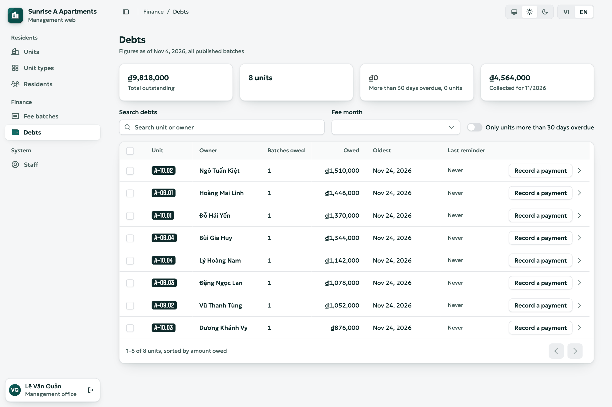
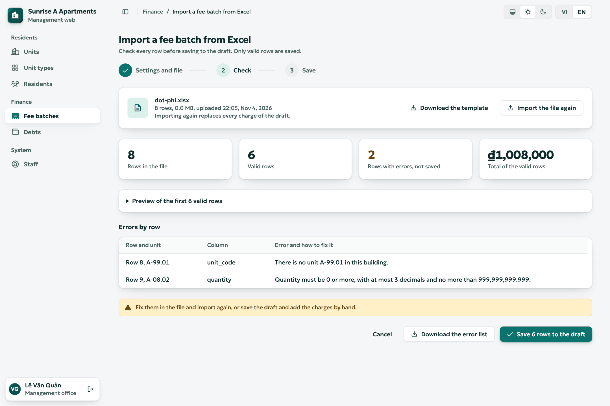
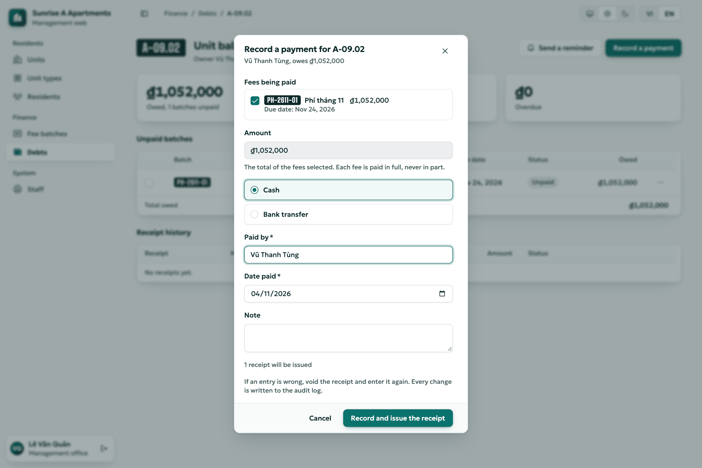
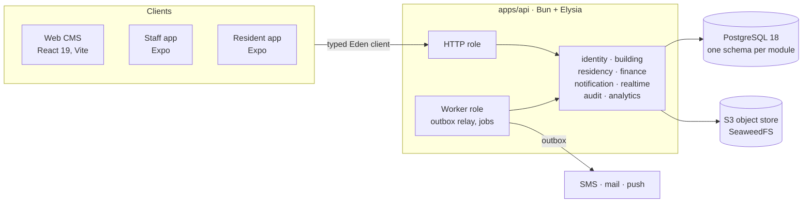

<div align="center">

# Residential Management System

**Run an apartment building in Vietnam, without ever settling a charge twice<br/>or losing sight of money that reached the bank.**


[Run it](#run-it) · [What works today](#what-works-today) · [Roadmap](#roadmap) · [Architecture](#architecture) · [Docs](#documentation) · [Contributing](#contributing)

<br/>

<a href="docs/assets/readme/debts-light.png">
  <picture>
    <source media="(prefers-color-scheme: dark)" srcset="docs/assets/readme/debts-dark.png">
    
  </picture>
</a>

</div>

## The hard part is the money

A building's fee charges get settled from independent sources at the same moment: a gateway that confirms twice, late or never; a Manager recording cash at the office; two people in one household paying together; a batch recalled while someone is paying. Most of the design exists to keep one statement true through all of that ([DOC-01 §3](docs/01-product/vision-and-scope.md)):

```text
NEVER SETTLE A CHARGE TWICE · NEVER LOSE SIGHT OF A TRANSFER

status(charge) = 'paid'  ⇔  exactly one live allocation of the full amount(charge)
amount(payment) = Σ live allocations(payment)
```

A charge is paid in full or not at all. Money that doesn't fit (short, over, duplicate or wrong) never enters the ledger: it becomes a row in the money log for the Manager to check by hand.

The tests hold it to that on real PostgreSQL 18:

| Scenario | Result |
| --- | --- |
| 500 charges, a manual and an online payment racing on each (`LG-14`) | One winner per charge, the loser logged |
| 8 sessions, 10,000 attempts locking charges in opposite orders (`LG-15`) | 0 deadlocks, invariants clean |
| Two publishes of the same 240-charge batch at once (`LG-61`) | One publication |
| 100 receipts issued concurrently (`LG-17`) | Unique, gapless numbers |
| 19 corruptions injected against the nightly invariant check (`K01…K19`) | Each fires exactly the expected checks, 0 rows on clean data |

The online side of these runs on test-built confirmations for now, because the real gateway driver comes later in this phase (P2-21).

## What works today

| | Works today | Still to come |
| --- | --- | --- |
| **Web CMS**<br/>for the management board | Units, unit types, residents and staff, Excel import, building settings. Fee batches: import, publish, extend, close, recall, re-issue. Manual payments, receipts and voids, debts with aging, push reminders, fee notice PDFs | Online transactions, tickets, notices, vehicles, library, dashboard, exports |
| **Resident app**<br/>for owners, family, tenants, helpers | Phone OTP sign-in, terms, switching between units | See and pay fees, requests, notices, access QR, vehicles, documents |
| **Staff app**<br/>for Manager, technicians, guards | Sign-in and the app shell | Tickets on site, QR scan, resident and vehicle lookup |

One deployment serves one building, and every screen is bilingual (Vietnamese and English).

<table>
  <tr>
    <td width="50%">
      <a href="docs/assets/readme/import-light.png">
        <picture>
          <source media="(prefers-color-scheme: dark)" srcset="docs/assets/readme/import-dark.png">
          
        </picture>
      </a>
      <br/><sub><b>Excel import.</b> Every row is checked first, and each error says how to fix it.</sub>
    </td>
    <td width="50%">
      <a href="docs/assets/readme/payment-light.png">
        <picture>
          <source media="(prefers-color-scheme: dark)" srcset="docs/assets/readme/payment-dark.png">
          
        </picture>
      </a>
      <br/><sub><b>Recording a payment.</b> Each fee is paid in full, and a wrong entry is voided, never edited.</sub>
    </td>
  </tr>
</table>

## Run it

You need macOS 14+ or Linux (Windows through WSL 2), Docker with Compose v2, and [mise](https://mise.jdx.dev) or [asdf](https://asdf-vm.com) for the versions in `.tool-versions`.

```sh
git clone git@github.com:ninggiangboy/residential-management-system.git
cd residential-management-system
mise install    # or: asdf install
bun run setup   # install, .env.local, infrastructure, migrations, demo seed (safe to re-run)
bun run dev     # API, web CMS, resident app, staff app; `bun run dev api web` for just those
```

Open **http://localhost:5173** and sign in as `manager@demo.rms.invalid` with `demo-password-1`.

The demo building (DEMO-A: 240 units, 4 staff, 8 residents) has no fee batches yet, so use **Fee batches → Import a batch** to see the finance screens.

<details>
<summary><b>All demo accounts</b></summary>

<br/>

| Role | Sign-in | Secret |
| --- | --- | --- |
| Admin | `admin@demo.rms.invalid` | `demo-password-1` |
| Manager | `manager@demo.rms.invalid` | `demo-password-1` |
| Technician | `technician@demo.rms.invalid` | `demo-password-1` |
| Guard | `guard@demo.rms.invalid` | `demo-password-1` |
| Resident | `+12025550101` | OTP `123456` (demo accounts only; no SMS is sent) |

</details>

<details>
<summary><b>Local services and ports</b></summary>

<br/>

All ports bind to `127.0.0.1`. Move a taken one in `.env.local` (for example `RMS_PG_PORT=5433`).

| Service | Address | Started by |
| --- | --- | --- |
| API | http://localhost:3000 (ops `:3001`: `/health/ready`, `/metrics`) | `dev` |
| Web CMS | http://localhost:5173 | `dev` |
| Resident app / staff app (Metro) | `:8081` / `:8082` | `dev` |
| PostgreSQL 18.6 | `:5432` | `infra:up` |
| SeaweedFS (S3 API, file browser) | `:9000`, http://localhost:9001 | `infra:up` |
| Mailpit (SMTP, inbox) | `:1025`, http://localhost:8025 | `infra:up` |
| Grafana | http://localhost:3030 | `monitor:up` |
| Prometheus, Alertmanager | http://localhost:9090, http://localhost:9093 | `monitor:up` |

</details>

<details>
<summary><b>Everyday commands and tests</b></summary>

<br/>

| Task | Command |
| --- | --- |
| Every CI `verify` check | `bun run check` |
| Stop the dev servers | `bun run stop` |
| Apply / generate migrations | `bun run db:migrate` / `bun run db:generate` |
| Rebuild the schemas and reseed (`local`, `test` only) | `bun run db:reset` |
| Stop the containers, keep the data | `bun run infra:down` |
| ⚠️ **Delete** the local database and object store | `bun run infra:reset` |

| Suite | Command | Needs |
| --- | --- | --- |
| Unit | `bun run test` | Nothing |
| Integration, grants, authorization matrix | `bun run test:integration` · `test:grants` · `test:authz` | `infra:up`, `.env.local` |
| Web end-to-end | `bun run test:e2e` | `infra:up`, Chromium, port 5173 free |
| Mobile flows | `bun run test:mobile` | Maestro, a simulator, the API and Metro |
| Deployment files | `bun run check:deploy` | Docker |

Run one file with `bun test <path>`, and one test by adding `-t '<pattern>'`. [DOC-69 §5](docs/09-operations/local-dev.md) lists every target.

</details>

## Roadmap

The project is **docs-first**: requirements, data models, API contracts and test plans are approved before the code that implements them. The [master plan](docs/00-master-plan.md) gives every task (`Pn-xx`) its acceptance criteria.

| | Phase | Scope |
| --- | --- | --- |
| ✅ | **P0** Specification | Decision register, Phase 1 documents |
| ✅ | **P1** Foundation | Runtime, identity, building, residency, audit, app shells, CI. *Still open: the staging host, SMS and mail providers, the SMS abuse experiment* |
| 🚧 | **P2** Fees and payment | **Built:** ledger, `settle()`, recall and void, receipts, debts, invariant checks, notifications, PDFs, finance API and web screens.<br/>**Next:** resident fee screens, then online payment |
| | **P3** Reconciliation | Bank statement import and matching |
| | **P4** Operations | Tickets, notices, household management |
| | **P5** Access and content | QR codes, vehicles, document library |
| | **P6** Release | Dashboard, exports, hardening, production |

Online payment starts with Stripe Checkout behind a swappable gateway port, so VNPay or VietQR can follow as drivers rather than a rewrite. Stripe is for sandbox, staging and demo until real-money use is settled ([DR-325](docs/00-decision-register.md), [ADR-0029](docs/04-adr/README.md)).

## Architecture

A **modular monolith**. `apps/api` installs every business module and runs as an HTTP server, a background worker, or both. Each module owns one PostgreSQL schema and reaches the others only through published contracts.



These rules fail the build or the review rather than relying on discipline ([DOC-12](docs/03-architecture/code-architecture.md)):

- **Race-safe by construction.** A contested transition is one conditional `UPDATE … RETURNING`; zero rows is a typed `409`, and each has a barrier race test.
- **Nothing half-happens.** A change, its events and its audit row commit in one transaction. SMS, mail and push leave through an outbox, never from inside it.
- **Building scope on every query.** It comes from the token or membership, never the request body, and an AST lint checks every query on a scoped table.
- **Boundaries are enforced.** dependency-cruiser rejects a cross-module import that skips `contracts`, a client importing server code, or a domain importing a driver.
- **Pure domain.** `domain` has no I/O and takes time from a `Clock` port. Amounts use `Money`, and days use `LocalDate` against the building's own "today".

<details>
<summary><b>Modules</b></summary>

<br/>

| Module | Owns |
| --- | --- |
| `identity` | Staff login with lockout, invites and step-up; resident phone OTP; refresh-token families; terms gate |
| `building` | Building settings and terms, encrypted gateway configuration, file uploads with quotas |
| `residency` | Units and unit types, residents, memberships, ownership transfer, Excel import |
| `finance` | Fee batches, charges, allocations, payments, receipts, the money log, debts, PDFs, invariant checks |
| `notification` | Inbox, device tokens, Expo push |
| `realtime` | Server-sent events for the web CMS |
| `audit` | Append-only audit log, written in the same transaction as each change |
| `analytics` | Self-hosted usage analytics with no account or device id |

</details>

<details>
<summary><b>Tech stack</b></summary>

<br/>

Versions are exact and the latest stable when adopted; [DOC-11](docs/03-architecture/tech-stack-and-versions.md) records each pin with its source.

| Layer | Technologies |
| --- | --- |
| Runtime | Bun 1.4, TypeScript 7 (Node 24 for tooling) |
| API | Elysia 1.4, Drizzle ORM 0.45, PostgreSQL 18.6, pino, OpenTelemetry, prom-client |
| Web CMS | React 19, Vite 8, TanStack Router and Query, Tailwind CSS 4, Radix UI |
| Mobile | Expo SDK 58 (React Native, New Architecture), Expo Router, NativeWind 4.2 |
| Storage and mail | SeaweedFS (S3 API), Mailpit locally |
| Quality | Biome, dependency-cruiser, knip, jscpd, `bun test`, Playwright, Maestro |
| Security | Trivy, Semgrep, Gitleaks, Dependabot |
| Operations | Docker Compose, Caddy, pgBackRest, Prometheus, Alertmanager, Loki, Alloy, Grafana, GitHub Actions |

</details>

<details>
<summary><b>Repository layout</b></summary>

<br/>

```text
apps/
  api/             composition root: HTTP server and worker
  cms-web/         web CMS for the management board
  resident-app/    Expo app for residents
  staff-app/       Expo app for staff
modules/           business modules (@mod/*), one PostgreSQL schema each
packages/
  core-*/          vendored infrastructure (@core/*): auth, config, db, http, messaging, storage, telemetry…
  shared-types/    ids, statuses, error codes, Money, time helpers
  client-core/     the clients' typed fetcher: refresh, retries, query keys
  mobile-core/     shared logic of the two Expo apps
  ui-native/       shared mobile components
  i18n-catalog/    vi/en message catalog
  design-tokens/   colors, type and spacing for web and mobile
  pdf-assets/      fonts and primitives for receipts and fee notices
docs/              product, architecture, data, design, API, UX, operations and testing documents
docker/            compose files (local, staging, production), the API image
ops/               deploy, Caddy, backups, PostgreSQL, monitoring and alerting configuration
scripts/ tools/    setup and check scripts; custom lints, dependency-cruiser, compatibility checks
```

</details>

## Documentation

| | |
| --- | --- |
| **[Document index](docs/README.md)** | Every document (`DOC-xx`) and its status |
| **[Master plan](docs/00-master-plan.md)** | Phases, tasks, acceptance criteria, traceability |
| **[Decision register](docs/00-decision-register.md)** | Every design decision (`DR-xx`) with its options and outcome |
| **[ADRs](docs/04-adr/README.md)** | Architecture decision records |
| **[Design canvas](docs/references/design-canvas/README.md)** | The reference for screen layout and UX |
| **[Original SDD](residential-management-sdd.md)** | The system design it all started from |

New to the code? Read [code architecture](docs/03-architecture/code-architecture.md) → [local development](docs/09-operations/local-dev.md) → [system context](docs/03-architecture/system-context-and-containers.md) → [CI/CD](docs/09-operations/ci-cd.md).

Code, comments, scripts and CI cite these IDs (`DOC-12 §6.2`, `DR-233`, `P1-04`), so every behavior traces back to the document or decision behind it.

## Contributing

- **Branches.** `dev` is the trunk. Use short branches and merge with `bun run pr:merge <n>`, which rebases (never squashes) and refuses unless `gate` is green and the branch is up to date.
- **Commits.** Subjects and PR titles follow `<type>(<scope>)?!?: <summary>`, up to 100 characters, checked by `bun run check:commits`.
- **Docs with code.** Change the documents in the same pull request: config keys in DOC-41, metrics in DOC-40, error codes in DOC-42 with copy in DOC-68. A change to an approved document needs a decision (`DR-xx`).
- **In the UI.** Text goes through the `vi`/`en` catalog and colors come from `@rms/design-tokens`, never literals. Screens follow the quality bar of [DOC-54 §17](docs/08-ux-ui/design-system.md).
- **Dependencies.** Exact versions, the latest stable release, at least 7 days old, recorded in DOC-11.

[`CLAUDE.md`](CLAUDE.md) has the full rules reviewers enforce.

<br/>

<div align="center"><sub>Private repository. All rights reserved.</sub></div>
