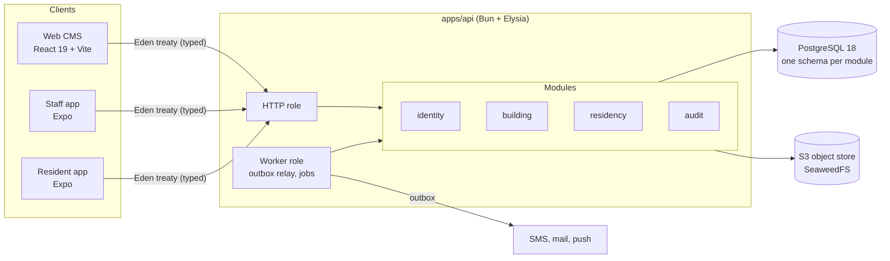

# Residential Management System

A platform for a property management company to run an apartment building in Vietnam: units and residents, fees and online payment, support tickets, notices, vehicles, resident access codes and a document library, for both the management board and the people who live there.


## Table of contents

- [Overview](#overview)
- [Features](#features)
- [Architecture](#architecture)
- [Tech stack](#tech-stack)
- [Project status](#project-status)
- [Getting started](#getting-started)
- [Development](#development)
- [Testing](#testing)
- [Repository layout](#repository-layout)
- [Documentation](#documentation)
- [Contributing](#contributing)

## Overview

One deployment serves one building. A single API backs four clients:

| Client | Users | Purpose |
| --- | --- | --- |
| **Web CMS** (`apps/cms-web`) | Admin, Manager (the management board) | Configure the building, manage units and residents, import data, publish fees and notices, reconcile payments |
| **Staff app** (`apps/staff-app`) | Manager, technicians, guards | Handle tickets on site, check resident access codes and vehicles |
| **Resident app** (`apps/resident-app`) | Owners, family members, tenants, helpers | Pay fees by VietQR, open tickets, read notices, show an access QR code |
| **API** (`apps/api`) | All clients; also runs the background worker | Business rules, persistence, jobs, outbox delivery |

The interface is bilingual (Vietnamese and English) throughout.

## Features

| Area | Scope | Phase |
| --- | --- | --- |
| Identity | Staff password login with lockout, invites and step-up; resident phone OTP; refresh-token families; terms gate | P1 ✅ |
| Building | Building settings, terms, encrypted gateway configuration, file uploads with quotas | P1 ✅ |
| Residency | Units, residents, memberships and capabilities, ownership transfer, Excel import of units and owners | P1 ✅ |
| Audit | Append-only audit log written in the same transaction as each change, secrets masked | P1 ✅ |
| Fees | Fee batches, ledger, allocation, debts, receipts, money log, nightly invariant checks | P2 |
| Payments | Online payment through payOS (VietQR), hardened webhooks, re-query of lost payments, bank statement reconciliation | P3 |
| Operations | Support tickets, notices, household management, push notifications | P4 |
| Access and content | Resident QR codes, vehicles, document library | P5 |
| Reports | Dashboard, exports, release hardening | P6 |

## Architecture

The backend is a **modular monolith**. `apps/api` is the composition root: it installs every business module and runs as an HTTP server, a background worker, or both. Each module owns one PostgreSQL schema and talks to other modules only through its published contracts.



Key principles (detailed in [DOC-12](docs/03-architecture/code-architecture.md)):

- **Layered modules.** `domain` (pure: no I/O, time from a `Clock` port) → `application` (use cases and ports) → `infrastructure` / `presentation` (Drizzle, Elysia). One command per file, reads in query services.
- **Enforced boundaries.** dependency-cruiser rejects a cross-module import that skips `contracts`, a client that imports server code, or a domain that imports a driver.
- **Building scope on every query.** The scope comes from the token or membership, never from the request body; a custom AST lint checks every query on a scoped table.
- **Race-safe state changes.** A contested transition is one conditional `UPDATE … RETURNING`; zero rows is a typed `409`. Every such update has a barrier race test.
- **Transactional outbox.** A change, its events and its audit row commit together; side effects (SMS, mail, push) leave through the outbox, never from inside a transaction.
- **Typed clients.** The clients import only the API's type (`import type { App }`) for an end-to-end typed Eden client.

## Tech stack

Every version is exact and the latest stable release when adopted; [DOC-11](docs/03-architecture/tech-stack-and-versions.md) records each pin with its source and verification date.

| Layer | Technologies |
| --- | --- |
| Runtime and language | Bun 1.4, TypeScript 7 (Node 24 for tooling) |
| API | Elysia 1.4, Drizzle ORM 0.45, PostgreSQL 18.6, pino, OpenTelemetry, prom-client |
| Web CMS | React 19, Vite 8, TanStack Router and Query, Tailwind CSS 4, Radix UI |
| Mobile | Expo SDK 58 (React Native, New Architecture), Expo Router, NativeWind 4.2 on Tailwind 3.4 |
| Storage and mail | SeaweedFS (S3 API), Mailpit locally |
| Quality | Biome, dependency-cruiser, knip, jscpd, `bun test`, Playwright, Maestro |
| Security | Trivy, Semgrep, Gitleaks, Dependabot |
| Operations | Docker Compose, Caddy, pgBackRest, Prometheus, Alertmanager, Loki, Alloy, Grafana, GitHub Actions |

## Project status

The project is built **docs-first**: requirements, data models, API contracts and test plans are written and approved before the code that implements them.

| Phase | Name | Status |
| --- | --- | --- |
| P0 | Specification | ✅ Done: decision register and every Phase 1 document approved |
| P1 | Foundation | 🚧 Nearly done: see below |
| P2 | Fees ledger | Planned |
| P3 | Online payment | Planned |
| P4 | Operations | Planned |
| P5 | Access and content | Planned |
| P6 | Reports, hardening, release | Planned |

**Phase 1 delivered so far:** the API runtime (config, health, messaging, jobs, idempotency, metrics), the `audit`, `building`, `identity` and `residency` modules, the authorization matrix tests, the web CMS shell, both mobile app shells with Maestro flows, the demo building seed and reset, the CI pipeline, and the staging deployment files (verified on Docker).

**Still open in Phase 1:** the staging host itself (P1-20), the SMS and mail provider adapters (P1-22, waiting on the provider choice), and the SMS abuse experiment on staging (P1-23).

The [master plan](docs/00-master-plan.md) §5 tracks every task (`Pn-xx`) with its acceptance criteria.

## Getting started

### Prerequisites

- macOS 14+ or Linux (Windows through WSL 2)
- Docker with Compose v2
- Git 2.40+
- [mise](https://mise.jdx.dev) or [asdf](https://asdf-vm.com) for the versions pinned in `.tool-versions` (Bun 1.4.3, Node 24.22.0)
- Optional: [uv](https://docs.astral.sh/uv/) for the design-token font test, [Maestro](https://maestro.mobile.dev) for mobile flows

### Install and run

```sh
git clone git@github.com:ninggiangboy/residential-management-system.git
cd residential-management-system
mise install          # or: asdf install
bun run setup         # tools check, install, .env.local, infrastructure, migrations, demo seed
bun run dev           # API, web CMS, resident app and staff app
```

`bun run setup` is idempotent: run it again at any time. `bun run dev api web` starts only the named apps; `bun run stop` stops them.

### Demo accounts

The seed creates the demo building **DEMO-A** with 240 units, 4 staff and 8 residents ([DOC-69 §9](docs/09-operations/local-dev.md)).

| Role | Sign-in | Secret |
| --- | --- | --- |
| Admin | `admin@demo.rms.invalid` | `demo-password-1` |
| Manager | `manager@demo.rms.invalid` | `demo-password-1` |
| Technician | `technician@demo.rms.invalid` | `demo-password-1` |
| Guard | `guard@demo.rms.invalid` | `demo-password-1` |
| Resident | `+12025550101` | OTP `123456` (demo accounts only; no SMS is sent) |

### Local services

All ports bind to `127.0.0.1` only.

| Service | URL / port | Started by |
| --- | --- | --- |
| API | http://localhost:3000 (ops: `:3001` for `/health/ready`, `/metrics`) | `bun run dev` |
| Web CMS | http://localhost:5173 | `bun run dev` |
| Resident app / staff app (Metro) | `:8081` / `:8082` | `bun run dev` |
| PostgreSQL 18.6 | `:5432` | `bun run infra:up` |
| SeaweedFS (S3 API, file browser) | `:9000`, http://localhost:9001 | `bun run infra:up` |
| Mailpit (SMTP, inbox) | `:1025`, http://localhost:8025 | `bun run infra:up` |
| Grafana | http://localhost:3030 | `bun run monitor:up` |
| Prometheus, Alertmanager | http://localhost:9090, http://localhost:9093 | `bun run monitor:up` |

A port that is taken can be moved in `.env.local` (for example `RMS_PG_PORT=5433`).

### Resetting

| Command | Effect |
| --- | --- |
| `bun run infra:down` | Stops the containers and keeps the data |
| `bun run db:reset` | Rebuilds every schema and reseeds the demo building (`local` and `test` only) |
| `bun run seed:demo` | Reseeds the demo building in place |
| `bun run infra:reset` | ⚠️ **Deletes** the local database and object store |

## Development

Run every command from the repository root.

```sh
bun run check          # every CI verify check in one go
bun run lint           # Biome (`bun run format` applies fixes)
bun run typecheck      # tsc in every workspace
bun run check:arch     # import boundaries (dependency-cruiser)
bun run check:scope    # building scope on every query
bun run check:layout   # module layout rules
bun run db:migrate     # apply migrations; `db:generate` writes new ones
bun run tokens:build   # regenerate the design tokens
```

Conventions that the checks and reviewers enforce:

- User-facing text goes through the `vi`/`en` catalog in `packages/i18n-catalog`, never a literal string.
- Colors come only from `@rms/design-tokens`; a Biome plugin rejects color literals elsewhere.
- Amounts use `Money`; calendar days use `LocalDate` against the building's own "today".
- Behavior is selected by `APP_ENV`, never `NODE_ENV`.
- Migrations are never edited after merge and stay backward compatible for one release.

The full list of targets, including those that later tasks add, is in [DOC-69 §5](docs/09-operations/local-dev.md).

## Testing

| Suite | Command | Needs |
| --- | --- | --- |
| Unit | `bun run test` | Nothing |
| Integration | `bun run test:integration` | `infra:up`, `.env.local` |
| Database grants | `bun run test:grants` | `infra:up`, `.env.local` |
| Authorization matrix | `bun run test:authz` | `infra:up`, `.env.local` |
| Web end-to-end | `bun run test:e2e` | `infra:up`, Chromium, port 5173 free |
| Mobile flows | `bun run test:mobile` | Maestro, a simulator, the API and Metro |
| Deployment files | `bun run check:deploy` | Docker |

Run one file with `bun test <path>` and one test with `-t '<pattern>'`. Each integration test file runs against its own clone of a migrated template database. The test method and ID prefixes are in [DOC-88](docs/10-testing/test-strategy.md).

## Repository layout

```text
apps/
  api/            composition root: HTTP server and worker
  cms-web/        web CMS for the management board
  resident-app/   Expo app for residents
  staff-app/      Expo app for staff
modules/          business modules (@mod/*), one PostgreSQL schema each
  audit/  building/  identity/  residency/
packages/
  core-*/         vendored infrastructure (@core/*): auth, config, db, http, messaging, storage, telemetry…
  shared-types/   ids, statuses, error codes, Money, time helpers
  client-core/    the clients' typed fetcher: refresh, retries, query keys
  i18n-catalog/   vi/en message catalog
  design-tokens/  colors, type and spacing for web and mobile
  mobile-core/    ui-native/   shared mobile logic and components
docs/             product, architecture, data, design, API, UX, operations and testing documents
docker/           compose files (local, staging, production), the API image
ops/              deploy, Caddy, backups, PostgreSQL, monitoring and alerting configuration
scripts/          setup, checks, database and release helpers
tools/            custom lints (scope, audit, layout, Biome plugins), dependency-cruiser, compatibility checks
```

## Documentation

| Document | Contents |
| --- | --- |
| [`residential-management-sdd.md`](residential-management-sdd.md) | The original system design (SDD) |
| [`docs/00-master-plan.md`](docs/00-master-plan.md) | Every document, phase and task with acceptance criteria and traceability |
| [`docs/00-decision-register.md`](docs/00-decision-register.md) | Every design decision (`DR-xx`) with its options and outcome |
| [`docs/README.md`](docs/README.md) | Index of the project documents (`DOC-xx`) and their status |
| [`docs/04-adr/`](docs/04-adr/README.md) | Architecture decision records |

Recommended reading for a new developer:

1. [Code architecture](docs/03-architecture/code-architecture.md) (DOC-12)
2. [Local development](docs/09-operations/local-dev.md) (DOC-69)
3. [System context and containers](docs/03-architecture/system-context-and-containers.md) (DOC-07)
4. [CI/CD](docs/09-operations/ci-cd.md) (DOC-71)
5. [Tech stack and versions](docs/03-architecture/tech-stack-and-versions.md) (DOC-11)

Code, comments, scripts and CI cite these IDs (`DOC-12 §6.2`, `DR-233`, `P1-04`) so that every behavior traces back to the document or decision behind it.

## Contributing

- **Branching.** `dev` is the trunk. Work on short-lived branches; merge with `bun run pr:merge <n>`, which rebases (never squashes) and refuses unless the `gate` check is green and the branch is up to date.
- **Commits.** Subjects and PR titles follow `<type>(<scope>)?!?: <summary>` (at most 100 characters); `bun run check:commits` validates them. Scopes are module names or `api`, `web`, `resident-app`, `staff-app`, `core`, `db`, `runtime`, `shared`, `ops`, `docs`, `deps`.
- **CI.** Every pull request runs `verify`, `unit`, `integration`, `security`, `build` and `e2e-web`; `gate` aggregates them. A push to `staging` (made with `bun run staging:push`) publishes the image and deploys.
- **Docs with code.** Change the documents in the same pull request as the behavior: config keys in DOC-41, metrics in DOC-40, error codes in DOC-42 with their copy in DOC-68. A change to an approved document needs a decision (`DR-xx`).
- **Dependencies.** Exact versions only, the latest stable release, at least 7 days old, recorded in DOC-11.

[`CLAUDE.md`](CLAUDE.md) has a denser summary of the rules that reviewers enforce.

---

Private repository. All rights reserved.
