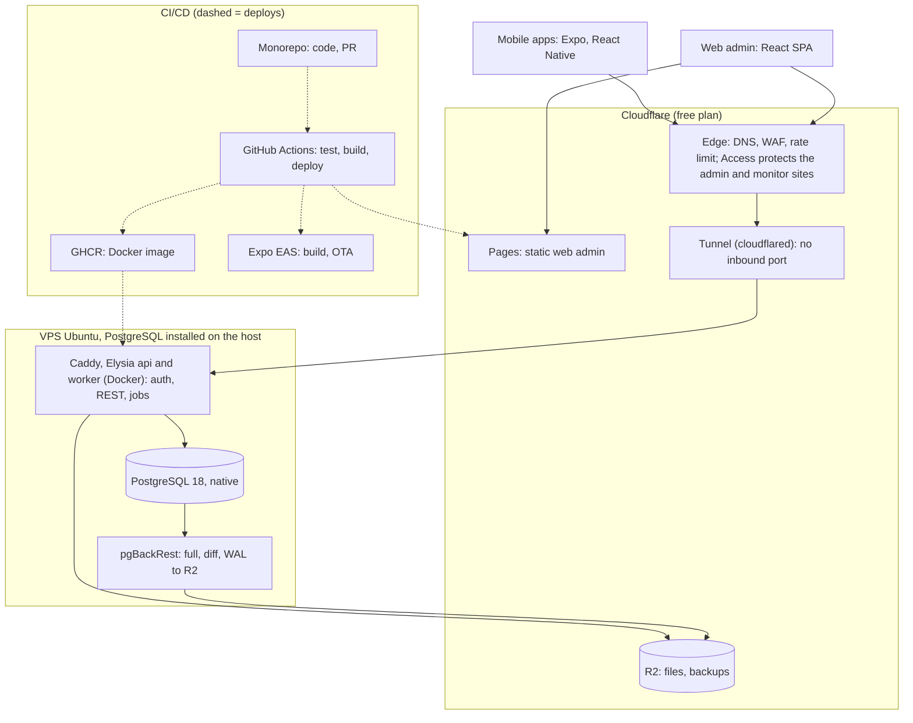

# Decision Register

> Status: **Review** · Updated: 2026-10-22 (DR-252, DR-253 added while running P1-07 and P1-08; DR-250 added while running P1-06; DR-249 added while running P1-05; DR-247, DR-248 added while running P1-04; DR-231…233 added while running P1-02 and P1-03; DR-91, 92, 96 decided; DR-68 providers not chosen yet; DR-226…228 added; DR-174…225 added with the P1 UX/UI documents; DR-157…173 added; DR-160, 171, 173 decided by the Owner 2026-10-20; DR-88 decided: `monitor.<domain>` behind Access; DR-151…156 added; DR-128…150 added; DR-246 added with the Git hooks; DR-243…245 added while writing DOC-15; DR-238…242 added while running P1-19; DR-247…237 added while running P1-09; DR-231…233 added while running P1-02 and P1-03; DR-91, 92, 96 decided; DR-68 providers not chosen yet; DR-226…228 added; DR-174…225 added with the P1 UX/UI documents; DR-157…173 added; DR-160, 171, 173 decided by the Owner 2026-10-20; DR-88 decided: `monitor.<domain>` behind Access; DR-151…156 added; DR-128…150 added; earlier: DR-124…127 added; spikes dropped; kit packages renamed core; DR-01…08 decided; DR-10…81 decided except DR-25…28, 30, 31, 34, 35; DR-17 and DR-42 decided) · Source: analysis of `residential-management-sdd.md` (the **original SDD**)

The original SDD is strong on the hard part: the money invariant, the arbiter row of every race (charge, `gateway_event`, ticket, nonce), the state machines, the options analyses and the experiments that prove them. It is thin on "exactly how" in the places that surround that core: the finance tables it does not list, the Excel and bank-statement formats, how the reference's kit packages are vendored (as `core-*`), the cross-module contracts that the module rule forces, the payOS facts it admits it does not know, the jobs and their schedules, time zones, personal-data handling, hosting, backup and the screens the design never drew. It also contains a few contradictions (transfer-content length, the audit transaction, the invalid-signature row, the 24-hour RPO against "never lose a payment", the `now()::date` aging query) that would surface as bugs if coded as written. Each gap below is one decision with one concrete proposal. The DRs that fix schemas, contracts and repository layout must be decided before any code.

**How to use**

- Each entry has a state: `Proposed` → (Owner reviews) → `Decided` or `Changed` (record the alternative).
- A decided entry is carried into its target documents (the *Write to* line). Architecture-level entries become ADRs in `docs/04-adr/`.
- **⚠ deviates from the original SDD**: the proposal differs from the SDD; the reason is given.
- Section references such as "SDD §6.4" mean the original SDD.

## Decision log

| Date | Decided by | Content | Affected items |
| --- | --- | --- | --- |
| 2026-10-18 | Owner | Documents in English (shipped vocabulary `locales/en.md`); code, UI strings, logs, API errors and commits in English. UI strings the product shows to residents come from the Vietnamese/English catalog (SDD §2.3) | All documents |
| 2026-10-18 | Owner | Use the latest stable versions of every stack, library and architecture; verify on the web (primary sources) before using anything from model memory; mobile follows the current Expo SDK on the New Architecture (DR-82) | DR-01, DR-70, DOC-11, master plan §0.4 |
| 2026-10-18 | Owner | Deployment topology: Cloudflare (Pages, Edge WAF/Access, Tunnel, R2) + one VPS per environment with Caddy, Elysia `api` and `worker` in Docker, PostgreSQL installed natively, pgBackRest to R2; GitHub Actions → GHCR, Pages and Expo EAS (DR-83) | DR-05…08, DR-58, DR-61, DR-64, DR-66, DR-67 |
| 2026-10-18 | Owner | Personal data leaving Vietnam through Cloudflare (edge, R2): record it in the docs and review later; proceed on DR-83 meanwhile. Review before real personal data is loaded, at the latest at go-live | DR-83, DR-58, P0-06, DOC-103 |
| 2026-10-18 | Owner | Small decisions made while writing documents may be taken by Claude and recorded as a DR with "Claude (delegated by Owner)". Architecture-level, money and access decisions stay with the Owner | docs-project skill, all DRs added later |
| 2026-10-18 | Owner | A charge is paid in full or not at all: no partial payment by any channel, no credit, no refund bookkeeping. The system records a payment only when the amount equals exactly the charges it settles; every other incoming money (short, over, duplicate, wrong, in instalments) is a log row for reconciliation that Manager handles outside the system. The log stays viewable (new screen and component) and a row can be marked reviewed with a note (DR-84) | DR-13…16, DR-17…19, DR-23, DR-24, DR-28, DR-29, DR-35, DR-72, DR-73, DR-76, DR-78, SDD §5.1, §5.4, §5.7 |
| 2026-10-18 | Owner | Webhook and settlement: DR-32 accepted as proposed (`gateway_event` takes only authenticated confirmations, failures go to `webhook_rejection`); a call from an unknown payOS IP is logged, never blocked, and the HMAC signature is the only gate; an intent stays `pending` on a transfer of another amount and the status endpoint returns `unmatchedTransfer {amount, receivedAt}`; an exact-amount confirmation for an `expired`, `cancelled` or `cancelling` intent with all charges still `open` is posted | DR-29, DR-32, DR-39, DR-72, DR-84 item 8 |
| 2026-10-18 | Owner | Identity: DR-36…39 accepted as proposed with three changes. (1) Step-up for sensitive staff actions: password re-entry plus a one-time code mailed to the Admin (6 digits, 10 minutes, single use) to change the gateway configuration or receiving account, create or promote an Admin, or change a staff email; every success notifies every Admin by email and inbox; no TOTP in phase 1. (2) `resident_account.is_demo`: the fixed OTP `123456` works only for flagged accounts and the API refuses to boot in production if a flagged account belongs to a non-demo building. (3) Cookie wording: SPA and API are same-site, cross-origin | DR-33, DR-36, DR-37, DR-38, DR-39, DR-42, DR-53, DR-60, DR-73, DOC-26, EXP-10 |
| 2026-10-18 | Owner | Time zone (DR-09) accepted as proposed. Audit (DR-57) accepted as proposed plus: webhook and re-query settlement writes an audit row with `actor_kind = 'system'`; a PII read by export is one `pii.read` row per export with the record count; retention periods (5 years finance, 2 years others) to be confirmed in the legal dossier P0-06 and ledger tables are never deleted | DR-09, DR-57, P0-06 |
| 2026-10-19 | Owner | Correcting a wrong charge: a new action **void a single open charge** (Manager/Admin, reason of at least 5 characters, audited, no payment on it; intents holding it are cancelled as a whole; a corrected charge is issued in a new batch). The **negative adjustment line is kept** (offset a paid overcharge in a later batch, discounts and waivers, reason shown on the bill). A refund note on a payment is not added; a paid overcharge is refunded outside the system | DR-19, DR-20, DR-42, DR-53, DR-73 |
| 2026-10-19 | Owner | Spikes dropped: "the project does not need spikes, remove them all". S-01…S-09 and tasks P0-08…P0-16 are removed (the identifiers stay defined in the master plan, table "Dropped spikes"). Each question is absorbed as acceptance criteria or a first step of the task that needs it: S-01 → verified against the gateway sandbox when the Owner reports one (none: fake driver plus one real minimum-amount payment before go-live, P6-09); S-02 → P1-01/P1-02 (fallback: previous stable of that one package, or Expo as a second workspace root); S-03 → P2-13 and EXP-08; S-04 → race tests of P2-03 and the EXP-03 task; S-05 → P1-07; S-06 → an Owner/client decision in DR-68 before P1-10; S-07 → client input at the start of P3 (generic profile until then); S-08 → P4-05; S-09 → P1-20 and the EXP-12 restore drill. The 🔬 marker is removed from the register | DR-01, DR-12, DR-14, DR-25, DR-34, DR-39, DR-41, DR-50, DR-56, DR-61, DR-67, DR-68, DR-70, DR-81, DR-82, DR-83, master plan §0.2, §4, §5 |
| 2026-10-19 | Owner | Reference packages are copied (vendored), DR-02 confirmed, and renamed: every `kit-*` package becomes `core-*` (directories `packages/core-<name>`, scope `@core/*`), `packages/KIT_VERSION` becomes `packages/CORE_VERSION`, the sync commit scope becomes `chore(core): sync <sha>`, ADR-0003 is "Vendor the core packages; manual sync"; the mapping `reference kit-x → core-x` lives in DOC-12. Project scopes: `@core/*`, `@mod/*`, `@rms/*`, `@app/*` | DR-02, DR-04, DR-10, DR-71, DR-75, DR-77, ADR-0003, DOC-11, DOC-12, P1-02 |
| 2026-10-19 | Owner; Claude (delegated by Owner) | DR-03 and DR-04 accepted as proposed (DR-04 with the `@core/*` scope). DR-08 kept as is for now, to be revisited later. DR-05, DR-06 and DR-07: the Owner said "as you see fit"; Claude rewrote them to the DR-83 topology (Caddy, `cloudflared`, `admin.<domain>`/`api.<domain>`, TLS at Cloudflare, one VPS per environment, native PostgreSQL 18) and merged the "Superseded" boxes | DR-03…08, DR-83 |
| 2026-10-19 | Owner | Conventions accepted as proposed: DR-10 (codes and counters; the receipt number stays gapless), DR-11 (money and rounding), DR-12 (standard columns, deletion rules, scope guard), DR-18 (debt, aging, collection rate), DR-22 (Excel templates; the Kind column is kept). DR-20 accepted: "close" is a manual Manager freeze for reporting only (charges stay payable, a closed batch cannot be recalled, no automatic close); a due-date extension (later date only, audited, residents notified) is the only edit of a published batch; the publish notification goes to active owner, family and tenants of a charged unit, not to helpers; re-issue creates a new draft with `replaces_batch_id`, `fee_month` and `due_date` editable; publish needs at least one charge, every charge total > 0 and `due_date >= buildingToday`; the void-single-charge action is part of DR-20 | DR-10, DR-11, DR-12, DR-18, DR-20, DR-22 |
| 2026-10-19 | Owner | Imports, option B (DR-21): the Excel file is validated **synchronously in the API** and the preview is stored in `import_job` for the commit step; the `validating` state, the outbox command `<module>.import_requested.v1`, the `import.progress` SSE event, the polling fallback and the relay-latency remark are removed; limits stay 5 MB and 5,000 rows; validation moves to the worker only if measurements demand it. NFR-12 measures from the accepted request to the response carrying the validated preview | DR-21, DR-42, DR-62, DR-75, DR-80, NFR-12, DOC-09, DOC-21, P1-13 |
| 2026-10-19 | Owner | Gateway secrets (DR-33), accepted with one change: `gateway_config` stores **one** AES-256-GCM encrypted JSON blob `secrets_enc` (`v1:<keyId>:<iv>:<ciphertext+tag>`) whose fields each driver defines, instead of three fixed columns; masking in the API and step-up to change the configuration or the receiving account are unchanged | DR-33, DOC-17, DOC-24, DOC-36, P1-07 |
| 2026-10-19 | Owner | Household and residency (DR-40…47): DR-41, 43, 44, 45, 46, 47 accepted as proposed (UI wording for "ticket" is "Yêu cầu"). DR-40 accepted with changes: **no limit** on memberships or helpers per unit (the 10 and 3 are dropped); the invitation SMS cap of 10 per day per owner stays as an abuse and cost guard; ownership transfer removes other members by default and Manager can opt out per transfer ("keep members"); **option B for history**: a resident always sees open charges of the unit and sees paid history, receipts and payer names only from the start of their own membership (one date filter on `membership.created_at`; Manager and Admin see all), carried into DR-73 and the owner terms text of DR-59 | DR-40, DR-41, DR-43…47, DR-17, DR-59, DR-73, DOC-27, DOC-35, DOC-51 |
| 2026-10-19 | Owner; Claude (correction to DR-53) | QR, vehicles, notices (DR-48…53) accepted as proposed. DR-48 option A: Guards see the owner's phone **masked** with a Call button (`tel:`), every view logged (`access.lookup_log`), NFR-14 reworded as in DR-48. DR-53: the template key `payment.short` is removed (no short payment is posted, DR-84); the resident sees a mismatched transfer only in the app (`unmatchedTransfer`), no push | DR-48…53, DOC-03 (NFR-14), DOC-31 |
| 2026-10-19 | Owner | Library, reports, PDF, privacy, building and files (DR-54…61): DR-55, 56, 58, 60 accepted as proposed (DR-57 stays as decided on 2026-10-18). DR-54 option B: **no stored `effective_visibility`**; the readers of a page (own `visibility_override`, else the nearest ancestor folder's `visibility`, depth ≤ 5) are computed at read time with one recursive query, search filters through the same expression, the subtree recompute is dropped. DR-59: the deletion cooling-off is the building setting `accountDeletionDays` (default 30), confirmed by the legal dossier P0-06, added to the DR-60 settings schema. DR-61 accepted with cleaned wording (title "presigned PUT", no SeaweedFS, HEIC converted by the client to JPEG) | DR-54…61, DOC-32, DOC-35, DOC-36, DOC-37, P1-07, P5-04, P6-04 |
| 2026-10-19 | Owner | Runtime and operations (DR-62…68): DR-62, 64, 65, 67, 68 accepted (DR-62 loses the `import_requested` override, DR-21 B; the `import_purge` job stays for the 30-day file retention and expired `import_job` rows; DR-67 wording cleaned, roles unchanged; DR-68: the Owner or client picks the SMS and mail providers before P1-10). DR-63 option B: **no Jaeger and no traces in phase 1** (request ids in logs); Prometheus + Alertmanager + Grafana + Loki; logs collected by **Grafana Alloy** because Promtail reached end of life on 2026-03-02 (Grafana Loki 3.4 blog; Alloy version pinned in P1-18 after verification); the OTLP trace export is removed. DR-66 accepted as in DR-83 (pgBackRest to R2, weekly `pg_dump`); the Owner declined a second copy outside Cloudflare and accepts that backups, files and the edge share one provider account (single-provider risk, recorded in DR-66 and DOC-72) | DR-62…68, DR-82, DR-05, DOC-40, DOC-70, DOC-72, P1-03, P1-18, P6-05 |
| 2026-10-19 | Owner | Clients and API (DR-69…75) accepted as proposed. DR-72: "restrict `W-Gateway` to payOS" becomes "to the chosen provider"; DR-75: the `import.progress` event is dropped (DR-21 B); DR-73 carries the history filter of DR-40 on `GET /me/fees/history` and `GET /me/receipts` | DR-69…75 |
| 2026-10-19 | Owner | Process and scope (DR-76…81): DR-76, 78 accepted as proposed. DR-77: coverage targets are **warnings only** in CI for every module (reported, never failing the build). DR-79: requirements FR-49 **void a single open charge** (DR-19, DR-20) and FR-50 **step-up for sensitive staff actions** (DR-39) are added; the range is FR-01…50. DR-80 accepted; NFR-12 measures to the response with the validated preview. DR-81 accepted: the member type "family" stays separate from "tenant"; the rows for owner transfer, closed batch and ticket deadlines point to DR-40, DR-20 and DR-47 as decided | DR-76…81, DR-19, DR-20, DR-39, DOC-03, DOC-88, DOC-71, master plan §1, §6 |
| 2026-10-19 | Owner | Receipts and e-invoices (DR-17, DR-42, DR-13): DR-17 and DR-42 accepted as proposed (one receipt per allocation; `ResidencyApi.getMembership` also returns `startedAt` for the history rule of DR-40). Legal risk resolved: the company issues an e-invoice only when a resident asks (request of type "Khác"), outside the system; the system does not manage e-invoices (no number, no table, no integration); the receipt is "Biên lai thu tiền / Payment receipt", not a tax invoice. Readiness hooks: complete snapshot, reserved nullable `finance.receipt.external_invoice jsonb`, event `finance.receipt_issued.v1`; no VAT fields, buyer tax details, invoice table or provider port now (a new migration at integration time) | DR-13, DR-17, DR-42, DR-40, DR-73, DOC-01, DOC-09, DOC-15, DOC-22, DOC-34, master plan §8 |
| 2026-10-19 | Owner | Master plan approved as v1.0 (task P0-01 done). Every P1-blocking DR is decided; DR-25, 26, 27, 28, 30, 31, 34, 35 stay open until the gateway sandbox and the bank statement sample arrive; DR-08 is to be revisited | Master plan, DR-25…35 |
| 2026-10-19 | Claude (delegated by Owner) | Added while writing DOC-07: DR-85 (`platform` schema belongs to the core packages), DR-86 (one object-key layout), DR-87 (contracts, an event and tables implied by decisions). DR-88 (operators reach Grafana by SSH port-forward) is proposed for the Owner | DR-36, DR-42, DR-55, DR-56, DR-59, DR-61, DR-63, DR-74, DOC-07 |
| 2026-10-19 | Claude (delegated by Owner) | Added while writing DOC-05: DR-89 (the proposal has 113 features, not 139; 124 in the catalog), DR-90 (Excel export of units and residents is an export-center kind). DR-91 (no Manager-created payment link) and DR-92 (no pinned favorites) are proposed for the Owner | DR-79, DR-55, DR-57, DOC-01, DOC-03, DOC-05 |
| 2026-10-19 | Claude (delegated by Owner) | Added while writing DOC-11 after re-verifying the versions on the web: DR-93 (pgBackRest from the PGDG apt repository), DR-94 (Expo-managed modules follow the SDK ranges), DR-95 (exact pins everywhere). DR-70 corrected: `expo-brightness` replaces the non-existent `expo-screen-brightness`; DR-82 table revised | DR-70, DR-82, DR-83, DOC-11 |
| 2026-10-19 | Claude (delegated by Owner) | Added while writing DOC-04: DR-97 (a recall counts the non-void charges of the batch; FR-04.2 updated). DR-96 (the resident sees `unmatchedTransfer` for every unposted outcome that leaves money received) is proposed for the Owner because it extends DR-84 item 8 | DR-19, DR-84, DR-20, DOC-03, DOC-04 |
| 2026-10-19 | Claude (delegated by Owner) | Added while writing DOC-12: DR-98 (`core-messaging` vendored without the privacy-participant protocol), DR-99 (guards built in the composition root, routes declare `audience`), DR-100 (`Money`, `LocalDate` and friends in `@rms/shared-types`) | DR-02, DR-03, DR-09, DR-11, DOC-12 |
| 2026-10-19 | Claude (delegated by Owner) | Added while writing DOC-10: DR-101 (job rows and processed messages are bounded; DR-62 revised), DR-102 (memory-overcommit rules and the staging database settings) | DR-06, DR-62, DOC-10 |
| 2026-10-19 | Claude (delegated by Owner) | Added while writing ADR-0013…0026: DR-103 (no third-party error tracker, stated explicitly); DR-63 revised: the per-job gauge is `job_last_success_timestamp{job}` | DR-58, DR-63, DR-101, ADR-0021, ADR-0022 |
| 2026-10-19 | Claude (delegated by Owner) | Added while writing DOC-14: DR-104 (the allow-list of the building-scope lint, reconciled; `realtime.events` is scoped), DR-105 (DDL mechanics: text + CHECK enumerations, `updated_at`/`version` set by the statement, bootstrap migration, no down migrations) | DR-12, DR-85, DOC-07, DOC-12, DOC-14 |
| 2026-10-19 | Claude (delegated by Owner) | Added while writing DOC-16: DR-106 (`resident_profile` keyed by `(building_id, account_id)`; DR-40 revised), DR-107 (staff `locked_until` vs `locked`), DR-108 (deletion workflow columns), DR-109 (`import_job` columns) | DR-12, DR-21, DR-36, DR-40, DR-59, DOC-16 |
| 2026-10-19 | Claude (delegated by Owner) | Added while writing DOC-17: DR-110 (audit columns, the trigger behind the privileges and the clamped purge), DR-111 (building settings: no `termsVersion`, defaults overlaid, write-once terms), DR-112 (platform tables: `file_object` account and stamps, `job_run`, the maintenance flag) | DR-33, DR-57, DR-59, DR-60, DR-61, DR-62, DR-74, DOC-14, DOC-17 |
| 2026-10-19 | Claude (delegated by Owner) | Added while writing DOC-19: DR-113 (database roles: attributes and settings, the grants step computed from nothing instead of default privileges, the denied tables and columns of `rms_readonly`, `rms_readonly` also the metrics user, `rms_backup` as a non-superuser with a fallback, `READONLY_DATABASE_URL`). DR-65 and DR-67 revised | DR-65, DR-67, DR-57, DOC-19 |
| 2026-10-19 | Claude (delegated by Owner) | Added while writing DOC-18: DR-114 (units and owners import: unit-code normalisation, blank cells, owner cells, phone metadata, ID number format, same-person test, fill-empty-only profiles, commit re-validation with `import_stale`, a preview without ID numbers, `IdentityApi.findResidentAccountsByPhones`, the hourly `import_expire` job). DR-22 and DR-62 revised | DR-21, DR-22, DR-62, DR-40, DR-58, DOC-18 |
| 2026-10-19 | Claude (delegated by Owner) | Added while writing DOC-20: DR-115 (default retention periods for the tables that have none, to be confirmed in P0-06; `terms_acceptance` IP nulled at account deletion; the daily `account_deletion` job). Owner decided the same day: tickets, vehicles, notices and the library are never deleted; one deployment serves one building | DR-57, DR-58, DR-59, DR-62, DR-87, DR-101, DOC-20 |
| 2026-10-19 | Claude (delegated by Owner) | Added while writing DOC-09: DR-116 (three events the template catalog needs: debt reminders, vehicle submitted, staff inbox created; due-date extension tells only units with an open charge; `staff.invited` dropped), DR-117 (commands carry ids not contacts; secrets encrypted with the settings key ring; stale commands skipped), DR-118 (payload rules, 64 KB cap, chunks of 500, retry classes with a per-type hook in the vendored relay), DR-119 (`FilesApi.signedUrl` and `storeGenerated`) | DR-42, DR-52, DR-53, DR-62, DR-87, DR-98, DR-101, DOC-09 |
| 2026-10-19 | Claude (delegated by Owner) | Added while writing DOC-38 and DOC-37: DR-120 (job catalog: unique names, three added jobs, hourly minutes, grace windows), DR-121 (the lock per transaction, no retry inside a slot, a 15 s scheduler tick, shutdown order), DR-122 (file delete and thumbnail are outbox commands of `building`; thumbnails are `file_object` rows), DR-123 (verification is an endpoint; MB is MiB; generated files bypass the quota refusal; `bulk_zip` 7 days) | DR-21, DR-55, DR-56, DR-61, DR-62, DR-73, DR-111, DR-115, DOC-37, DOC-38 |
| 2026-10-19 | Claude (delegated by Owner) | Added while writing DOC-35, DOC-36 and DOC-42: DR-124 (audit writer: declared actions, masked personal fields, limits and a bulk form, a closed list of system rows, `pii.read` per response and fail closed, the export row written at completion, who reads the log), DR-125 (terms gate with no cache, `/me/account/deletion` exempt, deletion cancel and the owner check at approval and execution, two contracts), DR-126 (one settings document with a composite ETag, `SecretBox` with a row-bound AAD, the active-intent port and row locks, stored step-up action names, environment feature flags, a restricted Markdown for terms, the demo seed, reset and boot guard), DR-127 (validation 400 and 422 by rule code, the open codes, SQLSTATE mapping, the failure-to-outcome mapping of handlers, logging rules, `POST /client-errors`) | DR-33, DR-37, DR-39, DR-57, DR-59, DR-60, DR-63, DR-74, DR-110, DR-111, DOC-35, DOC-36, DOC-42 |
| 2026-10-20 | Claude (delegated by Owner) | Added while writing DOC-26: DR-128 (staff sign-in answers: one body, no "tries left"; DOC-02 and DOC-04 revised), DR-129 (ten session-revocation reasons shared by the column and the event; DOC-16, DOC-09 and the JSON schema revised), DR-130 (cookie and body delivery of the refresh token), DR-131 (grace window mints a sibling), DR-132 (step-up: bound code, throttle, `database.autonomous` for failure counts), DR-133 (staff account rules: `last_admin`, no self lock, open-tickets probe), DR-134 (OTP order, demo challenge, rolling cap, provider-down rule), DR-135 (`IdentityApi` additions) | DR-36…39, DR-37, DR-60, DR-85, DOC-02, DOC-04, DOC-09, DOC-12, DOC-16, DOC-26, DOC-42 |
| 2026-10-20 | Claude (delegated by Owner) | Added while writing DOC-27: DR-136 (a profile is created with the first membership in a building), DR-137 (the invitation SMS only for owner adds, cap counted under an advisory lock), DR-138 (the unit `version` arbitrates a transfer; a promoted member keeps their row), DR-139 (membership edit rules: one change per request, owner row only by transfer, `can_pay` tenants only), DR-140 (`ResidencyApi.listActiveMemberships`, `buildingIdsOfAccounts`, `lookup`; `access` hosts the union lookup), DR-141 (editable unit code; history rows only across vacancy) | DR-22, DR-40, DR-41, DR-114, DOC-09, DOC-16, DOC-26, DOC-27 |
| 2026-10-20 | Claude (delegated by Owner) | Added while writing DOC-50, DOC-51 and DOC-46: DR-142 (the catalog E-01…E-168 and the test prefixes `AG-`, `FF-`, `FO-`, `FI-`, `FT-`, `FN-`, `FA-`), DR-143 (wire formats, gate order, idempotency details, `request_in_progress`), DR-144 (caching, 429 answers, compatibility, OpenAPI diff), DR-145 (public readiness and `GET /public/config`), DR-146 (`PATCH /me`, devices, repeated verify), DR-147 (staff account visibility, transitions, reasons, step-up order), DR-148 (gateway addressing, storage breakdown, check), DR-149 (imports by kind, `fileId`, 5,000-row 400, deletion filter), DR-150 (reset response floor, set-password status check) | DR-73, DR-74, DR-75, DR-127, DOC-18, DOC-26, DOC-27, DOC-35, DOC-36, DOC-37, DOC-38, DOC-42, DOC-43, DOC-46, DOC-50, DOC-51 |
| 2026-10-20 | Claude (delegated by Owner) | Added while writing DOC-39, DOC-40 and DOC-41: DR-151 (authorization matrix: input record, sixteen actors, expected outcome, output and failure conditions), DR-152 (security header values, the web CMS CSP `connect-src` corrected, the client-IP rule with `/64` bucket keys; DR-64 revised), DR-153 (scanner thresholds, `WEBHOOK_KNOWN_IPS`), DR-154 (metric label `job_name` because Prometheus owns `job`, backup gauge as a timestamp, DB gauges in every process with `max`, worker request id = correlation id, `prom-client`; DR-62, DR-63, DR-101 revised), DR-155 (job staleness table, traffic floors, delivery and silences, 20 added alerts), DR-156 (configuration conventions, 13 boot rules, `OPS_PORT`, `SC-`, `OB-`, `CF-`) | DR-32, DR-39, DR-62, DR-63, DR-64, DR-65, DR-101, DOC-38, DOC-39, DOC-40, DOC-41 |
| 2026-10-20 | Owner | DR-88 decided: option 2, with the host named `monitor.<domain>` (not `grafana.<domain>`) behind Cloudflare Access, instead of the SSH port-forward. DR-83 items 1 and 4 and DR-07 now list three public hosts per environment, Access in front of `admin` and `monitor` only; propagated to DOC-07, DOC-39, DOC-40, ADR-0020, ADR-0021 and the DOC-70 row of the master plan | DR-88, DR-83, DR-07, DR-63, DOC-07, DOC-39, DOC-40, DOC-70, ADR-0020, ADR-0021 |
| 2026-10-20 | Claude (delegated by Owner) | Added while writing DOC-69, DOC-70, DOC-71 and DOC-73 (P0-31): DR-157 (local targets, ports, Expo on Node, local role provisioning), DR-158 (host layout, release tarball, config hashes, secret file ownership, held upgrades), DR-159 (the one rate rule, WAF skip for the webhook, Access for `*.pages.dev`), **DR-160 proposed** (Bot Fight Mode off: it cannot be skipped on the free plan; the Owner confirms), DR-161 (profiles, staging without Loki, `deploy.sh` behavior, boot retry), DR-162 (cluster locale, backup timers), DR-163 (`gate`, blocking scans, e2e deploy gate, smoke test), DR-164 (a release promotes the staged image), DR-165 (two Pages projects, nightly race on a CI database), DR-166 (review rule, PR titles), DR-167 (independent apps, `.dev` identifier, EAS environments, push projects, compatibility), DR-168 (adoption metric) | DR-05, DR-06, DR-08, DR-65, DR-83, DR-88, DOC-69, DOC-70, DOC-71, DOC-73 |
| 2026-10-20 | Claude (delegated by Owner) | Added while writing DOC-88, DOC-98 and DOC-99 (P0-32): DR-169 (`TEST_` variables, `@rms/test-support`, `check:test-ids`, race profiles), DR-170 (how EXP-09 is run), DR-172 (EXP-10 mutants); **proposed for the Owner:** DR-171 (what "per hour" in NFR-07 means: the bucket allows 8 to 10 SMS per phone in an hour) and DR-173 (EXP-10 runs in CI, deviating from DR-78) | DR-77, DR-78, DR-151, NFR-07, DOC-88, DOC-98, DOC-99 |
| 2026-10-20 | Owner | DR-160 decided: option 1, Bot Fight Mode off for the whole zone. DR-171 decided: option (a), NFR-07 reworded to "a burst of 5, at most 10 in any hour" (IP: a burst of 20, at most 40). DR-173 decided: EXP-10 runs in CI (the `integration` job), not on staging; asked whether it must run on every pull request, it was answered that `test:authz` already does and nothing new is added | DR-78, DR-83, DR-159, DR-160, DR-171, DR-173, NFR-07, DOC-07, DOC-39, DOC-70, DOC-98, DOC-99 |
| 2026-10-20 | Claude (delegated by Owner) | Added while writing DOC-53 (P1 gate, quick pass because the design prototype exists): DR-174 (`/wrong-app` for the wrong client; navigation by phase), DR-175 (money screens never persisted; no offline write queue), DR-176 (web URL conventions: validated search parameters), DR-177 (deep links and push routing), DR-178 (responsive thresholds), DR-179 (planned client performance budget) | DOC-53, DOC-55, DOC-64…67, DOC-10, DOC-71, DOC-31 |
| 2026-10-20 | Claude (delegated by Owner) | Added while writing DOC-54: DR-180 (Geologica and Big Shoulders self-hosted; Be Vietnam Pro for PDFs only), DR-181 (**Phosphor** icons instead of Lucide, ⚠ revises DR-70), DR-182 (both themes ship, follow the OS), DR-183 (status presentation as one data table), DR-184 (accessibility floor), DR-185 (**token-styled charts, Recharts held back**, ⚠ revises DR-70), DR-186 (web CMS breakpoints), DR-187 (date input: calendar popover with a typed field) | DOC-54, DOC-11, DOC-55, DOC-64, DOC-66, DOC-68, ADR-0019 (note) |
| 2026-10-20 | Claude (delegated by Owner) | Added while writing DOC-55: DR-188 (`packages/client-core`; no `packages/ui-web`), DR-189 (token handling per platform; no sign-out on silence), DR-190 (server-state defaults; opt-in persisted cache), DR-191 (unit context rules), DR-192 (client error reporting throttle), DR-193 (push tap for another unit) | DOC-55, DOC-12, DOC-11, DOC-26, DOC-39, DOC-35, DOC-31 |
| 2026-10-20 | Claude (delegated by Owner) | Added while writing DOC-56: DR-194 (**no duplicated wireframes**, ⚠ master plan A.5), DR-195 (one test prefix per screen document; copy-key scheme), DR-196 (composite screens built per phase), DR-197 (**ticket wording: "Yêu cầu" for residents, "Phiếu" for staff**). The canvas has 110 artboards, not 115 (DR-72 revised) | DOC-56, DOC-57…67, DOC-68, DOC-88, glossary, master plan |
| 2026-10-20 | Claude (delegated by Owner) | Added while writing DOC-57, DOC-60 and DOC-61: DR-198…201 (unit switcher content, push explanation sheet, home built per phase, one Terms component), DR-202 (E-13 returns `cooloffDays`, `executeAfter`), DR-203 (`Contact` shows what E-15 returns), DR-204 (`Terms` view mode), DR-205 (`formatPhone`), DR-206 (no tries-left counter or policy numbers), DR-207 (no "open mail app" button), DR-208 (reset resend 45 s) | DOC-57, DOC-60, DOC-61, DOC-51, DOC-35, DOC-55, DOC-64, DOC-68 |
| 2026-10-20 | Claude (delegated by Owner) | Added while writing DOC-64, DOC-65 and DOC-67: DR-209 (no echoed email or absolute expiry), DR-210 (forgot-password dialog), DR-211 (`W-Profile` one page), DR-212 (fields E-57 and E-63 return for the list screens), DR-213 (`unitCode` in import issues; browser CSV), DR-214 (four member types on the add form), DR-215 (phone lookup shows no personal data), DR-216 (step-up dialog opens proactively and reactively), DR-217 (`W-Staff` counts), DR-218 (staff edit reuses the create dialog), DR-219 (`W-Building` one page) | DOC-64, DOC-65, DOC-67, DOC-51, DOC-18, DOC-27, DOC-35, DOC-53 |
| 2026-10-20 | Claude (delegated by Owner) | Added while writing DOC-68: DR-220 (rule codes share the `error.` namespace), DR-221 (one name per shared string), DR-222 (two ticket status families), DR-223 (formatter details), DR-224 (parity compares ICU arguments) | DOC-68, DOC-42, DOC-55, DOC-56, DOC-57, DOC-64, DOC-67 |
| 2026-10-21 | Claude (delegated by Owner) | DR-225: the session lists carry `client` (`web` \| `app`), a new `refresh_family.client` column; asked by the Owner ("ok theo đề xuất") | DOC-16, DOC-26, DOC-51, DOC-60, DOC-61, DOC-64 |
| 2026-10-21 | Owner | P1 gate review answers. DR-96, DR-91, DR-92 decided as proposed (`unmatchedTransfer` for `amount_short`, `amount_over`, `charge_already_paid`, `charge_recalled`; no Manager-created payment link; no pinned library favorites). DR-68: the SMS provider and the SMTP relay are not chosen yet; ports, `console`/`allowlist` drivers and Mailpit first, real adapters in P1-22 when the Owner picks (P1-10 no longer waits; M1 and P1-22 do). DR-226: `GET /staff/imports` is built as E-169 (catalog E-01…E-169). DR-227: M0 approval of DOC-69 does not wait for the dry run; it is the acceptance of P1-03. CI review rule (DOC-71 §11.1): "up to you, other people may join later", so DR-166 stands and the open question is closed. DR-228: documents hold placeholders, real Owner data is supplied only when the task that needs it starts, and DOC-70 §2 classifies each input | DR-68, DR-91, DR-92, DR-96, DR-166, DR-226, DR-227, DR-228, DOC-03, DOC-04, DOC-05, DOC-11, DOC-26, DOC-40, DOC-41, DOC-50, DOC-51, DOC-65, DOC-68, DOC-69, DOC-70, DOC-71, DOC-73, DOC-88, DOC-98, DOC-99, master plan |
| 2026-10-21 | Claude (delegated by Owner) | Added while running P1-01: DR-229 (NativeWind 4.2.7 supports only Tailwind CSS 3: the Expo apps pin `tailwindcss` 3.4.19, the web stays on 4.3.3), DR-230 (dependency-cruiser 18.7.0 needs TypeScript below 7: it runs from `tools/depcruise` with TypeScript 6.0.3, with a fixture suite). Both are the DOC-11 §11 rule 1 fallback; confirm | DR-70, DR-82, DR-229, DR-230, DOC-11, DOC-12, DOC-54, DOC-71 |
| 2026-10-21 | Claude (delegated by Owner) | Added while running P1-02 and P1-03: DR-231 (the local object store is SeaweedFS 4.48, bucket and CORS created by an `aws-cli` one-shot), DR-232 (core packages pinned to DOC-11; OpenTelemetry on the 2.12 line because `sdk-trace-node` rejects `api` 1.10; exports point at `src`), DR-233 (local infrastructure rules from the dry run: loopback ports, TCP healthcheck, superuser password, dotenv references, skipped steps, Node rule). Confirm | DR-02, DR-82, DR-95, DR-227, DR-231, DR-232, DR-233, DOC-11, DOC-12, DOC-69 |
| 2026-10-22 | Owner | Two vendored packages renamed so the name does not repeat: `core-core` → `core-kernel` (`@core/kernel`), `core-web-core` → `core-web` (`@core/web`); directories, imports, dependency-cruiser rules, arch fixtures and `packages/CORE_VERSION` follow | DR-02, DOC-12, P1-02 |
| 2026-10-22 | Claude (delegated by Owner) | Added while running P1-09: DR-234 (Tailwind 3.4.19 pinned at the root so the hoisted NativeWind resolves it; the rename to `apps/cms-web` had hoisted 4.3.3), DR-235 (flat ICU catalog per language with `intl-messageformat`, not the `@core/i18n` catalog; parity by argument kind, plain matches number; word formatters return a phrase), DR-236 (the five token outputs and their rules, Big Shoulders 800, `status.json` shape, icon registry in `design-tokens`), DR-237 (color-literal lint as a Biome GritQL plugin; DS-05 through `uv` and fontTools). Confirm | DR-02, DR-71, DR-82, DR-180…183, DR-224, DR-229, DOC-11, DOC-54, DOC-55, DOC-68, DOC-69 |
| 2026-10-22 | Owner; Claude (delegated by Owner) | Decided while running P1-19: DR-238 (Owner: Semgrep CE and Trivy licences replace CodeQL and dependency review, which need GitHub Code Security on a private repository), DR-239 (Owner: the trunk is `dev`; `main` is created as the production branch at the first release), DR-240 (pipeline mechanics: scanner images, `bun run check` with skipped targets, `gate` without `e2e-web`, `--omit=peer` in the image, line coverage only). Confirm DR-240 | DR-08, DR-77, DR-95, DR-153, DR-163, DR-164, DOC-11, DOC-39, DOC-69, DOC-71, DOC-88 |
| 2026-10-22 | Owner; Claude (delegated by Owner) | After P1-19: DR-241 (Owner: no GitHub Pro; `bun run pr:merge` enforces `gate` and the up-to-date rule, squash only by repository setting; changed to rebase by DR-251), DR-242 (Claude, asked by the Owner: npm versions resolve 7 days after release, Dependabot waits 7 days) | DR-82, DR-163, DR-166, DOC-11, DOC-69, DOC-71 |
| 2026-10-22 | Claude (delegated by Owner) | Added while writing DOC-15: DR-243 (ledger guard triggers: frozen columns, allowed transitions, no delete of ledger rows except in the demo reset, whose setting `rms.demo_reset` holds the demo building's id; DOC-36 §10.2 revised), DR-244 (the finance columns DR-13 leaves open, `receipt.pdf_file` instead of `pdf_key`, a required note on an adjustment line, `already_recorded` as an upload count, the order-code ceiling, per-building claims), DR-245 (`finance.fee_notice_job` for the bulk fee-notice requests). Confirm: the tables hold money | DR-13, DR-17, DR-19, DR-27, DR-30, DR-34, DR-56, DR-60, DR-120, DR-126, DOC-06, DOC-07, DOC-15, DOC-20, DOC-35, DOC-36, DOC-38, DOC-88 |
| 2026-10-22 | Claude (delegated by Owner) | DR-246 (local Git hooks with husky 9.1.7: staged Biome on `pre-commit`, the DOC-71 §11.2 subject on `commit-msg`, Gitleaks on `pre-push`; CI stays the gate) | DR-08, DOC-11, DOC-69, DOC-71 |
| 2026-10-21 | Claude (delegated by Owner) | Added while running P1-02 and P1-03: DR-231 (the local object store is SeaweedFS 4.48, bucket and CORS created by an `aws-cli` one-shot), DR-232 (core packages pinned to DOC-11; OpenTelemetry on the 2.12 line because `sdk-trace-node` rejects `api` 1.10; exports point at `src`), DR-233 (local infrastructure rules from the dry run: loopback ports, TCP healthcheck, superuser password, dotenv references, skipped steps, Node rule). Confirmed by the Owner the same day | DR-02, DR-82, DR-95, DR-227, DR-231, DR-232, DR-233, DOC-11, DOC-12, DOC-69 |
| 2026-10-21 | Claude (delegated by Owner) | Added while running P1-04: DR-247 (guards are `transform` hooks because Elysia validates a body before `beforeHandle`; route plugins use `normalize: false`; the error answer has no `requestId` in the body; CORS is written in `@core/http`), DR-248 (the boot order with the ops server before the 30 s database wait, the exit codes 78 and 1, where the configuration slices live, `/metrics` stays P1-18, `keys:generate --out` moves to P1-20, TypeScript runs from source); both to be confirmed | DR-74, DR-83, DR-127, DR-156, DR-161 |
| 2026-10-22 | Owner | DR-251 (pull requests are rebase-merged instead of squashed; changes DR-08, DR-166, DR-241) | DR-08, DR-166, DR-241, DOC-71, DOC-69 |
| 2026-10-21 | Claude (delegated by Owner) | Added while running P1-05: DR-249 (the job runtime and relay as built: `ctx.withLock` and `ctx.snapshot`, `SqlJobRunStore` in `@core/runtime`, `outboxPolicies` in the manifests, the shutdown order, `outbox:*` scripts without an audit row until P1-08, JB-16 at a smaller scale, JB-17 per job); to be confirmed | DR-62, DR-101, DR-118, DR-120, DR-121 |
| 2026-10-21 | Claude (delegated by Owner) | Added while running P1-06: DR-250 (the grants exceptions apply only to objects that exist, `scripts/migrate.ts` and its output, `db:reset` drops the schemas as the migrator, the permission tests are in `apps/api/tests/grants` with stand-in tables for the modules not written yet, the template builder applies the backup-function grants and a recipe version); to be confirmed | DR-67, DR-113, DR-77 |
| 2026-10-22 | Claude (delegated by Owner) | Added while running P1-07 and P1-08: DR-252 (the `building` module and files as built: the presigned `PUT` is signed by `@core/storage` itself because Bun's presigner does not sign `Content-Type`, `ObjectStorage` gains a ranged read, a streaming write and a download name, verify also compares the `Content-Type` of the object, only images get a thumbnail command, `StaffContext` lives in `@rms/shared-types`, `FileActor` carries the role, `RuleViolationError` takes an answer code, `check:scope` reads the AST with the TypeScript 6 of `tools/depcruise`, the routes and the demo reset wait for the guards and P1-21), DR-253 (the `audit` module as built: the `audited` wrapper is returned by the module and typed in the contracts, `auditActions` in the manifest and `check:audit`, `ip` and `user agent` on the request context, the deny-list and the masks); to be confirmed | DR-57, DR-61, DR-122, DR-123, DR-124, DR-126, DR-12 |
| 2026-10-22 | Claude (delegated by Owner) | Added while checking P1-07 and P1-08 against the reference repository: DR-254 (the layout of a module: `application/use-cases/` with one class and one `execute` per file, one handler per file, `queries/` only for the contract implementation, repository interfaces in `domain/`, aggregates with behavior, `<name>.module.ts` apart from `install.ts`, the presentation rule of Done, `bun run check:layout`); to be confirmed | DR-254, DR-252, DR-253, DOC-12 |
| 2026-10-23 | Claude (delegated by Owner) | Added after a review of `identity` against DR-254: DR-255 (aggregates and races: the aggregate decides and returns a `Transition`, one guarded statement applies it; a lost race is a typed 409 or a bounded re-decision; `version` does not guard a counter; set-based statements stay statements); to be confirmed | DR-255, DR-254, DOC-12, DOC-26 |
| 2026-10-23 | Claude (delegated by Owner) | Added while running P1-11: DR-256 (the resident OTP as built: the resend gate is one statement, the seams are ports, the SMS texts are catalog keys, `resident()` loads nothing, boot guard check 1 is built, `otp_challenge.phone` is personal data); to be confirmed | DR-256, DOC-26, DOC-16, DOC-35, DOC-36, DOC-68 |
| 2026-10-23 | Claude (delegated by Owner) | Added while running P1-12: DR-257 (the `residency` module as built: the guard, the policy, the memberships and the profile; `UnitContext` lives in `shared-types`, `lookup` and the unit, transfer, phone and import use cases wait for P1-13 and P1-14, `ownedUnitIds` counts a locked owner, `GET /me/terms` is built here); confirmed | DR-257, DOC-27, DOC-12, DOC-35, DOC-36, DOC-09 |

---

## A. Platform, repository and delivery

### DR-01 · Which versions of runtime, framework and libraries to pin — **Decided (Owner, 2026-10-19)**
- **Problem:** SDD §4.3 names "Bun ≥ 1.4", "PostgreSQL 17", "React 19" and "Expo SDK" with no pinned versions (and PostgreSQL 17 is no longer the latest: see DR-82) and never shows that Elysia + Eden Treaty + Drizzle + Expo + NativeWind + `@react-pdf/renderer` work together inside one Bun workspace. Expo's Metro bundler and Bun's `node_modules` layout are a known friction point. A wrong guess costs the whole of P1.
- **Decision (proposed):** Following DR-82 (latest stable, verified on the web, snapshot of 2026-10-18), pin the latest stable of each at the start of P1. The compatibility of `apps/api` (Elysia + Drizzle + PostgreSQL 18), `apps/cms-web` (Vite + React 19) and `apps/resident-app` (Expo, importing the API's Eden types) in one Bun workspace is checked in the first steps of P1-01/P1-02, in the real repository, not in a throwaway workspace. The reference repository's tool versions (TypeScript ^5.9, Biome ^2.2, drizzle-orm ^0.45, zod ^4.1, and so on) are stale starting points, not pins: the DR-82 snapshot replaces them. Rules: exact Bun version in `.tool-versions` and in `oven/bun:<exact>` Docker bases; Node 24 LTS (or 26 once LTS) only for Expo/EAS tooling; `bun.lock` committed; Dependabot weekly with grouped minor/patch updates; a major upgrade needs a DR; pre-releases need a DR (DR-82 rule 1). The compatibility result is a table in DOC-11 with *verified on* dates, filled in P1-01/P1-02.
  *Changed 2026-10-19 (Owner):* the throwaway-workspace spike S-02 is dropped; its checks (TypeScript 7 against dependency-cruiser, knip and Biome; NativeWind with Tailwind 4; `exceljs`; Expo in the Bun workspace) are first steps of P1-01/P1-02, with the same fallback rules.
- **Consequences:** If Expo cannot live in the Bun workspace, the fallback is `apps/resident-app` and `apps/staff-app` as a second workspace root installed with `bun install --linker hoisted` or npm, sharing `packages/*` by relative path; that costs one extra CI job.
- **Write to:** DOC-11, ADR-0002.

### DR-82 · Currency policy: latest stable versions, verified on the web before use — Decided (Owner, 2026-10-18)
- **Problem:** The original SDD and the reference repository carry version numbers from memory or from an older snapshot (PostgreSQL 17, Node 22, TypeScript ^5.9, Biome ^2.2, "Expo SDK"). The mobile ecosystem moves fast: Expo ships about three SDKs a year, each bumping React Native and removing APIs, and the New Architecture is no longer optional. A stale pin or a design built on removed APIs costs rework in P1.
- **Decision (Owner):**
  1. **Latest stable by default.** Every runtime, framework, library, tool, CI action, Docker base image and hosted service uses the latest stable release at the time it is adopted (Owner, 2026-10-18: "always choose the latest stable"). Pre-releases (beta, RC, `next`, canary) are not used; an exception needs a DR that names the reason and the exit plan. When the latest stable fails a compatibility check in P1-01/P1-02, the fallback is the previous stable of that one package, recorded in DOC-11, never a pre-release.
  2. **Verify before use.** A version, an API, a library name or an architectural pattern is checked on the web against a primary source (official docs and changelog, release notes, npm registry, GitHub releases, endoflife.date) **before** it is written into a document, ADR, DR or code. Model memory, the original SDD and the reference repository are starting points, never evidence.
  3. **Record the evidence.** DOC-11 lists each pin with *verified on* date and source link. A document that states a version or an external API behavior cites the source.
  4. **Re-verify on a schedule.** At every doc gate (`Pn-00`) and before pinning in code (P1-01, P1-02), the DOC-11 table is refreshed; a pin older than 30 days at the moment of use is checked again. Releases between gates are caught by Dependabot (DR-01).
  5. **Mobile is New Architecture only.** Target the current Expo SDK with its bundled React Native; no code path or library that needs the legacy architecture; every native library is checked for New Architecture support (React Native Directory, package changelog) before it enters DR-70 or DOC-55. Use development builds (EAS), not Expo Go, for any native module; read the SDK release notes for breaking changes before designing around an API.
  6. **Re-check a design that depends on a version.** When the refresh changes a major version or removes an API, the documents that cite it are updated in the same change (`docs-project` review).
- **Snapshot verified 2026-10-18** (seed for DOC-11; P1-01/P1-02 confirm compatibility in the real workspace):

  | Item | Verified | Source | Note |
  | --- | --- | --- | --- |
  | Bun | 1.4.3 (2026-10-10) | GitHub releases `oven-sh/bun` | SDD "≥ 1.4" holds; pin the exact version |
  | Node (tooling only) | 24 LTS (24.22); 26 becomes LTS 2026-10-28 | endoflife.date | Replaces "Node 22". Expo SDK 58 accepts 22.13+, 24.3+, 26+; odd releases unsupported |
  | PostgreSQL | **18** (18.6, supported to 2030-11); 17.11 still supported | endoflife.date | Replaces "PostgreSQL 17". 19 not generally available at the check. P1-20 checks that the Ubuntu and PostgreSQL apt packages offer 18 (17 is the fallback) |
  | TypeScript | 7.0.2 (npm `latest`) | npm registry | Reference repo uses ^5.9. P1-01 checks Biome, dependency-cruiser, knip, Expo and Drizzle against it |
  | Expo SDK / expo | **58** (SDK post 2026-10-15; npm `expo` 58.0.14) | expo.dev/changelog, npm | Previous: 57 (2026-06-30), 56 (2026-05-21). Expo Go for SDK 58 follows within weeks: use development builds |
  | React Native | 0.88.0 (2026-10-15) | npm, SDK 58 changelog | Bundled by SDK 58 |
  | expo-router | 58.0.23 | npm | SDK 58: server output default, some `expo-router/react-navigation` APIs moved |
  | eas-cli | 25.2.0 | npm | |
  | expo-server-sdk | 7.2.0 | npm | |
  | React | 19.3.1 | npm | |
  | Vite | 8.3.4 | npm | |
  | TanStack Router / Query | 1.170.45 / 5.104.4 | npm | |
  | Tailwind CSS | 4.3.3 | npm | |
  | NativeWind | **4.2.7** stable (5.0.0-rc.0 exists, not used) | npm | Decided: stable only. P1-01 checks it against Tailwind 4 and SDK 58; if it fails the fallback is `StyleSheet` with token constants (DR-70), not the RC |
  | Elysia | **1.4.30** stable (2.0 is beta, not used) | npm | Stable only. Eden Treaty 1.4.9, `@elysiajs/openapi` 1.4.16 |
  | Drizzle ORM / drizzle-kit | **0.45.4 / 0.31.11** stable (1.0.0-rc.4 exists, not used) | npm, orm.drizzle.team upgrade-v1 | Decided: stable only. 1.0 changes casing, RQB v2 (`defineRelations`) and the migrations layout; the move happens by a new DR when 1.0 is released as `latest` (DOC-14 layout is written for 0.45) |
  | zod / TypeBox | 4.6.7 / `@sinclair/typebox` 0.34.52 | npm | P1-01 confirms which TypeBox package the current Elysia expects |
  | Biome | 2.5.15 | npm | Reference repo uses ^2.2 |
  | dependency-cruiser / knip | 18.6.0 / 6.41.0 | npm | |
  | Playwright | 1.64.1 | npm | |
  | TipTap | 3.32.0 | npm | |
  | `@react-pdf/renderer` | 4.9.0 | npm | P2-13 and EXP-08 measure it on Bun |
  | `exceljs` | 4.4.0 (npm `latest`), last published 2023-10-19 | npm | It is the latest stable, so it stays. Unmaintained for three years: P1-01 runs a read/write smoke test and P1-13 the import tests, and a replacement needs a DR |
  | pino / nodemailer | 10.4.0 / 10.1.3 | npm | |
  | `@aws-sdk/client-s3` | 3.1152.0 | npm | Used against R2 (DR-83) |
  | Caddy | 2.11.7 (2026-10-03) | GitHub releases `caddyserver/caddy` | DR-83 |
  | cloudflared | 2026.10.1 (2026-10-15) | GitHub releases | DR-83 |
  | pgBackRest | 2.60.0 (2026-10-18) | GitHub releases | DR-83; P1-20 tests it against R2 |
  | wrangler (Pages deploy) | 4.151.1 | npm | DR-83 |
  | Ubuntu Server | 26.04 LTS (26.04.1, EOL 2031-05) | endoflife.date | P1-20 checks PostgreSQL 18 and Docker packages for it, else 24.04 |
  | Grafana Alloy | not pinned yet: pin in P1-18, verify on the web first | Grafana Loki 3.4 blog (https://grafana.com/blog/2025/02/13/grafana-loki-3-4-standardized-storage-config-sizing-guidance-and-promtail-merging-into-alloy/) | DR-63; replaces Promtail, which reached end of life on 2026-03-02 |

  *Revised 2026-10-19:* DOC-11 re-verified the table on 2026-10-19 and holds the current pins. Differences: knip 6.42.0, nodemailer 10.1.7, Grafana Alloy pinned at 1.20.1, pgBackRest 2.60.0 upstream but 2.59.3 in the PGDG apt repository for Ubuntu 26.04 (DR-93).

- **Expo SDK 58 changes that touch this design** (expo.dev/changelog/sdk-58; each is checked again when the document concerned is written): `expo-notifications` shows foreground notifications by default (DR-52, DOC-31); iOS 27 SDK requires the scene-based lifecycle (DOC-73); R8 enabled in Android release builds (DOC-73 smoke test); `NODE_ENV` is set by the command, which changes `.env` loading (DOC-41, DOC-69); `expo-file-system` `File.write()` is async; `expo-sqlite` libSQL removed; React Native 0.87 Strict TypeScript API (no deep imports) and removed `InteractionManager`, `Modal animated`, some `StatusBar` props (DOC-55, DOC-54).
- **Consequences:** Each doc gate starts with a refresh of the table, which costs about half a day. In return the first line of code is not written against removed APIs. The reference repository's tool versions are bumped when the core packages are vendored (P1-02).
- **Write to:** DOC-11, DOC-55, DOC-73, ADR-0002, ADR-0019, master plan §0.4, §7.

### DR-02 · How the reference's kit packages are consumed (vendored as `core-*`) — ⚠ deviates from the original SDD — **Decided (Owner, 2026-10-19)**
- **Problem:** SDD §4 and §23 say the repository uses `packages/kit-*` "from the reference kit". The reference packages are `"private": true` workspace packages that are not on any registry, so `bun add @kit/messaging` cannot work. SDD §23 also lists only 11 kit packages while `kit-messaging` depends on `kit-context` and `kit-telemetry`.
- **Options:** (1) copy (vendor) the needed packages into this repository and record the upstream commit; (2) link `../elysia-architecture` as a workspace outside the repository (breaks clones and CI); (3) publish the reference packages to a private registry (infrastructure for a side project).
- **Decision (Owner, 2026-10-19):** Option 1, copy (vendor). Copy by dependency closure of the reference's `kit-messaging` (vendored as `core-messaging`), `kit-http`, `kit-auth`, `kit-db`, `kit-runtime`, `kit-storage`, `kit-mail`, `kit-i18n`, `kit-testing`, `kit-config`, `kit-core`, `kit-context`, `kit-telemetry`, `kit-web-core` (SSE client and `authFetch`), plus `shared-types` conventions. Not copied: the reference's `kit-ui` and `kit-privacy-participant` (see DR-03). Record the upstream commit SHA in `packages/CORE_VERSION`; later upstream changes are merged by hand in a PR titled `chore(core): sync <sha>` and never automatically.
  **Renaming:** every reference `kit-x` is renamed `core-x`, except two names that would repeat the word: `kit-core` becomes `core-kernel` (`@core/kernel`) and `kit-web-core` becomes `core-web` (`@core/web`); the vendored directory is `packages/core-<name>` and the package scope is `@core/*` (imports read `@core/messaging`). A mapping table `reference kit-x → core-x` lives in DOC-12; the upstream names appear only there and in the notes of `packages/CORE_VERSION`. Project scopes are `@core/*` (vendored), `@mod/*`, `@rms/*` (project-owned shared packages) and `@app/*` (DR-04).
  *Changed 2026-10-19 (Owner):* the earlier sentence that package names keep the `@kit/*` scope to match the reference documentation is dropped in favor of the rename above.
  *Changed 2026-10-22 (Owner):* `core-core` (`@core/core`) is renamed `core-kernel` (`@core/kernel`) and `core-web-core` (`@core/web-core`) is renamed `core-web` (`@core/web`); the earlier rule had no exceptions.
- **Consequences:** The core packages become this project's code: bug fixes go in this repository. The sync step is manual and rare. The dependency-closure computation is task P1-02.
- **Write to:** DOC-12, DOC-11, ADR-0003.

### DR-03 · Which reference modules are reused, forked or skipped, and which modules are added — ⚠ deviates from the original SDD — **Decided (Owner, 2026-10-19)**
- **Problem:** SDD §4.1 lists 11 modules and says identity is the reference module "with magic links, passkeys and OAuth removed and SMS OTP added". The reference also has `realtime`, `privacy`, `profile`, `billing`; SDD §10.4 uses SSE "as in the reference" for the web CMS, and FR-39 needs account deletion. The SDD also needs a home for report exports and for stored-file bookkeeping (DR-55, DR-61).
- **Decision (proposed):**

  | Reference module | Decision |
  | --- | --- |
  | `identity` | **Fork** into `modules/identity`: keep refresh families, ES256, rate buckets, token hashing; delete magic link, passkey, OAuth, 2FA and the reference step-up; add staff password flow, resident OTP and the emailed-code step-up for sensitive staff actions (DR-36…39). No upstream sync after the fork |
  | `notification` | **Fork** into `modules/notification`: delete Web Push; add Expo push, device tokens, push tickets (DR-52, DR-53) |
  | `realtime` | **Reuse as is** (`modules/realtime`, SSE over LISTEN/NOTIFY) for the web CMS (DR-75). Added to the module list |
  | `privacy` | **Skip**: its export/erasure saga assumes self-service users; here deletion is Manager-mediated and small (DR-59) |
  | `profile` | **Skip**: resident profile lives in `residency` |
  | `billing` | **Skip** (Stripe top-ups). Reuse the *patterns* only: idempotent webhooks, gapless numbering |

  New modules beyond SDD §4.1: `realtime` (reused), `reporting` (owns `export_job`, composes the dashboard through contracts; DR-55). The module list becomes: `identity`, `building`, `residency`, `finance`, `tickets`, `access`, `vehicles`, `notices`, `notification`, `wiki`, `audit`, `reporting`, `realtime`.
- **Consequences:** Two forked modules diverge from upstream on purpose. `building` also owns `file_object` (DR-61).
- **Write to:** DOC-07, DOC-12, DOC-09, ADR-0002, ADR-0014.

### DR-04 · Repository layout, package scopes and tooling — **Decided (Owner, 2026-10-19)**
- **Problem:** SDD §23 gives a tree but no workspace globs, scopes, per-module layout, root tooling files or how the mobile apps and the web app import API types.
- **Decision (proposed):** Bun workspaces `apps/*`, `modules/*`, `packages/*`. Scopes: `@core/*` (vendored reference packages, DR-02), `@mod/<module>` (business modules, entry points `@mod/<m>/contracts`, `@mod/<m>/manifest`, `@mod/<m>/integrations/<consumer>` as in the reference), `@rms/*` (`shared-types`, `i18n-catalog`, `design-tokens`, `ui-native`, `mobile-core`, `pdf-assets`), `@app/*` (apps). Module layout `src/{presentation,application,domain,infrastructure,contracts}`. Root files copied from the reference: `biome.json`, three dependency-cruiser configs (`.dependency-cruiser.{apps,modules,packages}.cjs`, with the reference's `kit-*`/`@kit/*` patterns renamed to `core-*`/`@core/*`), `knip.json`, `.jscpd.json`, `tsconfig.base.json`. No changesets (private application). The web and mobile apps import the API type with a type-only import (`import type { App } from '@app/api'`) so no server code reaches a bundle; a CI check fails on a value import from `@app/api`. Add `packages/pdf-assets` (fonts) to SDD §23.
- **Consequences:** The dependency-cruiser rules are the enforcement behind SDD §4.1 "modules call each other only through `contracts/`".
- **Write to:** DOC-12, ADR-0004.

### DR-05 · Deployment units and process model — **Decided (Claude, delegated by Owner, 2026-10-19)**
- **Problem:** SDD §4.1 and §19.1 say "the same image with `APP_ROLES`" but do not say how many processes per container, which routes each role serves, how the web CMS is served or what runs in development.
- **Decision:** The topology is DR-83: one VPS per environment, Cloudflare in front.

  | Unit | Image | `APP_ROLES` | Processes | Serves |
  | --- | --- | --- | --- | --- |
  | `api-1`, `api-2` | `rms-api` | `api` | 1 each (container replication is the scaling unit) | All HTTP routes including the gateway webhook and SSE |
  | `worker` | `rms-api` | `worker` | 1 | Outbox relay, handlers, job timers (DR-62), no HTTP except `/health/*` and `/metrics` on an internal port |
  | `caddy` | official `caddy` image | — | — | Plain-HTTP reverse proxy to `api-*` with active health checks on `/health/ready`, SSE unbuffered (TLS ends at Cloudflare, DR-83) |
  | `cloudflared` | official `cloudflared` image | — | — | Outbound Tunnel from Cloudflare to Caddy; the host has no inbound port (DR-83) |
  | monitoring | official images | — | — | Prometheus, Alertmanager, Grafana, Loki, Grafana Alloy (DR-06, DR-63, DOC-40) |
  | PostgreSQL 18 | installed natively on the host (apt), not a container | — | — | — (DR-83) |
  | web CMS | — | — | — | Not in a container: static files on Cloudflare Pages at `admin.<domain>`, deployed by GitHub Actions (DR-83) |
  | local dev | `bun run dev` | `api,worker` | 1 | Everything in one process |

  The reference maintenance-mode flag is not used for routine deploys (expand/contract migrations, DR-08); it stays available for a contract migration that cannot be backward compatible. The webhook route lives only on the `api` role so a worker restart never drops a webhook.
- **Consequences:** The worker is a single point of work; a second worker is safe by design (DR-62) but not deployed in phase 1.
- **Write to:** DOC-07, DOC-70, ADR-0020.

### DR-06 · Host sizes and resource budget (what "2 vCPU, 4 GB" in NFR-03 measures) — **Decided (Claude, delegated by Owner, 2026-10-19)**
- **Problem:** NFR-03 and EXP-07 give "2 vCPU, 4 GB" while SDD §19.1 gives PostgreSQL alone "2 vCPU, 4 GB, 50 GB SSD". Two API containers, a worker doing PDFs (EXP-08 allows 1 GB), Caddy, `cloudflared`, PostgreSQL and monitoring cannot all fit in 4 GB.
- **Decision:** Each environment is one VPS (DR-83), with PostgreSQL 18 installed natively on the same host.

  | Host | Size | Runs |
  | --- | --- | --- |
  | Staging VPS | 2 vCPU, 4 GB, 60 GB | Caddy, `cloudflared`, api ×1, worker, native PostgreSQL 18, Prometheus + Grafana. **EXP-07 runs here with api ×1**, so the numbers are conservative |
  | Production VPS | 4 vCPU, 8 GB, 100 GB | Caddy, `cloudflared`, api ×2, worker, native PostgreSQL 18 with a 3 GB budget, monitoring |

  Limits: api 1 GB each, worker 1.5 GB (container `mem_limit`; EXP-08 on staging measures the real need), Caddy 128 MB (the former proxy limit; `cloudflared` gets a limit after EXP-07 measures it), monitoring 1 GB. PostgreSQL is not a container: its 3 GB budget is `shared_buffers` 1 GB and `max_connections` 100 on the host (DR-83). NFR-03 is restated as: "p95 ≤ 300 ms at 50 req/s on the staging host with API, worker and PostgreSQL co-located". The numbers are recalibrated when EXP-07 first runs (SDD §3.4).
- **Consequences:** Production needs a larger machine than SDD §19.1 implies; the quality-attributes document carries a capacity table.
- **Write to:** DOC-10, DOC-70, ADR-0020.

### DR-07 · Environments, domains, TLS and proxy trust — **Decided (Claude, delegated by Owner, 2026-10-19)**
- **Problem:** SDD §19.1 names nginx with Let's Encrypt but not domains, the real client IP, headers, request-size limits or whether `/metrics` is exposed. SDD §19.1 sets the request size to 60 MB "for video", but uploads go straight to object storage by presigned URL (SDD §4.1), so the API never receives a video.
- **Decision:** Environments: `local`, `staging`, `production`. Three public hosts per environment (DR-83, DR-88): `admin.<domain>` (web CMS on Cloudflare Pages), `api.<domain>` (the API at `/api/v1`, through the Tunnel) and `monitor.<domain>` (Grafana, through the Tunnel, behind Cloudflare Access); staging uses `admin-staging.<domain>`, `api-staging.<domain>` and `monitor-staging.<domain>`. The web CMS is cross-origin to the API, so CORS allows only `https://admin.<domain>` (credentials true; headers as DR-83 item 5). The gateway webhook is `https://api.<domain>/api/v1/payments/webhooks/<provider>/{gatewayConfigId}`; `<provider>` is neutral because the gateway may be payOS or VietQR (DR-25). TLS ends at Cloudflare; Caddy speaks plain HTTP inside the host (`auto_https off`), so there is no certificate to manage or renew on the VPS. The client IP is read from `CF-Connecting-IP`; Caddy trusts the private Docker ranges and the API keeps `TRUSTED_PROXY_HOPS=1`. Request body limit 2 MB in Caddy ⚠ (not 60 MB). Rate limits are the application buckets (DR-64) plus one Cloudflare rule on `/api/v1/auth/*` (the free plan allows one); Caddy's core has no rate limiting. No buffering on the SSE path. `/metrics` and `/health/*` are on an internal port that neither Caddy nor the Tunnel routes (readiness is also routed at `/api/v1/health/ready` for the uptime probe). Security headers in DR-64.
- **Consequences:** The staging and production DNS names and the company domain are an Owner input (P0-03).
- **Write to:** DOC-70, DOC-39, ADR-0020.

### DR-08 · CI/CD pipeline, branching and commit rules — **Decided (Owner, 2026-10-19), to be revisited**

> **Superseded in part by DR-83:** the deploy steps run through the Tunnel, and the pipeline also deploys the web CMS to Pages and mobile builds/OTA to Expo EAS (step 2 and the zero-downtime script keep their order).

- **Problem:** SDD §4.3 says "GitHub Actions CI" and §19.3 says rollback under 10 minutes, but no stages, gates, registry, deploy mechanism or branching are defined.
- **Decision (proposed):**
  1. Trunk-based: short-lived branches, squash-merged PRs, protected `main`, Conventional Commits in English with the module as scope (`feat(finance): …`), PR template with the doc-update checkbox, `CODEOWNERS` for `modules/finance`, `modules/identity` and `docs/04-adr`. The repository is private.
  2. Stages: **verify** (Biome, typecheck, dependency-cruiser, knip, jscpd, catalog parity, building-scope lint, `@app/api` value-import check) → **unit** → **integration** (PostgreSQL 18 service container) → **build** (images tagged `sha-<7>`, pushed to GHCR) → **e2e web** (Playwright, path-gated) → **deploy staging** on `main` (SSH, `docker compose pull && up -d`, migrate, smoke test) → **deploy production** by manual approval on a `v*` tag. Merge is blocked by verify + unit + integration.
  3. Nightly on staging: concurrency harness, load test (k6) on demand. Maestro flows run on demand and before a store release, not per PR.
  4. Security scans: gitleaks, Trivy (image + filesystem), CodeQL on PRs (SDD §19.5).
  5. Zero-downtime: migrations run first and must be backward compatible for one release (expand, then contract, SDD §16.3); `deploy.sh` restarts `api-1`, waits for `/health/ready`, then `api-2`, then `worker`. Rollback = redeploy the previous tag, under 10 minutes.
- **Consequences:** nginx open source has only passive upstream checks; the deploy script is the active health gate.
- **Write to:** DOC-71, DOC-70, DOC-69.
  *Revised 2026-10-20 (DR-163, DR-165):* merge is blocked by `gate`, which covers verify, unit, integration, security and build; step 3's nightly harness runs on a CI database, not on staging.

### DR-83 · Deployment topology: Cloudflare edge + one VPS, Elysia `api` and `worker` in Docker — Decided (Owner, 2026-10-18)
- **Problem:** DR-05…08, DR-61, DR-64, DR-66 and DR-67 assume nginx with Let's Encrypt, a managed PostgreSQL in Vietnam with PITR, a generic S3 bucket with presigned POST and a same-origin web CMS. The Owner chose a different, cheaper topology (diagram below, the Spring Boot box replaced by Elysia).
- **Decision (Owner):**



  1. **Hosts and names** (domain and exact names are Owner inputs, P0-03): `admin.<domain>` = web CMS on Cloudflare Pages; `api.<domain>` = Elysia API through the Tunnel; the gateway webhook is `https://api.<domain>/api/v1/payments/webhooks/<provider>/{gatewayConfigId}` (provider-neutral: payOS or VietQR, DR-25). `monitor.<domain>` = Grafana through the Tunnel, behind Access (DR-88). Staging mirrors it (`admin-staging.<domain>`, `api-staging.<domain>`, `monitor-staging.<domain>`) on a second, smaller VPS with its own Tunnel, R2 buckets and Pages branch.
  2. **VPS (one per environment)**: Ubuntu LTS (26.04 verified as current LTS; P1-20 confirms the PostgreSQL 18 and Docker packages for it, else 24.04). Docker Compose runs `caddy`, `cloudflared`, `api-1`, `api-2` (image `rms-api`, `APP_ROLES=api`), `worker` (same image, `APP_ROLES=worker`) and monitoring. Elysia runs the API and the worker from the one image (DR-05). **Firewall denies all inbound traffic**, SSH included; operators and the deploy job reach SSH through the Tunnel (Access service token for CI); the provider console is the break-glass path.
  3. **Caddy** (plain HTTP inside the host; TLS ends at Cloudflare, `auto_https off`): reverse proxy to `api-1`/`api-2` with active health checks on `/health/ready`, `request_body` limit 2 MB, no buffering on the SSE path, security headers for API responses, real client IP from `CF-Connecting-IP` (trusted proxies = the private Docker ranges; the API keeps `TRUSTED_PROXY_HOPS=1`). Caddy's core has no rate limiting: limits are the application buckets (DR-64) plus the one Cloudflare rule below.
  4. **Cloudflare edge (free plan)**: DNS, managed WAF rules, **one** rate-limiting rule (free plan: 1 rule, 10 s window, IP counting; verified 2026-10-18) on `/api/v1/auth/*`, Access in front of `admin.<domain>` and `monitor.<domain>` only (DR-88). **Access never fronts `api.<domain>`**: the mobile apps and payOS cannot pass a login. Required rules: skip WAF challenges and Bot Fight Mode for the webhook path and for the API host (native apps cannot solve a challenge); webhook signature verification (DR-32) stays the only gate for payOS.
  5. **Web CMS is static on Pages**, deployed by GitHub Actions. It is cross-origin to the API, so CORS is on: allow only `https://admin.<domain>`, credentials true, explicit headers (`Authorization`, `If-Match`, `Idempotency-Key`, `X-Unit-Id`, `X-App-Version`, `X-Request-Id`, `Content-Type`), exposed headers as DR-74. The staff refresh cookie stays httpOnly, host-only on `api.<domain>`, `SameSite=Strict` (same site as `admin.<domain>`). CSP and HSTS for the web CMS are served by a Pages `_headers` file, not by a proxy.
  6. **PostgreSQL 18 is installed natively on the host** from the PostgreSQL project's apt repository (latest stable, DR-82; the diagram's "16" is not used). It listens on localhost and the Docker bridge gateway only; `pg_hba.conf` allows the Docker subnet with `scram-sha-256`; containers reach it as `host.docker.internal` (`host-gateway`). Roles and grants as DR-67. Tuning budget on the 8 GB host: `shared_buffers` 1 GB, `max_connections` 100 (DR-06).
  7. **Backup with pgBackRest (2.60) to R2** (S3 endpoint): full weekly, differential daily at 02:00, continuous WAL archive (`archive_timeout` 60 s) so RPO ≤ 5 min as DR-66 requires; repository encryption on (`repo1-cipher-type`), retention 4 full + 7 differential; weekly logical `pg_dump` as the portable copy. A separate R2 bucket and API token for backups. P1-20 proves the R2 endpoint works with pgBackRest and tries one PITR restore on an empty host; EXP-12 measures the restore against RTO ≤ 4 h.
  8. **Files on R2**: two private buckets per environment (`rms-<env>-files`, `rms-<env>-backup`), S3 API through `@aws-sdk/client-s3` (endpoint `https://<account>.r2.cloudflarestorage.com`, region `auto`). **R2 does not support presigned POST** (R2 docs: only GET, HEAD, PUT, DELETE; verified 2026-10-18), so DR-61 changes: presigned **PUT** with `Content-Type` signed, short expiry (15 min), size checked by `HEAD` after the upload and the object deleted when it exceeds the limit; P1-07 also tests whether signing `Content-Length` is honored. Bucket CORS allows `PUT`/`GET` from `admin.<domain>` only. R2 does not give a Vietnam location (hints: `apac` best effort; jurisdictions: `eu`, `us`, `fedramp`).
  9. **CI/CD**: GitHub Actions runs verify, unit, integration, then builds the image and pushes it to GHCR (`sha-<7>` and the release tag). Deploy staging on `main`, production on a `v*` tag with manual approval: Actions connects over the Tunnel, the VPS pulls from GHCR with a read-only token, migrations run first, then the rolling restart `api-1` → ready → `api-2` → `worker` (DR-08). Web: `wrangler pages deploy` (or the official action) per environment. Mobile: EAS Build for binaries, EAS Update (OTA) per channel (DR-69). Rollback: previous image tag, previous Pages deployment, previous EAS Update, each ≤ 10 min.
  10. **Server-sent events** (DR-75) must send a heartbeat at least every 30 s: Cloudflare closes a proxied request that gets no response data for 100 s (error 524; changeable only on Enterprise).
- **Data residency (DR-58): recorded, decision deferred (Owner, 2026-10-18: "write it in the docs first, review later").** The design proceeds on the DR-83 topology as is. The question stays open and is reviewed **before any real personal data is loaded into staging or production** (at the latest at the P6 go-live gate, DOC-103) together with the legal dossier (P0-06). Cloudflare's edge and R2 are outside Vietnam, while the original SDD (§19.1) chose Vietnam-hosted data for Decree 13/2023/NĐ-CP. R2 would hold vehicle papers and plate photos (personal data) in the files bucket and the encrypted database backups. Proposed handling until the legal dossier (P0-06) answers: (a) backups are ciphertext (pgBackRest encryption, key kept off R2); (b) the files bucket takes no CCCD images (the CCCD number is an encrypted column in PostgreSQL, DR-58) and the privacy notice and impact assessment list Cloudflare as a processor with cross-border transfer; (c) if counsel rejects (b), vehicle papers and photos move to a Vietnam-hosted S3-compatible store behind the same `FilesApi` (a config change, not a redesign). The VPS location (Vietnam or not) is a P0-03 input.
- **Supersedes (parts of):** DR-05 (nginx → Caddy; web CMS not in a container; PostgreSQL native), DR-06 (same sizes, now one VPS per environment), DR-07 (nginx/Let's Encrypt/`limit_req`/same origin → Cloudflare/Caddy/Tunnel/CORS), DR-08 step 2 (deploy through the Tunnel, Pages and EAS), DR-58 (cross-border list), DR-61 (POST → PUT), DR-64 (nginx headers and "CORS disabled"), DR-66 (hosting; pgBackRest is now the primary mechanism, not the fallback), DR-67 (self-hosted PostgreSQL). DR-05, DR-06 and DR-07 were rewritten to this topology on 2026-10-19; the others carry a pointer to this entry.
- **Consequences:** One VPS per environment is a single point of failure: recovery is a rebuild from the compose files and a pgBackRest restore (RTO ≤ 4 h, RB-10). A Tunnel or Cloudflare outage makes the API unreachable, so payOS webhooks can be missed; the re-query job and statement reconciliation cover it (DR-30, DR-35). Cloudflare free-plan limits (1 rate rule, WAF features) mean the application-level limiter carries more of the load. Operating PostgreSQL ourselves adds upgrades, tuning and the restore drill to the Owner's work (DOC-72).
- **Write to:** DOC-07, DOC-70, DOC-71, DOC-72, DOC-37, DOC-39, DOC-35, ADR-0016, ADR-0017, ADR-0020.
  *Revised 2026-10-20:* item 1, the Pages branch becomes one Pages project per environment (DR-165); item 4, Bot Fight Mode cannot be skipped on the free plan and is off for the zone (DR-160), the rate rule's numbers are DR-159; item 2, SSH goes to a fourth host `ssh-<env>.<domain>` (DR-158); item 9, a release promotes the staged image (DR-164).

### DR-93 · pgBackRest is installed from the PGDG apt repository — **Decided (Claude, delegated by Owner, 2026-10-19)**
- **Problem:** DR-83 names pgBackRest 2.60. Upstream 2.60.0 is a day old and the PGDG apt repository for Ubuntu 26.04 ships 2.59.3.
- **Decision:** Install the apt package (2.59.3 today) and move to 2.60.x when PGDG ships it; do not build from source.
- **Consequences:** One minor version behind upstream; signed packages and `apt upgrade` keep it current.
- **Write to:** DOC-11, DOC-70, DOC-72.

### DR-94 · Expo-managed modules follow the SDK's bundled ranges, not npm `latest` — **Decided (Claude, delegated by Owner, 2026-10-19)**
- **Problem:** For some modules npm `latest` lies outside the range the Expo SDK 58 bundles (gesture-handler 3.4.0 against ~3.3.0, flash-list 2.3.3 against 2.3.2, async-storage 3.1.1 against 2.2.0); DR-82 says "latest stable".
- **Decision:** For every package in the SDK's bundled native modules list the pin is what `npx expo install` selects. DR-82 applies to everything else.
- **Consequences:** These modules lag npm `latest` until the next SDK.
- **Write to:** DOC-11, DOC-55.

### DR-95 · Exact pins everywhere — **Decided (Claude, delegated by Owner, 2026-10-19)**
- **Problem:** Ranges and floating tags make builds non-reproducible.
- **Decision:** Exact versions in `package.json` (except the `~` ranges Expo writes), exact Docker image tags in Compose files, GitHub Actions by commit SHA with the tag in a comment.
- **Consequences:** More Dependabot pull requests (DR-01 groups minor and patch updates).
- **Write to:** DOC-11, DOC-70, DOC-71.

### DR-98 · `core-messaging` is vendored without the privacy-participant protocol — **Decided (Claude, delegated by Owner, 2026-10-19)**
- **Problem:** The reference messaging package depends on `kit-privacy-participant`, but DR-02 and DR-03 skip that package and the privacy module.
- **Decision:** The vendored `core-messaging` drops that dependency. P1-02 lists the edit under `omitted` and `local-changes` in `packages/CORE_VERSION`.
- **Consequences:** A manual sync (DR-02) must re-apply this edit.
- **Write to:** DOC-12 §13, ADR-0003.

### DR-99 · Guards are built in the composition root and injected into modules — **Decided (Claude, delegated by Owner, 2026-10-19)**
- **Problem:** Neither the original SDD nor the DRs say where the `resident`, `unit(capability)` and `staff(...roles)` guards live. Modules cannot import each other's code, and the guards need `ResidencyApi` and `IdentityApi`.
- **Decision:** `apps/api/src/bootstrap/guards.ts` builds the three guards from the contracts and passes them to every module as `host.guards`. Every route declares an `audience` as route metadata, which the EXP-10 authorization-matrix generator reads; a route without it fails the build. This changes no access rule, only where the code lives.
- **Consequences:** Modules never build their own authentication.
- **Write to:** DOC-12 §5.3, DOC-39.

### DR-102 · Memory-overcommit rules and the staging database settings — **Decided (Claude, delegated by Owner, 2026-10-19)**
- **Problem:** The ceilings of DR-06 add up to 5.1 GB on the 4 GB staging host and 8.4 GB on the 8 GB production host (DOC-10 §6.1), and DR-06 gives PostgreSQL settings for production only.
- **Decision:** (1) PostgreSQL runs with `OOMScoreAdjust=-900`; (2) containers have `memswap_limit` equal to `mem_limit`; (3) each host has a 2 GB swap file for the host only; (4) staging PostgreSQL uses `shared_buffers` 512 MB and `max_connections` 60; (5) `DB_POOL_MAX` is 15 (`api`) and 10 (`worker`) on staging, 20 and 15 on production; (6) EXP-07 and EXP-08 never run together; (7) the worker is capped at `cpus: 1.0` on staging and `cpus: 2.0` on production.
- **Consequences:** A runaway container dies before the database does; the overcommit is made safe, not removed. EXP-07 recalibrates the values.
- **Write to:** DOC-70, DOC-41, DOC-10.

## B. Conventions

### DR-09 · Time zones and calendar-day semantics — ⚠ deviates from the original SDD — **Decided (Owner, 2026-10-18)**
- **Problem:** SDD §16.3 says "today" is computed in `Asia/Ho_Chi_Minh`, but the aging query of SDD §5.10 uses `now()::date`, which follows the database session zone (UTC) and is wrong between 00:00 and 07:00 local time. Schedules (backup 02:00, invariant check 03:00) and "valid until the due date" have no zone either.
- **Decision (proposed):** Servers and PostgreSQL run in UTC; `timestamptz` everywhere. `building.time_zone` (default `Asia/Ho_Chi_Minh`, UTC+7, no DST) drives every business calendar computation. SQL uses `(now() AT TIME ZONE b.time_zone)::date`; code uses one helper `buildingToday(tz)`. Rules:
  - A charge is payable through the end of its due day; it is overdue when `buildingToday > due_date`; `days_past_due = buildingToday − due_date`.
  - `fee_month` and `due_date` are `date`; JSON carries them as `YYYY-MM-DD`.
  - `receivedOn` (a date) becomes `received_at = now()` when it is today, otherwise 12:00 local of that date.
  - Scheduled jobs run at fixed local times: backup 02:00, invariant check 03:00, demo reset 04:00 (DR-62).
  - The aging query of SDD §5.10 is corrected accordingly.
- **Consequences:** A multi-zone future needs only a per-building value. A test table with 23:30, 00:30 and 06:59 local times is required.
- **Write to:** DOC-14, ADR-0013, DOC-22.

### DR-10 · Human-readable codes and the counter tables — ⚠ deviates from the original SDD — **Decided (Owner, 2026-10-19)**
- **Problem:** SDD §5.6 says batch codes and ticket codes "use the same counter table" `finance.document_counter`, but modules own their schema and may not touch another module's tables (SDD §4.1). The ticket code `YC-MMDD-NNN` (design) repeats every year, which breaks `UNIQUE (building_id, code)`. The period of a receipt number (payment date? fee month?) is not stated. The design also shows a transaction code `TT-MMDD-NNNN` that SDD never defines.
- **Decision (proposed):** One core-package helper `GaplessCounter` creates a `document_counter` table in each schema that needs one; the SQL is the upsert of SDD §5.6.

  | Series | Schema | Format | Period | Gapless required |
  | --- | --- | --- | --- | --- |
  | `receipt` | `finance` | `BL-YYMM-NNNN` | **issue month** in building time (not fee month, not `received_at`) | Yes |
  | `batch` | `finance` | `PH-YYMM-NN` | fee month of the batch | No (a discarded draft's code is not reused) |
  | `intent` | `finance` | `TT-YYMMDD-NNNN` | creation date | No |
  | `ticket` | `tickets` | `YC-YYMMDD-NNN` ⚠ (design shows `YC-MMDD-NNN`; the year avoids yearly collisions) | creation date | No |

  Widths are minimum widths: the 10,000th receipt of a month prints `BL-2610-10000`. `UNIQUE (building_id, number)` on `receipt` is the last guard. A void receipt keeps its number. Order codes for payOS are a separate sequence (DR-27). UUIDs are v7, generated in the application (`Bun.randomUUIDv7()` or the core-package helper).
- **Consequences:** Two counter tables instead of one. The `intent` display code is new; it is what Manager reads on the transactions screen (`W-Transactions`).
- **Write to:** DOC-14, DOC-15, DOC-17, ADR-0014.

### DR-11 · Money, quantity and rounding arithmetic — **Decided (Owner, 2026-10-19)**
- **Problem:** SDD says money is `bigint` and quantity `numeric(12,3)` and requires `amount = round(quantity × unit price)`, but not the rounding mode, how the TypeScript layer represents either, or how pro-rata splits (SDD §14) round.
- **Decision (proposed):**
  - TypeScript `Money` is a branded `bigint` in the domain and an integer JSON number at the edge (assert ≤ 2^53−1; amounts are far below). Never a float.
  - Quantity is held as integer thousandths (`qty_milli`) in code and `numeric(12,3)` in SQL. Line amount = `(qty_milli × unit_price + 500) / 1000` with integer division (half up; quantities and prices are non-negative).
  - No pro-rata (DR-84): a charge is paid whole, so the report "collection per fee item" (SDD §14) sums the line amounts of `paid` charges. Item totals add up exactly without a rounding rule.
  - Currency is the constant `VND`; there is no currency column.
- **Consequences:** Water-meter rows with quantity 12.345 and unit price 15,000 give 185,175 đồng; a test table covers the half cases.
- **Write to:** DOC-14, DOC-21, DOC-33.

### DR-12 · Standard columns, deletion rules and the building-scope guard — ⚠ deviates from the original SDD — **Decided (Owner, 2026-10-19)**
- **Problem:** SDD §4.2 says "every row carries `building_id`" and a lint rule rejects queries on business tables without it, but its own DDL (§16.1) gives `allocation` no `building_id` (and `charge_line`, `payment_intent_item`, `receipt` are unspecified). SDD §20.1 says the rule is a Biome plugin, §19.4 says "a lint rule". Soft versus hard deletion is not stated.
- **Decision (proposed):** Every business table has `building_id uuid NOT NULL` (including `allocation`, `charge_line`, `payment_intent_item`, `receipt`, `ticket_message`, `ticket_attachment`, `page_version`…), `created_at timestamptz NOT NULL DEFAULT now()`, `updated_at` where rows change, and an `integer version` on aggregates edited by several actors (`fee_batch`, `charge`, `ticket`, `notice`, `page`, `vehicle`, `unit`). Deletion: units are never deleted; ledger rows (`payment`, `allocation`, `receipt`) are never deleted; drafts (`fee_batch`, `charge`, `charge_line` while `draft`, `notice` while `draft`) are hard-deleted; everything else changes `status`. The scope guard is a Biome GritQL rule if it can express "a Drizzle query on a table from the scoped list without a `building_id` predicate or `BuildingScope` argument"; otherwise a Bun script that walks the TypeScript AST (decided in P1-01). Tables that are global by nature (`rate_bucket`, `idempotency_key` keyed by account) are on an explicit allow-list.
- **Consequences:** Four extra columns in the finance DDL compared with SDD §16.1; every composite index starts with `building_id`.
- **Write to:** DOC-14, DOC-12, DOC-15, ADR-0004.


### DR-100 · `Money`, `QtyMilli`, `LocalDate`, `buildingToday` and the branded id types live in `@rms/shared-types` — **Decided (Claude, delegated by Owner, 2026-10-19)**
- **Problem:** DR-11 and DR-09 name the helpers but not their package.
- **Decision:** They go in `@rms/shared-types`, a leaf package with no workspace dependency, no framework and no I/O, so server domain code and clients can both import it.
- **Consequences:** The package must stay free of dependencies; a CI check (dependency-cruiser, DOC-12 §6.3) enforces it.
- **Write to:** DOC-12 §2.2, DOC-14.

### DR-104 · The allow-list of the building-scope lint — **Decided (Claude, delegated by Owner, 2026-10-19)**
- **Problem:** DOC-12 §7.3 lists seven allow-list entries and DOC-07 §6.1 lists two; neither lists `outbox_messages`/`inbox` (no `building_id`), `identity.staff_account` (found by email at sign-in), `identity.password_token` (public links) or `building.building` (the root), and DOC-12 lists `realtime.events`, whose rows are building-specific.
- **Decision:** A table is on the allow-list only if it is looked up before a building is known, belongs to an account that spans buildings, or is infrastructure. DOC-14 §5.3 holds the reconciled list. `realtime.events` carries `building_id` and is scoped. The document that defines a global table adds it in the same change as its DDL.
- **Consequences:** A few more entries to review; no runtime change. EXP-10 stays the runtime check.
- **Write to:** DOC-14 §5.3, DOC-12 §7.3, DOC-07 §6.1, DOC-17.

### DR-105 · DDL mechanics: enumerations as `text` + `CHECK`, `updated_at` and `version` set by the statement, bootstrap step, no down migrations — **Decided (Claude, delegated by Owner, 2026-10-19)**
- **Problem:** DR-12 names the columns but not how they are kept; the original SDD does not say how enumerations are typed, where shared SQL functions live, how `platform` tables are created or what a rollback is.
- **Decision:** Enumerations are `text` with a `CHECK` (DOC-14 §9). The guarded `UPDATE` sets `updated_at` and increments `version`; there is no trigger (§4.1). A bootstrap migration creates the extensions, schemas, `platform` tables and helper functions (§2.1). There are no down migrations: rollback is the previous image, and migrations are backward compatible for one release (§14, DR-08).
- **Consequences:** A forgotten `updated_at` or `version` increment is a review and integration-test finding, not a database guarantee.
- **Write to:** DOC-14, DOC-12 §14, DOC-17 §3, DOC-19, ADR-0014.

## C. Finance ledger

### DR-13 · The finance tables the SDD names but does not define — **Changed (Owner, 2026-10-18)**
- **Problem:** SDD §16.1 gives DDL for `fee_batch`, `charge`, `payment` and `allocation` only. `charge_line`, `receipt`, `unit_credit_entry`, `finance_anomaly`, `payment_intent`, `payment_intent_item`, `gateway_event`, `statement_import`, `statement_line` and the counters are only named. The settlement code of §6.4 and the invariants of §5.1 cannot be written without their columns.
- **Decision (proposed):** The columns below are the contract; DOC-15 holds the full DDL with indexes and CHECKs. Every table also has `building_id`, `created_at` (DR-12). *Changed 2026-10-18 (Owner, DR-84):* `unit_credit_entry` and `finance_anomaly` are not created, `charge.paid_amount` and `payment_intent.settled_amount` do not exist, and `gateway_event` and `statement_line` carry the log columns. The original DDL of those two tables is dropped from this entry. *Changed 2026-10-19 (DR-17):* `finance.receipt` gets the nullable column `external_invoice jsonb`, reserved for a future e-invoice integration.

  ```sql
  CREATE TABLE finance.charge_line (
    id uuid PRIMARY KEY, building_id uuid NOT NULL,
    charge_id uuid NOT NULL REFERENCES finance.charge (id) ON DELETE CASCADE,  -- cascade only while draft
    position smallint NOT NULL, kind text NOT NULL DEFAULT 'fee' CHECK (kind IN ('fee', 'adjustment')),
    item_name jsonb NOT NULL, quantity numeric(12,3) NOT NULL DEFAULT 1 CHECK (quantity >= 0),
    unit_price bigint NOT NULL CHECK (unit_price >= 0), amount bigint NOT NULL, note text,
    CHECK ((kind = 'fee' AND amount > 0) OR (kind = 'adjustment' AND amount <> 0)),   -- DR-19
    UNIQUE (charge_id, position));

  CREATE TABLE finance.receipt (
    id uuid PRIMARY KEY, building_id uuid NOT NULL, number text NOT NULL,
    allocation_id uuid NOT NULL UNIQUE REFERENCES finance.allocation (id),
    charge_id uuid NOT NULL, unit_id uuid NOT NULL, amount bigint NOT NULL CHECK (amount > 0),
    snapshot jsonb NOT NULL, pdf_key text, status text NOT NULL CHECK (status IN ('issued', 'void')),
    issued_at timestamptz NOT NULL DEFAULT now(), voided_at timestamptz,
    external_invoice jsonb,   -- reserved for a future e-invoice integration (DR-17)
    UNIQUE (building_id, number));

  CREATE TABLE finance.payment_intent (
    id uuid PRIMARY KEY, building_id uuid NOT NULL, unit_id uuid NOT NULL,
    code text NOT NULL, order_code bigint NOT NULL UNIQUE, amount bigint NOT NULL CHECK (amount > 0),
    status text NOT NULL CHECK (status IN ('creating','pending','cancelling','paid','failed','expired','cancelled')),
    gateway_config_id uuid NOT NULL, provider text NOT NULL DEFAULT 'payos',
    link_id text, qr_payload text, checkout_url text, receiving jsonb,   -- bank, account no., account name snapshot
    created_by_account uuid NOT NULL, display_until timestamptz NOT NULL, expires_at timestamptz NOT NULL,
    next_check_at timestamptz, last_checked_at timestamptz, check_count int NOT NULL DEFAULT 0,
    paid_at timestamptz, gateway_reference text,
    version int NOT NULL DEFAULT 1, UNIQUE (building_id, code));

  CREATE TABLE finance.payment_intent_item (
    id uuid PRIMARY KEY, building_id uuid NOT NULL,
    intent_id uuid NOT NULL REFERENCES finance.payment_intent (id),
    charge_id uuid NOT NULL REFERENCES finance.charge (id), amount bigint NOT NULL CHECK (amount > 0),
    released_at timestamptz);                          -- partial unique index: SDD §6.2

  CREATE TABLE finance.gateway_event (
    id uuid PRIMARY KEY, building_id uuid NOT NULL, provider text NOT NULL, reference text NOT NULL,
    order_code bigint, amount bigint NOT NULL, paid_at timestamptz NOT NULL,
    source text NOT NULL CHECK (source IN ('webhook', 'requery', 'statement')), payload jsonb NOT NULL,
    intent_id uuid, unit_id uuid,                       -- resolved from order_code when known
    outcome text NOT NULL,                              -- 'posted' or a reason of DR-16
    payment_id uuid,                                    -- set when outcome = 'posted'
    reviewed_by uuid, reviewed_at timestamptz, review_note text,   -- DR-16, only when outcome <> 'posted'
    received_at timestamptz NOT NULL DEFAULT now(), UNIQUE (provider, reference));
  -- no signature_ok column: invalid signatures go to finance.webhook_rejection (DR-32)
  ```

  `payment` gains `building_id`-scoped `statement_line_id uuid`, `reconciled_at timestamptz`, `bank_reference text`, `note text`, `created_at`; `unit_id` is `NOT NULL` (a payment exists only when it settles charges in full, DR-84). `allocation` has `UNIQUE (charge_id) WHERE status = 'live'`, so a charge cannot be paid twice. `charge.status` is `draft | open | paid | void` and there is no `paid_amount`. `statement_import` and `statement_line` are in DR-34. `import_job` is per module (DR-21).
- **Consequences:** The SDD's `payment.unit_id` nullable (unassigned money) disappears: unassigned or mismatched money is a `gateway_event` or `statement_line` row, never a payment. Fewer tables, and no credit arithmetic in the nightly check.
- **Write to:** DOC-15, DOC-22, DOC-23, ADR-0005.
  *Revised 2026-10-22 (DR-244):* `receipt.pdf_key` is `receipt.pdf_file`, the id of the `file_object` row (DR-86, DR-119); `receipt.payment_id` is added; the full column list is DOC-15.

### DR-84 · A charge is paid in full or not at all; no partial payment, no credit; other money is a log — Decided (Owner, 2026-10-18) · ⚠ deviates from the original SDD
- **Problem:** SDD §5.1, §5.4 and §5.7 let a charge be paid in parts (`paid_amount`), turn any surplus into credit held by the Manager, and manage that credit with `applied`, `refunded` and `void_reversal` entries. That produced the allocation race of the old DR-14 (a partial cash payment against an open online link), the credit arithmetic of the old DR-15, six check queries, an anomaly queue with three resolutions and several screens, all to handle money that the business wants Manager to check by hand anyway.
- **Decision (Owner):**
  1. **Pay in full or not at all.** A charge is `open` or `paid`. No channel (online link, cash, bank transfer, statement) pays a charge in part. The amount of a payment is exactly the sum of `charge.amount` of the charges it settles.
  2. **Online.** An intent covers whole charges (DR-28). A confirmation is posted only when its amount equals `intent.amount` **and** every charge of the intent is still `open`. Otherwise nothing is posted: the confirmation stays in `gateway_event` with an `outcome` (DR-16) and Manager checks it by hand. No part of the intent is posted on its own.
  3. **Manual.** Manager selects whole charges; the amount is computed by the system (the sum) and is not typed. The API refuses an amount that differs (422 `allocation_mismatch`). There is no advance payment and no "hold as credit".
  4. **No credit.** No `unit_credit_entry`, no apply, refund or keep action, no credit balance anywhere. A wrong transfer is refunded by the Manager **outside the system**; the system keeps only the log.
  5. **A wrong transfer is linked to nothing.** A short, over, duplicate, wrong or instalment transfer produces a log row and nothing more: the system never matches it to another charge, period or payment. To clear a debt, the resident pays the exact amount (a posted payment) or Manager records a manual payment for whole charges (DR-23). The two actions are independent. An adjustment line (DR-19) and a void of a single open charge (DR-20) are likewise independent of the log: the system never creates or pre-fills them from a log row. Manager marks the log row reviewed, with a note, once it has been handled outside the system.
  6. **The log is always viewable.** Every authenticated confirmation, posted or not, and every statement line that is not matched, can be viewed in the new screen `W-Money-Log` and the component `UnitMoneyPanel` (DR-72). A row that is not posted can be marked **reviewed** with a note (DR-16). The log does not change the ledger.
  7. **Database guard.** `UNIQUE (charge_id) WHERE status = 'live'` on `allocation` makes a second payment of a charge impossible; the conditional `UPDATE … WHERE status = 'open'` is the arbiter that the loser of a race sees as zero rows (DR-14).
  8. **Resident message (Owner, 2026-10-18).** An intent stays `pending` when a transfer of another amount arrives; the status endpoint returns `unmatchedTransfer {amount, receivedAt}` so the app shows "We received a transfer that does not match the amount to pay. Manager will check and contact you" without revealing anything else.
- **Consequences:** Fewer tables (`unit_credit_entry`, `finance_anomaly` are gone), no `paid_amount` cache (`charge.status` plus the unique allocation is the truth), and one invariant: `payment.amount = Σ live allocation.amount`. The ledger no longer shows every received đồng: money that reached the bank but was not posted is visible only in the log and in the bank statement reconciliation (DR-35). That is the accepted trade-off.
- **Write to:** DOC-03 (FR-09, FR-46, FR-47 reworded), DOC-15, DOC-22, DOC-23, DOC-66, DOC-85 (RB-11), ADR-0005, ADR-0006.

### DR-14 · The allocation statement: all-or-nothing versus clamped — ⚠ deviates from the original SDD — **Changed (Owner, 2026-10-18)**
- **Problem:** SDD §5.4 uses `WHERE … AND paid_amount + :amount <= amount`; zero rows means the charge is already paid or recalled. With partial payments (old design) the online amount moved wholly to credit when a cash part had been paid. Partial payment no longer exists (DR-84), so the question reduces to: which statement decides a race between two full payments of the same charge?
- **Decision (Owner, via DR-84):** All-or-nothing, option 1. For each charge, in ascending `charge.id` order:

  ```sql
  UPDATE finance.charge SET status = 'paid', version = version + 1
  WHERE id = :charge_id AND building_id = :building_id AND status = 'open' AND amount = :expected_amount
  RETURNING id;
  -- 0 rows: the charge is no longer open (paid by another channel or recalled) or its amount differs
  ```

  Manual entry: 0 rows on any charge → ROLLBACK, 409 `charge_changed` with the fresh state. Online settlement: 0 rows on any charge → roll back to the savepoint taken after the `gateway_event` claim and set `outcome` to `charge_already_paid` or `charge_recalled` (DR-29); the intent's other charges are not paid. The `allocation` unique index (DR-84 item 7) and the existing `CHECK` constraints stay as the last net. The `LG-` race tests of P2-03 prove, on PostgreSQL 18 at READ COMMITTED with 2…8 racing sessions, that exactly one of several full payments of the same charge wins, that two payments covering the same charges in different orders (A,B and B,A) do not deadlock because of the id order, and that the receipt counter row does not serialize more than it should; the EXP-03 task (P2-14) writes the naive baseline (read status, then write without the predicate).
  *Changed 2026-10-18:* the old proposal (clamp for online and credit, strict for manual, anomaly `charge_partially_paid`) is dropped.
- **Consequences:** The loser of a race leaves a log row, and Manager refunds that transfer outside the system. The SDD sentence "either fits within what is left or updates zero rows" becomes "the charge is open, or the payment is not posted".
- **Write to:** DOC-22, DOC-23, ADR-0005, ADR-0006.

### DR-15 · Credit bookkeeping: entry kinds, signs and the per-payment invariant — **Superseded by DR-84 (Owner, 2026-10-18)**
- **Problem:** SDD §5.7 defined append-only credit entries and the invariant `amount = Σ live allocations + credit + refunded`.
- **Decision (Owner, via DR-84):** There is no credit. The per-payment invariant of the nightly check (SDD §5.10) is `payment.amount = Σ live allocation.amount` for every posted payment, plus the charge checks: `charge.status = 'paid'` if and only if exactly one live allocation of the full `charge.amount` exists. A voided payment (DR-24) has no live allocation. The six credit queries of the old design are not written.
  *Changed 2026-10-18:* the old proposal (entry kinds `excess`, `applied`, `refunded`, `void_reversal`; credit applied only by the Manager) is dropped.
- **Consequences:** EXP-11's list of corruptions loses the credit and sign cases (DR-78).
- **Write to:** DOC-22, DOC-15, DOC-100 (EXP-11), ADR-0005.

### DR-16 · The log of incoming money that is not posted: outcomes, review and the viewer — ⚠ deviates from the original SDD — **Changed (Owner, 2026-10-18)**
- **Problem:** SDD §5.7 and §6 introduce `charge_already_paid`, `charge_recalled`, `amount_short`, `amount_over`, `duplicate_transfer`, `unknown_order`, `statement_only` and `unmatched_statement_line` as anomalies with resolutions. With DR-84 there is no money effect to resolve; the log only tells Manager what to check by hand and lets them see what came in.
- **Decision (Owner, via DR-84):** No `finance_anomaly` table. The log is two existing tables with review columns.

  | `gateway_event.outcome` | When |
  | --- | --- |
  | `posted` | Exact match; a payment exists (`payment_id`) |
  | `amount_short` | `amount < intent.amount` |
  | `amount_over` | `amount > intent.amount` |
  | `duplicate_transfer` | A second transfer for an intent that is already `paid` |
  | `charge_already_paid` | Exact amount, but a charge of the intent is no longer `open` (paid by cash or another link) |
  | `charge_recalled` | Exact amount, but a charge of the intent is `void` |
  | `unknown_order` | No intent for the order code in this building |

  Statement lines (DR-34, DR-35) use `statement_line.match_status`: `matched`, `proposed`, `already_recorded` need no review; `unmatched` and `statement_only` are reviewable. Both tables get `reviewed_by`, `reviewed_at`, `review_note`.

  **Review:** `POST /staff/money-log/{kind}/{id}/review {note}` (Manager, Admin; `kind` = `gateway_event` or `statement_line`; note of at least 5 characters). The row moves `open → reviewed`; it is audited; it can be reviewed once. A row with `outcome = 'posted'` or `match_status` in the no-review set cannot be reviewed. **Open** means not posted and not reviewed. The ledger never changes because of a review. The transfer itself is handled outside the system. A manual payment (DR-23) is independent and is never linked to a log row. Likewise a void of a single open charge (DR-20) and an adjustment line (DR-19) are independent of the log: the system never creates, suggests or pre-fills either from a log row.

  **Alert:** a new open row writes one inbox entry for each active Manager and Admin account and raises the dashboard counter "money to check" (event `finance.money_unposted.v1`).

  **Viewer (DR-72):** screen `W-Money-Log` (a tab of `W-Transactions`) lists every `gateway_event` (posted and not) and the reviewable statement lines, newest first, with filters outcome, unit, date range, open/reviewed; a row opens a drawer with the amount, time, reference, order code, intent, the raw payload excerpt, the payment and receipt link when posted, and the review note. The component `UnitMoneyPanel` shows the same rows for one unit on the unit detail screen and on `W-Debts`. Residents never see the log (DR-84 item 8 is the only resident message).
- **Consequences:** `invariant_violation` alerts (SDD §5.10) stay a different thing: bugs, not business cases. RB-11 becomes "Money to check".
- **Write to:** DOC-22, DOC-15, DOC-51 (E-xx), DOC-66, RB-11.

### DR-17 · Receipts: snapshot, language, voiding and legal status — **Decided (Owner, 2026-10-19)**
- **Problem:** SDD §5.6 says a receipt stores a frozen snapshot and has a PDF key, but not the snapshot fields, languages, the voided look, receipts for credit-applied allocations, or whether the receipt is a legal document.
- **Decision (proposed):** One receipt per allocation (SDD §5.6). Snapshot JSON (frozen at issue):

  ```json
  { "company": {"name": {"vi": "…", "en": "…"}, "address": "…", "hotline": "…", "logoKey": "…"},
    "building": {"name": {"vi": "…", "en": "…"}},
    "unitCode": "A-1508", "payer": {"name": "Trần Minh Anh", "memberType": "owner"},
    "batch": {"code": "PH-2610-01", "name": {"vi": "…", "en": "…"}, "feeMonth": "2026-10-01"},
    "lines": [{"name": {"vi": "Phí quản lý", "en": "Management fee"}, "quantity": "1", "unitPrice": 2488000, "amount": 2488000}],
    "amount": 2488000, "method": "online",
    "reference": "FT2628273914", "paidAt": "2026-10-09T02:12:41Z", "issuedAt": "2026-10-09T02:12:42Z" }
  ```

  *Changed 2026-10-18 (DR-84):* no `outstandingAfter` (a charge is paid whole) and no `source` (no credit). The PDF renders the snapshot in Vietnamese, English or both according to `building.fee_notice_language`. A void receipt keeps its number and PDF; a second PDF with a diagonal "VOID" watermark replaces the cached one. The document is titled "Biên lai thu tiền / Payment receipt" and states it is not a tax invoice. **Legal status (Owner, 2026-10-19):** the management company issues an e-invoice only when a resident asks for it (the resident raises a request of type "Khác"), outside the system. The system does not manage e-invoices: no invoice number, no invoice table, no integration (SDD §2.3 lists e-invoices as later).
  *E-invoice readiness (Owner, 2026-10-19):* the snapshot stays complete (lines, quantities, unit prices, amounts, payer). The nullable column `finance.receipt.external_invoice jsonb` (`{provider, number, issuedAt, url}`) is reserved (DR-13), and the event `finance.receipt_issued.v1`, one per receipt, is the integration seam (DR-42). VAT fields, buyer tax details, an invoice table and a provider port are **not** built; a new expand migration adds them at integration time. One receipt per allocation stays.
- **Consequences:** The snapshot is the single input of the PDF renderer, so a later logo change never alters an old receipt. Which receipts a resident may read follows the history rule of DR-40.
- **Write to:** DOC-22, DOC-34, DOC-15, DOC-01 (risk).

### DR-18 · Definitions of debt, aging buckets, collection rate and dashboard numbers — ⚠ deviates from the original SDD — **Decided (Owner, 2026-10-19)**
- **Problem:** SDD §5.10 and FR-12 give buckets "0–30, 31–60, 61–90, over 90 days" past due, which leaves not-yet-due debt unplaced. §14 defines collection rate as "Σ paid / Σ amount of the month's batches" without saying whether recalled/void charges count. §5.10's SQL has the time-zone defect of DR-09.
- **Decision (proposed):**
  - Outstanding = `amount` of `open` charges in `published` or `closed` batches (a charge is paid whole, DR-84). There is no credit to show beside debt.
  - Buckets by `days_past_due` (DR-09): **not yet due** (≤ 0), **1–30**, **31–60**, **61–90**, **> 90**. The first bucket is shown separately; FR-12's "0–30" is read as "1–30".
  - Collection rate of a fee month = Σ `amount` of `paid` charges / Σ `amount` over **non-void** charges of non-recalled batches with that `fee_month`; a batch with no charges counts 0/0 and is skipped.
  - Dashboard "total debt" = Σ outstanding of all open charges; "open tickets" = statuses other than `closed`/`cancelled`; "unassigned" = `submitted`; "pending vehicles" = `pending`; "latest notice read rate" = read/recipient_count of the newest `sent` notice.
  - Reminder throttle: one reminder per unit per 24 h by `ON CONFLICT` on `(unit_id, reminder_day)` in building time.
- **Consequences:** The aging query in DOC-22 differs from SDD §5.10 in the date expression and the extra bucket; a test table pins the boundaries (day 0, 1, 30, 31).
- **Write to:** DOC-22, DOC-33, DOC-03.

### DR-19 · Correcting a wrong charge: void a single open charge, or offset with an adjustment line — ⚠ deviates from the original SDD — **Changed (Owner, 2026-10-19)**
- **Problem:** SDD §5.8 and §22 say a recall is refused once any charge has a payment, and "a correction then goes through a separate adjustment batch". That covers an undercharge (an extra positive batch) but not an overcharge on a charge that was already paid, nor one wrong charge inside a published batch that cannot be recalled because another unit has paid: `charge.amount > 0` and the import rule "amount integer > 0" leave no way to reduce what a unit owes.
- **Options:** (1) accept the limitation and refund by hand outside the system; (2) allow a negative **adjustment line** in a later batch; (3) a "reverse allocation to credit" operation on a paid charge (a new money operation, risky); (4) **void a single open charge** and issue a corrected one.
- **Decision (Owner):** Options 2 and 4 together.
  - **Adjustment line (option 2, kept).** `charge_line.kind = 'adjustment'` may be negative; the charge total must stay > 0 (`CHECK` on publish, not in the table). Its purpose: offset a **paid** overcharge in a later batch, and give discounts and waivers, with the reason shown on the bill. The Excel import accepts a row with `Kind = adjustment` and a non-zero amount. The resident sees "Adjustment" lines with the reason in `note`. An overcharge larger than the next batch is refunded by the Manager outside the system (DR-84); the adjustment line keeps the debt right. Option 3 is not built in phase 1.
  - **Void a single open charge (option 4, new).** Manager or Admin voids one `open` charge that has no live allocation, with a reason; `charge.status` becomes `void`. The corrected charge is issued in a new batch (a draft/adjustment batch). Rules and cascade are in DR-20. A paid overcharge is **not** refunded in the system: Manager refunds outside it, and no refund note is added to the payment (the system keeps no link to a refund).
  Adjustment lines are entered **by the Manager by hand** (Excel import or form) in an ordinary batch. The system never creates, suggests or pre-fills an adjustment from a money-log row or from any wrong, short, over or duplicate transfer, and an adjustment is valid with no wrong transfer in the system at all. A void of a single open charge and a manual payment are likewise independent of the log. There is no link or field between adjustments and the log.
  *Changed 2026-10-19:* the old title ("Correcting an overcharge on a paid charge: adjustment lines") and the single action (option 2) are extended by the void action; the adjustment line itself is unchanged.
- **Consequences:** The line amount rule in DR-13 differs by kind; reports show adjustment lines as their own item. One more action, endpoint (`POST /staff/charges/{id}/void`, DR-73), event (`finance.charge_voided.v1`, DR-42) and resident notification (`fee.charge_voided`, DR-53). Voiding does not change the batch's other charges.
- **Write to:** DOC-21, DOC-15, DOC-22, DOC-18 (DQ rules), DOC-31, DOC-45 (FL).

### DR-20 · Batch rules the SDD leaves open: close, due-date extension, recipients, re-issue — ⚠ deviates from the original SDD — **Decided (Owner, 2026-10-19)**
- **Problem:** SDD §22 asks the client what "closed" means; FR-03 says a published batch is visible to "the unit's paying members" while §5.2 notifies owner, family and tenants; a real need (extend a due date) conflicts with "a published batch cannot be edited" (FR-02); re-issue copies "into a new draft" without saying what is copied.
- **Decision (proposed):**
  - **Close** is a manual Manager action on a published batch that freezes it for reporting only. Open charges stay payable and in debt; no automatic close; a closed batch cannot be recalled.
  - **Due-date extension** is the only edit of a published batch: `PATCH /staff/fee-batches/{id}` with a later `due_date`, audited, `version` guarded; earlier dates are refused. Residents get a notification `fee.batch_due_extended`.
  - **Publish notification** goes to every active owner, family and tenant of a charged unit (tenants without `can_pay` can see fees, SDD §7.4); helpers get nothing. FR-03's "paying members" is read as "members who can see fees".
  - **Re-issue** creates a new `draft` batch with `replaces_batch_id`, copying charges and lines of the recalled batch (new ids, `fee_month` and `due_date` editable); the new code comes from the counter.
  - **Void a single open charge** (Owner, 2026-10-19; next to recall, DR-19): `POST /staff/charges/{id}/void {reason}` by the Manager or Admin. Allowed only when the charge is `open` and has no live allocation; `reason` is at least 5 characters; the action is audited (DR-57) and `version` guarded. In the same transaction every intent that holds the charge is cancelled **as a whole** (`finance.intent_cancel_requested.v1`, DR-31) and the resident is told to start again; a late exact-amount confirmation of such an intent finds the charge `void` and goes to the money log with outcome `charge_recalled` (DR-16, DR-29 step 4). The resident is notified (`fee.charge_voided`, event `finance.charge_voided.v1`). A corrected charge is issued in a new draft (adjustment) batch; the voided charge is never reopened. A `paid` charge cannot be voided (409).
  - Publish checks: ≥ 1 charge, every charge total > 0, `due_date ≥ buildingToday`.
- **Consequences:** One more endpoint behavior, one more action (void a single open charge) and two more notification templates. The open point in SDD §22 about "closed" is answered with a default the client can still change.
- **Write to:** DOC-21, DOC-31, DOC-03 (FR-02, FR-03 wording; FR-49).

### DR-97 · The count check of a recall when a charge of the batch is already void — **Decided (Claude, delegated by Owner, 2026-10-19)**
- **Problem:** The recall (original SDD §5.8, FR-04.2) updates every `open` charge to `void` and compares the updated row count with the batch's charge count. A charge voided earlier alone (FR-49, DR-19) is not `open`, so a batch with no payment would be refused with `batch_has_payments`.
- **Decision:** The recall requires the updated row count to equal the number of charges of the batch that are not `void`; it is refused exactly when a charge of the batch is `paid`. The expected count is read in the same transaction after the batch row is locked.
- **Consequences:** A batch with one voided charge can still be recalled. DOC-21 gets the test case "239 open + 1 void → recalled".
- **Write to:** DOC-21, DOC-22, DOC-03 (FR-04.2, updated).

### DR-243 · Ledger guards: frozen columns, allowed transitions, no delete except the demo reset of that building — **Decided (Claude, delegated by Owner, 2026-10-22; confirm)**
- **Problem:** Original SDD §16.2 asks for one trigger (charge amount and lines immutable unless `draft`), and §5.1 says payments, allocations and receipts change only their status, but nothing in the database stops an `UPDATE payment SET amount`, a `paid → void` charge, a reopened void charge or a `DELETE` of a ledger row by a bug. `rms_app` holds `DELETE` on the ledger tables because drafts and the demo reset need it (DOC-19 §4.1). DOC-36 §10.2 asks that a ledger delete guard, if DOC-15 adds one, honor the setting `rms.demo_reset = 'on'` and still refuse a row of a building that is not a demo building; `'on'` cannot tell the buildings apart.
- **Options:** (1) no trigger beyond the SDD's, rely on code review and the nightly check; (2) guard triggers on every ledger table, with the demo reset as the only delete path.
- **Decision:** Option 2. `BEFORE UPDATE OR DELETE` triggers on `fee_batch`, `charge`, `charge_line` (also `INSERT`), `payment`, `allocation`, `receipt`, `gateway_event`, `statement_line`, and delete-only triggers on `payment_intent`, `payment_intent_item`, `statement_import`, `document_counter` (DOC-15 §11). They freeze the money columns, allow only the transitions of the state machines (charge `draft→open`, `open→paid`, `paid→open`, `open→void`; batch `draft→published`, `published→recalled|closed`; void never back), check at `draft → open` that a charge equals the sum of its lines, let a `gateway_event` outcome leave `pending` once and a review be written once, and refuse every delete except of drafts. The demo reset sets `set_config('rms.demo_reset', <demo building id>, true)` after `building.assertDemo`; a guard allows a delete only of a row whose `building_id` equals that value. SQLSTATE `23000`.
- **Consequences:** A bug that edits money or deletes a ledger row fails at the statement, before the nightly check would see it. Each guard is one row lookup at most (the publish check reads the lines of each charge). DOC-36 §10.2 is revised (the value is the building id). Business rules (later due date only, reason lengths beyond the CHECKs, who may act) stay in the use cases.
- **Write to:** DOC-15 §11, DOC-36 §10.2, DOC-22, DOC-19 (note).

### DR-244 · The finance columns and keys DR-13 leaves open — **Decided (Claude, delegated by Owner, 2026-10-22; confirm)**
- **Problem:** DR-13 gives the columns of the finance tables as a contract but not: who voided a charge or a payment and why, who published, recalled or closed a batch, where the receipt PDF is referenced now that every object is a `file_object` (DR-86, DR-119), the intent columns the re-query backoff (DR-30) and the cancel paths (DR-20, DR-28, DR-31) need, whether an adjustment line must carry its reason (DR-19 says the reason is shown on the bill), how `already_recorded` can be a stored status when `dedup_key` is unique (DR-34), how far the order-code sequence may go before the transfer content exceeds 9 characters (DR-27), and how a job that spans buildings claims rows when every index starts with `building_id` (DOC-14 §5.1).
- **Decision:** (1) `charge.void_kind` (`recall` or `single`), `void_reason` (5 to 500 characters, `single` only), `voided_at`, `voided_by`; `payment.void_reason`, `voided_at`, `voided_by`, `note`. (2) `fee_batch.created_by`, `published_at/by`, `recalled_at/by`, `closed_at/by`. (3) `receipt.pdf_file` (a `file_object` id) replaces `pdf_key`; `receipt.payment_id` is added. (4) `payment_intent.check_failures`, `cancel_reason` (`resident`, `staff`, `superseded`, `batch_recalled`, `charge_voided`), `cancel_requested_at`, `cancelled_at`, `expired_at`, `failed_at`. (5) An adjustment line requires a non-empty `note`; the receipt snapshot lines carry `kind` and `note`. (6) `statement_line.candidate_payment_id`, `intent_id`, `note`; `already_recorded` is the upload count `statement_import.duplicate_count`, not a stored value. (7) `finance.import_job.params.batchId` is required. (8) `order_code_seq` has `MAXVALUE 34,359,738,367` (32⁷ − 1), so the content `TT` + base 32 never exceeds 9 characters. (9) Every unique key starts with `building_id` except the three global ones (`payment (provider, gateway_reference)`, `gateway_event (provider, reference)`, `payment_intent (order_code)`). (10) Jobs across buildings (`intent_requery`, `fee_notice_run`, `invariant_check`, `finance_purge`) loop over the buildings and claim per building. (11) `gateway_event.outcome = 'pending'` exists only inside the `settle()` transaction; a committed `pending` row is an invariant violation.
- **Consequences:** DR-30's claim query gains `building_id = :b`. The glossary's "match status" loses `already_recorded` as a stored value. A sequence that reaches its ceiling stops intent creation with an error (an alert, not a truncated content).
- **Write to:** DOC-15, DOC-06, DOC-22, DOC-23, DOC-25, DOC-34.

### DR-245 · `finance.fee_notice_job` holds the bulk fee-notice requests — **Decided (Claude, delegated by Owner, 2026-10-22; confirm)**
- **Problem:** DR-56 makes the bulk fee notice a job that produces a per-unit PDF set and a ZIP and resumes after a restart, and DR-120 adds the claim loop `fee_notice_run` over "queued bulk fee-notice requests", but no table holds the requests.
- **Decision:** `finance.fee_notice_job (id, building_id, batch_id, status queued|running|ready|failed, language, unit_total, unit_done, cursor_charge, zip_file, attempts, locked_until, error, requested_by, started_at, finished_at)`; one active request per batch (partial unique index); the worker claims per building with `SKIP LOCKED` and a lease, renders charges in id order and resumes after `cursor_charge`. Rows are kept; the ZIP is removed after 7 days (DR-123).
- **Consequences:** DOC-34 specifies the lease, the attempt limit and the request endpoint on this table; DOC-38's `fee_notice_run` names it.
- **Write to:** DOC-15 §10.2, DOC-34, DOC-38, DOC-20, DOC-07.

## D. Imports

### DR-21 · Import jobs: lifecycle, storage and who owns the table — ⚠ deviates from the original SDD — **Changed (Owner, 2026-10-19)**
- **Problem:** SDD §5.3 and §11.2 describe a two-step import (upload, validate in the worker, preview, commit) used by fee batches and by units/owners, and §16.1 lists `import_job` only under `residency`, but the finance module cannot use another module's table. Where the file goes, the job states, limits and expiry are unspecified.
- **Decision (Owner, option B):** Each module that imports owns its `import_job` (same columns, from one core-package helper): `finance.import_job` (fee batches) and `residency.import_job` (units/owners). Statements use `statement_import` (DR-34). The API validates the Excel file **synchronously**; the preview is stored in `import_job` for the commit step. States:

  ```
  validated | failed          (set by POST /staff/imports itself)
  validated -> committed      (conditional UPDATE ... WHERE status = 'validated')
  validated -> expired        (24 h: the commit endpoint refuses an older job with 409 `import_expired`; the weekly purge job then deletes the row and the file)
  ```

  Flow: the client gets a presigned upload (DR-61) under `imports/`, then `POST /staff/imports {kind, fileKey, batchId?}`: in the same request the API reads the object, parses it with `exceljs` (streaming reader), validates it, inserts the `import_job` row with its `result` JSON (counts, first 50 valid rows, up to 500 errors `{row, column, code, message}`) and the status `validated` or `failed`, and answers with that preview. No outbox command, no worker step, no progress event and no polling are involved. `POST /staff/imports/{id}/commit` runs the single-transaction save. Limits: 5 MB, 5,000 rows (NFR-12 measures 2,000 rows from the accepted request to the response carrying the validated preview ≤ 10 s, DR-80). Files are kept 30 days. Validation moves to the worker only if measurements demand it (a new DR).
  *Changed 2026-10-19:* the proposal validated in the worker: states `uploaded -> validating -> validated | failed`, an outbox command `<module>.import_requested.v1` (relay poll ≤ 1 s), progress pushed over SSE with polling every 2 s as fallback.
- **Consequences:** Two similar tables. The upload API in SDD §17.1 (`POST /staff/imports`) now takes a `fileKey`, not a multipart body. A validation of 5,000 rows occupies one API request for its duration; the 5 MB and 5,000-row limits bound it.
- **Write to:** DOC-21, DOC-27, DOC-17, DOC-38, DOC-51.

### DR-22 · Excel templates, header matching and row rules — **Decided (Owner, 2026-10-19)**
- **Problem:** SDD §5.3 and §11.2 list validation rules but no column set, header names, sheet, encoding, sample file, or the shape of an error report.
- **Decision (proposed):** Templates are downloadable (`GET /staff/imports/templates/{kind}`); the first sheet is read; row 1 is the header; headers are matched case-insensitively against a Vietnamese and an English alias list; unknown columns are ignored with a warning.

  | Kind | Columns (required in bold) |
  | --- | --- |
  | `fee_batch` | **Unit code**, **Fee month** (`MM/YYYY`), **Item name**, Item name (EN), Quantity (default 1), **Unit price** or **Amount**, Kind (`fee` default, `adjustment`), Note |
  | `unit_owner` | **Unit code**, Floor, Type (bedrooms), Area (m²), Occupancy (`occupied`/`rented`/`vacant`), Owner full name, Owner phone, Owner email, Owner ID number (CCCD, optional), Owner date of birth (optional) |

  The batch header (name vi/en, fee month, due date, notice language) comes from the form, not the file (design `W-Fee-Import`). All rules of SDD §5.3 and §11.2 apply; rounding per DR-11; a unit appearing twice with the same item is an error; for `unit_owner` the same phone on two different people is an error on the second row. Error messages are returned as `{code, params}` and rendered in the UI language. A sample file with one error of each code is the P1 test fixture. *Revised 2026-10-19 (DR-114):* the rules left open here (unit-code normalisation, blank cells, ID number format, phone metadata, same-person test, profile handling, commit re-validation) are decided in DR-114 and written in DOC-18 §1. National ID numbers in Excel are personal data: the uploaded file is deleted when the job commits or expires, not kept 30 days, for `unit_owner` jobs (overrides DR-21).
- **Consequences:** The aliases are part of DOC-18 (DQ rules); adding a column later is backward compatible.
- **Write to:** DOC-18, DOC-21, DOC-27.

### DR-109 · `import_job` columns: `params jsonb` and `expires_at` — **Decided (Claude, delegated by Owner, 2026-10-19)**
- **Problem:** DR-21 stores the validated preview in `import_job` for the commit step but does not fix the columns; the residency and finance variants must agree.
- **Decision:** Both variants have `params jsonb` (`{}` for units, `{"batchId": …}` for fees) and `expires_at = created_at + 24 h` (FR-01.4). DOC-16 §5.5 holds the residency table, DOC-15 the finance table.
- **Consequences:** One column set for both; a stale job is refused with 409 `import_expired`.
- **Write to:** DOC-15, DOC-16 §5.5.

### DR-114 · Units and owners import: the rules the SDD and DR-22 leave open — **Decided (Claude, delegated by Owner, 2026-10-19)**
- **Problem:** DR-22 and original SDD §11.2 give the columns, the headers and five behaviors, but not how a unit code is normalised, what a blank cell does, what happens to a profile that already exists, who counts as "the same person", what the commit does when the data changed after the preview, what an ID number looks like, which phone metadata to use, how the preview avoids keeping national ID numbers in an unencrypted column, how `residency` learns which phones already have an account, or who deletes the file of a job that expires (DR-22 wants it deleted at expiry; the only purge is weekly).
- **Decision:** (1) Unit code: trimmed, `^[A-Za-z0-9][A-Za-z0-9._/-]{0,19}$`, matched with `lower(code)`, stored upper-case. (2) A blank cell never erases; a new unit is `vacant`. (3) If any owner cell is filled, name and phone are required. (4) Phones: `libphonenumber-js/max`, region VN, `isValid()`; a landline is a warning. (5) ID number: 12 digits (CCCD) or 9 (CMND), spaces removed; a numeric cell of 10 or 11 digits is padded to 12 with a warning. (6) Date of birth: `DD/MM/YYYY`, `YYYY-MM-DD`, an Excel date or serial, from 1900-01-01 to building today; the reader is opened with `styles: 'cache'`. (7) The same person is the same phone with the same name after folding case, diacritics and spaces; the same phone with another name is `phone_conflict` on the later row. (8) A profile that exists in the building is only filled where empty; a different non-empty value is a warning and is not applied; the account's name is never changed. (9) A unit with another owner is `owner_conflict`; an account that is already a non-owner member of the unit is `owner_is_member`. (10) The commit reads the file again and re-validates; if the counts differ from the preview it answers 409 `import_stale` and writes nothing. (11) The stored preview holds no ID number and no date of birth; listed rows show the ID masked. (12) New read contract `IdentityApi.findResidentAccountsByPhones(phones[])`, at most 5,000 numbers. (13) A new hourly job `import_expire` in `residency` turns `validated` jobs past `expires_at` into `expired` and removes their file; the commit removes the file in its transaction; fee-import files stay under the weekly `import_purge` (30 days).
- **Consequences:** One new error code, `import_stale` (DOC-42, DOC-50), next to `import_expired` and `import_not_ready` (DR-74). DR-62's job table gains `import_expire`. The commit parses the file twice (about 80 ms for 2,000 rows, measured without the database). DOC-27 owes the contract that creates accounts in the commit transaction. DOC-11 says to import the `/max` phone metadata.
- **Write to:** DOC-18, DOC-27, DOC-42, DOC-38, DOC-11, DOC-07 §5.2, DOC-51.

## E. Manual payments

### DR-23 · Manual payment semantics — **Changed (Owner, 2026-10-18)**
- **Problem:** SDD §5.4 and §17.2 define the request but leave open: whether the amount must equal the allocations, advance payments, backdating, who may enter, and the receipt.
- **Decision (proposed; amended by DR-84):** `POST /staff/payments` (Manager, Admin). Rules:
  1. The request lists whole `chargeIds`; there is no `amount` to type and no `allocations`. The server computes `amount = Σ charge.amount`; the form shows the sum. A request with an `amount` that differs is refused (422 `allocation_mismatch`). A charge that is not `open` is refused (409 `charge_changed`, DR-14).
  2. No advance payment, no "hold as credit", no partial payment (DR-84). A charge paid in several transfers is not supported as such: Manager records one manual payment when it decides the charge is paid, with no link to those transfers (DR-84 item 5).
  3. `dryRun: true` returns the computed sum and the receipts that would be issued, without saving.
  4. `receivedOn` ≤ today and ≥ today − 90 days (older needs Admin). `payerName` is required; `method` is `cash` or `bank_transfer`; `bankReference` is optional and used by reconciliation (DR-35); `statementLineId` links an unmatched line (FR-11).
  5. `Idempotency-Key` is mandatory; `UNIQUE (building_id, client_key)` makes a repeat return the original response (HTTP 200 with `Idempotent-Replayed: true`). The generic idempotency table of DR-74 also stores it.
  6. A warning (not a block) is returned when a selected charge has an active online intent (SDD §5.4); if that intent later receives its transfer, the outcome is `charge_already_paid` and Manager refunds it by hand.
- **Consequences:** `W-Fee-Record` has no amount field and no credit checkbox (DR-72). *Changed 2026-10-18:* the old rules (split of an `amount` over charges oldest first, `holdAsCredit`) are dropped.
- **Write to:** DOC-22, DOC-44 (FL), DOC-51.

### DR-24 · Voiding a payment: who, when, what is blocked — **Changed (Owner, 2026-10-18)**
- **Problem:** SDD §5.5 defines the mechanics but not who may void, a time limit, nor the effect on a reconciled statement line.
- **Decision (proposed):** Manager and Admin may void a `cash` or `bank_transfer` payment; reason of at least 5 characters is mandatory; no time limit (the audit log is the control). The transaction: payment → `void`; each live allocation → `void`; each charge `status = 'open'`; each receipt → `void` (watermarked PDF, DR-17); if the payment came from a statement line, the line returns to `unmatched`; one audit row with before and after values; an outbox event `finance.payment_voided.v1` (resident notification "payment voided", default on). Online payments cannot be voided (SDD §5.5).
- **Consequences:** A voided payment's charges become payable again immediately, which may need a new intent (the old one was released at settlement). *Changed 2026-10-18 (DR-84):* no credit, so the block `credit_already_used` and the `void_reversal` entry are dropped.
- **Write to:** DOC-22, DOC-44, DOC-35.

## F. Online payment (payOS)

### DR-25 · payOS facts the design does not know, and the fallback
- **Problem:** SDD §22 lists unknowns: webhook retry schedule, behaviour of a transfer to a cancelled/expired link, rate limits, the `orderCode` ceiling, fees, sandbox coverage. SDD §6.3 and §21 assume a "payOS sandbox" and a "sandbox bank" in the demo, but nothing in the SDD shows that one exists. The webhook shape, the status set of `GET /v2/payment-requests/{orderCode}` (including partially paid), whether `reference` is unique per transaction and what the dashboard's "confirm webhook" test sends are also unstated.
- **Decision (proposed):** Facts to verify against the gateway sandbox **when the Owner reports that one is available** (open dependency; needs a merchant account, client dependency P0-04), with recorded real requests and responses saved as contract-test fixtures. The list below applies to payOS and, with the same questions, to a VietQR driver:
  1. webhook body and signature (data keys sorted, `key=value` joined by `&`, HMAC-SHA256 with the Checksum Key);
  2. which field is unique per bank transaction (assumed `data.reference`) and its relation to the statement's bank reference;
  3. what `GET` returns for pending, paid, cancelled, expired, partially paid, and whether it lists several transactions for one order; whether payOS sends a webhook for a transfer of a different amount, and whether it marks the link `PAID` for it (DR-84 needs the amount from the payload, not the status);
  4. what happens to a transfer made after the link expired or was cancelled;
  5. webhook retry policy and timeout; payOS IPs (for an optional allow-list);
  6. `orderCode` range, description limit (9 characters on unlinked accounts), minimum and maximum amount, API rate limits, per-transaction fee;
  7. the test payload sent when the webhook URL is registered (the handler must recognise it and answer 200 without writing an `unknown_order` log row);
  8. whether any sandbox exists and what it covers.
  If no sandbox exists, the fallback is DR-26 for all automated tests, staging and the demo, plus one real small-amount payment (the minimum allowed) through production before go-live (task P6-09). The proposals of SDD §6.5 stay defaults until the facts are verified.
- **Consequences:** Verifying the facts can change DR-27…DR-33. The sandbox is a client dependency, not an experiment: P3 starts on the defaults and the fake driver, and the facts are verified in P3-01 and P3-10 when a sandbox exists.
- **Write to:** DOC-24, DOC-11, ADR-0007.

### DR-26 · Test double for the gateway and a webhook simulator
- **Problem:** EXP-01…04 deliver confirmations 1–5 times in random order, late, simultaneously with re-queries; the demo (SDD §21) replays a webhook five times. None of that can be done against a live gateway.
- **Decision (proposed):** `PaymentGateway` (SDD §6.6) has two drivers selected per gateway configuration: `payos` and `fake`. The fake driver stores links in a table, lets a test set a link `PAID`/`CANCELLED`/`EXPIRED`, and answers `getStatus`. A CLI `bun run payos:sim` signs payloads with a configured Checksum Key and POSTs them to the real webhook route (flags: `--repeat`, `--shuffle`, `--delay`, `--wrong-signature`, `--amount`). Rules: `fake` is allowed only for gateway configs of a building with `is_demo = true`, in `local` and in `staging`; production boot fails if a non-demo building has a `fake` config. Contract tests replay fixtures recorded in the gateway sandbox against the `payos` adapter when the Owner reports a sandbox; otherwise the fake driver is the contract (DR-25).
- **Consequences:** The demo building (DR-60) pays with the fake driver, so the demo needs no bank.
- **Write to:** DOC-24, DOC-88, DOC-36, ADR-0007.

### DR-27 · Order code, transfer content and QR data — ⚠ resolves a contradiction in the original SDD
- **Problem:** SDD §6.3 says the content is "`TT` plus the order code in base 32 (8 characters)" because payOS limits the description to 9 characters, and the example is `TT2DQ8XR` (`TT` + 6). "8 characters" is either the total or the base-32 part; with 8 base-32 characters the total is 10 and exceeds the limit.
- **Decision (proposed):**
  - `order_code` = `nextval('finance.order_code_seq')`, sequence starting at 1,000,000, positive integer far below the JavaScript safe limit; unique per payOS merchant (verified against the gateway when a sandbox is available).
  - Transfer content = `TT` + Crockford base-32 (alphabet without I, L, O, U) of the order code, upper case, no padding: at most 2 + 7 = **9 characters in total**; 32⁷ ≈ 3.4·10¹⁰ order codes before the limit.
  - The QR payload is payOS's `qrCode` string (EMVCo VietQR) stored on the intent and rendered locally; `checkoutUrl` is kept as a fallback link shown only if rendering fails. Bank name is looked up from the BIN in a static VietQR bank list shipped in `shared-types`.
  - If the receiving account is linked through payOS and a longer content is allowed (open point), content becomes `TT <intent code>`; the matching never depends on it (DR-35 parses `TT` + base-32 only as a fallback).
- **Consequences:** The example in DOC-51 is recomputed: order code 2610153 encodes to `2FMZ9`, so the content is `TT2FMZ9` (7 characters); a test pins the encoding. The first order code, 1,000,000, gives `TTYGJ0`.
- **Write to:** DOC-23, DOC-24, DOC-51, DOC-25.

### DR-28 · Payment-intent lifecycle details the state diagram leaves open
- **Problem:** SDD §6.2 gives the state machine but: a link shown for 30 min (`expiredAt`) holds its charges for 60 min, so a second household member can be blocked by a dead QR for half an hour; who may cancel; what happens when charges change during the intent; selection limits.
- **Decision (proposed):**
  1. The intent amount is `Σ outstanding` at creation; "full batch only" means the full **outstanding** of each selected charge. Charges are never selected or paid partially (DR-84). Limits: 1…10 charges, amount between the payOS minimum and maximum (verified when a sandbox is available, DR-25; defaults 2,000 and 500,000,000 đ).
  2. A charge's batch must be `published` or `closed` and the charge `open`, checked in the creation transaction.
  3. Holds: items stay held until the intent leaves the active states. **Supersede rule** ⚠: a creation request that conflicts only with an intent whose `display_until` has passed cancels that intent (→ `cancelling`, items released in the same transaction, cancel command queued) and creates the new one. The old intent still accepts a late confirmation (SDD §6.2 note).
  4. Cancel (`POST …/cancel`) may be called by the creator, any other member who can pay for that unit, or Manager/Admin; allowed only in `pending`.
  5. A charge of an open intent paid by cash meanwhile makes the intent's confirmation `charge_already_paid` (DR-14, DR-16); the intent is not edited.
  6. Membership removal of the creator does not affect the intent (SDD §7.7).
- **Consequences:** Rule 3 is new behavior (no 30-minute dead hold); it needs EXP-02-style tests with a barrier.
- **Write to:** DOC-23, DOC-45 (FL), DOC-51.

### DR-29 · The `settle(confirmation)` contract, step by step — ⚠ deviates from the original SDD — **Changed (Owner, 2026-10-18)** — **Decided (Owner, 2026-10-18)**
- **Problem:** SDD §6.4 shows the SQL but leaves open: which building a webhook belongs to; the `UNIQUE (intent_id)` conflict on a duplicate transfer; what status an intent gets when the amount is wrong; how `paid_at` is read from payOS (local time without zone); the transaction retry rule; the test webhook.
- **Decision (proposed; amended by DR-84):** Input `Confirmation { provider, reference, orderCode, amount, paidAt, source, payload, gatewayConfigId }`, already authenticated by its source. One transaction at READ COMMITTED:
  1. Resolve the building from `gatewayConfigId`; if `orderCode` belongs to an intent of another building, reject (400) and log to `webhook_rejection`.
  2. `INSERT … gateway_event (outcome = 'pending') ON CONFLICT (provider, reference) DO NOTHING RETURNING id`; no row → commit, answer 200. Resolve `intent_id` and `unit_id` from `orderCode`; no intent → outcome `unknown_order`, commit.
  3. Take a savepoint. Classify without writing money: intent already `paid` → `duplicate_transfer`; `amount < intent.amount` → `amount_short`; `amount > intent.amount` → `amount_over`. Any of these → release the savepoint, set the outcome, commit (Manager gets the inbox entry, DR-16). The intent keeps its status.
  4. Exact amount: claim the intent (SQL of SDD §6.4, any status that is not `paid`: a late confirmation of an expired or cancelled link is still posted), then for each item in ascending `charge_id` run the conditional update of DR-14. Zero rows on any item → roll back to the savepoint, set the outcome `charge_already_paid` or `charge_recalled`, commit.
  5. All items updated: insert the payment (`source = 'online'`, `unit_id` known) and one allocation per item, the receipts (DR-17), release the items, set `gateway_event.outcome = 'posted'` and `payment_id`, outbox `finance.payment_posted.v1`, commit.
  The intent ends `paid` only in step 5. After a wrong amount (step 3) the resident sees the message of DR-84 item 8, and a new intent can be started once the old one expires or is cancelled (DR-28 rule 3). `paid_at`: payOS's `transactionDateTime` is parsed as `Asia/Ho_Chi_Minh` local time (verified when a gateway sandbox is available, DR-25). Retries: on SQLSTATE `40001`/`40P01` the whole transaction is retried up to 3 times with 20–60 ms jitter. A payload recognised as payOS's webhook-registration test is answered 200 without any row. The same function serves the webhook, the re-query and the statement path.
- **Consequences:** `gateway_event` rows with a `statement` source are inserted only after payOS itself reported `PAID` (DR-35). *Changed 2026-10-18:* the old steps (payment with null `intent_id`, `excess` credit, partial allocation, `settled_amount`) are dropped.
- **Write to:** DOC-23, DOC-45 (FL), ADR-0008.

### DR-30 · The re-query and expiry job
- **Problem:** SDD §6.5 and FR-10 say "re-queried every 5 minutes for 60 minutes", "immediately when the resident presses 'I have transferred'" and a `creating` cleanup after 2 minutes, but not the claim query, concurrency, backoff or what a payOS outage does to the schedule.
- **Decision (proposed):** A timer in the worker ticks every 30 s and claims up to 20 intents per tick:

  ```sql
  SELECT id FROM finance.payment_intent
  WHERE status IN ('creating','pending','cancelling') AND next_check_at <= now()
  ORDER BY next_check_at LIMIT 20 FOR UPDATE SKIP LOCKED;
  ```

  The claim only advances `next_check_at` (lease 60 s) and commits; the payOS call happens **outside** any transaction. Then: `PAID` → `settle`; still `PENDING` and age < 60 min → `next_check_at = now() + 5 min + random(0…20 s)`; age ≥ 60 min → queue the cancel command and set `expired`; payOS says `CANCELLED`/`EXPIRED` early → `cancelled`/`expired`; `creating` older than 2 min → `GET` by order code (found → `pending`, absent → `failed`, items released). Errors back off 30 s, 60 s, 2 min, 5 min; at most 5 payOS calls in flight; the "I have transferred" endpoint sets `next_check_at = now()` if `last_checked_at` is older than 30 s, otherwise returns the current status. An alert fires when more than half of the calls in 10 minutes failed (the SDD alert "payments stuck" stays).
- **Consequences:** With 150 intents and a lost webhook the load is the 1,800 calls/hour of SDD §6.5, spread by jitter.
- **Write to:** DOC-23, DOC-38, DOC-40, RB-02.

### DR-31 · Cancelling a link at payOS
- **Problem:** SDD §6.2 and §5.8 queue "the outbox event that cancels them at payOS" but not what happens when the cancel fails, is rejected because the link is already paid, or never succeeds.
- **Decision (proposed):** Command `finance.intent_cancel_requested.v1` handled by `CancelIntentLink`: success → `cancelled`; payOS reports the order already paid → run `getStatus` and `settle`; 4xx other → `cancelled` locally with a warning log (a link we cannot cancel will expire at `expiredAt`); 5xx/timeouts → retry with the outbox backoff (8 attempts, 5 s doubling to 15 min), then dead letter and the "dead letters" alert. An intent in `cancelling` for more than 15 minutes is re-queried by DR-30. A recalled batch cancels every intent that holds any of its charges, including the other batches in that intent (the resident is told to start again).
- **Consequences:** Cancelling is best effort at payOS; correctness never depends on it, because a late confirmation is either posted (exact amount, charges still open) or written to the log (DR-16).
- **Write to:** DOC-23, DOC-24, DOC-45.

### DR-32 · Webhook endpoint hardening and the rejection log — ⚠ deviates from the original SDD — **Decided (Owner, 2026-10-18)**
- **Problem:** SDD §6.4 stores an invalid-signature call in `gateway_event` with `signature_ok = false`, but `gateway_event` is `UNIQUE (provider, reference)`. An attacker who posts a forged body with a real-looking `reference` before the genuine webhook would occupy the key, and the genuine confirmation would then be treated as "already processed" and the payment lost. A table that accepts unauthenticated inserts is also a flood target.
- **Decision (proposed):** `gateway_event` receives only authenticated confirmations. Failures go to `finance.webhook_rejection (id, building_id, gateway_config_id, received_at, ip, reason, body_sha256, body_excerpt)`; `reason` ∈ `bad_signature`, `bad_account`, `malformed`, `unknown_config`, `foreign_building`; the excerpt is capped at 2 KB, rows are purged after 30 days, inserts are rate limited to 60/min/IP in the application (Caddy has no rate limiting and the single free Cloudflare rule covers `/auth/*`, DR-83). Order of checks: size ≤ 16 KB → config exists and is active (else 404, no row) → HMAC in constant time → `data.accountNumber` equals the configured account → `data.code`/`success` indicate a paid transfer → `settle`. Responses: 200 processed or duplicate, 400 malformed, 401 `invalid_signature`, 5xx transient (payOS retries). If the gateway documentation or sandbox gives a list of payOS source IPs (DR-25), a call from an unknown IP is **logged** and never blocked by IP; the HMAC signature is the only gate (Owner, 2026-10-18). "Signature errors" on `W-Transactions` and the alert "more than 3 invalid in 10 min" count `webhook_rejection`.
- **Consequences:** The `gateway_event` contract stays clean (only authenticated confirmations); the experiment EXP-01 adds a forged-first scenario.
- **Write to:** DOC-23, DOC-24, DOC-39, DOC-40, ADR-0008.

### DR-33 · Gateway configuration, encryption and key rotation — **Changed (Owner, 2026-10-19)**
- **Problem:** SDD §15 encrypts the payOS Client ID, API key and Checksum key with AES-256-GCM "from the environment" but gives no table, key identification, rotation, or definition of "check connection".
- **Decision (Owner):** `building.gateway_config (id, building_id, provider, driver, secrets_enc, receiving_account jsonb, status, last_check_at, last_check_ok, version)`; one `active` row per building and provider. `secrets_enc` is **one** AES-256-GCM encrypted JSON blob in the format `v1:<keyId>:<iv>:<ciphertext+tag>` (base64url); the fields inside the JSON are defined by each driver (payOS: client id, API key and checksum key; VietQR: its own set, DR-25), so a new driver adds no column. Keys come from `SETTINGS_ENCRYPTION_KEYS` (JSON map `keyId → 32-byte key`), the newest is used to encrypt, all to decrypt; rotation = add key, run the re-encrypt job (RB-12), remove the old key. Secrets are never returned: the API returns a mask for each field (`••••` + last 4). "Check connection" calls an authenticated, side-effect-free payOS endpoint (found when the gateway is verified, DR-25) and verifies that a self-signed sample webhook validates with the stored checksum key. Only Admin edits; the audit row records which fields changed, not values. Changing the receiving account while intents are active is refused (409) until none are active. Changing the gateway configuration (secrets included) or the receiving account requires step-up (password plus an emailed one-time code, DR-39).
  *Changed 2026-10-19:* the proposal stored the three payOS secrets in three fixed columns (`client_id_enc`, `api_key_enc`, `checksum_key_enc`); they are now one blob whose fields each driver defines.
- **Consequences:** Lost encryption keys mean re-entering the gateway credentials, not data loss. A driver with another secret set needs a field list in DOC-24, not a migration.
- **Write to:** DOC-36, DOC-24, DOC-17, DOC-39, RB-12.

### DR-91 · A payment link created by the Manager for a resident is not built — **Decided (Owner, 2026-10-21)**
- **Problem:** The proposal lists "payment links" (F-PAY-05). A payment intent belongs to a member who selects the charges, and a second creation path would need its own race rules (DR-28).
- **Options:** (1) not built: the resident creates the link in the app (FR-07) and the Manager sends a debt reminder (FR-12.4); (2) the Manager creates an intent on behalf of a unit.
- **Decision:** Option 1, the simplest rule that keeps money correct, accepted as proposed by the Owner (2026-10-21). A Manager who wants cash in sends a reminder or records a manual payment (FR-05).
- **Consequences:** F-PAY-05 stays "Not built".
- **Write to:** DOC-05, DOC-23.

### DR-96 · Which unposted outcomes set `unmatchedTransfer` on the intent — **Decided (Owner, 2026-10-21)**
- **Problem:** DR-84 item 8 says an intent stays `pending` when a transfer of another amount arrives and the status endpoint returns `unmatchedTransfer {amount, receivedAt}`. It does not say what the resident sees for the other unposted outcomes. A resident whose charge was paid in cash and who also transferred sees nothing, and may transfer again.
- **Decision:** Accepted as proposed by the Owner (2026-10-21). The status endpoint returns `unmatchedTransfer` for every outcome that leaves money received and the intent not `paid`: `amount_short`, `amount_over`, `charge_already_paid`, `charge_recalled`, with the same neutral message of DR-84 item 8. Not for `posted` (the intent is `paid`), `duplicate_transfer` (the intent already shows its receipts) or `unknown_order` (no intent). Still no push and no inbox entry.
- **Consequences:** One field, one message, no new screen. The Manager refunds outside the system as before.
- **Write to:** DOC-23, DOC-51, DOC-58, DOC-68, DOC-03 (FR-09.1). Applied 2026-10-21 to DOC-03, DOC-04, DOC-51 and DOC-68; DOC-23 and DOC-58 are written from this DR.

## G. Reconciliation

### DR-34 · Bank-statement import: format, profiles and idempotency
- **Problem:** FR-11 and SDD §6.7 import "the receiving account's statement" but §22 admits the format is unknown. Re-uploading an overlapping statement must not create duplicate lines.
- **Decision (proposed):** Accept XLSX and CSV (≤ 5 MB, ≤ 20,000 lines). A **statement profile** is JSON: sheet, header row, column map (`date`, `credit`, `debit`, `content`, `reference`, `balance`), date format, decimal and thousand separators. The first profile is written from a real sample of the company's bank (client dependency P0-05, needed at the start of P3); a generic profile lets Manager map columns once and save it per building. Only credit lines are used. Tables: `statement_import (id, building_id, profile_key, file_key, status, period_from, period_to, line_count, matched_count, created_by)` and `statement_line (id, building_id, import_id, line_no, booked_on date, amount bigint, content text, bank_reference text, dedup_key text, match_status, payment_id, reviewed_by, reviewed_at, review_note, UNIQUE (building_id, dedup_key))` where `dedup_key = sha256(bank_reference ‖ booked_on ‖ amount ‖ normalized(content))`. A repeated line is reported as `already_recorded`. Uploaded files are kept 1 year.
- **Consequences:** Without a real sample the parser is generic only (the default until the sample arrives); the sample is a client dependency and can slip.
- **Write to:** DOC-25, DOC-15, DOC-18.
  *Note 2026-10-22 (DOC-15, DR-244):* with `UNIQUE (building_id, dedup_key)` a repeated line cannot be stored, so `already_recorded` is a count of the upload (`statement_import.duplicate_count`), not a stored `match_status`.

### DR-35 · Statement matching algorithm and "not seen in bank"
- **Problem:** SDD §6.7 lists four matching steps in prose; the match keys, tie handling, the amount check, date tolerance, and the definition of "not seen in bank" are open.
- **Decision (proposed):** For each credit line, in order, stopping at the first success:
  1. **Reference:** `bank_reference = payment.gateway_reference` or `payment.bank_reference` (same building) → `matched`.
  2. **Order code:** extract `TT([0-9A-HJKMNP-TV-Z]{1,7})` from the upper-cased, diacritic-stripped content, decode base-32, find the intent. If its status is not `paid`, call payOS `getStatus`; `PAID` → `settle` with payOS's own reference and `source = 'statement'` (a later webhook deduplicates on `(payos, reference)`); not `PAID` → the line gets `match_status = 'statement_only'` (reviewable, DR-16). The amount must equal the intent amount (DR-84), else the line goes to step 4 with a note, and `settle` is not called.
  3. **Manual transfer:** unreconciled `bank_transfer` payments with equal amount and `received_at` within ±1 day (building time): one candidate → status `proposed`, confirmed by the Manager; several → all listed, Manager picks.
  4. **Otherwise:** `match_status = 'unmatched'` (reviewable, DR-16); Manager marks the line reviewed with a note (not fee-related, a refund case, part of an instalment). Only a line whose amount is exactly the amount of whole charges may be linked to a manual payment of those charges (`statementLineId`, FR-11); no other link exists.
  "Not seen in bank": posted `online` and `bank_transfer` payments older than 3 days (building time) with no statement line, evaluated only for dates covered by an imported statement period; cash is excluded. Output is a list on the reconciliation screen, not an anomaly.
- **Consequences:** Step 2 is the only place where the statement can create a payment, and only after payOS confirms, so it cannot double count (SDD §6.7).
- **Write to:** DOC-25, DOC-23, DOC-45.

## H. Identity and access

### DR-36 · Account tables, credential fields and phone rules — **Decided (Owner, 2026-10-18)**
- **Problem:** SDD §7.1–§7.6 name `staff_account`, `resident_account`, `otp_challenge`, `password_token`, `refresh_family`, `refresh_token`, `rate_bucket` without columns, and say phone numbers are E.164 without saying which countries are accepted.
- **Decision (proposed):**

  | Table | Columns |
  | --- | --- |
  | `identity.staff_account` | `id`, `building_id`, `email citext UNIQUE`, `full_name`, `role` (`admin`,`manager`,`technician`,`guard`), `status` (`invited`,`active`,`locked`,`disabled`), `password_hash`, `failed_attempts`, `locked_until`, `language`, `push_enabled`, `avatar_key`, `last_login_at`, `version` |
  | `identity.resident_account` | `id`, `phone text UNIQUE` (E.164), `display_name`, `avatar_key`, `language`, `push_enabled`, `status` (`active`,`deletion_requested`,`deleted`), `is_demo boolean NOT NULL DEFAULT false` (DR-37, DR-60), `last_app_open_at`, `version` |
  | `identity.otp_challenge` | `id`, `phone`, `code_hmac`, `expires_at`, `resend_after`, `attempts`, `consumed_at`, `ip`, `created_at` |
  | `identity.password_token` | `id`, `staff_id`, `kind` (`reset`,`invite`,`step_up`), `action text NULL` (only for `step_up`: `gateway_config`, `admin_change`, `staff_email`), `attempts smallint NOT NULL DEFAULT 0`, `token_hash`, `expires_at`, `consumed_at` |
  | `identity.refresh_family` / `refresh_token` | as the reference (family = device, `sid`), plus `kind` (`staff`/`resident`), `account_id`, `user_agent`, `last_used_at`, `absolute_expires_at` |
  | `identity.rate_bucket` | as the reference |

  Step-up challenge (Owner, 2026-10-18): the smaller change is to **reuse `identity.password_token`** with `kind = 'step_up'`, bound to the acting `staff_id` and an `action`, rather than a new table; the six-digit code is stored as an HMAC (like `otp_challenge.code_hmac`) in `token_hash`, not as a plain SHA-256. The rules are in DR-39.

  Phone parsing: `libphonenumber-js` with default region `VN`; any number that is valid internationally is accepted (overseas owners exist); stored as E.164; displayed in national format for VN. Emails are lower-cased (`citext`). A staff member who is also a resident has two accounts, one per app (SDD §3.1); the same phone/email can exist in both tables.
- **Consequences:** `building_id` on `staff_account` is single-valued in phase 1; multi-building staff later adds a membership table.
- **Write to:** DOC-16, DOC-26, ADR-0010.

### DR-37 · OTP details: generation, message, resend, environments — **Decided (Owner, 2026-10-18)**
- **Problem:** SDD §7.3 specifies the statement and limits but not the code generator, the SMS text, whether a new request invalidates the old challenge, nor how developers, staging and the demo sign in without real SMS.
- **Decision (proposed):** Code = 6 digits from a CSPRNG (`crypto.getRandomValues`, uniform by rejection). A new request first marks any unconsumed challenge of the phone as consumed, then inserts the new one (one live challenge per phone). SMS text without diacritics (brandname rules), at most 160 characters: `{code} la ma xac thuc dang nhap {brand}. Co hieu luc 5 phut. Khong chia se ma nay.` Resend is refused with 429 `rate_limited` and `Retry-After` until `resend_after` (45 s). A wrong code returns 400 `otp_invalid` with `details.attemptsLeft`; the fifth failure consumes the challenge. The SMS outbox command expires after 5 minutes (a stale OTP is useless, SDD §19.3) and is attempted at most 3 times. Drivers: `SMS_DRIVER=console` (local), `allowlist` (staging: real provider only for listed test numbers, others logged), `provider` (production). The fixed code `123456` is accepted **only** for a `resident_account` with `is_demo = true` (DR-36); such an account sends no SMS (DR-60). The API refuses to boot in production if a flagged account has a membership in a non-demo building (boot guard, DR-60). A global ceiling `OTP_DAILY_CAP=3000` raises an alert and refuses new challenges when reached (SMS-pumping guard beyond SDD §7.3's per-phone and per-IP buckets). The enumeration trade-off of SDD §7.3 is accepted.
- **Consequences:** Cost is bounded to the cap; go-live needs about 650 SMS (SDD §7.3).
- **Write to:** DOC-26, DOC-39, DOC-41, ADR-0010.
  *Revised 2026-10-20 (DR-134):* the order of the checks, the demo challenge, the rolling 24-hour cap and the provider-down rule are DR-134 and DOC-26 §5.

### DR-38 · Token claims, session lifetimes and cookie rules — **Decided (Owner, 2026-10-18)**
- **Problem:** SDD §7.6 gives claims `sub, kind, building_id, role` and lifetimes 15 min / 30 d / 180 d, but a resident account spans buildings later (SDD §7.2), so `building_id` in a resident token is meaningless; cookie attributes, CSRF, key rotation, absolute lifetime and the "recent sessions" list of `W-Profile` are unspecified.
- **Decision (proposed):**
  - Claims: staff `{sub, kind:"staff", role, bid, sid, iat, exp}`; resident `{sub, kind:"resident", sid, iat, exp}` ⚠ (no building claim; the building is derived from the unit membership on each request, SDD §7.4). Header `kid`.
  - Signing: ES256; `JWT_KEYS` holds several `kid → PEM`; sign with the newest, verify with all; rotation procedure RB-12 (add new key, deploy, wait 15 minutes plus the access TTL, remove old).
  - Refresh: 256-bit random, stored as SHA-256; rotation with reuse detection and a 10 s grace window (reference). Lifetimes are **sliding with an absolute cap**: staff 30 days sliding, 90 days absolute; resident 180 days sliding, 365 days absolute. Maximum 10 live families per account; the oldest is revoked on the 11th sign-in.
  - Web CMS: refresh token in a cookie `Secure; HttpOnly; SameSite=Strict; Path=/api/v1/auth`; the SPA (`admin.<domain>`) and the API (`api.<domain>`) are same-site but cross-origin (DR-83), so the cookie stays `SameSite=Strict`, the SPA sends `credentials: 'include'`, CORS allows the admin origin with credentials, and the required `X-Requested-With: rms` header on `/auth/refresh` and `/auth/logout` forces a preflight, which with `SameSite=Strict` is the CSRF protection. *Changed 2026-10-18:* the old wording ("the SPA and API share one origin") was stale after DR-83. Mobile: refresh token in the request body, stored in `expo-secure-store`.
  - `GET /me/sessions`, `DELETE /me/sessions/{id}` and the staff equivalents back the "recent sessions" of `W-Profile` and `Account`.
  - Revocation events per SDD §7.6; the staff role and account status are re-read from the database on each staff request.
- **Consequences:** A locked staff member is refused at once; a locked resident membership affects the next request (SDD §7.4).
- **Write to:** DOC-26, DOC-39, DOC-51, ADR-0011.
  *Revised 2026-10-20 (DR-129, DR-130, DR-131):* ten revocation reasons; the `client` field and the cookie `__Secure-rms_refresh`; the grace window mints a sibling token.

### DR-39 · Staff passwords, lockout, invite and reset tokens, and step-up — ⚠ adds step-up to the original SDD — **Decided (Owner, 2026-10-18)**
- **Problem:** SDD §7.5 gives lockout numbers and token lifetimes. Open: hashing parameters, token format, what a resend does to an old link, and the denial-of-service side of locking an email after 5 failures (the reference documents this trade-off).
- **Decision (proposed):** Argon2id via `Bun.password` with `memoryCost 19456` KiB, `timeCost 2` (OWASP minimum; benchmarked on the staging host in P1-10, raise if the host allows); rehash on sign-in when parameters change. Reset and invite tokens: 256-bit random, stored as SHA-256 in `password_token`, consumed by the atomic single-use statement; issuing a new token of the same kind marks earlier ones consumed. The reset request answers identically for known and unknown emails and is limited to 3 per email per hour and 10 per IP per hour (PostgreSQL bucket). Lockout stays 5 failures / 15 minutes as SDD §7.5, plus 30 attempts / 15 min per IP; Admin and Manager (for Technician/Guard) can unlock an account at once; a successful password reset also clears the lock. Link: `https://admin.<domain>/reset?token=…` or `/invite?token=…` (opened in a browser; the apps have no change-password screen). Mail is localized to the staff member's language. Password rule as SDD: ≥ 8 characters with letters and digits, maximum 128; no breach list in phase 1.
  - **Step-up for sensitive staff actions (Owner, 2026-10-18, option B).** These actions need the Admin to re-enter the password **and** a one-time code mailed to the Admin's own email: change the gateway configuration or the receiving account (DR-33), create or promote an Admin, change a staff email. The Admin requests a code with `POST /staff/step-up {action}` (204; the mail goes through `identity.mail_requested.v1`); the sensitive request then carries `stepUp {password, code}` and is verified in the same transaction as the action. The code is 6 digits from a CSPRNG, valid 10 minutes, **single use** (consumed by the atomic statement of `password_token`), one live code per staff and action (a new request marks the earlier one consumed), at most 5 wrong attempts then the challenge is consumed, and a wrong password counts toward the lockout above. Each success notifies **every Admin** of the building by email and by inbox entry (`staff.step_up_done`, DR-53). TOTP is not built in phase 1.
  - **Gateway callbacks** have no password: the HMAC signature is the only gate; a call from an unknown payOS IP is logged, never blocked (DR-32).
- **Consequences:** An attacker can lock a known staff email for 15 minutes at a time; accepted, with the Admin unlock as the remedy.
- **Write to:** DOC-26, DOC-39, DOC-03 (FR-50).
  *Revised 2026-10-20 (DR-128, DR-132, DR-133):* sign-in answers, the bound step-up code with its throttle and autonomous failure counting, the staff account rules.

### DR-128 · Staff sign-in answers: one body for every credential failure, no "tries left" — **Decided (Claude, delegated by Owner, 2026-10-20)**
- **Problem:** FR-13.4 and ER-20 want a wrong password and an unknown email to look the same, but DOC-02 (journey step 1) and DOC-04 (UC-17 A) say the login screen shows "2 tries left", which only a real account can show. DOC-16 says a locked account answers the same 401, DOC-42 says 423 `account_locked`. DR-39 says nothing on timing or on what a person who is not `active` sees.
- **Decision:** (1) The answer for a wrong password, an unknown email and an account that is `invited`, `locked` or `disabled` is the same 401 `invalid_credentials`; the unknown and not-active cases run one dummy Argon2id verify so that the timing class is the same. (2) 423 `account_locked` with `details.retryAfter` is returned only for an `active` account whose `locked_until` is in the future, before the password is checked; the attempt that reaches the limit already answers 423. (3) No answer carries a count of tries left; DOC-02 and DOC-04 are revised. (4) A password is NFC-normalized before hashing and must hold a letter and a digit (FR-13.5). (5) `needsRehash` compares the `m` and `t` of the stored string with the configuration.
- **Consequences:** A stranger learns that an email exists only after five wrong passwords against it, and the per-IP bucket allows six such emails per 15 minutes. The staff lose the counter; the lock message is enough.
- **Write to:** DOC-26 §4.1, §4.2, DOC-02, DOC-04, DOC-42.

### DR-129 · One vocabulary of ten reasons for revoking a session — **Decided (Claude, delegated by Owner, 2026-10-20)**
- **Problem:** `refresh_family.revoked_reason` (DOC-16) had eight words and the event `identity.session_revoked.v1` (DOC-09) had eight different ones; neither had a word for a disabled account or a password reset, and the event had none for a cap eviction, a lock or a phone change.
- **Decision:** Column and event share ten words: `sign_out`, `user_revoked`, `token_reuse`, `cap_exceeded`, `account_locked`, `account_disabled`, `role_changed`, `phone_changed`, `password_changed`, `deleted`. A staff password set from a **reset** link revokes every family (`password_changed`); an invite acceptance, an email change and a Manager unlock revoke nothing. Every revocation writes one event per family, a cap eviction included.
- **Consequences:** DOC-16 §4.5 (CHECK and column table), DOC-09 §6.3 and `identity.session_revoked.v1.schema.json` change in the same commit; the schema and the new example were validated with Ajv 8.20.
- **Write to:** DOC-26 §3.8, DOC-16 §4.5, DOC-09 §6.3.

### DR-130 · How the refresh token reaches the web CMS and the apps — **Decided (Claude, delegated by Owner, 2026-10-20)**
- **Problem:** DR-38 says cookie for the web and body for mobile but not how the API knows which, what the cookie is called, which credential wins when both arrive, what logout takes, or what a refresh checks.
- **Decision:** The staff login body has `client: "web" | "app"` (residents are always `app`); `web` gets the token only in `Set-Cookie: __Secure-rms_refresh=…; Path=/api/v1/auth; Secure; HttpOnly; SameSite=Strict`, host-only, with `Max-Age` equal to the seconds left of the token; `app` gets it only in the body (`__Host-` cannot be used: it forces `Path=/`). A refresh uses the body token when present, else the cookie, and the cookie path needs `X-Requested-With: rms` (else 403 `forbidden`). Logout takes the refresh token (body or cookie), revokes its family with `sign_out` and answers 204 for any token. A refresh re-checks the account: a staff member who is not `active` (a temporary lock does not count) or a resident who is `deleted` has the family revoked and gets 401.
- **Consequences:** A cross-site form post cannot refresh (no header); a stolen access token cannot log out.
- **Write to:** DOC-26 §3.3, §3.5, §3.7, DOC-39.

### DR-131 · The refresh grace window mints a sibling token — **Decided (Claude, delegated by Owner, 2026-10-20)**
- **Problem:** DR-38 keeps a 10-second grace window for a token that was just rotated (a lost response), but the raw token is stored only as SHA-256, so the first answer cannot be replayed.
- **Decision:** Inside the window, a rotated token is accepted again and a new token is inserted in the same family without a `replaced_by_id`; the earlier successor stays valid. After the window a second use is reuse: the family is revoked with `token_reuse`, committed, then 401.
- **Consequences:** Two live tokens may exist for up to the sliding lifetime in the lost-response case; the unused one is reuse if used later than 10 seconds after the other rotated. A stolen token replayed inside the window succeeds (ADR-0011 already accepts this).
- **Write to:** DOC-26 §3.5.

### DR-132 · Step-up internals: bound code, request throttle, failures that survive the rollback — **Decided (Claude, delegated by Owner, 2026-10-20)**
- **Problem:** DR-39 fixes the rules of step-up but not (a) what the code's HMAC covers, (b) a limit on code requests (each one sends a mail), (c) how a failed proof is counted when the exception rolls back the action's transaction and its counters with it, or (d) who writes the notices to the Admins.
- **Decision:** (a) The stored value is `HMAC-SHA256(OTP_HMAC_KEY, "stepup:" || staff_id || ":" || action || ":" || code)`; an OTP uses `"otp:" || challenge_id || ":" || code`. (b) `POST /staff/step-up` draws from `stepup:staff:<id>` in `platform.rate_bucket`, 5 per hour. (c) `database.autonomous(fn)` is added to `@core/db`: `IdentityApi.verifyStepUp` counts a failure (the code's attempts and the sign-in counter) in a transaction on a second connection, committed before it throws; it is the single exception to "a contract call joins the caller's transaction". (d) `verifyStepUp` writes one `identity.mail_requested.v1` kind `step_up_notice` per active Admin of the building, actor included, inside the action's transaction.
- **Consequences:** One extra pool connection for a moment on a failed proof; without it an attacker with a stolen session could try codes without limit. DOC-12 §8.1 gets behavior 5; DOC-09 §7.1 rule 2 and the `verifyStepUp` row are revised.
- **Write to:** DOC-26 §4.5, §6, DOC-12 §8.1, DOC-09 §7, DOC-17 §3.

### DR-133 · Rules for administering staff accounts — **Decided (Claude, delegated by Owner, 2026-10-20)**
- **Problem:** FR-14 and DR-39 say who creates and locks but leave: what a Manager may touch, whether someone may lock themselves, what happens when the last Admin is locked, what open tickets block, which accounts can reset a password, and what "unlock" means for the two kinds of lock.
- **Decision:** (1) A Manager acts only on Technician and Guard accounts (403 `forbidden` otherwise). (2) Nobody locks, disables or changes the role of their own account (403 `forbidden`, `details.reason = "self"`). (3) The last active Admin cannot be locked, disabled or demoted (409 `last_admin`); the transaction first locks the building's active Admin rows with `FOR UPDATE`, because without that two Admins locking each other both succeed (tested). (4) Open tickets (`assigned`, `accepted`, `in_progress`, `on_hold`) block lock, disable and a role change with 409 `staff_has_open_tickets`; only an Admin may force with `reassignTo`; `identity` reaches tickets through the port `OpenTicketsProbe` that `tickets` implements in `integrations/identity`. (5) Only `active` staff sign in or receive a reset mail. (6) `POST /staff/accounts/{id}/unlock` clears a temporary lock and a manual lock. (7) A role change or a lock revokes every family; an email change does not.
- **Consequences:** One new code, `last_admin`; one new port; the Admin has no way to lock the last Admin out by accident.
- **Write to:** DOC-26 §4.4, DOC-28 (the probe), DOC-42, DOC-36 §10.1 (the probe binding).

### DR-134 · Resident OTP: order of the checks, demo challenge, daily cap, provider-down rule — **Decided (Claude, delegated by Owner, 2026-10-20)**
- **Problem:** DR-37 and SDD §7.3 give the limits but not the order of the checks, what a demo account's request does, what a "day" is for a cap on accounts that have no building, how the API knows the SMS provider is down when sending is asynchronous (UC-14 E4), how often `last_app_open_at` is written, the SMS texts, or what the sign-in answer holds.
- **Decision:** (1) Order: IP bucket (spent by every request, so phone enumeration is throttled), account lookup, resend gate, phone bucket, provider check, daily cap, issue. (2) A demo account gets a real challenge row with a hash nobody knows and no SMS command; the verify statement accepts `123456` only when the phone belongs to a flagged account. (3) The cap of 3,000 counts `otp_challenge` rows of the last 24 hours (rolling). (4) The provider counts as down when at least 3 `identity.sms_requested.v1` commands of the last 10 minutes have failed once and none was delivered; then 503 `sms_unavailable`. (5) `last_app_open_at` is written at most once an hour. (6) The texts are those of DOC-26 §5.4 (`vi` without diacritics, `en`), with `SMS_BRAND` and `APP_DOWNLOAD_URL`. (7) The verify answer returns the access and refresh tokens, the account and the active memberships.
- **Consequences:** The per-IP ceiling of 20 per hour can refuse residents on one building Wi-Fi at launch; `OTP_PER_IP_PER_HOUR` is configuration for that (DOC-103). The provider rule has a false negative when every command expires unsent; the outbox-lag alert covers it.
- **Write to:** DOC-26 §5, DOC-41, DOC-42, DOC-103.

### DR-135 · `IdentityApi` additions for the household, the import and the phone change — **Decided (Claude, delegated by Owner, 2026-10-20)**
- **Problem:** `residency` must create a resident account by phone (owner, member, import), change a login phone atomically with the revocation of sessions, and send the invitation SMS, but `identity` owns the tables and the outbox of those; DR-42 and DR-87 list no such call. The sign-in answer needs the account's memberships.
- **Decision:** `IdentityApi` gains `findOrCreateResidentAccount(phone, displayName)` (idempotent on phone; an existing name is never overwritten), `changeResidentPhone(accountId, newPhone)` (409 `phone_in_use`; revokes every family with `phone_changed`) and `queueMemberInvitation(accountId, {unitCode})` (draws one token from the phone's OTP bucket; the owner's 10 a day is residency's). `ResidencyApi.listActiveMemberships(accountId)` is added (DOC-27) for the sign-in answer.
- **Consequences:** DOC-09 §7.3 gains three rows; `residency` still never writes an identity table.
- **Write to:** DOC-26 §2.2, DOC-09 §7, DOC-27.

## I. Residency and cross-module contracts

### DR-40 · Residency tables, household rules and ownership transfer — **Changed (Owner, 2026-10-19)**
- **Problem:** SDD §7.2, §7.7 and §11 define memberships and units but leave: unit/profile columns, how CCCD is stored, member limits, who may unlock, what an owner may edit, invitation SMS abuse, the transfer default (open point in §22), and what the new owner sees.
- **Decision (proposed):**
  - `unit (id, building_id, code, floor, bedrooms, area_m2 numeric(8,2), occupancy, note, version)`; `resident_profile (account_id PK, full_name, email, cccd_enc, cccd_last4, date_of_birth, note)` — CCCD is encrypted with the PII key (DR-65) and shown masked (`•••• 1234`) except on the detail view for the Manager/Admin; `membership` per SDD §7.2 plus `credential_version int NOT NULL DEFAULT 1`, `locked_by` (`owner`/`manager`), `invited_at`, `note`; `unit_history (kind owner_changed|moved_in|moved_out|member_added|member_removed, actor, at, details jsonb)`. Occupancy is set by the Manager (no derivation).
  - Limits: no limit on the number of memberships or helpers per unit (Owner, 2026-10-19). An owner may send at most 10 invitation SMS per day (an abuse and cost guard, in addition to the phone's bucket).
  - An owner may add, edit (change `family`↔`tenant`, toggle `can_pay`), lock, unlock and remove non-owner members, never themselves; a membership locked by the Manager can be unlocked only by the Manager.
  - Any change of status, `member_type` or ownership increments `membership.credential_version` in the same transaction (DR-48).
  - Ownership transfer (Manager): old owner removed, new owner inserted; **default: all other members are removed** (SDD §22 asks the client); Manager can opt out per transfer with "keep members". Fees, receipts and tickets stay with the unit.
  - **History visibility (Owner, 2026-10-19, option B):** a resident always sees the **open** (unpaid) charges of the unit (debt follows the unit) and sees paid charges, receipts and payer names only for payments dated on or after `membership.created_at` of their own membership in that unit; Manager and Admin see everything. It is one date filter on `membership.created_at`, applied by `GET /me/fees/history`, `GET /me/receipts` and the fee detail (DR-73). Finance reads the start of the membership as `startedAt` (= `membership.created_at`) from `ResidencyApi.getMembership` (DR-42). A new owner therefore sees earlier debt but not earlier payments; the owner's terms text (DR-59) says so.
  - Changing a login phone to a number that already has an account is refused (409 `phone_in_use`); merging accounts is out of scope.
  *Changed 2026-10-19:* the proposed limits (10 active memberships, 3 helpers per unit) are dropped, and a new owner no longer sees the earlier paid history (the proposal showed all fee history).
- **Consequences:** The `credential_version` column is the cross-module revocation switch used by the QR scan. Every resident history query carries the `membership.created_at` filter; a test with a member added after a payment pins it.
- **Write to:** DOC-16, DOC-27, DOC-29, DOC-46 (FL), DOC-51, DOC-35.
  *Revised 2026-10-19 (DR-106):* `resident_profile` is keyed by `(building_id, account_id)`, not `account_id` alone.

### DR-41 · Search and lookup (units, residents, plates, wiki) — ⚠ deviates from the original SDD — **Decided (Owner, 2026-10-19)**
- **Problem:** `GET /staff/lookup?q=`, `W-Units` and `W-Residents` filters, plate lookup (`G-Plate`) and wiki search cover Vietnamese text typed with or without diacritics, phone fragments and partial plates, but no index or algorithm is given. SDD §12 searches plates "by prefix" although guards usually remember the last digits.
- **Decision (proposed):** Extensions `pg_trgm`, `unaccent`, `citext` (P1-20 checks they are available on the VPS). `unaccent` is wrapped in an immutable function for indexes.

  | Search | Strategy |
  | --- | --- |
  | Unit code | exact then `ILIKE 'q%'` on `code` |
  | Resident name | trigram GIN on `lower(immutable_unaccent(full_name))` |
  | Phone | digits only, suffix match of ≥ 4 digits; the phone is in `identity`, so residency calls `IdentityApi.findResidentAccountsByPhoneFragment` (≤ 50 ids) and joins its own data |
  | Plate | **contains** match on `plate_key` with a trigram GIN index, minimum 3 characters ⚠ (SDD: prefix) |
  | Wiki | full text, DR-54 |

  The staff lookup returns a union of units, residents and plates, each labelled, capped at 20 per kind.
- **Consequences:** Trigram indexes cost write time; at 5,000 units this is negligible.
- **Write to:** DOC-27, DOC-30, DOC-32, DOC-51.

### DR-42 · Cross-module contracts and the event catalog — **Decided (Owner, 2026-10-19)**
- **Problem:** SDD §4.1 says modules call each other only through `contracts/` (sync interfaces and versioned events) but no contract or event is listed, while many flows span modules (membership for payment, recipients for a notice, unit codes for a report). §7.7 says the QR rotation happens "in the same transaction" across modules, which assumes a transaction handle crossing a contract.
- **Decision (proposed):** Rules: sync contracts take and return plain DTOs; they run in the ambient transaction of the caller (as the reference's `UnitOfWork` does) but never take a transaction argument; list calls are keyset-paginated with `limit ≤ 500`; events are named `<module>.<name>.v1`, written to the producer's outbox in the state-change transaction, consumed by handlers that are idempotent through the inbox (SDD §4.2). The catalog (DOC-09 is the source):

  | Contract | Provider | Main callers |
  | --- | --- | --- |
  | `ResidencyApi.getMembership(accountId, unitId)` (returns `startedAt` too, used by the history rule of DR-40) | residency | HTTP guard, finance |
  | `ResidencyApi.listRecipients(unitId, capability)`, `listNoticeRecipients(buildingId, cursor, limit)`, `activeUnitIds(accountId)`, `getUnits(ids)`, `getMembershipForScan(id)` | residency | finance, notices, notification, access, reporting |
  | `IdentityApi.getStaff(ids)`, `listActiveStaff(buildingId, roles, cursor, limit)`, `findResidentAccountsByPhoneFragment`, `getResidentAccounts(ids)` | identity | tickets, notices, residency |
  | `FinanceApi.getOutstandingByUnit(unitIds)`, `FinanceApi.reportQueries` | finance | residency (unit detail), reporting |
  | `AuditApi.record(entry)` | audit | every module (joins the caller's transaction) |
  | `FilesApi.register/verify/attach/remove/usage` | building | every module with uploads |
  | `FeatureApi.get(buildingId)` / `BuildingApi.getSettings(buildingId)` | building | all |

  Events: `finance.batch_published.v1`, `finance.batch_recalled.v1`, `finance.batch_due_extended.v1`, `finance.charge_voided.v1`, `finance.payment_posted.v1`, `finance.payment_voided.v1`, `finance.receipt_issued.v1` (one per receipt, the e-invoice integration seam, DR-17), `finance.money_unposted.v1`, `finance.intent_cancel_requested.v1`, `finance.receipt_render_requested.v1`, `residency.membership_changed.v1`, `residency.owner_changed.v1`, `identity.sms_requested.v1`, `identity.mail_requested.v1` (also carries the step-up code and the step-up notice to Admins, DR-39), `identity.session_revoked.v1`, `tickets.ticket_changed.v1`, `tickets.ticket_assigned.v1`, `vehicles.vehicle_reviewed.v1`, `notices.notice_sent_batch.v1`, `notices.notice_read.v1`, `notification.push_requested.v1`, `reporting.export_ready.v1`. An import has no event: validation is synchronous (DR-21). The QR rotation uses `credential_version` (DR-48), not a shared transaction. DR-04's dependency-cruiser rules enforce all of this.
- **Consequences:** Reports that need unit codes call `ResidencyApi.getUnits` for one page of ids (SDD §14).
- **Write to:** DOC-09, DOC-12, DOC-07, ADR-0009, ADR-0014.
  *Revised 2026-10-19 (DR-116):* three events added: `finance.debt_reminder_sent.v1`, `vehicles.vehicle_submitted.v1`, `notification.staff_inbox_created.v1`. *Revised 2026-10-19 (DR-118):* payload rules, retry classes and the 64 KB cap are DOC-09 §3–§4. *Revised 2026-10-19 (DR-119):* `FilesApi` also has `signedUrl` and `storeGenerated`.

### DR-85 · The `platform` schema belongs to the core packages — **Decided (Claude, delegated by Owner, 2026-10-19)**
- **Problem:** DR-36 puts `rate_bucket` in `identity`, but the limits for the webhook, QR, intents, reminders and uploads (DR-64) need a bucket table that no business module owns; the master plan lists `idempotency_key` under DOC-16 while DR-74 puts it in `platform`.
- **Decision:** The schema `platform` belongs to the vendored core packages, not to a module. It holds `platform.maintenance`, `platform.idempotency_key` and `platform.rate_bucket`. `platform.rate_bucket` serves every limiter except sign-in, OTP and reset, which stay in `identity.rate_bucket` (DR-36). The tables are on the building-scope allow-list (DR-12).
- **Consequences:** DOC-17 §3 holds the DDL of `idempotency_key`; DOC-16 drops it. One more schema in the grants matrix (DOC-19).
- **Write to:** DOC-14, DOC-17, DOC-19, ADR-0014.

### DR-87 · Contracts, an event and tables that decisions imply but no DR names — **Decided (Claude, delegated by Owner, 2026-10-19)**
- **Problem:** Writing the data ownership table (DOC-07 §5–§6) shows pieces that DR-18, DR-26, DR-33, DR-39, DR-55, DR-59 and DR-75 need but DR-42 does not list.
- **Decision:**
  1. Sync contracts added to the DR-42 table: `BuildingApi.getGatewayConfig` (finance and the webhook read the configuration and its secrets), `BuildingApi.hasAcceptedLatestTerms` (the `terms_required` guard, DR-59), `IdentityApi.verifyStepUp` (building verifies a step-up inside the same transaction, DR-39), and the read contracts of `TicketsApi`, `VehiclesApi` and `NoticesApi` that `reporting` uses for the dashboard (DR-55).
  2. Event `identity.account_deletion_executed.v1`, consumed by `residency` (remove memberships, clear the profile) and `notification` (delete device tokens), so DR-59 execution needs no cross-module write.
  3. Tables: `finance.debt_reminder` (one row per unit per building day, the throttle of FR-12.4), `finance.fake_gateway_link` (links of the `fake` driver, DR-26) and `realtime.events` (replay buffer, DR-75).
- **Consequences:** DOC-09 lists the event and contracts; DOC-15 and DOC-17 carry the three tables.
- **Write to:** DOC-07, DOC-09, DOC-12, DOC-15, DOC-17.

### DR-106 · `resident_profile` is keyed by `(building_id, account_id)` — **Decided (Claude, delegated by Owner, 2026-10-19)**
- **Problem:** DR-40 keys `resident_profile` by `account_id`, but DR-12 gives every business table a `building_id`, and a phone could later belong to two buildings.
- **Decision:** The primary key is `(building_id, account_id)`. A person in two buildings has two profiles.
- **Consequences:** The building-scope guard applies to the table like any other.
- **Write to:** DOC-16 §5.2, DOC-27.

### DR-107 · Staff account status: temporary lockout is `locked_until`, `locked` is the manual lock — **Decided (Claude, delegated by Owner, 2026-10-19)**
- **Problem:** DR-36 has four staff statuses (`invited`, `active`, `locked`, `disabled`), but FR-13 (15-minute lockout after 5 wrong passwords) and FR-14.3 (manual lock) do not say which one uses `locked`.
- **Decision:** The temporary lockout is `locked_until` with `status = 'active'`, so no job has to unlock it. `locked` is the manual lock by a Manager or Admin (FR-14.3). `disabled` is the Admin's deactivation and the Admin can reverse it.
- **Consequences:** No unlock job; the sign-in query compares `locked_until` with `now()`.
- **Write to:** DOC-16 §4.1, DOC-26.

### DR-108 · Columns for the account-deletion workflow — **Decided (Claude, delegated by Owner, 2026-10-19)**
- **Problem:** DR-59 describes request, approval and execution of an account deletion but no table carries the dates.
- **Decision:** `identity.resident_account` has `deletion_requested_at`, `deletion_approved_at` and `deleted_at`; `residency.resident_profile` has `cleared_at`. DOC-35 owns the workflow.
- **Consequences:** The cooling-off (`accountDeletionDays`) is computed from `deletion_approved_at`.
- **Write to:** DOC-16 §4.2 and §5.2, DOC-35.


### DR-136 · A profile is created with a person's first membership in a building; a person is "in the building" when the profile exists — **Decided (Claude, delegated by Owner, 2026-10-20)**

- **Problem:** `resident_profile` is entered by the Manager (DR-40), yet name search, the resident list and the scope of a phone change read it, and an owner who adds a member provides only a display name. A person with no profile could not be found by name and a Manager could not be tied to an account, because `resident_account` has no building (DR-36).
- **Decision:** Every use case that creates a first membership of an account in a building (owner add, Manager add, transfer, import) inserts the profile with `ON CONFLICT DO NOTHING`, `full_name` from the form. Staff reach a resident account only through this row; an account without one in the caller's building is 404. The account's `display_name` and the profile's `full_name` are separate fields with separate editors.
- **Consequences:** A name entered by an owner is the first profile name until the Manager edits it. Cleared profiles (after deletion) keep the row.
- **Write to:** DOC-27 §5, DOC-16 §5.2.

### DR-137 · The invitation SMS goes only for members the owner adds; the cap counts `invited_at`; the count is serialised by an advisory lock — **Decided (Claude, delegated by Owner, 2026-10-20)**

- **Problem:** DR-40 caps invitations at 10 per day per owner; FR-17.1 sends "one SMS invitation" when an owner adds a member; the Manager's add, a transfer and a 2,000-row import could also send, which would spend the SMS budget (about 650 at go-live, DR-37) and surprise people. Two parallel adds at count 9 would both pass.
- **Decision:** `queueMemberInvitation` is called only by the owner's add. A Manager's add, a transfer and an import send no SMS. The cap counts the memberships the owner added with `invited_at` in the building day, under `pg_advisory_xact_lock(hashtextextended('invite:' || owner, 0))`. The phone's own bucket is drawn inside identity's call.
- **Consequences:** A Manager tells people they were added. An owner who removes and re-adds still spends the count.
- **Write to:** DOC-27 §6.2, DOC-26, DOC-04 (UC-15), DOC-03 (FR-17.1).

### DR-138 · The unit's `version` arbitrates a transfer; a member promoted to owner keeps their row — **Decided (Claude, delegated by Owner, 2026-10-20)**

- **Problem:** UC-13 says two transfers of one unit end with "one succeeds, the other fails" on the unique owner index, but under READ COMMITTED the second would simply transfer again, removing the first transfer's new owner. A tenant who becomes the owner would, with a new row, lose the paid history they could see.
- **Decision:** The transfer sends `If-Match` with the unit's `version`; the transaction's first statement bumps it. The reason is required (DOC-35 §3.5). When the new owner already has a non-removed membership of the unit, that row becomes the owner row (same `created_at`); otherwise a row is inserted.
- **Consequences:** A concurrent edit of the unit also conflicts with a transfer (accepted). A promoted tenant's `can_pay` is kept in the row and is ignored for an owner.
- **Write to:** DOC-27 §7, DOC-51, DOC-04 (UC-13 race table).

### DR-139 · Membership edits: one change per request; the owner row changes only by transfer; type changes only between family member and tenant; `can_pay` for tenants only — **Decided (Claude, delegated by Owner, 2026-10-20)**

- **Problem:** FR-17.3 lists the edits but not combinations, who may touch the owner row, whether a helper can be retyped, or what `can_pay` means for other types. Without rules, the same request could bump `credential_version` or not depending on its body.
- **Decision:** A `PATCH` carries exactly one of `memberType`, `canPay`, `status`. The owner row is never retyped or removed by an edit (409 `owner_must_transfer`); the Manager may lock and unlock it. `memberType` moves only between `family` and `tenant`; a helper is removed and added again. `canPay` is accepted only on a tenant (422 rule `can_pay_tenant_only`). A Manager's lock on a membership the owner locked sets `locked_by = 'manager'`.
- **Consequences:** Retyping a helper restarts their history window. Every status or type change bumps `credential_version`; a `can_pay` change never does.
- **Write to:** DOC-27 §6, DOC-42 §5.3, DOC-51, DOC-59.

### DR-140 · Three `ResidencyApi` calls, and the union lookup is hosted by `access` — **Decided (Claude, delegated by Owner, 2026-10-20)**

- **Problem:** The sign-in answer and `GET /me` need the memberships with unit codes (identity has no list of memberships); the boot guard of DOC-36 needs the buildings of the demo accounts; the union lookup needs units, residents and plates from three modules, and `residency` may not call `vehicles`.
- **Decision:** `ResidencyApi` gains `listActiveMemberships(accountId)`, `buildingIdsOfAccounts(accountIds)` and `lookup(buildingId, q, opts)`. `lookup` returns the full phone; the audience's mapper masks it (DOC-12 §10). `GET /staff/lookup` is a route of `access`, which joins `lookup` with the plate search of `vehicles`; DOC-29 confirms.
- **Consequences:** DOC-09 §7.2 grows by three calls; `access` depends on `residency` and `vehicles` contracts.
- **Write to:** DOC-09 §7.2, DOC-29, DOC-36 §10.1, DOC-26.

### DR-141 · Unit rules: editable code, history rows only across vacancy — **Decided (Claude, delegated by Owner, 2026-10-20)**

- **Problem:** DR-40 says a unit is never deleted but does not say whether its code can be corrected, and DOC-16 says every change of occupancy is a history row while the kinds are only `moved_in` and `moved_out`.
- **Decision:** The code is editable by the Manager (normalised, unique, audited); other modules read it through `getUnits`, snapshots keep their own. An occupancy change writes `moved_out` when it becomes `vacant` and `moved_in` when it leaves `vacant`; `occupied ↔ rented` writes none.
- **Consequences:** A renamed unit's older PDFs show the old code.
- **Write to:** DOC-27 §4, DOC-16 §5.1, DOC-22 (snapshots).

## J. Support tickets

### DR-43 · Ticket tables, limits and what a resident may attach — **Decided (Owner, 2026-10-19)**
- **Problem:** SDD §8 and §16.1 name `ticket`, `ticket_event`, `ticket_message`, `ticket_attachment`, `ticket_rating`, `ticket_type` without columns. FR-19 says "up to 5 photos or 1 video", which can mean either-or or both. Field lengths are unstated.
- **Decision (proposed):**

  | Table | Columns |
  | --- | --- |
  | `tickets.ticket` | `id`, `building_id`, `code`, `unit_id`, `type_id`, `title` (≤ 120), `description` (≤ 2,000), `location` (≤ 120), `status`, `urgent bool`, `assignee_id`, `assigned_at`, `appointment_at`, `due_at` (null in phase 1), `created_by_account`, `resolved_at`, `closed_at`, `cancelled_by` (`resident`/`staff`), `reopen_count`, `version` |
  | `tickets.ticket_event` | `id`, `ticket_id`, `kind`, `from_status`, `to_status`, `actor_kind`, `actor_id`, `reason`, `payload jsonb`, `at` (the timeline and the source of "average time to resolve") |
  | `tickets.ticket_message` | `id`, `ticket_id`, `visibility` (`public`/`internal`), `author_kind`, `author_id`, `body` (≤ 1,000), `at` |
  | `tickets.ticket_attachment` | `id`, `ticket_id`, `message_id?`, `phase` (`report`,`before`,`after`,`result`), `file_id`, `kind` (`image`/`video`) |
  | `tickets.ticket_type` | `id`, `building_id`, `code`, `name jsonb`, `enabled`, `default_department`, `resolution_hours` |
  | `tickets.ticket_rating` | `ticket_id PK`, `stars 1…5`, `comment ≤ 500`, `rated_by`, `at` |

  Attachments on submit: **up to 5 images and at most 1 video** (video ≤ 60 s and 50 MB as measured on the device, 50 MB checked on the server). Per message: up to 3 images. Seed the five types of SDD §8.6 with these `default_department` values: repair → technician, cleaning → technician, security → guard, complaint → manager (assigned manually), other → manager.
- **Consequences:** FR-19 is restated "up to 5 photos and 1 video". The `ticket_event` table is also what EXP and the statistics read.
- **Write to:** DOC-17, DOC-28, DOC-03 (FR-19).

### DR-44 · Ticket transitions: the missing ones and the guard rules — ⚠ deviates from the original SDD — **Decided (Owner, 2026-10-19)**
- **Problem:** SDD §8.1 has no way for the Manager to dispose of a spam, duplicate or invalid ticket (only the resident can cancel, and only before assignment), nothing for a staff account that is locked while holding tickets, and no rule on how many reopen/rate cycles exist.
- **Decision (proposed):** Add one transition: `submitted | assigned | accepted → cancelled` by the Manager/Admin with a mandatory reason (`cancelled_by = 'staff'`; the resident is notified with the reason). The transition table is a code constant (`TicketTransitions`) used by the domain and by the authorization test matrix; every transition is one conditional `UPDATE … WHERE status = :from [AND assignee_id = :staff]`. Reject reasons are an enum (`wrong_skill`, `busy`, `needs_equipment`, `other`) plus a note (≤ 300). A reopened ticket keeps its rating; a second close allows the resident to rate again only if the earlier rating was never given. Reassigning to the same assignee is refused (422). `urgent` is toggled by the Manager/Admin with `If-Match`. Staff transitions use `POST /staff/tickets/{id}/transition {to, reason?, note?, attachments?}`; the resident ones have their own endpoints (cancel, message, rating).
- **Consequences:** One more state-machine row, one more notification template, one more authorization-matrix row.
- **Write to:** DOC-28, DOC-47 (FL), DOC-17.

### DR-45 · What the resident sees of a ticket: media, notes and messages — ⚠ resolves a contradiction in the original SDD — **Decided (Owner, 2026-10-19)**
- **Problem:** FR-22 says before/after photos and the result note are "visible to the resident", while SDD §8.3 says residents see `after` and `result` photos "once the ticket is closed", and §8.1 shows `resolved` to the resident as "In progress" because Manager checks first. Default visibility of staff messages is unstated.
- **Decision (proposed):** The resident sees `report` attachments always, and `after`/`result` photos, the result note and the timeline entries of the technician only when the ticket is `closed` (Manager checks first, SDD §8.1). `before` photos are staff-only. Staff messages are `public` by default; Manager/assignee choose an explicit "Internal note" action for `internal`. Resident DTOs have no field that could carry an internal message (SDD §8.3); EXP-10 asserts it. A `public` staff message sends a push to the resident; the resident's reply sends a push to the assignee and Manager.
- **Consequences:** FR-22's wording is corrected in DOC-03 ("visible to the resident once the ticket is closed").
- **Write to:** DOC-28, DOC-03, DOC-17, DOC-99 (EXP-10).

### DR-46 · Assignment rules, guards and locked staff — **Decided (Owner, 2026-10-19)**
- **Problem:** SDD §8.4 lists active staff "of the chosen department" with open counts, but does not say which roles can take which types, what a Guard sees of Technician tickets (privacy), or what happens to open tickets when a staff account is locked.
- **Decision (proposed):** Assignable staff are active accounts with role `technician` or `guard`; no hard type↔role rule, only the dialog's suggestion from `default_department` (Manager judgement, SDD §8.4). A Guard's read-only list of Technician tickets shows code, title, status, unit code, location and assignee name; it hides the resident's name, phone and messages. Locking or disabling a staff account that holds tickets in `assigned`, `accepted`, `in_progress` or `on_hold` is refused with 409 `staff_has_open_tickets` listing them; Manager reassigns first. Admin may force with `reassignTo`, which moves them to `assigned` for the new assignee. The workload count query is the grouped query of SDD §8.4 with an index `(assignee_id) WHERE status IN (…)`.
- **Consequences:** A deactivated technician can never silently hold tickets.
- **Write to:** DOC-28, DOC-26, DOC-39.

### DR-47 · Ticket deadlines: build now or later (open point of SDD §22) — **Decided (Owner, 2026-10-19)**
- **Problem:** The proposal says deadlines/overdue alerts are P1; the design marks them phase 2; the SDD builds the columns and defers the feature.
- **Decision (proposed):** Phase 2, following the SDD and the design. `ticket_type.resolution_hours` and `ticket.due_at` exist; `due_at` is set at creation (`created_at + resolution_hours`) but nothing reads it and no UI shows it; a feature flag `FEATURE_TICKET_DEADLINES=false` documents where the job and the badge will go. If the client insists on P1, the work is one scheduler job (`tickets_overdue`) and two screen states (estimate 3 days, task P4-12 reserved and marked "optional").
- **Consequences:** FR list gets no deadline FR in phase 1; DOC-03 notes "(phase 2)".
- **Write to:** DOC-28, DOC-01, DOC-05.

## K. Resident QR and vehicles

### DR-48 · QR credential details: credential version, key rotation, what the guard sees — ⚠ deviates from the original SDD — **Decided (Owner, 2026-10-19)**
- **Problem:** SDD §7.7 rotates the QR credential "in the same transaction" when a member is locked, which is a write into the `access` module's table from `residency` (against §4.1). The scan checks the nonce and the membership status, but a membership that is locked and then unlocked would revive any screenshot taken before. SDD §9.1 lets a valid scan show the owner "with call button", which shows a phone number to a Guard, while NFR-14 limits phone numbers to the Manager, Admin and the unit's own members.
- **Decision (proposed):**
  - Token payload `{ b, m, n, cv, iat, exp }` where `cv` is `membership.credential_version` (DR-40). A scan is valid when: signature, building, `exp > now()`, `access.qr_credential.nonce = n`, **and** `ResidencyApi.getMembershipForScan(m)` returns `status = 'active'` and `credentialVersion = cv`. Lock, unlock, removal, type change and ownership transfer increment the version inside `residency`'s own transaction; no cross-module transaction, no event delay.
  - `qr_credential (membership_id PK, building_id, nonce uuid, issued_at)` is created lazily by `POST /me/qr` (`INSERT … ON CONFLICT DO UPDATE SET nonce = gen_random_uuid()`); opening the screen on a second device invalidates the first, as the SDD intends. The screen regenerates on focus when < 60 s remain (SDD §18.2); `POST /me/qr` is limited to 30/min/account.
  - Signing keys: `QR_KEYS` map `v1`, `v2`… → 32-byte secret; the token prefix names the key; two keys are valid during a rotation of at least 15 minutes (RB-12).
  - **NFR-14 amendment ⚠:** a Guard sees the scanned person's name, member type and rights, the owner's name, and may call the owner; the phone number is shown to Guards **masked** (`090••••123`) with a "Call" button that dials through `tel:`; each such view is logged in `access.qr_scan` / `access.lookup_log` with guard id and target. NFR-14 is reworded: "visible only to the Manager, Admin, the unit's own members, and — masked, logged — Guards".
  - `qr_scan (id, building_id, guard_id, membership_id?, result, scanned_at)` is purged after 90 days (DR-62); `invalid` results store `membership_id` NULL so that a failed scan reveals nothing even in the log.
- **Consequences:** EXP-05 adds "lock then unlock then scan the old code".
- **Write to:** DOC-29, DOC-17, DOC-35, DOC-03 (NFR-14), ADR-0012.

### DR-49 · Vehicles: columns, plate normalization, search, retirement — ⚠ deviates from the original SDD — **Decided (Owner, 2026-10-19)**
- **Problem:** SDD §12 leaves the plate-key function, vehicle types, the uniqueness rule for revisions, what happens when a resident sells a car or a unit moves out, and (see DR-41) prefix search.
- **Decision (proposed):** `vehicles.vehicle (id, building_id, unit_id, plate_raw, plate_key, type, brand, color, status, plate_photo_file, paper_front_file, paper_back_file, reject_code, reject_note, reviewed_by, reviewed_at, version)` and `vehicle_revision (id, vehicle_id, building_id, same editable columns, status, …)`. Types: `car`, `motorbike`, `electric_bike`. `plate_key = upper(regexp_replace(plate_raw, '[^0-9A-Za-z]', '', 'g'))`, so `51F-123.45` → `51F12345` (a test table covers ordinary, motorbike and 2-letter plates). Statuses: `pending → approved | rejected`, plus **`retired`** ⚠ (owner/family/Manager removes a vehicle; it no longer shows to guards; its plate key is free). The partial unique index covers `status IN ('pending','approved')` for `vehicle`; a `vehicle_revision` in `pending` reserves its `plate_key` through a second partial unique index checked in the same transaction. `max_cars_per_unit` counts `car` vehicles in `pending` + `approved`. Reject codes: `over_limit`, `unclear_photo`, `paper_mismatch`, `other`. A Manager "retire all vehicles of a unit" action is offered in `W-Unit-Detail` when a move-out is recorded. Plate lookup is the contains-search of DR-41 over approved vehicles.
- **Consequences:** A new status and a new bulk action beyond the proposal.
- **Write to:** DOC-30, DOC-17, DOC-18.

## L. Notices, push and inbox

### DR-50 · Notice model and the allowed rich-text subset — **Decided (Owner, 2026-10-19)**
- **Problem:** SDD §10 stores titles and bodies as "TipTap JSON" for web and for mobile, but React Native has no TipTap renderer, and unrestricted rich text invites broken rendering and script injection. Columns and size limits are unspecified.
- **Decision (proposed):** `notices.notice (id, building_id, category, title jsonb, body jsonb, audience jsonb, status, scheduled_at, sending_started_at, sending_heartbeat_at, sent_at, recipient_count, pinned, display_until, created_by, version)`; `notice_attachment (notice_id, file_id, position)` ≤ 5, each ≤ 20 MB; `notice_recipient` per SDD §16.2 plus `locale`, `member_type`, `read_at`, `push_status`. `audience = {"residents": true, "roles": ["manager","technician","guard"]}`. Rich text is limited to the node set `doc`, `paragraph`, `heading` (levels 2–3), `bulletList`, `orderedList`, `listItem`, `hardBreak`, `image` (by `file_id`, never an external URL) and marks `bold`, `italic`, `underline`, `link` (schemes `https`, `tel`, `mailto` only); the server validates against a TypeBox schema and rejects anything else; body ≤ 100 KB. Web renders with TipTap; the mobile apps use one small renderer in `packages/ui-native` for exactly this node set (P4-05 checks the same JSON in a web preview). Push body is the title only.
- **Consequences:** A feature outside the set (tables, colours) is a schema change in the shared package.
- **Write to:** DOC-31, DOC-17, DOC-34, ADR-0025.

### DR-51 · Notice fan-out, resend safety and read state — ⚠ refines the original SDD — **Decided (Owner, 2026-10-19)**
- **Problem:** SDD §10.2 claims a stuck `sending` notice is reclaimed after 5 minutes, but `sending_started_at` is set once, so a long fan-out looks stuck; recipients are "resolved to a list" without paging; the notice read state lives in `notice_recipient.read_at` while the inbox has its own `read_at`; late joiners never see earlier notices.
- **Decision (proposed):**
  1. The scheduler tick (30 s) claims as SDD §10.2. The worker updates `sending_heartbeat_at` after each batch; reclaim triggers when `now() − sending_heartbeat_at > 5 min`.
  2. Recipients are read with `ResidencyApi.listNoticeRecipients(buildingId, cursor, 500)` (keyset on `account_id`), one batch per transaction, so memory stays flat at 5,000 or 50,000 recipients; staff roles via `IdentityApi.listActiveStaff`.
  3. Each batch writes `notice_recipient` rows and one `notices.notice_sent_batch.v1`; the `notification` handler inserts `inbox_entry` rows with `ON CONFLICT DO NOTHING` and creates push requests in groups of 100.
  4. **Single source of truth for read state:** `notice_recipient.read_at`. Opening a notice from the list or from the inbox calls `POST /me/notices/{id}/read`; `notices.notice_read.v1` marks the matching inbox entry read. The unread badge counts inbox entries.
  5. A resident sees the notices of which they are a recipient. A person who joins later does not see earlier notices as unread (SDD §10 intent); standing information belongs in the document library. Pinned notices are shown on `Main` only for recipients.
  6. Scheduling input is local building time, stored `timestamptz`; a scheduled notice can be edited until `sending` (state diagram SDD §10.1).
- **Consequences:** EXP-06's "kill the worker midway" case must also cover a heartbeat that stops.
- **Write to:** DOC-31, DOC-48 (FL), DOC-17, ADR-0025.

### DR-52 · Push delivery contract with Expo and the payload privacy rule — **Decided (Owner, 2026-10-19)**
- **Problem:** SDD §10.4 describes chunks of 100 and a receipt check after 15 minutes. Missing: token registration, a token moving between accounts, Expo's access-token security, retry policy, channels, the payload content (Expo, FCM and APNs are outside Vietnam; Decree 13/2023 on personal data is a stated concern, SDD §19.1), badge counts.
- **Decision (proposed):**
  - `notification.device_token (id, account_kind, account_id, session_id, expo_push_token UNIQUE, platform, app_version, locale, created_at, last_seen_at)`; `POST /me/devices`, `POST /staff/devices` upsert by token and reassign it if it was registered to another account; sign-out and session revocation delete it.
  - `EXPO_ACCESS_TOKEN` enables Expo enhanced push security; requests in groups of 100; on HTTP 429/5xx retry 3 times (1 s, 5 s, 30 s); tickets stored in `push_ticket`; receipts fetched 15 minutes later; `DeviceNotRegistered` deletes the token; other errors increment the notice's `push failed` counter; `push_ticket` rows are purged after 3 days.
  - Android channels `default` and `urgent` (urgent notices and payment received); iOS interruption level default.
  - **Payload privacy ⚠:** title and body come from templates in the recipient's language and contain no amounts, names, phone numbers or ticket text. Examples: "October fees published", "Payment received", "Your request has been updated", "New notice: {notice title}". `data` carries `{route, unitId, entityId}` only. Details are fetched in the app after authentication.
  - Push respects `push_enabled`; there are no quiet hours in phase 1.
- **Consequences:** Any wording that would reveal money or health-related ticket content is a template defect.
- **Write to:** DOC-31, DOC-35, DOC-39, ADR-0022.

### DR-53 · Inbox table, template catalog and unit visibility — **Decided (Owner, 2026-10-19)**
- **Problem:** SDD §10.4 stores "a template key and parameters" and hides entries of inactive units, but neither the table nor the catalog of keys is defined, and the hide rule needs membership data owned by `residency`.
- **Decision (proposed):** `notification.inbox_entry (id, building_id, account_kind, account_id, unit_id, template_key, params jsonb, source_kind, source_id, created_at, read_at)` with `UNIQUE (account_kind, account_id, source_kind, source_id, template_key)`; 180-day retention (DR-62). Reads filter `unit_id IS NULL OR unit_id = ANY(ResidencyApi.activeUnitIds(account))` (one call per request). Template keys (each with vi/en text in the shared catalog, DR-71): `fee.batch_published`, `fee.batch_recalled`, `fee.batch_due_extended`, `fee.charge_voided`, `fee.reminder`, `payment.received`, `payment.voided`, `ticket.status_changed`, `ticket.commented`, `ticket.assigned`, `ticket.rejected`, `ticket.awaiting_close`, `ticket.new_unassigned`, `vehicle.approved`, `vehicle.rejected`, `vehicle.pending_review`, `notice.published`, `member.added`, `finance.money_unposted`, `report.export_ready`, `staff.invited`, `staff.step_up_done`. A transfer of another amount creates no inbox entry and no push: the resident sees it only in the app through `unmatchedTransfer` (DR-84). Web CMS receives new entries over SSE (DR-75); mobile refreshes on focus and on push. Unread count: one indexed `count(*)` per app open.
- **Consequences:** Adding an event means adding a template key and both translations (parity test).
- **Write to:** DOC-31, DOC-17, DOC-68, DOC-55.
  *Revised 2026-10-19 (DR-116):* the key `staff.invited` is dropped (the invitation is a mail); every other key has one source event (DOC-09 §5.3).

## M. Content, reports, audit, privacy, building and files

### DR-54 · Document library: tables, visibility cascade, search, versions — **Changed (Owner, 2026-10-19)**
- **Problem:** SDD §13 stores an "effective list" of readers on each page computed on write, but a folder's visibility change must update all descendant pages; bilingual content, search over two languages, version retention and attachment limits are unspecified.
- **Decision (proposed):** Tables `wiki.folder (id, building_id, parent_id, position, name jsonb, visibility text[] NULL)` (depth ≤ 5), `wiki.page (id, building_id, folder_id, position, title jsonb, visibility_override text[] NULL, published_version_id, version)`, `wiki.page_version (id, page_id, version_no, content jsonb /* {vi,en} TipTap */, plain_text jsonb /* {vi,en} */, author_id, created_at)`, `wiki.page_attachment (page_id, file_id, position)`. Groups: `resident` (owner, family, tenant), `manager`, `technician`, `guard`; Admin and Manager always read and write; helpers read nothing (SDD §7.4). **Effective readers are computed at read time, not stored:** a page's readers are its own `visibility_override`, else the `visibility` of the nearest ancestor folder that sets one (depth ≤ 5), found by one recursive query up the folder chain; there is no `effective_visibility` column and no subtree recompute when a folder's visibility changes. Search: a stored generated column `search_tsv = to_tsvector('simple', immutable_unaccent(title_vi ‖ title_en ‖ plain_vi ‖ plain_en))` on the published version, GIN index, `plainto_tsquery('simple', immutable_unaccent(q))` with prefix matching on the last term, filtered through the same effective-readers expression (`&& :groups`), `ts_headline` for snippets. Keep the last 50 versions per page (older purged, the published one never). Video links: YouTube only (`youtube-nocookie.com` embed). Same TipTap subset as DR-50.
  *Changed 2026-10-19:* the proposal stored `effective_visibility text[]` on each page and recomputed the subtree of a folder in one transaction, in batches of 1,000 pages, when its visibility changed.
- **Consequences:** The cut order in SDD §21 (version restore, PDF export) stays valid because versions are stored from the start. A page read or search costs one recursive query over at most 5 folder levels; there is no recompute job to fail.
- **Write to:** DOC-32, DOC-17, DOC-51.

### DR-55 · Reports and exports: the `reporting` module, definitions, files — ⚠ deviates from the original SDD — **Decided (Owner, 2026-10-19)**
- **Problem:** SDD §14 says reports are read-only queries over the owning modules' tables with no reporting copy, then says cross-module reports read "through module contracts, never by joining another module's tables". Exports "run as worker jobs that write a file to object storage and notify the requester", which needs a table and a module to own it.
- **Decision (proposed):** Add the module `reporting` (DR-03). It owns `reporting.export_job (id, building_id, kind, params jsonb, format, status, file_id, requested_by, requested_at, finished_at, error)` and composes the dashboard by calling `FinanceApi`, `TicketsApi`, `VehiclesApi`, `NoticesApi` read contracts in parallel (each answers from its own tables with indexes). Reports: `collection_by_fee_item`, `debt_aging`, `collection_by_month`, `online_transactions`, `tickets_summary`, `staff_workload`; filters: fee month range, batch, unit, date range. Export rules: Excel with `exceljs` streaming, PDF with the renderer of DR-56 (landscape tables), at most 50,000 rows, 2 concurrent exports per user, files kept 7 days, delivered as a 15-minute signed URL, requester notified with `report.export_ready` (inbox + SSE). Column choice/logo per building is stored with building settings (SDD §14: "template set once"). Rounding of the item split: DR-11.
- **Consequences:** The staff exports endpoint becomes `POST /staff/exports {kind, params}` and `GET /staff/exports/{id}`.
- **Write to:** DOC-33, DOC-17, DOC-09, ADR-0014.

### DR-56 · PDF rendering: documents, fonts, caching and bulk — **Decided (Owner, 2026-10-19)**
- **Problem:** SDD §4.3 picks `@react-pdf/renderer` with Be Vietnam Pro but never shows it runs on Bun, handles Vietnamese diacritics, fits EXP-08 (240 in 2 min, 5,000 in 30 min, ≤ 1 GB), or says what "bulk PDF" outputs (one merged file or many).
- **Decision (proposed):** Font: Be Vietnam Pro (SIL OFL; Regular, Medium, SemiBold, Bold, Italic subsets committed in `packages/pdf-assets`). The first step of P2-13 renders a 2-page bilingual fee notice under Bun and measures time and RSS for 240 and 5,000 documents (EXP-08 measures on staging); the wiki export test in P5-04 checks the TipTap-JSON → PDF mapping. Design assumptions: documents are A4 portrait; receipts and fee notices render from the frozen snapshot (DR-17) or the charge data; the **fee notice PDF** is rendered on first request and cached under `batch/<id>/unit/<unit>.pdf` with a content hash; **bulk** (`POST …/pdf`) creates one job producing a per-unit PDF set and a ZIP, not one merged file; the receipt PDF is rendered by the worker after the settlement event, and `GET /me/receipts/{id}/pdf` renders it inline when missing (cached after); render concurrency 2; the worker is restarted by its memory limit (DR-06) and the job resumes (claim by `SKIP LOCKED`). The logo (PNG/JPEG ≤ 1 MB) is resized to 512 px once at upload.
- **Consequences:** If the render fails on Bun (P2-13 first step or EXP-08), the fallback is the same renderer in a Node child process image, or Typst/Chromium; the choice is a new DR.
- **Write to:** DOC-34, DOC-38, DOC-33.
  *Revised 2026-10-19 (DR-123):* a `bulk_zip` is removed 7 days after creation.

### DR-57 · Audit log: same transaction, content and tamper resistance — ⚠ deviates from the original SDD — **Decided (Owner, 2026-10-18)**
- **Problem:** SDD §15 says "every staff use case … writes one `audit_log` row in its own transaction", while §5.4 step 3 writes the audit row inside the payment transaction. A separate transaction can lose the audit of a committed money change (crash between the two), and an audit row without the change (rolled-back mutation) is also wrong.
- **Decision (proposed):** The audit row is written **in the same transaction** as the mutation by `AuditApi.record(entry)` through an application-layer wrapper around use cases (SDD §15 intent: it records intent, not columns). `audit.audit_log (id uuid7, building_id, actor_kind, actor_id, actor_role, ip inet, user_agent, request_id, action, object_type, object_id, changes jsonb /* [{field,before,after}] */, reason, at timestamptz)`; indexes `(building_id, at DESC)` and `(object_type, object_id, at DESC)`. Rules: secrets and CCCD are masked in `changes`; reads of CCCD/date of birth are recorded as `pii.read` rows: one per detail view, and **one per export** with the record count, never one per record; a settlement posted by the webhook, the re-query or the statement path (no staff actor) writes its audit row with `actor_kind = 'system'` and `actor_id` null; failed authorisation attempts are not audited here (logs and metrics). The runtime role cannot `UPDATE` or `DELETE` the table (trigger and `REVOKE`); a `SECURITY DEFINER` function `audit.purge(before, scope)` run monthly deletes audit rows of finance objects older than 5 years and all others older than 2 years (SDD §15). The retention periods (5 years finance, 2 years others) are confirmed in the legal dossier (P0-06); the ledger tables themselves (`charge`, `payment`, `allocation`, `receipt` and the money log) are never deleted. `GET /staff/audit` is keyset-paginated with filters on actor, action, object and date.
- **Consequences:** A failed audit insert fails the mutation, which is the intended behavior for staff mutations.
- **Write to:** DOC-35, DOC-17, DOC-19, ADR-0018.

### DR-58 · Personal data inventory, protection and what may leave Vietnam — **Decided (Owner, 2026-10-19)**

> **Superseded in part by DR-83:** Cloudflare (edge, Pages, R2) joins Expo/FCM/APNs as a cross-border processor; see its data-residency paragraph.

- **Problem:** NFR-14 and SDD §19.5 give rules for CCCD, phone and date of birth, and SDD §19.1 wants data in Vietnam under Decree 13/2023/NĐ-CP, but no inventory, field protection, logging detail or list of cross-border flows exists.
- **Decision (proposed):**

  | Data | Class | Protection |
  | --- | --- | --- |
  | CCCD number | sensitive | encrypted column (AES-256-GCM, PII key); masked everywhere except the profile detail for the Manager/Admin; reads logged (`pii.read`) |
  | Date of birth | personal | returned only to the Manager/Admin; reads logged with the CCCD view |
  | Phone, email | personal | visible to the Manager/Admin/the unit's own members (phone masked for Guards, DR-48); logs mask them (`+84•••••123`) |
  | Vehicle papers, plate photos | personal | private bucket prefix, signed URLs of 5 minutes, visible to the unit's members, Manager, Admin and (plate photo only) Guards |
  | Names | personal | as above |
  | Ticket text and media | operational | unit members and staff of the ticket |

  Logging granularity (resolving NFR-14 "access is logged"): the **detail view** of a profile with CCCD/DOB and every export containing them are logged; list views show masked values and are not logged per row. Cross-border: only Expo/FCM/APNs receive anything, and only the generic payload of DR-52; payOS, the SMS provider and the SMTP provider are chosen from Vietnam-hosted vendors where possible (DR-68). Never logged: OTP, tokens, passwords, CCCD, full phone numbers, QR tokens. The legal dossier (impact assessment, consent text) is a client deliverable listed as dependency P0-06.
- **Consequences:** Every new field is classified in DOC-17/16 when added.
- **Write to:** DOC-35, DOC-39, DOC-20, DOC-16, ADR-0022.

### DR-59 · Terms of use, consent and account deletion — **Changed (Owner, 2026-10-19)**
- **Problem:** FR-39 requires acceptance of terms on first sign-in and after each new version, and a deletion request; the SDD gives no tables, gating rule, deletion workflow, or definition of "deleted" given financial records and the unit's ownership.
- **Decision (proposed):**
  - `building.terms_version (id, building_id, kind terms|privacy, version int, text jsonb, published_at)` and `terms_acceptance (account_id, version_id, accepted_at, ip, app_version)`. Admin publishes a new version in `W-Building`. While the latest version is unaccepted, resident endpoints except `/auth/*`, `/me`, `/me/terms*` answer 403 `terms_required` with the version to accept.
  - Deletion: `POST /me/account/deletion` sets `deletion_requested`; the account remains usable and can cancel by calling `DELETE` of the same resource. Manager sees it in `W-Residents` and approves; execution runs `accountDeletionDays` days after approval (cooling-off; a building setting, default **30**, DR-60; the value is confirmed by the legal dossier P0-06). It is refused (`owner_must_transfer`) while the account is the active owner of a unit; transfer ownership first. Execution: revoke sessions and delete device tokens, remove memberships, null `display_name`/avatar/profile fields, replace the phone with `deleted:<id>` (frees the number), keep financial rows with the payer-name snapshot (SDD §19.5), keep audit rows with ids only.
  - The consent texts are the client's legal output (P0-06). The owner terms text states that debt follows the unit but history does not: a resident sees the open charges of the unit at any time, and paid history, receipts and payer names only from the start of their own membership (DR-40).
  *Changed 2026-10-19:* the proposal fixed the cooling-off at 30 days; it is now the building setting `accountDeletionDays` (default 30).
- **Consequences:** The `privacy` module of the reference is not needed (DR-03).
- **Write to:** DOC-35, DOC-27, DOC-36, DOC-51, DOC-46 (FL).

### DR-60 · Building settings, the demo building and the nightly reset — ⚠ deviates from the original SDD — **Decided (Owner, 2026-10-19)**
- **Problem:** SDD §15 makes the "trial account" a second building in the same deployment with a nightly reset. A reset job that deletes rows by `building_id` is dangerous if it ever targets a real building; app-store review (SDD §21 store submission) needs a working login against the production backend; payments and OTP in the demo building must not use real services. Settings are a list without a schema.
- **Decision (proposed):**
  - `building.building (id, code, name jsonb, company jsonb, address, hotline, working_hours, email, logo_file, time_zone, is_demo)` and `building.building_setting (building_id PK, data jsonb, version)` with a TypeBox schema: `defaultLanguage`, `defaultDueDays` (10), `accountDeletionDays` (30, DR-59), `lockout {maxAttempts 5, minutes 15}`, `maxCarsPerUnit` 2, `storageQuotaBytes` 50 GB, `feeNoticeLanguage` (`vi`/`en`/`both`), `reportColumns`, `termsVersion`.
  - **Demo building exists in staging and production** ⚠ (production needs it for store review). It has `is_demo = true`, its own staff and resident accounts, a `fake` payment driver (DR-26), fixed OTP `123456` for its seeded phones, no SMS and no real mail. The seeded resident accounts have `resident_account.is_demo = true` (DR-36), and only they accept the fixed OTP (DR-37); the API refuses to boot in production if a flagged account has a membership in a non-demo building; push may reach real test devices.
  - Reset: every module exposes `resetDemo(buildingId)` that **first asserts `building.is_demo`** and then deletes in dependency order and reseeds; the job runs at 04:00 local (DR-62) and can be run by Admin of the demo building only. A CI test calls it on a non-demo building and expects a refusal.
- **Consequences:** The demo data set is a versioned seed (`scripts/seed-demo`) shared with local development.
- **Write to:** DOC-36, DOC-26, DOC-24, DOC-102, ADR-0026.

### DR-61 · Files and uploads: presigned PUT, verification, limits, quota — ⚠ deviates from the original SDD — **Decided (Owner, 2026-10-19)**

- **Problem:** SDD says uploads use a presigned PUT, "size-limited" and verified; an S3 presigned PUT cannot enforce a maximum size. The quota (50 GB, alert at 80%) and the "orphaned uploads deleted after 24 hours" need a ledger of files that no module owns. The 60 MB nginx limit (DR-07) was for video that bypasses nginx.
- **Decision (proposed):**
  - `building.file_object (id, building_id, module, purpose, object_key, mime, size, checksum, status pending|verified|attached|deleted, owner_ref, created_at, attached_at)`; `FilesApi` (register, verify, attach, remove, usage). Keys: `{env}/{building_id}/{module}/{yyyy}/{mm}/{uuid}.{ext}`.
  - Upload: **presigned PUT** with a signed `Content-Type` and a fixed key, then `HEAD` after the upload and delete the object if the size is wrong (DR-83: the bucket is Cloudflare R2). P1-07 checks on R2 that the limits hold, including whether a signed `Content-Length` is honored.
  - Verify: `HEAD` size, read the first 4 KB and check magic bytes against the allowed type (JPEG, PNG, WebP; the client converts HEIC to JPEG before upload), PDF, MP4/MOV, XLSX/CSV, DOCX/XLSX/PPTX for attachments. Thumbnails (480 px) for list views are made in the worker (`sharp`, Bun compatibility checked in P1-07).
  - Limits: images ≤ 10 MB (device resizes to 1,920 px JPEG q0.8), video ≤ 50 MB, attachments ≤ 20 MB, imports/statements ≤ 5 MB, logo ≤ 1 MB.
  - Downloads: signed GET URLs (15 min; 5 min for papers) inside DTOs; no public bucket; no CDN.
  - Quota = Σ `size` of non-deleted files; an hourly job alerts at 80% and refuses new uploads at 100% (413 `quota_exceeded`). `pending` files older than 24 h are deleted.
- **Consequences:** `building` owns a table every module uses, through a contract.
- **Write to:** DOC-37, DOC-17, DOC-39, ADR-0016.
  *Revised 2026-10-19 (DR-123):* verification is an endpoint after the `PUT`; "MB" is the mebibyte; generated files bypass the quota refusal. *Revised 2026-10-19 (DR-122):* thumbnails are `file_object` rows made by a command.

### DR-86 · One object-key layout for every object, generated PDFs included — **Decided (Claude, delegated by Owner, 2026-10-19)**
- **Problem:** DR-56 names the fee-notice cache `batch/<id>/unit/<unit>.pdf` and DR-61 names object keys `{env}/{building_id}/{module}/…`; two key shapes for one bucket.
- **Decision:** Every object key follows DR-61. `file_object.purpose` tells the kinds apart (`fee_notice_pdf`, `receipt_pdf`, `bulk_zip`, `import`, `statement`, `export`, plus the upload purposes). The path of DR-56 is the logical key stored in `file_object.owner_ref`, not the object key.
- **Consequences:** One lifecycle and quota rule for all objects (DR-61).
- **Write to:** DOC-37, DOC-34.

### DR-90 · Excel export of units and residents is a kind of the export center — **Decided (Claude, delegated by Owner, 2026-10-19)**
- **Problem:** The proposal asks to export units and residents to Excel (F-UNI-06), but no endpoint or FR names it.
- **Decision:** It is two kinds of the export center (`units`, `residents`, FR-48), run as an export job (DR-55), and logged as one `pii.read` row per export with the record count (FR-37.5, DR-57). No new FR and no new endpoint.
- **Consequences:** The wording of FR-48 widens to name the two kinds.
- **Write to:** DOC-03 (FR-48), DOC-33, DOC-51.

### DR-92 · Pinning favorite library pages is not built — **Decided (Owner, 2026-10-21)**
- **Problem:** The proposal lists "pin favorites" for the library (F-WIK-09); no endpoint, screen or FR exists.
- **Decision:** Not built, accepted as proposed by the Owner (2026-10-21); the folder tree and search (FR-33) reach every page.
- **Consequences:** F-WIK-09 stays "Not built".
- **Write to:** DOC-05, DOC-32.

### DR-103 · No third-party error tracker — **Decided (Claude, delegated by Owner, 2026-10-19)**
- **Problem:** The master plan lists "no third-party error tracker" in ADR-0022, but no DR states it. DR-58 allows only Expo/FCM/APNs (and Cloudflare, DR-83) to receive personal data; request bodies and stack traces would carry it to a new processor.
- **Decision:** Errors go to the structured logs with the request id, collected by Grafana Alloy into Loki (DR-63), plus metrics. A hosted error tracker is not used. Adding one needs a new DR that adds it to the cross-border list of DR-58.
- **Consequences:** Exceptions are not grouped or de-duplicated; debugging depends on log search and on request ids in log lines.
- **Write to:** ADR-0022, DOC-39, DOC-40.

### DR-110 · `audit_log` columns, a trigger behind the privileges, and a purge that clamps its cut-off — **Decided (Claude, delegated by Owner, 2026-10-19)**
- **Problem:** DR-57 lists the columns of `audit.audit_log` but not how a row is classified for the 5-year and 2-year retention, where the record count of an export goes, or which values `actor_kind` takes. It says the runtime role cannot `UPDATE` or `DELETE` ("trigger and `REVOKE`") while DOC-14 §12 says "privileges, not triggers". The monthly purge is a `SECURITY DEFINER` function that `rms_app` must be able to call, so a compromised application role could ask it to delete everything.
- **Decision:** (1) `retention_class` is a stored generated column: `finance` when `action` starts with `finance.`, otherwise `standard`; no use case sets it. (2) `details jsonb` holds facts that are not field changes (`{"recordCount": 300}` of a `pii.read` export). (3) `actor_kind` ∈ `staff`, `system`; `actor_id` and `actor_role` are present exactly for `staff`. (4) `object_id` is `uuid NOT NULL`; an action on a set names its parent object. (5) The privilege is the control (`rms_app` has `SELECT` and `INSERT` only); a trigger refuses `UPDATE`, `DELETE` and `TRUNCATE` as a second layer, and `audit.purge` is the only deleter (it sets a transaction-local flag the trigger honours). (6) `audit.purge(p_before, p_scope)` raises the floor itself: the cut-off is `least(p_before, now() - 5 years)` for `finance` and `least(p_before, now() - 2 years)` for `standard`, so no argument can delete newer rows. (7) The column is `at`, not `created_at` (DR-57 names it), the one exception to DOC-14 §4.1.
- **Consequences:** The trigger does not stop someone who can already `DELETE`, since the flag is a plain setting; the privileges do. DOC-14 §12 is reworded. Changing a floor is a new migration of the function and a new DR.
- **Write to:** DOC-17 §2, DOC-19, DOC-35, DOC-14 §12.

### DR-111 · Building settings are overlaid on defaults, `termsVersion` is not a setting, terms versions are write-once — **Decided (Claude, delegated by Owner, 2026-10-19)**
- **Problem:** DR-60 lists `termsVersion` among the settings although the latest version is a row of `terms_version` (DR-59), and gives no default for `feeNoticeLanguage` or ranges for any key. `BuildingApi.hasAcceptedLatestTerms(accountId)` (DR-87) cannot tell which building's version is meant: a resident account spans buildings. FR-38.2 wants out-of-range values refused. Quota "50 GB" does not say GB or GiB.
- **Decision:** (1) `building_setting.data` stores only the keys an Admin saved; `getSettings` overlays them on code defaults, so a new key needs no migration. (2) `termsVersion` is removed from the settings; the latest version of a kind is the highest `version` of its rows. (3) Defaults and ranges: `defaultLanguage` `vi`; `defaultDueDays` 10 (1…60); `accountDeletionDays` 30 (1…365); `lockout.maxAttempts` 5 (3…10); `lockout.minutes` 15 (5…120); `maxCarsPerUnit` 2 (1…20); `storageQuotaBytes` 53,687,091,200 (1 GiB…1 TiB); `feeNoticeLanguage` `vi`; `reportColumns` `{}`. "GB" in the requirements means GiB. (4) `terms_version` is write-once: a trigger refuses `UPDATE`; a correction is a new version. (5) The contract is `hasAcceptedLatestTerms(accountId, buildingId)`; the resident guard knows the building from the unit context.
- **Consequences:** DR-60's list loses one key. DOC-07 §5.2 shows the two-argument contract. A change to a default is a code change, not a data change.
- **Write to:** DOC-17 §1, DOC-36, DOC-07 §5.2, DOC-41.

### DR-112 · Platform tables: file ownership and stamps, job runs written at the end, the maintenance flag written only by the migration role — **Decided (Claude, delegated by Owner, 2026-10-19)**
- **Problem:** DR-61 lists the columns of `file_object` but not who registered a file (so `attach` cannot refuse another account's file), which timestamps go with which status, or which purposes exist; it deletes only `pending` files after 24 hours, leaving a verified file that nobody attached. DR-62 says every run writes a `job_run` row without saying when, and the table has no `building_id` while DR-12 gives every business table one. The reference's maintenance flag is written by the deploy script and read by the application, but nothing says with which database role.
- **Decision:** (1) `file_object` gets `account_kind`, `account_id` (who registered it), `updated_at` and the stamps `verified_at`, `attached_at`, `deleted_at`, pinned to the status by a `CHECK`; `purpose` is a closed list (expand migration to add); `object_key` is pinned to the DR-61 layout, which supersedes the "under `imports/`" wording of DR-21 and DR-22 (DR-86). (2) `orphan_uploads` deletes `pending` and `verified` files older than 24 hours. (3) `job_run` is written once at the end of a run, with status `succeeded` or `failed` (no `running`), and joins the building-scope allow-list as infrastructure. (4) `platform.maintenance` is written by `rms_migrator` (the deploy script) and only read by `rms_app`. (5) `outbox_messages` and `inbox` use the reference's DDL and names unchanged, an exception to DOC-14 §11 for vendored code.
- **Consequences:** A worker that dies mid-run leaves no `job_run` row; the gauge `job_last_success_timestamp{job}` and its alert notice the silence. The application cannot switch maintenance mode on. The physical R2 delete of a `deleted` file is DOC-37's command, not a column here.
- **Write to:** DOC-17 §3, DOC-14 §5.3, DOC-19, DOC-37, DOC-38.

### DR-124 · Audit writer rules that DR-57 and DR-110 leave open — **Decided (Claude, delegated by Owner, 2026-10-19)**
- **Problem:** DR-57 fixes the table and the transaction but not how a module names its actions, what a `changes` entry may hold once account deletion promises that audit rows keep "ids only", which system paths are audited, how a read (`pii.read`) is written when a query use case opens no transaction, when the row of an export is written (the record count is known only when the file is), or who may read the log.
- **Decision:** (1) A module declares its actions in its manifest (`auditActions`); `AuditApi.record` refuses an action not declared by the module of its first segment (`pii.read` by every module); a static check compares code, manifests and the catalog of DOC-35 §4. (2) Personal fields are recorded in their masked form in `changes`: CCCD, date of birth, full name and `note` as `[masked]`, a phone as `+84•••••123`, an email as `l•••@example.com`; secrets as `[masked]`; a deny-list generated from the personal-data inventory makes an unmasked field an error. (3) Limits: a string cut at 500 characters, an entry at 32,768 bytes; an action over many rows writes **one** row for its parent object with the counts in `details`. (4) The system actor is limited to `finance.payment.post` (webhook, re-query, statement) and `identity.account.delete_execute`; a settlement that ends as a money-log row writes no audit row. (5) A query use case that returns a full CCCD or a date of birth opens a short transaction, writes the `pii.read` row, and returns the data after the commit: if the insert fails, no data leaves. (6) The `pii.read` row of an export is written by the worker in the transaction that marks the export `ready`, with the requester's context stored on the job; exports carry no full CCCD and no date of birth (the masked `•••• 1234` only). (7) `GET /staff/audit`: the Admin reads every row; the Manager reads the rows of `finance`, `residency`, `tickets`, `vehicles`, `notices`, `wiki` and `reporting` except `pii.read`; a Technician and a Guard read nothing.
- **Consequences:** `reporting.export_job` needs the requester's role, IP, user agent and request id (DOC-17 §9, owed). The profile-detail query is the one query that begins a transaction. A new action is a change to a manifest, the code and DOC-35 §4 together.
- **Write to:** DOC-35, DOC-17 §9, DOC-33, DOC-27, DOC-39.

### DR-125 · Terms gate and account-deletion details that DR-59 leaves open — **Decided (Claude, delegated by Owner, 2026-10-19)**
- **Problem:** DR-59 fixes the gate and the deletion in outline. Open: whether the gate may use a cache (FR-41.1 wants the very next request refused), which routes are exempt (a person who will not accept new terms must still be able to leave), whether a superseded version may be accepted, whether a deletion can be rejected or cancelled after approval, when `owner_must_transfer` is checked, what happens when the owner check fails at execution, and which contracts `identity` needs from `residency`.
- **Decision:** (1) The gate is one statement per resident request and is **not cached** (two API containers cannot share an invalidation). (2) Exempt routes: `/auth/*`, `GET/PATCH /me`, `/me/terms*`, `/public/*`, `/health/*` and `POST/DELETE /me/account/deletion` (the last is added to DR-59's list). (3) `POST /me/terms {versionIds}` accepts only the latest version of each kind, is idempotent, and answers 409 `terms_version_superseded` otherwise. (4) There is no "reject": a Manager who does not approve leaves the request pending. A resident may cancel until execution, even after approval; a cancel clears both dates and a new request is allowed. (5) `owner_must_transfer` is checked at the approval (409) and again at the execution; a blocked execution leaves the account `deletion_requested`, is logged at `warn`, counted in `account_deletion_blocked` and retried the next day. (6) New contracts: `ResidencyApi.ownedUnitIds(accountId)` and `IdentityApi.listDeletionRequests(page)`. (7) No in-app export or correction of personal data: the Manager handles such requests outside the system and the privacy notice says how to ask.
- **Consequences:** One indexed read more per resident request. DOC-09 §7.2 and §7.3 gain the two calls. A legal requirement for an in-app export would be a new requirement.
- **Write to:** DOC-35, DOC-09, DOC-27, DOC-26, DOC-51, DOC-46 (FL), DOC-40.

### DR-126 · Building configuration, secret encryption and demo mechanics that DR-33, DR-60 and DR-111 leave open — **Decided (Claude, delegated by Owner, 2026-10-19)**
- **Problem:** The building and its settings are two rows with two versions but one screen; "newest key" and what binds a blob to its row are undefined; building cannot ask finance whether an intent is active without a module cycle, and an intent created from a cached configuration could use the old receiving account after a change; the step-up action names differ between DOC-09 and DOC-16; the terms text format has no renderer; the demo's phones, staff passwords and mail are unspecified, and the reset must be refused by every module and safe against a half-done run.
- **Decision:** (1) `GET/PATCH /staff/settings` is one document with the composite `ETag` `"<building.version>.<setting.version>"`; `code`, `timeZone` and `isDemo` cannot be edited through the API (a time-zone change is a migration with a DR); a setting sent as `null` is removed and falls back to its default; `lockout` is always sent whole. (2) `SecretBox` (AES-256-GCM, `v1:<keyId>:<iv>:<ciphertext+tag>`) lives in `@core/kernel` as a local change; key ids are `k<number>` and the newest is the highest number; the additional authenticated data is recomputed from the row (`gateway_config|<id>`, `cccd|<buildingId>|<accountId>`, `outbox|<type>`) so a blob cannot be moved. (3) `building` declares the port `ActiveIntentProbe`; `finance` implements it through `integrations/building`; intent creation reads the configuration with `FOR SHARE` and the change takes `FOR UPDATE`, so either the change is refused (`gateway_in_use`) or the intent sees the new account. (4) The step-up action names are the stored ones: `gateway_config`, `admin_change`, `staff_email`; `IdentityApi.verifyStepUp` and the mail parameters use them (DOC-09 corrected). (5) Feature flags are environment variables (`FEATURE_TICKET_DEADLINES`), no table; an unknown `FEATURE_*` stops the boot. (6) Terms text is Markdown restricted to headings 2–3, paragraphs, lists, bold, italic and `https` links, parsed by one pure function in `@rms/shared-types`; a real building must publish `vi` and `en`. (7) The demo: 240 units, 8 resident accounts on fictional North American `555-01xx` numbers, staff emails `<role>@demo.rms.invalid`, the staff password in `DEMO_STAFF_PASSWORD`, no mail and no SMS for demo recipients, no step-up in the demo, business gauges exclude demo buildings. (8) Every module implements `resetDemo` (asserting `building.is_demo` itself) and `seedDemo`; the reset is one transaction under an advisory lock, runs at 04:00 and through `POST /staff/demo/reset` (404 for a real building, 409 while running); file objects are removed by outbox commands after commit. (9) The boot guard has six checks (flagged account in a real building, `fake` in a real building, more than one real building as a warning, console drivers in production, the probe unbound, a stored blob naming a key the ring lacks). (10) `BuildingApi` gains `getBuilding`, `listBuildings`, `isDemo`, `missingTerms` and the `lock: 'share'` option.
- **Consequences:** DOC-12 §13.1 records `SecretBox` under the local changes of `core-kernel`; DOC-12 §4.4 shows the port; DOC-09 §7.3 and §7.4 are corrected and extended; a ledger delete-guard trigger (DOC-15) must honor `rms.demo_reset`; a lost PII key still makes CCCD numbers unrecoverable (DR-65).
- **Write to:** DOC-36, DOC-09, DOC-12, DOC-15, DOC-23, DOC-24, DOC-26, DOC-40, DOC-41, DOC-67, DOC-102.

## N. Runtime, operations and security

### DR-62 · Jobs, schedules and the outbox runtime settings — **Decided (Owner, 2026-10-19)**
- **Problem:** SDD §4.1 lists the worker's duties and §5.10, §6.5, §10.2, §15, §19.4 give times and intervals in prose; there is no catalog, no mechanism for "jobs that must run once", no missed-run policy, and the PgBouncer plan of §19.6 breaks session-level advisory locks (§19.1).
- **Decision (proposed):** Mechanism: the reference job timers (`running ??= job().finally(…)`, a slow pass never overlaps) plus, for singleton jobs, **transaction-scoped** locks `pg_try_advisory_xact_lock(hashtext('job:<name>'))` taken in a short transaction (safe behind PgBouncer in transaction mode); every run writes `building.job_run (name, started_at, finished_at, status, details jsonb)`, which feeds the "last success" metrics. Schedules are evaluated in building time; a missed run (worker down) executes once on start-up if it is within its grace window. Outbox relay defaults: poll 500 ms when idle, immediate while busy, batch 50, lease 60 s, 8 attempts, backoff 5 s doubling to 15 min, then dead letter; overrides: `sms` 3 attempts and 5-minute expiry, `push` 3 attempts, `intent_cancel` 8.

  | Job | Schedule | Owner |
  | --- | --- | --- |
  | `notice_scheduler` | every 30 s | notices |
  | `notice_reclaim` | every 60 s | notices |
  | `intent_requery` | every 30 s tick | finance |
  | `push_receipts` | every 5 min | notification |
  | `storage_quota`, `orphan_uploads`, `export_purge` | hourly | building / reporting |
  | `invariant_check` | 03:00 | finance |
  | `integrity_weekly` (memberships, stuck notices) | Mon 03:30 | residency / notices |
  | `qr_scan_purge`, `otp_purge`, `token_purge` | daily 03:45 | access / identity |
  | `inbox_purge`, `import_purge` | weekly Sun 04:00 | notification / building |
  | `audit_purge` | monthly day 1, 04:30 | audit |
  | `demo_reset` | 04:00 (demo buildings only) | all modules |
  | Backup | 02:00 (host cron, outside the app) | ops |

  Realtime (LISTEN) and the relay use a direct database connection; request traffic may go through PgBouncer with `DB_PREPARE=false`.
- **Consequences:** `job_run` and the table of timers are in DOC-38 and DOC-41 (configuration keys per job).
- **Write to:** DOC-38, DOC-41, DOC-40, ADR-0015, ADR-0009.
  *Revised 2026-10-19 (DR-101):* a tick that found nothing writes no `job_run` row; `job_run` rows are kept 30 days and processed outbox/inbox rows 7 days.
  *Revised 2026-10-19 (DR-114):* the job table gains `import_expire` (hourly, `residency`): `validated` import jobs past `expires_at` become `expired` and their file is removed (DR-22 deletes units-and-owners files at expiry).
  *Revised 2026-10-19 (DR-115):* the job table gains `account_deletion` (daily 03:45, `identity`); `orphan_uploads` also deletes `deleted` file rows after 90 days; `push_receipts` also deletes push tickets older than 3 days.
  *Revised 2026-10-19 (DR-120, DR-121):* 23 jobs with unique names (`import_purge` is residency's, `finance_purge` is finance's, `integrity_weekly` and `integrity_notices`; `export_run`, `fee_notice_run`, `realtime_purge` added), hourly jobs at :05 to :45, grace windows, the lock taken at the start of every transaction of a job.
  *Revised 2026-10-20 (DR-154, DR-155):* the per-job label is `job_name`; the staleness thresholds per job are DOC-40 §5.4.

### DR-63 · Observability stack, metric catalog and alert delivery — **Changed (Owner, 2026-10-19)**
- **Problem:** SDD §19.2 says metrics are "scraped by the host's monitoring", traces go over OTLP, alerts have conditions, but no backend, no channel, no list of metrics and no way to watch the nightly check or the backup exist.
- **Decision (proposed):** On each host: Prometheus + Alertmanager + Grafana (about 600 MB), Loki for logs with 14-day retention, collected by **Grafana Alloy** (Promtail reached end of life on 2026-03-02: Grafana Loki 3.4 blog, https://grafana.com/blog/2025/02/13/grafana-loki-3-4-standardized-storage-config-sizing-guidance-and-promtail-merging-into-alloy/, verified 2026-10-18; the Alloy version is pinned in P1-18 after verifying it on the web), an external uptime probe (free tier) on `GET /api/v1/health/ready` for NFR-10. Alert delivery: email plus a Telegram bot to the Owner and Admin; `Critical` also repeats every 30 minutes until acknowledged. Metrics are exposed on the internal port: HTTP (`http_request_duration_seconds`, by route and status), outbox (`outbox_oldest_unpublished_age_seconds`, `outbox_dead_letters`), jobs (`job_last_success_age_seconds{job}`), finance (`payment_intents_pending_overdue`, `payment_intents_creating_stale`, `money_log_open`, `ledger_invariant_violations`, `webhook_rejections_total`, `payos_requests_total{outcome}`), notifications (`push_failures_total`, `sms_failures_ratio`), storage (`storage_usage_ratio`), backup (`backup_last_success_age_seconds` from a textfile written by the backup script), and Postgres basics (`postgres_exporter`). DB-derived gauges run cheap indexed queries per scrape (every 15 s). The alert table of SDD §19.2 is implemented as PromQL rules in DOC-40, each linked to a runbook RB-01…RB-09. **No traces and no Jaeger in phase 1** (Owner, 2026-10-19): the request id (`X-Request-Id`) on every log line is enough to follow one request, and the OTLP trace export of the SDD is not built. No third-party error tracker in phase 1 (Decree 13); the apps log through the API's client-error endpoint; a Sentry-compatible DSN stays configurable and off.
  *Changed 2026-10-19:* the proposal also ran Jaeger with 7-day trace retention and collected logs with Promtail.
- **Consequences:** The staging machine budget (DR-06) includes this stack.
- **Write to:** DOC-40, DOC-70, DOC-74 (runbooks), ADR-0021.
  *Revised 2026-10-19 (DR-101):* the per-job gauge is `job_last_success_timestamp{job}` (the alert computes the age with `time() - …`); `job_last_success_age_seconds` is not used.
  *Revised 2026-10-20 (DR-154, DR-155):* the label is `job_name`; the backup gauge is `backup_last_success_timestamp`; `push_failures_total` and `sms_failures_ratio` are not built; alerts and delivery rules are DOC-40 §5, §6.

### DR-64 · Security headers, CSP, CORS and rate limits — **Decided (Owner, 2026-10-19)**

> **Superseded in part by DR-83:** headers for the web CMS come from the Pages `_headers` file, API headers from Caddy; CORS is enabled for `https://admin.<domain>` only; `limit_req` becomes application buckets plus one Cloudflare rule.

- **Problem:** SDD §19.5 says "TLS everywhere; HSTS on the web CMS" and OTP/login limits; it does not set CSP, CORS, CSRF, or limits for other endpoints.
- **Decision (proposed):** The Pages `_headers` file adds for the web CMS (Caddy sets the API response headers): `Strict-Transport-Security` (1 year), `X-Content-Type-Options: nosniff`, `Referrer-Policy: same-origin`, `Permissions-Policy` denying camera/mic/geolocation, `Content-Security-Policy: default-src 'self'; img-src 'self' data: blob: https://<bucket-host>; media-src 'self' https://<bucket-host>; frame-src https://www.youtube-nocookie.com; connect-src 'self' https://<bucket-host>; style-src 'self' 'unsafe-inline'; script-src 'self'`. CORS allows only `https://admin.<domain>` (DR-83; native apps send no `Origin`); the browser upload to the bucket needs the bucket's CORS rule for `PUT`/`GET` from `https://admin.<domain>`. Rate limits: one Cloudflare rule on `/api/v1/auth/*` (DR-07); application PostgreSQL buckets for OTP and staff sign-in (SDD), `/auth/staff/password-reset` (DR-39), `POST /me/qr` 30/min/account, `POST /me/payments/intents` 10/min/account, `POST /staff/debts/reminders` 10/hour, uploads 60/hour/account, exports 2 concurrent. 429 carries `Retry-After`. OpenAPI/Scalar docs are served only in `local` and `staging`.
- **Consequences:** A stricter CSP may need nonce handling for the TipTap editor; checked in P1.
- **Write to:** DOC-39, DOC-70.
  *Revised 2026-10-20 (DR-152):* the CSP `connect-src` names `https://api.<domain>` and the files host (the web CMS and the API are different origins); the API header values and the client-IP rule are DOC-39 §5.

### DR-65 · Secrets and keys: inventory, storage, rotation — **Decided (Owner, 2026-10-19)**
- **Problem:** SDD §19.1 lists secrets "in the host's secret store" without naming the store, and §7.6/§9/§15 mention JWT, QR and settings keys without rotation. DR-40/DR-58 add a PII key.
- **Decision (proposed):**

  | Secret | Env (all also accepted as `*_FILE`) | Rotation |
  | --- | --- | --- |
  | Database URL (runtime, migrator) | `DATABASE_URL`, `MIGRATION_DATABASE_URL` | on staff change |
  | JWT signing keys | `JWT_KEYS` (kid → PEM) | yearly, overlap ≥ 30 min |
  | QR keys | `QR_KEYS` (`v1`, `v2`) | yearly, overlap ≥ 15 min |
  | OTP HMAC key | `OTP_HMAC_KEY` | on suspicion (challenges are 5 min) |
  | Settings encryption keys (gateway secrets) | `SETTINGS_ENCRYPTION_KEYS` | re-encrypt job, RB-12 |
  | PII encryption key (CCCD) | `PII_ENCRYPTION_KEYS` | re-encrypt job, RB-12 |
  | S3, SMS, SMTP, Expo credentials | `S3_*`, `SMS_*`, `SMTP_*`, `EXPO_ACCESS_TOKEN` | per provider |

  *Revised 2026-10-19 (DR-113):* the database inventory adds `READONLY_DATABASE_URL` (the `rms_readonly` URL, read by the exporter container only); `MIGRATION_DATABASE_URL` is never mounted in `api` or `worker`.
  Storage: Docker secrets as files under `/etc/rms/secrets` (root, 0400), read through `*_FILE`; `bun run keys:generate` creates keys for local/staging; production keys are generated on the host and a sealed copy is kept offline by the Owner. Nothing in the image, repository, CI logs or the `/metrics` page. Gitleaks runs in CI. RB-12 documents each rotation.
- **Consequences:** Losing the PII key makes CCCD unrecoverable; the offline copy is mandatory.
- **Write to:** DOC-39, DOC-41, DOC-70, RB-12.
  *Revised 2026-10-20 (DR-158):* the files under `/etc/rms/secrets` are owned by `deploy`, group `rms` (10001), mode 0440, so a non-root container can read them; the migrator URL and the role-password files are 0400. "Root, 0400" is dropped.

### DR-66 · Backup, point-in-time recovery and restore — ⚠ deviates from the original SDD — **Decided (Owner, 2026-10-19)**

- **Problem:** NFR-11 sets RPO ≤ 24 h with a daily 02:00 dump kept 5 copies (SDD §19.1, §22), while the invariant above all others is "never lose a payment" (SDD §2.1). A restore to 02:00 loses every payment made since, including online payments whose webhooks payOS will not resend. Bucket versioning exists but the PostgreSQL side has no continuous archive.
- **Options:** (1) accept RPO 24 h and rely on statement reconciliation after a restore; (2) continuous WAL archive with point-in-time recovery (pgBackRest, DR-83).
- **Decision:** Option 2, **RPO ≤ 5 minutes**, RTO ≤ 4 h unchanged, as set by DR-83. PostgreSQL 18 is self-hosted (DR-67); pgBackRest archives to the private R2 backup bucket: a full backup weekly, a differential daily at 02:00 and a continuous WAL archive (`archive_timeout` 60 s), repository encryption on, retention 4 full + 7 differential, plus a weekly logical `pg_dump` as the portable copy (kept 4 weeks). Files live in the R2 files bucket only; there is no second copy outside Cloudflare (the Owner declined one, 2026-10-19). After any restore (RB-10): run the invariant check; re-query payOS for every intent created in the period; import the bank statement for the gap and reconcile; list the `unknown_order` log rows. The restore drill (NFR-11, EXP-12) is quarterly.
- **Consequences:** NFR-11 is restated "RPO ≤ 5 min, RTO ≤ 4 h (pgBackRest to R2)"; storage for WAL adds cost. Backups, files and the edge share one provider account; the Owner accepts this single-provider risk (2026-10-19). The risk is recorded in DOC-72.
- **Write to:** DOC-72, DOC-20, DOC-10, RB-10, ADR-0017.

### DR-67 · PostgreSQL hosting and database roles — **Decided (Owner, 2026-10-19)**

- **Problem:** SDD §19.1 and §22 leave "managed service from a Vietnamese cloud provider or a container with dumps" open. The choice decides PITR (DR-66), extensions (DR-41), connection limits and LISTEN. Roles and grants are not defined.
- **Decision (proposed):** Hosting is the Owner's VPS with PostgreSQL 18 installed natively (DR-83); P1-20 sets up the VPS, proves pgBackRest to R2 and the PITR restore, and checks that the host provides the extensions `pg_trgm`, `unaccent`, `citext`, `max_connections` 100 (or PgBouncer), a direct (non-pooled) connection for LISTEN/NOTIFY and the relay, and minor upgrades through apt. Roles: `rms_migrator` (owner of schemas, runs drizzle-kit migrations before each deploy), `rms_app` (DML on module schemas, used by `api` and `worker`; no DDL; no `UPDATE`/`DELETE` on `audit.audit_log`), `rms_readonly` (reporting and support, no access to `identity.*_hash` columns), `rms_backup`. Isolation between modules is by convention and dependency-cruiser, not by per-module DB roles (one application role, as the reference).
  *Revised 2026-10-19 (DR-113):* `rms_readonly` is also the metrics user (member of `pg_monitor`); `rms_backup` is a non-superuser with `peer` authentication and the backup functions; the grants are one idempotent script computed from nothing; the tables and columns that `rms_readonly` cannot read are listed in DOC-19 §4.2.
- **Consequences:** The grants matrix (DOC-19) gets a permission test run in CI against a fresh database.
- **Write to:** DOC-19, DOC-70, DOC-72, ADR-0017.

### DR-113 · Database roles: attributes, the grants step, what the support role cannot read, the backup role — **Decided (Claude, delegated by Owner, 2026-10-19)**
- **Problem:** DR-67 names the four roles and what they may do in a sentence each, and DR-65 lists two database URLs. It does not say how the roles are created and with which limits, how the grants stay correct as modules add tables, what "no access to `identity.*_hash` columns" means for the tables that hold secrets in other names, who runs the metrics exporter, or what `rms_backup` is allowed to call.
- **Decision:** (1) The roles are created once per cluster by `0001-provision.sql` with `psql` variables for the passwords; none is a superuser; connection limits are 3 (`rms_migrator`), 45 staging and 80 production (`rms_app`), 5 (`rms_readonly`) and 3 (`rms_backup`); `rms_app` gets 30 s `statement_timeout`, 10 s `lock_timeout` and 60 s `idle_in_transaction_session_timeout`, `rms_readonly` is read-only with a 60 s `statement_timeout`. (2) Privileges are set by one idempotent, atomic script `0900-grants.sql`, run by `rms_migrator` at the end of `db:migrate`; it computes the state from nothing, so a table a migration adds is closed until the script runs (fail closed). Default privileges are not used. (3) `rms_app` has `SELECT`, `INSERT`, `UPDATE`, `DELETE` on every table, except `SELECT` and `INSERT` only on `audit.audit_log` and `SELECT` only on `platform.maintenance`; no `TRUNCATE`, no `TEMP`, no `CREATE`. (4) `rms_readonly` reads every table except the denied ones (`identity.otp_challenge`, `password_token`, `refresh_family`, `refresh_token`, `rate_bucket`, `platform.idempotency_key`, `platform.rate_bucket`, `notification.device_token`, and every `outbox_messages`) and every column named `*_hash` or `*_enc` and `residency.resident_profile.date_of_birth`; it is a member of `pg_monitor` and is the user of `postgres_exporter`. (5) `rms_backup` has no password (`peer` through a user map), `pg_read_all_data`, `pg_read_all_settings`, `pg_checkpoint` and `EXECUTE` on `pg_backup_start`, `pg_backup_stop`, `pg_switch_wal`, `pg_create_restore_point`; if pgBackRest needs more, it connects as the OS user `postgres` and `rms_backup` keeps `pg_dump` only. (6) New secret `READONLY_DATABASE_URL` (the exporter container only); `MIGRATION_DATABASE_URL` is never mounted in `api` or `worker`.
- **Consequences:** A forgotten denylist entry for a new secret table is the residual risk; the review checklist and the catalog checks of DOC-19 §9.4 are the net. `SELECT *` on a table with a hidden column fails for the support role. The roles are not isolated per module (DR-67).
- **Write to:** DOC-19, DOC-14 §2.1 and §14.1, DOC-41, DOC-39, DOC-70, DOC-72, RB-12.

### DR-115 · Default retention periods for the tables with none, and the account-deletion job — **Decided (Claude, delegated by Owner, 2026-10-19)**
- **Problem:** DR-62 and DR-101 give purge jobs for some tables, DR-57 for the audit log, DR-53 and DR-52 for the inbox and push tickets, but the tables of identity, building and finance that hold short-lived or personal rows have no period, nothing says what happens to a terms acceptance when its account is deleted, and DR-59 describes the execution of an account deletion without naming the job that does it. DOC-20 needs one period per table.
- **Decision:** (1) Defaults: `identity.otp_challenge` 24 hours after creation; `identity.password_token` 7 days after `consumed_at` or `expires_at`; `identity.refresh_family` 30 days after `revoked_at` or `absolute_expires_at` (tokens cascade); idle rate buckets (identity and platform) 24 hours; `building.file_object` rows in `deleted` status 90 days (in `orphan_uploads`, which also deletes unattached files after 24 hours, DR-112); `finance.debt_reminder` 30 days and `finance.webhook_rejection` 30 days (DR-32) in finance's weekly `import_purge` run; `access.lookup_log` 90 days with `qr_scan`; `reporting.export_job` rows 7 days with the file; `realtime.events` 24 hours. (2) `building.terms_acceptance` is kept; its `ip` is set to null when the account is deleted, by a `building` handler of `identity.account_deletion_executed.v1`. (3) A daily job `account_deletion` in `identity` (03:45 slot) executes approved deletions whose cooling-off has passed, re-checks `owner_must_transfer`, and is idempotent. (4) Tickets, vehicles, notices and the library are never deleted (Owner, 2026-10-19). (5) One deployment serves one building; another building is another deployment, so `accountDeletionDays` has one value (Owner, 2026-10-19). (6) A stale `device_token` is not purged by age. (7) Every period is a default until the legal dossier (P0-06) confirms it; the Owner left the choice of periods to Claude.
- **Consequences:** DR-62's job table gains `account_deletion` (and `import_expire`, DR-114). A deleted person's data stays in backups for about 5 weeks (DOC-20 §6) and the privacy notice says so. Unpurged tickets, vehicles, notices and library are bounded only by the 50 GiB quota.
- **Write to:** DOC-20, DOC-35, DOC-38, DOC-17, DOC-15.
  *Revised 2026-10-19 (DR-123):* `bulk_zip` files are kept 7 days.

### DR-68 · SMS and mail providers — **Decided (Owner, 2026-10-19)**
- **Problem:** SDD §22 leaves the SMS provider ("provider to choose"), brandname registration (which in Vietnam takes time and has per-message cost) and the SMTP relay open. Residents cannot sign in without SMS.
- **Decision (proposed):** Port `SmsSender` and `Mailer`; one adapter each. The Owner/client chooses the providers and the choice is recorded here before P1-10 (it is a decision, not an experiment). Compare two or three Vietnamese SMS providers that support brandname OTP (price per message, brandname registration lead time, delivery receipts, API quality, sandbox) and one SMTP relay (deliverability with SPF/DKIM/DMARC for the company domain, location, price). Decision rule: pick the cheapest provider with a delivery-receipt API and brandname approval ≤ 3 weeks; register the brandname during P0/P1 so it is ready for staging UAT. SMS and mail drivers per environment: `console` (local), `allowlist` (staging), real (production). Mail carries only links and generic text (DR-58).
- **Consequences:** Brandname approval is a calendar-time dependency; if it is late, go-live can use an unbranded OTP route at higher cost.
- **Owner decision (2026-10-21):** The SMS provider and the SMTP relay are **not chosen yet**. The ports `SmsSender` and `Mailer` are built first with the `console` and `allowlist` drivers, and local mail goes to Mailpit; the real adapters are written in **P1-22**, when the Owner picks the providers. *Revised 2026-10-21:* P1-10 no longer waits for the choice (the sentence "recorded here before P1-10" above is replaced by "recorded before P1-22"); P1-22 has the precondition "the Owner has picked the providers", and milestone M1 still needs a real SMS OTP on a phone, so it waits for P1-22. The comparison criteria and the decision rule above stay as the way to choose. The names of the `SMS_*` and `SMTP_*` keys are fixed in P1-22 (DOC-41); until then the ports, the fake drivers and the key `SMS_DRIVER` are enough. Lead time: brandname registration takes up to about 3 weeks and starts only after the pick, so the Owner should pick early enough that it is approved before the staging UAT.
- **Write to:** DOC-26, DOC-11, DOC-70, DOC-41, master plan P1-10 and P1-22.

### DR-88 · Operators reach Grafana at `monitor.<domain>`, behind Cloudflare Access — **Decided (Owner, 2026-10-20)**
- **Problem:** DR-83 gives no public host for monitoring, and DR-63 sends alerts by email and Telegram. An operator still needs the dashboards.
- **Options:** (1) no public hostname; the operator forwards the port over the SSH path through the Tunnel (DR-83 item 2); (2) a third hostname behind Cloudflare Access.
- **Decision (Owner):** Option 2, with the host named `monitor.<domain>` (staging: `monitor-staging.<domain>`), replacing the SSH port-forward proposed first. Details (Claude, delegated): (1) the host is a Tunnel public hostname whose origin is the `grafana` container (`http://grafana:3000`) on the Docker network; it does not pass through Caddy. (2) One Cloudflare Access application covers this host only, with an allow-list of the operators' emails (the Owner and the Admin who operates the system) and a one-time PIN; the session length is set in DOC-70. The free plan covers the staff count (checked in P1-20). (3) Grafana keeps its own sign-in (the admin password of DR-65) behind Access; there is no auth-proxy mode. (4) Prometheus, Loki and Alertmanager get no host: Grafana reads them as data sources, and alerts are listed and silenced in Grafana through its Alertmanager data source. `/metrics` and `/health/*` stay on the ops port that neither Caddy nor the Tunnel routes. (5) The WAF skip rules of DR-83 item 4 stay for the API host and the webhook path only; `monitor.<domain>` keeps the managed WAF, and the one free rate rule stays on `/api/v1/auth/*`. (6) SSH through the Tunnel stays the operator's way onto the host; the provider console stays the break-glass path.
- **Consequences:** One more hostname and one more Access application to protect. A wrong Access policy would expose dashboards and log queries; these hold request ids and unit ids but never the values listed as never logged (OTP, tokens, passwords, CCCD, phones, DR-57). Dashboards and SSH both depend on the Tunnel, so a Cloudflare outage hides them; alerts still reach the Owner by Telegram and email, and the provider console remains. Every environment has its own host, Access application and Tunnel route.
- **Write to:** DOC-70, DOC-39, DOC-40, DOC-07, ADR-0020, ADR-0021.

### DR-116 · Events the template catalog needs and DR-42 omits, and what each event tells — **Decided (Claude, delegated by Owner, 2026-10-19)**
- **Problem:** Matching every template key of DR-53 to an event while writing DOC-09 §5.3 leaves three without a source: `fee.reminder` (the Manager's debt reminders, FR-12.4), `vehicle.pending_review` (a vehicle waits for review, FR-30) and the live `inbox.created` of the web CMS (DR-75), which cannot come from one event per resident entry (a notice to 5,000 residents would write 5,000 rows for a stream nobody listens to). Several mappings are also open: who is told of a due-date extension, what an ownership transfer tells, which events an assignment writes, how the step-up notice reaches an Admin's inbox, and `staff.invited`.
- **Decision:** (1) Three events: `finance.debt_reminder_sent.v1` (up to 500 `debt_reminder` rows per message; consumer `notification` creates `fee.reminder`), `vehicles.vehicle_submitted.v1` (`vehicle.pending_review`) and `notification.staff_inbox_created.v1` (written only when the entry is for a staff account; consumer `realtime` sends `inbox.created`). (2) `finance.batch_due_extended.v1` lists only the units that still have an `open` charge in the batch. (3) `residency.owner_changed.v1` creates `member.added` for the new owner; no new key. (4) An assignment writes both `tickets.ticket_assigned.v1` (tells the technician) and `tickets.ticket_changed.v1` with `change = assigned` (tells the resident and the web CMS). (5) `identity.mail_requested.v1` with `kind = step_up_notice` has two consumers: the mail, and the inbox entry `staff.step_up_done` (FR-50.4). (6) `staff.invited` is not emitted: the invitation is a mail and the invitee has no session to read an inbox; DOC-31 drops the key. (7) The `ticket.*` keys derive from `change`, `toStatus` and `messageVisibility` of `tickets.ticket_changed.v1`; an internal note sends nothing (FR-24.2).
- **Consequences:** The catalog has 26 types instead of 23. DR-42's list grows by three events; DR-53's list loses one key. DOC-07 §5.3 shows the three new rows.
- **Write to:** DOC-09, DOC-31, DOC-07 §5.3, DOC-12.
  *Revised 2026-10-19 (DR-116):* DR-42's event list gains `finance.debt_reminder_sent.v1`, `vehicles.vehicle_submitted.v1`, `notification.staff_inbox_created.v1`; DR-53's template list loses `staff.invited`.

### DR-117 · Commands carry ids, not contacts, and a secret in a command is encrypted — **Decided (Claude, delegated by Owner, 2026-10-19)**
- **Problem:** ADR-0009 leaves open whether the one-time code in `identity.sms_requested.v1` is stored encrypted. `otp_challenge` and `password_token` keep only an HMAC or a hash of a code (DR-36, DR-39), so the command itself must carry the code, and an outbox row lives up to 7 days (DR-101) next to the phone number or address it was sent to.
- **Decision:** (1) `identity.sms_requested.v1` carries `accountId` and `identity.mail_requested.v1` carries `staffId`; the sender handler reads the phone or address from the owner's table, so no contact detail sits in an outbox row. (2) The secret (OTP, link token, step-up code) travels as `secretEnc`, AES-256-GCM under `SETTINGS_ENCRYPTION_KEYS` in the format and with the helper of DR-33; the handler decrypts in memory. (3) Every command that can go stale carries `expiresAt`; the handler returns success without sending when it has passed (FR-15.7). (4) A rotation of the key ring keeps the retired key for at least 24 hours (the staff invite link is the longest-lived secret); RB-12 says so. (5) Demo accounts get no SMS (DR-37), so the producer writes none.
- **Consequences:** An outbox table holds no usable secret and no contact; `rms_readonly` has no access to it anyway (DOC-19). Decrypting costs microseconds. ADR-0009's open point is closed here without editing the ADR.
- **Write to:** DOC-09, DOC-26, DOC-41, RB-12.

### DR-118 · Message shape and retry policy — **Decided (Claude, delegated by Owner, 2026-10-19)**
- **Problem:** DR-42 and DR-62 fix names and retry numbers but not what a payload may hold, how large it may be, how a batch of 5,000 units becomes messages, which header fields exist (DR-63 drops traces) or how the per-type overrides of DR-62 work in a relay that has one global `maxAttempts` and a fixed backoff of `min(2^attempts, 300)` seconds.
- **Decision:** (1) `buildingId` is the first field of every payload; it is `null` only for the events about an account that spans buildings (resident OTP, session revoked, account deletion). (2) A payload is at most 64 KB (`OUTBOX_MAX_PAYLOAD_BYTES`), checked by the writer wrapper; the largest payload the schemas allow is 51,114 bytes. (3) An action over many units or accounts writes messages of at most 500 ids with `part` and `parts` (push groups stay at 100, DR-52). (4) Headers are `correlationId` and `causationId`; `traceparent` is allowed and absent in phase 1. (5) Four retry classes (`default` 8 attempts, `sms` 3, `push` 3, `intent_cancel` 8) read from a map in the module manifest; the vendored `core-messaging` gains a `policy(type)` hook and the options `backoffBaseSeconds` (5) and `backoffMaxSeconds` (900), recorded under `local-changes` (DR-98). (6) Expiry of a stale command is checked by the handler, not by the relay, so it never dead-letters. (7) With 8 attempts the waits are 5, 10, 20, 40, 80, 160 and 320 seconds; the 15-minute cap of DR-62 is never reached and only bounds a larger attempt count.
- **Consequences:** A message that fails for 10 minutes 35 seconds is dead-lettered; longer outages are handled by the alert and `outbox:requeue` (RB-05), as before. Three more keys for DOC-41.
- **Write to:** DOC-09, DOC-38, DOC-41, DOC-12 §13, DOC-42.

### DR-119 · `FilesApi` also hands out download URLs and stores generated files — **Decided (Claude, delegated by Owner, 2026-10-19)**
- **Problem:** DR-42 names `register / verify / attach / remove / usage`, but DTOs carry signed GET URLs (DR-61) and the worker writes PDFs, ZIPs and exports (DR-56, DR-86) with no upload by a client, so two calls are missing.
- **Decision:** `FilesApi.signedUrl(fileId)` returns a GET URL valid 15 minutes, or 5 minutes for a `vehicle_paper` (FR-40.4); `FilesApi.storeGenerated(input)` writes bytes from the worker to the bucket and registers, verifies and attaches the `file_object` in one call, as account kind `system`.
- **Consequences:** DOC-37 §3 holds the signatures and errors.
- **Write to:** DOC-37, DOC-09, DOC-34, DOC-33.

### DR-120 · The job catalog: additions, unique names and the times — **Decided (Claude, delegated by Owner, 2026-10-19)**
- **Problem:** DR-62's table names `import_purge` for `building`, but each module that imports owns its `import_job` (DR-21) and DOC-20 §5 purges them from `residency` and `finance`; it names `integrity_weekly` for two modules; the job name is also the advisory-lock key and the `job_run` label, so one name for two jobs would share a lock and a gauge. The table has no job for the workers that run exports and bulk fee-notice PDFs (DR-55, DR-56) or for `realtime.events` (DR-115), no minute for the hourly jobs, and no rule for a run missed while the worker was down.
- **Decision:** (1) Names are unique. `import_purge` belongs to `residency`; finance's weekly sweep is `finance_purge` (fee-batch `import_job`, `webhook_rejection` and `debt_reminder` older than 30 days, statement files older than 1 year, `bulk_zip` files older than 7 days); `integrity_weekly` belongs to `residency` and the notices check is `integrity_notices`. (2) Three jobs are added: `export_run` and `fee_notice_run` (claim loops over queued requests every 5 seconds) and `realtime_purge` (hourly). (3) The hourly jobs start at :05 `storage_quota`, :15 `orphan_uploads`, :25 `import_expire`, :35 `export_purge`, :45 `realtime_purge`. (4) Grace window for a missed run: sub-hourly and hourly none; daily 12 hours (`demo_reset` 2 hours); weekly 24 hours; monthly 7 days; each is a key `JOB_<NAME>_GRACE_MINUTES`. (5) Each job has a mode: `claim` (rows claimed with `SKIP LOCKED`), `lock` or `snapshot` (DR-121).
- **Consequences:** 23 jobs. DOC-20 §5 names the finance part `finance_purge` and adds `realtime_purge` and the `bulk_zip` sweep.
- **Write to:** DOC-38, DOC-20, DOC-41, DOC-40.

### DR-121 · Job runtime rules: the lock per transaction, no retry inside a slot, one scheduler tick — **Decided (Claude, delegated by Owner, 2026-10-19)**
- **Problem:** ADR-0015 says a singleton job takes `pg_try_advisory_xact_lock` "in a short transaction" and does not hold it for the run, which lets two workers alternate batches of one job; it does not say how a check that needs one snapshot (`invariant_check`, up to 5 minutes, NFR-09) fits, whether a failed run is retried inside its slot, how the scheduler wakes, which time zone clock jobs use, or the order of shutdown.
- **Decision:** (1) A `lock` job takes the lock at the start of **every** transaction of the job and stops its run when the lock is busy; a `snapshot` job does all its work in one `REPEATABLE READ READ ONLY` transaction that takes the lock first and sets its own `statement_timeout`. Between batches of a `lock` job a second worker could take a batch; this is accepted because every job is idempotent and phase 1 has one worker. (2) A failed run is not retried before its next slot; an operator runs `jobs:run -- --name <job>`. (3) One scheduler loop wakes every 15 seconds (`JOBS_SCHEDULER_TICK_SECONDS`); a slot found within two ticks is on time; older slots run once only inside the grace window. (4) Clock jobs use `JOBS_TIME_ZONE` (default `Asia/Ho_Chi_Minh`), checked at boot against the building's. (5) Shutdown order: stop the scheduler and timers, pause the relay, abort the jobs' signal and wait at most `WORKER_STOP_TIMEOUT_SECONDS` (40), stop the relay, close the pool; Compose `stop_grace_period` 60 seconds. (6) The relay has no `LISTEN` connection; the `realtime` handlers of the worker use `pg_notify`. (7) `outbox:discard` is added next to the reference's `outbox:list` and `outbox:requeue`.
- **Consequences:** ADR-0015 stays true for batch jobs; the snapshot job is the one long transaction, bounded by its timeout. DOC-10 §6.3's reserved `LISTEN` connection of the worker is unused.
- **Write to:** DOC-38, DOC-41, DOC-70, RB-05.

### DR-122 · Removing an object and making a thumbnail are outbox commands of `building` — **Decided (Claude, delegated by Owner, 2026-10-19)**
- **Problem:** DOC-17 §3.1 says the R2 delete of a `deleted` file is "a command in the outbox", and DR-61 makes thumbnails "in the worker", but no event names either; `ck_file_object_purpose` has no value for a thumbnail, and nothing says where it is recorded or how a list view finds it.
- **Decision:** (1) `building.file_delete_requested.v1 {buildingId, fileId}` is written in the same transaction as every move of a file to `deleted` (a failed verify, `FilesApi.remove`, `orphan_uploads`); the handler `building.delete_file_object` deletes the object only when the row is `deleted`. (2) `building.thumbnail_requested.v1 {buildingId, fileId}` is written by `verify` for the image purposes that have a thumbnail; the handler `building.make_thumbnail` resizes with `sharp`. (3) A thumbnail is a `file_object` row of purpose `thumbnail` (added to the `CHECK`), same module as the original, `owner_ref = 'thumb:<fileId>'`, status `attached`; it counts toward the quota and is removed with its original. (4) Width 480 px, WebP quality 80; the logo 512 px (DR-56). (5) `building` becomes a publishing module: it has an outbox and is a relay source.
- **Consequences:** The catalog has 28 types. DOC-17 §3.1's purpose list gains `thumbnail`. `signedUrl(fileId, { variant: 'thumb' })` falls back to the original while the thumbnail does not exist.
- **Write to:** DOC-37, DOC-09, DOC-17 §3.1, DOC-38, DOC-07.

### DR-123 · Upload details that DR-61 leaves open — **Decided (Claude, delegated by Owner, 2026-10-19)**
- **Problem:** DR-61 says the server verifies an upload but not when or by which call; "MB" and "GB" are not defined for file sizes; the quota refusal would also stop a receipt PDF; `bulk_zip` has no lifetime; the limit for an avatar and a thumbnail for a vehicle paper are not stated; a presigned `PUT` URL is a bearer token usable again until it expires.
- **Decision:** (1) Verification is an endpoint the client calls right after its `PUT`: `POST /me/uploads/{id}/verify` and `POST /staff/uploads/{id}/verify`; `attach` accepts only a `verified` file. (2) "MB" means the mebibyte (1,048,576 bytes), as "GB" means the gibibyte for the quota (DR-111). (3) An avatar is an image (10 MB); a vehicle paper has no thumbnail. (4) Only client uploads are refused at 100% of the quota; files the system generates are always stored. (5) A `bulk_zip` is removed 7 days after creation by the weekly `finance_purge`. (6) The reuse of a presigned `PUT` URL after verification is a residual risk, accepted; P1-07 checks whether a signed `If-None-Match: *` closes it. (7) A CSV is registered as `text/csv`; the web CMS sets it from the extension. (8) The system account of a generated file is the nil UUID.
- **Consequences:** DR-73's endpoint list gains two endpoints for DOC-51. DOC-20 adds the `bulk_zip` sweep to `finance_purge`.
- **Write to:** DOC-37, DOC-51, DOC-34, DOC-38, DOC-20.

### DR-101 · Job rows and processed messages are bounded — **Decided (Claude, delegated by Owner, 2026-10-19)**
- **Problem:** DR-62 says every run of a job writes a `building.job_run` row. The worker's ticks (`notice_scheduler` and `intent_requery` every 30 s, `notice_reclaim` every 60 s, `push_receipts` every 5 min) are 7,566 rows a day, 0.57 GB a year, more than all other data of the sample building (DOC-10 §5.3). DR-62 also has no purge for `job_run`, and none for processed `outbox_messages` and `inbox` rows (the reference deletes published rows after 7 days).
- **Decision:** A run writes a `job_run` row when its schedule is one hour or longer, or when it did work or failed; a tick that found nothing to do only updates the gauge `job_last_success_timestamp{job}`. `job_run` rows older than `JOB_RUN_RETENTION_DAYS` = 30 are deleted by the daily `token_purge` slot. Published outbox rows and the inbox rows of delivered messages are deleted after `OUTBOX_RETENTION_DAYS` = 7 by the relay cleanup (at most every 10 minutes, one instance, the lock of DR-62).
- **Consequences:** The "last success" metric survives a worker restart only after the next tick (60 s at most). Outbox payloads that hold a one-time code leave the database after 7 days.
- **Write to:** DOC-38, DOC-41, DOC-20, DOC-40.
  *Revised 2026-10-20 (DR-154):* the gauge's label is `job_name` (`job_last_success_timestamp{job_name}`).

### DR-151 · The authorization matrix: input, actors, expected outcome, output — **Decided (Claude, delegated by Owner, 2026-10-20)**
- **Problem:** DOC-50 §2 fixes the route metadata and P1-15 says "the generator builds role × member type × own/foreign unit and building", but nothing says what it reads (the mounted `App` or the OpenAPI document), who the actors are, how an expected result is computed without copying the bug it tests, what a pass is, or what happens to a cell that mutates data.
- **Decision:** (1) The generator reads the routes of the mounted `App` in process; the OpenAPI document carries the same record as `x-endpoint-id`, `x-audience`, `x-step-up`, `x-idempotent` for clients and AG-02. (2) Sixteen actors: `anon`, `tok.expired`, `res.owner`, `res.family`, `res.tenant_pay`, `res.tenant_nopay`, `res.helper`, `res.locked`, `res.terms_pending`, `res.stranger`, `staff.admin`, `staff.manager`, `staff.technician`, `staff.guard`, `staff.disabled`, `staff.admin_b2`; two scopes, `own` and `foreign` (U2 of the same building for a resident route, building B2 for a staff route). (3) `expected()` is a pure function of the audience; the capability truth values come from an independent hand-typed copy of the DOC-27 §3.2 table, not from the production function. `ALLOW` means the gate passes (2xx or a business 400, 409, 412, 422, 428); a 401, 403 or 404 on an `ALLOW` cell is an *unexpected refusal* and fails like an unexpected 2xx. A permitted actor on a `foreign` object gets 404, never 403; a list route gets a leak scan for the other scope's ids. (4) Refusal cells run before `ALLOW` cells of a route; fixtures are restored from a template database before the next route; a path parameter without a fixture fails the run before any request. (5) Output `authz-matrix.json` and `authz-matrix.md` as CI artifacts, not committed; the run fails on an unexpected 2xx or 3xx, an unexpected refusal, any 5xx, a leak, a route without metadata or a missing fixture.
- **Consequences:** P1-15 has no open question; EXP-10 (DOC-99) holds the results. The 168 routes × 16 actors are 2,688 own-scope cells (*revised 2026-10-21, DR-226:* 169 routes, 2,704 cells).
- **Write to:** DOC-39 §4, DOC-99, DOC-50 §2 (the metadata is unchanged).

### DR-152 · Security header values, a corrected CSP and the client-IP rule — revises DR-64 — **Decided (Claude, delegated by Owner, 2026-10-20)**
- **Problem:** DR-64 gives the web CMS a CSP with `connect-src 'self'`, but DR-83 puts the web CMS on `admin.<domain>` and the API on `api.<domain>`, so every API call and the SSE stream would be blocked. DR-64 also says Caddy sets the API response headers without giving values, and DR-07 names `CF-Connecting-IP` and `TRUSTED_PROXY_HOPS=1` without a rule for what happens when the header is absent, forged or an IPv6 address.
- **Decision:** (1) The web CMS CSP gets `connect-src 'self' https://api.<domain> https://<files-host>` and `font-src 'self'; object-src 'none'; base-uri 'self'; form-action 'self'; frame-ancestors 'none'`; the other headers stay as DR-64. HSTS is `max-age=31536000` without `includeSubDomains` and without `preload`. (2) The API answers get HSTS, `X-Content-Type-Options: nosniff`, `Referrer-Policy: no-referrer`, the same `Permissions-Policy`, no `Server` header, and `Content-Security-Policy: default-src 'none'; frame-ancestors 'none'` on every path except `/api/v1/docs*`; Caddy never sets `Cache-Control` (the application does, DOC-50 §12). (3) `clientIp()`: a peer outside `TRUSTED_PROXY_CIDRS` is the client and no header is read; a trusted peer gives `CF-Connecting-IP` when it is a valid IP, else the `X-Forwarded-For` entry `TRUSTED_PROXY_HOPS` from the right, else the peer; a bucket key uses the `/64` prefix of an IPv6 address, the audit row and the log keep the full address. New keys `TRUSTED_PROXY_CIDRS` (private ranges in staging and production) and the rule that `TRUSTED_PROXY_HOPS` is 0 when the list is empty.
- **Consequences:** The CSP is enforcing from staging on (no report endpoint in phase 1); SC-15 walks the web CMS to find a violation before production. Rate limits per IP are not bypassed with an IPv6 range.
- **Write to:** DOC-39 §5, DOC-41 §4, DOC-70, DOC-50 §5.3 (unchanged).
  *Revised 2026-10-20 (DR-152):* DR-64's CSP `connect-src` and the missing API header values.

### DR-153 · Scanner thresholds and the webhook source-range key — **Decided (Claude, delegated by Owner, 2026-10-20)**
- **Problem:** DR-08 and the SDD name gitleaks, Trivy and CodeQL but not when each runs or what fails the build; DR-32 says an unknown payOS IP is logged but gives no configuration to say which IPs are known.
- **Decision:** Gitleaks on every pull request's commits and the full history weekly on `main`, any finding fails; Trivy filesystem on every pull request and image on every build of `main` and weekly on the running image, failing on HIGH or CRITICAL with a fixed version (`--ignore-unfixed`) and on any secret in a layer; CodeQL on JavaScript and TypeScript with the `security-extended` suite, failing on an error-severity alert; Dependabot as DR-01. `WEBHOOK_KNOWN_IPS` (CIDR list, empty = no check) feeds the log line `webhook.unknown_ip` and the counter `webhook_unknown_ip_total`; it never blocks.
- **Consequences:** A new vulnerability in an untouched build is found by the weekly image scan and reaches the Owner as a failed Actions run.
- **Write to:** DOC-39 §5.4, §12, DOC-71, DOC-41 §14, DOC-24.

### DR-154 · Metric names and labels, DB gauges in every process, the worker's request id — revises DR-62, DR-63, DR-101 — **Decided (Claude, delegated by Owner, 2026-10-20)**
- **Problem:** (1) DR-62, DR-63 and DR-101 name `job_last_success_timestamp{job}`, but Prometheus attaches its own `job` label to every scraped series and renames a scraped `job` to `exported_job`, so a rule on `{job="notice_scheduler"}` would silently match nothing. (2) DR-63 has the backup gauge as an age written by a script, which is stale the moment it is written. (3) DR-63 lists `push_failures_total` and `sms_failures_ratio`, which duplicate counters other documents already define. (4) DOC-38 exports database gauges from both roles, so a gauge exists when the worker is down, but nothing says how two copies are alerted. (5) "The request id on every log line" has no meaning for a worker handler.
- **Decision:** (1) The per-job label is `job_name` in every metric (`job_last_success_timestamp`, `job_runs_total`, `job_duration_seconds`, `integrity_findings`). (2) The backup gauge is `backup_last_success_timestamp`, a Unix time in a textfile written after a successful `pgbackrest backup`; `backup_last_success_age_seconds` is not used. (3) `push_failures_total` and `sms_failures_ratio` are not built; `delivery_failed_total{channel,reason}` and `sms_sent_total{outcome}` carry them. (4) Database-derived gauges are exported by every process and every alert takes `max(...)`; a gauge is read at most once per `METRICS_CACHE_SECONDS` (10) and abandoned after `METRICS_QUERY_TIMEOUT_MS` (1500), keeping the last value and raising `metrics_collection_errors_total{gauge}`. (5) A worker handler's log lines carry `requestId` equal to the message's `correlationId`; a job run carries its own fresh id. (6) New metrics: `integrity_findings{job_name}` (the job sets it to `details.findings`), `provider_auth_failed_total{provider}`, `db_pool_waiting`, `readiness_ok`, `sse_streams_open`, `webhook_unknown_ip_total`, `metrics_collection_errors_total`. (7) Loki gets four labels only: `env`, `service`, `container`, `level`. (8) The metrics library is `prom-client` 15.1.3, to be verified on Bun in P1-18 (fallback: a small exposition writer).
- **Consequences:** DOC-38 §3.5 and §8, DOC-20 and DOC-17 are corrected to `job_name`; ADR-0015 keeps the old text (ADRs are not edited in substance) and DOC-40 is the authority for label names. DOC-11 gains the `prom-client` row.
- **Write to:** DOC-40, DOC-38, DOC-20, DOC-17, DOC-11, DOC-41.
  *Revised 2026-10-20 (DR-154) in DR-62, DR-63, DR-101:* the label `{job}` is `{job_name}`; the backup gauge is a timestamp.

### DR-155 · Alert rules: thresholds per job, traffic floors, delivery and acknowledgement — **Decided (Claude, delegated by Owner, 2026-10-20)**
- **Problem:** DOC-38 says a job alerts "at twice the interval" without numbers (a 5-second job would flap); `ApiErrors` at 2% pages on one failed request at night; Alertmanager has no "acknowledged" state though DR-63 repeats Critical alerts "until acknowledged"; the design documents ask for alerts that have no runbook among RB-01…09.
- **Decision:** (1) A job is stale after twice its interval with a floor of 120 s, 36 hours for `invariant_check` (its own Critical rule), 62 days for `audit_purge`; the constants are recorded rules `job_stale_after_seconds{job_name}`, one per job. A job that never reported raises nothing (a stated limit). (2) `ApiErrors` also needs at least 20 requests in 5 minutes; `SmsFailures` at least 5 messages in 15 minutes. (3) Critical: `group_wait` 10 s, repeat every 30 minutes; Warning: `group_wait` 30 s, repeat every 12 hours; *acknowledge* is an Alertmanager silence; an `ApiDown` or `PostgresDown` alert holds the Warnings of the same `env`. (4) Prometheus scrapes and evaluates every 15 s and keeps 15 days (DOC-10 §6.4); the P1-18 acceptance (database stopped → alert within 2 minutes) is met by `for: 30s` on `ReadinessFailing`. (5) Twenty alerts are added beyond the nine of SDD §19.2 (DOC-40 §5.3); an alert without a runbook has one first step in a table "Alerts without a runbook" of DOC-74. (6) The monthly manual test of the delivery path is a routine of P6-06.
- **Consequences:** DOC-74 gains a table; DOC-70 provisions the rule files from DOC-40 §5.
- **Write to:** DOC-40 §5, §6, DOC-38 §8, DOC-74.

### DR-156 · Configuration conventions, boot validation and three test prefixes — **Decided (Claude, delegated by Owner, 2026-10-20)**
- **Problem:** DOC-41 had only its name. Open: list and map formats, how secrets are given in production, what a boot failure looks like, which profile sets what, the number of the ops port, and three new test prefixes.
- **Decision:** (1) A `csv` is comma-separated, a `json` key is one JSON document on one line; booleans are `true` or `false` only; a unit is the key's suffix. (2) A secret key `K` is read from `K_FILE`; in `staging` and `production` a plain `K` is refused (it would show in `docker inspect`). (3) `APP_ENV` (`local`, `test`, `staging`, `production`) is required and replaces `NODE_ENV` for behavior. (4) `loadConfig` validates 13 rules (DOC-41 §17), writes one `config_invalid` line that never holds a secret value, and exits 78 like the boot guard; a key with a prefix this document owns that is not in it is refused, so a typo cannot fall back to a default. (5) `OPS_PORT` default 3001. (6) `METRICS_QUERY_TIMEOUT_MS` and `METRICS_CACHE_SECONDS` (DR-154). (7) The DOC-41 tables are machine-checkable: the first backticked word of a row's first column is the key; CF-01 and CF-02 compare it and its default to the schema. (8) Test prefixes `SC-` (DOC-39), `OB-` (DOC-40), `CF-` (DOC-41), added to master plan §0.2. (9) Keys of later phases are listed in DOC-41 §14 with the default their decision gives and are confirmed by the document that specifies them.
- **Consequences:** `bun run keys:generate` and the generated `.env.example` are covered by CF-16 and CF-17.
- **Write to:** DOC-41, DOC-39, DOC-40, master plan §0.2.

### DR-157 · Local development: target names, ports, compose variables, Expo on Node, local role provisioning — **Decided (Claude, delegated by Owner, 2026-10-20)**
- **Problem:** DOC-12, DOC-71 and DOC-88 cite `bun run` targets that no document defined, the ports were "planned; fixed in DOC-69", and nothing said where Expo's tooling runs, what happens when a port is taken, or how the local database gets the four roles of DR-67.
- **Decision:** (1) The root targets are fixed in DOC-69 §5 (`setup`, `keys:generate`, `infra:up|down|reset`, `dev`, `dev:api|web|resident|staff`, `db:generate|migrate|reset|provision-ci`, `seed:demo`, `payos:sim`, `lint`, `typecheck`, `check:*`, `test`, `test:integration|race|authz|grants|e2e|mobile|load|db-clean`, `exp:<nn>`, `build`, `docker:build`); `bun run test:unit` does not exist. (2) Ports are 3000 (API), 3001 (ops), 5173 (Vite), 8081 and 8082 (Metro of the resident and staff apps), 5432, 9000 and 9001 (object store), 1025 and 8025 (Mailpit); a taken port is changed with the compose variables `RMS_PG_PORT`, `RMS_S3_PORT`, `RMS_S3_CONSOLE_PORT`, `RMS_MAIL_PORT`, `RMS_MAIL_UI_PORT`, which only `compose.local.yml` reads. (3) Expo and EAS tools run on Node 24 (`bunx expo`, never `--bun`); if Metro cannot follow the workspace the fallback is DR-01's `--linker hoisted`. (4) The `postgres` container of `compose.local.yml` runs `0001-provision.sql` of DOC-19 from an `initdb.d` script with the passwords of `.env.local`, so the local roles equal production's and a permission error shows up on the laptop. (5) `setup` is check tools, `bun install --frozen-lockfile`, `keys:generate`, `infra:up`, `db:migrate`, `seed:demo`, and stops at the first failure.
- **Consequences:** DOC-69 stays `Draft` until P1-03 runs the dry run on a clean account; the object-store ports are placeholders until P1-03 pins the product.
- **Write to:** DOC-69, DOC-88, DOC-71.

### DR-158 · Host layout and hardening: the SSH host, the release tarball, config hashes, secret file ownership, upgrades — revises DR-65 storage wording — **Decided (Claude, delegated by Owner, 2026-10-20)**
- **Problem:** DR-83 puts SSH behind the Tunnel without naming the host, never says how compose files reach a VPS that holds no Git credentials, how Compose notices a changed bind-mounted config file, or how a non-root container reads a secret file that DR-65 says is "root, 0400". It also leaves open whether the operating system may update PostgreSQL and Docker by itself.
- **Decision:** (1) A fourth host per environment, `ssh-<env>.<domain>` (`ssh-staging`, `ssh`), a Tunnel route of type SSH to `172.30.0.1:22` (the bridge gateway, seen from the `cloudflared` container) behind an Access application with a Service Auth policy for the CI token. (2) The repository holds `docker/` (Dockerfile, compose files) and `ops/` (every configuration mounted into a container or installed on a host). CI uploads both as `/opt/rms/incoming/<tag>.tgz` and streams the commit's `deploy.sh` to the host (`ssh host "bash -s -- <tag>" < ops/deploy/deploy.sh`); a release is unpacked to `/opt/rms/releases/<tag>`, `/opt/rms/current` points at it, the last five are kept. (3) The bind mounts use the stable path `/opt/rms/current/…`; `deploy.sh` hashes each `ops/<service>/` directory and passes it as an environment variable (`RMS_CFG_<SERVICE>`) so Compose recreates only the services whose configuration changed. (4) Secret files are owned by `deploy`, group `rms` (gid 10001), mode 0440; application containers run as uid 10001 and third-party containers get `group_add: ["10001"]`; `db-migrator-url` and the role-password files are 0400 and read only by the migration step, which runs as `deploy`'s uid. (5) Users: `deploy` (docker group, no sudo; CI and routine) and `ops` (sudo; operators); root has no SSH login; the firewall allows only the Docker bridge to ports 22 and 5432; Docker publishes no port. (6) Unattended upgrades cover operating-system security updates only; `postgresql-*`, `pgbackrest`, `docker-*` and `containerd` are held and upgraded by the operator in an announced window.
- **Consequences:** A leaked CI key is root on that host (the Docker group), limited by Access, a pinned host key and per-environment keys. Docker is a dependency of SSH over the Tunnel; the provider console is the break-glass path (DOC-70 §15). DOC-07 §4.2 names the fourth host; DOC-12 §2.1 gains `ops/`.
- **Write to:** DOC-70, DOC-71, DOC-07 §4, DOC-12 §2.1; the storage wording of DR-65.

### DR-159 · Cloudflare free-plan rules: the rate rule and Access for `*.pages.dev` — **Decided (Claude, delegated by Owner, 2026-10-20)**
- **Problem:** DR-83 item 4 and DOC-39 leave "the one rate rule" without numbers (DOC-39 §5.4 sets them in DOC-70). The free plan allows one rule, a 10-second period, counting per IP, 10-second mitigation, with the fields Path and Verified Bot only (Cloudflare documentation, read 2026-10-20). The Pages project's `*.pages.dev` address is public unless protected.
- **Decision:** (1) The rule matches `/api/v1/auth/` on the API hosts (both hosts in one rule once production exists), counts **100 requests per 10 seconds per IP** and blocks for 10 seconds. It is an outer net only: the application buckets of DR-64 are the limiters. The number is loose because residents on one building Wi-Fi share a public address and refresh tokens at app start. EXP-09 and the first week on staging recalibrate it. (2) A WAF custom rule **skips** managed rules, rate limiting rules and the remaining custom rules for the webhook path of the API host (the HMAC is the only gate, DR-32); a Configuration rule turns off Browser Integrity Check and sets Security Level to Essentially Off for the API host; a Cache rule bypasses the cache for `/api/*` on the API host (DOC-50 §12). (3) Access is also put in front of the project's `*.pages.dev` alias when the plan allows it.
- **Consequences:** P1-20 checks that the free plan accepts the `starts_with` operator and a host condition in the one rate rule, the Skip rule options and Access for `*.pages.dev`; the fallbacks are in DOC-70 §5.
- **Write to:** DOC-70 §5.3, §5.4, DOC-39 §5.4.

### DR-160 · Bot Fight Mode is off for the zone — revises DR-83 item 4, DOC-07 TB1, DOC-39 §5.4 — **Decided (Owner, 2026-10-20)**
- **Problem:** DR-83 item 4 requires "skip WAF challenges and Bot Fight Mode for the webhook path and for the API host". Cloudflare's documentation says Bot Fight Mode **cannot** be bypassed or skipped by WAF custom rules or Page Rules, does not run on the ruleset engine, and "may challenge API or mobile app traffic" (read 2026-10-20); Super Bot Fight Mode, which supports Skip rules, is a paid feature. A challenge on the API host would break the mobile apps and the gateway callback.
- **Options:** (1) turn Bot Fight Mode **off** for the zone and rely on the managed WAF ruleset, the application's rate buckets and the one rate rule; (2) keep it on and accept challenges to apps and the webhook; (3) move to a paid plan with Super Bot Fight Mode.
- **Decision:** Option 1, confirmed by the Owner (2026-10-20). The edge loses bot challenges for every host of the zone, including `admin` and `monitor`, which stay behind Access.
- **Consequences:** DOC-70 §5 and §15 are written for option 1. If the Owner picks option 3, the skip rules of DOC-70 §5.3 get a row for Super Bot Fight Mode and the zone setting changes; the rest does not.
- **Write to:** DOC-70 §5.3, DOC-07 §7.1 (TB1), DOC-39 §5.4, ADR-0020.

### DR-161 · Compose profiles, staging without Loki, the behavior of `deploy.sh` — **Decided (Claude, delegated by Owner, 2026-10-20)**
- **Problem:** DOC-40 §3.2 says Alloy and Loki run on each host while DOC-10 §6.1 gives the 4 GB staging host a 0.6 GB monitoring budget without Loki (DR-06 lists Prometheus and Grafana for staging). DR-08 does not say what the deploy script does when a step fails, and after a reboot Docker starts the containers before PostgreSQL (which needs the bridge Docker creates).
- **Decision:** (1) Compose profiles: `api2` (`api-2`), `logs` (`loki`, `alloy`), `deploy` (`migrate`); staging runs none; production runs `api2,logs`. Staging logs are read with `docker logs`; P1-18 starts the `logs` profile on staging only for the check of DOC-11 §10 row 15. (2) `deploy.sh` runs six steps (unpack, pull, migrate, infrastructure, rolling restart `api-1` → `api-2` → `worker`, record), stops at the first failure with the step number, and **never rolls back by itself**: after a failed migration nothing new runs; after a failed restart the schema is expanded and the previous image works with it, so the operator runs the rollback (`deploy.sh --rollback`). (3) PostgreSQL starts after Docker (`After=docker.service`) and `api` and `worker` retry the first database connection for 30 seconds and exit with code 1 if it still fails, so Docker restarts them until the database is up; `/health/ready` is 503 meanwhile.
- **Consequences:** Staging has no log search until the `logs` profile is started. P1-04 implements the boot retry and DOC-38 §5 states it. The reboot of DOC-70 §14 check 9 proves the order.
- **Write to:** DOC-70 §6, DOC-40 §3.2, DOC-38 §5, DOC-71 §7.

### DR-162 · PostgreSQL cluster locale and the backup timers — **Decided (Claude, delegated by Owner, 2026-10-20)**
- **Problem:** DOC-19 leaves the database locale to P1-20; DR-66 says "daily at 02:00" without a time zone or a mechanism; the host runs UTC.
- **Decision:** (1) The cluster is created by hand with `pg_createcluster 18 main --locale=C.UTF-8 --encoding=UTF8 -- --data-checksums` (the packaged default cluster is not created): Vietnamese sorting is done in the application and search uses `unaccent` and trigrams (DOC-14 §13). (2) Backups run from systemd timers with an explicit zone: a full backup Sunday 02:00 `Asia/Ho_Chi_Minh`, a differential Monday to Saturday 02:00, both through `/usr/local/sbin/rms-backup`, which writes `backup_last_success_timestamp` (DR-154) only after `pgbackrest backup` succeeds.
- **Consequences:** A different locale needs a dump and restore; the choice is made before any data exists. The `BackupMissing` alert (26 h) matches the daily schedule.
- **Write to:** DOC-70 §8, DOC-72, DOC-19 §3.

### DR-163 · CI gates: one required check, blocking scans, the e2e deploy gate, the smoke test — extends DR-08 — **Decided (Claude, delegated by Owner, 2026-10-20)**
- **Problem:** DR-08 says merge is blocked by verify, unit and integration; DOC-39 §12 and DR-153 say the scanners fail the build; the stages skipped by path gating would leave a required check pending; DR-08 names no smoke test.
- **Decision:** (1) The branch rule requires one status, `gate`, which fails unless every job that ran finished `success` or `skipped`. (2) `verify`, `unit`, `integration`, `security` and `build` (image built on every pull request, pushed on `main`) block a merge; coverage figures below target are warnings (DR-77). (3) `e2e-web` is path-gated and blocks the staging deploy, not the merge. (4) After a deploy the smoke test of DOC-71 §7.3 runs (ready, public config, the ops route is 404, the admin host's headers, and on staging a demo staff sign-in and sign-out); on production it never signs in.
- **Consequences:** A pull request waits for the image build and the scans (planned critical path about 9 minutes against the 12-minute limit of P1-19). A flaky e2e test delays a deploy, not a merge.
- **Write to:** DOC-71 §4, §7, DOC-88 §11, DOC-70 §6.5.

### DR-164 · A release promotes the image that passed staging — **Decided (Claude, delegated by Owner, 2026-10-20)**
- **Problem:** DR-83 item 9 pushes `sha-<7>` and "the release tag" without saying whether a tag rebuilds. A rebuild gives a different digest than the one tested on staging.
- **Decision:** A `v*` tag does not build. The `promote` job fails unless the tagged commit is on `main`, the image `sha-<7>` exists in GHCR and a successful `staging` deployment of that SHA exists in the GitHub Deployments API; then it adds the tag `vX.Y.Z` to the same digest (`docker buildx imagetools create`). Production deploys that tag after the Owner approves the GitHub environment `production`.
- **Consequences:** A hotfix goes through `main` and staging first; there is no path to production that skips staging. GHCR cleanup keeps every `v*` version and the 30 newest `sha-*`.
- **Write to:** DOC-71 §6.2, §7.4.

### DR-165 · Two Pages projects, and the nightly race job on a CI database — revises DR-83 item 1, DR-08 step 3 — **Decided (Claude, delegated by Owner, 2026-10-20)**
- **Problem:** DR-83 item 1 gives staging "its own … Pages branch"; a custom domain on a branch alias needs a hand-edited, proxied CNAME and falls through to production when it is not proxied (Cloudflare Pages documentation, read 2026-10-20). DR-08 step 3 runs the concurrency harness "nightly on staging", but the harness clones databases from a template, which needs `CREATEDB`, a privilege the application roles do not have (DR-113) and staging must not grant.
- **Decision:** (1) One direct-upload Pages project per environment, `rms-admin-staging` and `rms-admin-production`, each with its own custom domain. (2) The nightly job runs the race harness (profile `nightly`), the database-only subsets of EXP-03, EXP-04 and EXP-11, the grants tests and the full authorization matrix on a fresh `postgres:18.6` service container; the load test (EXP-07) stays on staging by hand.
- **Consequences:** Two projects to maintain; staging data is never touched by the harness. A race that only shows with real data volumes is found by EXP-02 and EXP-03 on staging, not nightly.
- **Write to:** DOC-71 §8, §10, DOC-70 §5.4, DOC-88 §11.

### DR-166 · Repository rules: review, PR titles — **Decided (Claude, delegated by Owner, 2026-10-20)**
- **Problem:** DR-08 sets trunk-based development, Conventional Commits with the module as scope and `CODEOWNERS` without saying how it is enforced on squash merges or whether review is mandatory for a team of one.
- **Decision:** (1) Squash merge only, linear history, no force push, protected `v*` tags. (2) A code-owner review is required only when the repository has more than one contributor. (3) `bun run check:commits` validates the pull-request title (which becomes the squashed commit) and each commit message against one pattern; the scopes are the thirteen module names plus `api`, `web`, `resident-app`, `staff-app`, `core`, `shared`, `ops`, `docs`, `deps`.
- **Consequences:** Dependabot titles must be configured to match (`chore(deps)`). The Owner's review is a single point until a second contributor joins.
  *Confirmed by the Owner (2026-10-21):* asked whether a second contributor will join, the Owner answered "up to you, other people may join the repository later"; the rule stands (no required review while the Owner is alone, one code-owner approval once a second contributor joins).
- **Write to:** DOC-71 §11.

### DR-167 · Mobile release: independence, identifiers, EAS environments, push projects, compatibility — **Decided (Claude, delegated by Owner, 2026-10-20)**
- **Problem:** DR-69 fixes identifiers, profiles and channels but not whether the two apps share versions, how a developer keeps the store app beside a development client, which EAS environment the `staging` profile uses (EAS Environment Variables have `development`, `preview`, `production`), how staging and production push are kept apart when the identifiers are equal, or when the API may break an old app.
- **Decision:** (1) The two apps are built, versioned and updated independently. (2) The development client uses the identifier with the suffix `.dev`; staging and production builds use the production identifier (DR-69). (3) The profile `staging` uses the EAS environment `preview` unless a custom `staging` environment exists (P1-17 checks). (4) Staging and production push use separate Firebase projects and Expo access tokens; if EAS cannot attach two credential sets to one app by environment, the staging build uses the production Firebase project and only the server-side token separates the data. (5) The API stays compatible with every app version at or above `MIN_APP_VERSION`; raising the minimum is the only way to retire a behavior. (6) A native change bumps `version`; an OTA update never carries one (runtime policy `appVersion`).
- **Consequences:** A tester cannot keep a staging and a production build side by side. The pull-request checklist carries the native-change line (DOC-71 §11.3).
- **Write to:** DOC-73, DOC-71 §9, DOC-50 §16.

### DR-168 · The adoption metric of the `MIN_APP_VERSION` procedure — revises DR-154 — **Decided (Claude, delegated by Owner, 2026-10-20)**
- **Problem:** Raising `MIN_APP_VERSION` safely needs to know what share of requests comes from the new version; no metric carries the app version, and `upgrade_required_total{app}` only counts refusals.
- **Decision:** A counter `app_version_requests_total{app,version}` counts requests of the native apps (`X-App-Id` `resident` or `staff`; the web CMS sends no version). `version` is the semantic version string; the cardinality is a handful of live versions. The procedure of DOC-73 §9 waits for 90 % of the last day's requests on the new version and 7 days since the release.
- **Consequences:** DOC-40 §4.1 gains the row; DOC-50 §16 lists the metric; no log field is added. A version string outside semver is counted as `invalid`.
- **Write to:** DOC-40 §4.1, DOC-50 §16, DOC-73 §9.

## O. Clients

### DR-69 · Mobile app identity, build profiles and distribution — **Decided (Owner, 2026-10-19)**
- **Problem:** SDD §4.3 and §21 mention EAS Build/Update and store submission only. App identifiers, accounts, environments, update policy and the minimum-version rule are open, and store review needs a reviewer login.
- **Decision (proposed):** Two apps: `Resident` and `Staff` (display names are the company's; Owner input P0-03). Bundle/package ids `<reverse-domain>.rms.resident` and `<reverse-domain>.rms.staff`. Apple Developer and Google Play accounts are owned by the company. Build profiles `development`, `staging`, `production` set `APP_ENV` and `API_BASE_URL`; staging builds go to TestFlight and the Play internal track. EAS Update channels `staging` and `production`; runtime version policy `appVersion`, so an update never reaches a binary with different native code. The API refuses clients below `MIN_APP_VERSION[app]` with 426 `upgrade_required` using the header `X-App-Version` and `X-App-Id`. Permission strings (camera, photo library, notifications) in Vietnamese and English. Review credentials: a resident and a staff account of the demo building (DR-60). Deep link scheme `rms-resident://` and `rms-staff://`.
- **Consequences:** Store review time (days) is in the P6 schedule risk.
- **Write to:** DOC-73, DOC-55, DOC-36.

### DR-70 · Web and mobile UI stacks and shared tokens — **Decided (Owner, 2026-10-19)**
- **Problem:** SDD §4.3 lists libraries but not the UI kit, table, chart, form, drag-and-drop libraries, nor how React Native components share the design tokens that the web uses ("`packages/ui-native` implements the design system's components for both Expo apps from the same tokens", SDD §18.2). 115 artboards are a large component surface.
- **Decision (proposed):**
  - Versions follow DR-82: verified latest stable, New Architecture only on mobile, development builds instead of Expo Go, native libraries checked for New Architecture support before they are listed here.
  - Web: Vite, React 19, TanStack Router (file-based) and Query, Tailwind CSS, shadcn/ui on Radix primitives, TanStack Table, react-hook-form with a TypeBox schema adapter, Recharts, `@dnd-kit` (wiki ordering), TipTap, `date-fns`, `lucide-react`.
  - Mobile: current Expo SDK (58 at the 2026-10-18 snapshot; pinned in P1-01), expo-router, NativeWind (4.2 stable: see DR-82 table; Tailwind classes driven by the same `design-tokens` preset), TanStack Query with persisted cache for non-money screens (max age 24 h; payment and QR screens always online), `@shopify/flash-list`, `expo-image`, `expo-camera`, `expo-secure-store`, `expo-notifications`, `expo-image-picker`, `expo-image-manipulator`, `expo-media-library` (save QR image), `expo-brightness` *(Revised 2026-10-19: DOC-11 found that `expo-screen-brightness` does not exist on npm; SDK 58 ships `expo-brightness`)*, `@react-native-community/netinfo`, `react-native-qrcode-svg`, `react-hook-form`.
  - `packages/design-tokens` is extracted from the design canvas (colors, type scale, spacing, radius, status colors) into JSON and generates both the Tailwind preset and the NativeWind theme (task P1-09).
  - Eden Treaty types via type-only import (DR-04); P1-01 confirms Metro handles the workspace.
- **Consequences:** If NativeWind fails the P1-01 check, `StyleSheet` with token constants is the fallback and `ui-native` is written once.
- **Write to:** DOC-55, DOC-54, DOC-11, ADR-0019.
  *Revised 2026-10-20 (DR-181, DR-185):* the icon library is Phosphor, not `lucide-react`; charts are token-styled components and Recharts is held back until P6.

### DR-71 · i18n catalog, language resolution and number/date formats — **Decided (Owner, 2026-10-19)**
- **Problem:** SDD §4.3 says "shared catalog package (`vi`, `en`), ICU messages, catalog parity test". Unspecified: library, who owns server messages, language fallback, and the exact formats (`2.838.000 đ` differs from `Intl` output `2.838.000 ₫`).
- **Decision (proposed):** Reuse `@core/i18n` (typed catalogs, parity tests) with `@rms/i18n-catalog` holding `vi` and `en` for UI, API error messages, notification templates, emails and PDFs; ICU messages through `intl-messageformat`. Resolution order: request `Accept-Language` for unauthenticated calls; account language for authenticated calls; building default; `vi` as the final fallback (SDD §2.3). The API returns `message` in the caller's language (SDD §17.3). Formats: Vietnamese amount `2.838.000 đ`, English `₫2,838,000`; Vietnamese date `09/10/2026`, English `Oct 9, 2026`; times 24-hour in building time; these are two small formatter functions in `shared-types`, not raw `Intl` currency output; a test pins both. UI strings are quoted in documents exactly as they appear.
- **Consequences:** NFR-13 is enforced by the parity test in CI (keys and ICU placeholders).
- **Write to:** DOC-68, DOC-55, DOC-12, DOC-06.

### DR-72 · Screens the design does not draw — ⚠ deviates from the original SDD — **Decided (Owner, 2026-10-19)**
- **Problem:** The design (115 artboards, `docs/references/design-screens.md`) predates several SDD decisions. It offers VNPay on `Pay-Select` and `W-Gateway`, lacks recalled batches, the money log, statement reconciliation, re-issue, the export center, terms update and account deletion, and shows content lengths that SDD changed (DR-27).
- **Decision (proposed):** The SDD wins where they differ: phase 1 shows VietQR only (hide VNPay on `Pay-Select`, restrict `W-Gateway` to the chosen provider), `W-Fees` adds the `recalled` status, transfer content follows DR-27. New screens to design before their phase (each marked with its owning phase):

  | Screen | Phase | Purpose |
  | --- | --- | --- |
  | `W-Money-Log` (tab of `W-Transactions`; replaces the planned `W-Anomalies`) | P2 (list, posted rows) · P3 (gateway rows, review) | Every confirmation and unmatched statement line, filters, detail drawer, mark reviewed with a note (DR-16, DR-84) |
  | `UnitMoneyPanel` (component) | P3 | The log rows of one unit, on the unit detail screen and `W-Debts` (DR-16) |
  | `W-Fee-Record` additions | P2 | Whole-charge selection with the computed sum and no amount field (DR-23), void dialog (DR-24) |
  | `W-Fee-Reissue`, `W-Fee-Recall` | P2 | Recall confirmation with the 409 result, re-issue copy |
  | `W-Statement` | P3 | Upload, profile mapping, matched/unmatched/proposed lines, "not seen in bank" |
  | `W-Export-Center` | P6 | Requested exports and downloads (DR-55) |
  | `W-Ticket-Cancel` | P4 | Manager cancel with reason (DR-44) |
  | `Terms-Update`, `Account-Deletion` | P1 | DR-59 |
  | `Pay-Mismatch` state | P3 | "We received a transfer that does not match the amount to pay; Manager will check" (DR-84 item 8) |
  | `Sessions` (resident and staff) | P1 | DR-38 |
  | `W-Charge-Void` (dialog on the batch charge list) | P2 | Reason (≥ 5 characters), the warning that intents holding the charge are cancelled and the resident must start again (DR-19, DR-20) |
  | `W-Step-Up` (dialog) | P1 | Request a code, enter password and code before a sensitive staff action (DR-39) |

  The design owner (client or Owner) is asked in P0 to produce these before the matching phase gate.
- **Consequences:** Screen documents mark each artboard `designed` or `to design`.
- **Write to:** DOC-56…DOC-67, DOC-53.
  *Revised 2026-10-20 (DR-194, DR-197):* the canvas has **110** artboards, not 115, and 13 screens are `to design` (the twelve above plus the component `UnitMoneyPanel`; the list is DOC-56 §4, which is the source of the count). Screen documents do not duplicate wireframes (DR-194).

## P. API and conventions

### DR-73 · Endpoints the SDD's API table does not list — **Decided (Owner, 2026-10-19)**
- **Problem:** SDD §17.1 lists the main endpoints but screens and decisions above need more: wiki writes, terms, deletion, devices, sessions, ticket types, uploads, exports, templates, dashboards, credit actions, statement actions, anomaly actions, receipt PDFs, history, public config.
- **Decision (proposed):** DOC-51 numbers every endpoint `E-xx`; the additions to SDD §17.1, each with audience and role:

  | Area | Additions |
  | --- | --- |
  | Public | `GET /public/config` (min app version, languages, Manager contact for the login screen), `GET /health/*` |
  | Auth | `POST /auth/staff/invite/resend` (Admin/Manager), unlock `POST /staff/accounts/{id}/unlock`, step-up `POST /staff/step-up {action}` (Admin; mails the code; the sensitive request confirms it with `stepUp {password, code}`, DR-39) |
  | Resident account | `GET/POST /me/terms`, `POST/DELETE /me/account/deletion`, `POST/DELETE /me/devices`, `GET /me/sessions`, `DELETE /me/sessions/{id}`, `GET /me/contact` |
  | Fees | `GET /me/fees/history`, `GET /me/receipts` (both return paid charges and receipts only from the start of the caller's membership, DR-40; finance reads `startedAt` from `ResidencyApi.getMembership`, DR-42; open charges always); `unmatchedTransfer` inside `GET /payments/intents/{id}` (DR-84) |
  | Staff finance | `GET /staff/fee-batches/{id}/charges`, `POST …/{id}/reissue`, `PATCH …/{id}` (due date), `POST /staff/charges/{id}/void {reason}` (Manager, Admin; DR-20), `GET /staff/receipts/{id}/pdf`, `GET /staff/money-log`, `POST /staff/money-log/{kind}/{id}/review`, `GET /staff/units/{id}/money-log`, `POST /staff/statements/{id}/lines/{lineId}/assign\|dismiss\|confirm`, `GET /staff/statements/{id}/not-seen` |
  | Staff people | `GET /staff/units/{id}/history`, `POST /staff/residents/{id}/deletion/approve`, `POST /staff/vehicles/{id}/retire` |
  | Tickets | `GET/PATCH /staff/ticket-types`, `POST /staff/tickets/{id}/cancel` |
  | Content | `GET/POST/PATCH/DELETE /staff/docs/folders`, `/staff/docs/pages`, `GET …/pages/{id}/versions`, `POST …/restore`, `PUT /staff/docs/order`, `GET /staff/docs/tree\|search` |
  | Platform | `POST /staff/uploads`, `GET /staff/inbox`, `POST /staff/inbox/read-all`, `GET /staff/me`, `POST/DELETE /staff/devices`, `GET /staff/dashboard`, `GET /staff/exports/{id}`, `GET /staff/imports/templates/{kind}`, `GET /staff/storage`, `POST /staff/gateway/check`, `GET /staff/events` (SSE) |
  | Terms admin | `GET/POST /staff/terms` |
- **Consequences:** The endpoint count roughly doubles from SDD §17.1; DOC-51 is the source and EXP-10's matrix is generated from route metadata.
- **Write to:** DOC-51, DOC-50, DOC-03.
  *Revised 2026-10-19 (DR-123):* the platform group gains `POST /me/uploads/{id}/verify` and `POST /staff/uploads/{id}/verify`.

### DR-74 · API conventions: error shape, idempotency store, cursors, versions — **Decided (Owner, 2026-10-19)**
- **Problem:** The documentation catalog expects Problem Details, but SDD §17.3 defines `{ "error": { "code", "message", "details" } }`. The SDD also says "creates that can be retried take `Idempotency-Key`" but stores keys only for manual payments (`payment.client_key`). Cursor format and error codes for new cases are open.
- **Decision (proposed):**
  - Keep the SDD error shape (DOC-50 documents the mapping to RFC 9457 should it ever be needed). `details` for validation: `[{path, code, message}]`. New codes: `terms_required` (403), `upgrade_required` (426), `charge_changed` (409), `staff_has_open_tickets` (409), `phone_in_use` (409), `allocation_mismatch` (422), `import_not_ready` (409), `import_expired` (409), `already_rated` (409), `idempotency_key_reuse` (422), `file_not_verified` (422), `quota_exceeded` (413), `intent_not_cancellable` (409), `owner_must_transfer` (409), `sms_unavailable` (503).
  - Generic idempotency: `platform.idempotency_key (account_kind, account_id, key, request_hash, status, response_status, response_body, created_at)`, 24-hour retention, used by `POST` creates (tickets, vehicles, notices, members, intents, uploads, manual payments, exports). Same key + same body replays the stored response with `Idempotent-Replayed: true`; same key + different body → 422 `idempotency_key_reuse`; an in-flight duplicate waits on the row lock (insert first, `ON CONFLICT DO NOTHING`).
  - Cursors: opaque base64url of `(sortKey, id)`; page-number lists limited to 10,000 rows.
  - `If-Match: "<version>"` on edits; `ETag` on single resources.
  - Response headers: `X-Request-Id`, `Retry-After` on 429/503.
- **Consequences:** One more table; the manual payment keeps its own unique key as a second net.
- **Write to:** DOC-50, DOC-17, DOC-42, ADR-0023.

### DR-75 · Real-time for the web CMS: SSE through the reference `realtime` module — **Decided (Owner, 2026-10-19)**
- **Problem:** SDD §10.4 says the web CMS "receives new entries over SSE as in the reference" without naming events, authentication (EventSource cannot send an `Authorization` header), connection limits, or the PgBouncer implication.
- **Decision (proposed):** `GET /api/v1/staff/events` served by `@mod/realtime` (LISTEN/NOTIFY on a direct connection, opt-in replay buffer with `Last-Event-ID`, the reference's fetch-based SSE client in `kit-web-core` (vendored as `core-web`) so the bearer token is sent). Events: `inbox.created`, `ticket.created`, `ticket.changed`, `money_log.opened`, `export.ready`, `session.revoked`. Limit 3 concurrent streams per account; a revoked session closes its stream. Caddy path: flush immediately (no buffering) and a heartbeat at least every 30 s because Cloudflare closes a silent proxied request after 100 s (DR-83). Mobile apps do not use SSE: they refresh on focus and on push, and the payment screen polls (SDD §6.1).
- **Consequences:** The `realtime` module needs the direct database endpoint (DR-67).
- **Write to:** DOC-52, DOC-70, ADR-0024.

### DR-127 · Error classes, the open codes and the failure-to-outcome mapping — **Decided (Claude, delegated by Owner, 2026-10-19)**
- **Problem:** DOC-12 §12 maps `ValidationError` to 422 while the use cases use 400 for most validation failures and 422 for a few; several use cases say "refused (409; the exact code is fixed in DOC-50)"; DR-74 lists codes but not the SQLSTATE mapping, the logging rules or what a worker handler does with each failure (DOC-09 §4.4 defers it); the apps are to log through "the API's client-error endpoint" (DR-63) that no document defines.
- **Decision:** (1) Two classes with one code: `ValidationError` (400: schema, limits, formats) and `RuleViolationError` (422: a business rule), the status being a property of the rule code listed in DOC-42 §5.2; clients treat both alike. (2) `invalid_transition` (409, `details {entity, status, action}`) covers a state that does not allow an action; named codes exist where a screen branches: `charge_not_voidable`, `payment_not_voidable`, `money_log_already_reviewed`, `plate_in_use`, `rating_window_closed`, `gateway_in_use`, `email_in_use`, `token_invalid`, `step_up_required` and `step_up_failed` (both 403), `precondition_required` (428), `malformed_request`, `invalid_cursor`, `terms_version_superseded`, `deletion_not_requested`, `demo_reset_running`. (3) A unique violation is mapped by constraint name; an unmapped constraint, a check, a not-null, a foreign key and a missing privilege are 500; serialization and deadlock are retried 3 times, then 503; a lock or statement timeout and an exhausted pool are 503 `service_unavailable`. (4) Handlers: retry what time can cure (5xx, timeouts), `RetryLaterError` for provider 429 and for our own revoked credentials (300 s), return normally for a permanent failure of one recipient, an expired command, a demo recipient, a gone entity and a duplicate, throw for a poison message. (5) Logs carry the route template, never a query string or a body; a database error is logged by SQLSTATE, constraint, table and column, never its `detail` (it holds the values). (6) `POST /client-errors` (public, 8 KB, rate limited, writes a log line and a counter, stores nothing).
- **Consequences:** DOC-12 §12 changes the `ValidationError` row; DOC-03/04 keep their statuses (each is a rule code of §5.2) and gain the codes they left open; DOC-51 refers to the catalog; DOC-40 owes four metrics.
- **Write to:** DOC-42, DOC-12 §12, DOC-50, DOC-51, DOC-40, DOC-68.

### DR-142 · The numbered endpoint catalog and its naming — **Decided (Claude, delegated by Owner, 2026-10-20)**
- **Problem:** DR-73 lists the endpoints the SDD's table lacks, and master plan §3.2 asks DOC-51 to number every endpoint; screens, tests and the authorization matrix need stable ids before the groups are specified.
- **Decision:** DOC-51 §2 numbers **168 endpoints `E-01…E-168`**, grouped (public and health, auth, resident account, household, staff account, staff accounts, building administration, residency, real-time and inbox, finance, tickets, vehicles and access, notices, library, reports), with method, path, `operationId`, audience, idempotency, step-up action, use case and the document that specifies it. A number is never reused; a later endpoint takes the next number. `operationId` is a unique lowerCamel verb and noun and rides in OpenAPI with the extensions `x-endpoint-id` and `x-audience`. DR-73 is completed with: `GET /me/ticket-types` (E-118), `GET /staff/accounts/{id}` (E-41), device removal by id (`DELETE /me/devices/{id}`, `DELETE /staff/devices/{id}`), `PATCH /staff/ticket-types/{id}`, `GET /staff/notices` (E-145), `GET /staff/imports/{id}` (E-73), `GET /staff/docs/pages/{id}` (E-159). Test prefixes of this batch (master plan §0.2): `AG-` API guidelines (DOC-50), and one per flow document: `FF-` DOC-44, `FO-` DOC-45, `FI-` DOC-46, `FT-` DOC-47, `FN-` DOC-48, `FA-` DOC-49.
- **Consequences:** Phase 1 groups (E-01…E-74) are specified now; the others are specified before their phase (DOC-51 §11). The authorization-matrix generator (EXP-10) and test AG-02 join OpenAPI to the catalog.
  *Revised 2026-10-21 (DR-226):* the catalog has 169 endpoints, `E-01…E-169`; E-169 `GET /staff/imports` is a phase 1 endpoint.
- **Write to:** DOC-51, DOC-50, DOC-43, DOC-39, DOC-88, DOC-99, master plan §0.2.

### DR-143 · Wire formats, the order of the gates, idempotency details — **Decided (Claude, delegated by Owner, 2026-10-20)**
- **Problem:** ADR-0023 fixes the error shape and the idempotency table but not the formats a client parses, the order in which a request meets its checks, what a replay stores, or what a duplicate of an unfinished create receives (DOC-17 leaves it to DOC-50).
- **Decision:** (1) **Formats.** Instants are ISO 8601 UTC with milliseconds and `Z`; building days `YYYY-MM-DD`; durations integer seconds; money integer đồng; decimal measures strings; phones E.164 in answers; every field present (`null`, `[]`); lists `{items, nextCursor}` or `{items, page, pageSize, total}`; unknown request keys are 400 `unknown_key`. (2) **Gate order** (DOC-50 §7): context → maintenance → CORS → media type and size → app version (apps only) → IP bucket → authentication → role or unit guard → terms gate → step-up declaration → account buckets → schema validation → the use case. A request without a valid credential never receives a validation answer (test AG-04). (3) **Idempotency.** `Idempotency-Key` is required on the routes marked `R` in DOC-51; `request_hash` is the SHA-256 of method, route template, path parameters, `X-Unit-Id` and the canonical JSON body; only a committed 2xx is stored, so a failed request leaves no key; a duplicate of a create that committed its key as `in_progress` before an outside call gets 409 `request_in_progress` with `Retry-After: 1` (new code, DOC-42 §5.1). (4) **App version.** The check applies to `X-App-Id` `resident` and `staff` only; the web CMS sends `X-App-Id: web` and no version.
- **Consequences:** DOC-42 gains `request_in_progress`; P1-04 must install the guards where they run before body validation. A client keeps one key per user intent until it succeeds.
- **Write to:** DOC-50, DOC-42 §5.1, DOC-12 §8.3, DOC-17 §3.

### DR-144 · Caching, rate-limit answers and compatibility — **Decided (Claude, delegated by Owner, 2026-10-20)**
- **Problem:** The SDD and DR-64 set limits but not what an authenticated response may cache, what a 429 reveals, or what counts as a breaking change.
- **Decision:** (1) Authenticated JSON is `Cache-Control: no-store`; a single resource with an `ETag` is `private, no-cache` and answers 304 to a matching `If-None-Match`; only `GET /public/config` is `public, max-age=60`; Cloudflare bypasses its cache for `/api/*`. (2) A 429 carries `Retry-After` and `details.scope` and **no `X-RateLimit-*` headers**. (3) Breaking changes need `/api/v2`; additive changes do not; a CI check diffs the OpenAPI of a pull request against `main` and fails on a breaking change without a version bump (P1-19); a deprecated endpoint answers `Deprecation` and `Sunset`. (4) OpenAPI and Scalar are served in `local` and `staging` only and the boot guard refuses `OPENAPI_ENABLED=true` in `production`. (5) Strong `ETag`s are the quoted integer version; the settings document uses `"<building.version>.<setting.version>"`; `*` and lists are refused in `If-Match`.
- **Consequences:** One more CI check (P1-19); the configuration keys `CORS_ORIGINS`, `MIN_APP_VERSION_RESIDENT`, `MIN_APP_VERSION_STAFF`, `IDEMPOTENCY_TTL_HOURS`, `API_BODY_LIMIT_BYTES`, `OPENAPI_ENABLED` go to DOC-41.
- **Write to:** DOC-50, DOC-41, DOC-71, DOC-70.

### DR-145 · Public endpoints: readiness detail and the public config — **Decided (Claude, delegated by Owner, 2026-10-20)**
- **Problem:** DOC-38 §5.2 describes readiness on the ops port only, while DOC-07 routes `GET /api/v1/health/ready` through the Tunnel for the uptime probe; `GET /public/config` (DR-73) has no agreed shape and no building context.
- **Decision:** (1) The public `GET /api/v1/health/ready` answers `{status, maintenance}` and never names a failing dependency; the ops port adds `checks`. `api` checks the database; `worker` also the relay. `/health/live` exists on the ops port only. (2) `GET /public/config` answers `{serverTime, languages, defaultLanguage, apps: {resident, staff: {minVersion, storeUrl: {ios, android}}}, contact: {name, hotline, workingHours, email}}`; `contact` is the deployment's real building (the demo building only when it is all there is); cache `public, max-age=60`. New keys: `MIN_APP_VERSION_RESIDENT`, `MIN_APP_VERSION_STAFF`, `STORE_URL_RESIDENT_IOS`, `STORE_URL_RESIDENT_ANDROID`, `STORE_URL_STAFF_IOS`, `STORE_URL_STAFF_ANDROID`; the 426 `details.storeUrl` is the one for the caller's platform (from `User-Agent`).
- **Consequences:** DOC-38 §5.2 gets a note on the `api` side. `POST /client-errors` follows DOC-42 §10 (10 per minute per IP, 30 per hour per account), not a new limit.
- **Write to:** DOC-51 §3, DOC-38 §5.2, DOC-41, DOC-50.

### DR-146 · Resident account endpoints: `PATCH /me`, devices, a repeated verify — **Decided (Claude, delegated by Owner, 2026-10-20)**
- **Problem:** DOC-26 §7 lists `PATCH /me` without rules, no document defines the device endpoints, and DOC-37 §6.3 verifies only a `pending` file, so a retry after a lost response would fail.
- **Decision:** (1) `PATCH /me` edits `language`, `pushEnabled` and `avatarFileId` only (`displayName` and `phone` are `unknown_key`); no `If-Match`, last write wins; an avatar needs `X-Unit-Id` because the file's building comes from the unit; the old avatar is removed through `FilesApi` in the same transaction. (2) `POST /me/devices {expoPushToken, platform: "ios"|"android", appVersion}` answers 200 `{id}`, upserts on the token, reassigns a token that belongs to another account and binds it to the session `sid`; `DELETE /me/devices/{id}` answers 204 whether or not the row exists and deletes only the caller's row. The staff endpoints (E-34, E-35) have the same shape. (3) A repeat of `POST …/uploads/{id}/verify` on a `verified` file answers the same 200; on an `attached` or `deleted` file 404.
- **Consequences:** An account with no membership cannot set an avatar. `notification.device_token` DDL stays owed to DOC-17 and DOC-31 (P1-26). The column `avatar_key` keeps its name and holds the `file_object` id as text (note in DOC-16 §4.2); a rename is a migration to decide at the DDL review.
- **Write to:** DOC-51 §5, DOC-26 §7, DOC-31, DOC-17, DOC-37 §6.3, DOC-16 §4.2.

### DR-147 · Staff account endpoints: visibility, transitions, reasons, step-up order — **Decided (Claude, delegated by Owner, 2026-10-20)**
- **Problem:** DOC-26 §4.4 limits what a Manager may do but not what a Manager may see; it gives the actions but not the states they start from; DOC-35 §3.5 requires a reason only for `force_lock`; `PATCH /staff/me` has no audit action; and a Manager who asks for a step-up action meets two rules (`forbidden` before any proof, `step_up_required` before any database work).
- **Decision:** (1) A Manager lists and reads all four roles; actions on an Admin or a Manager stay 403. (2) Source states: lock from `active`; unlock from `locked` or while `locked_until > now()`; disable from `invited`, `active` or `locked`; enable from `disabled` only (it returns `invited` when no password was ever set); anything else is 409 `invalid_transition`. (3) `reassignTo` on lock, disable and role change always needs a `reason` (5…500 characters); lock writes `identity.staff.force_lock`, the others keep their action with `details.reassignedTo`. (4) `PATCH /staff/me` writes `identity.staff.update` with `details.self = true` and `fullName` masked. (5) For a step-up action the route first refuses a non-Admin with 403 `forbidden` (E-38, E-40 with role `admin`, E-42 for a promotion or an email change); only an Admin without `stepUp` gets 403 `step_up_required`. (6) `GET /staff/audit` is open to the Manager with the narrowed set of DOC-35 §5 (DOC-51 §2 corrected).
- **Consequences:** DOC-35 §3.5 and §4.2 gain the `details` and the self-edit row; DOC-26 §4.4 and §4.5 gain the states and the order of the checks.
- **Write to:** DOC-26 §4.4, §4.5, DOC-35 §3.5, §4.2, DOC-51 §7, §8, DOC-46.

### DR-148 · Building administration endpoints: gateway addressing, storage breakdown, check — **Decided (Claude, delegated by Owner, 2026-10-20)**
- **Problem:** DOC-36 §7.2 does not say how `PUT /staff/gateway` finds its row; DOC-37 §11 gives only used bytes for the storage screen; `POST /staff/gateway/check` writes `last_check_*` and FR-37.1 audits staff mutations.
- **Decision:** (1) `PUT /staff/gateway` names the `provider`, which identifies the single active row; `If-Match` carries its version and is required once the row exists; create answers 201, change 200; there is no `id` in the body. (2) `GET /staff/storage` adds `byPurpose [{purpose, files, bytes}]` and `computedAt` (one `GROUP BY purpose`, no new index). (3) `POST /staff/gateway/check` writes no audit row: it changes no business field. Its buckets `gateway-check:building:<id>` (10 per hour) and `demo-reset:building:<id>` (1 per minute) go to DOC-41.
- **Consequences:** A scan of about 20,000 `file_object` rows after a year for the breakdown.
- **Write to:** DOC-51 §9, DOC-36 §7.2, DOC-37 §11, DOC-35 §4.2, DOC-41.

### DR-149 · Imports: one route dispatched by kind, a file id, the row limit, the deletion filter — **Decided (Claude, delegated by Owner, 2026-10-20)**
- **Problem:** E-72, E-73 and E-74 serve two modules (`residency`, `finance`) and E-73 and E-74 receive only a job id; the SDD and DOC-27 §9.1 say the request carries a `fileKey` while DOC-37 registers and verifies a `fileId` and keeps the object key private; DOC-18 makes a file of more than 5,000 rows a failed job while UC-13 E2 and DOC-42 §5.2 say 400; W-Residents needs the pending deletion requests and DOC-27 §5.3 has no filter.
- **Decision:** (1) `apps/api` registers an `ImportHandler { kind, validate, get, commit }` per module and routes by `kind`; for a job id it asks each handler in turn (UUIDv7, two tables). The body is `{kind, fileId, params?}`: `fileId` is a verified upload of purpose `import`; the use case resolves its key through `FilesApi` and attaches it as `import:<jobId>`. (2) DQ-01…DQ-04 store a `failed` job and answer 201 with an issue of `severity: "fail"`; **DQ-05 (more than 5,000 rows) is 400 `validation_failed` rule `too_many_rows` and stores no job**; a file over 5 MB is refused at the upload (E-36) with `file_too_large`. (3) `GET /staff/residents` takes `deletion=requested`; each item carries `deletion {requestedAt, approvedAt}`, joined through `IdentityApi.listDeletionRequests`. (4) A membership `PATCH` derives the seen type from the target (`tenant` expects `family` and the reverse); the success of the phone change is 204.
- **Consequences:** DOC-27 §9.1, DOC-18 DQ-05 and IM-05 and UC-13 E2 are corrected by revision notes; the original SDD is not edited. DOC-21 gives `finance` the same handler shape.
- **Write to:** DOC-51 §10, DOC-27 §5.3, §6.3, §8, §9.1, DOC-18 §1, DOC-21, DOC-12 §5, DOC-37 §3.

### DR-150 · Staff password reset: a response floor and a status check on set-password — **Decided (Claude, delegated by Owner, 2026-10-20)**
- **Problem:** DOC-26 §4.3 says a reset request takes the same time class for every input but gives no mechanism (the active-account path writes two more rows), and it consumes a link without saying what happens if the account was locked or disabled after the link was issued.
- **Decision:** (1) `StaffPasswordFlows.request` answers no earlier than `RESET_MIN_RESPONSE_MS` (150 ms) after the request began, waiting after the commit so no connection is held; the median difference between a known and an unknown email must stay under 20 ms over 50 runs (FI-16). (2) The set-password `UPDATE staff_account` carries `AND status = :expected` (`invited` for an invite, `active` for a reset); zero rows rolls the transaction back, the link is not consumed and the answer is 400 `token_invalid`.
- **Consequences:** Every reset request takes at least 150 ms. A manual lock is never lifted by an old link and a Manager's unlock does not revive one. One configuration key (DOC-41).
- **Write to:** DOC-26 §4.3, DOC-46 FL-18, DOC-41.

### DR-226 · `GET /staff/imports` lists the import history (E-169) — **Decided (Owner, 2026-10-21)**
- **Problem:** `W-Import` reopens one job by id (E-73) but cannot show the earlier imports of the building. DOC-16 keeps `import_job_building_idx (building_id, created_at DESC)` "for the import history list" and no endpoint reads it; DR-213 left the history out of phase 1 and DOC-51 carried the question.
- **Options:** (1) build a list endpoint now, on the existing table and index; (2) no list: a job is reopened only through `?importId=`.
- **Decision:** Option 1, accepted by the Owner (2026-10-21). **E-169 `GET /staff/imports` · `listImports`**, audience `staff: admin, manager`, building-scoped, a cursor page (`cursor`, `limit` 1…100, default 20, DOC-50 §10) of the building's `residency.import_job` rows, newest first, each with `importId`, `kind`, `status`, `fileName`, `counts` (`rows`, `valid`, `errors`, `warnings`), `createdBy` (name), `createdAt`, `expiresAt`, `committedAt`. Filters `kind` (default and only value in P1: `unit_owner`; `fee_batch` is added by `finance` when `finance.import_job` exists, DOC-21) and `status`. No new table, no new index, no preview rows in the list (a row is opened through E-73). A `validated` job past `expires_at` is reported as `expired`, as in E-73. Rows are kept 30 days by `import_purge` (DR-62), so the history reaches back 30 days.
- **Consequences:** The catalog becomes `E-01…E-169`; the endpoints specified in phase 1 are E-01…E-74 and E-169. The first version of EXP-10 has 74 routes (75 minus E-01), 1,184 own-scope cells; the final matrix 169 × 16 = 2,704. Tests `IM-42`, `IM-43` (DOC-18 §4); `W-Import` gets a "recent imports" table (DOC-65, `UIWR-41`, `UIWR-42`) and four `status.import.*` labels (DOC-68).
- **Write to:** DOC-51 (§2, §10, §11), DOC-50 (§18), DOC-39 (§4.6), DOC-88 (§3, §15), DOC-99 (EXP-10), DOC-18 §4, DOC-65 `W-Import`, DOC-68 §5.16, master plan (P0-29, P1-13), README.

## Q. Process, testing and scope

### DR-76 · Order of work: what stage S1 needs from S2 and S3 — ⚠ deviates from the original SDD — **Decided (Owner, 2026-10-19)**
- **Problem:** SDD §21 lists EXP-03 (online vs manual on one charge) and EXP-04 (recall vs payment from webhooks) as results of stage S1, but the payOS adapter, intents and webhook arrive in S2; S1 recall must "cancel active payment intents" that do not exist yet. Stage S1 also publishes batches with "an in-app notification and push" (FR-03) and issues receipts with a push (SDD §5.4), while the inbox and Expo push are listed in S3.
- **Decision (proposed):**
  1. Stage S1 (P2) includes the **migrations** for intents, `gateway_event` and `webhook_rejection`, and the pure `settle()` use case with the all-or-nothing allocation of DR-14, driven by test-built confirmations (no HTTP, no payOS). EXP-03 and EXP-04 run in P2 against `settle()` directly. EXP-01 and EXP-02 (full webhook and re-query paths) stay in P3.
  2. Recall in P2 calls a `CancelIntentLinks` port; its default implementation marks intents `cancelling` and queues the command; the payOS handler is wired in P3.
  3. The `notification` module's **core** (inbox, templates, device tokens, Expo push sender, receipts) is built in P2, because publish, payment and money-log notifications need it. Stage S3 (P4) keeps notices and ticket notifications.
  4. The SSE module for the web CMS inbox is built in P2 (DR-75).
- **Consequences:** P2 is larger than SDD S1 (estimate in master plan §4.1); P4 is smaller. The finance data model for payments is decided in P0 (DR-13) rather than in S2.
- **Write to:** DOC-22, DOC-23, DOC-31, DOC-88, master plan §1.3.

### DR-77 · Test infrastructure, fixtures and coverage targets — **Changed (Owner, 2026-10-19)**
- **Problem:** SDD §20 names tools but not how databases are provided to parallel tests, how the race harness gets real concurrency, which fakes exist, coverage, or where experiment results go.
- **Decision (proposed):** Integration and race tests use the compose PostgreSQL (`bun run infra:up`) locally and a service container in CI; each test file clones a migrated template database (`CREATE DATABASE … TEMPLATE`) for isolation and speed. The race harness opens N separate connections (not one pooled connection) and releases them with a barrier. Fakes from `@core/testing` (in-memory inbox, storage, mailer) plus `FakeClock`, `FakeGateway` (DR-26) and `FakeSms`. Coverage targets (line/branch): `finance` and `identity` 90/85, `access`, `tickets`, `notices`, `residency` 80/75, other modules 70/60, web 60, mobile logic packages 70. The targets are **warnings only for every module**: CI reports the numbers and never fails the build for them. Result files of experiments are JSON under `docs/10-testing/experiments/results/` with commit, machine, date. The authorization matrix (EXP-10) is generated from route metadata that declares the audience of every route (SDD §19.5), so a route without metadata fails the build.
  *Changed 2026-10-19:* the proposal listed the targets without saying what CI does below them; the Owner decided that they never fail the build.
- **Consequences:** CI needs about 4 GB; the matrix test runs in the integration stage.
- **Write to:** DOC-88, DOC-89, DOC-71.

### DR-78 · Experiment environment, baselines and sample sizes — **Decided (Owner, 2026-10-19)**
- **Problem:** SDD §20.2 gives method and targets but not the baseline implementation, repetition counts, machine, or the list of the 20 corruptions of EXP-11.
- **Decision (proposed):** All EXP run on the staging host of DR-06 (except EXP-03/04, which are database-only and may run on a developer machine with the machine described in the result). Each experiment is repeated 5 times; the report gives min, median, max; pass criteria apply to every run for correctness metrics and to the median for latency. EXP-03 baseline: read the charge status, decide in code, write back at READ COMMITTED without the conditional predicate (kept in `apps/api/test/exp/baseline.ts`). EXP-11's 20 corruptions come from the invariants: a `paid` charge whose allocation differs from `charge.amount` (±1 đồng), orphan allocation, allocation on a void charge, two live allocations on one charge, receipt number gap, duplicate receipt per allocation, receipt for a void allocation, payment amount ≠ Σ live allocations, a `posted` `gateway_event` without a payment, an allocation whose charge belongs to another unit than the payment, intent `paid` without payment, payment without intent for an online source, two active intents on one charge, charge `paid` without a live allocation, live allocation on an `open` charge, membership double owner, member of a removed account, notice stuck `sending`, counter lower than the highest issued number, a live allocation without a receipt. EXP-01 includes a forged-signature-first case (DR-32). EXP-05 includes lock → unlock → scan old code (DR-48).
- **Consequences:** EXP-11's list is the spec of the nightly check's queries.
- **Write to:** DOC-89…DOC-101.
  *Revised 2026-10-20 (DR-173):* EXP-10 runs in the CI `integration` job, not on the staging host.

### DR-79 · Scope, requirement numbering and the 139-feature catalog — **Changed (Owner, 2026-10-19)**
- **Problem:** The SDD has 40 FRs while the product proposal lists 139 features; the feature catalog document must tie them together, and the decisions above add behavior (cancel by the Manager, retire vehicle, due-date extension, terms, sessions) that has no FR.
- **Decision (proposed):** Build everything in SDD §2.3 "In scope" in the order of SDD §21, with the cut order of SDD §21 (extended in master plan §4.3). FR-01…40 keep their numbers; behavior added by DRs becomes FR-41…50 marked "(added)" in DOC-03: FR-41 terms version admin and gating, FR-42 Manager cancels a ticket, FR-43 retire a vehicle, FR-44 extend a due date, FR-45 sessions list and revocation, FR-46 and FR-47 the money log with review (DR-16; the original credit meaning is withdrawn, DR-84), FR-48 export center, **FR-49 void a single open charge** (DR-19, DR-20) and **FR-50 step-up for sensitive staff actions** (DR-39). Feature IDs `F-<GROUP>-xx` use the 139 proposal features: each is mapped to an FR and a UC, or marked "covered by design only". The proposal's feature list is read in P0-07 to produce the map; features that map to no FR get an FR "(added)" or are recorded as out of scope with a reason.
  *Changed 2026-10-19:* the proposal ended at FR-48; FR-49 and FR-50 are added and the range is FR-01…50.
- **Consequences:** The traceability matrix (master plan §6) lists FR-01…50.
- **Write to:** DOC-03, DOC-05, DOC-01.
  *Revised 2026-10-19 (DR-89):* the proposal has 113 feature rows (131 counting one row per app it ships on), not 139; DOC-05 maps the 113 and adds 11 more, 124 in total.

### DR-80 · How the non-functional targets are measured — ⚠ deviates from the original SDD — **Decided (Owner, 2026-10-19)**
- **Problem:** Several NFR targets mix definitions: NFR-02 ("webhook received → receipt visible in the resident app, p95 ≤ 5 s") includes a 3-second client poll; NFR-04 ("within 60 s of the send time") has no definition of "handed to Expo"; NFR-10 (99.5% per month) has no probe; NFR-12 measures from what instant.
- **Decision (proposed):**
  - NFR-02: measured from the moment the webhook request is accepted to the first response of `GET /payments/intents/{id}` that shows `paid`, with the app polling every 3 s; the server part (accept → commit) is also reported and must be p95 ≤ 1 s. To keep margin the poll interval is 2 s for the first 60 s of the QR screen and 3 s after.
  - NFR-04: from the scheduler claim to the last `POST` to Expo having returned (fake endpoint with 200 ms latency in EXP-06).
  - NFR-10: external probe on `/api/v1/health/ready` every 60 s; monthly availability = successful probes / all probes, minus announced maintenance windows.
  - NFR-12: from `POST /staff/imports` accepted to the response carrying the validated preview (validation is synchronous in the API, DR-21), 2,000 rows ≤ 10 s.
  - NFR-03: DR-06. NFR-11: DR-66.
- **Consequences:** The poll change is a small deviation from SDD §6.5 (`client_poll_interval` 3 s).
- **Write to:** DOC-10, DOC-03, DOC-89.

### DR-81 · Proposed answers to the open points of SDD §22 — **Decided (Owner, 2026-10-19)**
- **Problem:** SDD §22 ends with ten open points that need the client; leaving them open blocks designs.
- **Decision (proposed):** Work proceeds on these defaults, each confirmed with the client by the phase shown.

  | Open point (SDD §22) | Default | Confirm by | DR |
  | --- | --- | --- | --- |
  | payOS facts | assumptions of SDD §6.5 until verified in the gateway sandbox (none: fake driver, then one real minimum-amount payment, P6-09) | When the Owner reports a sandbox (before P3-01) | DR-25 |
  | Receiving account linked through payOS | not linked: 9-character content (DR-27) | P3 start | DR-27 |
  | SMS provider, brandname | chosen by the Owner/client (DR-68); *revised 2026-10-21:* not chosen yet, the ports and the `console`/`allowlist` drivers come first | Before P1-22 (it was P1-10) | DR-68 |
  | PostgreSQL hosting | the Owner's VPS, native PostgreSQL 18, pgBackRest to R2 (DR-83) | P1 start | DR-67 |
  | Ticket deadlines | phase 2 (decided) | Decided 2026-10-19 | DR-47 |
  | Meaning of "closed" batch | reporting freeze, charges stay payable (decided) | Decided 2026-10-19 | DR-20 |
  | Family member type | keep, as a type separate from "tenant" even if they look alike (Owner, 2026-10-19; tenant rights, no member management) | Decided 2026-10-19 | SDD §7.4 |
  | Owner transfer default | remove other members, Manager may keep them per transfer (decided) | Decided 2026-10-19 | DR-40 |
  | Bank statement format | generic profile until a sample arrives | P3 start | DR-34 |
  | Real scale | 240 units, 650 accounts (design); the system is sized for 5,000 units | P0 end | DR-06 |

- **Consequences:** An answer that differs from the default creates a `Changed` DR and updates the target documents.
- **Write to:** DOC-01, DOC-03.
### DR-89 · The feature count is 113, not 139 — **Decided (Claude, delegated by Owner, 2026-10-19)**
- **Problem:** The master plan, DOC-01, DOC-03 and the original SDD say the product proposal has 139 features. Counting the rows of its tables (§3.1–§3.11) gives 113, or 131 when a row delivered on two apps counts twice. Writing DOC-05 (P0-07) needs one number.
- **Decision:** DOC-05 maps the 113 proposal rows to `F-<GROUP>-xx` and adds 11 features that decisions require (124 in total: 121 built, 1 later, 2 not built). New text says 113; the original SDD and `references/` are not edited. DOC-01, DOC-03 and the master plan are corrected in the same change.
- **Consequences:** Anyone quoting "139" from the SDD must read it as "113 rows, 131 deliveries".
- **Write to:** DOC-05, DOC-01, DOC-03, master plan §3.2, P0-07.


### DR-169 · Test infrastructure details: `TEST_` variables, `@rms/test-support`, the test-ID check, race profiles — **Decided (Claude, delegated by Owner, 2026-10-20)**
- **Problem:** DR-77 names the template database, the race harness and the fakes but not where the generic helpers live, which variables they read (DOC-41 refuses unknown keys under a prefix it owns), whether a missing test for a "Required tests" row fails CI, or how many rounds a race test runs.
- **Decision:** (1) Test-only variables use the prefix `TEST_` (`TEST_ADMIN_DATABASE_URL`, `TEST_APP_DATABASE_URL`, `TEST_KEEP_DB`, `TEST_RACE_PROFILE`, `TEST_BASE_URL`), live only in DOC-88 §6.3, are read only by `@rms/test-support` and by scripts under `apps/api/test/`, and are never read by `loadConfig`; DOC-41 does not own the prefix. (2) A dev-only package `packages/test-support` (`@rms/test-support`) holds the generic helpers (`cloneTemplate`, `race`, `rounds`, `eventually`); builders stay in each module's `./testing` export; the sample-building seed and the sixteen actors live in `apps/api/test/support/`. (3) `bun run check:test-ids` reports IDs without a test and tests without an ID and never fails the build. (4) Race profiles: `ci` (20 rounds) in `integration`, `nightly` (1,000 rounds, 8 sessions) in the nightly job.
- **Consequences:** DOC-12 §2.1 gains one package and `.dependency-cruiser.packages.cjs` one rule; the package is not in the `rms-api` image. Rare races surface within 24 hours, not on the pull request. Missing tests are visible, not blocking.
- **Write to:** DOC-88 §5, §6, §8, §11, DOC-12 §2.1, §6.3, DOC-69, DOC-71.

### DR-170 · How EXP-09 is run — **Decided (Claude, delegated by Owner, 2026-10-20)**
- **Problem:** A single operator IP cannot test the per-IP and the per-phone limits independently, and the real SMS provider must not be billed.
- **Decision:** The harness runs as a one-shot container on the `rms` network of the staging host and sets `CF-Connecting-IP` per request (the function the edge feeds, DOC-39 §5.3); the 225 test accounts are created through E-64 as helpers of unit `A-1509` in the reserved phone block `+84 90 000 xxxx`, none on `SMS_ALLOWLIST`; ground truth is a read-only `SELECT` as `rms_app`; phase E (21 unregistered phones through Cloudflare) and SC-18 cover the real edge and the `/64` rule.
- **Consequences:** DOC-70 §6.7 names the network, the Prometheus address and the secret file paths; `exp:09` needs the modes `seed`, `run`, `edge`, `summary`, `baseline`; the 225 accounts remain on staging, inert.
- **Write to:** DOC-98, DOC-70 §6.7, DOC-69.

### DR-171 · What "per hour" in NFR-07 means — **Decided (Owner, 2026-10-20)**
- **Problem:** NFR-07, the vision table, original SDD §20.2 and AU-24 say "≤ 5 SMS per phone per hour" and "≤ 20 challenges per IP per hour". The limiter of DOC-16 §4.6 and DOC-26 §6 is a token bucket with capacity 5 (20) and refill 5 (20) per hour: it allows 5 at once, then one per 12 minutes, so 8 SMS in 37.6 minutes and 9 or 10 in a full hour for a phone, up to 40 per hour for an IP (DOC-98 §6.1).
- **Options:** (a) keep the bucket and reword the requirement: a burst of 5 per phone and 20 per IP, then 5 and 20 per hour, at most 10 and 40 in any hour; (b) replace the token bucket of the OTP families by a sliding-window count over `identity.otp_challenge`, which makes the literal reading true at the cost of one indexed count per request and a second mechanism beside the bucket helper; (c) keep the bucket with capacity 5 and refill 5 per 24 hours (a weaker service for a resident who mistypes).
- **Decision:** Option (a), confirmed by the Owner (2026-10-20): the requirement is reworded to "a burst of 5, at most 10 in any hour" for a phone (and a burst of 20, at most 40 in any hour, for an IP). A phone cannot cost more than 10 SMS an hour and the building not more than 3,000 a day, and the bucket is already specified, tested and shared with the other limits.
- **Consequences:** If (a): NFR-07 and the vision table change wording, AU-24 is written with the burst reading (requests 46 s apart with a fake clock give 8 in 37.6 minutes). If (b): the bucket helper is not used for `otp:phone`, DOC-26 §6 and DOC-16 §4.6 change, and criteria C1 and C2 of EXP-09 become "≤ 5 in any 60 minutes".
- **Write to:** DOC-03 NFR-07, DOC-01, DOC-26 §5.1, §6, AU-24, DOC-16 §4.6, DOC-98.

### DR-172 · EXP-10 tests its own generator with eleven mutants — **Decided (Claude, delegated by Owner, 2026-10-20)**
- **Problem:** A matrix that cannot fail proves nothing, and DOC-39 §16 has only two negative tests (SC-04, SC-05).
- **Decision:** DOC-99 §3 lists eleven defective guards or repositories, built by the test composition root through the guard seam of DR-99 (`host.guards`) and run in the same job; a surviving mutant fails the experiment.
- **Consequences:** The test composition root accepts guard overrides (test code only); about one more minute in `integration`. SC-04 and SC-05 are the first two mutants.
- **Write to:** DOC-99, DOC-39 §16, DOC-88 §13.

### DR-173 · EXP-10 runs in the CI `integration` job, not on the staging host — deviates from DR-78 — **Decided (Owner, 2026-10-20)**
- **Problem:** DR-78 runs every experiment on the staging host except EXP-03 and EXP-04. The matrix needs a fresh database per route batch (`CREATE DATABASE … TEMPLATE`), which needs `CREATEDB`, a privilege the application roles do not have (DR-113) and the staging cluster should not give; it has no timing criterion.
- **Options:** (1) CI `integration`, five repetitions by `bun run exp:10` at the commit under test, with the machine recorded; the staging deployment is checked by the smoke test and SC-16; (2) the staging host with a dedicated role holding `CREATEDB`.
- **Decision:** Option 1, confirmed by the Owner (2026-10-20). No new trigger: `test:authz` already runs in `integration` on every pull request and in `nightly` (DOC-71, DOC-88 §13); the five-run record `bun run exp:10` is taken once for P6-08.
- **Consequences:** DOC-89 (P2) lists EXP-10 beside EXP-03 and EXP-04 as an experiment that does not need the staging host; DOC-71 keeps `test:authz` in `integration`.
- **Write to:** DOC-89, DOC-99, DOC-71.

### DR-227 · The dry run of DOC-69 is the acceptance of P1-03, not a condition of M0 — **Decided (Owner, 2026-10-21)**
- **Problem:** The acceptance of P0-31 says "a new machine can follow DOC-69 to a running stack (dry-run on a clean user account)". The scripts that DOC-69 describes (`bun run setup`, `infra:up`, `dev`) are written in P1-01 and P1-03, so the dry run cannot be done before M0, and DOC-69 could not reach `Approved` at the M0 review (P0-35).
- **Options:** (1) the dry run is the acceptance of P1-03 and is recorded in DOC-69 §14 then; M0 approval of DOC-69 does not wait for it; (2) postpone the approval of DOC-69 until P1-03 is done.
- **Decision:** Option 1, accepted by the Owner (2026-10-21). The acceptance of P0-31 for DOC-69 is "every command states the output its task must produce, and the document is complete against §3.2"; the dry run on a clean user account (`bun run setup` from a fresh clone, healthy in 3 minutes or less) is the acceptance of **P1-03**. If it finds a difference, P1-03 corrects DOC-69 in the same change.
- **Consequences:** Check 1 of DOC-69 §13 is performed by P1-03, not by P0-35. DOC-69's open question about the dry run is closed by this DR. The Owner can approve DOC-69 at M0.
- **Write to:** master plan P0-31 and P1-03, DOC-69 (§13 check 1, open questions), README.

### DR-228 · Owner inputs are placeholders until the task that needs them — **Decided (Owner, 2026-10-21)**
- **Problem:** DOC-70 §2 lists 15 inputs the Owner must supply (company data, domain, accounts, providers, credentials) and DOC-70, DOC-73, DOC-41 and DOC-40 carry open questions that only wait for them. It is unclear which input stops which task, and the questions cannot be closed while the data is missing, which blocks `Approved` (master plan §3.3 item 2).
- **Decision:** (1) **The documents never hold real Owner data.** They use placeholders (`<domain>`, `<reverse-domain>`, `<company-name>`, `<tax-code>`, `<hotline>`, …) and the real value is supplied only when the task that needs it starts, to the operator or to the secret store, the EAS project or the Cloudflare account that uses it, never to the repository. (2) DOC-70 §2 gets a column *Blocking?* that classifies each input by the task that needs the real value (see the table there). **No input is needed to start coding phase 1**: P1-01…P1-16, P1-19 and P1-21 run locally with placeholders, and the GitHub repository already exists. (3) An open question that only waits for an Owner input cites this DR and is closed by it: the question is answered by "placeholder now, real value at task X" (master plan §3.3 item 2). (4) Lead times the Owner should start early: SMS brandname registration (up to about 3 weeks, DR-68), Apple Developer Program enrolment, and the domain and name-server change.
- **Consequences:** DOC-70 §2, DOC-73, DOC-41 and DOC-40 change their open questions; the task that needs a real value (P1-12 terms seed before the staging UAT, P1-17, P1-18, P1-20, P1-22, P3-01, P6-10) says so in its acceptance when it starts. A real value is still required before the staging UAT and go-live; nothing is waived, only moved to the task that needs it. This answers the "Owner input" open questions in the sense of master plan §3.3 item 2.
- **Write to:** DOC-70 §2, DOC-73, DOC-41, DOC-40.

### DR-229 · The mobile apps use Tailwind CSS 3.4, the web keeps Tailwind 4 — **Decided (Claude, DOC-11 §11 rule 1, 2026-10-21; confirm)**
- **Problem:** The P1-01 compatibility check (DOC-11 §10 row 8) found that NativeWind 4.2.7, the latest stable, stops Metro at start-up with `NativeWind only supports Tailwind CSS v3` when `tailwindcss` is 4.3.3. NativeWind 5 (Tailwind 4) is a release candidate and is not allowed (DR-82).
- **Options:** (1) `tailwindcss` 3.4.19 in the two Expo apps only (the previous stable of that one package), the web stays on 4.3.3; (2) drop NativeWind and write `ui-native` with `StyleSheet` and token constants (the DR-70 fallback); (3) wait for NativeWind 5 stable.
- **Decision:** Option 1, recorded as the §11 rule 1 fallback. The Expo apps and Metro were bundled for iOS and Android with NativeWind 4.2.7 and Tailwind 3.4.19 (1,520 modules). The design tokens JSON (DOC-54, P1-09) therefore generates **two** outputs: a CSS `@theme` block for the web (Tailwind 4) and a `tailwind.config.js` preset for the apps (Tailwind 3 with `nativewind/preset`). `ui-native` keeps the token constants for anything NativeWind cannot style. Option 2 stays the exit if P1-09 or P1-17 finds NativeWind unusable on a device.
- **Consequences:** DOC-11 §6.1 and row 8; DOC-54 §2 (generation targets); P1-09 builds both outputs. Revisit when NativeWind 5 is stable (a DR, as rule 2 of DOC-11 §11 says).
- **Write to:** DOC-11, DOC-54, master plan P1-09.

### DR-230 · dependency-cruiser runs from `tools/depcruise` with its own TypeScript 6 — **Decided (Claude, DOC-11 §11 rule 1, 2026-10-21; confirm)**
- **Problem:** The P1-01 check (DOC-11 §10 row 2) found that dependency-cruiser 18.7.0, the latest stable, supports `typescript` below 7. With TypeScript 7 installed it prints `missing-tsc-transpiler` and cruises **0 modules**, so `check:arch` would pass without checking anything. The swc transpiler works but treats `import type` as a value import, so the rule "clients import `@app/api` type-only" fails on the allowed form.
- **Options:** (1) a small non-workspace install `tools/depcruise` (`dependency-cruiser` 18.7.0 + `typescript` 6.0.3) that only `check:arch` uses; the product stays on TypeScript 7; (2) move the whole repository to TypeScript 6; (3) the swc transpiler and a path rule instead of the `type-only` test.
- **Decision:** Option 1. `scripts/check-arch.ts` installs `tools/depcruise` on first use (`bun install --frozen-lockfile`) and runs the three configurations of DOC-12 §6 from it. A fixture suite (`tools/arch-fixtures`, `bun run check:arch:fixtures`) copies one failing tree per rule into a temporary directory and expects the rule to fail, so a cruiser that silently cruises nothing is noticed. Remove `tools/depcruise` when dependency-cruiser supports TypeScript 7.
- **Consequences:** DOC-11 §2 and row 2; DOC-12 §2.1 and §6; DOC-71 (the `verify` stage runs `check:arch:fixtures` too).
- **Write to:** DOC-11, DOC-12, DOC-71.

### DR-231 · The local object store is SeaweedFS 4.48 — **Decided (Owner, 2026-10-21)**
- **Problem:** DOC-11 §1 and DOC-69 §6 left the choice between SeaweedFS and RustFS to P1-03, which had to verify it on the web.
- **Options:** (1) SeaweedFS 4.48 (2026-09-28, Apache-2.0, multi-arch image); (2) RustFS 1.0.3 (2026-10-17, Apache-2.0), a 1.0 line four days old whose tags include `1.0.3-preview.1`; MinIO is out (last release 2025-10-16).
- **Decision:** Option 1. Checked against a running 4.48 with `@aws-sdk/client-s3` 3.1152.0: presigned `PUT` with a signed `Content-Type`, `HEAD`, presigned `GET`, `DELETE`, a CORS preflight (allowed from `http://localhost:5173`, refused from another origin) and a tampered signature (403). Credentials come from the container's `AWS_ACCESS_KEY_ID` and `AWS_SECRET_ACCESS_KEY`; `/healthz` on the S3 port is the healthcheck. SeaweedFS has no S3 console, so host port 9001 is the filer's file browser. It has no CLI that sets CORS, so a one-shot `amazon/aws-cli` 2.38.3 creates the bucket and the rule.
- **Consequences:** DOC-11 §1 (pin, `aws-cli` row, §10 row 11), DOC-69 §6, §7. This is local development only; production is Cloudflare R2 (DR-83).
- **Write to:** DOC-11, DOC-69.

### DR-232 · The vendored core packages are pinned to DOC-11, OpenTelemetry stays on the 2.12 line — **Decided (Owner, 2026-10-21)**
- **Problem:** The reference packages use `^` ranges and `latest`; `core-context`, `core-http` and `core-telemetry` import OpenTelemetry, which DOC-11 did not pin. On 2026-10-20 the OpenTelemetry JavaScript packages published a new major (`api` 1.10.0, `resources` 3.0.0, `exporter-trace-otlp-http` 0.300.0), while `sdk-trace-node`'s latest, 2.12.0, accepts `api` below 1.10.
- **Decision:** (1) Every dependency of a core package is an exact DOC-11 version (DR-95). (2) OpenTelemetry uses the line that fits together: `api` 1.9.1, `resources` 2.12.0, `sdk-trace-node` 2.12.0, `exporter-trace-otlp-http` 0.223.0 (the previous stable of `api`, rule 1 of DOC-11 §11). Traces stay off in phase 1 (DR-63); the packages are installed because the code imports them. Revisit when `sdk-trace-node` has a 3.x. (3) The packages' `exports` point at `src` (nothing is built or published, and Metro does not know the `bun` condition); the `build` script and `tsconfig.build.json` are removed.
- **Consequences:** DOC-11 §3, §10 row 10; `packages/CORE_VERSION` `local-changes`; DOC-12 §13.
- **Write to:** DOC-11, DOC-12.

### DR-233 · Local infrastructure rules found by the P1-03 dry run — **Decided (Owner, 2026-10-21)**
- **Problem:** Running DOC-69 as written (DR-227) showed gaps: the PostgreSQL healthcheck passes while the provisioning script still runs; `setup` names two steps whose targets do not exist yet; the machine's Node differs from the pin; a published port is open to the LAN; `DATABASE_URL` would hold a stale port after a port change; the superuser had no password.
- **Decision:** (1) All published ports are bound to `127.0.0.1`; a phone that must reach the object store needs a change recorded in DOC-69 §6. (2) The PostgreSQL healthcheck connects over TCP. (3) `RMS_POSTGRES_PASSWORD` is a generated key. (4) `keys:generate` writes URLs with dotenv references (`${RMS_PG_PORT}`) and appends a missing key without touching an existing one. (5) `setup` runs a step only if its root target exists and says `skipped` otherwise. (6) `check:tools` requires the exact Bun, accepts any Node release that Expo SDK 58 accepts (only warns when it differs from the pin) and needs Compose v2 or later. (7) The dry run of DR-227 covers a fresh clone; the part that needs a machine with no tools stays open until the Owner runs it.
- **Consequences:** DOC-69 §2 to §8, §12 to §14.
- **Write to:** DOC-69.

### DR-234 · Tailwind 3.4.19 is pinned at the workspace root so that NativeWind resolves it — **Decided (Claude, DOC-11 §11 rule 1, 2026-10-22; confirm)**
- **Problem:** On 2026-10-22 `expo export` of both apps stopped again with `NativeWind only supports Tailwind CSS v3`, the failure DR-229 had fixed. With Bun's hoisted linker one `tailwindcss` sits in the root `node_modules`; after `apps/web` became `apps/cms-web` it sorts first and its 4.3.3 was hoisted. `nativewind` and `react-native-css-interop` are hoisted too, so they resolved 4.3.3 even though each app lists 3.4.19.
- **Options:** (1) `tailwindcss` 3.4.19 in the root `devDependencies`: the root copy is always 3, and Bun nests 4.3.3 under `apps/cms-web`, `@tailwindcss/node` and `@tailwindcss/vite`, which ask for it; (2) rename directories to steer the hoisting order; (3) the isolated linker (hides workspace packages from Metro, DOC-11 §10 row 1).
- **Decision:** Option 1. Checked: `vite build` of the web on 4.3.3, `expo export` of the resident app (Android) and the staff app (iOS) through NativeWind with the token preset. The compatibility test `tools/compat/design-tokens.test.ts` compiles both themes with the hoisted tools, so a regression fails `check:compat`.
- **Consequences:** DOC-11 §6.1 and row 8. The root also lists `@tailwindcss/node`, `nativewind`, `postcss` and `react-native-css-interop` at the apps' versions, for that test.
- **Write to:** DOC-11.

### DR-235 · The catalog is a flat ICU map per language; formatters that need words return a phrase — **Decided (Claude, delegated by Owner, 2026-10-22; confirm)**
- **Problem:** The vendored `@core/i18n` (DR-02) has an i18next-style catalog: `{{name}}` placeholders, `_one`/`_other` plural keys, and keys that may not contain `_`. DOC-68 requires ICU messages through `intl-messageformat` (DR-71), and its keys contain `_` (`error.validation_failed`, `auth.signed_out`). DOC-68 §7 also asks `@rms/shared-types`, a leaf with no workspace dependency (DOC-12 §2.2), for `formatRelative` and `daysLeft`, whose outputs are catalog sentences.
- **Decision:** (1) `@rms/i18n-catalog` holds one flat `Record<key, ICU message>` per language (`src/shared/{en,vi}.ts`; `en` defines the key type and `vi` is typed against it), formatted by `intl-messageformat` 12.1.4 and checked with `@formatjs/icu-messageformat-parser` 3.5.22. It uses neither the catalog type nor the translator of `@core/i18n`. (2) DR-224 made exact: the parity test compares argument names and kinds (`plain`, `number`, `date`, `time`, `select:<options>`); a `plural` is a `number`, and a plain argument matches a number, so `Còn {count} ngày` matches `{count, plural, one {# day left} other {# days left}}`. (3) `relativeTime` and `daysLeft` in `@rms/shared-types` return a `Phrase` (`{key, params}` or `{text}`); `createTranslator(lang).phrase()` renders it. The 272 shared keys were generated once from DOC-68 §3–§6; from now on the catalog files are the source and DOC-68 records the words.
- **Consequences:** DOC-68 §1 and §7.1, DOC-55 §11. `intl-messageformat` needs `Intl.PluralRules` on Hermes; P1-17 checks it on a device and adds `@formatjs/intl-pluralrules` only if it is missing.
- **Write to:** DOC-68, DOC-55, DOC-11.

### DR-236 · How the tokens reach each client — **Decided (Claude, delegated by Owner, 2026-10-22; confirm)**
- **Problem:** DOC-54 §2.1 names the outputs but not their form, and the first compile showed three traps: Tailwind 4 writes a theme variable named like a canvas variable (`--shadow-card: var(--shadow-card)`) into its theme layer; NativeWind 4.2 drops `box-shadow: var(…)` and keeps only the root variables that a compiled class reads; NativeWind's rem is not the web's 16 px.
- **Decision:** `bun run tokens:build` writes `generated/` in `packages/design-tokens` from `tokens.json`, copied unchanged from the canvas (the design system artifact holds the same file, same SHA-256). (1) `tokens.css`: the canvas variable names, light under `:root` and `[data-theme="light"]`, dark under `[data-theme="dark"]` and under `prefers-color-scheme: dark` when no `data-theme` is set, so the web follows the system before any script runs; aliases (`success*`) resolved. (2) `theme.css` (Tailwind 4): colors map to the variables (`bg-ground` reads `var(--ground)`); type, radius, fonts and sizes are literal values (the same in both themes); shadows are `@utility` rules; Tailwind's default palette, shadows, radii, type sizes and fonts are removed, so `bg-red-500` does not exist. (3) `tailwind-preset.cjs` (Tailwind 3 with NativeWind): colors as CSS variables declared by the preset for light and `prefers-color-scheme: dark` (NativeWind compiles them to light and dark root variables, checked with its compiler), type sizes in px with letter spacing in dp, Tailwind's spacing steps written in px, one font family per static file (`sans-semibold` → `Geologica-SemiBold`), no shadows. (4) `native.ts`: resolved colors and shadows per theme, scales and text styles in dp, the font file of each weight. (5) `fonts.css`: `@font-face` for the self-hosted `woff2`. Also: Big Shoulders 800 ships (the design system now has it, for `plate-xl`); `paper` and `paper-ink` are the fixed light tokens of DOC-54 §11; `status.json` rows carry `entity`, `value`, an optional `when` (a derived condition, such as an open charge's due date), `audience`, `tone`, `icon`, `label` and an optional `detail` key; the icon registry is `ICON_NAMES` in `@rms/design-tokens` (the 50 canvas icons minus the three amenity ones), which the web and native registries of P1-16 and P1-17 must equal (DS-06).
- **Consequences:** DOC-54 §2.1, §4.1, §6, §7.3; DOC-55 §2.2; DOC-11 rows 7 and 8.
- **Write to:** DOC-54, DOC-55, DOC-11.

### DR-237 · The color-literal lint is a Biome GritQL plugin; DS-05 runs fontTools through `uv` — **Decided (Claude, delegated by Owner, 2026-10-22; confirm)**
- **Problem:** DOC-54 §2.1 asks for a Biome rule "no color literal outside `design-tokens`"; Biome has none built in. DS-05 needs fontTools, a Python package, in a Bun repository.
- **Decision:** (1) `tools/biome/no-color-literal.grit` flags a string, a JSX string or a template chunk that contains a hex color (`#` and 3 to 8 hex digits), `rgb(`, `rgba(`, `hsl(` or `hsla(`. `biome.json` attaches it through an override that excludes `packages/design-tokens/**` (an override with an empty `plugins` list does not remove a top-level plugin in Biome 2.5.15). (2) DS-05 runs `packages/design-tokens/scripts/check_glyphs.py` with `uv run --with fonttools==4.67.0 --with brotli==1.2.0` (brotli reads `woff2`). Without `uv` the test is skipped locally and fails in CI. The native `ttf` instances were made with fontTools 4.67.0 from the google/fonts variable files, as DOC-54 §4.1 describes.
- **Consequences:** DOC-69 §2 lists `uv` as optional for development and required in CI; DOC-71 installs it in the unit stage; DOC-11 §8 lists fontTools and brotli as CI helpers.
- **Write to:** DOC-54, DOC-69, DOC-71, DOC-11.

### DR-238 · Semgrep CE and Trivy licences replace CodeQL and dependency review — **Decided (Owner, 2026-10-22)**
- **Problem:** DR-08 and DR-153 put CodeQL (`security-extended`) and `actions/dependency-review-action` in the `security` stage. The repository is private and belongs to a personal account on GitHub Free. GitHub runs code scanning and the dependency-review action on a private repository only when GitHub Code Security (or Advanced Security) is enabled, which needs a Team or Enterprise plan; the CodeQL CLI licence allows private code only under that licence (GitHub documentation, read 2026-10-22).
- **Options:** (1) Buy GitHub Team plus Code Security and keep DOC-71 as written; (2) Semgrep CE (LGPL-2.1, free) for static analysis and Trivy's licence scanner for the licence rule, both run as CLIs in CI; (3) secrets and vulnerability scans only, no static analysis.
- **Decision:** Option 2 (Owner, 2026-10-22). The `security` stage runs Semgrep 1.182.1 with the registry set `p/default` and the project rules `.semgrep/rules.yml` (dynamic code, `sql.raw` of a non-literal, a shell command built from a value, MD5/SHA-1, TLS checks off, JWT `none`; every project rule is ERROR). A finding of severity ERROR, HIGH or CRITICAL fails the build; WARNING and MEDIUM findings are listed in the job summary. The licence rule of the dependency review is `trivy fs --scanners license` with the forbidden list of `trivy.yaml` (GPL-2.0, GPL-3.0, AGPL in their SPDX forms) over the production dependencies; a forbidden licence fails. New vulnerabilities in a dependency are already caught by Trivy filesystem (DR-153). The rules of the registry set change over time (they are not pinned the way the image is), as CodeQL's query suite did.
- **Consequences:** DOC-71 §5, DOC-39 §12, DOC-88 §11, DOC-11 §9 (Semgrep, the scanner images; `github/codeql-action` and `actions/dependency-review-action` not used), master plan P1-19 and P6-08 ("Trivy and Semgrep clean"). Semgrep CE sees one file at a time (no cross-file taint), so it is weaker than CodeQL; the project rules cover the patterns this code base can get wrong, and the P6-08 review stays manual. If Code Security is bought later, CodeQL is added back next to Semgrep.
- **Write to:** DOC-71, DOC-39, DOC-88, DOC-11, master plan.

### DR-239 · The trunk is `dev`; `main` becomes the production branch at the first release — **Decided (Owner, 2026-10-22)**
- **Problem:** DR-08 and DOC-71 call the trunk `main`, but the repository's default branch is `dev`.
- **Decision:** The trunk is `dev` (Owner: "keep dev, when release app, create main as branch of production"). Every pull request targets `dev`; a push to `dev` builds and pushes `sha-<7>` and, from P1-20, deploys staging. Where a document written before this DR says `main` for the trunk, read `dev`. A `main` branch is created when the first production release is made (P6-13), as the branch production is released from; how a release reaches it (a fast-forward of `dev` at the release commit, then the tag `vX.Y.Z` on `main`) is fixed by P6-13 in DOC-71 §7.4.
- **Consequences:** `ci.yml` triggers on pushes to `dev`; DOC-71 §2, §4, §7, §10, §11 and the glossary entry `gate` say `dev`. DR-164 (a release promotes the image that passed staging) is unchanged.
- **Write to:** DOC-71, DOC-06.

### DR-240 · Pipeline mechanics fixed while writing the workflows (P1-19) — **Decided (Claude, delegated by Owner, 2026-10-22; confirm)**
- **Problem:** DOC-71 is a specification that had not been run; P1-19 found what it leaves open or gets wrong.
- **Decision:** (1) **Scanners run from their pinned images** (`aquasec/trivy:0.76.1`, `ghcr.io/gitleaks/gitleaks:v8.30.1`, `semgrep/semgrep:1.182.1`) with `docker run`, not through `aquasecurity/trivy-action` and `gitleaks/gitleaks-action`: fewer third-party actions holding the token, exact versions, and the same command locally. Trivy 0.76.1 replaces the 0.76.0 of DOC-11 (released after the check). (2) **`bun run check`** runs every `verify` check, continues after a failure, prints a table, and reports a check whose target does not exist yet as skipped with the task that creates it (`check:scope` P1-07, `check:i18n` P1-09, `check:authz-metadata` P1-15); a CI step names a later target with `scripts/run-if-defined.ts` (`db:migrate` P1-06, `test:integration` P1-04, `test:authz` P1-15, `test:e2e` P1-16, `check:openapi` P1-04), so the workflow needs no edit when the task lands (the rule of DR-233 item 5). The value import of `@app/api` is the `check:arch` rule `clients-import-the-api-type-only` (DR-04); no separate check is written. (3) **`gate` does not need `e2e-web`**: DOC-71 §4.2 listed it, which would have made `e2e-web` merge-blocking against §4.1. (4) **The image installs with `--omit=peer`**: Bun installs optional peers, so Elysia's `typescript` brought the TypeScript 7 Go binary (15 fixed HIGH Go CVEs) into the image; `@app/api` depends on the peers Elysia uses at run time (`@sinclair/typebox`, `file-type`, `openapi-types`). The workspace manifests are copied with `COPY --parents` (Dockerfile 1.20+), so no per-module line is generated. (5) **Coverage** is line and function coverage per workspace: Bun 1.4.3 writes no branch counters to lcov, so the branch targets of DOC-88 §10 are reported as n/a. (6) **Deferred**: the weekly `image-scan-running` and the GHCR retention cleanup to P1-20 (no environment runs an image before it); the bundle budgets run in `e2e-web` with `bun run check:bundle`. (7) `scripts/` is type-checked by `bun run typecheck` (it was checked by nothing). (8) The Dependabot `bun` entry ignores all 125 modules the Expo SDK bundles, `react` included, generated by `bun run dependabot:sync` and checked in `verify`. (9) **A `publish` job** pushes `sha-<7>` on `dev` only after `gate` is green, with the image `build` scanned (handed over as a one-day artifact); DOC-71 §4.2 had the push inside `build`, which would publish an image for a commit whose tests failed.
- **Consequences:** DOC-71 §3 to §6, §10, §13, §15; DOC-88 §10, §11; DOC-69 §5 (new targets); DOC-11 §9.
- **Write to:** DOC-71, DOC-88, DOC-69, DOC-11.

### DR-241 · No GitHub Pro: `bun run pr:merge` is the required check — **Decided (Owner, 2026-10-22)**
- **Problem:** DR-163 makes `gate` the one required check and DOC-71 §11.1 lists branch-protection settings, but GitHub Free has no branch protection or rulesets for a private repository (403, checked 2026-10-22).
- **Options:** (1) GitHub Pro for the account; (2) a public repository; (3) stay on Free and enforce the rules with what Free offers.
- **Decision:** Option 3 (Owner: "i dont want change to GitHub Pro, so update gate"). (1) A pull request is merged with `bun run pr:merge <number>` (`scripts/merge-pr.ts`), which refuses unless the pull request is open, not a draft, targets `dev`, contains the tip of `dev` (behind by 0), and the check `gate` of its head commit is `success`; it squash-merges with `--match-head-commit`, so a push after the check makes GitHub refuse. (2) Repository settings, which Free allows, are set: squash merges only, the pull-request title as the commit title, merged branches deleted. (3) A red commit that reaches `dev` by a direct push or the GitHub button is not published: `publish` needs `gate` (DR-240 item 9). (4) Force push, deletion of `dev` and who may create `v*` tags stay conventions; `promote` refuses a tag on a commit that did not pass staging (DR-164).
- **Consequences:** DOC-71 §4.1, §7.5, §11.1 (the table says how each rule holds), the open question closed; DOC-69 §5 (`pr:merge`). Revisit if the plan changes or a second contributor joins (DR-166).
- **Write to:** DOC-71, DOC-69.

### DR-242 · npm versions resolve only 7 days after release; Dependabot waits 7 days — **Decided (Claude, delegated by Owner, 2026-10-22)**
- **Problem:** DR-82 pins the latest stable release, and a compromised npm release is usually found and pulled within days of publication; Semgrep's `p/default` flags `bunfig.toml` without `minimumReleaseAge` and Dependabot entries without `cooldown` (MEDIUM, P1-19). The Owner asked Claude to decide ("follow you").
- **Decision:** (1) `bunfig.toml` sets `minimumReleaseAge = 604800` (7 days, the value Semgrep's rule asks for). Checked on Bun 1.4.3 (2026-10-22): `bun install --frozen-lockfile` keeps the versions in `bun.lock`; `bun add` resolves a range to the newest version at least 7 days old (Biome resolved to 2.5.15 while 2.6.2 was a day old) and refuses an exact pin of a younger one (`blocked by minimum-release-age`); `minimumReleaseAgeExcludes` works with a package name, not with `name@version` although the documentation shows it. (2) DR-82's "latest stable" reads "latest stable published at least 7 days before the pin" for npm packages (DOC-11 §12 step 2). A fix that cannot wait goes into `minimumReleaseAgeExcludes` by name with a comment and a removal date. (3) Every Dependabot entry has `cooldown: { default-days: 7 }`; security updates are not delayed (GitHub documentation, read 2026-10-22).
- **Consequences:** DOC-11 §12, DOC-71 §11.5, `scripts/dependabot-sync.ts`. Images, actions and host packages keep the DR-82 rule (Dependabot's cooldown covers the `docker`, `docker-compose` and `github-actions` entries).
- **Write to:** DOC-11, DOC-71.

### DR-246 · Local Git hooks with husky: staged Biome, the commit subject, Gitleaks before a push — **Decided (Claude, delegated by Owner, 2026-10-22)**
- **Problem:** DOC-69 §2 says Conventional Commits "are checked by a hook (DR-08)" and §3 calls Gitleaks "the pre-push secret scan", but no hook exists: a bad subject or a leaked key is found only by CI, after the push.
- **Options:** (1) husky, hooks as shell files in `.husky/` installed by the `prepare` script; (2) lefthook, one YAML file and a Go binary per platform; (3) no hooks, CI only.
- **Decision:** Option 1, husky **9.1.7** (MIT, no dependencies, latest on 2026-10-22). `"prepare": "husky || true"` installs the hooks on `bun install` (so `bun run setup` step 2 does it) and does nothing in the production install of the image, where husky is absent. Three hooks, each fast and each a subset of CI, so CI stays the gate: (1) `pre-commit`: `biome check --staged` (formatting and lint of the staged files only; no `--write`, so a partly staged file is never rewritten); (2) `commit-msg`: `bun scripts/check-commits.ts --message-file`, the pattern of DOC-71 §11.2 from the same file CI runs, merge commits skipped; (3) `pre-push`: `scripts/pre-push.ts` runs Gitleaks with `.gitleaks.toml` over the pushed commits that no remote branch has yet, and is skipped with a warning when the binary of `.tool-versions` is not installed. Type checks, tests and the dependency rules are not hooked: they take seconds to minutes and run in `bun run check` and CI. `git commit --no-verify` and `git push --no-verify` bypass a hook; CI catches the same failures.
- **Consequences:** `package.json` (`prepare`, `husky`), `.husky/`, `scripts/check-commits.ts`, `scripts/pre-push.ts`; DOC-11 §2 (the pin), DOC-69 §2 and §4, DOC-71 §11.2.
- **Write to:** DOC-11, DOC-69, DOC-71.
### DR-247 · Guards are `transform` hooks, route plugins use `normalize: false`, the error answer carries no `requestId` — **Decided (Claude, delegated by Owner, 2026-10-21; confirm)**
- **Problem:** DOC-50 §7 asked P1-04 to confirm against the pinned Elysia whether a body is validated before an authorization hook runs (AG-04). The vendored error handler put `requestId` in the body, which DOC-42 §3 does not, and Elysia's default `normalize` strips unknown keys, so `unknown_key` (AG-20) could never be reported. `@elysiajs/cors` 1.4.2 answered `Access-Control-Allow-Credentials: true` to every origin, which AG-25 refuses.
- **Decision:** (1) Measured on Elysia 1.4.30: the order is `onRequest` → `onParse` → `onTransform` → **validation** → `beforeHandle` → handler, and `resolve` runs after validation. The guards of gates 7 to 10 are therefore installed as `transform` hooks (a route option or `onTransform`), never as `beforeHandle` or `resolve`; test AG-04 pins it. (2) Every route plugin is created with `routePlugin()` of `@core/http` (`normalize: false`) and every request body is a `strictObject`, so an unknown key is 400 `unknown_key` and a missing property is `required`. (3) The error answer is `{ error: { code, message, details? } }`; the request id is in `X-Request-Id` only. The classes of DOC-42 §4.1 are in `@core/kernel`; the handler maps SQLSTATE as DOC-42 §4.2 says and takes a `constraintErrors` map per module. (4) CORS is a 50-line plugin of `@core/http`; `@elysiajs/cors` is not used.
- **Consequences:** DOC-50 §5.3, §6, §7; DOC-42 §3; DOC-11 §3 (the `@elysiajs/cors` row); DOC-12 §4.1, §5.3; `packages/CORE_VERSION`. P1-10 and P1-12 build the guards as `transform` hooks.
- **Write to:** DOC-50, DOC-42, DOC-11, DOC-12.

### DR-248 · The boot order of `api` and `worker`, where the configuration lives, what P1-04 leaves out — **Decided (Claude, delegated by Owner, 2026-10-21; confirm)**
- **Problem:** DOC-38 §5.1 starts the ops server after the first database read, but DOC-41 §17 and DR-161 need `/health/ready` to answer 503 while the database is unreachable. DOC-12 §2.3 puts a configuration slice in each module, and no module exists yet. DOC-69 gave `/metrics` and `keys:generate --out` to P1-04, DOC-71 left "source or bundle" to it.
- **Decision:** (1) Order: configuration (`config_invalid`, exit 78) → container → ops server → database wait (a ping every second for 30 s; `database_unreachable`, exit 1) → maintenance flag → API server → worker. Nothing is served on `PORT` before the database answers; the ops port answers 503 `degraded` meanwhile. (2) The configuration slices of DOC-41 §4 to §14 live in `apps/api/src/bootstrap/config` and move into a module's `./config` export when that module is created. A `secret` key is read from `K_FILE`; an empty variable counts as unset; rule 13 owns an explicit list of prefixes (not every `APP_`/`LOG_` variable of a developer machine). A problem names the key and the rule number and never a value. (3) `/metrics` and its keys stay with P1-18. `keys:generate --out` moves to P1-20, which is where the files are used. (4) TypeScript runs from source in the image: the process answers `/health/ready` 180 to 200 ms after `bun src/main.ts` starts, so a bundle buys nothing.
- **Consequences:** DOC-38 §5.1; DOC-41 §2, §17, §19; DOC-12 §2.3, §5.1; DOC-69 §5, §8; DOC-70 §6; DOC-71 (Dockerfile unchanged); the master plan P1-20 gets `keys:generate --out`.
- **Write to:** DOC-38, DOC-41, DOC-12, DOC-69, DOC-71.

### DR-249 · The relay and the job runtime as built in P1-05 — **Decided (Claude, delegated by Owner, 2026-10-21; confirm)**
- **Problem:** DOC-38 and DOC-09 specify the statements, the modes and the tests; they leave open the shape of the job context, who writes `job_run` before the `building` module exists, where the retry classes live, and how a test builds an outbox before a module has one.
- **Decision:** (1) A job reaches its lock through the context: `ctx.withLock(fn)` (one transaction per batch, `JobLockBusy` when taken, so the run stops and writes nothing) and `ctx.snapshot(fn)` (`REPEATABLE READ READ ONLY`, `statement_timeout` 300 s, then the lock); the job never writes the advisory-lock statement itself. (2) `building.job_run` is written by `SqlJobRunStore` of `@core/runtime` (raw SQL, the table of DOC-17 §3.2) until the `building` module, P1-07, ships its own implementation of the port; a missing table reads as "no runs". (3) The retry class of a type is `outboxPolicies` of its module manifest (`default`, `sms`, `push`, `intent_cancel`), the attempts per class are the four `OUTBOX_*_MAX_ATTEMPTS` keys, and the writer refuses a type that is not in the map (JB-23). (4) The worker's readiness is the `relay` check of the ops port: a relay whose loop has not finished a pass in `max(10 × poll, 10 s)` is `degraded`; a paused loop still counts. (5) Shutdown: `stopping`, the relay pauses, running jobs get `WORKER_STOP_TIMEOUT_SECONDS`, the relay stops, the pool closes; exit 1 with the names of the jobs still running. (6) Tests build a `probe` schema with the DDL of DOC-17 §3.3 and `building.job_run` per test file until the migrations of P1-06 and P1-07 exist; `outbox:*` scripts write no audit row until P1-08; JB-16 ran 1,500 messages on two pools, and JB-17 is each job's own acceptance.
- **Consequences:** DOC-38 §2.7, §3, §9; DOC-09 §4.2, §9; DOC-12 §4.2; `packages/CORE_VERSION`.
- **Write to:** DOC-38, DOC-09, DOC-12.

### DR-250 · The migration step, the grants step and the permission tests as built in P1-06 — **Decided (Claude, delegated by Owner, 2026-10-21; confirm)**
- **Problem:** DOC-19 §4 names `audit.audit_log` and `audit.purge` in unconditional statements, which fail on a database whose `audit` module is not migrated; DOC-19 §9 tests tables no module has created yet and names a path (`packages/testing/`) that holds no code; DOC-69 asked `db:reset` to `DROP DATABASE`, which the migrator may not do; DOC-70 and DOC-69 print the result of `db:migrate` in two forms.
- **Decision:** (1) `0900-grants.sql` applies the `audit.audit_log` and `audit.purge` exceptions only when the object exists (`to_regclass`, `to_regprocedure`) and leaves a table whose every column is excluded closed; everything else is the script of DOC-19. (2) `scripts/migrate.ts` (root, as the image of DOC-71 copies it) runs the bootstrap, the pending migrations of the catalog in order and the grants on one `prepare: false` connection as `rms_migrator`, and prints `bootstrap applied`, `✔ <module> migrated (<n> applied)`, `migrated: <n> pending applied, <k> schemas`, `grants applied`; the one form is DOC-70's. (3) `db:reset` drops the fourteen schemas and every `drizzle_<module>` schema as the migrator and migrates again; it refuses any profile but `local` and `test`; no superuser and no `DROP DATABASE`. (4) The permission tests are `apps/api/tests/grants/*.test.ts`; until a module creates its tables they run on stand-ins with the same schema, name and sensitive columns (`fixtures.ts`), GRT-86 and GRT-87 (peer authentication) are skipped until the host exists (P1-20). (5) The template database of DOC-88 §6 is migrated through `scripts/migrate.ts`, receives the four backup-function grants of the provisioning script (they live in each database's catalog) and carries a recipe version in its hash.
- **Consequences:** DOC-19 §3.1, §4, §9, §10; DOC-14 §14, §16.1; DOC-69 §5, §13; DOC-70 §6.3; DOC-71 §6.1; DOC-88 §1, §6.
- **Write to:** DOC-19, DOC-14, DOC-69, DOC-70, DOC-71, DOC-88.

### DR-251 · Pull requests are rebase-merged, not squashed — **Changed (Owner, 2026-10-22; supersedes the squash part of DR-08, DR-166 and DR-241)**
- **Problem:** DR-08, DR-166 and DR-241 fix squash merges, so a branch of several commits (one per task step, as in P1-04 to P1-06) lands as one commit and its history is lost.
- **Decision:** Owner: switch from squash to rebase. (1) Fast-forward or rebase is preferred over squash everywhere: a branch is kept rebased on `dev` so its commits can land as they are, and `bun run pr:merge` merges with `--rebase` (the only linear, non-squash method `gh pr merge` offers, since GitHub has no pure fast-forward merge for a pull request); the up-to-date rule and the `gate` rule are unchanged. (2) The repository allows rebase merges only (squash and merge commits off); history stays linear. (3) Each commit lands on `dev` as written, so every commit subject must match DOC-71 §11.2; `check:commits` already checks every non-merge commit of the branch and still checks the pull-request title. The `(#n)` suffix is no longer added, and the commits are rewritten by GitHub (new SHAs), so a branch is not reused after the merge. (4) A branch with merge commits is flattened by the rebase; keep branches linear with `git rebase dev` or `gh pr update-branch --rebase`. (5) Because every commit subject is now what lands on `dev`, the scope list of DOC-71 §11.2 gains `db` (`@core/db`, the migrate and grants scripts) and `runtime` (`@core/runtime`, the job runtime and the worker role), which commits of P1-05 and P1-06 already use.
- **Consequences:** DOC-71 §4.1, §11.1, §11.2, DOC-69 §5 (`pr:merge`), master plan §7.1, README and CLAUDE.md.
- **Write to:** DOC-71, DOC-69.

### DR-252 · The `building` module and files as built in P1-07 — **Decided (Claude, delegated by Owner, 2026-10-22; confirm)**
- **Problem:** DOC-37 §6.1 assumes a presigned `PUT` whose `Content-Type` is signed; the vendored `@core/storage` presigns with Bun's `S3File.presign`, which does not (measured on SeaweedFS 4.48: a `PUT` with another type was accepted and stored under it, DOC-37 §12 U2). The port had no ranged read (DOC-37 §6.3 reads 4 KB of an object of up to 50 MB), no streaming write (§9) and no download name (§8). DOC-37 §3 gives `FileActor` no role but §4 allows some purposes to some roles only. DOC-36 and DOC-35 name `StaffContext` without saying which package holds it. DOC-12 §7.3 leaves the parser of the scope lint to P1-07. DOC-42 gives `file_not_verified` an answer code of its own, and the kernel's `RuleViolationError` has one code.
- **Decision:** (1) `packages/core-storage/src/sigv4-presign.ts` signs the `PUT` (AWS Signature Version 4, query string, path-style, `UNSIGNED-PAYLOAD`) with `content-type` and `host` signed, and `content-length` too when asked; it is synchronous, so the URL can still be made inside a transaction (DOC-37 §2 rule 4). The `@aws-sdk/*` packages of DOC-11 are not adopted: their presigner is asynchronous and adds about sixty packages for forty lines. `presignGet` stays Bun's. (2) `ObjectStorage` gains `readRange`, `writeStream` (a multipart upload that flushes every 8 MB part, because `write` only queues: a 64 MB stream cost 132 MB of resident memory without the flush and 26 MB with it) and `presignGet(key, ttl, { downloadName })`. (3) `verify` also compares the `Content-Type` of the object with the registered type (`wrong_type`), so a store that does not enforce the signature is still covered. (4) `FileActor` carries the staff `role`; `file_not_verified` has the reason `not_verified` for an `attach` of a file that is not `verified`, not the caller's or already attached; `RuleViolationError` takes an optional answer code. (5) Only an image gets a `building.thumbnail_requested.v1` command (a video of the `ticket_media` purpose gets none, DOC-37 §10). (6) `StaffContext` is in `@rms/shared-types`; `identity` re-uses it in its own contract. (7) `check:scope` (`scripts/check-scope.ts`, `scripts/lib/scope-lint.ts`) walks the AST with the TypeScript 6.0.3 of `tools/depcruise` (DOC-12 §7.3); `// scope-ok: <reason>` exempts a reviewed query, and there is one: `FilesApi.signedUrl(fileId)` has no building argument. (8) The settings, gateway, terms and upload routes are not mounted: they need the guards of P1-10 and P1-11, and their screens are P1-16. `BuildingSettingsService`, `GatewayService`, `TermsService` and `FilesService` hold the use cases, the contracts are in `@mod/building/contracts`, and the container binds `IdentityApi.verifyStepUp` and `ActiveIntentProbe` to stand-ins (a refusal, and "no intent is active") until `identity` and `finance` install. (9) The VietQR secret fields are provisional until DOC-24 (DR-25). (10) The demo reset and the boot guard (DOC-36 §10) are P1-21, "Check connection" (DOC-36 §7.4) is DOC-24, the re-encrypt job is RB-12, and the `storage_usage_ratio` gauge is a `UsageReporter` port that P1-18 binds. (11) `parseTermsMarkdown` and its tests are in `@rms/shared-types`; the `BuildingPatchSchema` and `SettingsUpdateSchema` of the body are in `contracts/settings.ts`.
- **Consequences:** DOC-37 §3, §6, §10, §12; DOC-36 §3, §7, §8, §13; DOC-17 §13; DOC-12 §4, §7.3, §13; DOC-11 §2, §10 row 13; DOC-42 §5.1; `packages/CORE_VERSION`.
- **Write to:** DOC-37, DOC-36, DOC-17, DOC-12, DOC-11, DOC-42.

### DR-253 · The `audit` module as built in P1-08 — **Decided (Claude, delegated by Owner, 2026-10-22; confirm)**
- **Problem:** `audited` (DOC-35 §3.2) needs `AuditApi`, an error class of the kernel and the actor, but a module may import another's contracts only, and a contract may import no `@core/*`. The request context holds no IP or user agent. DOC-35 §3.3 asks for declared actions and a static check; the manifest type has no place for them. §3.4 names a deny-list without listing it and masks a phone "country code, five bullets, last three digits" without a library to find the country code.
- **Decision:** (1) `installAudit` returns the `AuditApi` and the `audited` wrapper built over it; the contracts export the types `AuditApi`, `Audited` and `AuditedSpec`, and the modules receive the wrapper in their host. The spec's `details` takes the result only, and its `object` and `details` do not take part in the inference of the result, so the type of the body decides it. (2) `ModuleManifest.auditActions` lists the actions of a module; `auditActionCatalogOf(manifests)` builds the lookup that `record` asks (`pii.read` is open to every module); `bun run check:audit` compares the actions written in code with the manifests and the manifests with the catalog of DOC-35 §4 (AD-06). (3) `RequestContext` gains `ip` and `userAgent`, set by a `clientInfoPlugin` of `@core/http` that uses the client-IP rule of DOC-39 §5.3; a job or an inbox handler has neither. (4) The deny-list is the last segment of the field path, lower case without separators: `secret`, `secrets`, `password`, `token`, `apiKey`, `checksumKey`, `cccd`, `dateOfBirth`, `fullName`, `displayName`, `payerName`, `note` must be `[masked]` (or null for the first state of an object); `phone` and `loginPhone` in the masked phone shape; `email` in the masked email shape. A phone's country code is found with the ITU table of one-, two- and three-digit codes (the codes are prefix-free), without a library. (5) A string over 500 characters is cut to 500 including the closing `…`; the reason is trimmed and cut at 500. (6) The `AuditLogRepository` takes the scope first (the lint of DR-252), so `building_id` is never read from the entry. (7) The monthly job `audit_purge` calls `audit.purge` for both classes under the job lock; the function clamps the cut-off itself.
- **Consequences:** DOC-35 §3.1, §3.2, §3.3, §13; DOC-12 §8.3; DOC-38 §4.1; `packages/CORE_VERSION`.
- **Write to:** DOC-35, DOC-12.

### DR-254 · The layout of a module: one use case per file, handlers, aggregates, wiring and the presentation rule — **Decided (Claude, delegated by Owner, 2026-10-22; confirm)**
- **Problem:** DOC-12 §3 says "one class or function per command or query" and §4.1 draws `commands/`, `queries/`, `ports/` and `handlers/`, but no rule fixes the folder names or forbids a class that holds many operations, and the reference repository (`modules/profile`, `modules/billing`) uses `application/use-cases/`, one handler per file, repository interfaces in `domain/`, a factory apart from `install` and aggregates with behavior. P1-07 built four "service" classes (`FilesService` 382 lines and 8 operations, `GatewayService` 404, `TermsService`, `BuildingSettingsService`), `file-handlers.ts` with two handlers, the contract implementation as an object literal in `index.ts`, every repository interface in `application/ports.ts`, a domain of functions only (the status rules of a file live in the service) and no `presentation/`; P1-08 put the contract implementation in `application/audit-writer.ts`. The cruiser rules check imports only, so nothing noticed.
- **Decision:** (1) **Use cases.** `application/use-cases/<verb>-<noun>.ts` for **commands**: one exported class, constructor-injected ports, one public method `execute`; the file name is the kebab case of the class. **Reads are not use cases** (amended 2026-10-22, Owner): they are methods of one or a few query services in `application/queries/<name>-queries.ts` (`BuildingQueries`, `FileQueries`), a method per read, no `execute`, no transaction, no state change. The folder `commands/` of the first §4.1 is replaced; `application/queries/` holds the query services; `application/api/<name>-api-impl.ts` is the thin implementation of the module's contract, which delegates reads to the query services and writes to the use cases and holds no rule (moved out of `queries/` 2026-10-22: it serves writes as well as reads). A class named `*Service` or `*Manager`, or with several public operations, is a defect; a helper shared by use cases is named by its role (`BuildingDirectory`, `FileLoader`). (2) **Handlers.** `application/handlers/<name>.ts`, one `IntegrationEventHandler` per file. (3) **Ports and repositories.** `application/ports.ts` (a folder `ports/` from the second file) holds the ports to the outside only (`ObjectStore`, `Thumbnailer`, `RateLimiter`, `Clock`…); a repository interface lives in `domain/<aggregate>-repository.ts`, next to the aggregate it loads and saves. (4) **Domain.** An entity with a status or an invariant is an aggregate with behavior (`domain/<aggregate>.ts`, state changes as methods that throw a domain error; it may extend `AggregateRoot` of `@core/kernel`), not a row that a service edits. Pure rules without identity (magic bytes, purpose limits, settings validation) stay functions or value objects. For `building`: `FileObject` (the register, verify, attach and delete transitions), `TermsVersion` (published terms are frozen) and `GatewayConfig`; the settings document stays a validated value. (5) **Wiring.** `<name>.module.ts` exports `create<Name>Module(deps)`; `install.ts` exports `install<Name>(host)` and the host type that narrows `ModuleHost` (DOC-12 §4.2); `config.ts` holds the configuration slice when there is one; `index.ts` only re-exports. (6) **Presentation.** A module task whose acceptance lists endpoints is not Done without `presentation/`. When the routes wait for another task (the `staff` and `resident` guards are built from the `identity` contracts, P1-10 and P1-11; the audience matrix is P1-15), the use cases already take the actor as their first argument and the task names the open item and the task that closes it; P1-07 and P1-08 do: the routes of `building` come with the `staff` guard of P1-10 and the demo reset with P1-21, and `audit` has no route of its own. (7) **Enforcement.** `bun run check:layout` (`scripts/check-layout.ts`, a `verify` check) reads the sources and fails on: a file of `use-cases/` without exactly one class that has `execute`; a read as a use case (a `use-cases/` file named `get-`, `list-`, `view-`, `find-`, `search-` or `count-`) or a file of `queries/` that is not `*-queries.ts`, or a file of `api/` that is not `*-api-impl.ts`; a file of `handlers/` without exactly one `IntegrationEventHandler`; a `*Repository` interface outside `domain/`; a class named `*Service` or `*Manager` in `application/`; an `execute` method outside `use-cases/`; a module without `<name>.module.ts` and `install.ts`; (amended 2026-10-22, Owner) an `execute`, or a public method of a `*-queries.ts` service, that takes a `StaffContext` first and never calls `requireRole` (`@core/kernel`; each operation exports its `<OPERATION>_ROLES`, which the route reads for its guard and `audience`; DOC-12 §14 item 3). It has fixtures for each rule. (8) **As built.** `building` and `audit` are brought to this layout in the same change as this decision; behavior and tests stay the same (BD-, FS-, OPM-, AD- run before and after).
- **Consequences:** DOC-12 §3, §4.1, §4.3, new §4.5, §6, §14 item 17, §15; DOC-88 (the `check:layout` check); DOC-71 §4.1 (the `verify` list); master plan P1-07, P1-08 notes; CLAUDE.md commands.
- **Write to:** DOC-12, DOC-71, DOC-88.

### DR-255 · Aggregates and races: the aggregate decides, one guarded statement applies — **Decided (Claude, delegated by Owner, 2026-10-23; confirm)**
- **Problem:** DR-254 asks for aggregates with behavior, and DOC-12 §9.1 asks for a state change that two actors can race to be one conditional `UPDATE … WHERE <expected state> RETURNING`. The two read as opposed, and P1-10 resolved them by dropping the first: `identity` has one class (`StaffAccount`, two read-only members), and every rule that moves a row (the lockout count, the password set, the token rotation, the revocation) lives in a named SQL statement of a repository (`recordFailureByEmail`, `setPassword`, `consume`, `revokeOwned`). `check:layout` cannot see it, since it looks at the shape of files and not at where a rule lives.
- **Decision:** (1) **The aggregate owns the rule, the database owns the race.** A method that changes state reads the loaded state and `now`, applies the rule, throws a domain error when the rule forbids, and returns a `Transition` (`@core/kernel`): `{ id, expect, set }`, two partial snapshots of the same aggregate. `expect` is what the rule read and the decision depends on (`status`, `failedAttempts`, `lockedUntil`, `revokedAt`…); `set` is the new state. The aggregate is not mutated: the caller reloads to see the new state. (2) **One statement applies it.** `repository.apply(transition)` is a single `UPDATE … SET <set> WHERE id = :id AND <each expect column IS NOT DISTINCT FROM its value> RETURNING <row>`; a row means this actor won, `null` means the state moved since the load. Prefer a repository that holds no rule: no `CASE`, no comparison with `now`, no counter arithmetic. This is a preference, not a ban (Owner, 2026-10-23): when one statement is the simpler or the safer way to count (a counter with a `CASE` in its `SET`, as the lockout was before this DR), it stays a statement, as long as the rule it carries is named in a comment and has a test; where an aggregate can decide it as well, use the aggregate. No check enforces this. (3) **A lost race is one of two answers, and the use case says which.** *Loser loses* (a link, a role change, an approval): `null` becomes the typed 409 or `token_invalid` of the task. *Everyone counts* (a wrong password, a step-up attempt): the use case loads again and decides again, at most `MAX_DECIDE_ATTEMPTS = 30` times (`@core/kernel` `decide`); the second decision sees the first one's state, so 20 parallel wrong passwords still leave 5 failures and the sixth to the twentieth read `locked`. The bound exists so a hot row cannot loop; reaching it throws a 409 `conflict`. (4) **`version` is not the guard of a counter.** `version` is the optimistic lock of an edited resource (DOC-12 §9.2); a failed sign-in must not stale an Admin's open form, so a counter transition guards the columns it read and leaves `version` alone. A transition that edits what a user edits adds `version` to `expect` and `set`. (5) **Set-based statements stay statements** when no single aggregate decides them: a bulk revocation of every family of an account, the eviction of the oldest families, the cap of a cursor. The rule is a named constant or a function of the aggregate's module (`REVOKE_REASONS`, the cap) and the statement carries a comment that names it. (6) **What `identity` becomes.** `StaffAccount` (`recordFailure`, `signedIn`, `setPassword`), `RefreshFamily` with its tokens (`present`: rotate, grace, reuse, dead; `revoke`), `PasswordToken` (`consume`, `countFailure`: link and step-up code); in `building`, `FileObject` (`verify`, `attach`, `delete`, `completeGenerated`; the delete is decided again by `FileDeleter` when the file moved on). The guarded statement is `applyTransition` of `@core/db`. Their repositories lose the named statements and gain `find…`, `apply` and the inserts. The tests that exist (AU-01…50, among them the barriers of 20 parallel wrong passwords, parallel refresh and one-use links) must pass unchanged; a rule moved into an aggregate gets a unit test with no database.
- **Consequences:** DOC-12 §3 (habit 3), §4.5 (rule 6 and a new rule 9), §9.1; DOC-26 §12 (the statements are now `apply` calls; the tests are the same); `@core/kernel` gains `Transition` and `decide`, `@core/db` gains `applyTransition`, with lines under `local-changes` in `packages/CORE_VERSION`; master plan P1-10 note; DR-254 stays valid (this DR narrows its item 4).
- **Write to:** DOC-12, DOC-26, `packages/CORE_VERSION`.

### DR-256 · The resident OTP as built in P1-11 — **Decided (Claude, delegated by Owner, 2026-10-23; confirm)**
- **Problem:** DOC-26 §5 says what the resident sign-in does and not how the seams close while `residency` (P1-12), the provider (P1-22) and the metrics (P1-18) do not exist. Building it raised six points the document does not settle.
- **Decision:** (1) **The resend gate is atomic.** The issue statement of DOC-16 §4.3 spends only a challenge whose `resend_after` has passed, so two requests for one phone at the same instant leave the unique index occupied; the loser's insert fails with `23505` and answers 429 `rate_limited` with `Retry-After = OTP_RESEND_AFTER_SECONDS`. As first written (an unconditional `UPDATE`) both requests answered 202 when the second read the gate before the first committed. (2) **The seams are ports of `identity`**, bound by the container: `SmsSender` (`ConsoleSmsSender`, `AllowlistSmsSender`; `SMS_DRIVER=provider` is a sender that throws until P1-22, so a production configuration still boots), `PhoneNumbers` (`libphonenumber-js` 1.13.15 behind it, because `application/` may not import a library), `SmsProviderProbe` (the query of DOC-26 §5.4, cached 15 s) and `ActiveMemberships` (`ResidencyApi.listActiveMemberships`, "none" until P1-12). (3) **The SMS texts are catalog keys** `sms.otp` and `sms.member_invitation` (family `sms`, owned by DOC-26 §5.4 like `mail`), with a test for 160 characters and no diacritics. (4) **`resident()` loads nothing** (DOC-12 §5.3); `GET /me` refuses a deleted account with 401. The terms gate is `createTermsGate` in `apps/api`, called by the `unit(capability)` guard of P1-12. (5) **Boot guard check 1 is built here**: `runBootGuard` in `apps/api/src/bootstrap/boot-guard.ts`, run by `main.ts` before it listens (exit 78 in `production` and `staging`, a warning elsewhere). `IdentityApi` gains `getResidentAccounts` and `listDemoAccountIds`; the three calls of DR-135 join with P1-12 and P1-14, which consume them. (6) **`identity.otp_challenge.phone` is personal data** and joins the inventory of DOC-35 §7.1.
- **Consequences:** DOC-26 §5.1 step 7, §5.6, §12, §14; DOC-16 §4.3; DOC-35 §7.1 and §13; DOC-36 §10.1; DOC-68 §1; `modules/audit/test/personal-columns.json`; DOC-11 (the dependency, recorded 2026-10-19); master plan P1-11 note.
- **Write to:** DOC-26, DOC-16, DOC-35, DOC-36, DOC-68, P1-11.

### DR-257 · The `residency` module as built in P1-12 — **Decided (Claude, delegated by Owner, 2026-10-23; confirmed)**
- **Problem:** DOC-27 describes the whole module, and the master plan splits it over P1-12 (schema, contract, guard, policy), P1-13 (import), P1-14 (staff and unit API) and P4-10 (household). Building the first part raised six points the document does not settle.
- **Decision:** (1) **`UnitContext` is a type of `@rms/shared-types`**, next to `StaffContext`, because `Guards.unit(capability)` and `unitOf(context)` live there and `contracts/` may import nothing but shared types (`contracts-are-self-contained`); `@mod/residency/contracts` re-exports it and owns `can`. **`assertCan` is not in the contract**: it would throw `ForbiddenError` from `@core/kernel`, which a contract may not import, so a caller writes `if (!can(unit, capability)) throw new ForbiddenError()` and the `unit(capability)` guard does it for the route. (2) **The guard** is `unit(capability)` in `apps/api/src/bootstrap/guards.ts`, in the order of DOC-27 §3.1 (token, `X-Unit-Id`, membership, terms gate, policy); `unitRoute(guards, tag, capability)` of `@core/http` gives the guard and the audience from one argument. (3) **What is built:** the four tables of DOC-16 §5.1 to §5.4 (`import_job` waits for P1-13), `ResidencyApi` **without `lookup`** (it needs the phone and name searches that `IdentityApi` gets in P1-14), the `Membership` aggregate (lock, unlock, retype, `can_pay`, remove; the owner row changes only by transfer), the `ResidentProfile` rules (the ID number sealed with `PII_ENCRYPTION_KEYS` and `cccd|<building>|<account>`), the use cases `ChangeMembership` and `UpdateProfile` (no route: `PATCH /staff/memberships/{id}` and `PATCH /staff/residents/{accountId}` are P1-14), and the account-deletion handler. The owner's variant of the membership change (P4-10) reuses the aggregate with `{kind: 'owner'}`. (4) **A race of two actors** is decided by the guarded statement and answered by loading again and deciding on what the winner left (`decide`, DR-255): the owner's lock after the Manager's is `invalid_transition`, the Manager's lock after the owner's stands. (5) **`ownedUnitIds` counts a locked owner**, as the unique index does: only a transfer ends an ownership (DOC-35 §10.1); DOC-09 §7.2 said "active owner". (6) **`GET /me/terms` and `POST /me/terms`** (E-16, E-17) are routes of `building` that take the buildings of the account from a port the container binds to `ResidencyApi.buildingIdsOfAccounts`; the list is `{items: [{versionId, kind, version, accepted, text}]}` with the text in the language of `Accept-Language` (Vietnamese when the English text is missing), and the acceptance goes to the first building (one per deployment, DR-115). The audit row of a profile edit records the fields changed as `[masked]`, and the email in its masked shape `l•••@example.com` because that is the only email form the deny-list accepts (DOC-35 §3.4).
- **Consequences:** DOC-27 §2.1, §3.1, §17 and its status note; DOC-12 §11; DOC-09 §7.2 (`ownedUnitIds`); DOC-35 §9.3 and §13; DOC-36 §10.1; master plan P1-12 note and the open items of P1-13, P1-14.
- **Write to:** DOC-27, DOC-12, DOC-09, DOC-35, DOC-36, P1-12.

## R. UX/UI: clients, design system and screen documents

Decided while writing the P1-gate documents DOC-53…57, 60, 61, 64, 65, 67 (all by Claude under the Owner's delegation of design details: none touches money or access rules). The prototype (the design canvas, design system Hiên) stays the visual source of truth.

### DR-174 · Clients by role, and navigation by phase — **Decided (Claude, delegated by Owner, 2026-10-20)**
- **Problem:** The API lets any staff role sign in to any client (DOC-26 §3), and the canvas draws the navigation of every phase at once.
- **Decision:** A Technician or Guard on the web, and an Admin on the staff app, get a `/wrong-app` page with a sign-out. A navigation entry exists only once its phase has shipped, as a build constant (no server flag, no "coming soon" page). The Manager has no audit menu entry (E-54's narrowed read serves history panels).
- **Consequences:** New copy keys owed to DOC-68; `/wrong-app` is a `to design` screen.
- **Write to:** DOC-53, DOC-55, DOC-64, DOC-61, DOC-68.

### DR-175 · Money screens are never persisted offline; no offline write queue — **Decided (Claude, delegated by Owner, 2026-10-20)**
- **Problem:** DR-70 says payment and QR screens are always online but is silent on fees, receipts and debts.
- **Decision:** Fees, fee detail, history, receipts, payment, QR, scan, lookup, the money log and debts are never persisted. Everything else follows DR-70 (24 hours at most). There is no offline write queue.
- **Consequences:** A stale amount is never shown; the offline banner makes the app read-only.
- **Write to:** DOC-55, DOC-53.

### DR-176 · Web URL conventions: filters, tabs and dialogs are search parameters — **Decided (Claude, delegated by Owner, 2026-10-20)**
- **Problem:** Filters and dialogs kept in component state cannot be shared and are lost on Back.
- **Decision:** Filters, tab, page and dialogs are search parameters validated by `validateSearch` against a TypeBox schema (an invalid value falls back to its default). Names mirror the endpoint parameters. `redirect` is accepted only as a same-origin application path.
- **Consequences:** Each route owns a schema.
- **Write to:** DOC-53, DOC-55, DOC-64…67.

### DR-177 · Deep links and push routing — **Decided (Claude, delegated by Owner, 2026-10-20)**
- **Problem:** The push contract carries `route`, `unitId` and `entityId`, but nothing says how an app resolves them.
- **Decision:** An allow-list of the app's own routes; the target is `route/entityId`; the unit is switched before navigating; three entry paths (cold start, background tap, OS link); the app calls `clearLastNotificationResponse` after routing; a foreground push does not navigate; no universal links in phase 1.
- **Consequences:** The push contract is unchanged; DOC-31 owns the closed list of `route` values.
- **Write to:** DOC-53 §5.3, DOC-55, DOC-31.

### DR-178 · Responsive thresholds — **Decided (Claude, delegated by Owner, 2026-10-20)**
- **Problem:** The CMS and the apps need breakpoints and orientation rules.
- **Decision:** The CMS is primary at 1280 px and wider, usable from 768 px, and shows a notice below that. The apps are portrait only; tablets are letterboxed at 480 pt. Text scaling is honored up to 1.3×. (DR-186 refines the layout steps inside this range.)
- **Consequences:** None for the API.
- **Write to:** DOC-53, DOC-54, DOC-55.

### DR-179 · Planned client performance budget — **Decided (Claude, delegated by Owner, 2026-10-20)**
- **Problem:** NFR-03 covers the API only.
- **Decision:** The planned budget of DOC-53 §8, checked by a bundle-size check in CI from P1-19 and by Playwright, Maestro and Lighthouse in P6. The web-vitals "good" thresholds are those published by web.dev (verified 2026-10-20). All numbers are *planned*.
- **Consequences:** One more CI check.
- **Write to:** DOC-53, DOC-10, DOC-71.

### DR-180 · The UI typeface is Geologica with Big Shoulders for plates, self-hosted — **Decided (Claude, delegated by Owner, 2026-10-20)**
- **Problem:** DOC-11 §5 names Be Vietnam Pro as the app typography (SDD §4.3), but the canvas, and the tokens extracted from it (DR-70), use Geologica and Big Shoulders. The CSP allows `font-src 'self'` only, and React Native cannot load variable or `woff2` fonts.
- **Decision:** Geologica 400/500/600/700 and Big Shoulders 700 are the UI fonts. The web serves `woff2` from its own origin; the apps load static `ttf` instances made with `fonttools` and kept in `packages/design-tokens/fonts`. Vietnamese coverage is tested (DS-05). Be Vietnam Pro stays for PDFs only (DR-56).
- **Consequences:** A PDF and the app differ in typeface (acceptable). DOC-11 §5/§6 lose "app typography"; DOC-54 is the font source of truth.
- **Write to:** DOC-54, DOC-11, DOC-55, DOC-34 (note only).

### DR-181 · Icons are Phosphor, not Lucide — ⚠ deviates from DR-70 — **Decided (Claude, delegated by Owner, 2026-10-20)**
- **Problem:** DR-70 lists `lucide-react`, but every artboard is drawn with Phosphor icons; the two sets differ in shape and names.
- **Decision:** `@phosphor-icons/react` 2.1.10 (web) and `phosphor-react-native` 3.0.6 (native), shadcn `iconLibrary: "phosphor"`, one typed registry of icon names on both platforms; `lucide-react` is removed.
- **Consequences:** The web package is 17 months old; the fallback is the `@phosphor-icons/core` SVGs. DOC-11 §4 swaps the row; DR-70's icon clause is revised.
- **Write to:** DOC-54, DOC-11, ADR-0019 (note), DOC-55.
- *Revised 2026-10-20:* DR-70's icon library is Phosphor (this entry).

### DR-182 · Both themes ship and follow the operating system — **Decided (Claude, delegated by Owner, 2026-10-20)**
- **Problem:** The plan's DOC-54 content says "dark mode if any"; the canvas has both themes.
- **Decision:** Both themes ship and follow the OS; no manual toggle in phase 1; the QR and VietQR surfaces and receipts stay on a fixed light surface (DOC-54 §11).
- **Consequences:** Two theme passes in QA (DS-08); a user-selectable theme is a later change.
- **Write to:** DOC-54, DOC-55, DOC-29 (QR surface).

### DR-183 · Status presentation is one data table with fixed rules — **Decided (Claude, delegated by Owner, 2026-10-20)**
- **Problem:** The canvas colors statuses per screen; its `TicketCard` has a state `rejected` the model does not have, `VehicleCard` has `expired`, and nothing says which tone a `recalled` batch or a `resolved` ticket has.
- **Decision:** `status.json` in `design-tokens`: tone by "what the viewer should do", label text always shown (never color alone), `DUE_SOON_DAYS = 7`, resident ticket `cancelled` neutral instead of the red `rejected`, vehicle `expired` dropped for `rejected` / `retired` (DOC-54 §6).
- **Consequences:** Proposed labels (marked) go to DOC-68; the canvas `TicketCard` and `VehicleCard` are changed by the design owner or in `ui-native`.
- **Write to:** DOC-54, DOC-68, DOC-33.

### DR-184 · The accessibility floor — **Decided (Claude, delegated by Owner, 2026-10-20)**
- **Problem:** The plan says 44 px targets and 4.5:1; the tokens say `tap-min` 48 px and several `sm` controls are 36 px; `lamp` fails 3:1 on light surfaces.
- **Decision:** 44 × 44 px is the enforced minimum and 48 the target; `sm` controls extend their hit area; `lamp` never carries meaning alone; font scale 1.5× without clipping, with a 1.3× cap on `micro` and plates; rules A1–A12 (DOC-54 §12).
- **Consequences:** Tests DS-02, DS-07, DS-08; `@axe-core/playwright` joins the dev dependencies.
- **Write to:** DOC-54, DOC-71 (job), DOC-11.

### DR-185 · Charts are token-styled components; Recharts is not adopted yet — ⚠ deviates from DR-70 — **Decided (Claude, delegated by Owner, 2026-10-20)**
- **Problem:** DR-70 and ADR-0019 pick Recharts, but the canvas charts are three simple shapes already built as accessible components.
- **Decision:** Build them as plain components (DOC-54 §10); Recharts stays a pinned, unused dependency until P6 decides.
- **Consequences:** Less code and bundle in P1…P5; the dashboard (P6) may add Recharts for a line chart with its own DR.
- **Write to:** DOC-54, DOC-64, DOC-66, DOC-11.

### DR-186 · Web CMS breakpoints — **Decided (Claude, delegated by Owner, 2026-10-20)**
- **Problem:** The canvas wraps the sidebar above the content under about 810 px, which is not a navigation pattern.
- **Decision:** Designed at 1440 px, full layout from 1024 px, icon rail from 768 px, drawer below; tables scroll inside their card (DOC-54 §8.1). Within DR-178: "primary" is 1280 px and wider, and 1024–1279 px keeps the full layout.
- **Consequences:** DOC-53 repeats the per-screen behavior.
- **Write to:** DOC-54, DOC-53.

### DR-187 · The date input is the shadcn calendar in a popover with a typed field — **Decided (Claude, delegated by Owner, 2026-10-20)**
- **Problem:** The canvas draws date fields (fee month, due date, notice schedule) as a `SelectField` with a calendar icon and no picker; the native `input type="date"` shows the browser's format, not the `dd/mm/yyyy` of DR-71.
- **Decision:** The shadcn `calendar` (built on `react-day-picker`) opens in a popover from a text field that accepts typing in the UI-language format (`dd/mm/yyyy`, `MMM d, yyyy`), stores a date-only value (ADR-0013) and shows the format as its placeholder. On mobile, date choices are a `BottomSheet` list or the system picker where a screen needs one (DOC-55).
- **Consequences:** `react-day-picker` joins DOC-11 §4 (version verified when added, P1-16); DOC-64 and DOC-66 use it.
- **Write to:** DOC-54, DOC-64, DOC-66, DOC-11.

### DR-188 · A pure-TypeScript `client-core` package; shadcn source lives in the web app — **Decided (Claude, delegated by Owner, 2026-10-20)**
- **Problem:** The web and the two apps would each repeat the fetcher, the error classification and the retry rules; DOC-11 §4 names a `packages/ui-web` that DOC-12 does not list.
- **Decision:** `packages/client-core` (`@rms/client-core`, pure TypeScript) holds the fetcher, error classification, retry plan, intent keys, query-key helpers and single-flight. The shadcn component source lives in `apps/cms-web/src/components/ui` (no `packages/ui-web`). `@core/web` supplies only the SSE client; its `authFetch` is not used because the refresh rules here are project-specific.
- **Consequences:** DOC-12 §2.1, §2.2, §6.3 and DOC-11 §4 owe the package and the corrected line.
- **Write to:** DOC-55, DOC-12, DOC-11.

### DR-189 · Tokens on the clients: memory, secure-store, no sign-out on silence — **Decided (Claude, delegated by Owner, 2026-10-20)**
- **Problem:** ADR-0011 and DOC-26 fix the server side of refresh families, not how each client holds and replays tokens.
- **Decision:** The access token is in memory only on every platform. The mobile refresh token is in secure-store as `WHEN_UNLOCKED_THIS_DEVICE_ONLY`, written before any replay. A refresh that gets no answer is never a sign-out (retry inside the grace window, then state `unknown`). Web tabs share one refresh through Web Locks and `BroadcastChannel`.
- **Consequences:** DOC-26 §3.3 and DOC-39 gain the client rules.
- **Write to:** DOC-55 §5, DOC-26, DOC-39.

### DR-190 · Server-state defaults and an opt-in persisted cache — **Decided (Claude, delegated by Owner, 2026-10-20)**
- **Problem:** DR-70 says the cache is persisted for non-money screens but not which queries, nor the defaults.
- **Decision:** Server-state defaults of DOC-55 §8.1; offline is read-only with no write queue; the persisted cache is opt-in per query (`meta.persist`) and per account, with the allow-list of DOC-55 §9.2, which excludes money, QR, members, vehicles and access-control lookups.
- **Consequences:** Personal data of other people is never written to the device cache; DOC-35 (privacy) notes it.
- **Write to:** DOC-55, DOC-53, DOC-35.

### DR-191 · Unit context rules on the client — **Decided (Claude, delegated by Owner, 2026-10-20)**
- **Problem:** SDD §18.2 says switching units drops cached data but not the exact mechanics.
- **Decision:** Stored unit id; automatic selection with one membership; `removeQueries(['unit', previous])` on switch; a lost membership returns to `Unit-Pick`.
- **Consequences:** Every unit-scoped query key starts with `['unit', unitId]`.
- **Write to:** DOC-55 §7.

### DR-192 · Client error reporting throttle — **Decided (Claude, delegated by Owner, 2026-10-20)**
- **Problem:** `POST /client-errors` (E-04) is rate limited on the server; the clients need their own limit so a crash loop does not flood it.
- **Decision:** At most 5 reports per minute per app and one per `(kind, errorName, screen)` per 10 minutes; fire-and-forget; no URLs. The web reloads once on a chunk-load error after a deploy.
- **Consequences:** None for the API.
- **Write to:** DOC-55 §15, §16.

### DR-193 · A push tap for another unit — **Decided (Claude, delegated by Owner, 2026-10-20)**
- **Problem:** A push can concern a unit other than the selected one.
- **Decision:** The app switches to that unit when the membership is active; otherwise it opens Home. An unknown `route` opens Home.
- **Consequences:** None for the push contract (DR-177).
- **Write to:** DOC-55 §10.2, DOC-31.

### DR-194 · Wireframes are not duplicated — ⚠ deviates from master plan Appendix A.5 — **Decided (Claude, delegated by Owner, 2026-10-20)**
- **Problem:** Template A.5 asks for an ASCII wireframe per screen, but the design canvas is the visual source of truth and a copy drifts.
- **Decision:** Section 3 of a screen section is "Prototype": the artboard name, a compact region list and a "Do not copy" list. ASCII wireframes only for `to design` screens (DOC-56 §6.2).
- **Consequences:** Screen documents are shorter and cannot drift from the canvas.
- **Write to:** DOC-56, DOC-57…67, master plan Appendix A.5.

### DR-195 · One test-ID prefix per screen document, and the copy-key scheme — **Decided (Claude, delegated by Owner, 2026-10-20)**
- **Problem:** DOC-88 needs one prefix per document, and DOC-68 needs a stable key for every string.
- **Decision:** Screen documents use one prefix each (DOC-56 §6.3: `UIRA-`, `UIRF-`, `UIRU-`, `UIRQ-`, `UISM-`, `UIST-`, `UISG-`, `UIWO-`, `UIWR-`, `UIWF-`, `UIWS-`; `UICP-` is reserved for DOC-68) and the key scheme `<app>.<screen>.<element>` with `app` ∈ `res`, `staff`, `web`, `common` (DOC-56 §6.4). `error.<code>` and `status.<entity>.<value>` belong to DOC-68.
- **Consequences:** Acceptance criteria and E2E cases share one table row; DOC-88's prefix index and master plan §0.2 gain the rows.
- **Write to:** DOC-56, DOC-68, DOC-88.

### DR-196 · A composite screen is built in its first phase with the cards whose modules exist — **Decided (Claude, delegated by Owner, 2026-10-20)**
- **Problem:** The home shows cards for modules from P2 to P5.
- **Decision:** The home and other composite screens are built in their first phase with the cards whose modules exist; later cards are absent until their phase ships (DOC-56 §6.7, N10).
- **Consequences:** No "coming soon" placeholders.
- **Write to:** DOC-57, DOC-55.

### DR-197 · The UI word for a ticket: "Yêu cầu" for residents, "Phiếu" for staff — **Decided (Claude, delegated by Owner, 2026-10-20)**
- **Problem:** DR-41…47 fix "Yêu cầu" as the UI wording of a ticket, but the prototype's staff screens and the web CMS say "Phiếu" (a work slip).
- **Decision:** Residents see "Yêu cầu"; staff screens and the web CMS see "Phiếu", as the prototype draws them. The glossary records both words for the one concept. DR-41…47 stay true for residents.
- **Consequences:** The `web.staff.dialog.open-tickets.*` strings and every staff ticket string use "phiếu".
- **Write to:** DOC-56, DOC-61…64, DOC-68, glossary.

### DR-198 · `Unit-Pick` and the unit switcher show only what E-13 carries — **Decided (Claude, delegated by Owner, 2026-10-20)**
- **Problem:** The prototype shows floor, area and member count; `ActiveMembershipDto` and E-13 carry none of them.
- **Decision:** They show the unit code, the member type and, for a tenant, whether paying is allowed. Adding `floor` later is a one-field change to E-13.
- **Consequences:** None for the API.
- **Write to:** DOC-57.

### DR-199 · The push explanation is a bottom sheet on the first home render — **Decided (Claude, delegated by Owner, 2026-10-20)**
- **Problem:** The OS permission prompt cannot be shown twice; a cold request wastes it.
- **Decision:** A bottom sheet on the first home render after sign-in explains push before the OS prompt; "Để sau" is not asked again until the user turns push on in `Account`.
- **Consequences:** DOC-55 §10.1 refers to this sheet.
- **Write to:** DOC-57, DOC-55.

### DR-200 · The home is built per phase from a card matrix — **Decided (Claude, delegated by Owner, 2026-10-20)**
- **Problem:** The home, its tile grid and its tab bar differ by member type, `can_pay` and by phase.
- **Decision:** Built per phase from the matrix of `Main` §4 (DOC-57); a card or tab whose phase has not shipped is absent; the greeting follows the building-local hour (05:00 / 11:00 / 13:00 / 18:00); tile slots follow capabilities, so a tenant without `can_pay` gets "Phí của căn" and "Lịch sử phí" and never "Thanh toán" or "Thành viên".
- **Consequences:** Tested per member type (UIRA-).
- **Write to:** DOC-57.

### DR-201 · `Terms` and `Terms-Update` are one component — **Decided (Claude, delegated by Owner, 2026-10-20)**
- **Problem:** The two artboards differ only in entry and copy; an API flag would add state.
- **Decision:** One component, told apart by the entry path (sign-in vs the 403 `terms_required` gate) and by copy; the checkbox starts unticked (the artboard draws it ticked); one consent accepts every listed unaccepted version; the four summary rows are catalog copy and the binding text is the E-16 `text`; `Terms-Update` has a sign-out action so it is not a dead end.
- **Consequences:** None for the API.
- **Write to:** DOC-57.

### DR-202 · The resident reads the cooling-off length — **Decided (Claude, delegated by Owner, 2026-10-20)**
- **Problem:** `Account-Deletion` must say how long after approval the account is deleted, but `accountDeletionDays` is a building setting readable only by the Admin (E-47), and E-13 returns only the two dates.
- **Decision:** E-13 `account.deletion` gains `cooloffDays` (the setting, integer) and, when `approvedAt` is set, `executeAfter` (`approvedAt` plus the days). Nothing else of the settings is exposed.
- **Consequences:** DOC-51 E-13 example and DOC-35 §10 gain two fields; no schema change (computed on read).
- **Write to:** DOC-51, DOC-35, DOC-60.

### DR-203 · `Contact` shows only what E-15 returns — **Decided (Claude, delegated by Owner, 2026-10-20)**
- **Problem:** The artboard shows a company line, an office location, a logo mark and an out-of-hours promise that no document backs and E-15 does not carry.
- **Decision:** `Contact` and `Account-Phone` show name, hotline, working hours and email only; the plate shows the initials of the building name; the out-of-hours sentence and the office row are dropped. An office location or a logo can return later as an addition to the contact block of DOC-36 §4.
- **Consequences:** Less copy to translate.
- **Write to:** DOC-60, DOC-36 (note).

### DR-204 · `Terms` has a read-only mode — **Decided (Claude, delegated by Owner, 2026-10-20)**
- **Problem:** `Account` has the row "Điều khoản sử dụng", but `Terms` only has the modes `first` and `update`, both of which end in an accept button.
- **Decision:** `Terms` takes `mode=view`: it shows the accepted versions from E-16, with no accept button, and back returns to `Account`.
- **Consequences:** DOC-53 §5.1 params and DOC-57 `Terms` gain one value.
- **Write to:** DOC-53, DOC-57, DOC-60.

### DR-205 · A phone is shown in national form — **Decided (Claude, delegated by Owner, 2026-10-20)**
- **Problem:** The API returns E.164 (`+84912345678`); the artboards show `0912 345 678`.
- **Decision:** A helper `formatPhone(e164)` in `@rms/shared-types` returns the Vietnamese national form `0912 345 678` (spaces after the 4th and 7th digit); any other country code is shown in international form. Display only: requests always carry E.164.
- **Consequences:** One small table test beside the money and date formatters.
- **Write to:** DOC-55 §11, DOC-60.

### DR-206 · Sign-in and reset copy reveals nothing about the account — **Decided (Claude, delegated by Owner, 2026-10-20)**
- **Problem:** The artboards show "Bạn còn 2 lần thử" (a counter the API does not give, DR-128), the numbers 5 and 15 in a policy banner (building settings an Admin can change), and "Đã gửi link tới email của bạn" (false for an unknown email, FR-13.4).
- **Decision:** No screen shows a count of tries left. The policy banner has no number. The 423 message takes its minutes from `details.retryAfter`. The reset confirmation says "if the address has an active account you will get an email". The same rules apply to `W-Login` and `W-Forgot-Sent`.
- **Consequences:** DOC-68 holds `error.account_locked` with `{minutes}`.
- **Write to:** DOC-61, DOC-64, DOC-68.

### DR-207 · "Mở ứng dụng email" is not in phase 1 — **Decided (Claude, delegated by Owner, 2026-10-20)**
- **Problem:** `S-Forgot-Sent` shows a button that opens the mail app. No single call opens the inbox on both iOS and Android without a native intent library, and `mailto:` opens a composer.
- **Decision:** The button is dropped from phase 1; the screen keeps "Quay lại đăng nhập" and the resend. It can return if P1-17 adds an intent library for another reason.
- **Consequences:** None for the API.
- **Write to:** DOC-61.

### DR-208 · The reset-link resend is 45 seconds — **Decided (Claude, delegated by Owner, 2026-10-20)**
- **Problem:** `S-Forgot-Sent` says 60 seconds; the catalog says 45; every other resend in the product (OTP) is 45 seconds, and the server has no cooldown for E-06 (it has an hourly bucket).
- **Decision:** The client enables the resend 45 seconds after each send. The server bucket (3 per hour per email) stays the real limit and a 429 shows its `Retry-After`.
- **Consequences:** A single constant in `@rms/client-core`.
- **Write to:** DOC-61, DOC-64 (`W-Forgot-Sent`), DOC-55.

### DR-209 · `W-Forgot-Sent` and `W-Reset` echo no account email or absolute expiry — **Decided (Claude, delegated by Owner, 2026-10-20)**
- **Problem:** The prototype shows both, but E-06 returns the same 202 for every input and no endpoint reads a token without consuming it.
- **Decision:** Conditional copy ("Nếu {email} có tài khoản…") and a fixed validity (30 minutes for a reset, 24 hours for an invite). The reset and invite routes keep the token in the URL with `Referrer-Policy: no-referrer`.
- **Consequences:** The canvas copy changes; no new endpoint.
- **Write to:** DOC-64, DOC-68.

### DR-210 · Forgot-password is a dialog on `W-Login` — **Decided (Claude, delegated by Owner, 2026-10-20)**
- **Problem:** The canvas has no artboard for the request form.
- **Decision:** The request form is a dialog on `W-Login` at `/login?dialog=forgot`; success goes to `/forgot/sent`. `W-Login` also accepts `reason=password_set`.
- **Consequences:** No new artboard is needed; DOC-53 §4 owes both additions to the `W-Login` row.
- **Write to:** DOC-64, DOC-53.

### DR-211 · `W-Profile` is one page — **Decided (Claude, delegated by Owner, 2026-10-20)**
- **Problem:** DOC-53 §4 gives `W-Profile` a `tab` parameter, but the artboard is one page.
- **Decision:** One page without tabs. Language saves at once through E-31; name and photo save with "Lưu thay đổi". Every session except the current one can be ended (N9, FR-45.1). "Gỡ ảnh" is added.
- **Consequences:** The `tab` param of DOC-53 §4 is dropped.
- **Write to:** DOC-64, DOC-53.

### DR-212 · The list screens get the fields they draw — **Decided (Claude, delegated by Owner, 2026-10-20)**
- **Problem:** `W-Units` draws a summary line, a "Loại" filter, a member count and a "1–10 trên 240" pager; `W-Residents` draws "612 tài khoản", a "Chưa đăng nhập" status and a search by unit code and email. E-57 and E-63 return none of these, and the cursor lists have no filtered total.
- **Decision:** E-57 gains the query `bedrooms` (0…20), the item field `memberCount` and `summary {total, occupied, rented, vacant}` for the whole building. E-63 gains `summary {total}`, the item field `lastAppOpenAt` (null = never signed in) and the query `neverSignedIn`. Search stays what the endpoints do: unit-code prefix for units; folded name and phone suffix for residents. The pager keeps the cursors it has visited and shows no filtered total. "Phương tiện" column (P5) and "Xuất Excel" (P6) are hidden for now.
- **Consequences:** Two small query changes and three response fields in DOC-51 (Draft); RM-35, RM-36 get a case each; DOC-53's URL rows gain `bedrooms`, `neverSignedIn`, `dialog=profile&accountId`.
- **Write to:** DOC-51 E-57 and E-63, DOC-53 §4, DOC-27 §11.

### DR-213 · The import preview names the unit of an issue; the error list is a browser CSV — **Decided (Claude, delegated by Owner, 2026-10-20)**
- **Problem:** The canvas's error table has a "Mã căn" column and a download "Tải danh sách lỗi"; an issue of E-72 has `row`, `column`, `code`, `params` and `message` only, and no endpoint downloads the errors.
- **Decision:** Each entry of `preview.issues` also carries `unitCode` (normalized, `null` when the row has none). The download is generated in the browser from `issues` (CSV with a BOM, at most 500 rows). No list of past imports in phase 1; a job is reopened through `?importId=`.
- **Consequences:** One field in the E-72/E-73 examples and DOC-18 §1.4; no new endpoint; IM-30 asserts the field.
  *Revised 2026-10-21 (DR-226):* the list of past imports is built in phase 1 as E-169; the rest of this decision stands.
- **Write to:** DOC-51 E-72, E-73, DOC-18 §1.4.

### DR-214 · The add form takes the four member types — **Decided (Claude, delegated by Owner, 2026-10-20)**
- **Problem:** UC-13 3a says "create an owner by phone" and the canvas draws only that, but E-64 accepts `family`, `tenant` and `helper`, and DOC-27 §5.1 lets the Manager add them.
- **Decision:** The role select lists the four types. "Chủ hộ" is selectable only for a unit without an owner; otherwise it is disabled with the hint "Căn này đã có chủ hộ. Muốn đổi chủ hộ, dùng Chuyển chủ hộ." A tenant gets the "Được phép thanh toán" box.
- **Consequences:** More copy keys; UIWR-26.
- **Write to:** DOC-27 §5.1, DOC-56.

### DR-215 · A phone lookup never shows more than the list does — **Decided (Claude, delegated by Owner, 2026-10-20)**
- **Problem:** The canvas shows, for an existing phone, the person's full ID number, date of birth and email. Only E-65 returns those, and it writes `pii.read`; a create form must not read personal data.
- **Decision:** The lookup calls E-63, whose items hold the name, the phone and the masked ID number; the panel shows those and the person's units, nothing else.
- **Consequences:** UIWR-25 is the test; the profile dialog of `W-Residents` stays the only place of the full values.
- **Write to:** DOC-35 §6, DOC-56.

### DR-216 · The step-up dialog opens proactively and reactively — **Decided (Claude, delegated by Owner, 2026-10-20)**
- **Problem:** UX-09 opens the step-up dialog only after a 403, so a form that already knows its action would send one request certain to be refused.
- **Decision:** The dialog opens on submit when the form knows its action, and also on any 403 `step_up_required`. Each proof attempt carries a new `Idempotency-Key`, because a body that differs by `stepUp` under the same key would be 422 `idempotency_key_reuse`. The held request, password and code live only in memory.
- **Consequences:** UX-09 and DOC-55 §5 gain this rule.
- **Write to:** DOC-67 (`W-Step-Up`), DOC-53, DOC-55.

### DR-217 · `W-Staff` counts come from one unfiltered list call — **Decided (Claude, delegated by Owner, 2026-10-20)**
- **Problem:** E-39 returns only `total` for the current filter, but the prototype shows per-role and per-status counts.
- **Decision:** The chip counts and the subtitle come from one unfiltered E-39 call with `pageSize=50`. No new endpoint.
- **Consequences:** Works while the building has tens of staff.
- **Write to:** DOC-67.

### DR-218 · Editing a staff account reuses the create dialog — **Decided (Claude, delegated by Owner, 2026-10-20)**
- **Problem:** The prototype draws a pencil on each row but no edit panel, and no disable or enable action.
- **Decision:** Edit mode reuses the dialog of `W-Staff-New`; "Vô hiệu hóa tài khoản" lives in that dialog and "Kích hoạt lại" is the row action of a disabled account.
- **Consequences:** The design owner may redraw it.
- **Write to:** DOC-67, DOC-56.

### DR-219 · `W-Building` is one page with one save — **Decided (Claude, delegated by Owner, 2026-10-20)**
- **Problem:** DOC-53 §4 gives `W-Building` three tabs, but the artboard is one page and E-48 saves both parts under one `If-Match`.
- **Decision:** One page with one save; the terms panel is `dialog=terms`, replacing the `tab` parameter.
- **Consequences:** DOC-53 §4 owes the row change.
- **Write to:** DOC-67, DOC-53.


### DR-220 · Rule codes share the `error.` namespace — **Decided (Claude, delegated by Owner, 2026-10-20)**
- **Problem:** DOC-42 §3 says the message key of a code is `error.<code>`, but a rule code such as `password_weak` is a `details[].code`, not a top-level code; the screens already use `error.password_weak`, `error.phone_invalid`, `error.setting_invalid`, `error.terms_text`.
- **Decision:** Rule codes live in the same `error.` namespace as the top-level codes, one table in DOC-68 §3.7, and a uniqueness test (UICP-06) fails the build on a collision.
- **Consequences:** A future rule code must not reuse the name of a top-level code.
- **Write to:** DOC-68, DOC-42 §3, DOC-55 §14.

### DR-221 · One name per shared string — **Decided (Claude, delegated by Owner, 2026-10-20)**
- **Problem:** Three documents defined the same string under different keys (`common.auth.signed_out` / `auth.signed_out`; `common.offline.banner` / `offline.banner`; `common.role.*` / `common.staff-role.*`).
- **Decision:** The names in DOC-68 §4 and §6: `auth.signed_out`, `offline.banner`, `common.staff-role.<role>`; the screen documents change at their next edit.
- **Consequences:** No catalog file holds two keys with one text.
- **Write to:** DOC-68, DOC-57, DOC-64, DOC-67, DOC-55 §9.3.

### DR-222 · Two ticket status families — **Decided (Claude, delegated by Owner, 2026-10-20)**
- **Problem:** The staff status set (eight values) and the resident's five states share the word "status" but not the values; DOC-56 §6.4 used `status.ticket.sent` for the resident state.
- **Decision:** `status.ticket.<domain status>` for staff and web; `status.ticket-resident.<sent|received|processing|done|cancelled>` for the resident's five states (DR-45).
- **Consequences:** A ticket card reads the family of its audience; the DOC-56 example becomes `status.ticket-resident.sent`.
- **Write to:** DOC-68, DOC-56 §6.4, DOC-54 §6.3.

### DR-223 · Formatter details that DR-71 leaves open — **Decided (Claude, delegated by Owner, 2026-10-20)**
- **Problem:** DR-71 fixes the money and date outputs only; negative amounts, percentages, areas, relative time and day counts have no rule.
- **Decision:** A negative amount has a leading `-`; percentages and areas have up to one decimal with the trailing zero dropped; relative time is used for "sent" and "last seen" only and a deadline uses calendar days; `formatPhone` follows DR-205 and does not guess a layout for other countries.
- **Consequences:** The table of DOC-68 §7.2 is the formatter test of P1-09.
- **Write to:** DOC-68, DOC-55 §11, DOC-54 §9.

### DR-224 · The parity test compares ICU arguments, not branches — **Decided (Claude, delegated by Owner, 2026-10-20)**
- **Problem:** The parity test of P1-09 says "a different ICU placeholder fails" without defining equality for a `plural` or `select`; Vietnamese writes only the `other` branch.
- **Decision:** Equal sets of argument names and types.
- **Consequences:** Vietnamese strings stay simple; NFR-13 is still enforced.
- **Write to:** DOC-68, DOC-55 §11, P1-09.

### DR-225 · The session lists carry the client kind — **Decided (Claude, delegated by Owner, 2026-10-21)**
- **Problem:** E-20 and E-32 return one `device` string computed from the User-Agent. The prototype labels a staff session "Web quản lý" or "App quản lý" with its own icon, and a client cannot tell them apart reliably from the string (an Expo app's agent has no browser name).
- **Decision:** `identity.refresh_family` gains `client text NOT NULL CHECK (client IN ('web', 'app'))`, written at sign-in from the request's `client` (DR-130; a resident is always `app`). E-20 and E-32 return it beside `device`; the client chooses the icon (window for `web`, phone for `app`) and shows `device` as the title.
- **Consequences:** One column in the first migration (no data to move); DOC-26 §3.7 SQL and examples, AU-55, E-20, E-32 and the three session views change.
- **Write to:** DOC-16 §4.5, DOC-26 §3.7, DOC-51 E-20, E-32, DOC-60, DOC-61, DOC-64.
---

## Summary by impact

Each DR is listed under the first phase it blocks. DRs that block P1 and P2 must be decided before coding; this table is the input to task P0-01 of the master plan.

| Level | Items | Why decide early |
| --- | --- | --- |
| Blocks P1 | DR-01…12, DR-21, 22, DR-33, DR-36…42, DR-57…65, DR-67…74, DR-77, DR-79…82, DR-85…88, DR-93…95, DR-157…167, DR-169…173, DR-174…225 (the P1 UX/UI documents), DR-226…228, DR-254 | Fix versions, repository layout, the core packages, conventions (time, codes, money), imports, gateway-secret encryption, identity and residency tables, cross-module contracts, files, jobs, audit and privacy, security, hosting and providers, client stacks, API conventions, the endpoint list and the requirement wording |
| Blocks P2 | DR-13…20, DR-84, DR-23, 24, DR-27, DR-29, DR-52, 53, DR-56, DR-75, 76, DR-78, DR-243…245 (DOC-15) | Fix the ledger tables and semantics, the all-or-nothing rule, the allocation statement, the money log, batches, manual payments, order code, the `settle()` contract, the notification core, PDF rendering and the order of work |
| Blocks P3 | DR-25, 26, DR-28, DR-30…32, DR-34, 35 | Fix payOS behavior and the fake driver, intent lifecycle, the re-query and cancel jobs, webhook hardening and reconciliation |
| Blocks P4 | DR-43…47, DR-50, 51 | Fix ticket mechanics and the notice model and fan-out |
| Blocks P5 | DR-48, 49, DR-54 | Fix the QR credential, vehicles and the library |
| Blocks P6 | DR-55, DR-66, DR-168 | Reports and exports; backup and recovery (hosting is decided earlier by DR-67) |

Status on 2026-10-19: every DR is decided, changed or superseded except DR-25, 26, 27, 28, 30, 31, 34, 35 (waiting for the gateway sandbox or the bank statement sample). DR-17 and DR-42 were decided on 2026-10-19. DR-91, DR-92 and DR-96 were decided by the Owner on 2026-10-21, with DR-226, DR-227 and DR-228 (E-169, the DOC-69 dry run, Owner inputs as placeholders).

⚠ deviations from the original SDD: DR-02, DR-03, DR-09, DR-10, DR-12, DR-14, DR-16, DR-18, DR-19, DR-20, DR-21, DR-27, DR-29, DR-32, DR-39, DR-41, DR-44, DR-45, DR-48, DR-49, DR-51, DR-55, DR-57, DR-60, DR-61, DR-66, DR-72, DR-76, DR-80, DR-84, DR-181, DR-185, DR-194.
