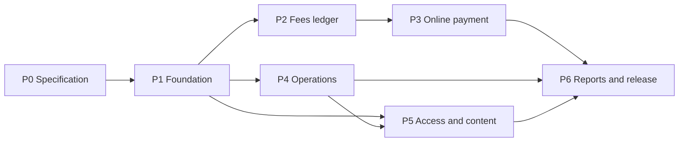
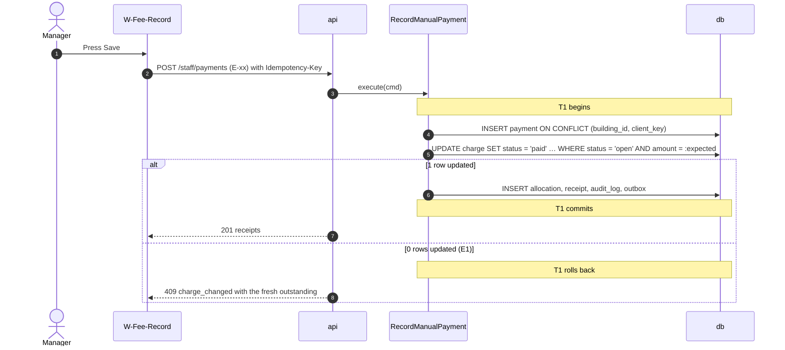

# Master Plan: building Residential Management System end to end

> Status: **Approved v1.0** (Owner, 2026-10-19) · Updated: 2026-11-01 (P1-27 written: DOC-18 §2, DOC-58, DOC-66, DOC-89, DOC-92, DOC-93, DOC-97, DOC-100, DOC-75 as Draft; DR-317…324; prefix `XP-`) · 2026-11-01 (P1-30: unit types and their defaults, a new phase-1 task; DR-314, DR-315; DOC-16 §5.6, DOC-27 §4.3, DOC-51 E-180…E-182, DOC-65 `W-Unit-Types`, DOC-18 DQ-47…49; FR-18.7, F-UNI-10) · 2026-10-28 (P1-26: DOC-31 core, DOC-34, DOC-52 SSE, DOC-17 §6 and §9.1 written as Draft, ADR-0024 Accepted, DR-287…303, prefix `SE-`; P1-25: DOC-23, DOC-44, DOC-08 Draft, DR-280…286) · 2026-10-28 (P1-29 built; DR-279: DOC-104, ADR-0028 and task P1-29, usage analytics; P1-24: DR-243…245 confirmed by the Owner, DR-27, 28, 30 stay open until the gateway sandbox) · 2026-10-27 (P1-20 built without a VPS: the files of a host run on Docker, DR-271); earlier 2026-10-27 (P1-21 done: the demo seed and reset, DR-270); earlier 2026-10-26 (DR-268: no R2 in Vietnam; files and backups in SeaweedFS on the VPS, ADR-0027 added, ADR-0016/0017/0020 superseded in part, P1-07, P1-20, P6-05, P6-13, NFR-11 and the risk rows reworded; earlier: P1-24: DOC-21 and DOC-22 written as Draft, DR-265…267; earlier: P1-07 and P1-08 done: DR-252, DR-253; P1-24: DOC-15 written as Draft, prefix `FNM-`, DR-243…245; P1-19 done: DR-238…242; P1-02 and P1-03 done: DR-231…233; DR-68, DR-226…228 applied: P1-10 no longer waits for the providers, P1-22 precondition, E-169, dry run of DOC-69 is the acceptance of P1-03; earlier: approved with every P1-blocking DR decided; DR-25, 26, 27, 28, 30, 31, 34, 35 stay open until the gateway sandbox and the bank statement sample arrive; see the register decision log) · Accompanies: [00-decision-register.md](00-decision-register.md) · Source: `residential-management-sdd.md` (**original SDD**)

This plan contains four things: the gaps found in the original SDD (84 decisions in the register, each with one proposal); every document to write, with its required content and gate; every task by phase with acceptance criteria; and the traceability from each requirement to design documents, tasks and verification. It holds no detailed design: design lives in the decisions and the documents.

Goal: when a task starts, everything needed for it is already in the docs. Nobody has to ask.

## 0. How to use this document

### 0.1 Language

| | |
| --- | --- |
| Documents (`docs/`, decision register, master plan) | English (`en`) · vocabulary: shipped `locales/en.md` |
| Code, UI strings in source, logs, API errors, commits, PR titles | English. Resident- and staff-facing text is delivered through the Vietnamese/English catalog (original SDD §2.3, DR-71) |
| Decided | 2026-10-18, Owner |

Reading order for newcomers: §1 → §4 → the current phase in §5 → the documents that phase references.

**Doc gate rule.** Every phase has a task `Pn-00` that reviews documents. A phase starts only when the documents it needs (column *Gate* in §3.2) are `Approved` (§3.3). A document gated by several phases (for example "P1 (§1–3), P4 (§4)") must be Approved for the listed sections before each of those phases starts.

### 0.2 Identifiers

Each prefix has one meaning in the whole project; a number once assigned is never reused (a dropped item is struck through with the reason).

| Prefix | Meaning | Defined in |
| --- | --- | --- |
| `FR-xx` / `FR-xx.y` | Functional requirement / sub-requirement (FR-01…40 from the original SDD; FR-41…50 "(added)" by DR-79) | DOC-03 |
| `NFR-xx` | Non-functional requirement | DOC-03 |
| `UC-xx` | Use case (UC-01…20 from the original SDD, UC-21…30 added in §3.4) | DOC-04 |
| `PS-x`, `J-x` | Persona, journey | DOC-02 |
| `F-<GROUP>-xx` | Feature (groups follow the 11 proposal modules: `ACC`, `UNI`, `VEH`, `QRC`, `NOT`, `TIC`, `FEE`, `PAY`, `WIK`, `DSH`, `SYS`) | DOC-05 |
| `DOC-xx` | Document | §3.1 |
| `ADR-xxxx` | Architecture decision | `04-adr/NNNN-*.md` |
| `DR-xx` | Decision register entry | `00-decision-register.md` |
| `Pn-xx` | Task of phase n; `Pn-00` is always the doc gate | §5 |
| `Mn` | Milestone that closes phase n | §4 |
| `S-xx` | Dropped spike (identifier kept for history; spikes were dropped on 2026-10-19) | §5, Phase 0, table "Dropped spikes" |
| `E-xx` | API endpoint | DOC-51 |
| `FL-xx` / `FL-xx.y` | Detailed flow / sub-flow | `06-design/flows/` |
| `DQ-xx` | Data quality rule | DOC-18 |
| `UX-nn` | UX principle (UX-01…UX-20) | DOC-53 |
| `EXP-xx` | Experiment (the 12 of original SDD §20.2) | `10-testing/experiments/` |
| `RB-xx` | Runbook | `09-operations/runbooks/` |
| Test prefixes | One prefix per document: `LG-` ledger (DOC-22), `IN-` intents and settlement (DOC-23), `PX-` payment gateway drivers (DOC-24), `ST-` statement (DOC-25), `AU-` identity and sessions (DOC-26), `RM-` residency (DOC-27), `TK-` tickets (DOC-28), `QC-` QR (DOC-29), `VH-` vehicles (DOC-30), `NT-` notices and notifications (DOC-31), `WK-` library (DOC-32), `RP-` reports (DOC-33), `PD-` PDF (DOC-34), `SE-` SSE and webhooks (DOC-52), `AD-` audit and privacy (DOC-35), `BD-` building and demo (DOC-36), `ER-` error handling (DOC-42), `FS-` files (DOC-37), `JB-` jobs (DOC-38), `MC-` messaging contracts (DOC-09), `IM-` imports (DOC-21, DOC-27, DOC-18 `IM-78…86`), `IDM-` identity and residency tables (DOC-16 §9), `OPM-` operations-model tables (DOC-17 §13), `FNM-` finance tables (DOC-15 §13), `GRT-` roles and grants (DOC-19), `DLC-` purge statements (DOC-20 §10), `AG-` API guidelines (DOC-50), `FF-` fees flows (DOC-44), `FO-` online-payment flows (DOC-45), `FI-` identity flows (DOC-46), `FT-` ticket flows (DOC-47), `FN-` notice, access and vehicle flows (DOC-48), `FA-` admin, report and library flows (DOC-49), `SC-` security (DOC-39), `OB-` observability (DOC-40), `CF-` configuration (DOC-41), `DS-` design system (DOC-54), `CL-` clients (DOC-55), and one `UI…-` prefix per screen document (DOC-56 §6.3): `UIRA-` (DOC-57), `UIRF-` (DOC-58), `UIRU-` (DOC-59), `UIRQ-` (DOC-60), `UISM-` (DOC-61), `UIST-` (DOC-62), `UISG-` (DOC-63), `UIWO-` (DOC-64), `UIWR-` (DOC-65), `UIWF-` (DOC-66), `UIWS-` (DOC-67), `UICP-` (DOC-68), `XP-` (experiment protocol, DOC-89). DOC-88 indexes them all | each document's "Required tests" section |

Ranges are written compactly: `FR-01…12`, `DOC-07…11`, `DR-21–24`, `P5-06…13`. A reference to a subsection is `DOC-19 §4.3`; a reference to the original SDD is "original SDD §6.2".

### 0.3 Document status lifecycle

| Kind | Lifecycle |
| --- | --- |
| Document | `Draft` → `Review` → `Approved` → `Superseded` |
| ADR | `Proposed` → `Accepted` → `Superseded by ADR-yyyy` |
| DR | `Proposed` → `Decided` or `Changed` (the alternative chosen is recorded) |
| Plan task | empty → `**Done YYYY-MM-DD** (\`sha\`)`; postponed or cut tasks state the reason |

Only the Owner moves a document to Approved, except for what is delegated to Claude (register decision log, 2026-10-18).

### 0.4 Currency policy (DR-82)

| Rule | What it means |
| --- | --- |
| Latest stable | Every runtime, framework, library, tool, CI action, Docker image and hosted service is the latest stable release when adopted. Pre-releases (RC, beta, `next`) are not used without a DR; if the latest stable fails the compatibility check of P1-01/P1-02, fall back to the previous stable of that one package, recorded in DOC-11 |
| Verify on the web first | Versions, APIs, library names and architecture patterns are checked against a primary source (official docs, changelog, npm registry, GitHub releases, endoflife.date) before they enter a document, ADR or code. Memory, the original SDD and the reference repository are not evidence |
| Evidence in DOC-11 | Each pin carries a *verified on* date and a source link; a document that states an external API behavior cites it |
| Refresh | At every doc gate (`Pn-00`) and before pinning in code, DOC-11 is refreshed; a pin older than 30 days at the moment of use is checked again |
| Mobile | Current Expo SDK, New Architecture only, development builds (EAS) instead of Expo Go, native libraries checked for New Architecture support, SDK release notes read before designing around an API |
| Ripple | A major bump or a removed API updates every document that cites it in the same change |

The snapshot of 2026-10-18 is in DR-82. It already changes the original SDD: PostgreSQL 18 (not 17), Node 24 LTS for tooling (not 22), Expo SDK 58 with React Native 0.88, TypeScript 7. Stable only: Drizzle stays on 0.45, NativeWind on 4.2 and Elysia on 1.4 while their next majors are RC/beta; the compatibility check of P1-01/P1-02 verifies the combination.

## 1. Analysis of the original SDD

### 1.1 What is already good and stays

- **The money invariant and its algebra.** the SDD's `0 <= paid_amount = Σ live allocations <= amount` and `amount(payment) = Σ allocations + credit + refunded`, with `CHECK` constraints and the unique indexes of §16.2, are the right foundation. Owner decision 2026-10-18 (DR-84) simplifies the algebra: a charge is paid whole, so the invariants are `payment.amount = Σ live allocation.amount` and `charge paid ⟺ exactly one live allocation of the full amount`. The plan never trades them for convenience.
- **One arbiter per race.** The charge row (recall vs payment, manual vs online), `gateway_event (provider, reference)` then the intent row (webhook vs re-query), the ticket row, the QR nonce, the single-use OTP row. Every race in the SDD already names its arbiter and the losing branch.
- **Three independent money paths.** Signed webhook, server re-query, staff entry, plus bank-statement reconciliation as a fourth net that can only settle after payOS confirms. "No signal from a phone moves money."
- **Options analyses with verdicts** for the ledger (A–D), the gateway (A–C) and the QR credential (A–C), each tied to an experiment. They are kept as the source of ADR-0005, ADR-0007 and ADR-0012.
- **Modular monolith on the reference's kit packages** (vendored here as `core-*`, DR-02) with outbox/inbox for every side effect and membership-scoped authorization read on every request (no cached permissions).
- **Measured claims.** Twelve experiments with numeric pass criteria, a cut order that protects the settlement path, the re-query job, the nightly invariant check and the authorization matrix.
- **Failure table (§19.3)** and risk list (§22): honest about what is unknown (payOS facts, hosting, SMS provider).

### 1.2 Main gaps

| # | Gap | Consequence if left open | DR |
| --- | --- | --- | --- |
| 1 | Partial payments and credit (§5.1, §5.4, §5.7): a charge that gained a partial cash payment sends the **whole** online amount to credit | Debt shown wrong after every cash/online overlap; Manager applies credit by hand. **Owner (2026-10-18): no partial payment, no credit; mismatched money is a log** | DR-84, DR-14 |
| 2 | Invalid-signature calls are stored in `gateway_event`, which is unique on `(provider, reference)` (§6.4) | A forged call with a guessed reference occupies the key; the genuine webhook is skipped as "already processed" and a payment is lost | DR-32 |
| 3 | RPO ≤ 24 h from a daily dump (NFR-11) against "never lose a payment" | A restore at noon loses a morning of online payments that payOS will not resend | DR-66 |
| 4 | Transfer content "`TT` + base-32 (8 characters)" with a 9-character limit (§6.3) | Link creation fails or truncates content; the example `TT2DQ8XR` and the rule disagree | DR-27 |
| 5 | payOS behavior and sandbox are assumed, not known (§22); demo uses a "sandbox bank" | Settlement, expiry and late-transfer logic built on guesses; the demo cannot run | DR-25, DR-26 |
| 6 | Finance tables named but not defined: `receipt`, `unit_credit_entry`, `finance_anomaly`, `payment_intent`, `gateway_event`, statements (credit and anomaly tables were then dropped by DR-84) | The nightly check, `settle()` and every report need columns the SDD never states | DR-13, DR-15 (superseded), DR-16 |
| 7 | One counter table for batch, receipt and ticket codes across modules; ticket code repeats yearly (§5.6, design) | Cross-module table access breaks module boundaries; `UNIQUE (building_id, code)` fails on 1 January | DR-10 |
| 8 | Aging SQL uses `now()::date`; schedules have no zone (§5.10) | Debt moves to the wrong bucket between 00:00 and 07:00 local; jobs fire at the wrong hour | DR-09, DR-18 |
| 9 | Audit row "in its own transaction" vs inside the payment transaction (§15, §5.4) | A crash loses the audit of committed money movement, or audits a rolled-back change | DR-57 |
| 10 | Cross-module calls and events unlisted; QR rotation "in the same transaction" across modules (§4.1, §7.7) | Modules reach into each other's tables; a locked-then-unlocked member revives an old QR | DR-42, DR-48 |
| 11 | The reference's `kit-*` packages are private and unpublished (vendored here as `core-*`); the list is incomplete (§23) | `bun add @kit/…` (the upstream scope) fails; missing transitive packages block P1 | DR-02, DR-03 |
| 12 | Stage S1 needs the gateway-side `settle()` and the notification core that live in S2/S3 (§21) | EXP-03/04 cannot run in S1; publish cannot notify residents | DR-76 |
| 13 | Guard sees the owner's phone with a call button vs NFR-14 (§9.1) | Requirement and design contradict; personal-data rule violated on day one | DR-48, DR-58 |
| 14 | Screens and endpoints missing: recall, the money log, statement, export center, terms, deletion, wiki writes, devices (§17.1, design) | Back-end behavior with no way to operate it; late discovery in P5/P6 | DR-72, DR-73 |
| 15 | Jobs, schedules, observability backend, secrets and hosting are described in prose only (§19) | No place to look when a job misses; PgBouncer plan breaks advisory locks | DR-62, DR-63, DR-65, DR-67 |

### 1.3 Adjustments to the plan in the original SDD

| Adjustment | Reason |
| --- | --- |
| Add **Phase 0: specification**; the original SDD's S0…S5 become P1…P6 | The register has 84 decisions; money and identity must not start on guesses. Nine risky unknowns were first planned as spikes S-01…S-09; the Owner dropped the spikes on 2026-10-19 and each question is now verified inside the task that needs it (§5, "Dropped spikes") |
| Move the `notification` core (inbox, device tokens, Expo push) and SSE for the web inbox from S3/S2 into P2 | FR-03 and §5.4 notify residents at publish and payment; DR-76 |
| P2 builds the `settle()` use case and intent/`gateway_event` migrations; EXP-03 and EXP-04 run in P2 on test-built confirmations | S1 results cannot depend on the S2 gateway adapter; DR-76 |
| Minimal CI (verify, unit, integration, staging deploy) from P1, not at hardening | Architecture rules and the building-scope lint must fail early; DR-08 |
| Add modules `reporting` and `realtime`; fork `identity` and `notification`; skip `privacy`, `profile`, `billing` | Report exports need an owner; SSE is already solved in the reference; DR-03, DR-55 |
| Production gets a larger host than "2 vCPU, 4 GB"; EXP-07 runs on the staging host with all components | The SDD's number cannot hold the whole stack; DR-06 |
| Demo building exists in staging **and** production; fake payment driver and fixed OTP for it, accepted only for accounts flagged `is_demo` (the API refuses to boot in production if a flagged account belongs to a non-demo building) | Store review needs a working login on production; DR-26, DR-37, DR-60 |
| Add **step-up** for sensitive staff actions: password re-entry plus a one-time code mailed to the Admin (gateway configuration or receiving account, creating or promoting an Admin, changing a staff email); no TOTP in phase 1 | The SDD protects these with the session alone; one stolen Admin session could redirect the money; DR-33, DR-39 |
| Add the action **void a single open charge** next to recall; the negative adjustment line stays | The SDD can only recall a whole batch (refused after any payment) or add a later batch; DR-19, DR-20 |
| PostgreSQL with point-in-time recovery (RPO ≤ 5 min) instead of daily dumps | The invariant "never lose a payment" outranks NFR-11 as written; DR-66 |
| Design the missing screens in P0/P1 for the phases that need them | DR-72 |
| Write the documents of phase n+1 in parallel with phase n | Docs-first, with no idle gate; §9 |

## 2. Working principles

1. **The core first, complete later.** The settlement path (`settle()`, the allocation statement, re-query, nightly invariant check) and the authorization matrix are never cut (§4.3). A phase that touches money ends with its race tests green.
2. **Every phase ends with something that runs and can be demonstrated** on staging (milestone `Mn`).
3. **Docs travel with code.** A behavior change edits the document in the same PR; a decision change gets a new DR and, if architecture-level, a new ADR that supersedes the old one.
4. **Every threshold is configuration**; every configuration key is in DOC-41.
5. **The database decides, the code asks.** Every state transition two actors can race on is one conditional `UPDATE … WHERE <expected state> RETURNING`. A race test (N real connections, barrier) is written **before** the feature that depends on it.
6. **Every money mutation is idempotent and fault-injected.** Each has a run-twice test and a kill-the-process-mid-transaction test before the first real job uses it.
7. **No signal from a phone moves money.** Only a signed webhook, a server re-query or a staff entry settles a charge.
8. **Modules talk through `contracts/` only.** dependency-cruiser and the building-scope lint are merge gates from P1.
9. **Every term and ID has one definition.** New terms enter the glossary (DOC-06) in the same change.

## 3. Documents to write

### 3.1 The docs/ tree

```
docs/
├── README.md                                   index and status table
├── 00-master-plan.md                           this file
├── 00-decision-register.md
├── references/                                 inputs kept from the SDD work (not written by this plan)
├── 01-product/
│   ├── vision-and-scope.md                     # DOC-01
│   ├── personas-and-journeys.md                # DOC-02
│   ├── requirements.md                         # DOC-03
│   ├── use-cases.md                            # DOC-04
│   └── feature-catalog.md                      # DOC-05
├── 02-glossary.md                              # DOC-06
├── 03-architecture/
│   ├── system-context-and-containers.md        # DOC-07
│   ├── data-flows.md                           # DOC-08
│   ├── messaging-contracts.md                  # DOC-09
│   ├── quality-attributes.md                   # DOC-10
│   ├── tech-stack-and-versions.md              # DOC-11
│   └── code-architecture.md                    # DOC-12
├── 04-adr/
│   ├── README.md                               # DOC-13
│   ├── 0001-record-architecture-decisions.md
│   └── NNNN-<title>.md                         ADR-0002…0027 (table in §3.2)
├── 05-data/
│   ├── data-conventions.md                     # DOC-14
│   ├── finance-model.md                        # DOC-15
│   ├── identity-and-residency-model.md         # DOC-16
│   ├── operations-model.md                     # DOC-17
│   ├── data-quality-rules.md                   # DOC-18
│   ├── db-roles-and-grants.md                  # DOC-19
│   └── data-lifecycle.md                       # DOC-20
├── 06-design/
│   ├── fee-batches-and-import.md               # DOC-21
│   ├── ledger-and-allocation.md         # DOC-22
│   ├── payment-intents-and-settlement.md       # DOC-23
│   ├── payos-gateway-adapter.md                # DOC-24
│   ├── bank-statement-reconciliation.md        # DOC-25
│   ├── identity-and-sessions.md                # DOC-26
│   ├── residency-and-memberships.md            # DOC-27
│   ├── tickets.md                              # DOC-28
│   ├── resident-qr.md                          # DOC-29
│   ├── vehicles.md                             # DOC-30
│   ├── notices-and-notifications.md            # DOC-31
│   ├── document-library.md                     # DOC-32
│   ├── reports-and-exports.md                  # DOC-33
│   ├── pdf-rendering.md                        # DOC-34
│   ├── audit-privacy-and-terms.md              # DOC-35
│   ├── building-configuration-and-demo.md      # DOC-36
│   ├── files-and-uploads.md                    # DOC-37
│   ├── jobs-and-outbox-runtime.md              # DOC-38
│   ├── security.md                             # DOC-39
│   ├── observability.md                        # DOC-40
│   ├── configuration-reference.md              # DOC-41
│   ├── error-handling.md                       # DOC-42
│   ├── usage-analytics.md                      # DOC-104
│   └── flows/
│       ├── README.md                           # DOC-43
│       ├── fees-and-payments.md                # DOC-44
│       ├── online-payment.md                   # DOC-45
│       ├── identity-and-household.md           # DOC-46
│       ├── tickets.md                          # DOC-47
│       ├── notices-access-vehicles.md          # DOC-48
│       └── admin-reports-library.md            # DOC-49
├── 07-api/
│   ├── api-guidelines.md                       # DOC-50
│   ├── api-endpoints.md                        # DOC-51
│   └── sse-and-webhooks.md                     # DOC-52
├── 08-ux-ui/
│   ├── ux-principles-and-ia.md                 # DOC-53
│   ├── design-system.md                        # DOC-54
│   ├── client-architecture.md                  # DOC-55
│   ├── screens/
│   │   ├── README.md                           # DOC-56
│   │   ├── resident-signin-home.md             # DOC-57
│   │   ├── resident-fees-payment.md            # DOC-58
│   │   ├── resident-requests-unit.md           # DOC-59
│   │   ├── resident-qr-notices-account.md      # DOC-60
│   │   ├── staff-shared-and-manager.md             # DOC-61
│   │   ├── staff-technician.md                 # DOC-62
│   │   ├── staff-guard.md                      # DOC-63
│   │   ├── web-auth-dashboard-operations.md    # DOC-64
│   │   ├── web-residents.md                    # DOC-65
│   │   ├── web-finance.md                      # DOC-66
│   │   └── web-system.md                       # DOC-67
│   └── ui-states-and-copy.md                   # DOC-68
├── 09-operations/
│   ├── local-dev.md                            # DOC-69
│   ├── deploy-staging-and-production.md        # DOC-70
│   ├── ci-cd.md                                # DOC-71
│   ├── backup-restore.md                       # DOC-72
│   ├── mobile-release.md                       # DOC-73
│   └── runbooks/
│       ├── README.md                           # DOC-74
│       ├── RB-01-ledger-invariant.md           # DOC-75
│       ├── RB-02-payments-stuck.md             # DOC-76
│       ├── RB-03-webhook-signatures.md         # DOC-77
│       ├── RB-04-outbox-lag.md                 # DOC-78
│       ├── RB-05-dead-letters.md               # DOC-79
│       ├── RB-06-sms-failures.md               # DOC-80
│       ├── RB-07-backup-missing.md             # DOC-81
│       ├── RB-08-storage-quota.md              # DOC-82
│       ├── RB-09-api-errors.md                 # DOC-83
│       ├── RB-10-restore-from-backup.md        # DOC-84
│       ├── RB-11-money-to-check.md       # DOC-85
│       ├── RB-12-rotate-secrets-and-keys.md    # DOC-86
│       └── RB-13-payos-outage-or-credential-change.md   # DOC-87
└── 10-testing/
    ├── test-strategy.md                        # DOC-88
    ├── experiments/
    │   ├── README.md                           # DOC-89
    │   ├── EXP-01-duplicate-and-late-webhooks.md      # DOC-90
    │   ├── EXP-02-webhook-vs-requery.md               # DOC-91
    │   ├── EXP-03-online-vs-manual-baseline.md        # DOC-92
    │   ├── EXP-04-recall-vs-payment.md                # DOC-93
    │   ├── EXP-05-qr-revocation.md                    # DOC-94
    │   ├── EXP-06-notice-fan-out.md                   # DOC-95
    │   ├── EXP-07-api-load.md                         # DOC-96
    │   ├── EXP-08-bulk-pdf.md                         # DOC-97
    │   ├── EXP-09-otp-abuse.md                        # DOC-98
    │   ├── EXP-10-authorization-matrix.md             # DOC-99
    │   ├── EXP-11-ledger-drift-detection.md           # DOC-100
    │   └── EXP-12-restore-drill.md                    # DOC-101
    ├── demo-script.md                          # DOC-102
    └── go-live-checklist-and-uat.md            # DOC-103
```

Not in the catalog on purpose: `11-report` (no thesis or formal report). The screen files are one file per **area**, one section per design artboard (110 artboards would otherwise be 110 files; *revised 2026-10-20 (DR-194): the canvas has 110, not 115*); each section follows template A.5.

### 3.2 Required content of each document

The Gate column is the phase that needs the document Approved before it starts. Test-ID prefixes are in §0.2.

**Common skeleton of the `06-design` group** (DOC-21…42): Purpose and scope (table: main class · runs in · trigger · reads · writes · task) → Components and interfaces (code signatures) → Algorithm (numbered pseudo-code) → Transactions and concurrency → Configuration → Metrics and logs → Errors and handling → Required tests (table: ID · Scenario · Expected) → Open questions (empty when Approved).

#### 01-product

| DOC | Document | Required content | Gate |
| --- | --- | --- | --- |
| DOC-01 | Vision and scope | Context of a Vietnamese apartment building (240 units, ~650 accounts, 10 staff; design scale 5,000 units / 20 buildings). The three layers of value (one source of truth; money that reconciles itself; platform for many buildings). Core problem and the two invariants. **Measurable goals** tied to NFR-01…14 and their EXP. In/out of scope with reasons (original SDD §2.3) and the "later" table; **e-invoices are out of the system: the company issues one only when a resident asks (a request of type "Khác"), outside the system, and the system records only the integration seam (reserved `finance.receipt.external_invoice`, event `finance.receipt_issued.v1`; DR-17)**. Assumptions (**the defaults of DR-81 with their confirm-by phase**). Constraints (one person, hosting, SMS brandname lead time). Cut order (§4.3). **Risks: e-invoice may become mandatory or requested more often (DR-17), Decree 13/2023 (DR-58)** | P1 |
| DOC-02 | Personas and journeys | `PS-1…8`: Admin, Manager, Technician, Guard, Owner, Family member, Tenant (pay / no pay), Helper (system role, device, technical level, frequency, goals, pain points, needs, does not need, screens). One journey `J-x` per persona: steps, emotions, touchpoints (screens and endpoints). **Journeys: owner pays two batches; tenant without `can_pay`; guard at the gate; Manager on the 1st of the month** | P1 |
| DOC-03 | Requirements | FR-01…40 with the original IDs plus **FR-41…50 (added, DR-79; FR-49 void a single open charge, FR-50 step-up for sensitive staff actions)**; each split into `FR-xx.y` with Given/When/Then acceptance criteria **with numbers** (template A.3), MoSCoW, verification (test level, EXP). **FR-49 acceptance numbers: reason of at least 5 characters, 409 on a charge with a live allocation, intents holding the charge cancelled as a whole; FR-50: 6-digit code, 10 minutes, single use, every Admin notified.** **Wording corrections: FR-03 (recipients), FR-19 (5 photos and 1 video), FR-22 (visible once closed), NFR-14 (Guards, masked), NFR-02/04/10/11/12 measurement (DR-80, DR-66)**. NFR-01…14 table with numeric target, how measured, tool, EXP. Matrix FR → UC → F → design DOC | P1 |
| DOC-04 | Use cases | Overall use-case diagram (Mermaid). UC-01…30 of §3.4 per template A.2 (actor, trigger, preconditions, main flow, alternative 2a…, error E1…, postconditions, rules, screens/endpoints/events, FRs, FL). **UC-03, UC-04, UC-18 carry every race branch** | P1 |
| DOC-05 | Feature catalog | The 113 proposal features mapped (DR-89) (P0-07) to `F-<GROUP>-xx`: description, FRs, UCs, phase completed, MoSCoW, flag, dependencies, deploying app (web/staff/resident/api), cut step. **Features with no FR and the FR added or the reason for out-of-scope** | P1 |

#### 02-glossary

| DOC | Document | Required content | Gate |
| --- | --- | --- | --- |
| DOC-06 | Glossary | Written first. Minimum term list — building, Manager, unit, owner / family member / tenant / helper, membership, `can_pay`, resident account, staff account, fee month, fee batch, draft / published / recalled / closed, charge, charge line, adjustment line, void (charge, payment), step-up, demo account (`is_demo`), outstanding, aging bucket, payment, allocation, receipt, money log and its outcomes (every kind), reviewed, void; payment intent (every state), order code, transfer content, payOS link, webhook, re-query, `gateway_event`, settlement, statement line, reconciliation; ticket (every state), assignee, internal note, urgent; QR credential, nonce, credential version, scan result; notice, audience, fan-out, recipient, inbox entry, push ticket; outbox, inbox, relay, dead letter, advisory lock, `SKIP LOCKED`, arbiter, conditional update, idempotency key, `BuildingScope`, `UnitContext`; Expo push, EAS, VietQR, CCCD, đồng, đ. Vietnamese names in the "local name" column are omitted (English documents) except terms shown in the product UI | P1 |

#### 03-architecture

| DOC | Document | Required content | Gate |
| --- | --- | --- | --- |
| DOC-07 | System context and containers | C4 level 1 (residents, staff, payOS, SMS, Expo/FCM/APNs, SMTP, bank statement). C4 level 2: web CMS (Cloudflare Pages), two Expo apps, Cloudflare edge and Tunnel, Caddy, `api` ×2, `worker` (Elysia, Docker), native PostgreSQL, pgBackRest, SeaweedFS (R2 in the `global` profile), the files host, monitoring. **Deployment diagram of DR-83, with the `vn`/`global` profiles of DR-268.** Deployment unit table (DR-05). **Data ownership table: every table, topic and bucket prefix → writer module, reader modules.** Trust boundaries and where each secret is used | P1 |
| DOC-08 | Data flows | Sequence diagrams for every main flow: publish batch → push; manual payment; online payment (create intent → settle); webhook; re-query; recall vs payment; statement reconciliation; OTP sign-in; ticket status change → notification; notice fan-out; QR scan; export. **Failure flows: PostgreSQL down mid-settlement, process killed after commit before 200, worker killed mid-fan-out, payOS timeout at link creation, Expo down, SMS down** | P2 |
| DOC-09 | Messaging contracts | Outbox/inbox settings (DR-62). **Event catalog** (DR-42): name, producer, consumers, JSON Schema per version, headers, idempotency key, retry class. Sync contract list with DTOs. Command events (intent cancel, receipt render; imports have none, validation is synchronous, DR-21); `finance.charge_voided.v1` (DR-20); `finance.receipt_issued.v1` (one per receipt, the e-invoice integration seam, DR-17). Backward-compatibility rules | P1 |
| DOC-10 | Quality attributes | Per NFR: tactic → mechanism → where → verification. Latency budget (webhook accept → commit → poll). **Capacity estimate** (150 payments/h at publish, 100 in 2 h before due date, ×10, 5,000 units) in rows/day and GB/day. **Resource budget per container and host (DR-06)** | P1 |
| DOC-11 | Tech stack and versions | Every library and tool with pinned version, reason, licence (Be Vietnam Pro is OFL). **Each pin with *verified on* date and source link (DR-82); starts from the 2026-10-18 snapshot and is refreshed at each doc gate.** Pre-releases only with a DR. Mobile: Expo SDK, React Native, New Architecture status, native library support check. **Compatibility table, filled in P1-01/P1-02 (DR-01) and extended by the tasks that verify one part (P1-07 uploads, P2-13 PDF, P4-05 rich text)**. Dev tools and CI actions | P1 |
| DOC-12 | Code architecture | Layers `presentation → application → domain`, `infrastructure`, `contracts`; the three dependency-cruiser configs; module template; `BuildingScope` repositories; ambient transaction; DTOs and mapping; where transactions live; `UnitContext` and policy function; exception types; core sync rule (DR-02) and the mapping table reference `kit-x` → `core-x` (upstream names appear only there and in `packages/CORE_VERSION`); **review checklist** (condition predicate, race test, idempotency test, audit row, template key) | P1 |

#### 04-adr

| DOC | Document | Required content | Gate |
| --- | --- | --- | --- |
| DOC-13 | ADR index | Table `ADR · title · status · gate · source DR` for the 28 ADRs below | P1 |

| ADR | Subject | Source | Gate |
| --- | --- | --- | --- |
| ADR-0001 | Record architecture decisions | Convention | P1 |
| ADR-0002 | Modular monolith on Bun, Elysia, Drizzle, PostgreSQL following the reference; module list | original SDD §4, DR-01, DR-03 | P1 |
| ADR-0003 | Vendor the core packages; manual sync | DR-02 | P1 |
| ADR-0004 | Repository layout, scopes and enforced boundaries | DR-04, DR-12 | P1 |
| ADR-0005 | Ledger: charges + append-only allocations, paid in full only, no credit; the money log (option C reduced) | original SDD §5.9, DR-13, DR-84 | P2 |
| ADR-0006 | The allocation write path: all-or-nothing conditional update, unique live allocation per charge | DR-14, DR-84 | P2 |
| ADR-0007 | Payment gateway port; payOS payment link per intent (option B); fake driver — extended by ADR-0029 | original SDD §6.6, DR-25, DR-26 | P2 |
| ADR-0029 | Stripe Checkout as the first payment driver, behind a provider-neutral gateway port (presentations `redirect` and `qr`) | DR-325, DR-326, DR-327 | P2 |
| ADR-0008 | Settlement idempotency: `gateway_event`, intent claim, rejection log, no signature rows in `gateway_event` | DR-29, DR-32 | P2 |
| ADR-0009 | Transactional outbox, inbox and event delivery; cross-module contracts | DR-42, DR-62 | P1 |
| ADR-0010 | Two account kinds; membership-scoped authorization read per request | original SDD §7, DR-36 | P1 |
| ADR-0011 | Tokens, refresh families, key rotation and cookies | DR-38 | P1 |
| ADR-0012 | Resident QR: signed token + nonce + membership credential version (option B) | original SDD §9.2, DR-48 | P5 |
| ADR-0013 | Time zones and calendar-day semantics | DR-09 | P1 |
| ADR-0014 | Schema per module, no cross-module foreign keys, per-module counters, reporting through contracts | DR-03, DR-10, DR-42, DR-55 | P1 |
| ADR-0015 | Jobs and worker topology; transaction-level advisory locks | DR-62 | P1 |
| ADR-0016 | Files on R2: presigned PUT (R2 has no POST), `HEAD` verification, `file_object`, quota. **Superseded in part by ADR-0027** (the store in `vn`; kept as the `global` reference) | DR-61, DR-83 | P1 |
| ADR-0017 | Backup with point-in-time recovery (pgBackRest to R2); self-hosted PostgreSQL. **Superseded in part by ADR-0027** (the repository in `vn`; kept as the `global` reference) | DR-66, DR-67, DR-83 | P1 |
| ADR-0018 | Audit written in the mutation's transaction | DR-57 | P1 |
| ADR-0019 | Mobile and web client stacks; shared tokens | DR-70 | P1 |
| ADR-0020 | Deployment topology: Cloudflare (Pages, Edge, Tunnel, R2) + VPS (Caddy, Elysia api/worker, native PostgreSQL); hosts, proxy trust. **Superseded in part by ADR-0027** (no R2 in `vn`; kept as the `global` reference) | DR-05, DR-06, DR-07, DR-83 | P1 |
| ADR-0021 | Observability stack and alert delivery | DR-63 | P1 |
| ADR-0022 | Personal data protection; push payload privacy; no third-party error tracker | DR-52, DR-58 | P1 |
| ADR-0023 | API conventions: error shape, idempotency store, cursors | DR-74 | P1 |
| ADR-0024 | Real-time for the web CMS with the reference `realtime` module | DR-75 | P2 |
| ADR-0025 | Notice fan-out, heartbeat reclaim and single-source read state; allowed rich-text subset | DR-50, DR-51 | P4 |
| ADR-0026 | Demo building and fake payment driver | DR-26, DR-60 | P1 |
| ADR-0027 | In Vietnam, files and backups in SeaweedFS on the VPS instead of Cloudflare R2; the Cloudflare domain, HTTPS and Tunnel stay; two profiles `vn` and `global` | DR-268, DR-83, DR-58, DR-61, DR-66, DR-67 | P1 |
| ADR-0028 | Self-hosted usage analytics: screen views, taps, opening and closing of the app from closed lists, no account or device id, an `analytics` schema, a counter to read it | DR-279, DR-103, DR-58 | P1 |

#### 05-data

| DOC | Document | Required content | Gate |
| --- | --- | --- | --- |
| DOC-14 | Data conventions | UUIDv7, `building_id` first in every index, standard columns (DR-12), deletion rules, money and quantity (DR-11), time (DR-09), bilingual `jsonb`, counters (DR-10, DDL of `document_counter`), naming, migrations per module with drizzle-kit (expand/contract), schema list, the scope-lint allow-list | P1 |
| DOC-15 | Finance model | Mermaid ERD. **Complete runnable DDL**: `fee_batch`, `charge`, `charge_line`, `payment`, `allocation`, `receipt` (with the reserved nullable `external_invoice jsonb`, DR-17), `payment_intent`, `payment_intent_item`, `gateway_event` (with the log columns), `webhook_rejection`, `statement_import`, `statement_line`, `document_counter`, `import_job`, `order_code_seq`, triggers (immutable amounts), every CHECK/UNIQUE of original SDD §16.2 with reasons, indexes. Sample upserts: counter, allocation (all-or-nothing), gateway_event insert. State diagrams of batch, charge, payment, intent, money-log row, import job | P2 |
| DOC-16 | Identity and residency model | ERD and DDL: `staff_account`, `resident_account` (with `is_demo`, DR-37), `otp_challenge`, `password_token` (kinds `reset`, `invite`, `step_up` with `action` and `attempts`, DR-36), `refresh_family`, `refresh_token`, `rate_bucket`, `unit`, `unit_type` (DR-314), `resident_profile`, `membership` (+`credential_version`), `unit_history`, `import_job` (`idempotency_key` lives in DOC-17 §3, DR-85). State diagrams: staff account, membership. Unique indexes of original SDD §7.2 | P1 |
| DOC-17 | Operations model | **§1 building** (`building`, `building_setting` with `accountDeletionDays`, `gateway_config` with one `secrets_enc` blob, DR-33, `terms_version`, `terms_acceptance`), **§2 audit** (`audit_log`), **§3 platform** (`file_object`, `job_run`, outbox/inbox usage, `idempotency_key`) — gate P1; **§4 tickets** (DR-43), **§6 notices and notification** (`notice`, `notice_attachment`, `notice_recipient`, `inbox_entry`, `device_token`, `push_ticket`) — gate P4 (`inbox_entry`, `device_token`, `push_ticket` already needed in P2); **§5 access**, **§7 vehicles**, **§8 wiki**, **§9 reporting** (`export_job`) — gate P5 / P6. DDL, indexes, state diagram for every status column | P1 (§1–3), P2 (notification tables), P4 (§4, §6), P5 (§5, §7, §8), P6 (§9) |
| DOC-18 | Data quality rules | `DQ-xx` catalog: **§1 unit/owner import (P1)**, **§2 fee import (P2)**, **§3 statement import (P3)**: layer (before/after write), expression or SQL, severity, action, threshold, error code and UI string; Excel header aliases | P1 (§1), P2 (§2), P3 (§3) |
| DOC-19 | DB roles and grants | Role × schema × privilege matrix (`rms_migrator`, `rms_app`, `rms_readonly`, `rms_backup`); append-only `audit_log`; secret provisioning; migration user separate from runtime; **permission test matrix run in CI on a fresh database** | P1 |
| DOC-20 | Data lifecycle | Retention per table and bucket (DR-62, DR-58), purge jobs, backup schedule and retention, personal-data policy, deletion execution (DR-59), storage growth estimate | P1 (skeleton), final before P6 |

#### 06-design

| DOC | Document | Required content | Gate |
| --- | --- | --- | --- |
| DOC-21 | Fee batches and import | Batch lifecycle (publish, recall, close, re-issue, due-date extension: DR-20), draft editing with `version`, import job (DR-21: synchronous validation in the API, preview stored in `import_job`; DR-22), template columns, rounding (DR-11), adjustment lines entered by hand and never derived from the money log (DR-19), **void a single open charge** and the corrected charge in a new batch (DR-19, DR-20). Tests `IM-`, `LG-` for publish twice, recall with payments, double-save, void of a charge with a live allocation (409) and of a charge held by an intent (the intent is cancelled as a whole) | P2 |
| DOC-22 | Ledger, allocation and the money log | **The all-or-nothing allocation statement (DR-14) with the race-test results of P2-03 and the EXP-03 baseline**, manual payment (DR-23), void a payment (DR-24), void a single open charge (DR-19, DR-20: rules, intents cancelled as a whole, late confirmation goes to the log),  receipts and numbering (DR-17, DR-10; the receipt keeps a complete snapshot and the reserved `external_invoice`), the invariants without credit (DR-15), the money log with outcomes, review and viewer (DR-16), debt/aging SQL and bucket test table (DR-18), nightly invariant queries and the alert, recall-vs-payment race (original SDD §5.8). **Input → expected-output test tables** | P2 |
| DOC-23 | Payment intents and settlement | Intent states and the supersede rule (DR-28), creation, the `settle()` contract step by step (DR-29), webhook-vs-re-query race (original SDD §6.5), manual-vs-online race, re-query/expiry job (DR-30), cancel handler (DR-31), parameters table (original SDD §6.5), notification events | P2 |
| DOC-24 | Payment gateway port and drivers | `PaymentGateway` port, `stripe` and `fake` drivers (`payos`, `vnpay`, `vietqr` as later drivers and the checklist for a new one, DR-326), request/response and webhook samples (**recorded in a Stripe sandbox, otherwise taken from the provider documentation and marked unverified**, DR-25, DR-326), signature algorithm with test vectors, error mapping, timeouts and retries, rejection log (DR-32), configuration and encryption (DR-33: one encrypted `secrets_enc` JSON blob, fields defined per driver), simulator CLI (DR-26), order code and transfer content (DR-27) || P2 |
| DOC-25 | Bank-statement reconciliation | Statement profiles and parser (DR-34), matching steps and tie rules (DR-35), "not seen in bank", assignment of lines as manual payments, dedup. **Tests with the real redacted sample when the client supplies it (P0-05); generic profile until then (DR-34)** | P3 |
| DOC-26 | Identity and sessions | Staff password, lockout, invite, reset (DR-39); **step-up for sensitive staff actions** (FR-50; 6-digit code, 10 minutes, single use, password re-entry, every Admin notified by email and inbox: DR-39); resident OTP with the fixed code only for `is_demo` accounts and the production boot guard (DR-37); tokens, refresh, cookies (SPA and API same-site, cross-origin: `SameSite=Strict`, `credentials: include`, `X-Requested-With: rms` preflight), key rotation (DR-38); sessions endpoints; rate buckets; revocation matrix. Tests `AU-` including parallel guesses, step-up (no code, wrong code, expired code, reused code, wrong password, other Admin's code, success notifies every Admin) and the fixed OTP refused for a non-demo account | P1 |
| DOC-27 | Residency and memberships | Units, unit types and their defaults (DR-314, DR-315), profiles, memberships, household changes, ownership transfer, phone change, no limit on members or helpers and the history-visibility rule `membership.created_at` (DR-40), Excel import of units/owners (DR-22), unit history, lookup/search (DR-41), `ResidencyApi` contract, `UnitContext` guard and policy table (original SDD §7.4). Tests `RM-` | P1 |
| DOC-28 | Tickets | State machine and transition table (DR-44), races and SQL (original SDD §8.2), assignment and workload (DR-46), messages and visibility (DR-45), attachments (DR-43), rating, types, deadlines flag (DR-47). Tests `TK-` for every concurrent pair | P4 |
| DOC-29 | Resident QR | Token format, nonce, credential version (DR-48), scan algorithm and results, guard-visible fields, logs and purge, key rotation. Tests `QC-`; **EXP-05 cases** | P5 |
| DOC-30 | Vehicles | States incl. `retired`, revisions, plate key function with test table, limits, review, plate search (DR-41, DR-49). Tests `VH-` | P5 |
| DOC-31 | Notices and notifications | **Notification core (P2):** inbox table and template catalog (DR-53; includes `fee.charge_voided` and `staff.step_up_done`), device tokens, Expo contract and payload privacy (DR-52), receipts, unit visibility. **Notices (P4):** lifecycle, rich-text subset (DR-50), scheduler, heartbeat, fan-out batches, read state (DR-51), statistics. Tests `NT-` | P2 (notification core), P4 (notices) |
| DOC-32 | Document library | Tables, visibility cascade (effective readers computed at read time with one recursive query, no stored list: DR-54), versions and retention, full-text search with `unaccent`, attachments, video links, PDF export (DR-54). Tests `WK-` | P5 |
| DOC-33 | Reports and exports | `reporting` module, each report's definition and SQL, dashboard numbers (DR-18), pro-rata item split with test table (DR-11), export jobs and file lifetime (DR-55). Tests `RP-` | P6 |
| DOC-34 | PDF rendering | Documents (fee notice, receipt, report, wiki), fonts, layout, language modes, caching, bulk ZIP, void watermark (DR-17, DR-56); the receipt is titled "Biên lai thu tiền / Payment receipt" and states it is not a tax invoice (DR-17), **EXP-08 results**. Tests `PD-` | P2 |
| DOC-35 | Audit, privacy and terms | Audit writer and table (DR-57), `actor_kind = 'system'` rows for webhook, re-query and statement settlement, `pii.read` logging (one row per export with the record count), retention purge (periods confirmed in P0-06; ledger tables never deleted); personal-data inventory and rules (DR-58); terms versions and gating, deletion workflow with the cooling-off from the building setting `accountDeletionDays` (default 30, DR-59), the owner terms text (debt follows the unit, history does not: DR-40). Tests `AD-` | P1 |
| DOC-36 | Building configuration and demo | Building and settings schema, gateway configuration screen contract, encryption (DR-33: one `secrets_enc` blob, fields per driver) and the step-up required to change the configuration or the receiving account, terms admin, the demo building: seed, fixed OTP only for `is_demo` accounts, boot guard, fake driver, reset guard (DR-60). Tests `BD-` | P1 |
| DOC-37 | Files and uploads | `file_object`, presign (PUT)/verify flow on the S3 store (SeaweedFS in `vn`, R2 in `global`, DR-268), limits table, thumbnails, signed URLs, quota, orphan cleanup (DR-61), **upload-check results of P1-07**. Tests `FS-` | P1 |
| DOC-38 | Jobs and outbox runtime | Timer mechanism, advisory locks, `job_run`, job catalog with schedules and grace windows, relay settings per event type, graceful shutdown, maintenance flag (DR-62). Tests `JB-` | P1 |
| DOC-39 | Security | Authn/authz, **endpoint × role/member-type matrix (generated from route metadata)**, headers and CSP, rate limits (DR-64), secrets inventory (DR-65), TLS, step-up (FR-50, DR-39), a webhook call from an unknown payOS IP is logged and never blocked, the HMAC being the only gate (DR-32), lightweight STRIDE per trust boundary (webhook, upload, QR scan, OTP, step-up), CI scanning | P1 (skeleton), final P6 |
| DOC-40 | Observability | **Metric catalog** (DR-63), log fields (request id on every line; no traces and no Jaeger in phase 1, DR-63), log collection with Grafana Alloy and Loki, dashboards (panel list), **alert rules in PromQL linked to RB-01…09**, delivery channels | P1 (skeleton), alerts final P3, P6 |
| DOC-41 | Configuration reference | Per app: key · type · default · env var · profile · description for every key (jobs, rate limits, parameters of original SDD §6.5/§7.3, feature flags, drivers, `MIN_APP_VERSION`) | P1 (skeleton) |
| DOC-42 | Error handling | Error classes; exception → code → HTTP status (DR-74); retry classes of the outbox; logging rules; problem catalog with message keys | P1 |

**Detailed flows** (`flows/`; participants are named once per screen, app, class, table, topic; one `sequenceDiagram` per flow with `alt` for every error flow; template A.8):

| DOC | Document | Required content | Gate |
| --- | --- | --- | --- |
| DOC-43 | Flows index | Table `FL · Flow · UC · Screens · Endpoints · File`; the participant naming list | P1 |
| DOC-44 | Fees and payments (ledger level) | FL-01 Import a fee file and save a draft (UC-01) · FL-02 Publish a batch (UC-01) · FL-03 Recall a batch, with the race (UC-04) · FL-04 Re-issue a batch (UC-04) · FL-05 Record a manual payment (UC-02) · FL-06 Void a payment (UC-02) · FL-07 Review money that was not posted (UC-21) · FL-08 Follow debt and send reminders (UC-05) · FL-09 Settle a confirmation at ledger level (UC-18) · FL-44 Void a single open charge and issue a corrected charge (UC-04) | P2 |
| DOC-45 | Online payment | FL-10 Pay batches online (UC-03) · FL-11 A second member meets an open payment (UC-03) · FL-12 Webhook settlement incl. duplicates (UC-18) · FL-13 Re-query and expiry (UC-18) · FL-14 Change method and cancel (UC-03) · FL-15 Reconcile a bank statement (UC-06) · FL-16 Late, short, over and duplicate transfers (UC-18, UC-21) | P2 |
| DOC-46 | Identity and household | FL-17 Staff sign-in and lockout (UC-17) · FL-18 Staff invite and reset (UC-17) · FL-19 Resident OTP sign-in and terms (UC-14) · FL-20 Pick a unit and authorize a request (UC-14) · FL-21 Owner adds, locks or removes a member (UC-15) · FL-22 Manager transfers ownership or changes a login phone (UC-13) · FL-23 Import units and owners (UC-13) · FL-24 Account deletion (UC-27) · FL-45 Step-up for a sensitive staff action (UC-17) | P1 |
| DOC-47 | Tickets | FL-25 Submit a ticket (UC-07) · FL-26 Assign a ticket (UC-08) · FL-27 Accept, reject, start, hold, resolve (UC-09) · FL-28 Close, reopen, rate (UC-10) · FL-29 Resident cancels while Manager assigns (UC-07, UC-08) · FL-30 Manager cancels a ticket (UC-22) | P4 |
| DOC-48 | Notices, access, vehicles | FL-31 Create and schedule a notice (UC-11) · FL-32 Fan-out and push (UC-19) · FL-33 Read tracking and statistics (UC-11) · FL-34 Show and scan a QR code (UC-16) · FL-35 Lock a member then scan the old code (UC-15, UC-16) · FL-36 Register and review a vehicle (UC-12) · FL-37 Unit and plate lookup (UC-28) | P4 (FL-31…33), P5 (FL-34…37) |
| DOC-49 | Admin, reports, library | FL-38 Edit, publish and restore a library page (UC-23) · FL-39 Search the library (UC-24) · FL-40 Dashboard and report export (UC-25) · FL-41 Staff accounts and settings (UC-17) · FL-42 Nightly invariant check (UC-20) · FL-43 Sessions and account settings (UC-26) | P5 (FL-38, 39), P6 (FL-40…43) |

#### 07-api

| DOC | Document | Required content | Gate |
| --- | --- | --- | --- |
| DOC-50 | API guidelines | Naming, `/api/v1` audiences (`/staff`, `/me`, `/auth`, `/payments/webhooks`), error shape and codes (DR-74), idempotency, cursors, `If-Match`, headers (`X-Unit-Id`, `X-App-Version`, `X-Request-Id`), money and time formats, localization of messages, caching | P1 |
| DOC-51 | API endpoints | One section `E-xx` per endpoint (template A.4) for all endpoints of original SDD §17.1 plus DR-73. **Sample request and response for E-xx of: create intent, manual payment, publish, recall, void a single open charge (`POST /staff/charges/{id}/void`), step-up (`POST /staff/step-up`), OTP verify, assign ticket, scan QR**. Groups are written before the phase that builds them | P1 (auth, public, residency, platform), then each group before its phase |
| DOC-52 | SSE and webhooks | SSE endpoint, event types and payloads, replay, limits (DR-75); payOS webhook contract with signed samples, response codes, test payload handling (DR-25, DR-32); Expo push/receipt contract summary | P2 (SSE, webhook) |

#### 08-ux-ui

| DOC | Document | Required content | Gate |
| --- | --- | --- | --- |
| DOC-53 | UX principles and information architecture | Numbered UX principles (money screens never retry blindly; 409 shows fresh state; offline banner read-only). Sitemap per app, navigation by role/member type, URL map with search params for the web, responsive behavior, performance budget | P1 |
| DOC-54 | Design system | Tokens extracted from the design canvas (color, type, spacing, radius, dark mode if any, state colors for charge/ticket/batch/payment), component catalog for web (shadcn) and native (`ui-native`), chart/map conventions, accessibility (44 px targets, 4.5:1) | P1 |
| DOC-55 | Client architecture | Web and mobile structure (DR-70), shared packages, Eden type import rule, auth and refresh handling per platform, unit context and cache keys, server-state rules for 409, push registration, offline persistence list, i18n setup (DR-71), EAS/Update policy summary (DR-69) | P1 |
| DOC-56 | Screens index | Table of all 110 artboards (*revised 2026-10-20: the canvas has 110, not 115, DOC-56*) plus the new screens of DR-72: area, file, section, phase, status (`designed` / `to design`), role/member type | P1 |
| DOC-57 | Resident: sign-in and home | Template A.5 for `Login`, `Login-Error`, `OTP`, `Terms`, `Terms-Update`, `Unit-Pick`, `Main`, `Home-Member`, `Home-Tenant-Pay`, `Home-Tenant-NoPay`, `Home-Helper` | P1 |
| DOC-58 | Resident: fees and payment | `Fees`, `Fees-NoPay`, `Fee-Detail`, `Fee-History`, `Pay-Select`, `Pay-VietQR`, `Pay-Done`, `Pay-Mismatch` — endpoints, polling, states, copy | P2 (fees, pay) |
| DOC-59 | Resident: requests, unit, members, vehicles | `Requests`, `Request-New`, `Request-Detail`, `Request-Cancel`, `Request-Done`, `Unit-Owner`, `Unit-Member`, `Members`, `Member-Add`, `Member-Actions`, `Vehicles`, `Vehicle-Add` | P4 (requests, unit, members), P5 (vehicles) |
| DOC-60 | Resident: QR, notices, account | `QR`, `QR-Expired`, `QR-Helper`, `Notices`, `Notices-Helper`, `Notice-Detail`, `Inbox`, `Docs`, `Doc-Page`, `Account`, `Account-Phone`, `Account-Helper`, `Account-Deletion`, `Sessions`, `Contact` | P1 (account), P4 (notices, inbox), P5 (QR, docs) |
| DOC-61 | Staff app: shared and Manager | `S-Login`, `S-Login-Error`, `S-Forgot`, `S-Forgot-Sent`, `S-Account`, `S-Inbox`, `S-Docs`, `S-Doc-Page`, `B-Home`, `B-Tickets`, `B-Ticket-Detail`, `B-Assign`, `B-Ticket-Close`, `B-Vehicles`, `B-Vehicle-Review`, `B-Vehicle-Reject`, `B-Units`, `B-Unit-Detail`, `B-Notice-New`, `B-Notice-Stats` | P1 (S- sign-in/account), P4 (tickets, notices), P5 (vehicles, docs) |
| DOC-62 | Staff app: Technician | `K-Jobs`, `K-Job-New`, `K-Job-Reject`, `K-Job-Working`, `K-Job-Done`, `K-History` | P4 |
| DOC-63 | Staff app: Guard | `G-Lookup`, `G-Scan`, `G-Scan-OK`, `G-Scan-Expired`, `G-Scan-Invalid`, `G-Unit`, `G-Plate`, `G-Jobs`, `G-Jobs-Tech` | P4 (G-Jobs), P5 (rest) |
| DOC-64 | Web: sign-in, dashboard, operations | `W-Login`, `W-Forgot-Sent`, `W-Reset`, `W-Profile`, `W-Dashboard`, `W-Tickets`, `W-Ticket-Detail`, `W-Ticket-Assign`, `W-Ticket-Types`, `W-Ticket-Cancel`, `W-Notices`, `W-Notice-Edit`, `W-Notice-Stats`, `W-Docs` | P1 (sign-in, profile), P4 (tickets, notices), P5 (docs), P6 (dashboard) |
| DOC-65 | Web: residents | `W-Residents`, `W-Resident-Add`, `W-Units`, `W-Unit-Detail`, `W-Unit-Types` (DR-314), `W-Import`, `W-Vehicles` | P1 (units, residents, import), P5 (vehicles) |
| DOC-66 | Web: finance | `W-Fees`, `W-Fee-Import`, `W-Fee-Batch`, `W-Fee-Notice`, `W-Fee-Record`, `W-Fee-Recall`, `W-Charge-Void`, `W-Fee-Reissue`, `W-Debts`, `W-Transactions`, `W-Money-Log`, `UnitMoneyPanel`, `W-Statement`, `W-Reports`, `W-Export-Center` | P2 (fees, debts, transactions, money log), P3 (statement), P6 (reports, export) |
| DOC-67 | Web: system | `W-Staff`, `W-Staff-New`, `W-Building`, `W-Gateway`, `W-Step-Up` (dialog), `W-Audit`, `W-System` | P1 (staff, building), P2 (gateway, DR-325), P6 (audit, system) |
| DOC-68 | UI states and copy | Loading/empty/error/stale/forbidden/offline patterns; all microcopy keys (vi, en) for error codes of DR-74; number and date formats (DR-71) | P1 (skeleton), grows per phase |

#### 09-operations

| DOC | Document | Required content | Gate |
| --- | --- | --- | --- |
| DOC-69 | Local development | Machine requirements, tool setup (`.tool-versions`), `make`/`bun run` targets (`setup`, `infra:up`, `dev`, `db:migrate`, `seed:demo`, `payos:sim`), port table, demo accounts and fixed OTP, reset, common problems (Expo + Bun) | P1 |
| DOC-70 | Deploy: staging and production | Hosts and sizes (DR-06), **the DR-83 topology step by step**: VPS hardening (inbound denied, SSH through the Tunnel), compose files and profiles, start order, health checks, Caddyfile, `cloudflared` config, **Cloudflare setup (DNS, Access for `admin.<domain>` and `monitor.<domain>` (DR-88), WAF skip rules, the one rate rule, Pages projects, the files host `files.<domain>` (DR-268); R2 buckets and tokens only in the `global` profile)**, the SeaweedFS service, data volume and buckets, native PostgreSQL install and tuning, pgBackRest config, environment variables and secrets (DR-65), rolling deploy script through the Tunnel, migrations, DNS, **Owner inputs from P0-03**, teardown | P1 (staging), final P6 |
| DOC-71 | CI/CD | Stages and merge-blocking conditions (DR-08; coverage targets are reported as warnings and never block, DR-77), **GHCR image, Pages deploy, EAS build/OTA, deploy over the Tunnel (DR-83)**, caches, image tags, deploy gates, smoke tests, path gating, schedules (nightly race/load) | P1 |
| DOC-72 | Backup and restore | pgBackRest setup to SeaweedFS on the VPS (DR-268; R2 in `global`, DR-83), schedule, retention, encrypted repository and key custody off the VPS, weekly `pg_dump` portable copy, no off-VPS copy until the SeaweedFS replica exists, step-by-step restore, verification, drill procedure (DR-66). **Risk to record (DR-268): in `vn` the database, files and backups share one VPS; losing it loses all three; RPO ≤ 5 min and RTO ≤ 4 h hold for PostgreSQL faults only; the Owner accepts this until the replica exists** | P6 |
| DOC-73 | Mobile release | EAS profiles, channels, credentials, version rules, store submission checklist, review accounts, screenshots, `MIN_APP_VERSION` procedure (DR-69) | P1 (skeleton), final P6 |
| DOC-74 | Runbook index | Table alert → runbook → severity; template A.7 reminder | P3 |
| DOC-75…87 | RB-01 ledger invariant · RB-02 payments stuck · RB-03 webhook signatures · RB-04 outbox lag · RB-05 dead letters · RB-06 SMS failures · RB-07 backup missing · RB-08 storage quota · RB-09 API errors · RB-10 restore from backup · RB-11 money to check · RB-12 rotate secrets and keys · RB-13 payOS outage or credential change | Template A.7 with runnable queries and commands: **RB-01** SQL listing violating rows per invariant and the repair rules (never edit `charge.status` by hand: void the payment instead); **RB-02** intent states query, forced re-query, manual settle via statement; **RB-10** includes the post-restore reconciliation of DR-66; **RB-12** one section per key in DR-65 | RB-01 P2; RB-02, 03, 04, 05, 06, 08, 11, 13 P3; RB-07, 09, 10, 12 P6 |

#### 10-testing

| DOC | Document | Required content | Gate |
| --- | --- | --- | --- |
| DOC-88 | Test strategy | Pyramid; module × level matrix; tools; naming; fixtures and the template-database approach; race harness; fakes; coverage targets as warnings only for every module, reported by CI and never failing it (DR-77); stage → test mapping; **index of every document's test-ID prefix**; the authorization-matrix generator | P1 |
| DOC-89 | Experiments: common protocol | Machine, runs and statistics (DR-78), seeds, ground truth, baselines, shared formulas, result files, how a failing experiment blocks a milestone | P2 |
| DOC-90…101 | EXP-01 … EXP-12 | Template A.6 per experiment, with hypothesis tied to the NFR, variables, baseline, steps as commands, pass criteria of original SDD §20.2, threats. **EXP-03 includes the naive baseline code; EXP-11 lists the 20 corruptions of DR-78; EXP-12 includes the post-restore reconciliation; EXP-10 covers step-up (each sensitive endpoint without a valid password and code → 0 unexpected 2xx) and the charge void (role × charge state)** | EXP-09 P1; EXP-03, 04, 08, 11 P2; EXP-01, 02 P2 (moved by DR-325); EXP-06 P4; EXP-05 P5; EXP-10 P1 (first version), P6 (final); EXP-07, 12 P6 |
| DOC-102 | Demo script | The seven steps of original SDD §21 with narration, actions, expected results, fallback per step (fake driver if payOS is down), pre-demo checklist, reset (`demo_reset`) | P6 |
| DOC-103 | Go-live checklist and UAT | Checklist: DNS/Cloudflare/Tunnel, secrets, PITR enabled and tested, **data-residency review closed (DR-83, deferred by the Owner)**, **counsel's reading of the usage record and the `privacy` version that states it published (DR-279, DOC-104 §9.4)**, payOS production credentials and webhook registered, real small payment, SMS brandname, store builds, restore drill, EXP results attached, rollback plan; UAT script with the Manager and sign-off table | P6 |
| DOC-104 | Usage analytics | What is recorded (`screen_view`, `tap`, `app_open`, `app_close` with the time of use) and what never is; the closed lists of screens and controls; the client (session, queue, switch); E-173 and E-174; storage, rollup and retention; how it is read (counter, dashboard, SQL); the privacy notice, Apple and Google declarations; abuse and faults; metrics, keys; tests `UA-` (DR-279) | P1 (task P1-29) |

### 3.3 Definition of "Approved"

A document is Approved when all five hold:

1. It has every item of its required content in §3.2.
2. "Open questions" is empty ("None."), or each question has a DR in the decided state.
3. Every term is in the glossary; every ID (FR, UC, DR, E…) points to an existing item.
4. The documents it depends on are listed in its header.
5. Every place that could be read two ways has a concrete example (payload, SQL, test table).

Only the Owner moves a document to Approved, unless the Owner has delegated it.

### 3.4 Use cases to write

| UC | Name | Main actor | FR |
| --- | --- | --- | --- |
| UC-01 | Import and publish a fee batch | Manager | FR-01…03 |
| UC-02 | Record a manual payment; void a wrong entry | Manager | FR-05, FR-06 |
| UC-03 | Pay batches online | Owner, family member, tenant with `can_pay` | FR-07, FR-08, FR-10 |
| UC-04 | Recall and re-issue a batch; void a single open charge | Manager, Admin | FR-04, FR-44, FR-49 |
| UC-05 | Follow debt, send reminders | Manager | FR-12 |
| UC-06 | Reconcile with the bank statement | Manager | FR-11 |
| UC-07 | Submit a ticket | Owner, family member, tenant | FR-19 |
| UC-08 | Assign a ticket | Manager | FR-20 |
| UC-09 | Handle an assigned ticket | Technician, Guard | FR-21, FR-22 |
| UC-10 | Close or reopen, rate | Manager, resident | FR-23, FR-24 |
| UC-11 | Send a notice | Manager | FR-27, FR-28 |
| UC-12 | Register, review and retire a vehicle | Resident, Manager | FR-30, FR-43 |
| UC-13 | Import units and residents; transfer ownership; change a login phone | Manager | FR-18 |
| UC-14 | Sign in with OTP; pick a unit | Resident | FR-15, FR-16, FR-39 |
| UC-15 | Manage household members | Owner | FR-17 |
| UC-16 | Show and scan the QR code | Resident, Guard | FR-25, FR-26 |
| UC-17 | Manage staff, settings, gateway, audit | Admin | FR-13, FR-14, FR-37, FR-38, FR-40, FR-50 |
| UC-18 | Settle from webhook or re-query | System | FR-08, FR-09, FR-10 |
| UC-19 | Send scheduled notices; fan out inbox and push | System | FR-27, FR-29 |
| UC-20 | Check ledger invariants nightly | System | NFR-09 |
| UC-21 | Check money that was not posted and mark it reviewed | Manager | FR-09, FR-46, FR-47 |
| UC-22 | Cancel a ticket as staff | Manager | FR-42 |
| UC-23 | Edit and publish library pages; restore a version | Admin, Manager | FR-32 |
| UC-24 | Search and read the library | Resident, staff | FR-33 |
| UC-25 | View the dashboard; export a report | Manager, Admin | FR-34, FR-35, FR-36, FR-48 |
| UC-26 | Manage sessions and account settings | Resident, staff | FR-45 |
| UC-27 | Accept terms; request account deletion | Resident | FR-39, FR-41 |
| UC-28 | Look up a unit, a resident or a plate | Guard, Manager | FR-31 |
| UC-29 | Restore the system from backup | Operator (Owner) | NFR-11 |
| UC-30 | Rotate secrets and keys | Operator (Owner) | NFR-08 |

## 4. Roadmap

### 4.1 Phase overview

The original SDD's stages S0…S5 become P1…P6 behind a new Phase 0. The numbers are for planning and are recalibrated after every milestone.

| Phase | Name | Estimate (1 person, full time) | Milestone |
| --- | --- | --- | --- |
| P0 | Specification (original SDD: none) | 10 weeks | **M0:** every P1-gated document `Approved`; every P1-blocking DR `Decided` |
| P1 | Foundation (S0): core packages, tooling, CI, identity, building, residency, import, audit, files, shells | 7 weeks | **M1:** the sample building (240 units) is imported on staging; residents sign in with a real SMS OTP and switch units; staff sign in on the web; EXP-09 and the first EXP-10 pass; `check:arch` and scope lint are merge gates |
| P2 | Fees ledger (S1), `settle()` core, notification core **and online payment (S2: Stripe first, DR-325)** | 9 weeks for the ledger, plus the payment tasks P2-21…29 (the Owner re-estimates the length) | **M2:** a batch is imported, published and settled by manual entries on staging; recall and void work, mismatched money appears in the money log; EXP-03, EXP-04, EXP-08, EXP-11 pass; residents see fees and receipts and get push; **a resident pays a batch by card in the Stripe sandbox (or with the fake driver) end to end on staging, saves a card and pays again; EXP-01 and EXP-02 pass; a lost webhook is settled by re-query** |
| P3 | Bank-statement reconciliation (what is left of S2 after DR-325) and the ticket and notice documents | to re-estimate (most of the 6 weeks moved to P2) | **M3:** statement reconciliation works on the real sample (it matters once a bank-transfer driver exists); the P4 documents are written. *Revised 2026-11-01 (DR-325):* the online-payment criteria moved to M2 |
| P4 | Operations (S3): tickets, notices, household | 7 weeks | **M4:** full ticket and notice flows on the three clients; EXP-06 passes |
| P5 | Access and content (S4): QR, vehicles, library | 5 weeks | **M5:** guard and resident flows of the design; EXP-05 passes |
| P6 | Reports, hardening, release (S5) | 6 weeks | **M6:** dashboard and exports; PITR restore drill (EXP-12) passes; EXP-07 and the final EXP-10 pass; UAT signed by the Manager; stores accepted; production live |
| | **Total** | **50 weeks** | one person, full time |

Part-time (50%): about 100 calendar weeks. With two people after M1 (one on P2→P3 finance, one on P4→P5), the critical path is P0 + P1 + (P2 + P3) + P6 = 10 + 7 + 15 + 6 = **38 weeks**. P0 is long on purpose: it is where 81 decisions and about 45 gated documents are settled before money is coded.

### 4.2 Phase dependencies



With two people, P2→P3 (finance) and P4→P5 (operations and access) run in parallel after M1; they share only `ResidencyApi`, the `notification` core (built in P2, used by P4 from its start) and the web/mobile shells. P5 depends on P4 only through the household and notification pieces.

### 4.3 Cut order when time runs short

From first cut to last: (1) library version restore and PDF export (P5-04, part of P5-07); (2) report exports beyond Excel (P6-02 PDF part); (3) statement parsers beyond the company's own bank (P3-07, generic profile only); (4) ticket deadlines (P4-12, already optional); (5) bulk ZIP of fee notices beyond the per-unit PDF (P2-13); (6) Maestro flows beyond the critical ones (P1-17, P4-08, P4-09, P5-05, P5-06).

**Never cut:** the allocation statements and `settle()` (P2-03, P2-06), the re-query job (P3-04), the nightly invariant check (P2-11), the webhook hardening (P3-03), PITR (P6-05) and the authorization matrix (P1-15, P6-08). They are what make the first real payment safe (original SDD §21).

**Trigger:** a milestone more than 50% late (for example M2 not reached after 13 weeks of P2) starts the cut order from item 1 and a re-plan of the remaining phases.

## 5. Tasks per phase

Each table has the columns **ID · Task · Output and acceptance · Depends on · Documents**. One task is about 0.5–3 days and ends in one commit or PR; writing tasks for documents are up to 3 days each. Acceptance is a test or a measurable output.

### Phase 0: Specification

Goal: settle the decisions, collect the client inputs, and write the documents that Phase 1 needs.

**Dropped spikes** (Owner, 2026-10-19: "the project does not need spikes, remove them all"). The identifiers S-01…S-09 stay defined for history and are never reused; no spike notes are written. Each question is verified inside the task shown, with the same fallback rule.

| ID | Question it asked | Dropped (2026-10-19) | Now verified in task |
| --- | --- | --- | --- |
| S-01 | What does the payment gateway really do (webhook, query, cancel, expiry, limits, test payload, sandbox)? | Dropped | P3-01 and P3-10: the facts of DR-25 are verified against the gateway sandbox **when the Owner reports one** (open dependency). Without a sandbox: the fake driver for all automated tests, staging and the demo, plus one real minimum-amount payment before go-live (P6-09) |
| S-02 | Do the latest stable tools work together in one workspace (Bun, Elysia, Drizzle, PostgreSQL 18, TypeScript 7 with dependency-cruiser/knip/Biome, Vite, Expo SDK 58, NativeWind with Tailwind 4, Eden Treaty, `exceljs`)? Argon2 parameters? Can the scope lint be written? | Dropped | P1-01 and P1-02 (first steps; fallback: previous stable of that one package, or Expo as a second workspace root, DR-01); Argon2 benchmark in P1-10; scope lint decided in P1-01 (DR-12); EAS build, push token and camera scan in P1-17 |
| S-03 | Does `@react-pdf/renderer` with Be Vietnam Pro run on Bun within the EXP-08 limits? | Dropped | P2-13 (first step) and EXP-08; wiki PDF mapping in P5-04. Fallback as DR-56 |
| S-04 | Does the all-or-nothing allocation statement let exactly one of several full payments win without deadlock? | Dropped | The `LG-` race tests of P2-03 and the EXP-03 task P2-14 (the task writes the naive baseline) |
| S-05 | Do presigned PUT, signed `Content-Type`/`Content-Length`, `HEAD` verification and `sharp` work on R2? | Dropped | P1-07 acceptance (DR-61) |
| S-06 | Which SMS provider (brandname OTP) and SMTP relay? | Dropped | An Owner/client decision recorded in DR-68 (not an experiment); *revised 2026-10-21:* the providers are not chosen yet, ports and fake drivers first, the Owner picks before P1-22 |
| S-07 | Can the company's real bank statement be parsed with the generic profile? | Dropped | Client input at the start of P3 (P0-05, DR-34); generic profile until the sample arrives; tested in P3-07 |
| S-08 | Can the TipTap subset render identically on web and React Native? | Dropped | P4-05 (notices), renderer used by P4-09 (DR-50) |
| S-09 | Which VPS hosts native PostgreSQL 18; does pgBackRest archive to R2; do Ubuntu packages and Cloudflare Access fit? | Dropped | P1-20 (staging environment) and the EXP-12 restore drill (P6-05) |

| ID | Task | Output and acceptance | Depends on | Documents |
| --- | --- | --- | --- | --- |
| P0-00 | Doc gate: none. P0 writes the documents that P1 gates | — | — | — |
| P0-01 | Review the decision register — **Done 2026-10-19** (Owner approved v1.0; eight DRs open by design: DR-25…28, 30, 31, 34, 35) | Owner decides or accepts every DR ("accept all remaining" is allowed), `/docs-master-plan apply-decisions` run; every P1-blocking DR `Decided`; plan `Approved v1.0` | — | DR-01…84 |
| P0-02 | Design brief for the missing screens and the tokens source | List of DR-72 screens sent to the design owner with phase deadlines; the design canvas colors/type/spacing exported to a JSON draft | P0-01 | DOC-56, DOC-54 |
| P0-03 | Collect Owner and client inputs | Written list filled in DOC-70 §inputs: company legal name, domain, app display names and bundle ids, Apple/Google/Expo accounts, hosting accounts, receiving bank account, Manager contact, building time zone confirmation. *Owner 2026-10-21 (DR-228):* the list classifies each input by the task that needs the real value (DOC-70 §2, column *Blocking?*); documents hold placeholders, the real value is supplied when that task starts, and none blocks the start of P1 | P0-01 | DOC-70, DOC-73 |
| P0-04 | Obtain a payOS merchant account and test credentials | Client ID, API key, Checksum key in the staging secret store; written confirmation of fees and limits requested from payOS | P0-03 | DOC-24 |
| P0-05 | Obtain a real, redacted bank statement of the receiving account | Sample file (xlsx/csv) in `docs/10-testing/samples/` with personal data removed; the generic profile is used until it arrives (DR-34) | P0-03 | DOC-25 |
| P0-06 | Legal inputs from the client | Terms of use, privacy notice, consent wording (vi, en), retention statement (confirm the retention periods of accounting documents and audit: 5 years finance, 2 years others, DR-57), the cooling-off before a deletion is executed (`accountDeletionDays`, default 30, DR-59), receipt title and the not-a-tax-invoice statement (e-invoices are decided: issued on request outside the system, DR-17), impact-assessment dossier status | P0-03 | DOC-35, DOC-01 |
| P0-07 | Map the 113 proposal features | Table feature → FR / UC / "design only" (`docs/references/product-proposal.md` read end to end); every unmapped feature has an FR "(added)" proposal or an out-of-scope reason | P0-01 | DOC-05, DOC-03 |
| P0-08 | ~~Spike S-01 (payOS)~~ Removed 2026-10-19 (spikes dropped by the Owner); see "Dropped spikes" | — | — | — |
| P0-09 | ~~Spike S-02 (toolchain)~~ Removed 2026-10-19 (spikes dropped by the Owner); see "Dropped spikes" | — | — | — |
| P0-10 | ~~Spike S-03 (PDF on Bun)~~ Removed 2026-10-19 (spikes dropped by the Owner); see "Dropped spikes" | — | — | — |
| P0-11 | ~~Spike S-04 (allocation under concurrency)~~ Removed 2026-10-19 (spikes dropped by the Owner); see "Dropped spikes" | — | — | — |
| P0-12 | ~~Spike S-05 (uploads)~~ Removed 2026-10-19 (spikes dropped by the Owner); see "Dropped spikes" | — | — | — |
| P0-13 | ~~Spike S-06 (SMS and mail)~~ Removed 2026-10-19 (spikes dropped by the Owner); see "Dropped spikes" | — | — | — |
| P0-14 | ~~Spike S-07 (statement parsing)~~ Removed 2026-10-19 (spikes dropped by the Owner); see "Dropped spikes" | — | — | — |
| P0-15 | ~~Spike S-08 (rich text on React Native)~~ Removed 2026-10-19 (spikes dropped by the Owner); see "Dropped spikes" | — | — | — |
| P0-16 | ~~Spike S-09 (VPS, PostgreSQL, pgBackRest on R2, Cloudflare)~~ Removed 2026-10-19 (spikes dropped by the Owner); see "Dropped spikes" | — | — | — |
| P0-17 | Write DOC-06 — **Review 2026-10-19** | Glossary with every term of the minimum list; checker finds no undefined term used in DOC-01…05 | P0-01 | DOC-06 |
| P0-18 | Write DOC-01 and DOC-02 — **Review 2026-10-19** | Both Approved-quality; goals trace to NFRs | P0-17 | DOC-01, DOC-02 |
| P0-19 | Write DOC-03 — **Review 2026-10-19** | FR-01…50 and NFR-01…14 each with G/W/T and numbers; `check_docs.py` finds no dangling FR | P0-18, P0-07 | DOC-03 |
| P0-20 | Write DOC-04 and DOC-05 — **Review 2026-10-19** | UC-01…30 per template A.2; every FR has a UC; every feature mapped | P0-19 | DOC-04, DOC-05 |
| P0-21 | Write DOC-07, DOC-10, DOC-11, DOC-12 — **Review 2026-10-19** | Data ownership table covers every table of the register; capacity table; compatibility table skeleton (filled in P1-01/P1-02) | P0-20 | DOC-07, DOC-10, DOC-11, DOC-12 |
| P0-22 | Write ADR-0001…0011 and DOC-13 — **Review 2026-10-19** (ADR-0007 `Proposed` until the gateway sandbox) | ADRs Accepted in `04-adr/`; index lists all 26 | P0-21 | DOC-13 |
| P0-23 | Write ADR-0013…0023 and ADR-0026 — **Review 2026-10-19** (ADR-0026 `Proposed` until DR-26) | ADRs Accepted | P0-22 | DOC-13 |
| P0-24 | Write DOC-14 and DOC-16 — **Review 2026-10-19** | **All DDL runs clean** (`psql -f` on PostgreSQL 18, then the CHECK/UNIQUE test list passes by hand); ERDs | P0-21 | DOC-14, DOC-16 |
| P0-25 | Write DOC-17 (§1–3) — **Draft 2026-10-19**, DOC-18 (§1) — **Draft 2026-10-19**, DOC-19 — **Review 2026-10-19**, DOC-20 (skeleton) — **Draft 2026-10-19** | DDL runs clean; grants matrix covers every role × schema | P0-24 | DOC-17, DOC-18, DOC-19, DOC-20 |
| P0-26 | Write DOC-09, DOC-37, DOC-38 — **Review 2026-10-19** | Event catalog lists every event of DR-42; limits table; job catalog with schedules | P0-24 | DOC-09, DOC-37, DOC-38 |
| P0-27 | Write DOC-35, DOC-36, DOC-42 — **Review 2026-10-19** (DR-124…127; the retention table is DOC-35 §8 with DOC-20 §2; the reset guard is DOC-36 §10; the catalog is DOC-42 §5) | Retention table complete; demo reset guard specified; error catalog covers DR-74 codes | P0-25, P0-06 | DOC-35, DOC-36, DOC-42 |
| P0-28 | Write DOC-26 and DOC-27 — **Review 2026-10-20** (DR-128…135 and DR-136…141; DOC-26 §12 `AU-01…55`, DOC-27 §17 `RM-01…51`) | Every state and rate limit has a test row | P0-24 | DOC-26, DOC-27 |
| P0-29 | Write DOC-46, DOC-43, DOC-50, DOC-51 (P1 groups) — **Review 2026-10-20** (DOC-43, DOC-46, DOC-50; DOC-51 `Draft`: E-01…E-74 and E-169 specified, E-75…E-168 numbered (E-169 added 2026-10-21, DR-226); DR-142…150; DOC-46 §`FI-01…96`, DOC-50 §17 `AG-01…26`) | FL-17…24 and FL-45 with `alt` branches for every UC error; E-xx for auth, public, residency, platform | P0-28 | DOC-43, DOC-46, DOC-50, DOC-51 |
| P0-30 | Write DOC-39, DOC-40, DOC-41 (skeletons) — **Draft 2026-10-20** (DR-151…156; matrix input in DOC-39 §4, metric catalog DOC-40 §4, keys DOC-41 §4…14; `SC-01…31`, `OB-01…18`, `CF-01…18`) | Matrix generator input format fixed; metric catalog started; every P1 config key listed | P0-27 | DOC-39, DOC-40, DOC-41 |
| P0-31 | Write DOC-69, DOC-70, DOC-71, DOC-73 (skeleton) — **Draft 2026-10-20** (DOC-71 `Review`; DR-157…168, DR-160 decided by the Owner 2026-10-20; the dry run of DOC-69 and the Owner inputs of DOC-70 §2 are owed to P1-03, P1-20 and P0-03; *Owner 2026-10-21, DR-227, DR-228:* M0 approval of DOC-69 does not wait for the dry run, it is the acceptance of P1-03, and the Owner inputs are placeholders until the task that needs them) | Every command of DOC-69 states the output its task must produce; the dry run on a clean user account (a new machine follows DOC-69 to a running stack) is the acceptance of **P1-03** (DR-227) | P0-21, P0-03 | DOC-69, DOC-70, DOC-71, DOC-73 |
| P0-32 | Write DOC-88, DOC-98, DOC-99 (first version) — **Review 2026-10-20** for DOC-88, **Draft** for DOC-98 and DOC-99 (DR-169…173; DR-171 and DR-173 decided by the Owner 2026-10-20; the prefix index is DOC-88 §15) | Prefix index complete; EXP-09 and EXP-10 per template A.6 | P0-26 | DOC-88, DOC-98, DOC-99 |
| P0-33 | Write DOC-53, DOC-54, DOC-55, DOC-56 — **Review 2026-10-20** (DR-174…197; DOC-53 `UX-01…20`, DOC-54 `DS-01…08`, DOC-55 `CL-01…30`, DOC-56 §6 prefixes; the canvas has 110 artboards, 13 screens `to design`) | Screen index lists all 110 artboards plus new screens; tokens table complete | P0-02 | DOC-53, DOC-54, DOC-55, DOC-56 |
| P0-34 | Write DOC-57, DOC-60 (account), DOC-61 (§1), DOC-64 (§1), DOC-65 (§1), DOC-67 (§1), DOC-68 (skeleton) — **Review 2026-10-20** for DOC-68 (`UICP-01…14`, DR-220…224), DOC-57 (complete, `UIRA-01…55`), DOC-60 (account group, `UIRQ-01…21`), DOC-61 (§1, `UISM-01…18`), DOC-64 (§1, `UIWO-01…26`), DOC-65 (complete for P1, `UIWR-01…40`), DOC-67 (§1, `UIWS-01…32`); DR-198…219 | Template A.5 sections complete for the P1 screens | P0-33 | DOC-57, DOC-60, DOC-61, DOC-64, DOC-65, DOC-67, DOC-68 |
| P0-35 | Review M0 — **Done 2026-10-21** (the Owner approved the P1-gated documents for their P1 scope; ADR-0026 stays `Proposed` because it rests on DR-26, open until the payOS sandbox) | Every P1-gated document reviewed against §3.3 and set `Approved` by the Owner | P0-01…P0-34 | all P1-gated |

**Exit criteria (M0):** the checker (`check_docs.py`) reports no E1/E2 for the IDs this plan defines; every P1-gated document is `Approved`; every DR marked "Blocks P1" in the register is `Decided`. Tasks P0-08…P0-16 were removed with the spikes (2026-10-19); their questions are verified inside P1…P6 tasks ("Dropped spikes").

### Phase 1: Foundation

Goal: a running, checked skeleton with identity, residency, files, audit and the three client shells on staging.

| ID | Task | Output and acceptance | Depends on | Documents |
| --- | --- | --- | --- | --- |
| P1-00 | Doc gate: DOC-01…07, 09…14, 16, 17 (§1–3), 18 (§1), 19, 20, 26, 27, 35…42, 43, 46, 50, 51 (P1 groups), 53…57, 60 (account), 61 (§1), 64 (§1), 65 (§1), 67 (§1), 68, 69…71, 73, 88, 98, 99; ADR-0001…0004, 0009…0011, 0013…0023, 0026 | Approved | M0 | — |
| P1-01 | Repository skeleton and tooling — **Done 2026-10-21** (compatibility rows 1, 2, 3, 5, 6, 9 pass, 7 and 8 partial: DR-229 Tailwind 3.4 on mobile, DR-230 dependency-cruiser with TypeScript 6; scope lint is a Bun AST script) | Workspaces, Biome, three dependency-cruiser configs, knip, jscpd, `.tool-versions`, tsconfig base, versions re-verified against DOC-11 (DR-82). **First steps (formerly spike S-02, DR-01):** in the new workspace confirm, before pinning, that the latest stable Bun, Elysia, Drizzle 0.45, TypeScript 7 (with dependency-cruiser, knip and Biome), Vite, Eden Treaty, `exceljs` (read and write one xlsx) and the Expo SDK 58 app (New Architecture; Metro resolves the workspace packages and the type-only `@app/api` import) with NativeWind 4.2 and Tailwind 4 work together; a package that fails falls back to the previous stable of that one package (never a pre-release), or Expo moves to a second workspace root (DR-01); the result is the compatibility table in DOC-11 with *verified on* dates; decide the scope-lint implementation (Biome GritQL if it can express "a query on a scoped table without a `building_id` predicate", otherwise an AST script, DR-12). `bun install && bun run lint && bun run typecheck && bun run check:arch` green; a test import of a module's internals from another module fails `check:arch` | M0 | DOC-12, DOC-11, ADR-0004 |
| P1-02 | Vendor the core packages — **Done 2026-10-21** (14 packages, 132 unit tests pass; `Database.transaction` and `Database.autonomous` added as local changes; OpenTelemetry on the 2.12 line: DR-232) | Dependency closure computed; packages copied and renamed (`kit-x` → `core-x`, scope `@core/*`, directories `packages/core-<name>`); `packages/CORE_VERSION` holds the upstream SHA and the mapping notes; the mapping table is in DOC-12; `bun run test` of the vendored packages passes in this repository after their dependencies are bumped to the DOC-11 versions | P1-01 | DOC-12, ADR-0003 |
| P1-03 | Local infrastructure — **Done 2026-10-21, with the clean-account part of the dry run still open** (run again 2026-10-27 over steps 1 to 6 in a new clone with its own volumes and ports: 9.8 s, a second run with no change, `db:reset`, both `ready` commands, the sign-in of an Admin and of `+12025550101`; DOC-69 §14.1; what is open is the install of the tools on a user account that has none; SeaweedFS 4.48, DR-231; healthy in 24 s; `bun run setup` steps 1 to 4 from a fresh clone, steps 5 and 6 skipped until P1-06 and P1-12; DR-233; DOC-69 §14.1) | `bun run infra:up` → PostgreSQL 18, a local S3-compatible object store (bucket created; product chosen, pinned and verified on the web in this task), Mailpit all healthy in ≤ 3 min; `bun run setup` works from a fresh clone; **this is the dry run of DOC-69 on a clean user account (DR-227)**: it is recorded in DOC-69 §14 and any difference is corrected in DOC-69 in the same change | P1-01 | DOC-69 |
| P1-04 | `apps/api` composition root — **Done 2026-10-21** (CF-01…18, ER-01, 04, 06, 07, 14, 15, 19, 29, 30, AG-03, 04, 06, 25, OB-10, SC-17 and the boot tests pass; DR-247, DR-248; `/metrics` built in P1-18, `keys:generate --out` moves to P1-20) | Module catalog, config slices, `/health/live`, `/health/ready`, request id, pino; test: boot fails with a missing or malformed env var; `/health/ready` returns 503 when the database is down | P1-02, P1-03 | DOC-12, DOC-41, DOC-42, DOC-50 |
| P1-05 | Messaging and job runtime — **Done 2026-10-21** (JB-01…11, 13…16, 18…22, 24…26 and MC-02…05, 07, 08, 16…18 run on PostgreSQL 18.6, a killed relay process included; JB-17 stays with each job's task; DR-249) | Outbox/inbox per module, relay in the worker role, job timer helper, transaction-level advisory lock, `job_run`; tests `JB-`: kill the relay mid-batch → no lost and no duplicated effect; two workers claim disjoint rows | P1-04 | DOC-38, DOC-09, ADR-0009, ADR-0015 |
| P1-06 | Database roles and migrations — **Done 2026-10-21** (the bootstrap, the grants step, `db:migrate`, `db:reset`, `db:generate`; GRT-01…85 and 88, GRT-89…97 and DOC-14 checks 1, 9, 13 run on PostgreSQL 18.6 with stand-in tables, GRT-86 and 87 wait for the host; DR-250) | `rms_migrator`, `rms_app`, `rms_readonly` created; per-module drizzle migrations run by the migrator; permission test: `rms_app` cannot run DDL | P1-04 | DOC-19, DOC-14 |
| P1-07 | `building` module and files — **Done 2026-10-22, except the run on the staging VPS (SeaweedFS behind the files host, DR-268; the R2 bucket is no longer planned for `vn`)** (BD-01, 02, 04…19, 23…27 and 44…46 (BD-20 up to the proof, which `identity` checks), FS-01…16, 18 and 20…22 run against SeaweedFS and against a fake store; OPM-01…99 and S01…S12 run on PostgreSQL 18.6; the upload checks U1…U11 pass on SeaweedFS 4.48 and are **not yet run against SeaweedFS on the staging VPS behind `files-staging.<domain>`**, which needs P1-20 (DR-268); Bun's presigner does not sign `Content-Type`, so `@core/storage` signs it itself, a signed `Content-Length` is honored by SeaweedFS; `sharp` 0.35.5 runs on Bun at 21 ms per image; `check:scope` created; the staff routes E-36, E-37, E-47…E-50, E-52 and E-53 are mounted with the `staff` guard of P1-10 (2026-10-23; HTTP tests in `apps/api/tests/integration/building-routes.integration.test.ts`); E-51 (check connection) waits for DOC-24, E-16 and E-17 for P1-11, the `Idempotency-Key` of E-36 for the idempotency plugin of DOC-50 §8, the demo reset and the boot guard, which P1-21 built (2026-10-27); brought to the module layout of DOC-12 §4.5 by DR-254: use cases, one handler per file, aggregates and repository interfaces in `domain/`; DR-252) | Building, settings (schema validated), terms tables, `gateway_config` table (one `secrets_enc` blob, DR-33) and AES-GCM helper, `file_object`, presign/verify/attach, quota job; tests `FS-`, `BD-`: oversize upload rejected; wrong magic bytes → 422; orphan deleted after 24 h (fake clock); quota alert at 80%; **upload checks (formerly spike S-05, DR-61):** presigned PUT with signed `Content-Type` (and `Content-Length`, tested whether R2 honors it) plus `HEAD` verification rejects and deletes an oversize object on SeaweedFS (staging VPS, through the files host; R2 only in the `global` profile, DR-268), a `sharp` thumbnail runs on Bun (otherwise a new DR) | P1-05, P1-06 | DOC-17, DOC-36, DOC-37, ADR-0016 |
| P1-08 | `audit` module — **Done 2026-10-22** (AD-01…05, 07…12, 14, 17…19, 27, 29…31 and 33…37 run on PostgreSQL 18.6, OPM-30…44 and S09…S12 with them; `check:audit` is AD-06; brought to the module layout of DOC-12 §4.5 by DR-254; DR-253) | `AuditApi.record` joins the caller's transaction; test `AD-`: rolled-back mutation leaves no audit row; `rms_app` cannot `UPDATE`/`DELETE` `audit_log`; secrets masked in `changes` | P1-05, P1-06 | DOC-35, DOC-17, ADR-0018 |
| P1-09 | Design tokens, i18n catalog, shared types — **Done 2026-10-22** (`@rms/design-tokens` generates `tokens.css`, the Tailwind 4 `theme.css`, the NativeWind preset, `native.ts` and `fonts.css` from the canvas `tokens.json`, with DS-01…05; `@rms/i18n-catalog` holds the 272 shared keys of DOC-68 with UICP-01…03, 06, 07, 09, 10, 13; `@rms/shared-types` holds the constants, `Money`, time and formatters; tokens wired into the three apps; DR-234…237. DS-06 (platform icon registries) is P1-16 and P1-17; screen keys come with their screens) | Tokens JSON generates the Tailwind preset and the NativeWind theme; `@rms/i18n-catalog` parity test fails on a missing key or a different ICU placeholder; formatters table test (`2.838.000 đ`, `₫2,838,000`, `09/10/2026`, `Oct 9, 2026`) | P1-01, P0-02 | DOC-54, DOC-68 |
| P1-10 | `identity`: staff — **Done 2026-10-23, then reworked the same day to the aggregates of DR-255 (`StaffAccount`, `RefreshFamily`, `PasswordToken`; AU-05b, 33b, 43b, 46b added), except the Argon2 benchmark on the staging host, which the Owner dropped on 2026-10-23: the defaults of DR-39 stay** (AU-01…11, 13, 19, 31…37, 43…50 run on PostgreSQL 18.6; `scripts/bench-argon2.ts` measured the defaults on a development machine, 41 ms hash, 43 ms verify, so they stay; the staging run waits for the host, result goes to DR-39) | Fork with password login, lockout, invite, reset, refresh families, ES256 with `kid`, sessions endpoints, step-up (`POST /staff/step-up`, code 6 digits, 10 min, single use, password re-entry, notice to every Admin); tests `AU-`: 20 parallel wrong passwords count ≤ 5 failures and lock; a step-up code works once and not after 10 minutes; reset answers identically for unknown email; refresh reuse revokes the family; expired invite stays `invited`; Argon2id parameters benchmarked on the staging host and recorded in DR-39 (formerly spike S-02); the SMS provider and the mail relay are **not needed** by this task: the `Mailer` and `SmsSender` ports run with the `console` driver and Mailpit (DR-68, Owner 2026-10-21; formerly spike S-06) | P1-07, P1-08 | DOC-26, ADR-0010, ADR-0011 |
| P1-11 | `identity`: resident OTP and terms gate — **Done 2026-10-23** (AU-20…26, 28…32, 34, 35, 37, 41, 54, 55, AU-S04 and AU-S10 run on PostgreSQL 18.6, the HTTP routes over `apps/api`; AD-32…34 and 37 for the gate; BD-30 as `runBootGuard` with a fake residency; `OtpChallenge` and `ResidentAccount` decide and one guarded statement applies, DR-255; DR-256. **Open, with the task that closes it:** `ResidencyApi.listActiveMemberships` and `buildingIdsOfAccounts` were stood in by "none" in the container (P1-12 bound them on 2026-10-23, with the `unit(capability)` guard that calls `createTermsGate` and `GET/POST /me/terms`); `findOrCreateResidentAccount`, `changeResidentPhone`, `queueMemberInvitation` (AU-51…53) with P1-12 and P1-14; the metrics: built in P1-18 (2026-10-27); the provider adapter with P1-22) | OTP challenge, SMS command with 5-minute expiry, drivers `console`/`allowlist`, buckets, daily cap, `terms_required` gate; tests: 50 requests for one phone → ≤ 5 SMS; 6th wrong code ends the challenge; two parallel verifies → one session; the fixed code `123456` works only for an `is_demo` account and the API refuses to boot in production when a flagged account belongs to a non-demo building; unregistered phone → 404 and 0 SMS; expired outbox SMS is not sent | P1-10 | DOC-26, DOC-35 |
| P1-12 | `residency` module — **Done 2026-10-23** (RM-01…10, 12…14, 21, 38, 39, 46…51 and RM-03…05, 07, 08 over HTTP in `apps/api/tests/integration/unit-guard.integration.test.ts`, on PostgreSQL 18.6; RM-06 as the 64 generated cells; the four tables of DOC-16 §5.1 to §5.4, `ResidencyApi` **without `lookup`**, the `unit(capability)` guard with the terms gate, `can`, the `Membership` aggregate and `ChangeMembership`, `UpdateProfile` with the sealed ID number, the account-deletion handler, `GET/POST /me/terms` (E-16, E-17; AD-32, AD-33), the container binds `listActiveMemberships` and `buildingIdsOfAccounts`; DR-257. **Open, with the task that closes it:** `lookup`, the unit, resident, transfer, phone-change and household routes and use cases, `changeResidentPhone`, `queueMemberInvitation` (RM-11, 15…20, 22…37, 40, 41 with P1-14 and P4-10; RM-42…45 were run by P1-13; `findOrCreateResidentAccount` too); RM-11 with finance; `import_job` with P1-13, done; the metrics: built in P1-18 (2026-10-27)) | Units, profiles (CCCD encrypted), memberships with `credential_version`, `unit_history`, `ResidencyApi`, `UnitContext` guard, policy function; tests `RM-`: locked membership → 403 `membership_inactive` on the next request; second active owner → unique violation; policy table 4 member types × 8 capabilities; any status change bumps `credential_version` | P1-10 | DOC-16, DOC-27, ADR-0010 |
| P1-13 | Units and owners Excel import — **Done 2026-10-23** (IM-01…40 and IM-42, IM-43 on PostgreSQL 18.6 and over HTTP in `apps/api/tests/integration/import.integration.test.ts`: the 2,000-row file with 40 errors answers its preview in 0.2 s (NFR-12, budget 10 s) and commits in 3 s; `residency.import_job`, `GET /staff/imports/templates/unit_owner`, `POST /staff/imports`, `GET /staff/imports/{id}`, `POST /staff/imports/{id}/commit`, `GET /staff/imports` (E-71…E-74, E-169), the jobs `import_expire` and `import_purge`; `IdentityApi.findResidentAccountsByPhones` and `findOrCreateResidentAccount`; `FilesApi.read`; DR-258. **Open:** the `fee_batch` kind (P2-04), the metrics (P1-18)) | `residency.import_job`, presigned upload, synchronous validation in the API (preview stored in `import_job`, no worker, DR-21), commit, history list `GET /staff/imports` (E-169, DR-226: newest first, cursor, building-scoped; IM-42, IM-43); tests `IM-`: a 2,000-row file with 40 errors answered with the validated preview in ≤ 10 s (NFR-12); "Save" twice → one commit; same phone on two people → row error | P1-12, P1-07, P1-05 | DOC-18, DOC-27 |
| P1-14 | Staff, unit and resident API — **Done 2026-10-23.** Residency part: units E-57…E-62, residents E-63…E-67, memberships E-69, `ResidencyApi.lookup`; `CreateUnit`, `UpdateUnit`, `CreateResident`, `TransferOwnership`, `ChangeLoginPhone`, `UnitQueries`, `ResidentQueries`, `LookupQueries`; RM-19, 21…41 (RM-22…41 as listed in DOC-27 §17.5) on PostgreSQL 18.6 in `modules/residency/test` and over HTTP in `apps/api/tests/integration/residency-staff.integration.test.ts`; DR-260. **Open, with the task that closes it:** E-68 with the deletion task, E-70 and `access` with P5-05, `/me/members` with P4-10, the metrics: built in P1-18 (2026-10-27). Identity part: (staff accounts E-39…E-46 with the step-up, last-Admin, open-tickets and self rules; AU-08, 12…19, 37, 52, 53, AU-S08 on PostgreSQL 18.6 and over HTTP; `IdentityApi.changeResidentPhone`, `findResidentAccountsByPhoneFragment`, `queueMemberInvitation`, `listDeletionRequests`; migration `0003`; DR-261. **Open on the identity side:** `PATCH /staff/me` was built with P1-16 (2026-10-25); the `token_purge` second net of the idempotency keys; the real `OpenTicketsProbe` with P3) | Staff accounts, units, residents, memberships, ownership transfer, phone change, lookup (trigram); tests: Manager cannot create an Admin → 403; creating or promoting an Admin and changing a staff email need step-up (401/403 without a valid code); transfer removes members by default; phone in use → 409 `phone_in_use`; search "nguyen" finds "Nguyễn" | P1-12, P1-11 | DOC-27, DOC-51, DOC-18 |
| P1-15 | Authorization matrix, first version — **Done 2026-10-23** (SC-01…09, SC-13, AG-01, AG-02 and the 11 mutants of EXP-10 run on PostgreSQL 18.6 in `apps/api/tests/authz`: 51 mounted routes × 16 actors, 816 own and 95 foreign cells, 0 unexpected 2xx, 0 unexpected refusals, 0 5xx, 0 leaks, 11 of 11 mutants caught, 54 step-up cases; `bun run check:authz-metadata` joins every route with its row of DOC-51 §2 in `verify`; `bun run test:authz`, `bun run exp:10`; the matrix found E-50 answering `step_up_required` inside its transaction and without `details.action`, fixed; DR-262) | Route metadata declares the audience; generator builds role × member type × own/foreign unit and building; a route without metadata fails the build; sensitive routes declare `stepUp`; 0 unexpected 2xx on the implemented endpoints, including those without a valid step-up | P1-14 | DOC-99, DOC-39, DOC-88 |
| P1-16 | Web CMS shell — **Done 2026-10-25, with four parts left to later tasks** (the twelve screens on `apps/cms-web` and `@rms/client-core` (CL-01…12, CL-15), `PATCH /staff/me` (E-31), the full E-30 and `GET /public/config` (E-03) built here, E-59 never 304 and the owner row with its status; 44 Playwright flows in `bun run test:e2e` (UIWO-01, 02, 04, 05, 07, 08, 12, 14, 15…19, 20…26 in part; UIWR-02, 03, 05…14, 16…21, 24…26, 30…42 in part; UIWS-02, 06, 10…14, 17…24, 28, 30 in part) and axe in both themes with no serious violation; the first load of `/login` is 169 KB gzip; DR-263. **Done after the first report (2026-10-25, DR-264):** E-68 and the "Duyệt yêu cầu xóa" button (AD-39, AD-41, AD-45 for the approval; UIWR-22, 23), E-04 and the web error reporter (ER-43, ER-44, CL-18, CL-19; a script error and a render error reach the API in `e2e/errors.spec.ts`). **Open, with the task that closes it:** the SSE stream, the bell and `session.revoked` with DOC-52 (P4; the places they plug into are in DOC-55 §13), the lock-with-open-tickets and last-Admin flows UIWS-03, 04, 05 with P3 (no ticket exists yet), the `e2e-web` job ran on GitHub for the first time on PR #27 (2026-10-27) and passed in 8 min 12 s, with `gate` green, which closes that part, and `client_errors_total` built in P1-18) | Vite app with Eden client, refresh cookie, role layout, language switch; screens `W-Login`, `W-Forgot-Sent`, `W-Reset`, `W-Profile`, `W-Staff`, `W-Staff-New`, `W-Building`, `W-Units`, `W-Unit-Detail`, `W-Residents`, `W-Resident-Add`, `W-Import`; Playwright: sign in, create staff, import units | P1-14, P1-09 | DOC-55, DOC-64, DOC-65, DOC-67 |
| P1-17 | Mobile app shells — **Built 2026-10-26; the Maestro flows pass on an iOS simulator and on an Android emulator 2026-10-27; what needs a device or a login is still open** (`@rms/mobile-core` and `@rms/ui-native` created; resident `Login`, `OTP`, `Terms`, `Terms-Update`, `Unit-Pick`, `Main` (P1 cards), `Contact`, `Account`, `Sessions` and staff `S-Login`, `S-Forgot`, `S-Forgot-Sent`, `S-Account`, its sessions view and the wrong-client page; E-14 and E-15 built; catalog keys `res.*` and `staff.*`; EAS Observe wired; 32 unit tests of `mobile-core`; both apps bundle for iOS and Android and the resident app builds and boots on an iOS 27 simulator (New Architecture) and its sign-in shows data from E-03; the staff app builds natively too (`APP_ENV=local`, `vn.rms.staff.dev`); the screens the flows pass through have been seen running on the iOS 27.0 simulator (resident `Login`, `OTP`, `Unit-Pick`, `Main`, `Contact`, `Account`, `Sessions`; staff `S-Login`, `S-Forgot`, `S-Account`, its sessions view and the wrong-client page); DR-265. **Open, with the task that closes it:** the Maestro flows (`apps/*/.maestro`, `bun run test:mobile`) pass **9 of 9 (resident) and 4 of 4 (staff) on an iOS 27.0 simulator (iPhone 17)** after the fixes of PR #25 (the sheet and the keyboard, Next from the email to the password, the helper `launch` for iOS); **2026-10-27, after P1-21:** the seed had replaced the accounts the flows were written for (`+84…`, `tech@mocmien.example`), so they were moved to the demo accounts of DOC-69 §9.1, one phone for each resident flow (`otp:phone` allows 5 requests an hour and `otp:ip` 20, DOC-26 §5.1), `helpers/accept-terms.yaml` was added to every sign-in (the seed accepts nothing) and `terms-gate.yaml` (UIRA-23, 24, 27); they pass **10 of 10 (resident) and 4 of 4 (staff) on both the iOS 27.0 simulator (iPhone 17) and an Android 16 emulator (API 36)**, with the debug builds of both apps; **`Terms-Update` (UIRA-28, 30) has no flow**, because no screen of P1 makes a request behind the terms gate (`/me/contact` needs no unit): it comes with the first one, `Fees` of P2; the EAS development build, the Expo push token and the QR scan on a physical device (DOC-11 row 14) need the Owner's Expo login and a phone; E-22 and E-34 (device registration) with the `notification` module; the avatar, the phone-change and deletion rows with P6-04) | Both Expo apps with `mobile-core` (client, refresh, secure store, unit context, i18n); resident `Login`, `OTP`, `Terms`, `Unit-Pick`, `Account`, `Sessions`; staff `S-Login`, `S-Forgot`, `S-Account`; error reports through EAS Observe (DR-264: verify the package, the SDK it needs and the plan; record it in DOC-11); Maestro: OTP sign-in with the demo code, switching unit drops the previous unit's cached data; an EAS development build on the New Architecture registers an Expo push token and scans a QR with the camera (formerly spike S-02) | P1-11, P1-12, P1-09 | DOC-55, DOC-57, DOC-60, DOC-61, DOC-73 |
| P1-18 | Observability baseline — **Built 2026-10-27; the staging half of the acceptance waits for P1-20** (`/metrics` on the ops port, 404 on `PORT` (OB-03); `@core/telemetry` `Metrics` over `prom-client` 15.1.3 without its default metrics, `MetricsPort` in `@rms/shared-types` for the modules, pulled gauges that are cached, time out and keep the last value (OB-12, OB-13, OB-01 against DOC-40 §4); the HTTP, idempotency, handler, job, outbox, relay, readiness, pool, process, storage, audit, identity (all of DOC-26 §10) and residency (DOC-27 §15) metrics, and the metrics those tasks left open; `ops/` holds Prometheus with 15 alert rules and 23 job thresholds tested with `promtool` (OB-04…07), Alertmanager, Loki, Alloy 1.21.2 and five generated dashboards, all checked by `bun run check:ops` in `verify`; `bun run monitor:up` runs the stack on a laptop. **Run locally:** a stopped database raised `ReadinessFailing` and its mail reached Mailpit in 65 s (budget 2 min); Alloy shipped labelled JSON lines to Loki and dropped the health lines; all 46 dashboard queries run. DR-269. **Open, with the task that closes it:** the email and Telegram messages on staging, `monitor.<domain>` behind Access (P1-20); `postgres_exporter`, `node_exporter`, their alerts and the host panels were built in P1-20 and run on the local stack (DR-271); nine metrics of DOC-40 §4 re-phased to the task that builds their code (P1-21, P1-22, P3-01, P4, P6-04, the integrity jobs, the version gate); OB-09, 10, 11, 15…18) | pino fields with the request id (no traces and no Jaeger in phase 1, DR-63), logs collected by Grafana Alloy into Loki (Alloy: verify on the web and pin in this task), internal `/metrics`, Prometheus + Alertmanager + Grafana; test on staging: stop the database → readiness fails and an alert reaches email and Telegram within 2 min | P1-04 | DOC-40, ADR-0021 |
| P1-19 | CI pipeline — **Done 2026-10-22** (`ci.yml` and `weekly.yml` run green in about 3 min; the acceptance of DOC-71 §15 items 1 to 4 and 10 passed on throw-away pull requests; the scope lint, catalog parity and route-metadata checks are wired and run once P1-07, P1-09 and P1-15 create them; DR-238: Semgrep CE and Trivy licences in place of CodeQL and dependency review; DR-239: trunk `dev`; DR-240; DR-241: no branch protection on GitHub Free, `bun run pr:merge` enforces `gate`; DR-242: 7-day release age; item 5: the merge of PR #1 published `sha-36e9251` to GHCR) | Stages verify, unit, integration, build; scope lint, catalog parity, `@app/api` value-import check, gitleaks, Trivy, CodeQL (Semgrep CE, DR-238); a PR violating each rule fails; coverage is reported and only warns (DR-77); whole pipeline ≤ 12 min | P1-01 | DOC-71, DOC-88 |
| P1-20 | Staging environment — **Files built and run on Docker 2026-10-27, without a VPS; everything that needs the host is open** (DR-271: `docker/compose.{base,staging,production}.yml`, the Caddyfile, `ops/deploy/{deploy,smoke,maintenance,ci-deploy,ghcr-cleanup}.sh`, the PostgreSQL, pgBackRest, SeaweedFS, backup and host files, `keys:generate --out` (15 files, CF-16), `scripts/maintenance.ts`, the host alerts and the exporters, the jobs `deploy-staging`, `image-scan-running`, `ghcr-retention` and `rollback.yml`. **Run:** `bun run check:deploy` (compose for both environments, Caddy in front of a stand-in, `deploy.sh` and the CI scripts against stand-ins, PostgreSQL 18.6 with the files, `postgres_exporter`, shellcheck) and `bun run test:backup-repo`: **pgBackRest 2.60.0 against SeaweedFS 4.48 over TLS** (async archive, full and differential backups, `check`, a point-in-time restore, the wrong-CA refusal, identities scoped to a bucket), which settles the S3-or-POSIX choice for the repository in favour of S3 as far as Docker can show. The run corrected nine faults of the text of DOC-70, among them a Caddy `fail_duration` that took the only upstream out of rotation after a 413. **Open, needs the VPS:** the host itself (hardening, firewall order, console, the data volume), the Tunnel and Access, GHCR pull, the start order after a reboot, the deploy and rollback times, the empty-host restore (S-09), EXP-09 prerequisites, the alert messages; newer `cloudflared` 2026.10.4 and SeaweedFS 4.51 are not adopted until the Owner decides) | VPS per DR-83 (Tunnel, Caddy, Pages, no inbound port; DR-268: SeaweedFS in Compose with a separate data volume and the buckets `rms-staging-files` and `rms-staging-backup`, the Tunnel host `files-staging.<domain>`; no R2 bucket), secrets as files (`keys:generate --out` writes them on the host, DR-248), rolling deploy script through the Tunnel, native PostgreSQL 18 and pgBackRest archiving to the SeaweedFS backup bucket over TLS (the SeaweedFS version pinned in DOC-11; a POSIX repository on the backup volume is the fallback), with one PITR restore tried on an empty host (formerly spike S-09), external uptime probe; first check the PostgreSQL 18, Docker and `cloudflared` packages and the extensions `pg_trgm`, `unaccent`, `citext` on the chosen Ubuntu LTS (else 24.04), and that the Cloudflare Access free plan covers the staff count; VPS location, size and price recorded in DOC-70 (Owner input, P0-03); a tag deploys and passes the smoke test; rollback to the previous tag measured ≤ 10 min | P1-19, P1-06 | DOC-70, DOC-71, ADR-0020 |
| P1-21 | Demo building seed and reset guard — **Done 2026-10-27, for the modules that exist** (`building`, `identity`, `residency`: the seed is the data of `apps/api/src/demo/plan.ts`, run by `bun run seed:demo`, by `db:reset`, by the nightly job `demo_reset` and by `POST /staff/demo/reset` (E-56); 240 units (200 / 25 / 15), 4 staff, 8 residents with 9 memberships, the `fake` gateway and the terms; the fixed code `123456` only for the flagged accounts, no SMS and no mail to the demo; `resetDemo` and `seedDemo` of each module refuse a building that is not a demo building (BD-37) and the whole reset is one transaction (BD-39, BD-41); boot guard checks 2, 3, 5 and 6; BD-28…30, 32, 34, 35, 37…39, 41…43 and 48 run on PostgreSQL 18.6, a reset took 81 ms; DR-270. **Open, with the task that closes it:** the money, tickets, notices, vehicles, library, inbox and QR rows of DOC-36 §9.1 and their `resetDemo` (the module tasks), BD-31 and BD-36 (with `finance`), BD-40 (the staging host, P1-20)) | 240-unit sample seeds; fixed OTP for demo phones; `resetDemo` refuses a non-demo building (test `BD-`) | P1-12, P1-14 | DOC-36, ADR-0026 |
| P1-22 | SMS and mail adapters | **Precondition:** the Owner has picked the SMS provider and the SMTP relay and has started the brandname registration (DR-68, 2026-10-21). Provider adapters for that pick; the names of the `SMS_*` and `SMTP_*` keys are fixed here (DOC-41); OTP arrives on a real allow-listed phone in ≤ 30 s; invite mail passes SPF/DKIM checks | P1-11, the Owner's pick | DOC-26, DOC-41, DOC-70 |
| P1-23 | Run EXP-09 | On staging: a burst of 5 SMS per phone and at most 10 in any hour, a burst of 20 challenges per IP and at most 40 in any hour (DR-171), 0 successful guesses in 5 attempts; result JSON committed | P1-11, P1-20 | DOC-98 |
| P1-24 | Write DOC-15, DOC-21, DOC-22, ADR-0005, ADR-0006, ADR-0008 — DOC-21 and DOC-22 **Draft 2026-10-26** (DR-265…267; SQL run on PostgreSQL 18.6, 19 nightly queries and 19 injected corruptions, `IM-50…77`, `LG-01…81`; race and timing figures wait for P2-03, P2-10, P2-11, P2-14); DOC-15 **Draft 2026-10-22** (DR-243…245, confirmed by the Owner 2026-10-28; DDL tested on PostgreSQL 18.6, `FNM-01…123`, `FNM-S01…S12`; stays Draft until DR-27, 28, 30 are decided; §9 waits for DR-34, 35); ADR-0005, 0006, 0008 written in P0-22 | Finance DDL runs clean; all-or-nothing SQL with the P2-03 race-test evidence added when it runs; test tables | M0 | DOC-15, DOC-21, DOC-22 |
| P1-25 | Write DOC-23, DOC-44, DOC-08 — all three **Draft 2026-10-28** (DR-280…286: DR-282, 285, 286 decided under delegation, DR-280, 281, 283, 284 proposed for the Owner; DOC-23's statements run on PostgreSQL 18.6, `IN-01…52`; DOC-44 `FF-01…102`; DOC-08 12 flows and 6 failure flows; Draft until DR-27, 28, 30, 31 and the proposals are decided) | FL-01…09 and FL-44 with `alt` for every UC error; data flows with failure flows | P1-24 | DOC-23, DOC-44, DOC-08 |
| P1-26 | Write DOC-31 (notification core), DOC-34, DOC-52 (SSE), DOC-17 (notification tables), ADR-0024 — DOC-31, DOC-34 and DOC-52 **Draft 2026-10-28**, ADR-0024 Accepted (DR-287…303: DR-287 and DR-298 proposed for the Owner, DR-292 to confirm, the rest decided under delegation; DOC-17 §6.1–6.3 and §9.1 DDL and statements run on PostgreSQL 18.6, `OPM-100…152`, `OPM-S13…S24`; `NT-01…81`, `PD-01…39`, `SE-01…26`; the PDF renderer measured under Bun: about 1.2 MiB kept per document, hence render hosts, DR-291; EXP-08 still planned; the notices part of DOC-31 and the webhook part of DOC-52 owed to P4 and P3) | Inbox DDL, template catalog, push contract; PDF layouts (fonts per DR-56) | M0 | DOC-31, DOC-34, DOC-52, DOC-17 |
| P1-27 | Write DOC-18 (§2), DOC-58 (fees), DOC-66 (fees, debts), DOC-89, DOC-92, DOC-93, DOC-97, DOC-100, DOC-75 — **all nine written as Draft 2026-11-01** (DOC-18 §2 DQ-62…81; DOC-58 the four P2 screens, `UIRF-01…26`; DOC-66 the nine P2 screens, `UIWF-01…65`; DOC-89 with the test prefix `XP-`; DOC-92 EXP-03, DOC-93 EXP-04, DOC-97 EXP-08, DOC-100 EXP-11 with the list of the 20 corruptions K01…K22; DOC-75 RB-01 with the 19 operator queries; DR-317…324 decided under delegation; the Owner approves them at P2-00) | Template A.5/A.6/A.7 complete; EXP-11 lists the 20 corruptions | P1-24 | DOC-18, DOC-58, DOC-66, DOC-89 |
| P1-28 | Idempotency plugin — **Done 2026-10-23** (the wrapper `createIdempotent` of `@core/http`, `SqlIdempotencyStore` of `@core/db`, the hourly sweep in `apps/api`; E-36 in the `transaction` mode and E-72 in the `external` one; 19 unit tests in `idempotency.test.ts` and, on PostgreSQL 18.6, `idempotency-store.integration.test.ts` and the P1-28 blocks of `import.integration.test.ts` (replay with `Location`, reuse 422, missing key 400, a failed request stores nothing, two presses at once, another account's key, E-36 twice and in parallel); DLC-06; DR-259. **Open:** the other routes marked `R` take the wrapper as they are built; the `token_purge` second net waits for P1-14) | The `idempotency` Elysia plugin of DOC-50 §8 and ADR-0023 in `@core/http`, on `platform.idempotency_key` (DOC-17 §3): a route marked `R` (`idempotent: true` in its metadata) requires `Idempotency-Key` (8…128 characters); `request_hash` as §8.2; the key row, the use case's writes and the stored response commit in one transaction; a retry with the same hash answers the stored status and body with `Idempotent-Replayed: true`; another hash is 422 `idempotency_key_reuse`; 24-hour retention (a purge in an existing job). Applied to E-36 (`POST /staff/uploads`) and E-72 (`POST /staff/imports`), which accept the header and ignore it until now (P1-07, P1-13). Tests: same key and body twice → one row and one response; same key, other body → 422; two in parallel → one writes, the other waits and replays; a failed request stores nothing; a route marked `R` without the header → 400. **Must be done before P2-08** (the double-click test there) | P1-04, P1-07, P1-13 | DOC-50 §8, ADR-0023, DOC-17 §3, DOC-51 E-36, E-72 |
| P1-29 | Usage analytics (self-hosted) — **Built 2026-10-28** (module `analytics`, E-173 and E-174, `usage_rollup`, the three metrics, the dashboard `Usage`, the tracker and the switch on the three clients, `privacyManifests`; `UA-01…36` green, DOC-104 §13.2. a resident session on the Android emulator shows its screens in `usage_events_total`, and the generated `PrivacyInfo.xcprivacy` holds the entry. **Open:** `NSPrivacyCollectedDataTypes` against Apple's own text (P6-10), the staff app and the web CMS on a device or in a browser, the version gate of E-173/E-174 until the API has one) | The module `analytics` (migration of DOC-17 §9A, the grants of DOC-19, `BuildingScope` queries), E-173 and E-174 with their two buckets, the job `usage_rollup` (rollup, purge, run twice, barrier), the counters `usage_events_total` and `usage_events_dropped_total`, the histogram `usage_foreground_seconds` and the dashboard `Usage` (`bun run ops:dashboards`), `USAGE_*` keys, the lists in `@rms/shared-types`, the tracker in `@rms/client-core` and `@rms/mobile-core`, the route-to-screen maps and the first four controls of DOC-104 §4.2, the switch on `Account`, `S-Account` and `W-Profile` with `common.usage.*` in the catalog, `privacyManifests` in both app configs; tests `UA-01…36` (DOC-104 §13) green; `bun run check` green (`check:audit` unaffected: no audit action); on the local stack a resident app session shows its screens in `usage_events_total`. The key `NSPrivacyCollectedDataTypes` is checked against Apple's documentation and a generated `PrivacyInfo.xcprivacy` (DOC-104 §9.2) | P1-12, P1-16, P1-17, P1-18 | DOC-104, ADR-0028 |
| P1-30 | Unit types and their defaults (DR-314, DR-315) — **Done 2026-11-01** (migration `0002_unit_type`; E-180…E-182, `CreateUnitType`, `UpdateUnitType`, `UnitTypeQueries`; the defaults in `CreateUnit`, none in `UpdateUnit`; the import column `unit_type` with DQ-47…49; the demo plan with five types and `DEMO_SEED_VERSION` 2; `W-Unit-Types` at `/units/types`, the type filter, column and add-dialog prefill of `W-Units`, the type tag of `W-Unit-Detail`; RM-52…61 on PostgreSQL 18.6 in `modules/residency/test/unit-types.integration.test.ts` and over HTTP in `apps/api/tests/integration/residency-staff.integration.test.ts`, IM-78…86, IDM-69…88 and IDM-S15…S18 (run on 2026-11-01 when DOC-16 §5.6 was written), BD-49, BD-50, the matrix of `apps/api/tests/authz` with E-180…E-182 (0 unexpected 2xx), the four flows of `apps/cms-web/e2e/unit-types.spec.ts` (UIWR-43…53) and the 59 flows of the suite at `DEV_LATENCY_MS=0`; the five error codes moved into DOC-42 §5 with `ERROR_CODES`, `RULE_CODES` and the catalog (UICP-03 counts 108); Q1 looked at on 2026-11-01 at `DEV_LATENCY_MS=400` on a client-side navigation to `W-Unit-Types` and back (cached rows fade in, no white frame, the sidebar lights one entry) and Q2 by the suite at 0 ms. **Open:** Q4 at 1024 px and the frame-by-frame recording of Q8 for the pull request) | **Migration** `0002` in `modules/residency` (the table and the nullable `unit.unit_type_id` with its composite foreign key of DOC-16 §5.6; expand only, no backfill); `CreateUnitType`, `UpdateUnitType` (one command per file, `<OPERATION>_ROLES`, `requireRole`), `UnitTypeQueries`, one handler per file, E-180, E-181, E-182, the advisory lock of the cap of 50; `CreateUnit` takes the type's defaults for an absent `bedrooms` or `areaM2` (`FOR SHARE`), `UpdateUnit` never does, E-57 filter `unitTypeId` and `unitType` on E-57…E-60; the import: column `unit_type`, aliases moved off `bedrooms`, Q-T, DQ-47…49, defaults at preview and commit; the demo plan: five types, the layout of DOC-36 §9, the reset deletes units before types; audit actions `residency.unit_type.create` and `.update` in the manifest and DOC-35 §4.2 (`check:audit`); the five new error codes and `status.unit-type.*` in the catalog with the parity test; routes of E-180…E-182 in the authorization matrix (`check:authz-metadata`, 16 actors). **Web:** `W-Unit-Types` at `/units/types` and its sidebar entry, the type filter, column and add-dialog prefill of `W-Units`, the type tag and edit field of `W-Unit-Detail`, the import column copy. **Acceptance:** `RM-52…62` (RM-54 and RM-55 with a barrier), `IM-78…86`, `IDM-69…88` and `IDM-S15…S18` on PostgreSQL 18.6, `BD-49`, `BD-50`; `UIWR-43…53` in `apps/cms-web/e2e/unit-types.spec.ts`; `bun run check` green; the checks Q1…Q8 of DOC-54 §17 at `DEV_LATENCY_MS=400` and `0` on `W-Unit-Types` and the changed `W-Units` | P1-14, P1-13, P1-16, P1-21 | DOC-16 §5.6, DOC-27 §4.3, DOC-51 E-180…E-182, DOC-18 §1, DOC-65, DOC-36 §9 |

**Exit criteria (M1):** on staging, the sample building (240 units, owners) is imported through the web CMS; a resident signs in with a **real SMS OTP** on a phone (needs P1-22, hence the Owner's choice of providers, DR-68) and switches between two units; staff sign in on the web and in the staff app; EXP-09 and the first EXP-10 pass (0 unexpected 2xx); NFR-12 holds (2,000 rows in ≤ 10 s); `check:arch`, scope lint, parity test and permission test are merge gates; a deploy and a rollback are timed under 10 minutes.

### Phase 2: Fees ledger, settlement core and notification core

Goal: money can be charged, recorded, voided and reconciled in the ledger, and residents see it and are notified.

| ID | Task | Output and acceptance | Depends on | Documents |
| --- | --- | --- | --- | --- |
| P2-00 | Doc gate: DOC-08, 15, 17 (notification tables), 18 (§2), 21, 22, 23, 24, 31 (core), 34, 44, 45, 52 (SSE, webhook), 58 (fees, pay), 66 (fees, debts, transactions, money log), 67 (gateway), 89, 90, 91, 92, 93, 97, 100, 75; ADR-0005, 0006, 0007, 0008, 0024, 0029 *(DR-325 added DOC-24, 45, 90, 91, 67 (gateway) and the payment parts of DOC-52, 58, 66, ADR-0007, ADR-0029)* | Approved | M1 | — |
| P2-01 | Finance schema and constraints | Migrations for every table of DR-13, triggers, `order_code_seq`; one test per CHECK/UNIQUE of original SDD §16.2 (≥ 16) rejects its violating insert; trigger rejects an amount update on a non-draft charge | M1 | DOC-15 |
| P2-02 | Gapless counters and codes | `GaplessCounter`; `BL-`, `PH-`, `TT-` codes; tests `LG-`: rollback leaves no gap; 100 concurrent receipts → unique and gapless; month rollover in building time at 23:59/00:01 | P2-01 | DOC-14, DOC-15, ADR-0014 |
| P2-03 | Allocation use cases (all-or-nothing) | Race tests `LG-`: 500 charges, manual full payment vs online full payment at once → exactly one wins, the other is a log row `charge_already_paid`, 0 charges with two live allocations; a payment covering charges A,B racing one covering B,A → no deadlock; ids locked in ascending order; 2…8 racing sessions at READ COMMITTED, 10,000 attempts: exactly one of several full payments of a charge wins, A,B vs B,A does not deadlock, the receipt counter row does not serialize more than it should (formerly spike S-04) | P2-01, P2-02 | DOC-22, ADR-0006 |
| P2-04 | Fee import and draft editing | `finance.import_job` kind `fee_batch`; tests `IM-`: 240 rows (236 valid, 4 errors) → preview with row/column errors; save twice → one commit; re-import overwrites; discarded draft's code is not reused; charge edit with stale `version` → 409 | P2-01, P1-13 | DOC-21, DOC-18 |
| P2-05 | Publish, close, extend due date, re-issue | Tests: two parallel publishes → one publication and one event; due date in the past → 422; extending to an earlier date → 422; re-issue copies charges and lines to a new draft with `replaces_batch_id`; a corrected charge after a void goes into a new draft batch | P2-04 | DOC-21, DOC-22 |
| P2-06 | `settle()` with test-built confirmations | Tests `IN-`: same reference 5× → 1 payment and 1 receipt set; short, over, duplicate-transfer, unknown-order each produce the rows of DR-16/DR-29; two references for one order → `duplicate_transfer`; 40001/40P01 retried ≤ 3 times | P2-03 | DOC-23, DOC-22, ADR-0008 |
| P2-07 | Recall and the `CancelIntentLinks` port | Tests `LG-`: 200 batches × 50 charges, recall vs 1–5 settlements with a barrier → no recalled batch with a live allocation, every confirmed amount in an allocation or a log row; recall with a payment → 409 `batch_has_payments` and no change; void of a single open charge vs a settlement with a barrier → exactly one wins, an intent holding the voided charge is cancelled as a whole, a charge with a live allocation → 409, reason under 5 characters → 422, the audit row exists | P2-05, P2-06 | DOC-22 |
| P2-08 | Manual payment and receipts | Tests: double click with one `Idempotency-Key` → one payment and the same response; a charge paid meanwhile → 409 `charge_changed`; an `amount` that differs from the sum → 422; no field for a partial amount or advance; two charges → receipts `BL-…-0001` and `-0002` | P2-03, P2-02 | DOC-22, DOC-44 |
| P2-09 | Void and the money log | Tests: void reopens charges and voids receipts; every outcome of DR-16 writes the right `gateway_event` row; review needs a note, works once, and never changes the ledger; the payment invariant query is clean after each action; an adjustment line and a void of a single charge are independent of the log (no row is created or changed by them) | P2-08, P2-06 | DOC-22 |
| P2-10 | Debt, aging, reminders | Boundary test table at day 0, 1, 30, 31, 90, 91 and times 23:30, 00:30, 06:59 local; 5,000 units × 24 batches seeded → aging ≤ 200 ms, debt per unit ≤ 50 ms; reminder throttled to 1 per unit per 24 h | P2-08 | DOC-22, DOC-14 |
| P2-11 | Nightly invariant check | Job at 03:00 local, metric `ledger_invariant_violations`, alert rule; EXP-11 harness: all 20 corruptions reported, 0 false positives on clean data | P2-09 | DOC-22, DOC-100, DOC-40, DOC-75 |
| P2-12 | Notification core and SSE | Inbox, templates `fee.*` and `payment.*`, device tokens, Expo sender against a fake endpoint, receipts job, unit-visibility filter, `realtime` module; tests `NT-`: publish → inbox for owner/family/tenant and none for helper; `DeviceNotRegistered` deletes the token; no push template contains an amount or a name; tests `SE-` for E-75 over `app.handle` (the web side waits for P4 under the proposed DR-287) | P1-12, P1-05 | DOC-31, DOC-52, DOC-17, ADR-0024 |
| P2-13 | PDF rendering | Fee notice, receipt (with VOID watermark), per-unit cache, bulk ZIP; EXP-08 on staging: 240 in ≤ 2 min, 5,000 in ≤ 30 min, RSS ≤ 1 GB; **first step (formerly spike S-03, DR-56):** render a 2-page bilingual fee notice with Be Vietnam Pro under Bun and measure time and RSS for 240 and 5,000 documents; if it fails, the same renderer in a Node child process, or Typst/Chromium (new DR) | P2-05, P2-08 | DOC-34, DOC-97 |
| P2-14 | EXP-03 and EXP-04 | Harness, naive baseline (written by this task: read the status, then write without the predicate; formerly spike S-04), 5 runs each, result JSON committed: chosen design 0 overpaid, baseline overpays; EXP-04 0 violations | P2-07, P2-06 | DOC-92, DOC-93, DOC-89 |
| P2-15 | Finance and resident-fee API | Endpoints for batches, charges, `POST /staff/charges/{id}/void`, debts, payments, void, money log and review, receipts, `/me/fees`; `/me/fees/history` and `/me/receipts` filtered on `membership.created_at` (DR-40: open charges always visible, paid history and payer names only from the start of the caller's membership; Manager/Admin see all; test with a member added after a payment); authorization matrix rows added | P2-05…P2-10, P2-12 | DOC-51 |
| P2-16 | Web finance screens | `W-Fees`, `W-Fee-Import`, `W-Fee-Batch`, `W-Fee-Notice`, `W-Fee-Record` (whole-charge selection, void), `W-Fee-Recall`, `W-Charge-Void`, `W-Fee-Reissue`, `W-Debts`; Playwright: import and publish a batch, record cash, void it, recall a batch | P2-15 | DOC-66, DOC-64 |
| P2-17 | Resident fee screens | `Fees`, `Fees-NoPay`, `Fee-Detail`, `Fee-History`, receipt view/PDF; Maestro: owner sees the published batch and the push in the inbox; tenant without `can_pay` is read-only | P2-15, P2-12 | DOC-58 |
| P2-18 | Seed staging with the sample October batch | Publish → 236 charges; push reaches two staging devices; Manager walkthrough notes recorded | P2-16, P2-17 | DOC-102 |
| P2-19 | Write DOC-24, DOC-52 (webhook), DOC-90, DOC-91, ADR-0007 — **DOC-24 Draft and ADR-0029 Accepted 2026-11-01** (Stripe first, DR-325, DR-326); DOC-52 webhook, DOC-90, DOC-91 still owed | Samples recorded in a Stripe sandbox (P2-21), otherwise from the provider documentation marked unverified (DR-25); test vectors for the signature | M1 | DOC-24, DOC-52, DOC-90, DOC-91 |
| P2-20 | Write DOC-25, DOC-45, DOC-18 (§3), DOC-40 (alerts), DOC-58 (pay), DOC-66/67 (P3 parts), DOC-74, DOC-76…80, DOC-82, DOC-85, DOC-87 — **DOC-58 (pay) and the transactions and money-log parts of DOC-66 written as Draft 2026-11-01, DOC-67 `W-Gateway` revised for Stripe (DR-325)**; DOC-25 and DOC-18 §3 stay P3 | FL-10…16; runbooks with runnable queries; PromQL for the P3 alerts | P2-19 | DOC-25, DOC-45, DOC-74 |
| P2-21 | Gateway port, Stripe driver, fake driver, simulator (was P3-01) | `PaymentGateway` port with presentations; the `stripe` driver on hosted Checkout Sessions and the `fake` driver; `bun run pay:sim`; tests `PX-01…16`; **first step:** the facts of DOC-24 §4.12 (VND support and minimum, session lifetime, saved cards with `vnd`) checked in a Stripe sandbox, recorded in DOC-24, and the Stripe SDK and API version pinned in DOC-11 after checking the web; if VND is refused, the Owner decides before the driver goes on | P2-06, P2-12 | DOC-24, DOC-11 |
| P2-22 | Intent creation and saved cards (was P3-02) | Tests `IN-`: owner and family member select the same charges → same intent ("started by"); overlapping different selection → 409 `payment_in_progress`; creation after `display_until` supersedes; tenant without `can_pay` → 403; 10 parallel creates → 1 intent; timeout then `GET` not found → `failed`; a Stripe Customer per account, `finance.payment_customer`, list and remove a saved card (E-184, E-185) | P2-21 | DOC-23, DOC-24, DOC-45 |
| P2-23 | Webhook endpoint hardening (was P3-03) | Tests: forged call with a real reference first, genuine call second → genuine settles; wrong signature → 401 and one `webhook_rejection` row; foreign-building order → rejected; unknown event type → 200; `charge.refunded` and `charge.dispute.created` → a money-log row (DR-327); > 3 rejections in 10 min raises the alert | P2-21, P2-06 | DOC-24, DOC-52, DOC-39 |
| P2-24 | Re-query, expiry and cancel handler (was P3-04) | Tests `IN-`: lost webhook → settled by re-query within 6 min (fake clock); at 60 min → `expired` and the cancel (`checkout.sessions.expire`); `creating` > 2 min cleaned; provider 500 → backoff 30 s…5 min; cancel on a paid session → settle | P2-22, P2-12 | DOC-23, DOC-38 |
| P2-25 | Resident payment screens, saved cards, fee-notice PDF (was P3-05) | `Pay-Select`, `Pay-Redirect` (open the hosted page, poll 2 s then 3 s, return by deep link), `Pay-Done`, `Pay-Failed`, `Cards`; E-183 `GET /me/fees/{chargeId}/pdf` (DR-328); Maestro with the fake driver: pay → receipts appear without refresh; two phones → second shows "started by"; a saved card removed | P2-22, P2-24, P2-17 | DOC-58 |
| P2-26 | Transactions, money log, gateway web screens (was P3-06) | `W-Transactions`, `W-Money-Log`, `UnitMoneyPanel`, `W-Gateway` (Stripe fields, mask, check-connection, step-up before saving); Playwright: a refunded payment appears in the log and is marked reviewed with a note; gateway secrets shown masked | P2-23, P2-09 | DOC-66, DOC-67 |
| P2-27 | Run EXP-01 and EXP-02 (was P3-08) | On staging with the Stripe sandbox and `pay:sim`: EXP-01: 1,000 intents × 1–5 deliveries incl. forged-first → 1 payment per reference, 0 duplicate receipts, server part p95 ≤ 1 s and NFR-02 p95 ≤ 5 s; EXP-02: 10 rounds → 1 payment per intent, 0 deadlocks, 0 errors returned | P2-23, P2-24 | DOC-90, DOC-91 |
| P2-28 | Alerts and runbooks for payment (was P3-09) | PromQL for payments stuck, signatures, provider errors; runbooks RB-02, RB-03, RB-11, RB-13 (provider outage or credential change) executed once as a drill (stop the worker → alert within 5 min) | P2-24 | DOC-40, DOC-74, DOC-76, DOC-77, DOC-85, DOC-87 |
| P2-29 | End to end with Stripe on staging (was P3-10) | A sandbox card payment settles on staging; the webhook endpoint registered; a saved card pays again; the receipt is visible with NFR-02 measured; the Owner confirms the Stripe terms, fees and data-residency review for go-live (DOC-103) | P2-27 | DOC-24, DOC-103 |

**Exit criteria (M2):** on staging, the October batch (236 valid rows, 4 fixed) is imported, published and settled by manual entries (cash, bank transfer, each charge in full); recall and void work, and unmatched money shows in the money log; receipts are numbered without gaps; EXP-03 (0 overpaid), EXP-04 (0 violations), EXP-08 (240 in ≤ 2 min) and EXP-11 (20/20 reported) pass; aging for 5,000 units ≤ 200 ms; residents see fees and receipts and get push.

### Phase 3: Online payment

Goal: a resident pays batches with VietQR and the system settles exactly once, even when webhooks fail.

| ID | Task | Output and acceptance | Depends on | Documents |
| --- | --- | --- | --- | --- |
| P3-00 | Doc gate: DOC-18 (§3), 25, 40 (alerts), 66 (statement), 74, 76…80, 82, 85, 87 *(DR-325 moved DOC-24, 45, 52 (webhook), 58 (pay), 66 (transactions, money log), 67 (gateway), 90, 91 and ADR-0007 to P2-00)* | Approved | M2 | — |
| P3-01 | ~~payOS adapter, fake driver, simulator~~ — **moved to P2-21 (DR-325)**: online payment is built in P2 | — | — | — |
| P3-02 | ~~Intent creation~~ — **moved to P2-22 (DR-325)**: online payment is built in P2 | — | — | — |
| P3-03 | ~~Webhook endpoint hardening~~ — **moved to P2-23 (DR-325)**: online payment is built in P2 | — | — | — |
| P3-04 | ~~Re-query, expiry and cancel handler~~ — **moved to P2-24 (DR-325)**: online payment is built in P2 | — | — | — |
| P3-05 | ~~Resident payment screens~~ — **moved to P2-25 (DR-325)**: online payment is built in P2 | — | — | — |
| P3-06 | ~~Transactions, money log, gateway web screens~~ — **moved to P2-26 (DR-325)**: online payment is built in P2 | — | — | — |
| P3-07 | Statement import and matching | `statement_import`/`statement_line`, parser with the generic profile and the company's profile, matching steps, `W-Statement`; tests `ST-`: lost webhook and re-queries → settled via the order code; re-upload of an overlapping file → 0 duplicate lines; ±1-day proposals; `statement_only` when payOS is not paid; the company's profile is built from the client's redacted sample (P0-05) when it has arrived, otherwise only the generic profile is tested (formerly spike S-07, DR-34) | P3-04 | DOC-25 |
| P3-08 | ~~Run EXP-01 and EXP-02 on staging~~ — **moved to P2-27 (DR-325)**: online payment is built in P2 | — | — | — |
| P3-09 | ~~Alerts and runbooks~~ — **moved to P2-28 (DR-325)**: online payment is built in P2 | — | — | — |
| P3-10 | ~~End-to-end with payOS on staging~~ — **moved to P2-29 (DR-325)**: online payment is built in P2 | — | — | — |
| P3-11 | Write DOC-28, DOC-47, DOC-17 (§4), ADR-0025 | Ticket DDL, transitions table, FL-25…30 | P3-00 | DOC-28, DOC-47, DOC-17 |
| P3-12 | Write DOC-31 (notices), DOC-17 (§6), DOC-48 (FL-31…33), DOC-59 (§1–2), DOC-60 (notices), DOC-61 (§2), DOC-62, DOC-63 (G-Jobs), DOC-64 (tickets, notices), DOC-95 | Rich-text subset schema; screens per template A.5 | P3-11 | DOC-31, DOC-48, DOC-59, DOC-60, DOC-61, DOC-62, DOC-63, DOC-64, DOC-95 |

**Exit criteria (M3):** on staging a payOS payment settles end to end with the receipt visible in p95 ≤ 5 s; replaying a webhook 5× yields one payment and "duplicates blocked: 5"; killing the webhook path is recovered by the re-query within 6 minutes; a forged-first call does not block the genuine one; the statement parser reproduces the real sample; EXP-01 and EXP-02 pass; the alerts fire in the drill.

*Revised 2026-11-01 (DR-325):* the payment items of M3 (a payment settles end to end, the 5× replay, the lost webhook recovered by re-query, the forged-first call, EXP-01 and EXP-02, the alert drill) are criteria of **M2** now, with Stripe in place of payOS. M3 keeps the statement parser on the real sample.

### Phase 4: Operations

Goal: tickets and notices work on all three clients, and the household can manage itself.

| ID | Task | Output and acceptance | Depends on | Documents |
| --- | --- | --- | --- | --- |
| P4-00 | Doc gate: DOC-17 (§4, §6), 28, 31 (notices), 47, 48 (FL-31…33), 59 (§1–2), 60 (notices, account), 61 (§2), 62, 63 (G-Jobs), 64 (tickets, notices), 95; ADR-0025 | Approved | M1 | — |
| P4-01 | Tickets schema, seeds, state machine | Five types seeded; `YC-YYMMDD-NNN` codes; domain transition table; tests `TK-`: exhaustive pair matrix (valid and invalid transitions) | M1, P2-02 | DOC-28, DOC-17 |
| P4-02 | Submit, cancel, messages, attachments, visibility | Tests: no resident endpoint returns an internal note; 5 images + 1 video accepted, 6th image → 422; cancel after assignment → 409 `ticket_already_accepted`; `before` photos hidden from residents | P4-01, P1-07 | DOC-28 |
| P4-03 | Assignment, workload, transitions, Manager cancel | Tests with a barrier: each concurrent pair of original SDD §8.2; reject after reassignment → 409 `ticket_reassigned`; two Manager assigns → 409 `version_conflict`; locking staff with open tickets → 409 `staff_has_open_tickets` | P4-02 | DOC-28 |
| P4-04 | Rating, statistics, ticket notifications | Tests: second rating → 409 `already_rated`; rating after 14 days → 422; every status change creates one inbox row and one push to the right audience | P4-03, P2-12 | DOC-28, DOC-31 |
| P4-05 | Notices | Model, rich-text validation, draft/schedule/send, scheduler, heartbeat reclaim, fan-out, read tracking, statistics; tests `NT-`: the TypeBox schema of the allowed rich-text subset accepts the fixtures and rejects anything else, and the same JSON renders with the same structure in the web TipTap preview and in the `ui-native` renderer (formerly spike S-08); kill the worker mid-send then rerun → 0 duplicate recipients; reclaim after 5 min without heartbeat; a person in two units gets one notice; scheduled time interpreted in building time | P2-12, P1-12 | DOC-31, ADR-0025 |
| P4-06 | Run EXP-06 | 5,000 recipients, fake Expo at 200 ms: ≤ 60 s to the last inbox row and last push request; rerun after killing the worker → 0 duplicate rows | P4-05 | DOC-95 |
| P4-07 | Web: tickets and notices | `W-Tickets`, `W-Ticket-Detail`, `W-Ticket-Assign`, `W-Ticket-Types`, `W-Ticket-Cancel`, `W-Notices`, `W-Notice-Edit` (TipTap), `W-Notice-Stats`; Playwright: assign a ticket, schedule a notice | P4-03, P4-05 | DOC-64 |
| P4-08 | Staff app: Manager, Technician, Guard jobs | `B-Home`, `B-Tickets`, `B-Ticket-Detail`, `B-Assign`, `B-Ticket-Close`, `B-Units`, `B-Unit-Detail`, `B-Notice-New`, `B-Notice-Stats`, `K-*`, `G-Jobs`, `G-Jobs-Tech`, `S-Inbox`; Maestro: assign → accept → start → done → close | P4-03, P4-05 | DOC-61, DOC-62, DOC-63 |
| P4-09 | Resident app: requests, notices, inbox | `Requests`, `Request-New` (photo upload), `Request-Detail`, `Request-Cancel`, `Request-Done`, `Notices`, `Notices-Helper`, `Notice-Detail` (rich-text renderer checked in P4-05), `Inbox`; Maestro: submit a ticket with a photo and rate it | P4-03, P4-05 | DOC-59, DOC-60 |
| P4-10 | Household management | `/me/members` endpoints, SMS invite, limit of 10 invitation SMS per day per owner and no limit on members or helpers (DR-40), lock/unlock rules; screens `Unit-Owner`, `Unit-Member`, `Members`, `Member-Add`, `Member-Actions`; tests `RM-`: Manager-locked member cannot be unlocked by the owner; locking bumps `credential_version`; Maestro: owner locks a helper | P1-12, P4-09 | DOC-27, DOC-59 |
| P4-11 | Write DOC-29, DOC-30, DOC-17 (§5, §7), DOC-48 (FL-34…37), DOC-94, ADR-0012 | Token format and scan algorithm with test table; plate key test table | P4-00 | DOC-29, DOC-30, DOC-48, DOC-94 |
| P4-12 | (optional, pending DR-47) Ticket deadlines | Flag `FEATURE_TICKET_DEADLINES`: an overdue ticket raises an alert and a badge; scheduler job `tickets_overdue`; built only if the client asks for P1 | P4-04 | DOC-28 |
| P4-13 | Write DOC-32, DOC-17 (§8), DOC-49 (FL-38, 39), DOC-59 (§3), DOC-60 (QR, docs), DOC-61/63/64/65 (P5 parts) | Library DDL and visibility cascade; screens per A.5 | P4-11 | DOC-32, DOC-49, DOC-59, DOC-60, DOC-61, DOC-63, DOC-64, DOC-65 |

**Exit criteria (M4):** on staging the demo steps 6 and the owner-locks-helper part of step 7 run on the three clients; each concurrent ticket pair resolves to exactly one winner (barrier tests); EXP-06 passes (≤ 60 s for 5,000); no resident endpoint returns an internal note (EXP-10 extended).

### Phase 5: Access and content

Goal: guards scan codes that cannot be stale, vehicles are reviewed, and the library serves each role.

| ID | Task | Output and acceptance | Depends on | Documents |
| --- | --- | --- | --- | --- |
| P5-00 | Doc gate: DOC-17 (§5, §7, §8), 29, 30, 32, 48 (FL-34…37), 49 (FL-38, 39), 59 (§3), 60 (QR, docs), 61 (P5), 63, 64 (docs), 65 (vehicles), 94; ADR-0012 | Approved | M4 | — |
| P5-01 | `access` module | `qr_credential`, `POST /me/qr`, token with `cv`, scan algorithm with `ResidencyApi.getMembershipForScan`, `qr_scan`, key rotation; tests `QC-`: valid, expired, replaced, foreign building, locked, lock-then-unlock, forged signature; `invalid` result has no personal field; two keys accepted during rotation | M4, P1-12 | DOC-29, ADR-0012 |
| P5-02 | Run EXP-05 | 1,000 rounds: 0 stale codes accepted; 0 personal fields in `expired`/`invalid` bodies; lock → unlock → old code rejected | P5-01 | DOC-94 |
| P5-03 | `vehicles` module | Tables, plate-key function (test table), revisions, review, retire, `max_cars_per_unit` warning; tests `VH-`: same plate pending in two units → 409; editing an approved vehicle keeps the approved data visible; suffix `12345` finds `51F12345` | M4 | DOC-30 |
| P5-04 | `wiki` module | Folders, pages, versions, visibility cascade, search, attachments, restore; tests `WK-`: a folder visibility change applies to its 1,000 pages on the next read with no recompute (readers computed at read time, DR-54), and a page override beats the folder; "dien nuoc" finds "điện nước"; a helper reads 0 pages; restore creates a new version; the wiki PDF export maps the TipTap JSON subset (formerly spike S-03) | M4 | DOC-32 |
| P5-05 | Lookup API and guard privacy | `GET /staff/lookup`, `G-Unit`, masked phone, `lookup_log`; tests: Guard sees `090••••123`; each view is logged; Technician gets 403 | P5-01, P5-03 | DOC-27, DOC-29 |
| P5-06 | Resident app: QR, vehicles, docs | `QR`, `QR-Expired`, `QR-Helper` (brightness, regenerate on focus < 60 s), `Vehicles`, `Vehicle-Add`, `Docs`, `Doc-Page`; Maestro: owner locks helper, guard scan of an old code → invalid | P5-01, P5-03, P5-04 | DOC-59, DOC-60 |
| P5-07 | Staff app: guard and vehicles | `G-Lookup`, `G-Scan*`, `G-Unit`, `G-Plate`, `B-Vehicles`, `B-Vehicle-Review`, `B-Vehicle-Reject`, `S-Docs`; Maestro: scan → valid → unit | P5-05, P5-03 | DOC-61, DOC-63 |
| P5-08 | Web: vehicles and library | `W-Vehicles`, `W-Docs` (editor, drag ordering, versions); Playwright: approve a vehicle, restore a page version | P5-03, P5-04 | DOC-64, DOC-65 |
| P5-09 | Write DOC-33, DOC-17 (§9), DOC-49 (FL-40…43), DOC-20 final, DOC-39 final, DOC-40 final | Report SQL with fixtures; threat model per trust boundary | P5-00 | DOC-33, DOC-17, DOC-49, DOC-20, DOC-39, DOC-40 |
| P5-10 | Write DOC-66 (reports, export), DOC-64 (dashboard), DOC-67 (audit, system), DOC-72, DOC-73, DOC-70 (final), DOC-81, DOC-83, DOC-84, DOC-86, DOC-96, DOC-99 (final), DOC-101, DOC-102, DOC-103 | Backup steps verified on a clean host in the dry run of P6-05 | P5-09 | DOC-64, DOC-66, DOC-67, DOC-72, DOC-73, DOC-102, DOC-103 |

**Exit criteria (M5):** demo step 7 runs on staging (the guard sees "invalid code" and no personal data); EXP-05 passes (0 accepted stale codes in 1,000 rounds); plate suffix search works; the library serves residents, staff and guards according to the visibility matrix.

### Phase 6: Reports, hardening and release

Goal: Manager can run the business from the dashboard, recovery is proven, and the system is live.

| ID | Task | Output and acceptance | Depends on | Documents |
| --- | --- | --- | --- | --- |
| P6-00 | Doc gate: DOC-17 (§9), 20, 33, 39, 40, 49 (FL-40…43), 64 (dashboard), 66 (reports, export), 67 (audit, system), 70, 72, 73, 81, 83, 84, 86, 96, 99 (final), 101, 102, 103 | Approved | M3, M5 | — |
| P6-01 | `reporting` module and dashboard | Contracts to finance/tickets/vehicles/notices; tests `RP-`: dashboard equals a hand-computed fixture; collection per fee item sums to collections (largest remainder) | M3, M4 | DOC-33 |
| P6-02 | Exports | `export_job`, Excel and PDF, 50,000-row cap, 7-day files, signed URL, inbox notification; a 20,000-row export finishes ≤ 30 s with flat memory | P6-01 | DOC-33 |
| P6-03 | Web: dashboard, reports, export center, audit, system | `W-Dashboard`, `W-Reports`, `W-Export-Center`, `W-Audit`, `W-System`; Playwright: export a report and download it | P6-01, P6-02 | DOC-64, DOC-66, DOC-67 |
| P6-04 | Account deletion | `POST /me/account/deletion` → Manager approval → execution after `accountDeletionDays` (building setting, default 30); tests `AD-`: owner blocked with `owner_must_transfer`; execution frees the phone and keeps `payer_name` on payments | M4 | DOC-35, DOC-27 |
| P6-05 | Backup, PITR, restore drill | PITR configured per DR-268 (pgBackRest to SeaweedFS on the VPS; R2 in `global`, DR-83); weekly `pg_dump` portable copy, the drill covers the backup bucket and key custody off the VPS; NFR-11 holds for PostgreSQL faults, not for whole-VPS loss until the replica exists; EXP-12: restore to an empty host in ≤ 4 h, data loss ≤ 5 min, invariant check clean, post-restore reconciliation executed | P1-20 | DOC-72, DOC-101, DOC-84 |
| P6-06 | Alerts complete and runbook drills | All nine alerts fire once on staging; RB-04…09 steps executed by a person who did not write them; each runbook marked verified | P3-09 | DOC-40, DOC-74…83 |
| P6-07 | Run EXP-07 | k6 mix (60/25/15) at 50 req/s for 15 min on the staging host: p95 ≤ 300 ms, p99 ≤ 800 ms, errors < 0.1% | P6-01 | DOC-96 |
| P6-08 | Security review and EXP-10 final | Full matrix: 0 unexpected 2xx; checklist for webhook, upload, QR and OTP; Trivy/Semgrep clean (DR-238); RB-12 drill rotates JWT and QR keys without logging anyone out unexpectedly | P5-05 | DOC-39, DOC-86, DOC-99 |
| P6-09 | Real small payment in production | payOS production credentials and webhook registered; one payment of the minimum amount settles with receipt; Manager refunds it outside the system (DR-84) and the log row is marked reviewed with a note; evidence attached | P6-13 | DOC-103, DOC-24 |
| P6-10 | Store builds and submission | Resident and staff apps pass TestFlight/Play internal, then store review; review accounts use the demo building | P5-06, P5-07 | DOC-73 |
| P6-11 | User acceptance test with the Manager | UAT script executed with the Manager on staging; defects triaged; sign-off table filled | P6-03, P5-08 | DOC-103 |
| P6-12 | Demo rehearsal | Demo script run twice on staging incl. one forced fallback; reset restores the seed | P6-11 | DOC-102 |
| P6-13 | Production deploy | Production VPS, Cloudflare DNS/Access/WAF/Tunnel (hosts `api`, `files`, `admin`, `monitor`), Pages, SeaweedFS with its data volume (DR-268), secrets, DB with PITR; smoke test; uptime probe; rollback timed ≤ 10 min | P6-05, P6-06, P6-08 | DOC-70 |
| P6-14 | Release | Go-live checklist signed; tag `v1.0.0`; all documents `Approved` or `Superseded`; plan updated with measured results | P6-09…P6-13 | DOC-103 |

**Exit criteria (M6):** EXP-07 (p95 ≤ 300 ms, p99 ≤ 800 ms, errors < 0.1%), EXP-10 final (0 unexpected 2xx), EXP-12 (≤ 4 h, loss ≤ 5 min, invariants clean) pass; all nine alerts have a verified runbook; a real minimum-amount payment settled in production; both apps accepted by the stores; Manager signed the UAT; `v1.0.0` tagged.

## 6. Traceability matrix

Every FR and NFR has tasks; every NFR has a verification. Design documents use the DOC numbers of §3.1.

| Requirement | Design documents | Tasks | Verification |
| --- | --- | --- | --- |
| FR-01 Import a fee batch | DOC-21, DOC-18 | P2-04 | `IM-` tests; Playwright import |
| FR-02 Re-import and edit a draft | DOC-21 | P2-04 | `IM-` tests (version conflict) |
| FR-03 Publish freezes charges and notifies | DOC-21, DOC-31 | P2-05, P2-12 | `LG-`/`NT-` tests; trigger test |
| FR-04 Recall | DOC-22 | P2-07 | EXP-04 |
| FR-05 Manual payment and receipts | DOC-22, DOC-44 | P2-08 | `LG-` tests; EXP-03 |
| FR-06 Void | DOC-22, DOC-44 | P2-09 | `LG-` tests |
| FR-07 Select charges and receive one VietQR link | DOC-23, DOC-24 | P3-02, P3-05 | `IN-` tests; Maestro |
| FR-08 Confirmation settles and issues receipts | DOC-23, DOC-22 | P2-06, P3-03, P3-04 | EXP-01, EXP-02 |
| FR-09 Money that does not match a payment exactly is kept as a log row, not posted | DOC-22, DOC-23 | P2-06, P2-09, P3-06 | `IN-` tests; EXP-03, EXP-04 |
| FR-10 Re-query every 5 min for 60 min | DOC-23 | P3-04 | `IN-` tests (fake clock); EXP-02 |
| FR-11 Statement reconciliation | DOC-25 | P3-07 | `ST-` tests with the real sample |
| FR-12 Debt, aging, reminders | DOC-22 | P2-10 | boundary table test; 5,000-unit timing |
| FR-13 Staff password sign-in and lockout | DOC-26 | P1-10 | `AU-` tests |
| FR-14 Staff accounts | DOC-26, DOC-27 | P1-14 | `AU-`/authorization tests |
| FR-15 Resident OTP | DOC-26 | P1-11, P1-23 | EXP-09 |
| FR-16 Membership evaluated on every request | DOC-27 | P1-12, P1-15 | `RM-` tests; EXP-10 |
| FR-17 Owner adds members | DOC-27 | P4-10 | `RM-` tests; Maestro |
| FR-18 Import units and owners; transfer; phone change; unit types (FR-18.7) | DOC-27, DOC-18, DOC-16 §5.6, DOC-65 | P1-13, P1-14, P1-30 | `IM-`/`RM-` tests; NFR-12 timing; `UIWR-43…53` |
| FR-19 Submit and cancel a ticket | DOC-28 | P4-02 | `TK-` tests |
| FR-20 Assign with workload | DOC-28 | P4-03 | `TK-` tests (barrier) |
| FR-21 Accept or reject | DOC-28 | P4-03 | `TK-` tests (barrier) |
| FR-22 In progress, on hold, resolved with photos | DOC-28 | P4-03 | `TK-` tests |
| FR-23 Close, reopen, rate | DOC-28 | P4-03, P4-04 | `TK-` tests |
| FR-24 Internal notes never reach residents | DOC-28 | P4-02 | EXP-10 |
| FR-25 QR valid 15 min, new code invalidates the old | DOC-29 | P5-01 | `QC-` tests; EXP-05 |
| FR-26 Guard scan shows or hides data | DOC-29 | P5-01 | EXP-05 |
| FR-27 Write and send/schedule a notice | DOC-31 | P4-05 | `NT-` tests |
| FR-28 Read statistics | DOC-31 | P4-05 | `NT-` tests |
| FR-29 Inbox and push in the recipient's language | DOC-31 | P2-12, P4-05 | `NT-` tests |
| FR-30 Register and review a vehicle | DOC-30 | P5-03 | `VH-` tests |
| FR-31 Plate lookup among approved vehicles | DOC-30, DOC-27 | P5-03, P5-05 | `VH-` tests |
| FR-32 Library tree, visibility, versions | DOC-32 | P5-04, P5-08 | `WK-` tests |
| FR-33 Library search | DOC-32 | P5-04 | `WK-` tests |
| FR-34 Dashboard | DOC-33 | P6-01 | `RP-` fixture test |
| FR-35 Reports and exports | DOC-33 | P6-02 | `RP-` tests; timing |
| FR-36 Fee notices and receipts as PDF | DOC-34 | P2-13 | EXP-08 |
| FR-37 Audit log of every staff mutation | DOC-35 | P1-08 (and each task's DoD) | `AD-` tests |
| FR-38 Building settings | DOC-36 | P1-07, P1-16 | `BD-` tests |
| FR-39 Terms and deletion request | DOC-35 | P1-11, P6-04 | `AD-` tests |
| FR-40 Storage quota and 80% alert | DOC-37 | P1-07, P6-06 | `FS-` tests; alert drill |
| FR-41 (added) Terms versions and gating | DOC-35, DOC-36 | P1-07, P1-11 | `AD-`/`BD-` tests |
| FR-42 (added) Manager cancels a ticket | DOC-28 | P4-03 | `TK-` tests |
| FR-43 (added) Retire a vehicle | DOC-30 | P5-03 | `VH-` tests |
| FR-44 (added) Extend a due date | DOC-21 | P2-05 | `LG-` tests |
| FR-45 (added) Sessions list and revocation | DOC-26 | P1-10 | `AU-` tests |
| FR-46 (added) Review money that was not posted (note, once) | DOC-22 | P2-09 | `LG-` tests; invariant query |
| FR-47 (added) Money log: viewer and open counter | DOC-22, DOC-66 | P2-09, P3-06 | `LG-` tests; Playwright |
| FR-48 (added) Export center | DOC-33 | P6-02, P6-03 | `RP-` tests; Playwright |
| FR-49 (added) Void a single open charge | DOC-21, DOC-22 | P2-07, P2-15, P2-16 | `LG-` tests (P2-07); Playwright; EXP-10 (role × charge state) |
| FR-50 (added) Step-up for sensitive staff actions | DOC-26, DOC-39 | P1-10, P1-14, P1-15 | `AU-` tests; EXP-10 |
| NFR-01 No double settlement, no lost payment | DOC-22, DOC-23, ADR-0005, ADR-0006, ADR-0008 | P2-03, P2-06, P2-14, P3-08 | EXP-01, EXP-02, EXP-03, EXP-04 |
| NFR-02 Confirmation latency p95 ≤ 5 s | DOC-10, DOC-23 | P3-04, P3-05, P3-08 | EXP-01 (definition in DR-80) |
| NFR-03 API latency | DOC-10 | P6-07 | EXP-07 |
| NFR-04 Notice fan-out | DOC-31 | P4-05, P4-06 | EXP-06 |
| NFR-05 Bulk PDF | DOC-34 | P2-13 | EXP-08 |
| NFR-06 QR revocation | DOC-29, ADR-0012 | P5-01, P5-02 | EXP-05 |
| NFR-07 OTP abuse | DOC-26 | P1-11, P1-23 | EXP-09 |
| NFR-08 Isolation | DOC-39, DOC-27 | P1-15, P6-08 | EXP-10 |
| NFR-09 Ledger self-check | DOC-22 | P2-11 | EXP-11 |
| NFR-10 Availability 99.5% | DOC-10, DOC-70 | P1-20, P6-06 | external probe over the first month in production |
| NFR-11 Backup and restore (scope: PostgreSQL faults, not whole-VPS loss in `vn`, DR-268) | DOC-72, DOC-10 §7, ADR-0017, ADR-0027 | P1-20, P6-05 | EXP-12 |
| NFR-12 Import of 2,000 rows ≤ 10 s (request to the response with the validated preview) | DOC-18, DOC-27 | P1-13 | timed `IM-` test |
| NFR-13 Languages | DOC-68, DOC-55 | P1-09 | parity test in CI |
| NFR-14 Personal data | DOC-35, DOC-27, DOC-29 | P1-08, P1-12, P5-05 | `AD-`/`RM-` tests; EXP-10 |
| NFR-14 Personal data: the usage record holds no person (DR-279) | DOC-104, ADR-0028, DOC-35 §7.2 | P1-29 | `UA-` tests |
| Architecture: modular monolith and boundaries | ADR-0002, ADR-0004, DOC-12 | P1-01, P1-02, P1-04 | `check:arch` merge gate |
| Architecture: outbox/inbox delivery | ADR-0009, DOC-38 | P1-05 | `JB-` tests |
| Architecture: audit in the mutation's transaction | ADR-0018 | P1-08 | `AD-` test |
| Architecture: backup with PITR; files and backups in SeaweedFS on the VPS | ADR-0017, ADR-0027 | P6-05 | EXP-12 |

## 7. Working conventions

### 7.1 Definition of Ready

A task starts when: the documents in its *Documents* column are `Approved`; no DR that concerns it is `Proposed`; its acceptance is a test or a number; the tasks it depends on are done.

### 7.2 Definition of Done

- Merged to `dev` (the trunk, DR-239) with CI green (`gate`: verify, unit, integration, security, build).
- Tests for new behavior; a reproducing test for every bug fix; a **race test with a barrier for every new conditional update** and a **run-twice test for every money or notification mutation**.
- New metrics, logs, configuration keys, error codes, template keys and terms recorded in their source documents (DOC-40, DOC-41, DOC-42, DOC-68, DOC-06) in the same PR.
- A staff mutation writes its audit row in the same transaction (DR-57).
- No module imports another module's internals; every business query is `BuildingScope`d; every route declares its audience; every user-facing string exists in `vi` and `en`.
- Docs updated in the same PR; runs with `bun run dev` locally (and with the standard compose command where it applies).
- Migrations are backward compatible for one release (expand, then contract).
- Every new dependency or version is the latest stable, verified on the web with the source in DOC-11 (DR-82, §0.4); no API from memory is used unchecked.

### 7.3 Git and code

- Trunk-based on `dev` (DR-239); short branches; rebase merge (DR-251); protected `dev` (once the plan allows it, DOC-71 §11.1); `CODEOWNERS` for `modules/finance`, `modules/identity`, `docs/04-adr`.
- Conventional Commits in English with the module as scope: `feat(finance): post only exact online payments`.
- Language: documents, code, commits, PR titles, logs and API errors in English (§0.1); product copy through the vi/en catalog.
- PR template: link to the task ID and DOC, checklist for §7.2, screenshots for UI.
- Formatter and linter: Biome (config copied from the reference). Migrations: drizzle-kit, one folder per module, files `NNNN_<name>.sql`, never edited after merge.
- Tags: `vX.Y.Z` for releases; images tagged `sha-<7>` and the release tag.

## 8. Additional risks (beyond the original SDD)

| Risk | Early sign | Mitigation |
| --- | --- | --- |
| payOS differs from the assumptions of §6 (no sandbox, different statuses, no webhook retry) | The gateway sandbox or documentation contradicts DR-25 | Fake driver and simulator for all automated tests; minimum real-amount test in production; statement reconciliation already settles after payOS confirms; DR-25…33 are revised in P0 |
| Expo does not live in the Bun workspace | The P1-01 compatibility check fails on Metro resolution | Second workspace root for the two apps sharing packages by relative path (DR-01) |
| One person cannot carry 50 weeks of work | M1 more than 3 weeks late | Cut order of §4.3; two-person split after M1; scope stays "in scope" only |
| SMS brandname approval is slow | No approval 3 weeks after the SMS provider is chosen (DR-68) | Start as soon as the Owner chooses the provider (before P1-22, early enough for the staging UAT); unbranded OTP route as a paid fallback; long resident sessions limit sign-ins |
| Self-hosted PostgreSQL on one VPS: a restore fails or the VPS is lost | The P1-20 PITR restore or the EXP-12 drill misses RTO/RPO | pgBackRest to SeaweedFS on the VPS is the design for PostgreSQL faults (DR-268; R2 in `global`, DR-83); a lost whole VPS is not covered until the SeaweedFS replica exists (see the next row); EXP-12 quarterly; RB-10 reconciliation as the last resort |
| One VPS holds the database, the files and the backups (`vn`; **accepted by the Owner, 2026-10-26, DR-268**, replacing the single-provider risk of DR-66; no off-VPS copy until a SeaweedFS replica exists) | Losing the VPS or its provider account loses all three; RPO ≤ 5 min and RTO ≤ 4 h do not apply to it | Separate data volume; encrypted repository with the key off the VPS (DOC-72); a provider snapshot if P0-03 prices one; the weekly `pg_dump` is portable; the replica gets its own DR when the Owner schedules it |
| Data residency: the Cloudflare edge (DNS, Tunnel) is outside Vietnam; storage and backups are in Vietnam since DR-268 and R2 is not used in `vn` (**the remaining cross-border flows: review deferred by the Owner**; review before real personal data is loaded, at the latest at go-live) | P0-06 legal dossier rejects the cross-border transfer; real data about to be imported | DR-268: files and backups in SeaweedFS on the VPS in Vietnam behind `FilesApi`; encrypted backups; generic push text |
| Cloudflare free-plan limits or an outage (1 rate rule, Tunnel down, 524 on idle SSE) | 524/530 errors, webhook gaps | Application-level limits, SSE heartbeat ≤ 30 s, re-query job and reconciliation, WAF skip rules for the webhook path |
| `@react-pdf/renderer` too slow or heavy on Bun | P2-13 misses the EXP-08 limits | Node child process or Typst renderer (new DR); per-unit PDFs on demand instead of bulk |
| Design incomplete for new screens | `to design` count not falling by P2 | Screens are specified in text (template A.5 wireframes) and built with the design system; designer reviews after |
| Version drift or a design built on removed APIs (Expo SDK, React Native, Drizzle 1.0, TypeScript 7) | DOC-11 older than 30 days at a gate; a library without New Architecture support; Expo SDK release notes list a removed API the docs use | §0.4 refresh at every `Pn-00`; P1-01 tests the latest stack; DR-82 ripple rule updates the documents together |
| Core sync drift | Upstream fix not merged for months | `chore(core): sync` PR each phase end; `CORE_VERSION` audit in review |
| Store review delays or rejection | Rejection of the first submission | Submit in P5; demo review account; EAS Update for JS fixes |
| Consent texts unresolved (the legal status of receipts is decided: DR-17) | No answer from the client by M2 | Consent texts are a go-live checklist item |
| E-invoice may become mandatory or be requested more often | The client or a resident asks for e-invoices regularly, or the client reports a legal obligation | Mitigated by the reserved column `finance.receipt.external_invoice` and the event `finance.receipt_issued.v1` (DR-17); no work in phases 1–6 unless the client asks, then a new DR and an expand migration |
| Client unavailable for answers (bank sample, payOS account, hosting accounts) | P0-03…P0-06 open after 3 weeks | Defaults of DR-81 apply; those tasks run in parallel with the documents |
| Trigram/unaccent or `pgcrypto` missing on hosting | P1-20 package check | Move search to the application for the first release (less than 5,000 units) with a DR |
| PgBouncer breaks LISTEN or session locks | Realtime silently stops after enabling the pooler | Direct connection for realtime and relay (DR-62, DR-67); transaction-level locks only |

## 9. Start now: the first 10 tasks

1. **P0-01**: read the decision register; decide or accept DR-01…84, starting with the 43 "Blocks P1" entries; run `/docs-master-plan apply-decisions`.
2. **P0-03 to P0-06** in parallel with everything: payOS account, bank sample, hosting and store accounts, legal texts (these have waiting time).
3. **P0-08 to P0-16**: removed (spikes dropped, 2026-10-19). Start the SMS provider and brandname decision (DR-68) early: it is made by the Owner before P1-22 (ports and fake drivers come first, so P1-10 does not wait), and approval takes calendar time; M1 needs a real SMS OTP.
4. **P0-17**: write the glossary (DOC-06).
5. **P0-18 to P0-20**: product documents (DOC-01…05), with the feature map P0-07.
6. **P0-21 to P0-23**: architecture documents and the P1 ADRs.
7. **P0-24 and P0-25**: data model with DDL tried on a real PostgreSQL 18.
8. **P0-26 to P0-34**: foundation design, API, operations, UX documents of the P1 gate.
9. **P0-35**: review M0; Owner approves the P1-gated documents.
10. **P1-01** onward; in parallel start **P1-24 to P1-27** (the P2 documents).

## Appendix A: Shared templates

Examples are from this project. IDs, status values, code and file names are not translated.

### A.1 ADR (short MADR)

```markdown
# ADR-0006: The allocation write path is an all-or-nothing conditional update

- Status: Proposed | Accepted | Superseded by ADR-YYYY
- Date: 2026-10-18 · Related: DR-14, DOC-22, NFR-01, EXP-03

## Context
<The problem, constraints, why decide now. Cite the original SDD and DRs.>

## Options considered
1. **All-or-nothing conditional update.** One statement per charge; zero rows means the payment is not posted — simple / needs a unique live allocation as the last net.
2. **Clamped allocation with credit.** …

## Decision
Option **1** is chosen.
- <Concrete details: statements, locking order, log outcomes.>

## Consequences
**Positive**
- …

**Negative**
- …

**Follow-up work**
- …
```

### A.2 Use case

```markdown
## UC-03 · Pay batches online

- **Actor:** Owner, family member, tenant with `can_pay`; secondary: payOS (system)
- **Trigger:** The resident taps "Pay" on `Fees` with one or more open charges selected
- **Preconditions:** Active membership of the selected unit with the right to pay; the charges are `open`
- **Main flow:**
  1. The app sends `POST /me/payments/intents` (E-xx) with the charge ids.
  2. The server creates the intent and the payOS link and returns the QR data.
  3. …
- **Alternative flows:**
  - 2a. Another household member already started a payment for exactly the same charges → the same intent is returned with "started by …".
- **Error flows:**
  - E1. Another intent holds one of the charges → 409 `payment_in_progress` → UI "This fee batch already has an open payment started by {name} at {time}."
- **Postconditions:** One intent `pending` per charge selection; after confirmation one payment, allocations and one receipt per allocation
- **Business rules:** Full outstanding amount per charge only; the phone never settles money (principle 7)
- **Related:** FR-07, FR-08; screens `Pay-Select`, `Pay-VietQR`; endpoint E-xx; events `finance.payment_posted.v1`; flows FL-10, FL-11
```

### A.3 Requirement with acceptance criteria

G/W/T stand for Given/When/Then.

```markdown
### FR-09 · Money that does not match exactly is logged, not posted

| ID | Requirement | Acceptance criteria | Priority | Verification |
| --- | --- | --- | --- | --- |
| FR-09.1 | A selected charge paid in cash while an online link is open leaves the online money in the log, nothing is posted | **G** charge A (2,488,000) paid in cash, intent covering A and B (350,000) **W** the payOS confirmation for 2,838,000 arrives **T** no payment is created, B stays `open`, the `gateway_event` has outcome `charge_already_paid` and appears in the money log, the payment invariant holds | M | `IN-` tests, EXP-03 |
```

Full form (several scenarios for one requirement):

```markdown
### FR-04.1 Recall a published batch
Priority: Must · Source: original SDD §5.8 · UC: UC-04
- Given a published batch of 240 charges with no allocation
- When Manager presses "Recall"
- Then 240 charges become `void`, active intents become `cancelling`, and `finance.batch_recalled.v1` is written
- And if one charge has a payment, the recall changes nothing and returns 409 `batch_has_payments`
Verification: P2-07 race test, EXP-04
```

NFR:

```markdown
| ID | Requirement | Target | How measured | Verification |
| --- | --- | --- | --- | --- |
| NFR-02 | Confirmation latency | p95 ≤ 5 s from webhook accepted to the first poll showing `paid` | Timestamps in the EXP-01 harness; server part p95 ≤ 1 s | EXP-01 |
```

### A.4 API endpoint

```markdown
### E-xx `POST /me/payments/intents` · `createPaymentIntent`

- **Purpose / UC:** Create or return the payment intent for the selected charges (UC-03)
- **Authorization:** resident token with `X-Unit-Id`; member type owner, family, or tenant with `can_pay`; 10 requests/min/account
- **Parameters:**

  | Name | In | Type | Required | Default | Constraints |
  | --- | --- | --- | --- | --- | --- |
  | `X-Unit-Id` | header | uuid | yes | — | active membership |
  | `Idempotency-Key` | header | string | yes | — | ≤ 80 chars |
  | `chargeIds` | body | uuid[] | yes | — | 1…10, same unit, `open` |

- **Response 201/200:** schema + a complete JSON example (original SDD §17.2 with `code` and `serverTime`)
- **Errors:** 409 `payment_in_progress`, 403 `membership_inactive`, 502 `gateway_unavailable` (Problem shape of DR-74)
- **Data source:** `charge`, `payment_intent`, `payment_intent_item`; unique index `payment_intent_item_one_active`
- **Cache:** none
- **Performance:** p95 < 300 ms excluding the payOS call
- **Related real-time events:** none (the app polls `GET …/{id}`)
```

### A.5 Screen specification

One section per artboard in the area files of `08-ux-ui/screens/`.

```markdown
## Pay-VietQR

> Status: … · DOC-58
> Depends on: DOC-23, DOC-51 (E-xx), DOC-54
> Main readers: P3-05

### 1. Persona, use cases, permissions
### 2. URL and search params
### 3. Wireframe            (ASCII, as in original SDD §18.1)
### 4. Regions and components  (refer to the design system)
### 5. Data                 (endpoint E-xx · polling interval · refetch)
### 6. Interactions         (action → endpoint E-xx → result → error)
### 7. States               (loading · empty · error · stale · forbidden · offline)
### 8. Microcopy            (vi and en keys)
### 9. Acceptance criteria  (Given/When/Then, with IDs)
### 10. E2E test cases
### 11. Open questions
```

### A.6 Experiment protocol

```markdown
# EXP-02: Webhook and re-query confirm the same transfer at the same instant

> Status: … · DOC-91 / EXP-02
> Depends on: [common protocol](README.md), DOC-23, DOC-24
> Main readers: P3-08; the evaluation of NFR-01

## 1. Hypothesis       (H1 (NFR-01): exactly one payment per intent … measured by …)
## 2. Variables        (independent · dependent · controlled)
## 3. Baseline
## 4. Environment      (staging host, git SHA, PostgreSQL version)
## 5. Steps            (automated commands)
## 6. Metrics and formulas
## 7. Pass criteria
## 8. Analysis         (scripts, charts)
## 9. Result table template
## 10. Threats to validity
## 11. Results         (empty until run)
## 12. Open questions
```

### A.7 Runbook

```markdown
# RB-02: Payments stuck

> Status: … · DOC-76 / RB-02
>
> Alert: `PaymentsStuck` (critical, for 5m) · Dashboard: Finance · Related: DOC-23 §6

## Symptoms and impact
## Checks               (commands, metric queries, SQL — runnable verbatim)
## Remediation          (steps 1, 2, 3)
## On staging           (when it differs)
## Confirm it is resolved
## Prevention and follow-up
```

### A.8 Detailed flow

One file per functional area (`06-design/flows/<area>.md`) with the ordinary header block, then one section per flow:

````markdown
## FL-05 · Manager records a manual payment

- **UC / FR:** UC-02, FR-05 · **Screen:** `W-Fee-Record` · **Endpoints:** E-xx · **Events:** `finance.payment_posted.v1`
- **Trigger:** Manager presses "Save" on the record form
- **Preconditions:** Manager or Admin signed in; the unit has open charges

### Participants

| Participant | Kind | Code | Defined in |
| --- | --- | --- | --- |
| `W-Fee-Record` | Screen | `apps/cms-web/src/routes/finance/record.tsx` | DOC-66 |
| `api` | API | `PaymentController.create` | DOC-51 E-xx |
| `RecordManualPayment` | Service | `RecordManualPayment.execute(cmd)` | DOC-22 §3 |
| `db` | Data store | `payment`, `allocation`, `charge`, `receipt`, `document_counter` | DOC-15 |

### Sequence diagram



### Step details

| Step | From → To | Call | Data | Rules and checks | Error → handling |
| --- | --- | --- | --- | --- | --- |
| 2 | UI → API | `POST /staff/payments` (E-xx) | `{ "unitId", "method": "cash", "amount": 1500000, "allocations": [...] }` | `Idempotency-Key` mandatory | Timeout → retry with the same key |

### Transactions and concurrency

<What commits together (T1…); which step is the arbiter in a race; idempotency key; what the user sees if the process dies after each commit.>

### Errors and handling

| Situation | Step | HTTP status / problem type | UI behavior and message |
| --- | --- | --- | --- |
| E1 Charge changed by another payment | 4 | 409 `charge_changed` | The form refreshes with the new outstanding amount |

### Required tests

| ID | Scenario | Expected |
| --- | --- | --- |
````

Diagram rules: `autonumber` so the step table refers to arrow numbers; participants are named as in `flows/README.md`; every arrow shows the real call (endpoint with `E-xx`, method, SQL statement, topic); every error flow of the UC is an `alt`/`else` branch; `Note over` marks transaction begin/commit/rollback. A flow longer than about 25 arrows is split into sub-flows (`FL-07.1`, `FL-07.2`). Message text in a `sequenceDiagram` is not quoted; avoid `;` and `#` in it.

---

## Updating the plan during implementation

- Task done: append `— **Done YYYY-MM-DD** (\`sha\`)` to the Task column; when the result deviates from the docs add `(deviates slightly from the docs, DR-xx)`.
- Milestone reached: add a paragraph `**Mn reached on YYYY-MM-DD.**` with the measuring environment and a `Criterion · Result` table of real numbers.
- A risk that happened: strike it, note "happened, handled YYYY-MM-DD" and how.

