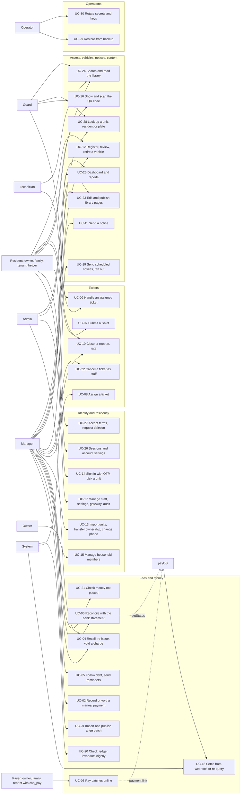

# Use cases

> Status: **Review** · Updated: 2026-10-19 · DOC-04
> Depends on: original SDD §3.2, §5–§12, §17, [DR](../00-decision-register.md) (DR-14, 16…24, 28…32, 35…42, 44…49, 50…53, 59, 62, 66, 72…75, 84), [DOC-01](vision-and-scope.md), [DOC-02](personas-and-journeys.md), [DOC-03](requirements.md), [DOC-06](../02-glossary.md)
> Main readers: DOC-05, DOC-21…49 (each detailed flow `FL-xx` expands one use case), DOC-51 (endpoints), DOC-56…67 (screens), P0-29, every task `Pn-xx` that builds a use case

This document describes how each actor reaches a goal with the system: 30 use cases (UC-01…30), each with its main, alternative and error flows and the race branches that two actors can create. It holds no design. The rules and numbers are in the requirements ([DOC-03](requirements.md)), the mechanisms in the design documents, and the step-by-step call sequences in the detailed flows (`06-design/flows/`, `FL-xx`).

## 0. Conventions

### 0.1 Actors

| Actor | Meaning |
| --- | --- |
| Admin, Manager, Technician, Guard | Staff roles (DOC-06 §1). Admin has every Manager right, so "Manager" in a flow also means Admin unless the use case says "Admin only" |
| Resident | Any holder of a resident account acting through one membership: owner, family member, tenant (with or without `can_pay`) or helper. A flow names the member types it allows |
| System | The `api` and `worker` processes acting without a user: webhook handler, jobs, outbox handlers |
| payOS | The payment gateway, a secondary actor of UC-03, UC-06 and UC-18 (the driver may also be `fake`, DR-26) |
| Operator | The person who runs the deployment; in phase 1 the Owner of the project (UC-29, UC-30) |

### 0.2 Notation

- **Endpoints** are written `METHOD /path` relative to `/api/v1`, in the audience groups of original SDD §17: `/auth/*` (public), `/me/*` (resident token plus `X-Unit-Id`), `/staff/*` (staff token), `/payments/webhooks/*` (gateway only). The endpoint IDs `E-xx` are assigned in DOC-51; until then the method and path identify the endpoint.
- **Screens** are the design artboard names in backticks (`Pay-VietQR`, `W-Fee-Batch`); the screens index (DOC-56) maps them to files and phases. Prefixes: `W-` web CMS, `B-` `K-` `G-` `S-` staff app, no prefix resident app.
- **Events** are the names of DR-42 (`finance.payment_posted.v1`). **Inbox templates** are the keys of DR-53 (`fee.batch_published`).
- **Error flows** read `E1. <situation> → <HTTP status> <code> · UI: "<text>"`. Codes are those of original SDD §17.3 and DR-74. Where a requirement says only "refused", the exact code is fixed in DOC-50/DOC-42 and the flow says so. UI strings are quoted exactly as the product shows them in English; their final wording and the Vietnamese text are in DOC-68.
- **Alternative flows** are numbered after the main step they leave (`2a`, `2b`). **Race branches** are listed in a table `Concurrent pair · Arbiter · Outcome` and always name the losing branch.
- **Rules** cite their source: `(DR-xx)`, `(FR-xx.y)`. Amounts use the sample building (DOC-01): unit `A-1508`, charge A 2,488,000 đ, charge B 350,000 đ, intent total 2,838,000 đ, transfer content `TT2FMZ9`.

### 0.3 Rules that every use case inherits

1. **Money.** A charge is paid in full or not at all. No use case allows a partial payment, an advance payment or a credit; money that is not an exact payment of whole open charges is a row of the money log (DR-84).
2. **Authorization.** Every resident request is evaluated against the active membership of `X-Unit-Id` on that request (`membership_inactive` when it is not, FR-16). Every staff request is scoped to the token's building and role, which are re-read from the database (DR-38).
3. **Audit.** Every staff mutation writes one audit row in the same transaction (FR-37, DR-57). A flow below mentions the audit row only when its content is notable.
4. **Notifications.** A status change and its inbox entry are one transaction with an outbox event (FR-23.2). A push carries a template title only, never an amount, name or ticket text (FR-29.3, DR-52).
5. **Retries.** A create that a client may repeat carries an `Idempotency-Key`; the same key and body replays the first response with `Idempotent-Replayed: true` (DR-74).
6. **Terms.** A resident who has not accepted the latest terms version gets 403 `terms_required` on every resident endpoint except `/auth/*`, `/me` and `/me/terms*` (FR-39.1). Flows below do not repeat this error.
7. **Version.** Edits of an aggregate carry `If-Match: "<version>"`; a stale version is 409 `version_conflict` with the fresh object (DR-74).
8. **Applies to all.** NFR-03 (API latency), NFR-10 (availability) and NFR-13 (Vietnamese and English strings with the same placeholders) have no single use case; they are checked on every flow (DOC-10, DOC-88).

## 1. Overview

### 1.1 Index

| UC | Use case | Main actor | FR / NFR | Detailed flows |
| --- | --- | --- | --- | --- |
| [UC-01](#uc-01--import-and-publish-a-fee-batch) | Import and publish a fee batch | Manager | FR-01…03 | FL-01, FL-02 |
| [UC-02](#uc-02--record-a-manual-payment-void-a-wrong-entry) | Record a manual payment; void a wrong entry | Manager | FR-05, FR-06 | FL-05, FL-06 |
| [UC-03](#uc-03--pay-batches-online) | Pay batches online | Owner, family member, tenant with `can_pay` | FR-07, FR-08, FR-10 | FL-10, FL-11, FL-14 |
| [UC-04](#uc-04--recall-and-re-issue-a-batch-void-a-single-open-charge) | Recall and re-issue a batch; void a single open charge | Manager, Admin | FR-04, FR-44, FR-49 | FL-03, FL-04, FL-44 |
| [UC-05](#uc-05--follow-debt-send-reminders) | Follow debt, send reminders | Manager | FR-12 | FL-08 |
| [UC-06](#uc-06--reconcile-with-the-bank-statement) | Reconcile with the bank statement | Manager | FR-11 | FL-15 |
| [UC-07](#uc-07--submit-a-ticket) | Submit a ticket | Owner, family member, tenant | FR-19 | FL-25, FL-29 |
| [UC-08](#uc-08--assign-a-ticket) | Assign a ticket | Manager | FR-20 | FL-26, FL-29 |
| [UC-09](#uc-09--handle-an-assigned-ticket) | Handle an assigned ticket | Technician, Guard | FR-21, FR-22 | FL-27 |
| [UC-10](#uc-10--close-or-reopen-rate) | Close or reopen, rate | Manager, resident | FR-23, FR-24 | FL-28 |
| [UC-11](#uc-11--send-a-notice) | Send a notice | Manager | FR-27, FR-28 | FL-31, FL-33 |
| [UC-12](#uc-12--register-review-and-retire-a-vehicle) | Register, review and retire a vehicle | Resident, Manager | FR-30, FR-43 | FL-36 |
| [UC-13](#uc-13--import-units-and-residents-transfer-ownership-change-a-login-phone) | Import units and residents; transfer ownership; change a login phone | Manager | FR-18, NFR-12 | FL-22, FL-23 |
| [UC-14](#uc-14--sign-in-with-otp-pick-a-unit) | Sign in with OTP; pick a unit | Resident | FR-15, FR-16, FR-39, NFR-07 | FL-19, FL-20 |
| [UC-15](#uc-15--manage-household-members) | Manage household members | Owner | FR-17 | FL-21, FL-35 |
| [UC-16](#uc-16--show-and-scan-the-qr-code) | Show and scan the QR code | Resident, Guard | FR-25, FR-26, NFR-06, NFR-14 | FL-34, FL-35 |
| [UC-17](#uc-17--manage-staff-settings-gateway-audit) | Manage staff, settings, gateway, audit | Admin | FR-13, FR-14, FR-37, FR-38, FR-40, FR-50 | FL-17, FL-18, FL-41, FL-45 |
| [UC-18](#uc-18--settle-from-webhook-or-re-query) | Settle from webhook or re-query | System | FR-08, FR-09, FR-10, NFR-01, NFR-02 | FL-09, FL-12, FL-13, FL-16 |
| [UC-19](#uc-19--send-scheduled-notices-fan-out-inbox-and-push) | Send scheduled notices; fan out inbox and push | System | FR-27, FR-29, NFR-04 | FL-32 |
| [UC-20](#uc-20--check-ledger-invariants-nightly) | Check ledger invariants nightly | System | NFR-09 | FL-42 |
| [UC-21](#uc-21--check-money-that-was-not-posted-and-mark-it-reviewed) | Check money that was not posted and mark it reviewed | Manager | FR-09, FR-46, FR-47 | FL-07, FL-16 |
| [UC-22](#uc-22--cancel-a-ticket-as-staff) | Cancel a ticket as staff | Manager | FR-42 | FL-30 |
| [UC-23](#uc-23--edit-and-publish-library-pages-restore-a-version) | Edit and publish library pages; restore a version | Admin, Manager | FR-32 | FL-38 |
| [UC-24](#uc-24--search-and-read-the-library) | Search and read the library | Resident, staff | FR-33 | FL-39 |
| [UC-25](#uc-25--view-the-dashboard-export-a-report) | View the dashboard; export a report | Manager, Admin | FR-34, FR-35, FR-36, FR-48, NFR-05 | FL-40 |
| [UC-26](#uc-26--manage-sessions-and-account-settings) | Manage sessions and account settings | Resident, staff | FR-45 | FL-43 |
| [UC-27](#uc-27--accept-terms-request-account-deletion) | Accept terms; request account deletion | Resident | FR-39, FR-41 | FL-19, FL-24 |
| [UC-28](#uc-28--look-up-a-unit-a-resident-or-a-plate) | Look up a unit, a resident or a plate | Guard, Manager | FR-31 | FL-37 |
| [UC-29](#uc-29--restore-the-system-from-backup) | Restore the system from backup | Operator (Owner) | NFR-11 | none (runbook RB-10) |
| [UC-30](#uc-30--rotate-secrets-and-keys) | Rotate secrets and keys | Operator (Owner) | NFR-08 | none (runbook RB-12) |

## 2. Fees and money

## UC-01 · Import and publish a fee batch

- **Actor:** Manager (Admin has the same right). Secondary: System (notification fan-out).
- **Trigger:** The Manager opens `W-Fees` and presses "Import batch" to bill a fee month (for example 10/2026).
- **Preconditions:** The Manager is signed in on the web CMS. The units of the building exist (UC-13). Every unit to be charged has an active owner, so someone can be notified.
- **Main flow:**
  1. On `W-Fee-Import` the Manager downloads the template (`GET /staff/imports/templates/fee_batch`; Vietnamese and English header aliases are both accepted, DR-22) and fills it.
  2. The Manager enters the batch header in the form: name (vi, optional en), fee month `10/2026`, due date (proposed as today + `defaultDueDays` 10 = 2026-10-15 when created on 2026-10-05), notice language.
  3. The browser uploads the file with a presigned `PUT` (`POST /staff/uploads`, verified by `HEAD`), then calls `POST /staff/imports {kind: "fee_batch", fileKey}`.
  4. The API validates the file synchronously (≤ 5 MB, ≤ 5,000 rows; a 2,000-row file answers in ≤ 10 s, FR-01.7) and answers with the preview stored in `import_job`: counts, the first 50 valid rows and up to 500 errors `{row, column, code, message}`. Example: 240 rows, 236 valid, 4 errors (rows 12, 57, 58, 201).
  5. The Manager reads the errors and presses "Save valid rows". `POST /staff/imports/{id}/commit` runs one transaction: `import_job` `validated → committed`, a draft batch with code `PH-2610-01` and 236 draft charges with their lines (FR-01.1, FR-03.4).
  6. On `W-Fee-Batch` the Manager sees the 4 units without a charge, fixes one by hand (`PUT /staff/charges/{id}` with `If-Match`; the charge `version` is guarded, FR-02.2) and previews a fee notice PDF (`W-Fee-Notice`).
  7. The Manager presses "Publish" (`POST /staff/fee-batches/{id}/publish` with `If-Match`). The publish checks pass: at least one charge, every charge total above 0, `due_date` not before today in building time (FR-03.1).
  8. In one transaction the batch moves `draft → published` by a conditional update, every charge `draft → open`, the event `finance.batch_published.v1` and the audit row are written (FR-03.2).
  9. The worker writes `fee.batch_published` inbox entries and pushes ("October fees published") to every active owner, family member and tenant of a charged unit; helpers get nothing (FR-03.3).
  10. The Manager follows the collection rate on `W-Dashboard` (UC-25).
- **Alternative flows:**
  - 3a. The Manager re-imports a corrected file while the batch is still `draft`: the new commit replaces all draft charges (exactly 200 charges after a 200-row file, `version` increases, FR-02.1).
  - 5a. The Manager presses "Save" twice, or two tabs commit the same job: the conditional update lets one commit through; the other sees the job `committed` and the draft rows are present once (FR-01.3).
  - 6a. The Manager adds an adjustment line for a waiver (kind `adjustment`, amount −200,000, with a reason in the note) in the file or in the draft table; the charge total must stay above 0 (FR-01.6, DR-19). The system never proposes an adjustment from a money-log row.
  - 6b. The Manager discards the draft: batch and charges are deleted, the code `PH-2610-02` is not issued again (FR-02.4).
  - 8a. Two Manager users press "Publish" at the same instant: one succeeds, the other sees the batch already published; 240 charges are `open` and one notification round is created (FR-03.2).
- **Error flows:**
  - E1. A file of 5.2 MB or 5,001 rows → 400 `validation_failed` naming the limit · UI: "File too large: 5 MB and 5,000 rows at most." No `import_job` is committed (FR-01.2).
  - E2. A row with an unknown unit code, another fee month, the same unit and item twice, or `amount ≠ quantity × unit price` → listed as a row error, never silently recomputed; quantity 12.345 × 15,000 gives 185,175 đ (FR-01.1, FR-01.5).
  - E3. Commit of a job older than 24 h → 409 `import_expired` · UI: "This preview has expired. Upload the file again." (FR-01.4).
  - E4. Publish on a draft with no charge, a charge total of 0, or a `due_date` in the past → 400 `validation_failed`; the response names the failed check and nothing changes (FR-03.1).
  - E5. A stale `If-Match` on a charge edit → 409 `version_conflict` with the fresh charge (FR-02.2).
  - E6. An edit of a published charge, or a direct `UPDATE` of its `amount` → refused; a trigger rejects the `UPDATE` (FR-02.3).
  - E7. The worker or Expo is down at publish → the publish still commits; the outbox retries and the inbox entries appear when the worker returns (UC-19 rules).
- **Postconditions:** A published batch with its charges `open`, visible to the members who can see fees; one audit row; debt includes the charges (UC-05).
- **Business rules:** Amounts are integer đồng; quantity has 3 decimals; line amount is rounded half up (DR-11). A published batch is frozen except for a later due date (UC-04). A charge is never edited after publish. Batch code `PH-YYMM-NN` comes from the module counter (DR-10).
- **Related:** FR-01, FR-02, FR-03; screens `W-Fees`, `W-Fee-Import`, `W-Fee-Batch`, `W-Fee-Notice`; endpoints `GET /staff/imports/templates/{kind}`, `POST /staff/uploads`, `POST /staff/imports`, `POST /staff/imports/{id}/commit`, `GET/POST /staff/fee-batches`, `PUT /staff/charges/{id}`, `POST /staff/fee-batches/{id}/publish`; events `finance.batch_published.v1`; flows FL-01, FL-02.

## UC-02 · Record a manual payment; void a wrong entry

- **Actor:** Manager (Admin has the same right).
- **Trigger:** A resident pays cash or by bank transfer at the office, or the Manager finds a wrong entry.
- **Preconditions:** The unit has at least one `open` charge (record) or a `posted` manual payment (void). The Manager is signed in.
- **Main flow (record):**
  1. On `W-Fee-Record` the Manager opens unit `A-1508`; the form lists its open charges and warns on any charge held by an active online payment ("online payment open since 09:12", FR-05.6).
  2. The Manager ticks whole charges A (2,488,000 đ) and B (350,000 đ), chooses method `cash`, enters payer "Trần Minh Anh", the date (today by default) and an optional note. The form shows the computed sum 2,838,000 đ; there is no amount field (DR-23).
  3. Optionally the Manager presses "Check" (`dryRun: true`): the response returns the sum and the receipts that would be issued; nothing is saved (FR-05.7).
  4. The Manager presses "Record". The client sends `POST /staff/payments` with an `Idempotency-Key`.
  5. One transaction: the payment is inserted (`source = cash`), each charge is updated by the conditional statement of DR-14 in ascending `charge.id` order, one live allocation per charge, one receipt per allocation (for example `BL-2610-0153` and `BL-2610-0154`), the audit row, the events `finance.payment_posted.v1` and `finance.receipt_issued.v1`.
  6. The worker renders the receipt PDFs; the residents of the unit who can see fees get `payment.received` (FR-05.1).
- **Main flow (void):**
  1. On `W-Fee-Record` the Manager opens the payment and presses "Void" with a reason of at least 5 characters, for example "recorded on the wrong unit" (`POST /staff/payments/{id}/void`).
  2. One transaction: payment `posted → void`, each live allocation `void`, each charge `paid → open`, each receipt `void` (number kept; the PDF is re-rendered with a diagonal "VOID" watermark), the audit row with before and after, `finance.payment_voided.v1` (FR-06.1).
  3. The residents get `payment.voided`; the charges are payable again at once (FR-06.5).
- **Alternative flows:**
  - 2a. The date is up to 90 days back (older needs an Admin) and never in the future (FR-05.5).
  - 4a. The same request is sent twice (double tap, timeout and retry): one payment exists; the second response is the first with `Idempotent-Replayed: true` (FR-05.4).
  - 5a. An online link is open on charge A and its transfer arrives after the cash: the confirmation finds A `paid` and becomes a money-log row `charge_already_paid` (UC-18, UC-21); the Manager refunds outside the system.
  - void-a. The payment came from a statement line: the line returns to `unmatched` (FR-06.4, UC-06).
  - void-b. To change an entry, the Manager voids it and records a new one; editing does not exist.
- **Error flows:**
  - E1. The request carries an `amount` that differs from the sum → 422 `allocation_mismatch` · nothing saved (FR-05.2).
  - E2. A selected charge was paid, recalled or voided a moment earlier → 409 `charge_changed` with the fresh state · UI: "This charge has just changed. Check the list and try again."; the whole transaction rolls back, charge A is not paid either (FR-05.3).
  - E3. `receivedOn` in the future, or more than 90 days back entered by a Manager → 400 `validation_failed` (FR-05.5).
  - E4. Void with a reason of 4 characters → 422 `validation_failed`; nothing changes (FR-06.2).
  - E5. Void of an `online` payment → refused (409; the exact code is fixed in DOC-50). Money confirmed by the bank is undone only by a refund outside the system (FR-06.3).
  - E6. The same `Idempotency-Key` with another body → 422 `idempotency_key_reuse`.
- **Postconditions:** Record: payment, allocations and receipts exist, the charges are `paid`, the unit's debt falls by 2,838,000 đ. Void: the ledger is back to its state before the payment, apart from the void rows and the audit trail.
- **Business rules:** A payment amount is exactly the sum of whole charges, computed by the system (DR-84). No advance, no partial payment, no credit. A manual payment is never linked to a log row except through a statement line of exactly the same whole charges (FR-11.6). One receipt per allocation; receipt numbers are gapless per month (DR-10).
- **Race branches:**

  | Concurrent pair | Arbiter | Outcome |
  | --- | --- | --- |
  | Manual payment and exact online settlement of one charge | Conditional `UPDATE charge … WHERE status = 'open'` | Exactly one wins. Manual loser: 409 `charge_changed`, nothing saved. Online loser: `charge_already_paid` log row. 500 charges raced: 0 charges with two live allocations (FR-05.8, EXP-03) |
  | Two manual payments of overlapping charges (A,B and B,A) | Ascending `charge.id` order | No deadlock; the second sees `paid` → 409 `charge_changed` |
  | Manual payment and recall of the batch | Charge row | Recall wins: the entry gets 409 `charge_changed`. Payment wins: recall returns 409 `batch_has_payments` (UC-04) |
  | Void of a payment and a new manual payment of the same charge | `payment.status = 'posted'` and `charge.status` conditions | The void commits first: the new entry then succeeds on the reopened charge. The new entry first: it fails with 409 `charge_changed` because the charge is still `paid` |

- **Related:** FR-05, FR-06; screens `W-Fee-Record`, `W-Audit`; endpoints `POST /staff/payments`, `POST /staff/payments/{id}/void`, `GET /staff/units/{id}/debt`, `GET /staff/receipts/{id}/pdf`; events `finance.payment_posted.v1`, `finance.payment_voided.v1`, `finance.receipt_issued.v1`, `finance.receipt_render_requested.v1`; flows FL-05, FL-06.

## UC-03 · Pay batches online

- **Actor:** Owner, family member, tenant with `can_pay` (the **payer**). Secondary: payOS, System (UC-18).
- **Trigger:** The payer opens `Fees` (or follows the push "October fees published") and taps pay.
- **Preconditions:** The payer is signed in (UC-14), has accepted the latest terms, the app is online (payment and QR screens never use the offline cache, DR-70), the selected unit's membership is active and allows paying (owner, family, or tenant with `can_pay`), an active gateway configuration exists (DR-33), and the unit has `open` charges of `published` or `closed` batches.
- **Main flow:**
  1. On `Fees` the payer sees the open charges of the unit: A "Management fee" 2,488,000 đ and B "Parking" 350,000 đ (`GET /me/fees?status=open`).
  2. On `Pay-Select` the payer selects both. Each charge is paid in full; there is no amount to edit. The total 2,838,000 đ is the sum (FR-07.2).
  3. The payer confirms VietQR. The app sends `POST /me/payments/intents {chargeIds}` with `X-Unit-Id` and an `Idempotency-Key`.
  4. The API checks the policy and the selection (1…10 charges, all `open`, batches `published` or `closed`, total between 2,000 and 500,000,000 đ by default, FR-07.6). In one transaction it inserts the intent in `creating` with the next `order_code` (for example 2610153), code `TT-261019-0001`, `display_until` now + 30 min, `expires_at` now + 60 min, and one item per charge; the partial unique index allows one active intent per charge.
  5. After the commit the API creates the payOS link (outside any transaction) and sets the intent `pending`, storing the QR payload.
  6. The response carries the QR payload, amount 2,838,000 đ, receiving account, transfer content `TT2FMZ9` (at most 9 characters, DR-27), `display_until` and `expires_at` (FR-07.3).
  7. `Pay-VietQR` shows the QR and polls `GET /me/payments/intents/{id}` every 2 s for the first minute, then every 3 s. The payer scans the QR (or saves the image) and pays in the bank app.
  8. UC-18 posts the payment: one payment (`source = online`), two live allocations, two receipts, both charges `paid`, the intent `paid`.
  9. The first poll that shows `paid` returns within 5 s at p95 of the webhook being accepted (NFR-02); the app moves to `Pay-Done` with one receipt per charge, the bank reference and the payer, without a manual refresh (FR-08.4, FR-08.7).
  10. The payer also receives `payment.received` in the inbox and a push "Payment received" (title only).
- **Alternative flows:**
  - 2a. **A second member meets an open payment.** The owner started the intent at 09:12. A family member selects exactly the same charges: `POST /me/payments/intents` returns the same intent with "started by Trần Minh Anh at 09:12" and the same QR; no second QR is made. Whoever transfers, the charges settle once (FR-07.4, J-6).
  - 2b. The selection overlaps but differs (the owner holds A and B, the family member selects only B): 409 `payment_in_progress` naming the holder and the time. The member may continue the holder's payment or cancel it (2e) (FR-07.4).
  - 2c. **A dead QR does not block the household.** The holder's `display_until` has passed (the QR is no longer shown) but the intent still holds its charges until `expires_at`: the new request cancels that intent (`pending → cancelling`, items released in the same transaction, cancel command queued) and creates the new one. The old intent still accepts a late exact confirmation (DR-28 rule 3).
  - 5a. **The gateway times out at link creation.** The API calls `GET` by order code once: found → `pending`; not found → `failed`, items released, the app shows "Could not create the payment. Try again." (FR-07.5). A `creating` intent older than 3 min is cleaned up by the re-query job the same way (FR-10.4).
  - 5b. The gateway refuses the request → 502 `gateway_unavailable`, intent `failed`, items released.
  - 7a. **"I have transferred".** The payer taps the button: `POST /me/payments/intents/{id}/check`. If `last_checked_at` is older than 30 s an immediate re-query runs; otherwise the current status returns without a gateway call (FR-10.3).
  - 7b. **Change method or cancel.** The payer, any other member who can pay for the unit, or a Manager cancels a `pending` intent (`POST /me/payments/intents/{id}/cancel`): `pending → cancelling`, charges released, cancel command queued (DR-28 rule 4).
  - 7c. **The payer closes the app.** The intent continues; the confirmation is still settled; the receipts are in `Fee-History` and the inbox.
  - 7d. **A transfer of another amount.** The payer edits the amount in the bank app and sends 2,000,000 đ. Nothing is posted; the intent stays `pending`; the status response carries `unmatchedTransfer {amount: 2000000, receivedAt}` and the app shows `Pay-Mismatch`: "We received a transfer that does not match the amount to pay. The management office will check and contact you." No push and no inbox entry go to the resident (FR-09.2, FR-29.7, DR-84 item 8). The Manager gets a money-log row (UC-21). The payer may wait for expiry or cancel, then start a new intent. *Which outcomes set `unmatchedTransfer` is decided in DR-96.*
  - 7e. **The QR validity passed.** After `display_until` the app shows "This QR code has expired" with a "New code" button, which repeats step 3 and takes branch 2c on the payer's own intent.
  - 9a. The payer is a tenant without `can_pay` or a helper → the pay button does not exist (`Fees-NoPay`, `Home-Helper`) and the API answers 403.
- **Error flows:**
  - E1. A tenant without `can_pay`, or a helper, calls the endpoint → 403 `forbidden` (FR-07.1).
  - E2. 0 or 11 charges selected, or a total of 1,500 đ → 400 `validation_failed` · UI: "Select between 1 and 10 charges." / "The amount is below the minimum for online payment." (FR-07.2, FR-07.6).
  - E3. A selected charge was paid or recalled since the list was loaded → 409 `charge_changed` with the fresh list · UI: "This charge has just changed." No intent is created.
  - E4. The 11th intent request within a minute → 429 `rate_limited` with `Retry-After` (FR-07.7).
  - E5. The membership was locked in the meantime → 403 `membership_inactive`; the app returns to `Unit-Pick` (FR-16.1).
  - E6. Another member holds an intent on part of the selection → 409 `payment_in_progress` (2b).
  - E7. The network drops after step 3: the app repeats the request with the same `Idempotency-Key` and receives the same intent (`Idempotent-Replayed: true`); a new key with the same charges returns the existing intent (2a).
  - E8. The cancel request when the intent is no longer `pending` → 409 `intent_not_cancellable`.
- **Postconditions:** Paid: the unit's charges are `paid`, receipts exist, debt falls. Not paid: the intent is `expired`, `cancelled` or `failed`, its charges are released and payable again.
- **Business rules:** Whole charges only; amount = Σ outstanding at creation (DR-28). A QR shows for 30 min; the intent holds its charges for 60 min unless superseded (2c). Membership removal of the creator does not cancel the intent (DR-28 rule 6). The app never decides that money arrived: only the server's `paid` status does (principle 7 of the master plan).
- **Race branches:**

  | Concurrent pair | Arbiter | Outcome |
  | --- | --- | --- |
  | Two members create an intent for the same charges at once | Partial unique index `payment_intent_item (charge_id) WHERE released_at IS NULL` | One insert wins; the other receives the winner's intent (same set, 2a) or 409 `payment_in_progress` (different set, 2b). 0 charges in two active intents (EXP-02 style barrier test) |
  | Intent creation and a manual payment of the same charge | Charge row (`status = 'open'` check in the creation transaction) | Creation first: the Manager is warned and may still record cash; the later transfer becomes `charge_already_paid`. Cash first: creation fails with 409 `charge_changed` |
  | Intent creation and a batch recall or a void of the charge | Charge row | Recall first: creation fails with 409 `charge_changed`. Creation first: the recall cancels the whole intent (UC-04). How the creation transaction locks the charges to close the gap between the check and the insert is fixed in DOC-23 |
  | Creation of a new intent and the dead-QR supersede (2c) | Intent row and its items, one transaction | Old intent `cancelling`, items released, new intent created atomically; a late confirmation of the old intent is still settled if exact and the charges are open (UC-18) |
  | Cancel and confirmation | Conditional claim on the intent (UC-18 step 7) | A confirmation that arrives first marks the intent `paid` and the cancel returns 409 `intent_not_cancellable`; a cancel that wins leaves `cancelling`, and an exact late confirmation is still posted |
  | Webhook and re-query confirm the same transfer | `gateway_event (provider, reference)` and the intent claim | One payment (UC-18) |
  | Forged webhook before the genuine one | HMAC check and `webhook_rejection` | The genuine confirmation is still posted (UC-18, FR-08.5) |
  | Double tap on "Pay" | `Idempotency-Key` | One intent |

- **Related:** FR-07, FR-08, FR-10; NFR-02; screens `Fees`, `Fees-NoPay`, `Fee-Detail`, `Fee-History`, `Pay-Select`, `Pay-VietQR`, `Pay-Done`, `Pay-Mismatch`; endpoints `GET /me/fees`, `GET /me/fees/{chargeId}`, `POST /me/payments/intents`, `GET /me/payments/intents/{id}`, `POST /me/payments/intents/{id}/cancel`, `POST /me/payments/intents/{id}/check`, `GET /me/receipts`, `GET /me/receipts/{id}/pdf`; events `finance.payment_posted.v1`, `finance.intent_cancel_requested.v1`; flows FL-10, FL-11, FL-14.

## UC-04 · Recall and re-issue a batch; void a single open charge

- **Actor:** Manager, Admin. Secondary: System (cancels intents, notifies residents).
- **Trigger:** The Manager finds a wrong batch or a wrong charge after publishing, or needs more time for residents.
- **Preconditions:** For recall: the batch is `published`. For void: the charge is `open` and has no live allocation. For the due-date extension: the batch is `published` or `closed`.
- **Main flow (recall and re-issue):**
  1. On `W-Fees` the Manager opens batch `PH-2610-01` and presses "Recall" (`W-Fee-Recall` shows the consequences).
  2. `POST /staff/fee-batches/{id}/recall` runs one transaction: `UPDATE fee_batch SET status = 'recalled' WHERE status = 'published'`, then all `open` charges of the batch become `void` and the updated row count must equal the number of the batch's charges that are not already `void` (DR-97).
  3. Every active intent that holds any of the batch's charges becomes `cancelling` as a whole, including a charge of another batch it holds; the cancel command is queued (DR-31).
  4. The audit row, `finance.batch_recalled.v1` and `fee.batch_recalled` notifications to the residents are written; debt no longer counts the charges (FR-04.1).
  5. The Manager presses "Re-issue" (`POST /staff/fee-batches/{id}/reissue`, `W-Fee-Reissue`): a new `draft` with `replaces_batch_id`, copied charges and lines under new ids, a new code, editable fee month and due date (FR-04.5). The Manager corrects the draft and publishes it (UC-01).
- **Main flow (void a single open charge):**
  1. The batch cannot be recalled because another unit has paid. On the batch charge list the Manager opens the charge of unit `A-1508` and presses "Void" (`W-Charge-Void`), entering the reason "billed to the wrong unit" (at least 5 characters).
  2. `POST /staff/charges/{id}/void {reason}` with `If-Match`: in one transaction the charge goes `open → void`; every intent that holds it is cancelled as a whole; `finance.charge_voided.v1` and the audit row are written; other charges of the batch are untouched (FR-49.1, FR-49.3).
  3. The resident gets `fee.charge_voided`; a resident watching `Pay-VietQR` sees the intent cancelled and is told to start again.
  4. The corrected charge is issued in a new draft batch (UC-01); the voided charge is never reopened (FR-49.4).
- **Main flow (extend a due date):**
  1. The Manager changes the due date of a published batch from 2026-10-15 to 2026-10-25 (`PATCH /staff/fee-batches/{id}` with `If-Match`).
  2. The change is audited and residents get `fee.batch_due_extended` (`finance.batch_due_extended.v1`); a charge 3 days past due moves to "not yet due" (FR-44.3).
- **Alternative flows:**
  - 2a. The Manager closes the batch instead (`POST /staff/fee-batches/{id}/close`): a manual freeze for reporting only; open charges stay payable and in debt; a closed batch can no longer be recalled (FR-04.4, DR-20).
  - 3a. The batch has no active intent: only the charges change.
  - void-a. A paid overcharge is not voided: the Manager offsets it with a negative adjustment line in a later batch (DR-19) or refunds outside the system (DR-84). Neither is created from the money log.
- **Error flows:**
  - E1. One charge of the batch is `paid` → 409 `batch_has_payments`; 239 of 240 rows updated is detected and the transaction rolls back; every charge is unchanged (FR-04.2) · UI: "This batch has payments and cannot be recalled. Void individual charges instead."
  - E2. Recall of a `closed` or already `recalled` batch → refused (409; the exact code is fixed in DOC-50) (FR-04.4).
  - E3. Void of a `paid` charge or of a charge with a live allocation → 409 · void with a reason of 4 characters → 422 `validation_failed` · void by a Technician → 403 `forbidden` (FR-49.2).
  - E4. A due date equal to or earlier than the current one → 400 `validation_failed`; any other field patched on a published batch → refused (FR-44.1, FR-44.2).
  - E5. Stale `If-Match` → 409 `version_conflict`.
  - E6. The gateway rejects the cancel with a 5xx → the command is retried 8 times (5 s doubling to 15 min), then dead-lettered with an alert; "already paid" from the gateway triggers `getStatus` and settlement (UC-18) (FR-10.6, DR-31).
- **Postconditions:** Recall: the batch is `recalled`, its charges `void`, its intents `cancelling` or `cancelled`, the residents informed. Void: one charge `void`. Extension: later due date, same status.
- **Business rules:** A recalled batch is never published again; a corrected copy is issued (DR-20). A voided charge is never reopened. Intents are always cancelled as a whole because their QR carries one amount. The void and the adjustment are independent of the money log (DR-16, DR-19).
- **Race branches:**

  | Concurrent pair | Arbiter | Outcome |
  | --- | --- | --- |
  | Recall and an exact online settlement of one charge of the batch | Charge row (`UPDATE … WHERE status = 'open'`) | Exactly one wins. Recall first: the transfer is a log row `charge_recalled`, nothing is posted, the Manager refunds outside the system. Payment first: the recall returns 409 `batch_has_payments`. Over 200 batches: 0 recalled batches with a live allocation (FR-04.3, EXP-04) |
  | Recall and a manual payment | Charge row | Same as above; the manual entry gets 409 `charge_changed` if the recall wins |
  | Recall and a resident creating an intent | Charge row; the recall also marks intents that exist at its commit | Creation first: the intent is cancelled as a whole by the recall. Recall first: creation fails with 409 `charge_changed`. The locking that closes the gap is fixed in DOC-23 |
  | Recall and a late confirmation for an intent already `cancelling` | Intent claim then charge update | The charges are `void`: outcome `charge_recalled`, logged, nothing posted (FR-09.5) |
  | Two Managers press "Recall" | Conditional update on the batch | One recall; the second sees `recalled` and gets 409 `version_conflict` |
  | Void of a single charge and an exact settlement | Charge row | Exactly one wins: voided with a log row, or paid with 409 on the void (FR-49.5, EXP-04) |
  | Void of a charge before the recall of its batch | Charge row | The charge is already `void`; the recall compares the rows it updated with the batch's charges that are not `void`, so a voided charge never blocks a recall (DR-97) |
  | Due-date extension and publish/recall | Batch `version` | The second to commit gets 409 `version_conflict` |

- **Related:** FR-04, FR-44, FR-49; screens `W-Fees`, `W-Fee-Batch`, `W-Fee-Recall`, `W-Fee-Reissue`, `W-Charge-Void`; endpoints `POST /staff/fee-batches/{id}/recall`, `POST /staff/fee-batches/{id}/reissue`, `POST /staff/fee-batches/{id}/close`, `PATCH /staff/fee-batches/{id}`, `GET /staff/fee-batches/{id}/charges`, `POST /staff/charges/{id}/void`; events `finance.batch_recalled.v1`, `finance.charge_voided.v1`, `finance.batch_due_extended.v1`, `finance.intent_cancel_requested.v1`; flows FL-03, FL-04, FL-44.

## UC-05 · Follow debt, send reminders

- **Actor:** Manager (Admin has the same right).
- **Trigger:** The due date has passed, or the Manager wants the state of debt.
- **Preconditions:** Published or closed batches with `open` charges exist.
- **Main flow:**
  1. On `W-Debts` the Manager sees debt per unit or per fee month: outstanding amount, open charges, oldest due date, and the aging buckets not yet due, 1–30, 31–60, 61–90 and over 90 days past due (`GET /staff/debts`; `GET /staff/units/{id}/debt` for one unit).
  2. The Manager filters "overdue more than 30 days" and selects 20 units.
  3. The Manager presses "Send reminders" (`POST /staff/debts/reminders`).
  4. The system writes `fee.reminder` inbox entries and pushes to the members who can see fees; one per unit per building day (FR-12.4).
  5. On `W-Debts` and in the unit detail the `UnitMoneyPanel` shows the unit's money-log rows next to the debt (UC-21).
- **Alternative flows:**
  - 3a. The Manager sends the same selection again 2 h later: 0 new reminders (already sent that building day); the response reports "20 skipped".
  - 3b. The Manager exports the debt aging (UC-25).
- **Error flows:**
  - E1. More than 10 reminder calls in an hour → 429 `rate_limited` with `Retry-After` · UI: "Too many reminders sent. Try again later." (FR-12.4).
  - E2. No unit selected → 400 `validation_failed`.
- **Postconditions:** Reminder inbox entries and pushes exist for the selected units; no ledger change.
- **Business rules:** Outstanding is the sum of `open` charges of `published` or `closed` batches; draft, paid and void charges never count (FR-12.3). Days past due use building time, never UTC: due 2026-10-15 gives 0 at 23:30 on 10-15 and 1 at 00:30 and at 06:59 on 10-16 (FR-12.2, DR-09). Boundaries: day 0 not yet due; 1 and 30 in 1–30; 31 and 60 in 31–60; 61 and 90 in 61–90; 91 over 90 (FR-12.1). The query runs in ≤ 50 ms at 5,000 units (planned, FR-12.5).
- **Related:** FR-12; screens `W-Debts`, `UnitMoneyPanel`, `W-Unit-Detail`; endpoints `GET /staff/debts`, `GET /staff/units/{id}/debt`, `POST /staff/debts/reminders`; templates `fee.reminder`; flows FL-08.

## UC-06 · Reconcile with the bank statement

- **Actor:** Manager (Admin has the same right). Secondary: payOS (`getStatus`).
- **Trigger:** The Manager exports the statement of the receiving account from the bank (monthly, or after an outage, a restore or a doubt).
- **Preconditions:** An active gateway configuration exists. The statement is an XLSX or CSV of ≤ 5 MB and ≤ 20,000 lines. A profile for the bank exists, or the Manager maps the columns once (generic profile, DR-34).
- **Main flow:**
  1. On `W-Statement` the Manager uploads the file (presigned `PUT`, then `POST /staff/statements`) and selects or maps a profile (sheet, header row, columns date, credit, content, reference, balance, formats).
  2. The API reads only credit lines and writes `statement_line` rows with `dedup_key = sha256(bank reference ‖ booked date ‖ amount ‖ normalized content)`. Repeated lines are reported `already_recorded` (FR-11.1, FR-11.2).
  3. For each line, in order, the first rule that succeeds decides (DR-35): (1) the bank reference equals a payment's `gateway_reference` or `bank_reference` → `matched`; (2) the content contains `TT` plus a base-32 order code of an intent in this building: if the intent is not `paid` the system asks payOS (`getStatus`); `PAID` and the line amount equals the intent amount → settle with payOS's own reference, `source = statement` (UC-18); not `PAID` → `statement_only` (FR-11.3); (3) an unreconciled `bank_transfer` payment of the same amount dated within ±1 day → `proposed` (several candidates are all listed); (4) otherwise `unmatched` (FR-11.5).
  4. The Manager reviews the result by status (matched, proposed, unmatched, already recorded) and confirms each proposal (`POST /staff/statements/{id}/lines/{lineId}/confirm`).
  5. For an unmatched line whose amount is exactly the sum of whole charges the Manager may assign it to a manual payment of those charges (`…/assign`); no other link exists (FR-11.6).
  6. For an unmatched line that is not fee money (a refund, a deposit) the Manager dismisses it with a note of at least 5 characters (`…/dismiss`), which marks it reviewed (UC-21).
  7. The "not seen in bank" list shows posted `online` payments older than 3 days with no statement line, only for dates covered by an imported period; cash is excluded (FR-11.7).
- **Alternative flows:**
  - 1a. An overlapping statement is uploaded today after yesterday's: repeated lines are `already_recorded`; 0 duplicates are created.
  - 3a. The intent was already `paid` by the webhook: the line is `matched` through the intent's payment; nothing is posted again.
  - 3b. The line amount differs from the intent amount → step 4 with the note "amount differs from intent"; `settle` is not called (FR-11.4).
  - 3c. A bank-specific profile is added once the real sample arrives (P0-05); the generic profile stays valid (FR-11.8).
- **Error flows:**
  - E1. A file over 5 MB or 20,000 lines → 400 `validation_failed` naming the limit.
  - E2. A profile that cannot read the file → the import fails with the first unreadable row and column named · UI: "Row 3, column Credit: not a number."
  - E3. payOS is unreachable during step 3 → the line stays `unmatched` with the note "gateway unavailable"; re-running the reconciliation retries it.
  - E4. A stale confirmation of a line already confirmed by another Manager → 409 `version_conflict`.
  - E5. An attempt to assign a line to charges whose sum differs → 422 `allocation_mismatch`.
- **Postconditions:** Each credit line has a match status; zero or more `settle` calls were made; unmatched and statement-only lines appear in the money log.
- **Business rules:** The statement can create a payment only through payOS confirmation, so it cannot double count (DR-35). A wrong amount is never applied elsewhere (FR-09.8). Uploaded files are kept 1 year (DR-34).
- **Race branches:**

  | Concurrent pair | Arbiter | Outcome |
  | --- | --- | --- |
  | Statement path and a late webhook for the same transfer | `gateway_event (provider, reference)` | The second finds the reference taken, writes nothing, answers as a duplicate; one payment |
  | Statement path and a manual payment of the same charge | Charge row | Whichever commits first posts; the other becomes a log row (`charge_already_paid`) |
  | Two Managers confirm the same proposed line | Line `version` | One confirms; the other gets 409 `version_conflict` |
  | Void of a payment linked to a line while the line is being confirmed | Payment status | The line returns to `unmatched`; the confirm fails with 409 |

- **Related:** FR-11; screens `W-Statement`, `W-Money-Log`; endpoints `POST /staff/statements`, `GET /staff/statements/{id}`, `POST /staff/statements/{id}/lines/{lineId}/assign|dismiss|confirm`, `GET /staff/statements/{id}/not-seen`; flows FL-15.

## UC-18 · Settle from webhook or re-query

- **Actor:** System (webhook handler, `intent_requery` job, statement path). Secondary: payOS.
- **Trigger:** (a) payOS posts `POST /payments/webhooks/{provider}/{gatewayConfigId}`; (b) the worker job ticks every 30 s and finds a `pending`, `creating` or `cancelling` intent whose `next_check_at` has come; (c) the payer presses "I have transferred" (UC-03 7a); (d) the statement path (UC-06) after payOS reports `PAID`.
- **Preconditions:** An active gateway configuration. For (a) a body of ≤ 16 KB. For (b) an intent younger than 60 min or not yet queried.
- **Main flow (a, webhook):**
  1. The handler checks, in order: the gateway configuration exists and is active (else 404, no row); the HMAC-SHA256 over the sorted `key=value` data with the Checksum Key, in constant time; `data.accountNumber` equals the configured receiving account; `data.code`/`success` mean a paid transfer. A call from an IP not on payOS's list is logged and never blocked (DR-32).
  2. The handler builds `Confirmation {provider, reference, orderCode, amount, paidAt, source, payload, gatewayConfigId}` and calls `settle()` in one transaction at READ COMMITTED (DR-29).
  3. `INSERT INTO gateway_event (outcome = 'pending') ON CONFLICT (provider, reference) DO NOTHING`. No row inserted → the transfer is known: commit and answer 200 (duplicate). The order code resolves the intent and the unit; no intent in this building → outcome `unknown_order`.
  4. A savepoint is taken. Classification without writing money: intent already `paid` → `duplicate_transfer`; `amount < intent.amount` → `amount_short`; `amount > intent.amount` → `amount_over`. Any of these releases the savepoint, sets the outcome, commits (UC-21 alert) and answers 200; the intent keeps its status.
  5. Exact amount: the intent is claimed by a conditional update (any status except `paid`; an `expired`, `cancelled` or `cancelling` intent is claimed too). Then for each item in ascending `charge_id` the statement of DR-14 (`UPDATE charge SET status = 'paid' … WHERE status = 'open' AND amount = :expected`) runs.
  6. Every item updated: insert the payment (`source = online`), one live allocation per item, one receipt per allocation (gapless numbers), release the items, set `gateway_event.outcome = 'posted'` and `payment_id`, write the audit row with `actor_kind = 'system'`, the outbox events `finance.payment_posted.v1` and `finance.receipt_issued.v1`, and commit. The intent is `paid` only now (FR-08.1).
  7. The handler answers 200. The payer's next poll shows `paid` with the receipts (UC-03 9); the worker renders the receipt PDFs and sends `payment.received`.
- **Main flow (b, re-query):**
  1. The job claims up to 20 due intents with `FOR UPDATE SKIP LOCKED`, advances `next_check_at` by a 60 s lease and commits (DR-30).
  2. Outside any transaction it calls payOS `getStatus` by order code. `PAID` → `settle()` with `source = requery` (steps 2–7 above). Still pending and younger than 60 min → `next_check_at = now + 5 min + random(0…20 s)`.
  3. At 60 min without a confirmation the intent becomes `expired`, a cancel command is queued and its charges are released (FR-10.2).
  4. `creating` older than 3 min: `GET` by order code; found → `pending`, absent → `failed` with items released (FR-10.4).
- **Alternative flows:**
  - 1a. The registration test payload payOS sends when the webhook URL is registered is answered 200 with no row written (FR-09.6).
  - 3a. **Late exact confirmation.** An exact confirmation for an `expired` intent whose charges are all still `open` is posted as usual (FR-09.7). The same holds for `cancelled` and `cancelling`.
  - 5a. **Zero rows on a charge.** The charge was paid in cash a moment ago or recalled: roll back to the savepoint, set the outcome `charge_already_paid` or `charge_recalled`, commit; no part of the intent is posted (FR-09.1, FR-09.5).
  - 5b. The intent is `creating` because the link response was not stored yet: the confirmation moves it `creating → paid` directly.
  - (d) The statement path calls `settle()` with payOS's own reference and `source = statement`; a later webhook for the same transfer deduplicates on `(payos, reference)` (UC-06).
  - 3b. **Resident message.** When the outcome leaves the intent open with money received, the status endpoint returns `unmatchedTransfer {amount, receivedAt}` (DR-96). No inbox entry and no push go to the resident (FR-29.7).
- **Error flows:**
  - E1. Invalid HMAC → 401 `invalid_signature`; one `webhook_rejection` row (`bad_signature`), no `gateway_event` row (FR-08.5, DR-32).
  - E2. Malformed body or a body over 16 KB → 400; `webhook_rejection` `malformed`. An order code of another building → 400 and `foreign_building`.
  - E3. SQLSTATE `40001` or `40P01` → the whole transaction is retried up to 3 times with 20–60 ms jitter (FR-08.8).
  - E4. PostgreSQL is down or the process dies before the commit → nothing is written; the handler answers 5xx or not at all; payOS retries and the re-query settles within one cycle.
  - E5. The process dies after the commit and before the answer → the payment exists once; the retry finds the reference and answers 200 as a duplicate (FR-08.6).
  - E6. payOS errors during the re-query → retries back off 30 s, 60 s, 2 min, 5 min; at most 5 gateway calls in flight; an alert fires when more than half of the calls in 10 min failed (FR-10.5).
  - E7. The cancel command fails with a 5xx → retried 8 times, then dead-lettered with an alert; "already paid" → `getStatus` and `settle()` (FR-10.6).
- **Postconditions:** One of: a payment with allocations and receipts (`posted`); a `gateway_event` row with a reason outcome and nothing posted; an unchanged state (duplicate, rejected). In every case each authenticated confirmation is a payment or a log row (NFR-01).
- **Business rules:** A confirmation is posted only when its amount equals the intent amount and every charge of the intent is still `open` (DR-84). No wrong transfer is matched to another charge, period or payment (FR-09.8). The HMAC signature is the only gate; IP is never a gate. The same function serves all three sources.
- **Race branches:**

  | Concurrent pair | Arbiter | Outcome |
  | --- | --- | --- |
  | One confirmation delivered 5 times in random order | `gateway_event (provider, reference)` | 1 payment, 0 duplicate receipts; the other 4 calls answer 200 and write nothing (FR-08.2, EXP-01) |
  | Webhook and re-query confirm the same intent at the same instant | `gateway_event` insert, then the intent claim | 1 payment per intent over 1,000 intents × 10 rounds; 0 deadlocks; 0 errors returned to the gateway (FR-08.3, EXP-02) |
  | A forged body with a real `reference` before the genuine webhook | HMAC check; failures go to `webhook_rejection` | The forged call gets 401 and occupies nothing; the genuine one is posted (FR-08.5, EXP-01) |
  | Online settlement and a manual payment of one charge | Charge row | Exactly one wins; the online loser is `charge_already_paid`, the manual loser 409 `charge_changed` (FR-05.8, EXP-03) |
  | Online settlement and a recall or a void of its charge | Charge row | Recall/void first: `charge_recalled`. Settlement first: the recall gets 409 `batch_has_payments`, the void 409 (EXP-04) |
  | Settlement and a cancel of the same intent | Intent claim | The claim accepts `pending`, `cancelling`, `expired`, `cancelled`; an exact confirmation is posted even if the cancel won |
  | Two payments covering the same charges in different orders (A,B and B,A) | Ascending `charge_id` order | No deadlock; one wins |
  | Two different transfers for one intent | `gateway_event` unique reference, then intent status | The first exact one is posted; the second is `duplicate_transfer` |
  | The process killed mid-transaction | Transaction atomicity | Nothing committed; the gateway retries or the re-query settles |
  | A statement line and a webhook for the same transfer | `gateway_event (provider, reference)` | One payment |

- **Related:** FR-08, FR-09, FR-10; NFR-01, NFR-02; screens `W-Transactions` (signature errors, duplicates), `W-Money-Log`, `Pay-VietQR`, `Pay-Mismatch`; endpoints `POST /payments/webhooks/{provider}/{gatewayConfigId}`, `GET /me/payments/intents/{id}`, `GET /staff/payments/intents`; events `finance.payment_posted.v1`, `finance.receipt_issued.v1`, `finance.money_unposted.v1`, `finance.intent_cancel_requested.v1`; flows FL-09, FL-12, FL-13, FL-16.

## UC-20 · Check ledger invariants nightly

- **Actor:** System (`invariant_check` job). Secondary: Admin (alert receiver).
- **Trigger:** The job runs at 03:00 building time every day; a missed run executes once at worker start if inside its grace window (DR-62).
- **Preconditions:** The worker runs; the database is reachable.
- **Main flow:**
  1. The job takes `pg_try_advisory_xact_lock(hashtext('job:invariant_check'))`; if another worker holds it, it ends.
  2. It runs set queries per building: every `paid` charge has exactly one live allocation of its full amount; every live allocation sits on a `paid` charge; every `posted` payment equals the sum of its live allocations; every live allocation has one receipt; receipt numbers have no gap against the counter; every `posted` money-log row has a payment (DR-15, SDD §5.10).
  3. An empty result writes `job_run` with status `ok` and `job_last_success_age_seconds` resets.
  4. A non-empty result raises the `invariant_violation` alert with the offending rows and pages the Admin (runbook RB-01).
- **Alternative flows:** 1a. The job is run by hand after a restore (UC-29) before the system reopens.
- **Error flows:** E1. The job fails or does not finish → `job_run` `failed`, the "job last success" alert fires after the grace window. E2. A false positive on clean data is a defect: 0 are accepted (NFR-09).
- **Postconditions:** A `job_run` row; violations, if any, are listed with ids.
- **Business rules:** A violation means a bug, not a business situation; the money log is a different thing (DR-16). The repair is never an edit of `charge.status`: void the payment instead (RB-01). Detection of an injected corruption within 24 h is measured with the 20 corruptions of DR-78.
- **Related:** NFR-09; screens `W-System` (job status), `W-Audit`; events none; flows FL-42.

## UC-21 · Check money that was not posted and mark it reviewed

- **Actor:** Manager (Admin has the same right).
- **Trigger:** The Manager receives an inbox entry `finance.money_unposted` (also over SSE on the web CMS) or sees "money to check: 3" on `W-Dashboard`.
- **Preconditions:** At least one money-log row is `open`: a `gateway_event` with an outcome other than `posted`, or a `statement_line` that is `unmatched` or `statement_only`.
- **Main flow:**
  1. On `W-Money-Log` (a tab of `W-Transactions`) the Manager opens the list, newest first, filtered by outcome, unit, date range and open/reviewed (`GET /staff/money-log`, keyset-paginated, FR-47.1).
  2. The Manager opens a row: amount, time, reference, order code, intent, a payload excerpt, the payment and receipt link when posted, and the review note (FR-47.2). Example: outcome `amount_short`, 2,000,000 đ received for an intent of 2,838,000 đ.
  3. The Manager handles it outside the system: contacts the resident, refunds the transfer, or records a manual payment of whole charges (UC-02) if the resident pays the rest in cash. Nothing the system offers here changes the ledger.
  4. The Manager marks the row reviewed with a note, for example "refunded by bank transfer 10/19" (`POST /staff/money-log/{kind}/{id}/review {note}`), once (FR-46.1).
  5. The row moves `open → reviewed`; an audit row is written; the dashboard counter falls by 1.
  6. On a unit's detail screen and on `W-Debts` the `UnitMoneyPanel` lists the same rows for that unit (FR-47.3).
- **Alternative flows:**
  - 2a. A new open row arrives while the Manager is on the page: every active Manager and Admin gets `finance.money_unposted` and the counter rises by 1 (FR-46.4); the web CMS refreshes through the `money_log.opened` event (DR-75).
  - 3a. The Manager adjusts a later batch with a negative adjustment line or voids a single open charge. Both are independent actions the Manager decides alone; the system never creates, suggests or pre-fills them from a log row (DR-16, DR-19).
- **Error flows:**
  - E1. A second review of the same row → refused (409; the exact code is fixed in DOC-50) (FR-46.1).
  - E2. A note of 4 characters → 422 `validation_failed` · UI: "Write at least 5 characters."
  - E3. A row with outcome `posted`, or a statement line `matched`, `proposed` or `already_recorded` → refused (FR-46.2).
  - E4. A Technician or Guard opens the endpoint → 403 `forbidden`; a resident never sees the log (DR-84).
- **Postconditions:** The row is `reviewed` with note, reviewer and time. Payments, allocations and charges are identical to before (FR-46.3).
- **Business rules:** Outcomes: `amount_short`, `amount_over`, `duplicate_transfer`, `charge_already_paid`, `charge_recalled`, `unknown_order`; statement lines `unmatched`, `statement_only` (DR-16). A transfer of another amount is never matched to another charge, period or payment.
- **Related:** FR-09, FR-46, FR-47; screens `W-Money-Log`, `UnitMoneyPanel`, `W-Dashboard`; endpoints `GET /staff/money-log`, `POST /staff/money-log/{kind}/{id}/review`, `GET /staff/units/{id}/money-log`; events `finance.money_unposted.v1`; templates `finance.money_unposted`; flows FL-07, FL-16.

## 3. Identity and residency

## UC-13 · Import units and residents; transfer ownership; change a login phone

- **Actor:** Manager (Admin has the same right).
- **Trigger:** The building is set up, an owner changes, or a resident changes their phone number.
- **Preconditions:** The Manager is signed in. For the import, the template of kind `unit_owner`.
- **Main flow (import):**
  1. On `W-Import` the Manager downloads the template (`GET /staff/imports/templates/unit_owner`), fills unit code, floor, bedrooms, area, occupancy, owner full name, phone, optional email, CCCD and date of birth.
  2. The browser uploads the file; `POST /staff/imports {kind: "unit_owner", fileKey}` validates it synchronously (a 2,000-row file with 40 errors previews in ≤ 10 s, NFR-12) and stores the preview in `residency.import_job`.
  3. The preview lists valid rows, rows that update an existing unit ("12 units exist, will be updated") and row errors.
  4. The Manager presses "Save valid rows" (`POST /staff/imports/{id}/commit`): one transaction creates or updates units, resident profiles and owner memberships.
  5. The uploaded file is deleted when the job commits or expires (it holds national ID numbers, DR-22).
- **Main flow (transfer ownership):**
  1. On `W-Unit-Detail` of `A-1508` the Manager presses "Transfer ownership", enters the new owner's phone and name, and decides whether to keep the existing members (default: remove).
  2. `POST /staff/units/{id}/owner`: in one transaction the old owner's membership is removed, the new owner's inserted, the 3 other members removed (unless "keep members"), `credential_version` increased on every changed membership, one `unit_history` row written; `residency.owner_changed.v1` is emitted (FR-18.3).
  3. Fees, receipts and tickets stay with the unit. The new owner sees the open charges of the unit but not payments dated before their membership began (DR-40).
- **Main flow (change a login phone):**
  1. The Manager opens the resident on `W-Unit-Detail`, enters the new number (`PATCH /staff/residents/{id}/phone`).
  2. For a free number: all the account's sessions are revoked, device tokens deleted, the person signs in with the new number, memberships are unchanged (FR-18.4).
- **Alternative flows:**
  - 3a. Create an owner by phone on `W-Resident-Add` (`POST /staff/residents`): an existing phone links the new unit to the existing account instead of creating one.
  - 3b. Search: the Manager types "nguyen", "van an" or "4567"; the resident is found by each; a phone fragment under 4 digits does not search by phone (FR-18.5).
  - 3c. The unit detail shows `unit_history`: kind, actor and time (FR-18.6).
  - 3d. Lock or remove a member from `W-Unit-Detail` (`PATCH /staff/memberships/{id}`); a membership locked by the Manager can be unlocked only by the Manager (FR-17.4).
- **Error flows:**
  - E1. One phone appears for two different people → the second row is a row error. A unit that already has an owner and a file naming another → row error "transfer is a deliberate action". An existing account is linked and its name is not overwritten; the preview says so (FR-18.1).
  - E2. A file of 5.2 MB or 5,001 rows → 400 `validation_failed` (FR-01.2 limits apply). A job older than 24 h → 409 `import_expired`.
  - E3. The new login phone already has an account → 409 `phone_in_use` · UI: "This number already belongs to another account." (FR-18.4).
  - E4. Two commits of the same job → one commit; the second sees `committed`.
  - E5. Transfer while the old owner is deleting their account → the account deletion stays refused with 409 `owner_must_transfer` until the transfer commits (UC-27).
  - E6. A stale `If-Match` on the unit → 409 `version_conflict`.
- **Postconditions:** Units, profiles and memberships exist; the unit history records the change; uploaded files are gone.
- **Business rules:** A unit is never deleted. One phone is one resident account across units. Exactly one active owner per unit (unique index, FR-16.5). CCCD is encrypted and shown masked; the detail view and every export containing it write one `pii.read` audit row (FR-37.5). Merging accounts is out of scope.
- **Race branches:**

  | Concurrent pair | Arbiter | Outcome |
  | --- | --- | --- |
  | Two commits of one import job | `UPDATE import_job … WHERE status = 'validated'` | One commit; the draft data appears once |
  | Two transfers of one unit | Unique index on the active owner | One succeeds; the other fails and rolls back |
  | Transfer and an owner locking a member | `credential_version` and membership status in one transaction | Whichever commits second sees the new state; a locked member is removed by the transfer anyway |
  | A phone change and a sign-in with the old number | Session revocation and `refresh_family` | The old refresh tokens are revoked at the change; the next request with the old token fails |

- **Related:** FR-18, FR-17.4; NFR-12; screens `W-Import`, `W-Units`, `W-Unit-Detail`, `W-Residents`, `W-Resident-Add`; endpoints `GET /staff/imports/templates/{kind}`, `POST /staff/imports`, `POST /staff/imports/{id}/commit`, `GET/POST /staff/units`, `GET/PATCH /staff/units/{id}`, `POST /staff/units/{id}/owner`, `GET /staff/units/{id}/history`, `GET/POST /staff/residents`, `PATCH /staff/residents/{id}/phone`, `PATCH /staff/memberships/{id}`; events `residency.owner_changed.v1`, `residency.membership_changed.v1`, `identity.session_revoked.v1`; flows FL-22, FL-23.

## UC-14 · Sign in with OTP; pick a unit

- **Actor:** Resident (any member type). Secondary: System (SMS).
- **Trigger:** The resident opens the resident app with no valid session.
- **Preconditions:** The resident's phone is registered by the Manager (UC-13) or by an owner (UC-15). The resident app is at or above `MIN_APP_VERSION`.
- **Main flow:**
  1. On `Login` the resident types the phone number and presses "Continue" (`POST /auth/otp`).
  2. For a registered phone the API marks any earlier unconsumed challenge consumed, creates a 6-digit challenge valid 5 min, and queues one SMS (`identity.sms_requested.v1`). The response carries a challenge id and `resendAfter` 45 s (FR-15.1).
  3. On `OTP` the resident enters the code (`POST /auth/otp/verify`). The code is accepted once; the API issues an access token (15 min) and a refresh token (sliding 180 days, cap 365 days).
  4. First sign-in or a new version: `Terms` shows the terms and privacy text; the resident accepts (`POST /me/terms`, UC-27).
  5. If the account has one active membership the app opens `Main`; if several, `Unit-Pick` lists the units and the resident picks one. The app sends `X-Unit-Id` on every later request.
  6. The home screen follows the member type: `Main` (owner), `Home-Member`, `Home-Tenant-Pay`, `Home-Tenant-NoPay`, `Home-Helper`. The app registers its device for push (`POST /me/devices`).
- **Alternative flows:**
  - 2a. The phone is not registered → 404 `phone_not_registered`, no SMS; `Login-Error` shows the Manager's contact (`GET /me/contact`, `GET /public/config`) (FR-15.1).
  - 3a. Resend: after 45 s the resident presses "Resend"; the new challenge consumes the old one (FR-15.2).
  - 3b. **Demo accounts.** For an account flagged `is_demo`, the fixed code `123456` is accepted and no SMS is sent (store review, demo building). For any other account it is refused (FR-15.6).
  - 5a. The resident switches unit from the app header; the app clears its unit-scoped cache.
  - 5b. Sign out (`POST /auth/logout`) revokes the session and deletes the device token (UC-26).
- **Error flows:**
  - E1. A wrong code → 400 `otp_invalid` with `details.attemptsLeft` 4, 3, 2, 1, 0; the fifth wrong code consumes the challenge · UI: "Wrong code. 3 tries left." (FR-15.3).
  - E2. A code at 5 min 01 s → 400 `otp_invalid` (expired); a resend at 30 s → 429 `rate_limited` with `Retry-After`; at 46 s accepted (FR-15.2).
  - E3. More than 5 SMS for a phone in an hour, or more than 20 challenges from one IP → 429 `rate_limited`; at 3,000 SMS in a day new challenges are refused and an alert fires (FR-15.5, NFR-07).
  - E4. The SMS provider is down → 503 `sms_unavailable` · UI: "Could not send the code. Try again later."
  - E5. The membership is locked or removed after sign-in → every `/me/*` request returns 403 `membership_inactive`; the app returns to `Unit-Pick` (FR-16.1).
  - E6. The app is older than `MIN_APP_VERSION` → 426 `upgrade_required` · UI: "Update the app to continue."
  - E7. The account has no active membership at all → the app shows a neutral "No unit is linked to this account. Contact the management office."
- **Postconditions:** A session (refresh family) exists; the app holds the selected unit; the resident has accepted the latest terms.
- **Business rules:** An unregistered phone gets no SMS (the enumeration trade-off is accepted, DR-37). Policy is evaluated on every request from the membership row, never from the token (FR-16.3): helpers see no fees, tickets, vehicles or library; tenants without `can_pay` cannot pay; only owners manage members (FR-16.2). A resident token and a staff token never mix (FR-16.4). Sessions are capped at 10 per account (FR-45.3).
- **Race branches:**

  | Concurrent pair | Arbiter | Outcome |
  | --- | --- | --- |
  | Two verifies of the same correct code | Atomic single-use `UPDATE otp_challenge … consumed_at IS NULL` | Exactly one signs in; the other gets `otp_invalid` (FR-15.4) |
  | 5 guesses in parallel | Attempts counter in one statement | At most 5 attempts; 0 successful guesses (EXP-09) |
  | A second OTP request while the first is live | Consume-then-insert in one transaction | One live challenge per phone |
  | Owner locks the membership while the resident uses the app | Membership read on each request | The very next request fails (UC-15) |

- **Related:** FR-15, FR-16, FR-39; NFR-07; screens `Login`, `Login-Error`, `OTP`, `Terms`, `Unit-Pick`, `Main`, `Home-Member`, `Home-Tenant-Pay`, `Home-Tenant-NoPay`, `Home-Helper`; endpoints `POST /auth/otp`, `POST /auth/otp/verify`, `POST /auth/refresh`, `POST /auth/logout`, `GET /me`, `GET /me/contact`, `GET /public/config`, `POST /me/devices`; events `identity.sms_requested.v1`; flows FL-19, FL-20.

## UC-15 · Manage household members

- **Actor:** Owner.
- **Trigger:** The owner wants to add a family member, a tenant or a helper, or to change or end an arrangement.
- **Preconditions:** The owner has the active owner membership of the selected unit.
- **Main flow:**
  1. On `Members` the owner sees the unit's members. They press "Add" (`Member-Add`) and enter a phone, a name, the type (family member, tenant, helper) and, for a tenant, whether the tenant may pay (`can_pay`).
  2. `POST /me/members`: the API finds the resident account by phone or creates it, inserts the membership and sends one SMS invitation to install the app (counted in the phone's bucket and in the owner's 10 invitations a day).
  3. The new member signs in (UC-14) and sees only what their type allows.
  4. Later the owner opens `Member-Actions` and changes `family ↔ tenant`, toggles `can_pay`, locks, unlocks or removes the member (`PATCH/DELETE /me/members/{id}`). In the same transaction `membership.credential_version` increases (FR-17.3).
  5. The effect is immediate: the member's next request returns 403 `membership_inactive`, and a QR code issued before the change fails at the gate (UC-16).
- **Alternative flows:**
  - 2a. The phone already has an account: that account gets a new membership of this unit; no second account is created (FR-17.1).
  - 4a. The owner enables `can_pay` for a tenant whose pay button was missing (`Fees-NoPay`): the change applies on the tenant's next request (J-7).
  - 4b. The owner unlocks a member that the Manager locked → refused; only the Manager can (FR-17.4).
  - 4c. The Manager locks or removes a member from `W-Unit-Detail` (UC-13 3d).
- **Error flows:**
  - E1. The 11th invitation of the day → 429 `rate_limited` · UI: "You can invite 10 people a day." (FR-17.2).
  - E2. A member tries to manage members → 403 `forbidden` (FR-16.2). The owner acts on their own membership → refused.
  - E3. A phone that is not valid in any country → 400 `validation_failed`.
  - E4. The unit already has 25 memberships: no limit applies; the add succeeds (FR-17.5).
- **Postconditions:** The membership exists or has the new status and type; `credential_version` is higher; the member's history view starts at `membership.created_at` (FR-17.6).
- **Business rules:** There is no limit on members or helpers. A new member sees the open charges of the unit but paid history, receipts and payer names only from the start of their own membership (DR-40, FR-17.6). Helpers read only broadcast notices and their own QR code.
- **Race branches:**

  | Concurrent pair | Arbiter | Outcome |
  | --- | --- | --- |
  | Owner locks a member, member opens the QR screen | Membership status and `credential_version` read on each request | The lock commits first: QR creation returns 403. QR first: the code dies at the next scan (FL-35, EXP-05) |
  | Owner and Manager change the same membership | Membership `version` | The second gets 409 `version_conflict`; a Manager lock cannot be undone by the owner |
  | Two invitations to the same phone | Account unique on phone, membership unique on `(account, unit)` | One account, one membership; the second call returns the existing membership |
  | Lock then unlock then scan the old code | `credential_version` | `invalid`: the version differs (FR-26.4) |

- **Related:** FR-17, FR-16; screens `Members`, `Member-Add`, `Member-Actions`, `Unit-Owner`, `Unit-Member`; endpoints `GET/POST /me/members`, `PATCH/DELETE /me/members/{id}`; events `residency.membership_changed.v1`; templates `member.added`; flows FL-21, FL-35.

## UC-17 · Manage staff, settings, gateway, audit

- **Actor:** Admin. Secondary: Manager (creates and unlocks Technician and Guard accounts only), every staff role (sign-in, reset), System (mail).
- **Trigger:** A new staff member joins, the building changes a setting, the receiving account changes, or someone reviews what was done.
- **Preconditions:** The actor is signed in on the web CMS (`W-Login`) with the role the action needs.
- **Main flow (create a staff account):**
  1. On `W-Staff-New` the Admin enters name, email and role (Admin, Manager, Technician, Guard). A Manager may choose only Technician or Guard (FR-14.1).
  2. `POST /staff/accounts`: the account starts `invited`; a set-password link valid 24 h is mailed (`identity.mail_requested.v1`), opened in a browser (`W-Reset`).
  3. The new staff member sets a password (8–128 characters, letters and digits) and signs in (`POST /auth/staff/login`); the account becomes `active` (FR-13.5, FR-14.2).
- **Main flow (change the receiving account, with step-up):**
  1. On `W-Gateway` the Admin edits the receiving account. Secrets are shown masked (`••••` plus the last 4).
  2. Saving needs a step-up: `W-Step-Up` asks for the password and a one-time code. `POST /staff/step-up {action: "gateway_config"}` mails a 6-digit code to the Admin's own email, valid 10 min, single use (FR-50.1).
  3. The Admin enters password and code and saves: `PUT /staff/gateway` carries `stepUp {password, code}`, verified in the same transaction as the change.
  4. The change commits when no intent is active; the audit row records which fields changed, not the secret values.
  5. Every Admin of the building receives an email and the inbox entry `staff.step_up_done` (FR-50.4). The Admin presses "Check connection" (`POST /staff/gateway/check`).
- **Alternative flows:**
  - A. **Staff sign-in and lockout.** Five consecutive wrong passwords lock sign-in for 15 min in one statement; `W-Login` shows "2 tries left, then locked 15 minutes". The correct password is refused during the lock. An Admin (or a Manager for a Technician/Guard) unlocks at once (`POST /staff/accounts/{id}/unlock`), or a completed reset clears it (FR-13.1, FR-13.6). A further limit of 30 attempts per IP in 15 min applies (FR-13.2).
  - B. **Reset.** A staff member requests a reset link (`POST /auth/staff/password-reset`); the answer is identical for a known and an unknown email; the link works once within 30 min and a newer link consumes the older (FR-13.3, FR-13.4).
  - C. **Resend an invite** that expired at 25 h (`POST /auth/staff/invite/resend`); the account stays `invited` until then (FR-14.2).
  - D. **Lock or change a role.** Locking a staff member who holds tickets in `assigned`, `accepted`, `in_progress` or `on_hold` is refused with the list; the Admin may force it with `reassignTo` (FR-14.3). A role change or lock revokes all refresh families; the next request is refused at once (FR-14.4).
  - E. **Settings.** On `W-Building` the Admin edits company and building data, `defaultLanguage`, `defaultDueDays` (10), `accountDeletionDays` (30), lockout (5, 15), `maxCarsPerUnit` (2), storage quota, `feeNoticeLanguage` and `reportColumns` (`PATCH /staff/settings`, `If-Match`); the Admin also publishes a new terms version (`POST /staff/terms`, UC-27). A Manager gets 403 (FR-38.1).
  - F. **Audit.** On `W-Audit` the Admin filters by actor, action, object and date (`GET /staff/audit`, keyset-paginated) and reads before/after values and reasons.
  - G. **Storage.** `W-System` shows file usage; the hourly job alerts the Admin at 80% (40 GB of 50 GB) and uploads are refused at 100% (FR-40.1).
- **Error flows:**
  - E1. A Manager creates an Admin → 403 `forbidden` (FR-14.1).
  - E2. A sensitive request with no code, a wrong code, an expired code, a reused code, a wrong password or another Admin's code → refused (401 or 403, exact code in DOC-26); 0 unexpected 2xx across the sensitive endpoints (FR-50.2, EXP-10). Five wrong codes consume the challenge; a wrong password counts toward the lockout (FR-50.3).
  - E3. A locked account signs in → 423 `account_locked` with `details.retryAfter` · UI: "Too many attempts. Try again in 15 minutes." (FR-13.1).
  - E4. A password such as `12345678` or `abcdefgh`, or 129 characters → 400 `validation_failed` (FR-13.5).
  - E5. Locking a Technician with open tickets → 409 `staff_has_open_tickets` listing the tickets (FR-14.3).
  - E6. `defaultDueDays` −1 or `feeNoticeLanguage` = `fr` → 422 and nothing changes (FR-38.2).
  - E7. A gateway/receiving-account change while an intent is active → 409 until none is active; a stale `If-Match` → 409 `version_conflict` (FR-38.3).
  - E8. The mail provider is down → the code or link is retried by the outbox; the UI shows "The email may be delayed."
  - E9. An upload at 100% quota → 413 `quota_exceeded` · UI: "Storage is full. Contact the administrator." (FR-40.1).
- **Postconditions:** The staff account, setting or gateway configuration is changed and audited; every Admin has been told about a step-up change.
- **Business rules:** Admin has every Manager right. Step-up applies to exactly three actions: change the gateway configuration or the receiving account, create or promote an Admin, change a staff email (DR-39). A gateway callback has no password: the HMAC is its only gate. Every staff mutation writes an audit row in the same transaction; a failed audit insert fails the mutation (FR-37.1). The runtime database role cannot update or delete audit rows (FR-37.4). Audit retention: 5 years for finance objects, 2 years for others, never for the ledger tables (FR-37.6, to be confirmed in P0-06).
- **Race branches:**

  | Concurrent pair | Arbiter | Outcome |
  | --- | --- | --- |
  | 20 parallel wrong passwords for one email | One `UPDATE … failed_attempts + 1 … RETURNING` | `failed_attempts` never exceeds 5; the account is locked for 15 min (FR-13.1) |
  | Two uses of the same reset or step-up code | Atomic single-use statement on `password_token` | One succeeds; the second is refused |
  | Two Admins request a step-up code for the same action | One live code per staff and action | The newer request consumes the older |
  | Changing the receiving account while an intent is created | Active-intent check in the change transaction | 409 until no intent is active; an intent created after the change uses the new account (stored in its `receiving` snapshot) |
  | Two Admins edit the settings | Settings `version` | The second gets 409 `version_conflict` |

- **Related:** FR-13, FR-14, FR-37, FR-38, FR-40, FR-50; screens `W-Login`, `W-Forgot-Sent`, `W-Reset`, `S-Login`, `S-Login-Error`, `S-Forgot`, `S-Forgot-Sent`, `W-Staff`, `W-Staff-New`, `W-Building`, `W-Gateway`, `W-Step-Up`, `W-Audit`, `W-System`; endpoints `POST /auth/staff/login`, `POST /auth/staff/password-reset`, `POST /auth/staff/password`, `POST /auth/staff/invite/resend`, `GET/POST/PATCH /staff/accounts`, `POST /staff/accounts/{id}/unlock`, `GET/PATCH /staff/settings`, `GET/PUT /staff/gateway`, `POST /staff/gateway/check`, `POST /staff/step-up`, `GET /staff/audit`, `GET /staff/storage`, `GET/POST /staff/terms`; events `identity.mail_requested.v1`, `identity.session_revoked.v1`; templates `staff.invited`, `staff.step_up_done`; flows FL-17, FL-18, FL-41, FL-45.

## UC-26 · Manage sessions and account settings

- **Actor:** Resident, staff (any role).
- **Trigger:** The user opens `Account` / `S-Account` / `W-Profile`, or a device is lost.
- **Preconditions:** The user is signed in.
- **Main flow:**
  1. The user opens the account screen: name, avatar, language (Vietnamese or English), push toggle, the list of units (resident), and "Sessions" (`Sessions`, `W-Profile`).
  2. `GET /me/sessions` (or the staff equivalent) lists the live sessions with device, last use and a mark on the current one.
  3. The user revokes another session (`DELETE /me/sessions/{id}`): its refresh family is revoked, its device token deleted, and a web CMS stream of that session closes (`session.revoked`) (FR-45.1).
  4. The user changes language or the push toggle (`PATCH /me`); inbox entries and push are rendered in the new language from their templates.
- **Alternative flows:**
  - 3a. The user signs out on this device (`POST /auth/logout`): the session and its device token are removed.
  - 3b. A resident who wants a new login phone contacts the Manager (`Account-Phone`, `Contact`): only the Manager changes it (UC-13).
  - 4a. A staff member asks for a password reset link from `W-Profile` (UC-17 B); the apps have no change-password screen.
- **Error flows:**
  - E1. A refresh token used twice outside the 10 s grace window → the whole family is revoked; the next request returns 401 `unauthenticated` and the app returns to sign-in (FR-45.2).
  - E2. The 11th sign-in of an account → the oldest family is revoked silently (FR-45.3).
  - E3. Revoking a session of another account → 404 `not_found`.
  - E4. A web CMS stream beyond 3 per account → the oldest is closed.
- **Postconditions:** The revoked session cannot refresh; its access token dies within 15 min and its device token no longer receives push.
- **Business rules:** Staff refresh lasts 30 days sliding with a 90-day cap; resident 180 days with a 365-day cap; access tokens 15 min (FR-45.4). A role change, lock, phone change or deletion revokes all families.
- **Race branches:**

  | Concurrent pair | Arbiter | Outcome |
  | --- | --- | --- |
  | Two refreshes with the same token (network retry) | Refresh rotation with a 10 s grace window | Within the window the second gets the rotated pair; outside it the family is revoked |
  | Revoke a session while it refreshes | Family status | The refresh fails with 401 |

- **Related:** FR-45; screens `Account`, `Account-Helper`, `Sessions`, `S-Account`, `W-Profile`; endpoints `GET /me`, `PATCH /me`, `GET /me/sessions`, `DELETE /me/sessions/{id}`, `GET /staff/me`, `POST /auth/refresh`, `POST /auth/logout`, `POST/DELETE /me/devices`, `POST/DELETE /staff/devices`; events `identity.session_revoked.v1`; flows FL-43.

## UC-27 · Accept terms; request account deletion

- **Actor:** Resident.
- **Trigger:** First sign-in, a new terms version, or the resident chooses "Delete my account".
- **Preconditions:** The resident is signed in; for deletion the account has no active-owner role (or ownership has been transferred).
- **Main flow (terms):**
  1. After OTP (UC-14) `Terms` shows the current `terms` and `privacy` versions; the resident reads and accepts (`POST /me/terms`).
  2. The acceptance stores account, version, time, IP and app version; fees, tickets and other endpoints now answer.
  3. When the Admin publishes version 4 (UC-17 E), the next request of each resident who accepted version 2 or 3 answers 403 `terms_required` with the version; the app shows `Terms-Update` (FR-41.1).
- **Main flow (deletion):**
  1. On `Account-Deletion` the resident reads what is removed and kept, and presses "Request deletion" (`POST /me/account/deletion`); the account becomes `deletion_requested` and stays usable (FR-39.2).
  2. The Manager sees the request in `W-Residents` and approves it (`POST /staff/residents/{id}/deletion/approve`).
  3. After `accountDeletionDays` (30) the job executes: sessions and device tokens revoked, memberships removed, name, avatar and profile fields cleared, phone replaced by `deleted:<id>` (the number is free); financial rows keep the payer-name snapshot, audit rows keep ids only (FR-39.3).
- **Alternative flows:**
  - 1a. The resident cancels the request before execution (`DELETE /me/account/deletion`); the account returns to `active`.
  - 2a. The Manager does not approve: nothing is executed; the account stays `deletion_requested`.
- **Error flows:**
  - E1. A resident who has not accepted the latest terms calls a fees endpoint → 403 `terms_required`; `/auth/*`, `/me`, `/me/terms*` still answer (FR-39.1).
  - E2. Approval for an account that is the active owner of a unit → 409 `owner_must_transfer` · UI (Manager): "Transfer ownership of the unit first." (FR-39.4).
  - E3. A second acceptance of the same version → idempotent: the earlier acceptance is kept.
- **Postconditions:** Terms: an acceptance row exists. Deletion: the personal data is cleared; the ledger is intact.
- **Business rules:** The owner terms text says debt follows the unit and history does not (DR-40, DR-59). The cooling-off is the building setting `accountDeletionDays`, default 30, confirmed in P0-06. Terms and privacy are versioned separately (FR-41.2).
- **Race branches:**

  | Concurrent pair | Arbiter | Outcome |
  | --- | --- | --- |
  | A resident cancels deletion while the job executes | Account status condition in the job's update | Cancel first: the job skips the account. Job first: the cancel finds `deleted` and returns 404 |
  | An ownership transfer and an approval at the same time | Owner membership check at approval and at execution | If the account is still the owner at execution, the job refuses and the request stays pending |

- **Related:** FR-39, FR-41; screens `Terms`, `Terms-Update`, `Account-Deletion`, `W-Residents`, `W-Building`; endpoints `GET/POST /me/terms`, `POST/DELETE /me/account/deletion`, `POST /staff/residents/{id}/deletion/approve`, `GET/POST /staff/terms`; flows FL-19, FL-24.

## 4. Tickets

## UC-07 · Submit a ticket

- **Actor:** Owner, family member, tenant. (The UI calls it a "request"; the screen names use `Request-*`.)
- **Trigger:** The resident wants something repaired, cleaned or reported.
- **Preconditions:** Signed in; the selected unit's membership is owner, family member or tenant (a helper is refused); the unit has enabled ticket types.
- **Main flow:**
  1. On `Requests` the resident presses "New request" (`Request-New`) and chooses a type (repair, cleaning, security, complaint, other), enters a title (≤ 120 characters), a description (≤ 2,000) and a location (≤ 120).
  2. The resident attaches up to 5 photos and 1 video (≤ 60 s, ≤ 50 MB): for each file the app requests `POST /me/uploads`, uploads with a presigned `PUT`, and the server verifies the object.
  3. The resident presses "Send" (`POST /me/tickets` with an `Idempotency-Key`).
  4. The ticket is created `submitted` with code `YC-261019-004`; the Manager and the Admin get `ticket.new_unassigned` and a push; the resident sees "Sent" (FR-19.2).
  5. On `Request-Detail` the resident follows the timeline and comments; resident-facing statuses are Sent, Accepted, In progress, Completed, Cancelled.
- **Alternative flows:**
  - 3a. **Cancel before assignment.** On `Request-Cancel` the resident cancels a `submitted` ticket (`POST /me/tickets/{id}/cancel`): status `cancelled`, `cancelled_by = resident` (FR-19.3).
  - 3b. The resident writes a comment of up to 1,000 characters and 3 images (`POST /me/tickets/{id}/messages`); staff get a push.
- **Error flows:**
  - E1. A title of 121 characters, a description of 2,001, 6 images or 2 videos → 400 `validation_failed` naming the limit (FR-19.1).
  - E2. A helper → 403 `forbidden` (FR-19.2).
  - E3. An upload larger than its limit, or a file whose first bytes do not match its type → 422 `file_not_verified`; at the quota → 413 `quota_exceeded` (FR-40.2).
  - E4. Cancel after the Manager assigned it → 409 `ticket_already_accepted` and the fresh ticket · UI: "This request has already been accepted and can no longer be cancelled." (FR-19.3).
  - E5. The network drops after "Send" → the app retries with the same key; one ticket exists.
  - E6. Offline: the form can be filled but "Send" is disabled until the connection returns.
- **Postconditions:** A `submitted` ticket exists with its attachments; the staff are notified.
- **Business rules:** Internal notes never reach residents (UC-10). The code `YC-YYMMDD-NNN` comes from the tickets module counter (DR-10). Ticket deadlines are phase 2 and not shown (DR-47).
- **Race branches:**

  | Concurrent pair | Arbiter | Outcome |
  | --- | --- | --- |
  | Resident cancels while the Manager assigns | `UPDATE ticket … WHERE status = 'submitted'` | First commit wins; the loser gets 409 and the fresh ticket (FR-19.4) |
  | Double tap on "Send" | `Idempotency-Key` | One ticket |

- **Related:** FR-19, FR-24; screens `Requests`, `Request-New`, `Request-Detail`, `Request-Cancel`; endpoints `GET/POST /me/tickets`, `GET /me/tickets/{id}`, `POST /me/tickets/{id}/messages`, `POST /me/tickets/{id}/cancel`, `POST /me/uploads`; events `tickets.ticket_changed.v1`; templates `ticket.new_unassigned`; flows FL-25, FL-29.

## UC-08 · Assign a ticket

- **Actor:** Manager (Admin has the same right). Secondary: the assignee (notified).
- **Trigger:** A `submitted` ticket appears in `W-Tickets` or `B-Home` ("tickets to assign"), or a rejected ticket returns.
- **Preconditions:** The ticket is `submitted` (or assigned, for a reassignment); an active Technician or Guard exists.
- **Main flow:**
  1. The Manager opens the ticket (`W-Ticket-Detail`, `B-Ticket-Detail`) and presses "Assign" (`W-Ticket-Assign`, `B-Assign`).
  2. The dialog lists active Technician and Guard accounts with their open-ticket count (statuses `assigned`, `accepted`, `in_progress`, `on_hold`; a Technician with 2 `assigned`, 1 `in_progress` and 1 `closed` shows 3, FR-20.1). The ticket type only suggests a department.
  3. The Manager picks the assignee, an optional appointment time and a note, and may mark the ticket `urgent`.
  4. `POST /staff/tickets/{id}/assign` with `If-Match`: the ticket becomes `assigned` with the assignee; `ticket.assigned` push goes to the assignee; the resident sees "Accepted" and gets a notification (FR-20.2).
- **Alternative flows:**
  - 4a. **Reassign** a ticket in `assigned`, `accepted`, `in_progress` or `on_hold`: the status returns to `assigned` for the new assignee; the new assignee is pushed and the previous assignee is told.
  - 4b. **Urgent.** The Manager toggles `urgent` with `If-Match`; the ticket sorts first in every list and the assignee sees the flag (FR-20.6).
  - 4c. A Guard opens a Technician ticket (`G-Jobs-Tech`): code, title, status, unit code, location and assignee name are visible; the resident's name, phone and messages are not (FR-20.5).
  - 4d. The Manager cancels the ticket instead (UC-22).
- **Error flows:**
  - E1. Reassigning to the same person → 422 `validation_failed` (FR-20.3).
  - E2. Two Manager users assign at `version` 5 → the second gets 409 `version_conflict` with the fresh ticket (FR-20.4).
  - E3. The resident cancelled a moment earlier → 409 `ticket_already_accepted`; the dialog closes with "This request was cancelled by the resident."
  - E4. The chosen assignee was locked meanwhile → 422 `validation_failed` naming the account.
  - E5. A Technician or Guard calls the endpoint → 403 `forbidden`.
- **Postconditions:** The ticket has one assignee, `assigned_at`, optional `appointment_at`; the timeline has an event.
- **Business rules:** Assignment is always manual (DR-46). A ticket has at most one assignee and one status at any time. A staff account holding open tickets cannot be locked (UC-17 D).
- **Race branches:**

  | Concurrent pair | Arbiter | Outcome |
  | --- | --- | --- |
  | Resident cancels, Manager assigns | `status = 'submitted'` predicate | First commit wins; the loser gets 409 |
  | Two Managers assign | Ticket `version` (`If-Match`) | The second gets 409 `version_conflict` |
  | Manager reassigns while the assignee accepts or rejects | `status = 'assigned' AND assignee_id = :staff` | See UC-09 |

- **Related:** FR-20; screens `W-Tickets`, `W-Ticket-Detail`, `W-Ticket-Assign`, `B-Home`, `B-Tickets`, `B-Ticket-Detail`, `B-Assign`, `G-Jobs-Tech`; endpoints `GET /staff/tickets`, `GET /staff/tickets/{id}`, `POST /staff/tickets/{id}/assign`, `GET/PATCH /staff/ticket-types`; events `tickets.ticket_assigned.v1`, `tickets.ticket_changed.v1`; templates `ticket.assigned`, `ticket.status_changed`; flows FL-26, FL-29.

## UC-09 · Handle an assigned ticket

- **Actor:** Technician, Guard (the assignee).
- **Trigger:** A push "You have a new job" (generic text) or the job appears in `K-Jobs` / `G-Jobs`.
- **Preconditions:** The ticket is `assigned` to the signed-in staff member.
- **Main flow:**
  1. The assignee opens `K-Job-New`: description, media, unit, location, contact, the Manager's note.
  2. The assignee accepts (`POST /staff/tickets/{id}/transition {to: "accepted"}`): `assigned → accepted` (FR-21.1).
  3. The assignee starts work (`to: "in_progress"`); the resident sees "In progress".
  4. If a part is missing the assignee puts the job on hold with a reason, "waiting for a valve" (`to: "on_hold"`); the reason appears on the resident's timeline; later the assignee resumes (`to: "in_progress"`) (FR-22.1).
  5. The assignee uploads before/after photos, writes the result note and reports done (`K-Job-Working`, `K-Job-Done`; `to: "resolved"` with attachments and note). The Manager gets `ticket.awaiting_close`.
  6. The Manager checks and closes (UC-10). The resident sees the after photos and the result note only then.
- **Alternative flows:**
  - 2a. **Reject.** On `K-Job-Reject` the assignee chooses `wrong_skill`, `busy`, `needs_equipment` or `other` and a note of ≤ 300 characters (`to: "submitted"`): the ticket returns to `submitted`, the assignee is cleared and the Manager gets `ticket.rejected` (FR-21.2).
  - 3a. The assignee posts a public message (default) or an explicit "Internal note" (staff only). A public message pushes the resident (FR-24.2).
  - 5a. A Guard handles a security ticket from `G-Jobs` with the same transitions.
- **Error flows:**
  - E1. The Manager reassigned it first → 409 `ticket_reassigned` and the fresh ticket · UI: "This job was reassigned." (FR-21.1).
  - E2. A reject note of 301 characters → 400 `validation_failed`.
  - E3. A transition not in the table (for example `accepted → resolved`) → 409; the table is a code constant used by the domain and by the authorization test (FR-22.3).
  - E4. A Technician opens a ticket assigned to someone else → 404 `not_found`.
  - E5. Offline: the screen shows the last data read-only; transitions need a connection.
- **Postconditions:** The ticket is in the new state; a `ticket_event` row records actor, from, to and reason; the resident is notified of every change they can see.
- **Business rules:** Two checkpoints: the assignee must accept before work starts, and the Manager checks before the resident is told it is done. `resolved` is shown to the resident as "In progress" (FR-22.2). Every transition is one conditional `UPDATE … WHERE status = :from [AND assignee_id = :staff]`.
- **Race branches:**

  | Concurrent pair | Arbiter | Outcome |
  | --- | --- | --- |
  | Assignee accepts, Manager reassigns | `status = 'assigned' AND assignee_id = :staff` | First commit wins; the loser gets 409 `ticket_reassigned` (FR-21.1) |
  | Assignee rejects, Manager reassigns | Same predicate | A reject after the reassignment fails because `assignee_id` no longer matches (FR-21.3) |
  | Assignee reports done, Manager reopens | Reopen needs `status = 'resolved'` | Whichever runs second sees the new state (FR-22.4) |
  | Assignee resumes while the Manager reassigns an `on_hold` ticket | `status = 'on_hold' AND assignee_id` | One wins; the loser gets 409 |

- **Related:** FR-21, FR-22, FR-24.2; screens `K-Jobs`, `K-Job-New`, `K-Job-Reject`, `K-Job-Working`, `K-Job-Done`, `K-History`, `G-Jobs`, `S-Inbox`; endpoints `GET /staff/tickets`, `GET /staff/tickets/{id}`, `POST /staff/tickets/{id}/transition`, `POST /staff/tickets/{id}/messages`, `POST /staff/uploads`; events `tickets.ticket_changed.v1`; templates `ticket.rejected`, `ticket.awaiting_close`, `ticket.status_changed`; flows FL-27.

## UC-10 · Close or reopen, rate

- **Actor:** Manager (Admin has the same right), resident (owner, family member, tenant of the unit).
- **Trigger:** A ticket is `resolved` ("Awaiting close") or `closed`.
- **Preconditions:** For close or reopen the ticket is `resolved` (or `closed` for the second reopen); for rating the ticket is `closed` and not yet rated.
- **Main flow:**
  1. The Manager opens `B-Ticket-Close` / `W-Ticket-Detail`, reviews the before/after photos and the result note, and closes the ticket, optionally adding result photos (`to: "closed"`).
  2. In the same transaction the resident gets an inbox entry and a push "Your request has been updated" (FR-23.2). The resident now sees "Completed", the `after` and `result` photos and the result note; `before` photos stay staff-only (FR-22.2).
  3. `Request-Done` invites the resident to rate: 1–5 stars and a comment of up to 500 characters (`POST /me/tickets/{id}/rating`) within 14 days of closing (FR-23.3).
  4. The rating appears in `K-History` for the assignee and in the satisfaction report (UC-25).
- **Alternative flows:**
  - 1a. **Reopen a resolved ticket.** The Manager sends it back with a note (`resolved → in_progress`); the assignee is pushed the note.
  - 1b. **Reopen a closed ticket** (`closed → assigned`): the same assignee by default, who must accept again (FR-23.1).
  - 3a. A reopened and re-closed ticket keeps its rating and allows no second one (FR-23.4).
  - 3b. The resident reads the thread: staff messages marked "Internal note" never appear in any resident response (FR-24.1).
- **Error flows:**
  - E1. A second rating → 409 `already_rated`; a rating 15 days after closing → refused; a comment of 501 characters → 400 `validation_failed` (FR-23.3).
  - E2. Close of a ticket that is not `resolved` → 409 · UI: "The ticket has changed. Refresh and try again."
  - E3. A resident of another unit calls the rating → 404 `not_found`.
  - E4. The close transaction rolls back → no "Completed" notification exists (FR-23.2).
- **Postconditions:** `closed` with `closed_at`; or reopened; a rating row at most once.
- **Business rules:** Internal notes are never returned by any resident endpoint and the resident DTO has no field that could carry one; EXP-10 asserts it with 3 internal notes across owner, family and tenant (FR-24.1). The rating needs 14 days or fewer.
- **Race branches:**

  | Concurrent pair | Arbiter | Outcome |
  | --- | --- | --- |
  | Assignee reports done, Manager reopens | `status = 'resolved'` predicate | Second to run sees the new state (FR-22.4) |
  | Two members rate the same ticket | `INSERT … ON CONFLICT (ticket_id) DO NOTHING` | One rating; the other gets 409 `already_rated` |
  | Two Managers close at once | Ticket `version` | One close; the second gets 409 `version_conflict` |

- **Related:** FR-23, FR-24; screens `B-Ticket-Close`, `W-Ticket-Detail`, `Request-Detail`, `Request-Done`, `K-History`; endpoints `POST /staff/tickets/{id}/transition`, `POST /me/tickets/{id}/rating`, `GET /me/tickets/{id}`; events `tickets.ticket_changed.v1`; templates `ticket.status_changed`; flows FL-28.

## UC-22 · Cancel a ticket as staff

- **Actor:** Manager (Admin has the same right).
- **Trigger:** A ticket is spam, a duplicate or invalid.
- **Preconditions:** The ticket is `submitted`, `assigned` or `accepted`.
- **Main flow:**
  1. On `W-Ticket-Detail` the Manager presses "Cancel" (`W-Ticket-Cancel`) and enters the reason "duplicate of YC-261019-004".
  2. `POST /staff/tickets/{id}/cancel {reason}` with `If-Match`: the ticket becomes `cancelled` with `cancelled_by = staff`; the assignee, if any, is notified.
  3. The resident gets an inbox entry and push with the reason (`ticket.status_changed`) (FR-42.1).
- **Alternative flows:** 2a. The ticket was `assigned`: the assignee's job disappears from `K-Jobs` and the workload count falls by 1.
- **Error flows:**
  - E1. An empty reason → 422 `validation_failed` (FR-42.2).
  - E2. A ticket `in_progress`, `on_hold`, `resolved` or `closed` → refused, the transition does not exist (409) (FR-42.2).
  - E3. The assignee accepted a moment before → the ticket is `accepted`, still cancellable; if the assignee moved it to `in_progress` first, the cancel gets 409 with the fresh ticket.
- **Postconditions:** `cancelled`, reason in the timeline, audit row.
- **Business rules:** The window is `submitted`, `assigned`, `accepted` only (DR-44). The resident can cancel only a `submitted` ticket (UC-07).
- **Race branches:**

  | Concurrent pair | Arbiter | Outcome |
  | --- | --- | --- |
  | Manager cancels, assignee starts work | `status IN (…)` predicate on cancel, `status = 'accepted'` on start | First commit wins; the loser gets 409 |
  | Manager cancels, resident cancels | `status` predicate | One cancellation; the second gets 409 |

- **Related:** FR-42; screens `W-Ticket-Cancel`, `W-Ticket-Detail`, `B-Ticket-Detail`; endpoints `POST /staff/tickets/{id}/cancel`; events `tickets.ticket_changed.v1`; flows FL-30.

## 5. Access, vehicles, notices, library and reports

## UC-11 · Send a notice

- **Actor:** Manager (Admin has the same right). Secondary: System (UC-19).
- **Trigger:** The Manager has information for residents or staff (a water shutdown, an event).
- **Preconditions:** Signed in. The audience has at least one recipient.
- **Main flow:**
  1. On `W-Notice-Edit` (web) or `B-Notice-New` (staff app) the Manager writes the title and body in Vietnamese and optionally English, chooses a category (`general`, `maintenance`, `urgent`, `event`), attaches up to 5 files of ≤ 20 MB, and chooses the audience: "residents" (all member types, helpers included) and any of the staff roles Manager, Technician, Guard. The editor shows the recipient count.
  2. The Manager saves a draft (`POST /staff/notices`). The body is validated against the rich-text subset (paragraphs, headings of level 2–3, lists, bold, italic, underline, links with `https`, `tel`, `mailto`, images by file id), at most 100 KB.
  3. The Manager chooses "Send now" (`POST /staff/notices/{id}/send`) or sets a time, for example 18:00 building time (`status = scheduled`).
  4. UC-19 resolves the recipients and delivers inbox entries and pushes.
  5. After sending, `W-Notice-Stats` / `B-Notice-Stats` show read and unread counts per member type, push failures and the unread list in pages of 20 rows with name, unit and last app open (`GET /staff/notices/{id}/stats`).
- **Alternative flows:**
  - 3a. A scheduled notice is edited, or returned to `draft`, until it is `sending` (FR-27.2).
  - 3b. A `sent` notice may be pinned, unpinned or given a display expiry (for example 2026-11-01); title, body and audience never change. A correction is a new notice (FR-27.4).
  - 3c. A pinned notice appears on the resident home only for its recipients; after `display_until` it leaves the lists without being deleted (FR-27.5).
  - 5a. A resident opening a notice from the list or the inbox marks it read once; the first `read_at` is kept (FR-28.3).
  - 5b. A resident who joined after sending does not see it as unread (FR-28.4).
- **Error flows:**
  - E1. No Vietnamese title, a body of 101 KB, 6 attachments, an attachment of 21 MB, an image from an external URL, or a level-1 heading → 400 `validation_failed` naming the rule (FR-27.1).
  - E2. Edit of title, body or audience of a `sent` notice → refused (409).
  - E3. A stale `If-Match` → 409 `version_conflict`.
  - E4. An audience with no recipient → 400 `validation_failed` · UI: "Nobody would receive this notice."
  - E5. A Technician calls the endpoint → 403 `forbidden`.
- **Postconditions:** A `sent` notice with a frozen recipient list and count; one inbox entry per recipient; statistics are counts over that list.
- **Business rules:** A person in two units receives one notice (deduplicated by account). A notice is resolved to a fixed list at send time. Standing information belongs in the library (UC-23). Statistics: 610 recipients and 400 read give read 400, unread 210 (FR-28.1).
- **Race branches:**

  | Concurrent pair | Arbiter | Outcome |
  | --- | --- | --- |
  | "Send now" pressed twice, or send and the scheduler | `UPDATE … SET status = 'sending' WHERE status IN ('draft','scheduled')` | One claim; one fan-out |
  | Edit and send | Notice `version` and status predicate | The second gets 409 |
  | Resident reads while statistics load | `read_at IS NULL` conditional update | Counts are eventually exact after the read commits |

- **Related:** FR-27, FR-28; screens `W-Notices`, `W-Notice-Edit`, `W-Notice-Stats`, `B-Notice-New`, `B-Notice-Stats`, `Notices`, `Notices-Helper`, `Notice-Detail`; endpoints `GET/POST /staff/notices`, `PATCH /staff/notices/{id}`, `POST /staff/notices/{id}/send`, `GET /staff/notices/{id}/stats`, `GET /me/notices`, `POST /me/notices/{id}/read`; events `notices.notice_sent_batch.v1`, `notices.notice_read.v1`; templates `notice.published`; flows FL-31, FL-33.

## UC-12 · Register, review and retire a vehicle

- **Actor:** Resident (owner, family member, tenant), Manager.
- **Trigger:** A resident has a new vehicle or changes one; the Manager has pending vehicles; a vehicle is sold or the resident moves out.
- **Preconditions:** Signed in; a helper cannot register. For review, the Manager is signed in.
- **Main flow (register and review):**
  1. On `Vehicles` the resident presses "Add" (`Vehicle-Add`): plate, type (car, motorbike, electric bike), brand, colour, a photo that shows the plate, and a photo of both sides of the registration paper. Files are uploaded with presigned URLs and verified (`POST /me/uploads`).
  2. `POST /me/vehicles` (with an `Idempotency-Key`): status `pending`; the plate key is computed (`51F-123.45` → `51F12345`); the Manager gets `vehicle.pending_review` and the dashboard counter rises.
  3. The Manager opens `W-Vehicles` / `B-Vehicle-Review`: photos, sender, owner, the unit's existing vehicles and a warning when the unit would exceed `maxCarsPerUnit` (default 2, counting cars that are `pending` or `approved`).
  4. The Manager approves (`POST /staff/vehicles/{id}/review`) or rejects with a code (`over_limit`, `unclear_photo`, `paper_mismatch`, `other`) and a note (`B-Vehicle-Reject`).
  5. The resident gets `vehicle.approved` or `vehicle.rejected` with the reason. Guards can find an approved vehicle by plate (UC-28).
- **Alternative flows:**
  - 4a. A rejected vehicle is edited and resubmitted (FR-30.3).
  - 4b. **Edit an approved vehicle.** The resident changes the colour: a `vehicle_revision` is created in `pending`; the approved data stays visible to Guards until the Manager approves, then it is copied onto the vehicle (FR-30.5).
  - 5a. **Retire.** The owner, a family member or the Manager retires a vehicle (`PATCH /me/vehicles/{id}` or `POST /staff/vehicles/{id}/retire`): status `retired`, no longer returned by plate lookup, its plate key free to register again (FR-43.1).
  - 5b. **Move-out.** When a move-out is recorded the Manager retires all vehicles of the unit in one action from `W-Unit-Detail`; 3 vehicles become 3 `retired` (FR-43.2).
  - 3a. A third car in a unit with `maxCarsPerUnit` 2 is only a warning; the Manager may still approve (FR-30.4).
- **Error flows:**
  - E1. The plate photo or one side of the paper is missing → 400 `validation_failed` · UI: "Add the plate photo and both sides of the registration paper." (FR-30.1).
  - E2. A second `pending` or `approved` vehicle with the same plate key in the building → 409 · UI: "This plate is already registered." The exact code is fixed in DOC-50 (FR-30.2).
  - E3. A file that is not what it claims → 422 `file_not_verified`; a stale `If-Match` → 409 `version_conflict`.
  - E4. A tenant tries to retire a vehicle → 403 `forbidden` (FR-43.1).
- **Postconditions:** A vehicle is `pending`, `approved`, `rejected` or `retired`; revisions are applied or discarded.
- **Business rules:** Guards see approved vehicles only. A pending revision reserves its plate key. Plate search matches any 3 or more characters (DR-41).
- **Race branches:**

  | Concurrent pair | Arbiter | Outcome |
  | --- | --- | --- |
  | Two units register the same plate at once | Partial unique index `(building_id, plate_key) WHERE status IN ('pending','approved')` | One insert wins; the other gets 409 |
  | Approve and retire | Vehicle `status` predicate | First commit wins; the loser gets 409 with the fresh vehicle |
  | Two Managers review one vehicle | Vehicle `version` | The second gets 409 `version_conflict` |
  | An approved vehicle's revision is approved while the owner edits again | One `pending` revision per vehicle | The second edit replaces or is refused per DOC-30 |

- **Related:** FR-30, FR-43; screens `Vehicles`, `Vehicle-Add`, `W-Vehicles`, `B-Vehicles`, `B-Vehicle-Review`, `B-Vehicle-Reject`, `W-Unit-Detail`; endpoints `GET/POST /me/vehicles`, `PATCH /me/vehicles/{id}`, `GET/PATCH /staff/vehicles`, `POST /staff/vehicles/{id}/review`, `POST /staff/vehicles/{id}/retire`; events `vehicles.vehicle_reviewed.v1`; templates `vehicle.pending_review`, `vehicle.approved`, `vehicle.rejected`; flows FL-36.

## UC-16 · Show and scan the QR code

- **Actor:** Resident (any member type, helpers included), Guard.
- **Trigger:** The resident arrives at the gate and opens `QR`; the Guard scans it (`G-Scan`).
- **Preconditions:** The resident is signed in with an active membership. The Guard is signed in on the staff app with a camera.
- **Main flow:**
  1. The resident opens `QR`. The app sends `POST /me/qr` (with `X-Unit-Id`); the server rotates the membership's nonce (creating the credential on first use) and returns a signed token `v1.<payload>.<hmac>` with `exp` 15 min later and `serverTime`.
  2. The screen shows the QR, the unit it belongs to and a countdown computed from `exp − serverTime`, so a phone whose clock is 3 min wrong still counts correctly (FR-25.4).
  3. The Guard scans it. `POST /staff/access/scans` receives the raw string. The server checks, in order: format and signature; building equals the guard's; `exp > now()`; stored nonce equals `n`; the membership is `active` and its `credential_version` equals `cv`.
  4. `valid`: `G-Scan-OK` shows unit, name and avatar, member type, rights, the owner's name with the phone masked `090••••123` and a Call button that dials through `tel:`, and "valid for N more minutes"; the view is logged with guard and target (FR-26.1).
  5. The Guard lets the person in, or presses Call.
- **Alternative flows:**
  - 1a. The resident presses "New code": the nonce rotates and the earlier code is dead at once. Opening the screen on a second phone does the same (FR-25.2).
  - 1b. A person in two units holds two codes; each screen names its unit (FR-25.3). The screen regenerates on focus when less than 60 s remain; `POST /me/qr` allows 30 per minute per account.
  - 3a. `expired`: `G-Scan-Expired` shows the creation and expiry times and the advice to ask for a new code; no resident data (FR-26.2).
  - 3b. `invalid` (bad signature, other building, replaced nonce, inactive membership, different version): `G-Scan-Invalid` shows one generic "invalid code" with possible causes; no resident data; the scan log stores no membership, so nothing tells whether the person still lives there (FR-26.3).
  - 3c. The Guard cannot scan and looks the person up instead (UC-28).
- **Error flows:**
  - E1. The membership is locked, removed or not active when the resident opens `QR` → 403 `membership_inactive`; `QR-Helper` / `QR-Expired` explain; the app returns to `Unit-Pick`.
  - E2. More than 30 `POST /me/qr` in a minute → 429 `rate_limited`.
  - E3. The Guard is offline → `G-Scan` shows "No connection. Look the person up by unit." (a scan needs the server).
  - E4. A resident's clock is wrong: the countdown stays correct because it uses server time.
  - E5. A QR key rotation: two keys are valid for at least 15 min; a token signed with the old key still verifies.
- **Postconditions:** One `access.qr_scan` row per scan (guard, membership if known, result, time; `invalid` stores no membership); rows older than 90 days are purged (FR-26.5).
- **Business rules:** A code is valid 15 min; a new code invalidates the old; lock, unlock, removal, type change and ownership transfer increase `credential_version`, so a screenshot taken before a lock stays dead after an unlock (DR-48). Replaced and revoked codes share one `invalid` answer. 0 stale codes over 1,000 rounds and 0 personal fields in `expired`/`invalid` answers (NFR-06). Phone numbers are visible to Guards only masked and logged (NFR-14).
- **Race branches:**

  | Concurrent pair | Arbiter | Outcome |
  | --- | --- | --- |
  | Code on phone 1, new code on phone 2 | `qr_credential.nonce` | The phone 1 code is `invalid` on the first scan after the change (FR-25.2, EXP-05) |
  | Owner locks the member, then unlocks, then the old code is scanned | `membership.credential_version` | `invalid`; the version differs (FR-26.4, EXP-05) |
  | Lock commits while a scan is in flight | Membership read in the scan | The scan that reads after the commit is `invalid`; one that read before is `valid` for that instant only |
  | Two Guards scan the same code | Read-only check plus a log row each | Both see the same result; both scans are logged |

- **Related:** FR-25, FR-26; NFR-06, NFR-14; screens `QR`, `QR-Expired`, `QR-Helper`, `G-Scan`, `G-Scan-OK`, `G-Scan-Expired`, `G-Scan-Invalid`, `G-Lookup`; endpoints `POST /me/qr`, `POST /staff/access/scans`, `GET /staff/lookup`; flows FL-34, FL-35.

## UC-19 · Send scheduled notices; fan out inbox and push

- **Actor:** System (`notice_scheduler`, `notice_reclaim`, outbox handlers, push receipts job). Secondary: Expo Push.
- **Trigger:** The scheduler ticks every 30 s; the Manager pressed "Send now" (UC-11); another event writes an inbox entry (UC-02, UC-04, UC-08…).
- **Preconditions:** A notice is `scheduled` with `scheduled_at <= now()` or `draft` sent now; the worker runs.
- **Main flow:**
  1. The scheduler claims up to 10 due notices with `UPDATE … SET status = 'sending', sending_started_at = now() … FOR UPDATE SKIP LOCKED`.
  2. For each notice the worker reads recipients through `ResidencyApi.listNoticeRecipients(buildingId, cursor, 500)` (keyset on account, deduplicated; resident accounts with an active membership) and `IdentityApi.listActiveStaff` for the chosen roles.
  3. One batch of 500 per transaction: `INSERT INTO notice_recipient … ON CONFLICT DO NOTHING` plus the outbox event `notices.notice_sent_batch.v1`; `sending_heartbeat_at` is updated after each batch.
  4. The `notification` handler inserts `inbox_entry` rows (`ON CONFLICT DO NOTHING`) and creates push requests in groups of 100 (`notification.push_requested.v1`).
  5. The worker sends to the Expo Push API in requests of 100 (3 retries on 429/5xx: 1 s, 5 s, 30 s), stores the tickets, and checks receipts 15 min later; `DeviceNotRegistered` deletes the token, other errors count as "push failed" for the notice.
  6. When the last batch is written the notice becomes `sent` with `sent_at` and a frozen `recipient_count`.
  7. 5,000 generated recipients and a fake Expo answering in 200 ms finish from claim to last request in ≤ 60 s (NFR-04, FR-29.1).
- **Alternative flows:**
  - 3a. **The worker is killed after 6 of 10 batches.** On restart, or when `sending_heartbeat_at` is older than 5 min, `notice_reclaim` (every 60 s) re-claims the notice; the written batches are skipped by `ON CONFLICT`; 0 duplicate recipient or inbox rows (FR-29.2).
  - 4a. The recipient has `push_enabled = false` or a membership that is now `removed`: no push, the entry exists (hidden if the unit is no longer active) (FR-29.5).
  - 4b. A push is built from a template in the recipient's language: no amount, name, phone or ticket text; `data` holds only `{route, unitId, entityId}` (FR-29.3).
  - 4c. Other events (publish a batch, close a ticket) use the same inbox/push path with their templates; the resident switches language and old entries render in the new language (FR-29.4).
  - 5a. Tapping an inbox entry of an active unit switches the app to that unit first (FR-29.5).
- **Error flows:**
  - E1. Expo is down → push requests are retried 3 times; then recorded "push failed"; the inbox entry exists anyway.
  - E2. A `DeviceNotRegistered` receipt → the token is deleted (FR-29.6).
  - E3. A long fan-out (50,000 recipients) is not mistaken for a stuck one: the heartbeat advances per batch.
  - E4. A transfer of another amount creates no entry and no push (FR-29.7).
- **Postconditions:** One inbox entry per recipient and at most one push; the notice is `sent`.
- **Business rules:** Read state lives only in `notice_recipient.read_at` (DR-51). An inbox row stores a template key and parameters, not text. A late joiner never sees an old notice as unread.
- **Race branches:**

  | Concurrent pair | Arbiter | Outcome |
  | --- | --- | --- |
  | Two workers claim the same notice | `FOR UPDATE SKIP LOCKED` and the status predicate | One claims; the other skips |
  | A killed worker and the reclaim | Heartbeat older than 5 min, `ON CONFLICT DO NOTHING` | The notice finishes once; no duplicate rows (EXP-06) |
  | The same outbox event delivered twice | Inbox (idempotent consumer) and `ON CONFLICT` on `inbox_entry` | One entry |
  | A membership removed during fan-out | Recipient list read per batch | The removed person may still receive the entry if their batch was already written; the entry is hidden by the active-unit filter |

- **Related:** FR-27.2, FR-27.3, FR-29; NFR-04; screens `Inbox`, `S-Inbox`, `W-Notices`; endpoints `GET /me/inbox`, `POST /me/inbox/read-all`, `GET /staff/inbox`, `POST /staff/inbox/read-all`, `POST/DELETE /me/devices`, `POST/DELETE /staff/devices`, `GET /staff/events`; events `notices.notice_sent_batch.v1`, `notification.push_requested.v1`, `notices.notice_read.v1`; flows FL-32.

## UC-23 · Edit and publish library pages; restore a version

- **Actor:** Admin, Manager.
- **Trigger:** The management office has standing information (rules, contacts, procedures).
- **Preconditions:** Signed in as Admin or Manager.
- **Main flow:**
  1. On `W-Docs` the editor builds a folder tree (depth ≤ 5, drag ordering with `PUT /staff/docs/order`) and creates a page in a folder (`POST /staff/docs/pages`).
  2. The editor writes Vietnamese and English content in the rich-text editor (same subset as notices), embeds a YouTube link (shown as a `youtube-nocookie.com` embed) and up to attachments of ≤ 20 MB.
  3. The editor chooses visibility: groups `resident`, `manager`, `technician`, `guard` on the folder, or a `visibility_override` on the page.
  4. Each save appends a version; "Publish" points the page at that version (`PATCH /staff/docs/pages/{id}`).
  5. A reader sees the published version through the effective readers computed at read time (UC-24).
- **Alternative flows:**
  - 3a. **Change a folder's visibility.** From `[resident]` to `[technician]`: the next read by a resident of the 39 inheriting pages is refused and by a Technician allowed, with no recompute job; the page with its own override keeps its readers (FR-32.2).
  - 4a. **Restore.** The editor opens the version history and restores version 12: it is copied into a new version and published (`POST /staff/docs/pages/{id}/restore`) (FR-32.3).
  - 4b. Export a page as PDF (`PD-`; first in the cut order) (FR-32.5).
- **Error flows:**
  - E1. A sixth folder level → 400 `validation_failed`. A Technician edits a page → 403 `forbidden`; helpers read nothing (FR-32.1).
  - E2. A link that is not YouTube, or an attachment over 20 MB → 400 `validation_failed` / 422 `file_not_verified` (FR-32.4).
  - E3. A stale `If-Match` on the page → 409 `version_conflict` with both versions.
  - E4. An image from an external URL → 400 `validation_failed`.
- **Postconditions:** The page has at most 50 versions plus the published one (FR-32.3).
- **Business rules:** Only Admin and Manager write. The last 50 versions are kept; the published one never goes. No stored list of readers.
- **Race branches:**

  | Concurrent pair | Arbiter | Outcome |
  | --- | --- | --- |
  | Two editors save the same page | Page `version` | The second gets 409 `version_conflict` |
  | Restore and publish | Page `version` | One commits; the other gets 409 |
  | Visibility change while a resident searches | Effective readers evaluated per query | The search either sees the old or the new rule; never a stale stored list |

- **Related:** FR-32; screens `W-Docs`; endpoints `GET/POST/PATCH/DELETE /staff/docs/folders`, `/staff/docs/pages`, `GET /staff/docs/pages/{id}/versions`, `POST /staff/docs/pages/{id}/restore`, `PUT /staff/docs/order`, `GET /staff/docs/tree`; flows FL-38.

## UC-24 · Search and read the library

- **Actor:** Resident (owner, family member, tenant), staff (all roles).
- **Trigger:** The reader opens `Docs` / `S-Docs` / `W-Docs` or types a search.
- **Preconditions:** Signed in. Helpers read nothing.
- **Main flow:**
  1. The reader opens the tree (`GET /me/docs/tree` or `GET /staff/docs/tree`), filtered to what the reader's role or group may read.
  2. The reader types "huong dan phong chay" (`GET /me/docs/search?q=`); the search is accent-insensitive and prefix-matches the last term ("phong ch").
  3. The result list shows highlighted snippets; opening a page (`Doc-Page`, `S-Doc-Page`) shows the published version in the reader's language, falling back to Vietnamese.
- **Alternative flows:** 3a. A PDF or image attachment previews; an Office file downloads through a signed URL; a video link opens the embed.
- **Error flows:**
  - E1. A page the reader may not read → 404 `not_found` (never 403).
  - E2. A search for a word in a page readable only by `manager`, by a Guard → 0 results; by a Manager → 1 (FR-33.2).
  - E3. A helper opens `Docs` → 403 `forbidden`.
- **Postconditions:** None (read-only).
- **Business rules:** The page "Hướng dẫn phòng cháy" is found by "huong dan phong chay" and "phong ch" (FR-33.1). Search is filtered by the same effective-readers expression as the tree.
- **Race branches:** None; reads see a committed version.
- **Related:** FR-33; screens `Docs`, `Doc-Page`, `S-Docs`, `S-Doc-Page`, `W-Docs`; endpoints `GET /me/docs/tree`, `GET /me/docs/pages/{id}`, `GET /me/docs/search`, `GET /staff/docs/tree`, `GET /staff/docs/search`; flows FL-39.

## UC-25 · View the dashboard; export a report

- **Actor:** Manager, Admin. Secondary: System (export worker).
- **Trigger:** The Manager opens `W-Dashboard`, or requests a report.
- **Preconditions:** Signed in as Manager or Admin.
- **Main flow:**
  1. `W-Dashboard` (`GET /staff/dashboard`) shows the collection rate per fee month, total debt, open tickets, unassigned tickets, vehicles pending, the latest notice read rate and "money to check". Example: a fee month with 10 charges of 1,000,000 đ — 6 `paid`, 3 `open`, 1 `void` — gives 6,000,000 ÷ 9,000,000 = 66.7% and total debt 3,000,000 đ (FR-34.1).
  2. The Manager opens `W-Reports`, chooses a report (`collection_by_fee_item`, `debt_aging`, `collection_by_month`, `online_transactions`, `tickets_summary`, `staff_workload`) and a filter (`GET /staff/reports/{kind}`).
  3. The Manager presses "Export" and chooses Excel or PDF (`POST /staff/exports {kind, params}`).
  4. The worker builds the file (Excel streamed, PDF landscape A4); the requester gets `report.export_ready` in the inbox and over SSE and downloads from `W-Export-Center` through a 15-minute signed URL (FR-48.1).
  5. For fee notices and receipts the Manager can generate PDFs in Vietnamese, English or both, per `feeNoticeLanguage`, using the company logo (FR-36.1); the receipt is titled "Biên lai thu tiền / Payment receipt" and states it is not a tax invoice (FR-36.2).
- **Alternative flows:**
  - 3a. **Bulk fee notices.** `POST /staff/fee-batches/{id}/pdf` makes one job that produces a per-unit PDF set and a ZIP, not a merged file; 240 notices in ≤ 2 min and 5,000 in ≤ 30 min with worker memory ≤ 1 GB (FR-36.4, FR-36.5, NFR-05).
  - 4a. A voided receipt's PDF is replaced by one with a diagonal "VOID" watermark (FR-36.3).
  - 4b. The file is deleted after 7 days (FR-48.1).
- **Error flows:**
  - E1. A report of 50,001 rows → refused naming the limit (FR-35.3).
  - E2. A user with 2 running exports requests a third → refused (FR-48.2).
  - E3. A Technician opens the endpoints → 403 `forbidden`.
  - E4. The render fails on a row → the job ends `failed` with the cause; the requester sees "The export failed. Try again."
- **Postconditions:** An `export_job` with a file for 7 days; one `pii.read` audit row per export that contains personal data, with the record count (FR-37.5).
- **Business rules:** The dashboard is composed through the read contracts of finance, tickets, vehicles and notices; no module reads another's tables (FR-34.4). "Open tickets" are statuses other than `closed` and `cancelled`; "unassigned" counts `submitted`; "pending vehicles" counts `pending`; the notice read rate is 400 ÷ 610 = 65.6% (FR-34.2, FR-34.3). The item split sums line amounts of `paid` charges, adjustments as their own item (FR-35.2).
- **Race branches:**

  | Concurrent pair | Arbiter | Outcome |
  | --- | --- | --- |
  | Two clicks on "Export" | `Idempotency-Key` | One job |
  | A payment posts while the dashboard loads | Read at READ COMMITTED | The dashboard shows a state at one instant per query; the next refresh includes it |
  | Bulk PDF job claimed by two workers | `SKIP LOCKED` claim | One worker renders |

- **Related:** FR-34, FR-35, FR-36, FR-48; NFR-05; screens `W-Dashboard`, `W-Reports`, `W-Export-Center`, `W-Fee-Notice`; endpoints `GET /staff/dashboard`, `GET /staff/reports/{kind}`, `POST /staff/exports`, `GET /staff/exports/{id}`, `POST /staff/fee-batches/{id}/pdf`, `GET /staff/receipts/{id}/pdf`, `GET /staff/events`; events `reporting.export_ready.v1`, `finance.receipt_render_requested.v1`; templates `report.export_ready`; flows FL-40.

## UC-28 · Look up a unit, a resident or a plate

- **Actor:** Guard, Manager (Admin has the same right).
- **Trigger:** A visitor asks for a unit, or a car arrives with a half-remembered plate.
- **Preconditions:** Signed in as Guard or Manager.
- **Main flow:**
  1. On `G-Lookup` / `B-Units` the staff member types "A-15", a name or a plate fragment (`GET /staff/lookup?q=`).
  2. The results are labelled unit, resident or plate, at most 20 per kind. Names match with or without diacritics; a phone fragment needs at least 4 digits; a plate needs at least 3 characters (FR-31.2, FR-31.1).
  3. For a plate (`G-Plate`, `GET /staff/plates?q=123`) only `approved` vehicles are returned, with unit, owner and vehicle type.
  4. Opening a unit (`G-Unit`) shows the active members and approved vehicles; the owner's phone is masked `090••••123` with a Call button; the view is written to the lookup log with guard and target (FR-31.3).
- **Alternative flows:** 4a. The Manager opens `B-Unit-Detail` for members with call buttons, vehicles and open tickets.
- **Error flows:**
  - E1. A query of 2 characters → returns nothing · UI: "Type at least 3 characters."
  - E2. A `pending`, `rejected` or `retired` vehicle never appears (FR-31.1).
  - E3. A Technician calls the endpoint → 403 `forbidden`.
- **Postconditions:** A `lookup_log` row per unit view with a masked phone.
- **Business rules:** NFR-14: Guards see phone numbers masked and logged. Search uses trigram and `unaccent` indexes (DR-41). The Guard never sees CCCD or date of birth.
- **Race branches:** A vehicle approved or retired while a Guard searches shows the committed state at query time; no arbiter is needed.
- **Related:** FR-31; NFR-14; screens `G-Lookup`, `G-Unit`, `G-Plate`, `B-Units`, `B-Unit-Detail`; endpoints `GET /staff/lookup`, `GET /staff/plates`, `GET /staff/units/{id}`; flows FL-37.

## 6. Operations

## UC-29 · Restore the system from backup

- **Actor:** Operator (the Owner in phase 1).
- **Trigger:** The VPS is lost, the database is corrupted, or the quarterly restore drill (EXP-12).
- **Preconditions:** The Operator has the offline copy of the pgBackRest repository key, the compose files and access to the Cloudflare and R2 accounts. A new host with the same OS exists.
- **Main flow:**
  1. The Operator rebuilds the host from the compose files and installs PostgreSQL 18 (DOC-70).
  2. The Operator restores with pgBackRest to a point in time (latest full + differential + WAL from R2); the data-loss window is at most 5 min (NFR-11).
  3. The Operator starts `api` and `worker` in maintenance mode and runs the invariant check (UC-20).
  4. The Operator re-queries payOS for every intent created in the lost period, imports the bank statement for the gap and reconciles it (UC-06), and lists the `unknown_order` log rows (DR-66).
  5. The Operator reopens traffic through the Tunnel after the checks pass; the time to a working system is at most 4 h.
- **Alternative flows:** 2a. The pgBackRest repository is unreadable: the Operator restores the weekly portable `pg_dump` (a larger loss window) and then follows step 4.
- **Error flows:** E1. A missing WAL segment → restore to the last consistent time and document the gap. E2. The invariant check fails after the restore → the system stays closed until RB-01 repairs it.
- **Postconditions:** A running system; the restore log; a note of the lost window.
- **Business rules:** No payment is lost silently: webhook gaps are covered by re-query and statement reconciliation. A single-provider risk is accepted: backups, files and the edge share one Cloudflare account (DR-66).
- **Race branches:** During the gap payOS may deliver webhooks to a down API; they retry or are caught by the re-query (UC-18).
- **Related:** NFR-11; runbook RB-10; documents DOC-72, DOC-84; flows none.

## UC-30 · Rotate secrets and keys

- **Actor:** Operator (the Owner in phase 1).
- **Trigger:** The yearly schedule, a suspected leak, or a staff change.
- **Preconditions:** The Operator has host access and the offline sealed copy of production keys.
- **Main flow:**
  1. The Operator generates the new key (`bun run keys:generate`) for one secret of DR-65 (JWT signing keys, QR keys, OTP HMAC key, settings encryption keys, PII encryption keys, database passwords, S3, SMS, SMTP, Expo).
  2. The Operator adds it next to the old one (the newest signs or encrypts; all verify or decrypt) and deploys.
  3. For encrypted data (`SETTINGS_ENCRYPTION_KEYS`, `PII_ENCRYPTION_KEYS`) the Operator runs the re-encrypt job and waits for it to finish.
  4. The Operator waits the overlap: ≥ 30 min plus the access-token life for JWT keys, ≥ 15 min for QR keys.
  5. The Operator removes the old key and deploys again; sessions and QR codes keep working throughout.
- **Alternative flows:** 1a. An emergency rotation after a leak removes the old key at once: users sign in again and QR codes issued before are rejected.
- **Error flows:** E1. The old key is removed before the re-encrypt job finishes → gateway secrets cannot be decrypted; the Admin re-enters them (no data loss). E2. The PII key is lost with no offline copy → CCCD numbers are unrecoverable.
- **Postconditions:** The old key is gone; the new key is in the secret store and in the sealed copy.
- **Business rules:** Nothing in the image, repository, CI logs or `/metrics`. Secrets are Docker secrets as files read through `*_FILE` (DR-65).
- **Race branches:** A token signed with the old key during the overlap verifies; one signed after its removal fails.
- **Related:** NFR-08; runbook RB-12; documents DOC-39, DOC-41, DOC-86; flows none.

## 7. Matrix: requirement → use case

Every requirement of [DOC-03](requirements.md) appears in at least one use case. This table adds the secondary use cases to the primary ones of DOC-03 §3; where the two differ, DOC-03 §3 names the primary use case and this table is the complete list.

| Requirement | Use cases | | Requirement | Use cases |
| --- | --- | --- | --- | --- |
| FR-01 | UC-01 | | FR-26 | UC-16 |
| FR-02 | UC-01 | | FR-27 | UC-11, UC-19 |
| FR-03 | UC-01, UC-19 | | FR-28 | UC-11 |
| FR-04 | UC-04 | | FR-29 | UC-19 |
| FR-05 | UC-02 | | FR-30 | UC-12 |
| FR-06 | UC-02 | | FR-31 | UC-28 |
| FR-07 | UC-03 | | FR-32 | UC-23 |
| FR-08 | UC-03, UC-18 | | FR-33 | UC-24 |
| FR-09 | UC-18, UC-21 | | FR-34 | UC-25 |
| FR-10 | UC-03, UC-18 | | FR-35 | UC-25 |
| FR-11 | UC-06 | | FR-36 | UC-25 |
| FR-12 | UC-05 | | FR-37 | UC-17 and every staff mutation (§0.3 rule 3) |
| FR-13 | UC-17 | | FR-38 | UC-17 |
| FR-14 | UC-17 | | FR-39 | UC-14, UC-27 |
| FR-15 | UC-14 | | FR-40 | UC-17, UC-07, UC-12 |
| FR-16 | UC-14, UC-15 | | FR-41 | UC-27 |
| FR-17 | UC-15, UC-13 | | FR-42 | UC-22 |
| FR-18 | UC-13 | | FR-43 | UC-12 |
| FR-19 | UC-07 | | FR-44 | UC-04 |
| FR-20 | UC-08 | | FR-45 | UC-26 |
| FR-21 | UC-09 | | FR-46 | UC-21 |
| FR-22 | UC-09, UC-10 | | FR-47 | UC-21 |
| FR-23 | UC-10 | | FR-48 | UC-25 |
| FR-24 | UC-10, UC-07, UC-09 | | FR-49 | UC-04 |
| FR-25 | UC-16 | | FR-50 | UC-17 |

| NFR | Use cases | NFR | Use cases |
| --- | --- | --- | --- |
| NFR-01 | UC-18, UC-03, UC-02 | NFR-08 | UC-30; the authorization matrix covers every use case (EXP-10) |
| NFR-02 | UC-18, UC-03 | NFR-09 | UC-20 |
| NFR-03 | Cross-cutting (§0.3 rule 8) | NFR-10 | Cross-cutting (§0.3 rule 8) |
| NFR-04 | UC-19 | NFR-11 | UC-29 |
| NFR-05 | UC-25 | NFR-12 | UC-13, UC-01 |
| NFR-06 | UC-16 | NFR-13 | Cross-cutting (§0.3 rule 8) |
| NFR-07 | UC-14 | NFR-14 | UC-16, UC-28, UC-13 |

### 7.1 Use case → persona journey

| Journey | Use cases |
| --- | --- |
| J-1 Admin changes the receiving account | UC-17 |
| J-2 Manager on the 1st of the month | UC-01, UC-02, UC-05, UC-21, UC-25 |
| J-3 Technician fixes a leak | UC-09, UC-10 |
| J-4 Guard at the gate | UC-16, UC-28 |
| J-5 Owner pays two batches | UC-14, UC-03, UC-18 |
| J-6 Family member meets an open payment | UC-03 (alternative 2a, 2b), UC-07 |
| J-7 Tenant without the right to pay | UC-03 (error E1, alternative 9a), UC-15 |
| J-8 Helper and the revoked code | UC-15, UC-16 |

## 8. New decisions made while writing

Made while writing and recorded in the decision register: DR-96 (proposed, Owner to decide) and DR-97 (decided, Claude delegated by the Owner).

### DR-96 · Which unposted outcomes set `unmatchedTransfer` on the intent

- **Problem:** DR-84 item 8 says an intent stays `pending` when a transfer of another amount arrives and the status endpoint returns `unmatchedTransfer {amount, receivedAt}`. It does not say what the resident sees for the other unposted outcomes of an exact or duplicate transfer (`charge_already_paid`, `charge_recalled`, `duplicate_transfer`, `amount_over`). A resident who transferred money and sees nothing will transfer again.
- **Decision (proposed):** The status endpoint returns `unmatchedTransfer` for every outcome that left money received and the intent not `paid`: `amount_short`, `amount_over`, `charge_already_paid`, `charge_recalled`. Not for `posted` (the intent is `paid`), `duplicate_transfer` (the intent is already `paid` and shows its receipts) or `unknown_order` (no intent). The message is the one of DR-84 item 8 for all four; the app reveals nothing else, in particular not the reason. No push and no inbox entry go to the resident (DR-53).
- **Consequences:** One field, one message, no new screen; a resident whose charge was paid in cash and who also transferred sees the neutral message while `Fees` shows the charge `paid`. The Manager refunds outside the system as before.
- **Write to:** DOC-23, DOC-51, DOC-58, DOC-68, DOC-03 (FR-09.1 wording).

### DR-97 · The count check of a recall when a charge of the batch is already void

- **Problem:** The recall (original SDD §5.8, FR-04.2) updates every `open` charge of the batch to `void` and requires the updated row count to equal the batch's charge count, otherwise some charge is `paid` and the transaction rolls back with 409 `batch_has_payments`. A charge voided earlier alone (FR-49) is not `open`, so the count would differ and the recall would be refused although no charge is `paid`.
- **Decision (proposed):** The recall requires the updated row count to equal the number of charges of the batch that are not `void`. Equivalently, the recall is refused exactly when a charge of the batch is `paid`. The expected count is read in the same transaction after the batch row is locked.
- **Consequences:** A batch with one voided charge can still be recalled when nothing is paid. The test table of DOC-21 gets the case "239 open + 1 void → recalled".
- **Write to:** DOC-21, DOC-22, DOC-03 (FR-04.2 wording).

## 9. Not in this document

| Topic | Lives in |
| --- | --- |
| Rules and numeric acceptance criteria | [DOC-03](requirements.md) |
| Persona journeys | [DOC-02](personas-and-journeys.md) |
| Feature list and phases | DOC-05 |
| Call sequences with `alt` branches for every error flow | DOC-43…49 (`FL-xx`) |
| Tables, columns, constraints, state diagrams | DOC-14…17 |
| Algorithms, SQL and transactions | DOC-21…38 |
| Endpoint contracts, `E-xx`, exact error codes | DOC-50, DOC-51, DOC-42 |
| Screen layouts, states and microcopy | DOC-56…68 |
| Runbooks | DOC-74…87 |

## Open questions

- **DR-96:** proposed in §8 (it extends DR-84 item 8, which the Owner decided); the document stays `Review` until the Owner decides it. DR-97 is decided. Not blocking P1.
- **Exact codes of "refused" cases (DOC-50):** the requirements say only "refused" for a recall of a closed batch, a second review of a money-log row, a void of an online payment, a duplicate plate and a cancel of a ticket past `accepted`. The flows above say "refused (409)" and leave the code to DOC-50/DOC-42.
- **Locking of intent creation against recall and void (DOC-23):** UC-03 and UC-04 require that an intent created at the same instant as a recall or a void of one of its charges ends cancelled or refused, never holding a `void` charge. The mechanism (a row lock on the charges in the creation transaction, or a post-commit check) is fixed in DOC-23.
- **Gateway-specific values (DR-25, DR-27, DR-28, DR-30, DR-31):** the 2,000 and 500,000,000 đ limits, the 9-character content, the 30-minute QR validity and the 60-minute hold used in UC-03 and UC-18 are defaults until the Owner reports a gateway sandbox.

