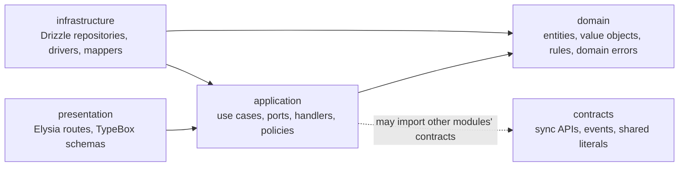
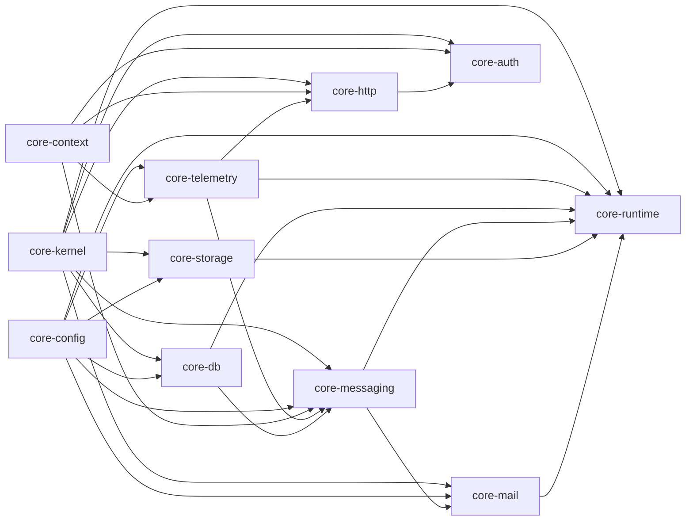

# Code architecture

> Status: **Approved** (Owner, 2026-10-21) · Updated: 2026-10-28 (P1-26: the `core-web` local changes owed to P4, DR-290; `realtime` changes, DR-289, §13) · 2026-10-26 (DR-268: the S3 adapter targets SeaweedFS in `vn`, R2 in `global`) · 2026-10-23 (DR-255: the aggregate decides and one guarded statement applies, §3, §4.5 rules 6 and 9, §9.1; earlier: 2026-10-22, DR-254: the layout of a module, §3, §4.1, §4.5, §6.4, §14 item 17; P1-07 and P1-08: the first two modules, `check:scope` and its parser, `audited` as built, `inBuilding`, DR-252, DR-253; P1-05: `Database.transaction` options, jobs and the writer rules; P1-04: §5.1 layout as built, §6 excludes, §12 classes, `routePlugin`, DR-247, DR-248; DR-02: `core-kernel` → `core-kernel`, `core-web` → `core-web`; earlier: 2026-10-21, P1-02: the core packages are vendored, §13 holds the result, §8.1 behaviors confirmed; earlier: 2026-10-20, DR-188: `packages/client-core`; earlier: DR-158, DR-169: `ops/` and `test-support` in the layout; DR-126, DR-127) · DOC-12
> Depends on: original SDD §4, §7.4, §19.4, §23, [DR](../00-decision-register.md) (DR-02, 03, 04, 09, 10, 11, 12, 14, 36, 40, 42, 55, 57, 62, 74, 77, 85, 87, 188, 254), [DOC-07](system-context-and-containers.md) §5–§6, [DOC-03](../01-product/requirements.md), [DOC-06](../02-glossary.md); versions are in [DOC-11](tech-stack-and-versions.md)
> Main readers: P1-01, P1-02, P1-03, P1-04…P1-13 (every task that creates a module or a repository), P2-xx (finance), DOC-14…17 (tables), DOC-26, DOC-27, DOC-39, DOC-42, DOC-88; every code review

This document says how the code is laid out and which imports are allowed: the repository and its package scopes, the layers inside a module, the module template, the composition root, the three dependency-cruiser configurations, the `BuildingScope` repositories, the ambient transaction, DTOs, `UnitContext` and its policy function, the exception types, the rule for syncing the vendored `core-*` packages and the review checklist. It holds no table (DOC-14…17), no event schema (DOC-09), no endpoint (DOC-51) and no version number (DOC-11). Which modules exist and who owns which table is DOC-07 §5–§6; this document does not repeat it.

Code samples are TypeScript signatures that show the shape the tasks implement. Names of vendored helpers (`UnitOfWork`, `OutboxWriter`, `AggregateRoot`…) come from the reference repository and were checked against the vendored copy in P1-02; where this document relies on a behavior the copy must have, it says so.

## 1. Scope and reading guide

| Question | Section |
| --- | --- |
| What is in the repository, which scope is which, who may import whom? | §2 |
| What does each layer of a module contain and what may it import? | §3 |
| How is a new module shaped, and when is it done? | §4, §4.5 |
| Who wires modules together and how do routes get their guards? | §5 |
| How are the rules enforced in CI? | §6 |
| How does a repository stay inside one building? | §7 |
| Where do transactions begin, how do events, audit and counters join them? | §8 |
| How are a race, a version check, money and time written? | §9 |
| What crosses a boundary: DTOs and mapping | §10 |
| How does a resident request become a `UnitContext` and a capability decision? | §11 |
| Which exceptions exist and how do they become HTTP answers? | §12 |
| How are the vendored `core-*` packages synced and named? | §13 |
| What does a reviewer check on every pull request? | §14 |

## 2. Repository, scopes and import rules

### 2.1 Layout (original SDD §23, DR-04)

```
residential-management-system/
├── apps/
│   ├── api/                 # @app/api: composition root, HTTP server, worker role
│   ├── web/                 # @app/cms-web
│   ├── resident-app/        # @app/resident-app
│   └── staff-app/           # @app/staff-app
├── modules/                 # @mod/<name>: one PostgreSQL schema each (DOC-07 §5.1)
├── packages/
│   ├── core-*/              # @core/*: vendored infrastructure (§13)
│   ├── shared-types/        # @rms/shared-types
│   ├── i18n-catalog/        # @rms/i18n-catalog
│   ├── design-tokens/       # @rms/design-tokens
│   ├── ui-native/           # @rms/ui-native
│   ├── client-core/         # @rms/client-core: fetcher, error classes, retry plan, intent keys, single-flight; pure TypeScript (DR-188)
│   ├── mobile-core/         # @rms/mobile-core
│   ├── pdf-assets/          # @rms/pdf-assets
│   ├── test-support/        # @rms/test-support: dev-only test helpers, never in the image (DR-169)
│   └── CORE_VERSION         # upstream commit of the last sync (§13)
├── docker/                  # Dockerfile.api, compose.{local,base,staging,production}.yml (DR-158)
├── ops/                     # configuration mounted or installed on a host: caddy, prometheus, alertmanager, loki, alloy, grafana, postgres, pgbackrest, backup, host, deploy (DOC-70 §3.2)
├── tools/                   # depcruise/ (dependency-cruiser + TypeScript 6, DR-230), arch-fixtures/ (one failing tree per rule), compat/ (compatibility smoke tests)
├── docs/  scripts/
└── biome.json  tsconfig.base.json  knip.json  .jscpd.json
    .dependency-cruiser.apps.cjs  .dependency-cruiser.modules.cjs  .dependency-cruiser.packages.cjs
```

Bun workspaces are `apps/*`, `modules/*` and `packages/*`. There are no changesets: the repository is a private application (DR-04).

### 2.2 Scopes and who may import them

| Scope | Holds | May import | Never imports |
| --- | --- | --- | --- |
| `@core/*` | Vendored infrastructure: one package per concern (§13) | Other `@core/*` along the acyclic graph of §6.3; npm packages only in its adapter files | `@mod/*`, `@rms/*`, `@app/*` |
| `@mod/<m>` | A business module (§4) | `@core/*` (by layer, §3); `@rms/shared-types`; **only the `contracts` export** of another `@mod/<n>` | Another module's `domain`, `application`, `infrastructure`, `presentation`; `@app/*`; `@rms/ui-native`, `@rms/mobile-core` |
| `@rms/*` | Project packages shared by apps and clients (`client-core` and `shared-types` are pure TypeScript with no DOM and no React Native, DR-188) | Other `@rms/*`; `@core/i18n`; `@core/web` (web only) | `@mod/*`, `@app/*`, server-only `@core/*` |
| `@app/api` | The composition root | Every module through its exports map: `.`, `./manifest`, `./config`, `./schema`, `./integrations/<consumer>` | A module's internals; a driver package directly (§6.2) |
| `@app/cms-web`, `@app/resident-app`, `@app/staff-app` | Clients | `@rms/*`, `@core/i18n`, `@core/web`; **`import type { App } from '@app/api'` only** | `@mod/*`, any value import from `@app/api` (DR-04) |

`@rms/shared-types` is a leaf: no workspace dependency, no framework, no I/O. It holds the language codes, roles, member types, capability names, status literals, error codes, the `Money` brand and its helpers (§9.3) and the time helpers (§9.4). Both server domain code and clients may import it (DR-100).

### 2.3 Module exports map

Every module package exposes the same entry points. `package.json#exports` makes any other path unresolvable, so `import '@mod/finance/src/domain/charge'` fails at the resolver and again in `check:arch` (§6.2).

| Export | Content | Imported by |
| --- | --- | --- |
| `.` | `create<Name>Module(deps)` and `install<Name>(host)` | `apps/api` only |
| `./contracts` | Sync interfaces with plain DTOs, event names and payload types, pure types and constants other modules may rely on | Any module, `apps/api` |
| `./config` | The module's configuration slice (keys are in DOC-41) | `apps/api` |
| `./manifest` | Static data for scripts: schema name, migrations folder, schema file, outbox and inbox tables | `apps/api`, `db:*` scripts, drizzle-kit |
| `./schema` | The Drizzle schema of the module | drizzle-kit, the scope lint |
| `./integrations/<consumer>` | What this producer tells one optional consumer (§4.4) | `apps/api` only |
| `./testing` | Fakes and builders for tests; not supported API | Tests, `apps/api` composition for e2e |

The reference's `./public` export (constants for the web client) is not used: clients get shared constants from `@rms/shared-types` (§2.2).

## 3. Layers inside a module



| Layer | Contains | May import | Must not know |
| --- | --- | --- | --- |
| `domain` | Aggregates with behavior (every entity that has a status or an invariant), value objects, state transition rules, domain errors, repository **interfaces** (`<aggregate>-repository.ts`, DR-254) | `@core/kernel`, `@rms/shared-types` | Any other layer, Elysia, Drizzle, `Date.now()`, any I/O |
| `application` | Commands as use cases in `use-cases/` (one class and one `execute` per file), reads in one or a few query services in `queries/<name>-queries.ts` (one class, one method per read), the contract implementation in `api/<name>-api-impl.ts`, integration-event handlers in `handlers/` (one per file), ports for everything outside (`Clock`, `OutboxWriter`, `ObjectStore`, gateways) in `ports.ts`, the audit and idempotency wrappers (§8), DTO mappers (DR-254) | `domain`, `@core/kernel`, `@core/context`, `@rms/shared-types`, other modules' `contracts` | `infrastructure`, `presentation`, Elysia, Drizzle, `pino`, `process.env` |
| `infrastructure` | Drizzle repositories and row mappers, driver adapters (payOS, Expo, SMS, SMTP, the S3 store: SeaweedFS or R2), `DrizzleOutboxWriter`, `DrizzleInboxGuard` | `application`, `domain`, `@core/*`, the npm drivers | `presentation` |
| `presentation` | Elysia route plugins, TypeBox request and response schemas, OpenAPI detail, the audience declaration of each route (§5.3) | `application`, `domain` types for mapping, `@core/http`, `@core/auth` | `infrastructure` (it receives use cases, never repositories) |
| `contracts` | Interfaces with plain DTOs, event names and payload types, pure literals and pure functions without imports | Nothing from its own module, no `@core/*`; types only from `@rms/shared-types` | Everything else |

Five habits keep the layers honest:

1. A use case receives its ports in the constructor and never builds them. The module factory (§4.3) builds them once.
2. A route handler is three lines: read the validated input, call one use case, map the result to a response DTO. A branch on a business rule in a route is a defect.
3. An aggregate carries its own rules. A use case loads it, calls a method (`file.verify(...)`, `terms.publish(...)`) and saves it; the transition rule is not copied into the use case. A method that moves a row returns a `Transition` (`{ id, expect, set }`, DR-255) and the repository applies it in one guarded statement, so the aggregate owns the rule and the database owns the race (§9.1). A class that owns many operations and edits rows (`FilesService`, `GatewayService`) is the mistake this prevents: each operation is a use case, each rule is on the aggregate (DR-254).
4. The domain computes with values it is given. "Today" arrives as `LocalDate`, "now" as `Date` from the `Clock` port, ids from the `IdGenerator` port (UUIDv7, DR-10). A domain file that calls `new Date()` fails review.
5. A name says what a class is for. `*Service` and `*Manager` are not allowed in `application/`; a helper shared by use cases is named by its role (`BuildingDirectory`, `FileLoader`) and is not a use case (it has no `execute`).

## 4. The module template

### 4.1 Directory tree

`finance` is shown because it uses every part. A smaller module omits what it does not need (`realtime` has no outbox; `audit` has no integrations).

```
modules/finance/
├── package.json                      # name @mod/finance, exports map of §2.3, workspace deps only on contracts
├── drizzle.config.ts                 # reads src/infrastructure/persistence/schema.ts, history table drizzle_finance.__migrations
├── migrations/                       # NNNN_<name>.sql, never edited after merge (expand/contract, DR-08)
├── test/                             # integration and race tests (real PostgreSQL), fixtures
└── src/
    ├── index.ts                      # re-exports only: createFinanceModule, installFinance, the public types
    ├── finance.module.ts             # createFinanceModule(deps): builds repositories, use cases, handlers, jobs, routes
    ├── install.ts                    # installFinance(host) and the FinanceHost type (§4.2)
    ├── manifest.ts                   # ModuleManifest (§4.2)
    ├── config.ts                     # FinanceConfig slice (keys: DOC-41)
    ├── contracts/
    │   ├── index.ts
    │   ├── finance-api.ts            # FinanceApi: getOutstandingByUnit, reportQueries (DR-42)
    │   └── events.ts                 # FinanceEvents: finance.batch_published.v1 … payload types
    ├── domain/
    │   ├── charge.ts  fee-batch.ts  payment.ts  payment-intent.ts      # aggregates with behavior
    │   ├── charge-repository.ts  fee-batch-repository.ts  …            # repository interfaces, one per aggregate
    │   └── errors.ts                 # ChargeChangedError … (§12)
    ├── application/
    │   ├── use-cases/                # publish-batch.ts, record-manual-payment.ts, void-charge.ts …
    │   │                             # commands only: one class, one execute, per file
    │   ├── queries/                  # debt-queries.ts, report-queries.ts: the reads, a few classes with one method per read
    │   ├── api/                      # finance-api-impl.ts: the contract implementation (reads to queries, writes to use cases). No rule of its own
    │   ├── handlers/                 # one integration-event handler per file (inbox-guarded)
    │   ├── ports.ts                  # payment-gateway, receipt-renderer: ports to the outside only (a ports/ folder from the second file)
    │   └── settle.ts                 # the one settlement function (DOC-23)
    ├── infrastructure/
    │   ├── persistence/              # schema.ts, drizzle-*-repository.ts, mappers.ts
    │   └── gateway/                  # payos-driver.ts, fake-driver.ts
    ├── presentation/
    │   ├── staff-routes.ts           # /staff/…
    │   ├── resident-routes.ts        # /me/…
    │   └── webhook-routes.ts         # /payments/webhooks/…
    └── integrations/
        └── notification.ts           # what finance events mean to notification (§4.4)
```

### 4.2 Manifest and module object

```ts
// manifest.ts: static, importable without building the container
export const financeManifest = {
  name: 'finance',
  schema: 'finance',                       // PostgreSQL schema = module name (ADR-0014)
  migrationsDir: new URL('../migrations', import.meta.url),
  schemaFile: new URL('./infrastructure/persistence/schema.ts', import.meta.url),
  outboxTable: outboxTable('finance'),     // @core/messaging helpers create outbox_messages and inbox per schema
  inboxTable: inboxTable('finance'),
  config: financeConfigSlice,
} as const satisfies ModuleManifest

// finance.module.ts
export interface FinanceModule extends AppModule<'finance', FinanceRoutes> {
  api: FinanceApi                          // the contract implementation (read-only or joins the caller's transaction)
}

export function createFinanceModule(deps: FinanceDeps): FinanceModule { /* builds repositories, use cases, handlers, jobs */ }

// install.ts
export function installFinance(
  host: ModuleHost<{ finance: FinanceConfig }> & {
    modules: { residency: ResidencyApi; building: BuildingApi; audit: AuditApi; files: FilesApi },
    guards: Guards,
  },
): FinanceModule
```

`AppModule` is what the runtime needs from every module:

```ts
export interface AppModule<N extends string, R> {
  readonly name: N
  readonly routes: R                       // an Elysia plugin; mounted with one static .use() per module
  readonly handlers: IntegrationEventHandler[]   // consumer group = (module, handler.name)
  readonly outbox?: OutboxSource           // absent for realtime
  readonly jobs: JobDefinition[]           // timers of DR-62, started and stopped as a group
  close(): Promise<void>                   // live connections, closed before the HTTP server
}
```

`install<Name>(host)` narrows the host to what the module needs (its configuration slice, the contracts of the modules it calls). The type of `host` is the module's statement of dependencies: a module that calls `ResidencyApi` says so in the signature, and `modules-import-only-what-they-can-resolve` (§6.2) fails when `package.json` does not list `@mod/residency`.

### 4.3 What the factory builds

1. Repositories (`Drizzle…Repository`) over `host.database`; each method takes a `BuildingScope` (§7).
2. `DrizzleOutboxWriter(database, manifest.outboxTable, ids.next)` and `DrizzleInboxGuard(database, manifest.inboxTable)`.
3. Use cases with their ports; `host.database` is passed as the `UnitOfWork` (§8.1).
4. The contract implementation (`application/api/finance-api-impl.ts`) over the same repositories and use cases.
5. Handlers (inbox-guarded), job definitions, and the route plugins.

No dependency-injection container is used: the wiring is plain code that reads top to bottom (as the reference does).

### 4.4 Producers describe themselves to consumers (`integrations/<consumer>`)

`notification` and `realtime` deliver for every module and know none of them. What a producer's events mean to a consumer is the producer's knowledge, so the producer ships it in `integrations/<consumer>.ts`: plain definitions typed with `import type` from the consumer's contracts (event → inbox template key and parameters, event → push, event → live SSE event) and the vi/en wording through the shared catalog (DR-53, DR-71). Rules:

- An `integrations/<consumer>` file imports only its producer's contracts, the consumer's contracts and `@core/*` (`integrations-use-contracts-only`, §6.2).
- A module's core never imports its own `integrations/` (`module-core-does-not-load-its-integrations`).
- Only `apps/api` imports `integrations/*`, and passes them to `installNotification` and `installRealtime`. A missing integration means that event produces nothing; a duplicate template key is a start-up error; a template without `vi` and `en` text is a start-up error and a catalog-parity failure (NFR-13).
- The same mechanism lets a module ask another without importing it: `building` declares the port `ActiveIntentProbe` in its contracts and `finance` ships its implementation in `integrations/building`, so the change of a gateway configuration can ask whether an intent is active while the module graph stays acyclic (DOC-36 §7.3, DR-126).
- Unlike the reference, `notification` here also calls contracts of `residency` and `identity` (recipients, device ownership; DOC-07 §5.2). That is an ordinary contract call and is allowed; only `realtime` is a strict leaf (§6.2).

### 4.5 Layout rules and when a module is done (DR-254)

The tree of §4.1 is the shape; these rules make it binding. `bun run check:layout` (§6.4) enforces the ones marked ✔.

| # | Rule | Check |
| --- | --- | --- |
| 1 | A command is a use case, `application/use-cases/<verb>-<noun>.ts`: one exported class, ports in the constructor, one public method `execute`; the file name is the kebab case of the class | ✔ |
| 2 | A handler is `application/handlers/<name>.ts`: one class that implements `IntegrationEventHandler` | ✔ |
| 3 | A read is not a use case. Reads are methods of a query service, `application/queries/<name>-queries.ts` (`BuildingQueries`, `FileQueries`: one class per area, a few per module, a method per read, no `execute`, no transaction, no state change). `queries/` holds that. `api/<name>-api-impl.ts` is the implementation of the module's contract: it delegates its reads to the query services and its writes to the use cases, and has no rule of its own. A file of `use-cases/` named `get-`, `list-`, `view-`, `find-`, `search-` or `count-` is a read in the wrong place | ✔ (the names and the folder) |
| 4 | No class named `*Service` or `*Manager` in `application/`; no `execute` outside `use-cases/` | ✔ |
| 5 | A repository interface (`*Repository`) lives in `domain/<aggregate>-repository.ts`; `application/ports.ts` holds ports to the outside only | ✔ |
| 6 | An entity with a status or an invariant is an aggregate in `domain/` with methods that change its state (a method returns a `Transition`, §9.1) and throw a domain error; it may extend `AggregateRoot`. A rule without identity (magic bytes, purpose limits, settings validation) stays a function or a value object | review |
| 7 | `<name>.module.ts` exports `create<Name>Module`, `install.ts` exports `install<Name>` and the host type, `index.ts` only re-exports, `config.ts` exists when the module has a configuration slice | ✔ (the two files) |
| 8 | A helper shared by use cases is named by its role and has no `execute` | review |
| 9 | Prefer a repository in `infrastructure/` that holds no business rule and applies a `Transition` or inserts. It is a preference, not a ban: a statement with a `CASE`, a comparison with `now` or counter arithmetic is allowed when it is the simpler or the safer way, if a comment names the rule it carries and a test covers it. A set-based statement (a bulk revocation, an eviction) does the same (DR-255 items 2 and 5) | review (no automatic check) |

A module task is **done** when: the layout rules hold; every endpoint of the task's acceptance has a route in `presentation/` with its `audience` (§5.3), or the task names the routes still open and the task that closes them (the use cases already take the actor as their first argument, §8.3); the tests of the task pass; the documents of §14 item 16 are updated.

*As built (P1-07, P1-08), revised by DR-254 and by its amendment of 2026-10-22 (reads are query services, not use cases):* `building` was first delivered as four service classes (`FilesService`, `GatewayService`, `TermsService`, `BuildingSettingsService`), a handler file with two classes, the contract implementation as an object literal in `index.ts` and every repository interface in `application/ports.ts`; `audit` held the contract implementation in `audit-writer.ts`. Both were brought to the layout above in the same change, with the same tests. `building` has two query services, `BuildingQueries` (settings, gateway view and configuration, missing terms) and `FileQueries` (usage, signed URL); `GetBuildingSettings`, `ViewGatewayConfig`, `GetGatewayConfig`, `ListMissingTerms`, `GetStorageUsage` and `SignFileUrl` were folded into them. The routes of `building` stay open until the `staff` guard of P1-10; the demo reset stays with P1-21.

## 5. The composition root

### 5.1 `apps/api`

```
apps/api/src/
├── main.ts                    # boot: configuration → container → ops server → database wait → api and/or worker (DOC-38 §5.1)
├── app.ts                     # buildApp(container): plugin order, one .use() per module → export type App; buildOpsApp(container)
├── bootstrap/
│   ├── config/                # the slices of DOC-41 (slices.ts), the loader and the boot rules (load.ts), key rings (rings.ts)
│   ├── container.ts           # createContainer(config, logger, overrides): the only place that knows concrete adapters
│   ├── boot.ts                # waitForDatabase: 30 s of retries, then exit 1 (DR-161)
│   ├── module-catalog.ts      # manifests of the installed modules, in migration order (audit, building; identity and residency follow in P1-10 and P1-12)
│   └── guards.ts              # resident, staff and unit guards (§5.3); written with the first guard in P1-10
└── scripts/                   # config-example, healthcheck; db:migrate, outbox:list, seed:demo, payos:sim follow (no business logic)
```

`createContainer` order follows the contract graph of DOC-07 §5.2, providers first: host (config, logger, clock, ids, database, storage, mailer, SMS) → `identity` → `building` → `audit` → `residency` → `finance`, `tickets`, `access`, `vehicles`, `notices` → `notification` (with every producer's integration) → `wiki` → `reporting` → `realtime` → `createRuntime` (bus, relay, maintenance flag, timers). `ContainerOverrides` lets e2e tests swap the mailer, SMS, payment gateway (`fake`), clock and storage while keeping the rest of the real graph.

`buildApp` mounts plugins in this order: request context → request line → error handler → CORS → maintenance gate → OpenAPI (not in production) → health → one static `.use(module.routes)` per module. Every route plugin is created with `routePlugin()` of `@core/http` (`normalize: false`, so an unknown key of a body is 400 `unknown_key`), and the guards of gates 7 to 10 are `transform` hooks because Elysia validates a body before `beforeHandle` (DR-247, DOC-50 §7). `buildOpsApp` is in `app.ts` too: only `main.ts` and `app.ts` may import the container (§6.1). A loop over modules turns the types the Eden client infers into `any`; a test fails when a module with routes is not mounted. `export type App = ReturnType<typeof buildApp>` is the only thing clients import (§5.4).

### 5.2 `module-catalog.ts`

The catalog lists the manifests of the installed modules in dependency order. `db:migrate`, `outbox:list`, drizzle-kit and the configuration loader read it without building the container. Migrations run per module on one connection with `prepare: false` (PgBouncer-compatible), never at API boot (DR-62, DR-08). History lives in the schema `drizzle_<module>`, table `__migrations`.

### 5.3 Guards and route audiences

Modules do not build their own authentication. `bootstrap/guards.ts` builds three guards from the contracts and passes them to every module as `host.guards` (DR-99):

| Guard | Does | On failure |
| --- | --- | --- |
| `resident` | Verifies the access token (`kind = resident`), loads nothing else | 401 |
| `unit(capability)` | After `resident`: reads `X-Unit-Id`, calls `ResidencyApi.getMembership(accountId, unitId)` on **every request**, builds `UnitContext` (§11), asks the policy function for the capability | 403 `membership_inactive` or 403 `forbidden` |
| `staff(...roles)` | Verifies the token (`kind = staff`, `building_id` claim), reads role and status from `IdentityApi.getStaff` on every request, checks the role against the listed roles | 401, 403 |

A resident token never passes a staff guard and the reverse, whatever the role (FR-16.4). Tokens carry no unit permission and a resident token carries no building (FR-16.3).

Every route declares its audience; there is no default-allow route (original SDD §19.5):

```ts
// modules/finance/src/presentation/resident-routes.ts: schemas on top, handlers as functions, one line per route
export function residentRoutes(d: FinanceRouteDeps) {
  const createIntent = ({ unit, body }: { unit: UnitContext; body: Static<typeof CreateIntentBody> }) =>
    d.createIntent.execute(unit, body)

  return routePlugin({ prefix: '/me/payments' })
    .post('/intents', createIntent, {
      ...unitRoute(d.guards, 'payments', 'pay'),   // guard + audience { kind: 'resident', capability: 'pay' } from one argument
      body: CreateIntentBody, response: { 201: IntentDto, 409: ProblemDto },
    })
}
```

The helpers `publicRoute`, `staffRoute(guards, tag, roles)` and `residentRoute(guards, tag)` of `@core/http` return the guard and the `detail['x-audience']` metadata together, so the roles a route is guarded with are the roles it declares. A handler is a function inside the route factory (it needs the use cases in `d`), typed by `Static<typeof Schema>` and `RouteSet`; the chain only names path, handler and options. An optional body arrives as `T | null`.


The audience is route metadata (`detail['x-audience']`), not a comment. The authorization-matrix generator of EXP-10 and DOC-39 reads it from the mounted `App`, and a route without it fails the build (DR-77). Public routes say `audience: { kind: 'public' }`, the payOS webhook says `{ kind: 'webhook', provider }`.

### 5.4 The type-only `App` import

`apps/cms-web`, `apps/resident-app` and `apps/staff-app` get end-to-end types from `import type { App } from '@app/api'`. A value import would pull server code into a bundle. The rule is enforced twice: by the apps configuration (§6.1, `dependencyTypesNot: ['type-only']`) and by `verbatimModuleSyntax` in `tsconfig.base.json`, which makes a plain `import { App }` of a type an error in the editor.

## 6. Enforcement in CI

`bun run check:arch` runs dependency-cruiser three times, once per configuration. Every rule has `severity: 'error'`, test files are excluded, and `tsPreCompilationDeps: true` is set so that `import type` counts as a dependency (otherwise `import type { … } from 'drizzle-orm'` in a domain file slips through). The same stage (`verify`, DR-08) also runs Biome, typecheck, knip, jscpd, catalog parity, the scope lint (§7.3) and the authorization-matrix route-metadata check (§5.3). Behavior of the options below was checked against the dependency-cruiser rules reference on 2026-10-19 (https://github.com/sverweij/dependency-cruiser/blob/main/doc/rules-reference.md); the configuration is verified against the pinned version in P1-01 (DOC-11). dependency-cruiser 18.7.0 supports `typescript` below 7 only and cruises nothing under TypeScript 7, so `check:arch` (`scripts/check-arch.ts`) runs it from `tools/depcruise`, which carries TypeScript 6.0.3 (DR-230). `bun run check:arch:fixtures` cruises the negative fixtures of §6.2.

### 6.1 `.dependency-cruiser.apps.cjs`

```js
const SERVER_ONLY = '^(modules|packages/core-(db|messaging|http|auth|runtime|storage|mail|telemetry|config|testing))/'

module.exports = {
  forbidden: [
    { name: 'clients-import-the-api-type-only', severity: 'error',
      from: { path: '^apps/(cms-web|resident-app|staff-app)/' },
      to: { path: '^apps/api/', dependencyTypesNot: ['type-only'] } },
    { name: 'clients-do-not-import-server-code', severity: 'error',
      from: { path: '^apps/(cms-web|resident-app|staff-app)/' },
      to: { path: SERVER_ONLY } },
    { name: 'apps-do-not-import-each-other', severity: 'error',
      from: { path: '^apps/([^/]+)/' },
      to: { path: '^apps/[^/]+/', pathNot: ['^apps/$1/', '^apps/api/'] } },  // the api type rule above covers apps/api
    { name: 'only-main-and-app-import-the-container', severity: 'error',
      from: { path: '^apps/api/', pathNot: '^apps/api/src/(main|app)\\.ts$' },
      to: { path: '^apps/api/src/bootstrap/container\\.ts$' } },
    { name: 'api-uses-module-exports-only', severity: 'error',
      from: { path: '^apps/api/' },
      to: { path: '^modules/[^/]+/src/(domain|application|infrastructure|presentation)/' } },
    { name: 'api-does-not-import-drivers', severity: 'error',      // adapters live in modules and core packages
      from: { path: '^apps/api/' },
      to: { path: 'node_modules/(drizzle-orm|postgres|jose|sharp|@aws-sdk|nodemailer|expo-server-sdk|exceljs|@react-pdf)/' } },
    { name: 'no-circular', severity: 'error', from: {}, to: { circular: true } },
  ],
  options: { tsPreCompilationDeps: true, exclude: { path: '\\.test\\.ts$' }, tsConfig: { fileName: 'tsconfig.json' } },
}
```

### 6.2 `.dependency-cruiser.modules.cjs`

Paths are relative to the repository root. The `$1` back-reference makes one rule cover every pair of modules.

```js
const FRAMEWORKS =
  'node_modules/(elysia|@elysiajs|drizzle-orm|drizzle-kit|postgres|nodemailer|jose|pino|exceljs|@react-pdf|@aws-sdk|expo-server-sdk|libphonenumber-js)/'
const INNER_CORE_OK = '^packages/(core-kernel|shared-types)/'          // the only workspace packages the domain may import
const LAYERS = '(domain|application|infrastructure|presentation)'

module.exports = {
  forbidden: [
    { name: 'domain-is-pure', severity: 'error',
      from: { path: '^modules/[^/]+/src/domain/' },
      to: { path: ['^modules/[^/]+/src/(application|infrastructure|presentation)/', '^packages/', FRAMEWORKS], pathNot: INNER_CORE_OK } },

    { name: 'application-no-infrastructure', severity: 'error',
      from: { path: '^modules/[^/]+/src/application/' },
      to: { path: ['^modules/[^/]+/src/(infrastructure|presentation)/',
                   '^packages/core-(db|http|telemetry|runtime|config|storage|mail|auth)/', FRAMEWORKS] } },

    { name: 'presentation-no-infrastructure', severity: 'error',
      from: { path: '^modules/[^/]+/src/presentation/' },
      to: { path: ['^modules/[^/]+/src/infrastructure/', 'node_modules/(drizzle-orm|postgres)/'] } },

    { name: 'modules-talk-only-through-contracts', severity: 'error',
      from: { path: '^modules/([^/]+)/' },
      to: { path: '^modules/[^/]+/',
            pathNot: ['^modules/$1/', '^modules/[^/]+/src/contracts/', '^modules/[^/]+/package\\.json$'] } },

    { name: 'contracts-are-self-contained', severity: 'error',
      from: { path: '^modules/[^/]+/src/contracts/' },
      to: { path: ['^modules/[^/]+/src/' + LAYERS + '/', '^packages/(?!shared-types/)', FRAMEWORKS],
            pathNot: '^modules/[^/]+/src/contracts/' } },

    { name: 'integrations-use-contracts-only', severity: 'error',
      from: { path: '^modules/([^/]+)/src/integrations/' },
      to: { path: '^modules/[^/]+/src/(?!contracts/|integrations/)' } },       // any layer of any module, its own included

    { name: 'module-core-does-not-load-its-integrations', severity: 'error',
      from: { path: '^modules/([^/]+)/src/', pathNot: '^modules/[^/]+/src/integrations/' },
      to: { path: '^modules/[^/]+/src/integrations/', pathNot: '^modules/(?!$1/)' } },   // only a module's own integrations

    { name: 'realtime-is-a-leaf', severity: 'error',                      // notification is not: it calls ResidencyApi and IdentityApi
      from: { path: '^modules/realtime/src/' },
      to: { path: '^modules/(?!realtime/)[^/]+/' } },

    { name: 'no-framework-in-domain-or-application', severity: 'error',
      from: { path: '^modules/[^/]+/src/(domain|application)/' }, to: { path: FRAMEWORKS } },

    { name: 'modules-do-not-import-apps', severity: 'error',
      from: { path: '^modules/' }, to: { path: '^apps/' } },

    { name: 'modules-import-only-what-they-can-resolve', severity: 'error',   // undeclared workspace dependency
      from: { path: '^modules/' }, to: { couldNotResolve: true } },

    { name: 'no-circular', severity: 'error', from: {}, to: { circular: true } },
  ],
  options: { tsPreCompilationDeps: true, exclude: { path: '\\.test\\.ts$' }, tsConfig: { fileName: 'tsconfig.json' } },
}
```

`@core/*` packages resolve to `packages/core-*` files; the rules therefore name directories. The `package.json#exports` map is the second net (§2.3). A negative fixture directory (`tools/arch-fixtures/cases/<config>__<rule>/`, one tree per rule that must fail, plus a clean `<config>__ok` tree per configuration) is copied to a temporary directory and cruised by `bun run check:arch:fixtures`, so a rule that silently stops matching is noticed. P1-01 wrote the cases for `clients-import-the-api-type-only`, `modules-talk-only-through-contracts`, `domain-is-pure` and `core-kernel-imports-only-its-allowed-packages`; each later rule adds its case with the code that first needs it.

### 6.3 `.dependency-cruiser.packages.cjs`

One rule per package lists which other workspace packages it may import. The graph is the reference's, with its names changed (§13) and `core-privacy-participant` absent.



```js
const ALLOWED = {                       // package → workspace packages it may import
  'core-kernel': [],  'core-config': ['core-kernel'],  'core-context': ['core-kernel'],
  'core-telemetry': ['core-config', 'core-context'],
  'core-db': ['core-kernel', 'core-config'],
  'core-messaging': ['core-kernel', 'core-db', 'core-config', 'core-context', 'core-telemetry'],
  'core-http': ['core-kernel', 'core-context', 'core-telemetry'],
  'core-auth': ['core-kernel', 'core-context', 'core-http'],
  'core-mail': ['core-kernel', 'core-config', 'core-messaging'],
  'core-storage': ['core-kernel', 'core-config'],
  'core-runtime': ['core-kernel', 'core-config', 'core-db', 'core-messaging', 'core-telemetry', 'core-http', 'core-mail', 'core-storage'],
  'core-i18n': [],  'core-testing': ['core-kernel', 'core-messaging', 'core-db'],
  'core-web': ['core-i18n'],
  'shared-types': [], 'design-tokens': [], 'i18n-catalog': ['shared-types'],
  'ui-native': ['design-tokens', 'shared-types', 'core-i18n'],
  'client-core': ['shared-types'],
  'mobile-core': ['shared-types', 'client-core', 'i18n-catalog', 'core-i18n'],
  'pdf-assets': [],
}
const rule = (pkg, allowed) => ({
  name: `${pkg}-imports-only-its-allowed-packages`, severity: 'error',
  from: { path: `^packages/${pkg}/` },
  to: { path: '^packages/', pathNot: [`^packages/${pkg}/`, ...allowed.map(a => `^packages/${a}/`)] },
})
module.exports = {
  forbidden: [
    ...Object.entries(ALLOWED).map(([p, a]) => rule(p, a)),
    { name: 'packages-do-not-import-modules-or-apps', severity: 'error',
      from: { path: '^packages/' }, to: { path: '^(modules|apps)/' } },
    { name: 'only-adapters-import-frameworks', severity: 'error',
      from: { path: '^packages/core-(kernel|context|config|i18n)/' },
      to: { path: 'node_modules/(elysia|@elysiajs|drizzle-orm|postgres|nodemailer|pino|jose)/' } },
    { name: 'packages-import-only-what-they-can-resolve', severity: 'error',
      from: { path: '^packages/' }, to: { couldNotResolve: true } },
    { name: 'no-circular', severity: 'error', from: {}, to: { circular: true } },
  ],
  options: { tsPreCompilationDeps: true, exclude: { path: '\\.test\\.ts$' }, tsConfig: { fileName: 'tsconfig.json' } },
}
```

`ALLOWED` started as the table copied from the reference graph; P1-02 recomputed it from the vendored `package.json` files (2026-10-21). Differences found: `core-config` and `core-web` import no workspace package, `core-runtime` does not import `core-http`, `core-testing` imports `core-mail` and `core-storage` but not `core-db`; each was a finding and the table now lists production imports only. The exclusion of test files covers `*.test.ts` and, since P1-04, the folders `apps/*/tests/` and `modules/*/test/` (integration tests build the container) and `apps/*/dist/` (a build output). Two options were added to all three configurations when the first real workspace imports appeared: `doNotFollow: { path: 'node_modules' }` (otherwise a circular dependency inside `@sinclair/typebox` fails the run) and `enhancedResolveOptions.conditionNames` with `bun`, `import` and `default` (otherwise `@core/*` cannot be resolved through the `exports` map). A package is liftable into its own repository exactly when none of its rules needs bending.

### 6.4 `check:layout` (DR-254)

Import rules cannot see the shape of a file, so `scripts/check-layout.ts` reads the sources of `modules/*/src` with the TypeScript compiler API (the TypeScript 6 of `tools/depcruise`, like `check:scope`) and fails on: a file of `application/use-cases/` that does not export exactly one class with one public `execute` and a matching file name; a file of `application/handlers/` that does not export exactly one class with `name`, `eventType` and `handle`; a read as a use case (a `use-cases/` file named `get-`, `list-`, `view-`, `find-`, `search-` or `count-`) or a file of `application/queries/` that is not `*-queries.ts`, or a file of `application/api/` that is not `*-api-impl.ts`; an interface named `*Repository` outside `domain/`; a class named `*Service` or `*Manager` in `application/`; an `execute` method outside `use-cases/`; a module without `<name>.module.ts` and `install.ts`; an `execute` of a use case, or a public method of a `*-queries.ts` service, that takes a `StaffContext` first and never calls `requireRole` of `@core/kernel` (`role-gate`). `tools/layout-lint/` holds one fixture per rule, like `check:arch:fixtures`. The check is part of `bun run check`.

## 7. `BuildingScope` repositories (DR-12)

### 7.1 The type and where it comes from

```ts
// @rms/shared-types
export type BuildingId = string & { readonly __brand: 'BuildingId' }
export interface BuildingScope { readonly buildingId: BuildingId }
```

A `BuildingScope` is built at the edge of a use case, never inside a repository:

| Caller | Scope comes from |
| --- | --- |
| Staff request | `building_id` claim of the verified staff token (`StaffContext.buildingId`) |
| Resident request | `UnitContext.buildingId` from the membership row; the resident token has no building claim |
| Outbox handler, job | `payload.buildingId` of the event or the job's own building loop; every event payload carries `buildingId` (DOC-09 confirms) |
| payOS webhook | `gatewayConfigId` in the URL → `BuildingApi.getGatewayConfig` → its building (DR-87) |
| Public routes (`/auth/*`) | Not scoped: they read only `identity` tables that are on the allow-list or look an account up by phone or email |

### 7.2 Repository shape

Every method of a repository for a scoped table takes the scope as its first argument and applies it through one helper; a method with a free-form `where` over a scoped table is rejected by the lint.

```ts
// @core/db (helper) — a typed predicate for the scope column
export const inBuilding = <T extends { buildingId: PgColumn }>(t: T, s: BuildingScope) => eq(t.buildingId, s.buildingId)

// modules/finance/src/infrastructure/persistence/drizzle-charge-repository.ts
export class DrizzleChargeRepository implements ChargeRepository {
  constructor(private readonly db: Database) {}

  findOpenByUnit(scope: BuildingScope, unitId: UnitId): Promise<Charge[]> {
    return this.db.executor.select().from(charge)
      .where(and(inBuilding(charge, scope), eq(charge.unitId, unitId), eq(charge.status, 'open')))
      .then(rows => rows.map(toCharge))
  }

  /** The arbiter of a race (DR-14): true when this call changed the row. */
  async markPaidIfOpen(scope: BuildingScope, id: ChargeId, expectedAmount: Money): Promise<boolean> {
    const rows = await this.db.executor.update(charge)
      .set({ status: 'paid', version: sql`${charge.version} + 1` })
      .where(and(inBuilding(charge, scope), eq(charge.id, id), eq(charge.status, 'open'), eq(charge.amount, expectedAmount)))
      .returning({ id: charge.id })
    return rows.length === 1
  }
}
```

Rules that follow from the shape:

- Every business table has `building_id` and every composite index starts with it (DR-12, DOC-14). A lookup by primary key still carries the scope: it is the cross-building guard (`404` for an object of another building, original SDD §19.5).
- Aggregates that several actors edit carry `version`; the conditional `UPDATE … WHERE version = :expected` is in §9.2.
- Repositories use `db.executor` (the current transaction or the pool), never `db.transaction` (§8.1).
- Reading another module's data goes through its contract, never through its table or its repository (DOC-07 §6.1).

### 7.3 The scope lint

The lint is a merge gate from P1 (DR-12). **P1-01 decided: a Bun script that walks the AST** (DOC-11 §2, row 5). A Biome GritQL plugin can flag a `.where(…)` without `inBuilding`, but it cannot know which tables are scoped, cannot flag a query with no `.where`, and cannot compare the `schema.ts` files with the scoped list. TypeScript 7 has no stable JavaScript API yet, so P1-07 wrote the script with the TypeScript 6.0.3 that `tools/depcruise` carries for dependency-cruiser (no new dependency; its types are not available to the TypeScript 7 of the product, so `scripts/lib/typescript-api.ts` is the one file that types the nodes as `any`).

| Check | Fails when |
| --- | --- |
| Predicate present | A Drizzle query (`select`, `update`, `delete`, `insert … select`, raw `sql` with a schema-qualified scoped table) on a table of the scoped list has neither `inBuilding(table, scope)` nor a `building_id` equality in its `where` |
| Scope argument | A public repository method on a scoped table has no `scope: BuildingScope` first parameter |
| Registry | A table in a module `schema.ts` with a `building_id` column that is not in the scoped list, or a table without `building_id` that is not on the allow-list |

*As built (`scripts/check-scope.ts`, `scripts/lib/scope-lint.ts`, fixtures in `tools/scope-lint`):* the checks are the three above; an `insert` must set `buildingId` in its `values`; a line `// scope-ok: <reason>` on the line of a query or method, or the two before it, exempts that one and is the review (the single use is `FilesApi.signedUrl(fileId)`, which has no building argument because the calling module has authorised the file, DOC-37 §8); the helper is `inBuilding` of `@core/db`, typed structurally because a core package may not import `@rms/shared-types`. The scoped list is generated from the schemas (`@mod/*/schema`). The explicit allow-list holds tables that are global by nature: `platform.*` (DR-85), `identity.rate_bucket`, `identity.otp_challenge`, `identity.refresh_family`, `identity.refresh_token`, `identity.resident_account` (a resident account has no building), `identity.password_token`, `identity.staff_account`, `building.building`, `outbox_messages` and `inbox`; the reasons are in DOC-14 §5.3 (DR-104). `realtime.events` is scoped and not on the list. Adding to the allow-list is a change reviewed by CODEOWNERS (`modules/identity`, `modules/finance`). EXP-10 is the runtime check: it tries cross-building and cross-unit access on every endpoint.

## 8. Transactions, events, audit and counters

### 8.1 The ambient transaction

`@core/db` provides one `Database` (one pool, all modules) with an ambient transaction held in `AsyncLocalStorage`:

```ts
interface Database {
  readonly executor: DrizzleExecutor                      // the open transaction if there is one, else the pool
  transaction<T>(fn: () => Promise<T>): Promise<T>        // begins; inside an open transaction it is a savepoint
}
interface UnitOfWork { run<T>(fn: () => Promise<T>): Promise<T> }   // application-layer port; Database implements it
```

Behavior the vendored `@core/db` must have (P1-02 checked each one in the copy on 2026-10-21 and added what was missing; `packages/core-db/src/database.test.ts` runs against the local PostgreSQL):

1. `UnitOfWork.run` called inside an open transaction **joins** it; it does not begin a second one. *In the reference as it was; test: the inner failure rolls back everything.*
2. `database.transaction` inside an open transaction is a **savepoint** (the Drizzle nested-transaction behavior). `settle()` uses it for the rollback to the savepoint taken after the `gateway_event` claim (DR-14, DOC-23). *Missing in the reference (`Database` had only `run`); added in P1-02 as a local change; tests: a failed inner transaction rolls back only its own writes, a released savepoint keeps them.*
3. `OutboxWriter.add` throws when no transaction is open: an event written outside the aggregate's transaction would defeat the outbox. *In the reference as it was (`DrizzleOutboxWriter` checks `inTransaction`).*
4. A transaction fails with SQLSTATE `40001` or `40P01` are retried by the use case wrapper, not by the repository (FR-08.8: up to 3 times, 20–60 ms jitter). *Not a core behavior: the wrapper is application code, written with the first use case (P1-06).*
5. `database.transaction(fn, { isolationLevel, accessMode })` takes the options of a **top-level** transaction: a `snapshot` job reads at `repeatable read`, read only (DOC-38 §3.2). *Added in P1-05; test: JB-13.*
6. `database.autonomous(fn)` runs `fn` in a transaction on a **separate pool connection**, outside the ambient one, and commits it before returning. Only `identity` uses it, to count a failed step-up proof so that the count survives the rollback of the action that asked (DR-132, DOC-26 §4.5). *Revised 2026-10-20 (DR-132). Missing in the reference; added in P1-02 as a local change; it needs a pool of two or more connections; test: the autonomous write survives the rollback of the caller.*

### 8.2 Where a transaction begins

| Place | Rule |
| --- | --- |
| Application use case (command) | Opens exactly one `uow.run` around its reads-that-matter, writes, outbox events and audit row. This is the only place a transaction begins for an HTTP request |
| Query use case | No transaction; reads at READ COMMITTED through `executor`. One exception: a query that returns a full CCCD number or a date of birth opens a short transaction to write its `pii.read` row before it returns the data (DOC-35 §6, DR-124) |
| Integration-event handler | One transaction: inbox insert (`ON CONFLICT DO NOTHING`), the module's writes, follow-up outbox rows. A duplicate delivery inserts nothing and returns |
| Job | The job opens its own short transactions (claim, then work); a singleton job takes `pg_try_advisory_xact_lock(hashtext('job:<name>'))` in a short transaction (DR-62) |
| Repository, route, mapper, domain | Never begins one |
| Contract implementation (`*-api-impl.ts`) | Joins the caller's ambient transaction if there is one, never takes a transaction argument (DR-42) |

A transaction spans one module by convention; the only cross-module writes inside it are the contract calls DR-42 defines to run in the caller's transaction (`AuditApi.record`, `FilesApi.attach`, `BuildingApi`/`IdentityApi` verifications). **No network call is made inside a transaction**: payOS, SMS, Expo, SMTP and the S3 store are reached from the outbox in the worker, or between two transactions (the intent is committed as `creating`, the link is requested, a second transaction records the result: DOC-23).

### 8.3 Use case skeleton: outbox, audit and idempotency in the same transaction

```ts
// application/commands/void-charge.ts
export class VoidCharge {
  constructor(
    private readonly uow: UnitOfWork, private readonly charges: ChargeRepository,
    private readonly intents: IntentRepository, private readonly outbox: OutboxWriter,
    private readonly audit: AuditApi, private readonly clock: Clock,
  ) {}

  execute(staff: StaffContext, cmd: { chargeId: ChargeId; reason: string }): Promise<ChargeDto> {
    assertRole(staff, 'manager', 'admin')
    if (cmd.reason.trim().length < 5) throw new RuleViolationError('reason_too_short', 'Reason needs at least 5 characters')
    return withRetryOnSerialization(() => this.uow.run(async () => {
      const scope = staff.scope
      const before = await this.charges.get(scope, cmd.chargeId)                  // 404 outside the building
      const voided = await this.charges.voidIfOpenWithoutAllocation(scope, cmd.chargeId)   // conditional UPDATE … RETURNING
      if (!voided) throw new ChargeNotVoidableError(before.status)                // 409: someone else won
      await this.intents.cancelHolding(scope, cmd.chargeId)                       // whole intents, same transaction
      await this.outbox.add({ type: 'finance.charge_voided.v1', aggregateId: cmd.chargeId,
        payload: { buildingId: scope.buildingId, chargeId: cmd.chargeId, unitId: before.unitId } })
      await this.audit.record({ staff, action: 'finance.charge.void', object: { type: 'charge', id: cmd.chargeId },
        changes: [{ field: 'status', before: before.status, after: 'void' }], reason: cmd.reason })
      return toChargeDto(voided)
    }))
  }
}
```

The audit row is in the same transaction as the mutation (DR-57): a failed audit insert fails the mutation, a rolled-back mutation leaves no audit row (FR-37.1). `AuditApi.record` is called through a small application wrapper so that actor, role, IP, request id and the `system` actor of webhook settlement (`actor_kind = 'system'`, FR-37.3) are filled from the request context, not from each use case. *As built (P1-08, DR-253):* `installAudit` returns the wrapper next to `AuditApi`, the modules receive it in their host (`audited`), the first argument of the use case is the actor, and the spec's `object` and `details` take the result only:

```ts
export function audited<A extends unknown[], R>(
  spec: { action: string; object: (r: R) => { type: string; id: string }; reason?: (...a: A) => string | undefined },
  fn: (...a: A) => Promise<{ result: R; changes: AuditChange[] }>,
): (...a: A) => Promise<R>      // runs fn inside the caller's transaction, then audit.record; never opens its own
```

A `POST` that creates something and can be retried takes `Idempotency-Key`. The wrapper `idempotent(spec, fn)` in `@core/http` inserts the key row into `platform.idempotency_key` first (`ON CONFLICT DO NOTHING`), waits on the row lock for an in-flight duplicate, replays the stored response with `Idempotent-Replayed: true`, and answers 422 `idempotency_key_reuse` when the body differs (DR-74, DR-85). The manual payment keeps its own unique key as a second net.

### 8.4 Handler skeleton (inbox)

```ts
export class CreateInboxEntryOnBatchPublished implements IntegrationEventHandler<FinanceEvents['finance.batch_published.v1']> {
  readonly name = 'notification.inbox_on_finance_batch_published'      // (module, handler.name) = one consumer group
  constructor(private readonly uow: UnitOfWork, private readonly inbox: InboxGuard, private readonly entries: InboxEntryRepository,
              private readonly residency: ResidencyApi) {}

  handle(env: Envelope<BatchPublishedPayload>): Promise<void> {
    return this.uow.run(async () => {
      if (!(await this.inbox.claim(env.id, this.name))) return                 // duplicate delivery: no-op
      const scope = { buildingId: env.payload.buildingId } as BuildingScope
      for await (const page of this.residency.listRecipientsPaged(env.payload.unitIds, 'view_fees')) {
        await this.entries.insertMany(scope, page.map(r => ({ accountId: r.accountId, templateKey: 'fee.batch_published',
          params: { batchCode: env.payload.code }, sourceKind: 'batch', sourceId: env.payload.batchId })))
      }
    })
  }
}
```

Side effects outside the database (mail, push, files) must tolerate a retry: the inbox guards database effects only. A handler throws `RetryLaterError` to defer without spending an attempt; the retry classes per event type are in DOC-09 and DOC-42.

## 9. Writing a race, a version, money and time

### 9.1 The database decides, the code asks

Every transition two actors can race on is one statement of the form `UPDATE … SET <new state> WHERE <id and building> AND <expected state> RETURNING id`. Zero rows means someone else won; the use case turns that into a typed 409, never into a silent overwrite. The shape is in §7.2 (`markPaidIfOpen`). The forbidden shape is "read the status, decide in code, write without the predicate": the EXP-03 baseline is exactly that code, written to be beaten. When several rows are updated in one transaction they are updated in ascending id order so that two overlapping transactions cannot deadlock (DR-14).

**The aggregate decides, one statement applies (DR-255).** The two rules above and the aggregate of §3 are one mechanism. A method of the aggregate reads the state it was loaded with and `now`, throws a domain error when the rule forbids, and returns a `Transition` (`@core/kernel`: `{ id, expect, set }`). `expect` holds the fields the decision read, `set` the new values. The repository's `apply(transition)` is the one statement `UPDATE … SET <set> WHERE id = :id AND <expect> RETURNING …`, where a `null` in `expect` is `IS NULL`; the statement computes nothing.

```ts
// domain: the rule, no I/O
recordFailure(lockout: Lockout, now: Date): FailureOutcome {
  if (this.lockedSeconds(now) > 0) return { kind: 'locked', seconds: this.lockedSeconds(now) }
  const failedAttempts = this.lockExpired(now) ? 1 : this.record.failedAttempts + 1
  const lockedUntil = failedAttempts >= lockout.maxAttempts ? addMinutes(now, lockout.minutes) : null
  return { kind: 'counted', failedAttempts, lockedUntil, transition: { id: this.id,
    expect: { failedAttempts: this.record.failedAttempts, lockedUntil: this.record.lockedUntil },
    set: { failedAttempts, lockedUntil } } }
}
// application: a wrong password counts for every actor, so a lost race loads again and decides again
await decide(async () => {
  const account = await accounts.find(id)
  const outcome = account.recordFailure(lockout, now)
  if (outcome.kind === 'locked') return { done: true, value: outcome }
  return (await accounts.apply(outcome.transition)) ? { done: true, value: outcome } : { done: false }
})
```

When the actors are rivals (a link used twice, two approvals), the use case does not repeat: `apply` returning `null` becomes the typed 409 or `token_invalid`. `decide` is for a change that every actor must get counted (a wrong password, a step-up attempt); it stops after `MAX_DECIDE_ATTEMPTS` and answers 409 `conflict`. A counter does not guard on `version` (§9.2): a failed sign-in must not stale an open edit form. Every transition keeps its barrier race test (master plan §7.2): 20 parallel wrong passwords leave 5 failures, two parallel refreshes of one token give one rotation. A rule that moved into an aggregate also gets a unit test with no database.

### 9.2 Optimistic version for edited aggregates

Aggregates that several users edit (`fee_batch`, `charge`, `ticket`, `notice`, `page`, `vehicle`, `unit`; DR-12) carry `version`. `PATCH` takes `If-Match: "<version>"`. The use case compares it with the loaded version first (a stale form fails even when nothing raced in between), then the repository writes `WHERE version = :expected`; zero rows throws `VersionConflictError` and the answer is 409 `version_conflict` with the fresh resource.

### 9.3 Money and quantity (DR-11)

```ts
// @rms/shared-types
declare const vnd: unique symbol
export type Money = bigint & { readonly [vnd]: true }           // đồng, integer, never a float; currency is the constant VND
export const money = (n: bigint | number): Money => { /* asserts integer */ return BigInt(n) as Money }
export const moneyToJson = (m: Money): number => { /* asserts m <= Number.MAX_SAFE_INTEGER */ return Number(m) }

export type QtyMilli = bigint                                    // quantity in thousandths; numeric(12,3) in SQL
/** Half up, non-negative inputs: (12345 × 15000 + 500) / 1000 = 185175 */
export const lineAmount = (qty: QtyMilli, unitPrice: Money): Money => money((qty * unitPrice + 500n) / 1000n)
```

Domain and application code compute with `Money`; JSON carries integer numbers; PostgreSQL stores `bigint`. A `number` that holds money in a domain file is a review finding.

### 9.4 Time (DR-09)

Servers and PostgreSQL run in UTC and every instant is `timestamptz`. A *calendar day* is always computed in the building's zone (`building.time_zone`, default `Asia/Ho_Chi_Minh`).

```ts
// @rms/shared-types
export type LocalDate = string & { readonly __brand: 'LocalDate' }          // 'YYYY-MM-DD'
export function buildingToday(now: Date, timeZone: string): LocalDate       // the only way code asks "what day is it"
export function daysPastDue(today: LocalDate, due: LocalDate): number       // max(0, today − due); due day is payable through its end
```

SQL uses `(now() AT TIME ZONE b.time_zone)::date`, never `now()::date`. The test table of FR-12.2 (23:30, 00:30 and 06:59 local) pins both. `Clock` is a port, so tests advance time with `FakeClock`.

### 9.5 Gapless counters (DR-10)

```ts
// @core/db — one document_counter table per schema that needs one; DDL in DOC-14
export interface GaplessCounter {
  /** One upsert in the caller's transaction; the row lock serializes issuers, a rollback leaves no gap. */
  next(scope: BuildingScope, series: string, period: string): Promise<number>
}
// SQL: INSERT INTO <schema>.document_counter (building_id, series, period, last) VALUES ($1, $2, $3, 1)
//      ON CONFLICT (building_id, series, period) DO UPDATE SET last = document_counter.last + 1 RETURNING last
```

The number is taken as late as possible in the transaction, right before the insert that uses it, so the lock is held briefly. Format and period of each series are in DR-10 (`BL-YYMM-NNNN`, `PH-YYMM-NN`, `TT-YYMMDD-NNNN`, `YC-YYMMDD-NNN`); `UNIQUE (building_id, number)` is the last guard.

## 10. DTOs and mapping

Four kinds of object exist; each crosses at most one boundary.

| Object | Lives in | Shape | Made by |
| --- | --- | --- | --- |
| Row | `infrastructure/persistence` | Drizzle row type | Drizzle |
| Entity | `domain` | Behavior and invariants; `Money`, `LocalDate`, branded ids | `toEntity(row)` in `infrastructure/persistence/mappers.ts` |
| Request and response DTO | `presentation` (TypeBox schema, the source of the client types) | Serializable: ISO 8601 UTC strings for instants, `YYYY-MM-DD` for dates, integers for money, strings for ids | `toXxxDto(entity)` in `application` (or the route file for trivial cases) |
| Contract DTO | `contracts` | Plain, serializable, versioned by the contract; no entity, no `Date`, no `bigint` | Contract implementation |

Rules:

1. A repository returns entities, never rows. A use case returns DTOs or entities to its route, never rows.
2. No domain object is serialized directly. A new field is not exposed until a mapper puts it in a DTO.
3. **Resident and staff DTOs are different types.** A staff ticket DTO has internal notes; the resident ticket DTO has no field that could carry one, so a mapping mistake cannot leak it (FR-24.1, NFR-08). The same holds for CCCD and unmasked phone numbers (NFR-14): masking is applied in the mapper of the audience that may not see them, not in the client.
4. Contract DTOs are the public API of a module. A field is only ever added (optional, documented as "absent on older messages = default"); a breaking change ships as a new event version emitted alongside the old one (DOC-09).
5. The response schema of every route is declared (`response: { 200: … }`); the Eden Treaty types of the clients come from it. An undeclared status code is typed `unknown` in the client and fails review.
6. List endpoints return a cursor page (`{ items, nextCursor }`); contract lists are keyset-paginated with `limit ≤ 500` (DR-42, DR-74).

## 11. `UnitContext` and the policy function

### 11.1 The context

```ts
// @mod/residency/contracts (pure types and one pure function, no imports but shared-types)
export type MemberType = 'owner' | 'family' | 'tenant' | 'helper'
export interface UnitContext {
  readonly buildingId: BuildingId; readonly unitId: UnitId; readonly membershipId: MembershipId
  readonly accountId: ResidentAccountId; readonly memberType: MemberType; readonly canPay: boolean
  readonly startedAt: Date                      // membership.created_at: the history filter of DR-40
  readonly scope: BuildingScope
}
export interface StaffContext {
  readonly buildingId: BuildingId; readonly staffId: StaffId; readonly role: 'admin' | 'manager' | 'technician' | 'guard'
  readonly scope: BuildingScope
}
```

The `unit` guard (§5.3) builds a `UnitContext` for every resident request from the membership row of `(account_id, unit_id)`: one primary-key lookup per request, no cached permission, so a lock or removal takes effect on the next request (FR-16.1). A missing, locked or removed membership answers 403 `membership_inactive`.

### 11.2 The policy function

The table of original SDD §7.4 is written once, as data, and every use case asks the same function. DOC-27 owns the table and its test; this section fixes where it lives and how it is called.

```ts
export type Capability =
  | 'broadcast_notices' | 'personal_notifications' | 'view_fees' | 'pay'
  | 'tickets' | 'vehicles' | 'library' | 'manage_members'

const RULES: Record<Capability, (c: UnitContext) => boolean> = {
  broadcast_notices:      () => true,                       // own QR code and contacting the Manager are in the same row
  personal_notifications: c => c.memberType !== 'helper',
  view_fees:              c => c.memberType !== 'helper',
  pay:                    c => c.memberType === 'owner' || c.memberType === 'family' || (c.memberType === 'tenant' && c.canPay),
  tickets:                c => c.memberType !== 'helper',
  vehicles:               c => c.memberType !== 'helper',
  library:                c => c.memberType !== 'helper',
  manage_members:         c => c.memberType === 'owner',
}
export const can = (c: UnitContext, cap: Capability): boolean => RULES[cap](c)
export function assertCan(c: UnitContext, cap: Capability): void   // throws ForbiddenError('forbidden')
```

- The `unit('pay')` guard calls `can`; a use case that has a second, finer rule (for example "a tenant cannot retire a vehicle", FR-43.1) calls `can` or a named predicate in its own `application/policies/` and never re-reads `memberType` inline.
- *As built (P1-12, DR-257):* `UnitContext` is declared in `@rms/shared-types` (the guards and `unitOf(context)` need it, and a contract imports nothing else), `@mod/residency/contracts` re-exports it and exports `can`; `assertCan` is not exported, because it would throw `ForbiddenError` and a contract may not import `@core/kernel`: the `unit(capability)` guard throws for a route, and a use case with a finer rule writes `if (!can(unit, capability)) throw new ForbiddenError()`.
- Policy functions are pure and exhaustively table-tested (`RM-` tests: four member types × eight capabilities × `canPay`; FR-16.2).
- The history rule is data, not policy: use cases that list paid history, receipts and payer names pass `ctx.startedAt` to the repository as a filter on payment date; Manager and Admin pass none (DR-40).
- Staff authorization is a role check against the fixed table of original SDD §7.4 (`assertRole(staff, …)` and the `staff(...roles)` guard). The full endpoint × role matrix is generated from route metadata (DOC-39).

## 12. Exception types and their answers

The domain and application layers throw typed errors; they never build an HTTP response. The error handler plugin of `@core/http` maps every error to `{ "error": { "code", "message", "details" } }` (DR-74). The classes come from the reference `@core/kernel` (`DomainError(code, message, kind, { details, retryAfterSeconds })` and subclasses, extended in P1-04 to the full list below); the kinds and the codes below are this project's. The complete catalog of codes, retry classes and message keys is DOC-42.

| Class (kind) | HTTP | Thrown when | Example codes (DR-74, DOC-03) |
| --- | --- | --- | --- |
| `ValidationError` (`validation`) | 400 | The request is invalid in itself: schema, limits, formats | `validation_failed` with `details[]` |
| `RuleViolationError` (`validation`) | 422 | Well-formed values that a business rule refuses (the status of each rule code is listed in DOC-42 §5.2) | `validation_failed` (`reason_too_short`, `same_assignee`, `setting_invalid`), `allocation_mismatch`, `file_not_verified`, `idempotency_key_reuse` |
| `UnauthorizedError` (`unauthorized`) | 401 | No or invalid credential, invalid webhook signature | `invalid_signature`, `otp_invalid` |
| `ForbiddenError` (`forbidden`) | 403 | Authenticated but not allowed | `forbidden`, `membership_inactive`, `terms_required` |
| `NotFoundError` (`not_found`) | 404 | Missing, or outside the caller's building or unit (never 403 for a foreign object) | `phone_not_registered` |
| `ConflictError` (`conflict`) | 409 | A conditional update changed zero rows, a unique index rejected | `charge_changed`, `batch_has_payments`, `import_expired`, `ticket_already_accepted`, `owner_must_transfer`, `staff_has_open_tickets`, `phone_in_use`, `payment_in_progress` |
| `VersionConflictError` (`conflict`) | 409 | `If-Match` does not match | `version_conflict` |
| `PayloadTooLargeError` (`too_large`) | 413 | Quota or size limit | `quota_exceeded` |
| `UpgradeRequiredError` (`upgrade_required`) | 426 | `X-App-Version` below `MIN_APP_VERSION` | `upgrade_required` |
| `RateLimitedError` (`rate_limited`) | 429 + `Retry-After` | A bucket is empty | `rate_limited` |
| `UnavailableError` (`unavailable`) | 503 + `Retry-After` | A dependency the request needs is down | `sms_unavailable` |
| `RetryLaterError` (messaging) | — | A handler defers without spending an attempt | — |

*Revised 2026-10-19 (DR-127):* the single `ValidationError` (422) is split in two classes, `ValidationError` (400) and `RuleViolationError` (422); the code stays `validation_failed`. DOC-42 §4 holds the full class table, the SQLSTATE mapping and the catalog of codes.

Rules:

1. A conflict that the client can resolve by reading again carries the fresh state in `details` (FR-05.3, FR-02.2): the mapper of the error handler calls the use case's `fresh` provider; the use case does not format it.
2. **An outcome that is not an error is not an exception.** Money that cannot be posted (`charge_already_paid`, `amount_short`, `charge_recalled`…) is a returned `SettleOutcome` written to the money log, because the webhook must answer 200 and the transaction must commit the log row (DR-84, DR-16). Throwing there would roll the log back.
3. An unexpected error is logged with the request id and answered 500 `internal_error` with no detail; the transaction rolls back (nothing partial survives).
4. Messages in errors are English keys for logs; the user-facing text is looked up by `code` in the catalog (DOC-68, DR-71).

## 13. The vendored `core-*` packages and the sync rule (DR-02)

The reference packages are private workspace packages that are on no registry, so they are copied into `packages/core-<name>` (directory) and imported as `@core/<name>`. Copy by dependency closure of the reference's messaging package. The closure was computed in P1-02 (2026-10-21) from the reference commit recorded in `packages/CORE_VERSION`; §13.1 lists the result.

### 13.1 Mapping: reference → this repository

Upstream names appear only in this table, in `packages/CORE_VERSION` and in the commit messages of syncs.

| Reference package | Here | Directory | Copied | Role |
| --- | --- | --- | --- | --- |
| `kit-core` | `core-kernel` | `packages/core-kernel` | Yes | Domain events, aggregate root, errors, `Clock`, `IdGenerator`, `UnitOfWork`, `Log`; gets `SecretBox` (AES-256-GCM key ring with a row-bound AAD, DOC-36 §6, DR-126) |
| `kit-config` | `core-config` | `packages/core-config` | Yes | Config slices, `loadConfig`, generated `.env.example` |
| `kit-context` | `core-context` | `packages/core-context` | Yes | Request context in `AsyncLocalStorage` |
| `kit-db` | `core-db` | `packages/core-db` | Yes | Pool, ambient transaction, advisory locks, per-module migrations; gets `GaplessCounter` (§9.5) |
| `kit-telemetry` | `core-telemetry` | `packages/core-telemetry` | Yes | Logger; the tracing part is not used in phase 1 (DR-63) |
| `kit-http` | `core-http` | `packages/core-http` | Yes | Error handler, request-context, maintenance plugins, OpenAPI helpers; gets `idempotent` (§8.3) and `audience` metadata (§5.3) |
| `kit-auth` | `core-auth` | `packages/core-auth` | Yes | Token verification, the `auth` macro, `StepUpPolicy` (the project step-up of DR-39 is built in `identity`) |
| `kit-messaging` | `core-messaging` | `packages/core-messaging` | Yes | Outbox, inbox, relay, in-process bus |
| `kit-mail` | `core-mail` | `packages/core-mail` | Yes | `Mailer` port, SMTP and console adapters |
| `kit-storage` | `core-storage` | `packages/core-storage` | Yes | `ObjectStorage` port, S3 and local adapters (presigned PUT, DR-61) |
| `kit-runtime` | `core-runtime` | `packages/core-runtime` | Yes | `AppModule`, `ModuleHost`, `createRuntime`, health, jobs |
| `kit-i18n` | `core-i18n` | `packages/core-i18n` | Yes | ICU messages, typed catalogs, parity helpers |
| `kit-testing` | `core-testing` | `packages/core-testing` | Yes | Fakes (`FakeClock`, `SequentialIds`, `InMemoryOutbox`, `PassthroughUnitOfWork`, `FakeStorage`, `InMemoryInbox`); `devDependency` only |
| `kit-web-core` | `core-web` | `packages/core-web` | Yes | SSE client over `fetch`, `authFetch` |
| `shared-types` conventions | `@rms/shared-types` | `packages/shared-types` | Conventions only | Not a copy: this project's own package (§2.2) |
| `kit-ui` | — | — | No | The design system here is shadcn (web) and `@rms/ui-native` (DR-03, DR-70) |
| `kit-privacy-participant` | — | — | No | The privacy module is skipped (DR-03); see DR-98 |

**Closure (P1-02).** `core-messaging` needs `core-kernel`, `core-config`, `core-context`, `core-db` and `core-telemetry`; `core-runtime` adds `core-mail` and `core-storage`; `core-mail` needs `core-messaging`, so the graph is acyclic and the allowed imports of each package are exactly the `ALLOWED` map of `.dependency-cruiser.packages.cjs` (§6.3). Fourteen reference packages are copied; the reference's `kit-privacy-participant` was a dependency of `kit-runtime`, not of `kit-messaging` as the original SDD and DR-98 assumed, so the edit for DR-98 is in `core-runtime` (`AppModule.privacy` removed). Not yet in the copies, added by the task that first needs each (and then listed in `local-changes`): `SecretBox` in `core-kernel`, `GaplessCounter` in `core-db` (P2-02), `idempotent()` and `audience` metadata in `core-http`, the `policy(type)` hook of the relay (DR-118). *Added 2026-10-28 (DR-290):* two changes to the SSE client of `core-web`, made by the P4 web task: stop reconnecting on a 429 with `scope: "sse_streams"`, and a 45-second silence watchdog (DOC-55 §13); the vendored backoff (1, 2, 4, 8 s, cap 15 s) is kept.

Reference modules: `identity` and `notification` are **forked** into `modules/identity` and `modules/notification` and never synced again; `realtime` is copied as is into `modules/realtime` (*revised 2026-10-28, DR-289:* with the replay buffer `realtime.events` keyed by the source message, the reference's 60-second age skip dropped and the streams closed after a lost `LISTEN` connection; DOC-52 §8, §9); `privacy`, `profile` and `billing` are skipped, and only the patterns of `billing` (idempotent webhooks, gapless numbering) are reused (DR-03). The reference scripts `gen:module`, `kit:add` and `kit:remove` are not part of the DR-02 list; modules are created by hand from §4 (P1-02 did not copy the reference's `templates/module`).

### 13.2 Renaming rules

1. Every reference `kit-x` becomes `core-x`; `@kit/*` becomes `@core/*`. Two exceptions avoid a repeated word: `kit-core` → `core-kernel` (`@core/kernel`) and `kit-web-core` → `core-web` (`@core/web`) (DR-02, changed 2026-10-22).
2. The reference's dependency-cruiser patterns for `kit-*`/`@kit/*` are renamed the same way (the configurations of §6 are already renamed).
3. The sync commit scope is `chore(core): sync <sha>`.

### 13.3 `packages/CORE_VERSION`

A plain text file next to the packages. The file as of P1-02:

```
upstream:   git@github.com:ninggiangboy/elysia-architecture.git (a sibling checkout at ../elysia-architecture when copied)
commit:     66bcc10435044415ff2e6dc55139614dd66f2888
synced-on:  2026-10-21
mapping:    kit-core→core-kernel, kit-config→core-config, … (the table of §13.1)
omitted:    kit-ui, kit-privacy-participant (+ the edit to core-runtime because of it, below); the reference `shared-types`
local-changes:
  - all packages: dependency versions pinned to the DOC-11 versions (exact, no `^`)
  - all packages: `exports` point at `src/*.ts`; `build` script, `files` and `tsconfig.build.json` removed; version 0.0.0
  - core-runtime: `AppModule.privacy` and the `@core/privacy-participant` dependency removed (DR-03, DR-98)
  - core-db: `Database.transaction()` (savepoint inside a transaction) and `Database.autonomous()` added (§8.1)
  - OpenTelemetry pinned to the 2.12 line (DOC-11 §3, §10 row 10)
```

Every later change that is not a rename adds one line (`GaplessCounter`, `idempotent()`, `SecretBox`, `audience` metadata, the relay `policy(type)` hook, …).

### 13.4 The rule

- **The core packages are this project's code.** A bug is fixed in this repository, in a normal pull request, with a test. Nobody patches `node_modules`.
- **Sync is manual and rare.** A later upstream change is brought in by hand in one pull request titled `chore(core): sync <sha>` that (a) lists the upstream commits taken, (b) re-applies the renames of §13.2, (c) keeps the lines of `local-changes` (a conflict is resolved in favor of this repository's behavior and noted), (d) updates `CORE_VERSION` and §13.1 when a package is added or removed, and (e) runs `check:arch`, the unit and the integration stages. Never automatic, never by a bot (DR-02).
- **A change to a core package that is not a rename is a `local-change`** and is listed in `CORE_VERSION`, so the next sync knows what not to overwrite.
- **A version bump of a third-party dependency of a core package follows DOC-11** (latest stable, verified; DR-82); it is not part of a sync unless the sync needs it.

## 14. Review checklist

Applied to every pull request; the pull-request template repeats it (master plan §7.2 is the Definition of Done, this is its code half). A reviewer rejects a change for any unchecked item that applies.

| # | Check | Applies to | Evidence in the pull request |
| --- | --- | --- | --- |
| 1 | **Boundaries.** No import of another module's internals; `check:arch` green | Every change | CI `verify` stage |
| 2 | **Scope.** Every query on a scoped table carries `BuildingScope`; the scope comes from the token, the membership or the event, never from the request body | Any repository or SQL | Scope lint green; a cross-building test where a new read or write is added |
| 3 | **Audience.** Every new route declares `audience`; a staff mutation asserts its role with `requireRole(staff, <OPERATION>_ROLES)`, the constant that the route also reads for its guard and `audience`; a resident route uses `unit(capability)` | Any route | Matrix generator output diff |
| 4 | **Condition predicate.** Every state change that two actors can reach is one conditional `UPDATE … WHERE <expected state> RETURNING`; zero rows becomes a typed 409 (or a log row for money); no read-then-write | Any status change, any money or claim | The predicate in the repository method; the arbiter named in the design document |
| 5 | **Race test.** A test with N real connections released by a barrier exists **before** the feature that depends on it, and shows exactly one winner | Every new conditional update | `LG-`, `IN-`, `TK-`, `QC-`… test file named in the task |
| 6 | **Idempotency test.** A run-twice test for every money or notification mutation; `Idempotency-Key` on retryable `POST` creates; handlers guarded by the inbox | Money, notifications, imports, creates | Test output; a kill-mid-transaction test for a money mutation |
| 7 | **One transaction.** The change, its outbox events, its counter and its audit row commit together; no network call inside the transaction | Any use case | `uow.run` around all of them; side effects through the outbox |
| 8 | **Audit row.** A staff mutation writes `AuditApi.record` in the same transaction; a settlement by a system path uses `actor_kind = 'system'` | Staff mutations, webhook, re-query, statement | `AD-` test or the use case's audit assertion |
| 9 | **Template key.** A user-facing notification stores a template key and parameters, never text; the key has `vi` and `en` messages with the same ICU placeholders; a push carries no amount, name, phone or ticket text | Any inbox entry, push, mail | Catalog parity test; DOC-31 key list updated |
| 10 | **Money and time.** `Money` for amounts, `LocalDate` and `buildingToday` for days, `Clock` for instants; no `Date.now()`, `new Date()` or `now()::date` in domain or application | Fees, aging, schedules | Grep in review; a boundary-time test (23:30, 00:30, 06:59) where a date rule changes |
| 11 | **DTOs.** Resident DTOs have no staff field; sensitive fields are masked in the mapper; response schemas declared | Any new response | Schema diff |
| 12 | **Errors.** New error codes are registered in DOC-42 and have message keys in DOC-68; nothing returns a raw exception message | Any new failure | Docs diff |
| 13 | **Sources updated.** New configuration keys in DOC-41, metrics and alerts in DOC-40, terms in DOC-06, test prefixes in DOC-88 | Any change that adds one | Same pull request |
| 14 | **Migrations.** Backward compatible for one release (expand, then contract); never edited after merge | Any schema change | Migration file; `rms_app` grants in DOC-19 |
| 15 | **Dependencies.** A new dependency or version is the latest stable, verified on the web, with the source in DOC-11; a change to a core package is listed in `CORE_VERSION` | Any dependency | DOC-11 row; `CORE_VERSION` diff |
| 16 | **Docs.** The document that describes the behavior is updated in the same change; a decision that changes an Approved document gets a DR | Any behavior change | Docs diff |
| 17 | **Layout.** One use case per file in `use-cases/`, one handler per file, repository interfaces in `domain/`, rules on the aggregate and not in a service, `presentation/` present or its absence named in the task (§4.5) | Any new use case, handler or module | `check:layout` green |

## 15. Traceability

| Item | Where it is implemented or checked |
| --- | --- |
| Layers, module template, exports, layout rules and done condition | §3, §4, §4.5, §6.4; P1-03, DR-254 and every module task |
| Dependency-cruiser configs | §6; P1-01, P1-02, DR-08 `verify` stage |
| `BuildingScope` and the scope lint | §7; P1-01 decides the form, DR-12; EXP-10 |
| Ambient transaction, outbox, audit, idempotency | §8; DR-42, DR-57, DR-62, DR-74; FR-37, FR-08.8 |
| Races, versions, money, time, counters | §9; DR-09, DR-10, DR-11, DR-14; FR-02.2, FR-05.3, FR-12.2 |
| DTOs, resident versus staff types | §10; FR-24.1, NFR-08, NFR-14 |
| `UnitContext`, policy, guards | §11, §5.3; FR-16, FR-26; DOC-27 owns the table |
| Exceptions | §12; DR-74; DOC-42 owns the catalog |
| Core sync | §13; DR-02, ADR-0003, P1-02 |
| Review checklist | §14; master plan §2, §7.2 |

## Not in this document

| Topic | Lives in |
| --- | --- |
| Which modules exist, who owns each table, the contract list and the event list | [DOC-07](system-context-and-containers.md) §5–§6, DOC-09 |
| Table definitions, the scoped-table list source, `document_counter` DDL | DOC-14…17 |
| The `settle()` algorithm and the allocation statement | DOC-22, DOC-23 |
| The member-type × capability table and its tests | DOC-27 |
| Endpoint × role matrix, headers, rate limits | DOC-39, DOC-50, DOC-51 |
| Error and problem catalog, retry classes | DOC-42, DOC-09 |
| Library and tool versions, the compatibility table | [DOC-11](tech-stack-and-versions.md) |
| CI stages and merge gates | DOC-71 |
| Test tools, fixtures, the race harness | DOC-88 |

## Open questions

Decisions made while writing, decided by Claude (delegated by the Owner):

- **DR-98 · `core-messaging` is vendored without the privacy-participant protocol.**
- **DR-99 · The resident, unit and staff guards are built in the composition root and injected into modules as `host.guards`, and every route declares an `audience` as route metadata.**
- **DR-100 · `Money`, `QtyMilli`, `LocalDate`, `buildingToday` and the branded id types live in `@rms/shared-types`.**

Two behaviors of the vendored copy were assumed in §8.1 (a nested `transaction` is a savepoint; `UnitOfWork.run` joins an open transaction). P1-02 checked them on 2026-10-21: the second held in the reference, the first was missing and is now a local change in `CORE_VERSION` (`Database.transaction`), with `Database.autonomous` added for DR-132.
