# Data flows

> Status: **Approved** (Claude, delegated by the Owner for technical documents, 2026-11-02; §3.7, the statement path, follows DR-284, decided by the Owner 2026-11-02) · Updated: 2026-11-02 (DR-27, 28, 30, 31, 280, 281, 283 decided) · 2026-10-28 (P1-25: first version) · DOC-08
> Depends on: original SDD §5.2, §5.4, §5.8, §6.1…6.7, §7.3, §8.1, §8.2, §9.1, §10.2…10.4, §14, §19.3, [DR](../00-decision-register.md) (DR-14, 16, 20, 23, 27…35, 37, 42, 48, 51, 52, 55, 62, 74, 84, 96, 117, 118, 134, 143, 259, 272, DR-280…282), [ADR-0008](../04-adr/0008-settlement-idempotency.md), [ADR-0009](../04-adr/0009-transactional-outbox-inbox-and-contracts.md), [DOC-07](system-context-and-containers.md) §3, §5.3, [DOC-09](messaging-contracts.md) §4.2, §5, [DOC-21](../06-design/fee-batches-and-import.md) §3, [DOC-22](../06-design/ledger-and-allocation.md) §5, §10, [DOC-23](../06-design/payment-intents-and-settlement.md), [DOC-26](../06-design/identity-and-sessions.md) §5, [DOC-37](../06-design/files-and-uploads.md), [DOC-38](../06-design/jobs-and-outbox-runtime.md) §2, §3, §5.4, §7, [DOC-40](../06-design/observability.md) §5, [DOC-42](../06-design/error-handling.md) §6, §7, [DOC-43](../06-design/flows/README.md) §3, [DOC-50](../07-api/api-guidelines.md) §8, [DOC-51](../07-api/api-endpoints.md) §2, [DOC-06](../02-glossary.md)
> Main readers: P2-03, P2-06…P2-09, P2-12, P3-02…P3-04, P3-07, P4-01…P4-05, P5-01, P6-01, the authors of DOC-44…49 (detailed flows), DOC-25, DOC-28, DOC-29, DOC-31, DOC-33, the runbook authors (RB-02…RB-06, RB-09), the experiment authors (EXP-01, EXP-02, EXP-04, EXP-06)

This document shows how data moves between the containers of DOC-07 for the main flows of the system and for the failures that matter: which container calls which, where each transaction begins and commits, who acknowledges what to whom, and what a crash at each point leaves behind. It is the architecture view: one participant per container or store, not per class. The detailed flows with every screen, endpoint and class are the `FL-xx` of DOC-43 §3; the mechanisms (statements, state machines, retry classes) are in the design document named for each flow. This document repeats none of them.

**Draft** because DOC-23 is Draft (DR-27, 28, 30, 31, 280, 281 and 283 are decided, 2026-11-02) and the owners of five flows are not written yet: DOC-25 (statement), DOC-28 (tickets), DOC-29 (QR), DOC-31 (notices and push), DOC-33 (exports). For those flows the behaviour comes from the original SDD and the decided DRs; each such section says what the owner document will fix.

## 1. Conventions

### 1.1 Participants

The names are DOC-43 §2's, so a reader moves from a flow here to its `FL-xx` without translating. Every participant is a container or a store of DOC-07 §3.

| Participant | Container (DOC-07 §3) | Notes |
| --- | --- | --- |
| `resident-app`, `staff-app`, `web-cms` | The three clients | They talk to `api` only, over HTTPS through the Cloudflare edge, the Tunnel and Caddy (`edge` below when it matters) |
| `edge` | Cloudflare edge, Tunnel, `cloudflared`, Caddy | Shown only where a lost or retried response matters; it holds no state |
| `api` | `api-1`, `api-2` | Stateless; any replica serves any request. The webhook route lives only here (DOC-07 §3 notes) |
| `worker` | `worker` | The outbox relay, the handlers and the jobs (DOC-38) |
| `db` | PostgreSQL 18 | One schema per module; the schema-qualified table is in the arrow (`finance.charge`) |
| `outbox` | The `outbox_messages` table of the producing schema | Written in the producer's transaction; read by the relay in `worker` (ADR-0009) |
| `s3` | SeaweedFS S3 gateway (`vn`), R2 (`global`) | Files, PDFs, exports (DR-268, DOC-37) |
| `payos`, `expo-push`, `sms-provider`, `mail-relay` | External | Called only from `api` (link creation) or `worker` (everything else); never inside a transaction |

### 1.2 Diagram rules

- `autonumber` is on; the commit and ack tables refer to the arrow numbers.
- `Note over` marks `T1 begins`, `T1 commits`, `T1 rolls back`. A transaction never contains a network call (CLAUDE.md, DOC-12 §8): an arrow to `payos`, `expo-push`, `sms-provider`, `mail-relay` or `s3` is always outside a `T…` bracket.
- An outbox row written in a transaction is drawn as an arrow to `outbox` inside the bracket. Its delivery is a later arrow `outbox → worker`.
- **Commit point**: the moment a fact becomes durable. **Ack point**: the moment a caller is told it happened. Every flow has the ack after the commit; the gap between them is the "killed after commit" case of §3.2.

### 1.3 The common tail: an outbox message to a handler

Every flow below ends with one or more outbox messages. Their delivery is always the same path (DOC-38 §2, DOC-09 §4.2), drawn once here and abbreviated as "relay delivers X" later.

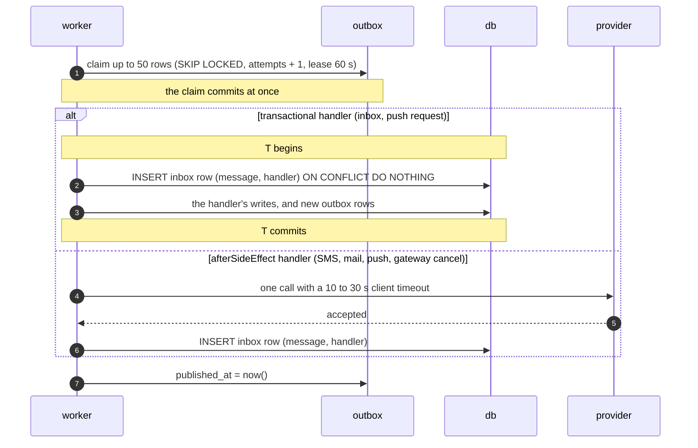

| Point | What is durable | If the worker dies here |
| --- | --- | --- |
| After arrow 1 | The claim (`attempts` + 1, lease) | The lease expires after 60 s; the row is claimed again with one more attempt |
| After the transactional handler commits | The handler's rows and its inbox row | The message is redelivered; the inbox row makes the handler skip (exactly-once effect) |
| After the provider accepted, before the inbox row | Nothing on our side | The call is repeated on redelivery: an SMS, a mail or a push may be sent twice (at-least-once, accepted for these, DOC-09 §5.2) |
| After `published_at` | Everything | Nothing to redo |

A handler that throws backs off 5, 10, 20 … 640 s and is dead at its class limit (`default` 8, `sms` 3, `push` 3, `intent_cancel` 8; DOC-42 §7.1); a dead message raises `DeadLetters` (RB-05). A message older than 2 minutes and still unpublished raises `OutboxLag` (RB-04).

## 2. Overview

| § | Flow | Trigger | Containers | Commit points | Detailed flow | Mechanism |
| --- | --- | --- | --- | --- | --- | --- |
| 3.1 | Publish a batch, then push | Manager on `W-Fee-Batch` (E-95) | `web-cms`, `api`, `db`, `worker`, `expo-push` | publish T1; inbox and push request T2 per part; push ticket T3 | FL-02 | DOC-21 §3.3, DOC-09 §5 |
| 3.2 | Manual payment | Manager on `W-Fee-Record` (E-104) | `web-cms`, `api`, `db`, `worker`, `s3`, `expo-push` | payment T1 (with the idempotency key); PDF T2; inbox T3 | FL-05 | DOC-22 §5 |
| 3.3 | Online payment: create the intent | Resident on `Pay-Select` (E-85) | `resident-app`, `api`, `db`, `payos` | key T0; intent T1; link T2 | FL-10 | DOC-23 §4 |
| 3.4 | Webhook settles | payOS (E-117) | `payos`, `edge`, `api`, `db`, `worker` | `settle()` T1 | FL-12 | DOC-23 §6, DOC-24 |
| 3.5 | Re-query settles or expires | `intent_requery` every 30 s; "I have transferred" (E-88) | `worker`, `db`, `payos` | claim T1; `settle()` or expiry T2 | FL-13 | DOC-23 §8 |
| 3.6 | Recall against a payment | Manager (E-96) and a webhook at the same instant | `web-cms`, `api`, `db`, `payos` | the first of the two to lock the charge | FL-03 | DOC-21 §3.5, DOC-22 §10 |
| 3.7 | Statement reconciliation | Manager uploads a statement (E-111) | `web-cms`, `api`, `s3`, `db`, `payos` | upload; import T1; one `settle()` per order-code line | FL-15 | DOC-25 (owed), DR-34, DR-35 |
| 3.8 | OTP sign-in | Resident on `Login`, `OTP` (E-09, E-10) | `resident-app`, `api`, `db`, `worker`, `sms-provider` | challenge T1; SMS send; verify T2 | FL-19 | DOC-26 §5 |
| 3.9 | Ticket status change, then notification | Technician on `K-Job-Working` (E-128) | `staff-app`, `api`, `db`, `worker`, `expo-push`, `resident-app` | transition T1; inbox T2 | FL-27 | DOC-28 (owed), original SDD §8 |
| 3.10 | Notice fan-out | `notice_scheduler` every 30 s | `worker`, `db`, `expo-push` | claim T1; one recipient batch per T2…Tn; inbox T per part | FL-32 | DOC-31 (owed), DR-51 |
| 3.11 | QR show and scan | Resident on `QR` (E-141), Guard on `G-Scan` (E-142) | `resident-app`, `staff-app`, `api`, `db` | nonce T1; the scan reads only (one log row) | FL-34 | DOC-29 (owed), DR-48 |
| 3.12 | Export | Manager on `W-Reports` (E-167) | `web-cms`, `api`, `db`, `worker`, `s3` | job T1; file and status T2; inbox T3 | FL-40 | DOC-33 (owed), DR-55 |
| 4.1 | PostgreSQL down mid-settlement | — | `payos`, `api`, `db`, `worker` | none | FL-12 | DOC-42 §6, original SDD §19.3 |
| 4.2 | Process killed after commit, before 200 | — | `payos`, `api`, `db` | the commit that was not acknowledged | FL-12 | DOC-23 §7.3 |
| 4.3 | Worker killed mid-fan-out | — | `worker`, `db` | the batches already committed | FL-32 | DR-51, DOC-38 §5.4 |
| 4.4 | payOS timeout at link creation | — | `resident-app`, `api`, `db`, `payos`, `worker` | T1 (intent `creating`) | FL-10 | DOC-23 §4.5, §8 |
| 4.5 | Expo down | — | `worker`, `expo-push`, `db` | the inbox entry | FL-32 | DR-52, DOC-09 §4.2 |
| 4.6 | SMS provider down | — | `resident-app`, `api`, `db`, `worker`, `sms-provider` | the challenge (T1) | FL-19 | DOC-26 §5.4, DR-134 |

## 3. Main flows

### 3.1 Publish a batch, then push

The Manager publishes batch `PH-2610-01` of 240 units. The publish is one statement on the batch row and its charges; the push to residents is a consequence written to the outbox in the same transaction, so a rolled-back publish never notifies anyone and a committed one always does (DR-42).

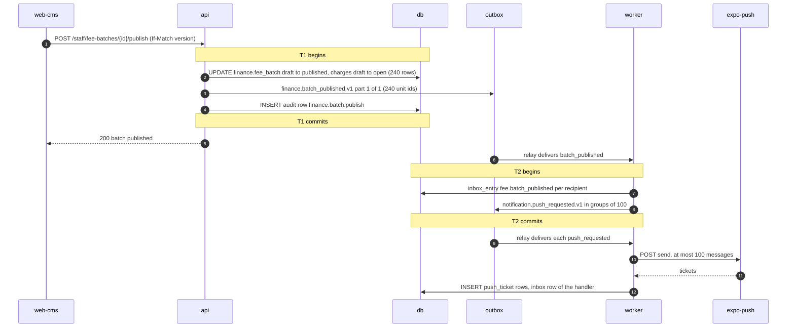

| Point | Durable | Ack |
| --- | --- | --- |
| Arrow 5 (T1) | 240 charges `open`, the batch `published`, one event, the audit row | Arrow 6: the Manager sees "Published" |
| Arrow 10 (T2) | The inbox entries and the push commands | The relay marks `batch_published` published |
| Arrows 12–14 | The push tickets | Expo's ticket is an ack of receipt, not of delivery; the receipts are read 15 minutes later (DR-52) |

**A crash.** Before arrow 5: nothing happened; the Manager retries (the `If-Match` version is unchanged). Between arrows 5 and 6: the batch is published; the Manager's retry gets 409 `invalid_transition` with the fresh batch, which shows it published (DOC-21 §3.3). In T2: redelivered, the inbox rows are `ON CONFLICT DO NOTHING`. Between the Expo call and the inbox row of `send_expo_push`: the push is sent again (§1.3). A batch over 500 units writes several parts (DOC-09 §2 rule 4; MC-06: 1,201 units → 3 parts). The fee notice PDFs are a separate job started by E-99 (DOC-21, DR-245) and are not on this path.

**Verification:** FF- tests of FL-02 (DOC-44), LG-61…LG-81 (DOC-21), MC-06 (DOC-09).

### 3.2 Manual payment

The Manager records cash for charges A (2,488,000 đ) and B (350,000 đ) of unit `A-1508`. The idempotency key, the payment, the allocations, the receipts, the counter and the outbox rows commit together (DOC-50 §8.3, DOC-22 §5.2).

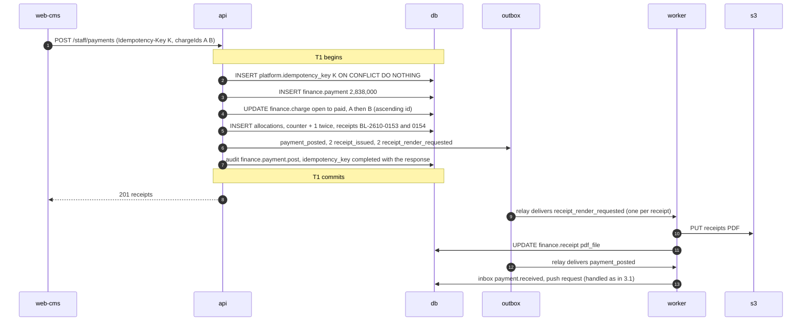

| Point | Durable | Ack |
| --- | --- | --- |
| Arrow 8 (T1) | The payment, both charges `paid`, two receipts with gapless numbers, the stored 201 | Arrow 9 |
| Arrows 11–12 | The PDF in `s3`, then its file id on the receipt | none to the user; `GET …/pdf` renders on demand if it is missing (DR-56) |

**A crash.** Before arrow 8: the transaction rolls back, the counter increments go with it, so no receipt number is lost (FNM-S02); the Manager retries with the same key and it runs as a first use. Between arrows 8 and 9: the retry with key K replays the stored 201 with `Idempotent-Replayed: true` (FR-05.4). Between arrows 11 and 12: the object is written again on redelivery (the same key in `s3`, DOC-37). If an online confirmation of charge B committed first, arrow 5 updates zero rows and the whole T1 rolls back with 409 `charge_changed` (DOC-22 §10).

**Verification:** LG-01…LG-20 (DOC-22), FF- tests of FL-05.

### 3.3 Online payment: create the intent

The owner of `A-1508` selects A and B. The gateway call sits **between** two transactions, so a slow payOS never holds a lock on a charge (original SDD §6.3, DOC-23 §4.2). The route runs in the `external` idempotency mode: the key is committed `in_progress` before the gateway call (DOC-50 §8, DR-143, DR-259).

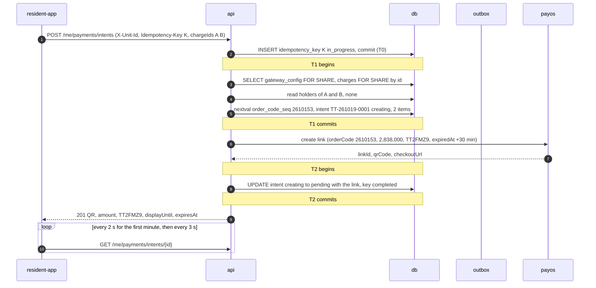

| Point | Durable | Ack |
| --- | --- | --- |
| Arrow 2 (T0) | The key, `in_progress` | none |
| Arrow 6 (T1) | The intent `creating`, A and B **held** (one active intent per charge), `next_check_at` +120 s | none |
| Arrow 8 | The link exists at payOS | payOS's answer |
| Arrow 10 (T2) | The intent `pending` with the QR | Arrow 11: the QR on `Pay-VietQR` |

**A crash.** Before arrow 6: nothing but the `in_progress` key; a retry with K within five minutes is 409 `request_in_progress`, after five minutes it takes the key over (DOC-50 §8). Between arrows 6 and 10: the intent stays `creating` with its charges held; `intent_requery` resolves it after 120 s by a `GET` (§4.4). A second household member who selects exactly A and B meanwhile gets this intent back (DOC-23 §4.4). The app never decides that money arrived: only the server's `paid` status does.

**Verification:** IN-01…IN-17 (DOC-23), FO- tests of FL-10 (DOC-45).

### 3.4 Webhook settles

The owner transfers 2,838,000 đ with content `TT2FMZ9`. payOS signs a webhook. The route checks the body and the signature (DOC-24) and calls `settle()`, which commits the event, the intent, the payment and its consequences in one transaction (DR-29, ADR-0008). The answer 200 is sent only after that commit.

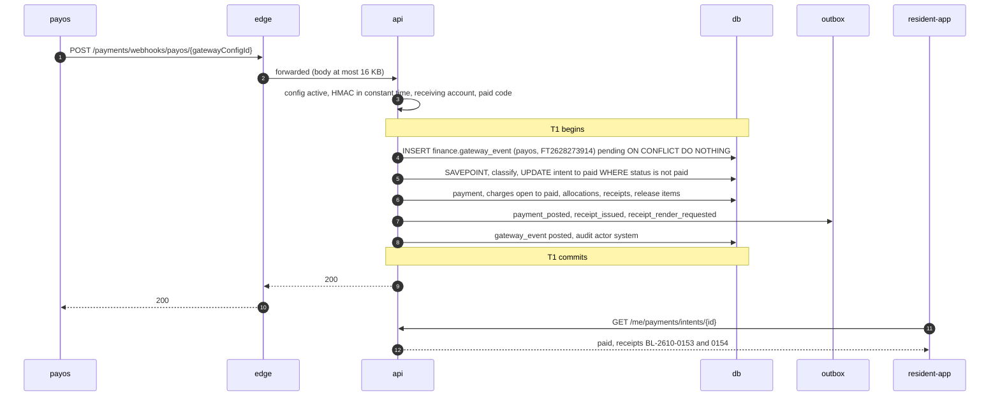

| Point | Durable | Ack |
| --- | --- | --- |
| Arrow 3 fails | A `finance.webhook_rejection` row (DR-32), never a `gateway_event` row | 401 `invalid_signature` or 400 |
| Arrow 9 (T1) | One payment or one money-log row for this reference, never both | Arrows 10–11: 200 to payOS |
| Arrow 13 | — | The poll shows `paid`: NFR-02 measures arrow 2 to arrow 13 (p95 ≤ 5 s), and arrow 4 to arrow 9 (p95 ≤ 1 s, DR-80) |

A transfer of another amount ends T1 with an outcome row (`amount_short`, `amount_over`, `charge_already_paid`, `charge_recalled`) and `finance.money_unposted.v1` for the Managers, and the poll returns `unmatchedTransfer` (DR-84 item 8, DR-96). The answer to payOS is 200 whatever the outcome (DOC-42 §6). The failures of this flow are §4.1 and §4.2.

**Verification:** IN-24…IN-39 (DOC-23), EXP-01 (DOC-90).

### 3.5 Re-query settles or expires

The second confirmation path. The job claims due intents, commits the claim, asks payOS **outside** any transaction, and then either calls `settle()` with `source = requery` or moves the intent (DR-30, DOC-23 §8). The webhook and the re-query meet on the `gateway_event` key, so whichever commits first settles and the other becomes a no-op (original SDD §6.5).

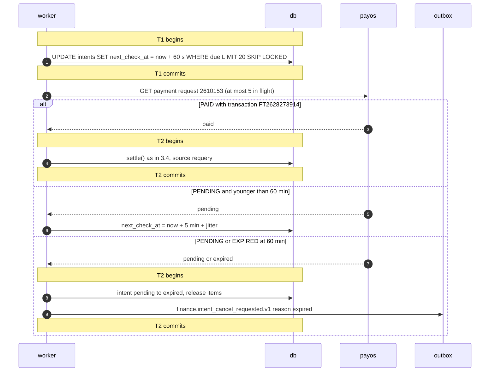

| Point | Durable | Ack |
| --- | --- | --- |
| Arrow 2 (T1) | The lease (the new `next_check_at`) | none; two workers claim disjoint rows |
| T2 | The payment, or the next check, or the expiry with its cancel command | the job's `job_run` row `{checked, settled, expired, failed}` |

"I have transferred" (E-88) only sets `next_check_at = now()` when the last check is older than 30 s; the next tick picks it up (DOC-23 §5.2). A worker that dies after arrow 2 leaves the lease, and the row is claimed again after 60 s. payOS errors back off 30 s, 60 s, 2 min, 5 min and are counted in `payos_requests_total`; `PaymentsStuck` (RB-02) fires for an intent `pending` past its 60 minutes.

**Verification:** IN-40…IN-49 (DOC-23), EXP-02 (DOC-91).

### 3.6 Recall against a payment

The Manager recalls batch `PH-2610-01` while the webhook for charge A of `A-1508` arrives. The **charge row** is the arbiter: both actors update it with `WHERE status = 'open'`, and the loser sees zero rows (DOC-22 §10, original SDD §5.8).

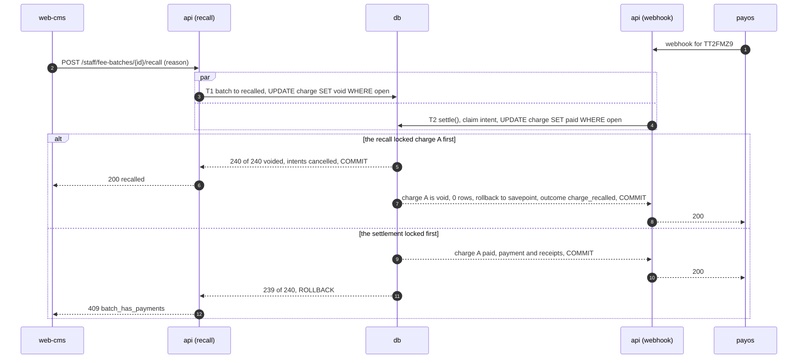

| Order | End state |
| --- | --- |
| Recall first | The batch `recalled`, every intent holding its charges `cancelling` with a cancel command (DOC-23 §5.4), the transfer a `charge_recalled` row for the Manager to refund outside the system |
| Settlement first | The batch still `published` with one paid charge; the Manager voids a wrong open charge alone (FL-44) or offsets a wrong paid one with an adjustment line (DR-19) |

When the recall and the settlement touch the same intent and charge in the same instant they lock in opposite orders; PostgreSQL aborts one with `40P01` after 1 s and the retry meets the committed state of the other (DOC-23 §7.2). No order lets a recalled charge carry a payment; the nightly check is the last net (DOC-22 §12).

**Verification:** IN-36 (DOC-23), LG-79, LG-81 (DOC-21), EXP-04 (DOC-93).

### 3.7 Statement reconciliation

The third confirmation path, and the only one that sees money the gateway never reported. The Manager uploads the receiving account's statement; the API reads it, deduplicates lines, and matches each credit line. A line with an order code (`TT` + base 32) re-queries payOS and settles **only** what payOS reports `PAID`, so the statement never double-counts (DR-35). DOC-25 owns the parser and the matching; this flow follows DR-34 and DR-35, which are proposed.

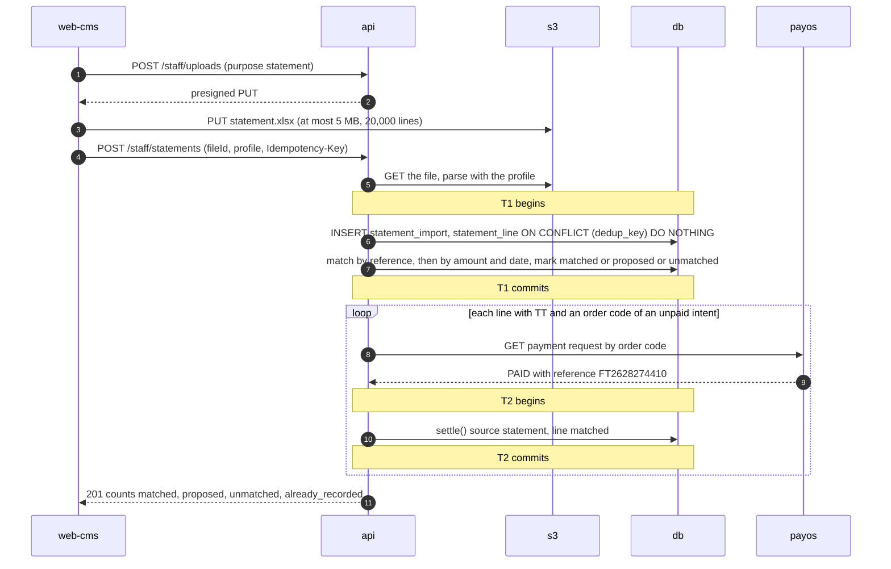

| Point | Durable | Ack |
| --- | --- | --- |
| Arrow 3 | The file in `s3` | the presigned PUT's 200 |
| Arrow 8 (T1) | The import and its lines; a line seen before is counted `already_recorded` by its `dedup_key` | none yet |
| Each T2 | One payment (or log row) for that transfer; a later webhook for the same reference is `already_processed` | none yet |
| Arrow 15 | — | the counts on `W-Statement` |

**A crash** after T1 and before the loop ends leaves some order-code lines unmatched; uploading the same file again finds every line `already_recorded` and the order-code step must still run for lines that are not `matched`. **DR-284** proposes that the order-code step runs for every line of the import that is still `unmatched`, not only for new lines, so a repeated upload finishes an interrupted one; DOC-25 decides. A gateway call inside an HTTP request bounds the work: at 20,000 lines the step is limited by the number of lines with an order code (a few hundred a month), each a 10 s timeout at most.

**Verification:** ST- tests (DOC-25, P3-07), IN-38 (DOC-23).

### 3.8 OTP sign-in

The resident `+84901234567` signs in. The challenge and the SMS command commit together; the SMS is sent by the worker; the verify consumes the challenge in one statement (DOC-26 §5, DR-37, DR-134). The code never travels in clear inside the system: the command carries it encrypted (DR-117).

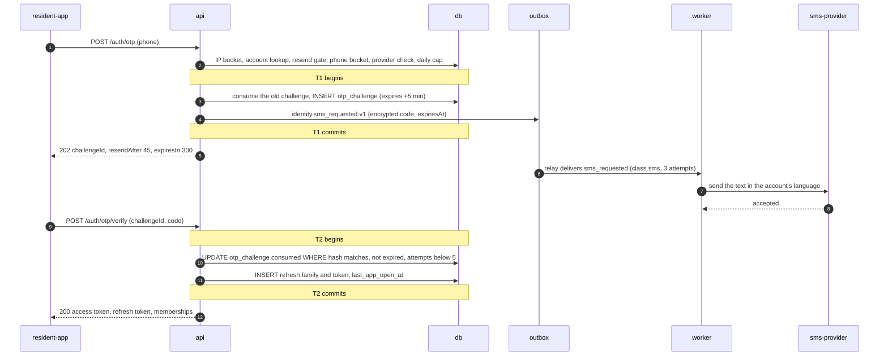

| Point | Durable | Ack |
| --- | --- | --- |
| Arrow 5 (T1) | The challenge and the SMS command | Arrow 6: 202, the app shows `OTP` |
| Arrow 9 | — | the provider's acceptance; delivery to the phone is outside the system |
| Arrow 13 (T2) | The consumed challenge and the session | Arrow 14 |

**A crash.** Between arrows 5 and 6 the SMS is still sent; the resident taps "resend" after 45 s and gets a new code (the old one is consumed). An SMS command past its `expiresAt` is skipped, so a late worker never sends a dead code (FR-15.7, MC-15). A wrong code commits its attempt counter before the 400 (DOC-26 §5.2). Demo accounts write no SMS command. The failure of this flow is §4.6.

**Verification:** AU- tests of DOC-26 §12, FI-21…FI-30 (DOC-46), EXP-09 (DOC-98).

### 3.9 Ticket status change, then notification

The Technician starts work on ticket `YC-261019-004` of `A-1508`. The transition is one conditional update on the ticket row and its event is written in the same transaction, so a resident never hears of a change that rolled back (original SDD §8.2). DOC-28 owns the statements and the transition table; this flow follows the original SDD and DOC-09 §5.

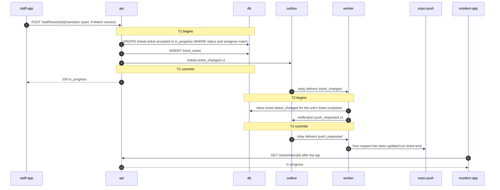

| Point | Durable | Ack |
| --- | --- | --- |
| Arrow 5 (T1) | The new status, the timeline event, the message | Arrow 6 |
| Arrow 10 (T2) | The inbox entry and the push command | none |

A transition that lost a race (the Manager reassigned the ticket a moment earlier) updates zero rows and answers 409 `ticket_reassigned`; nothing is written and nothing is sent. The web CMS learns of the change through `realtime.sse_on_tickets_ticket_changed` and SSE (DOC-07 §5.3). The push body never holds the ticket's text (DR-52).

**Verification:** TK- tests (DOC-28, P4-01), FT- tests of FL-27 (DOC-47).

### 3.10 Notice fan-out

A notice to every resident of a building of 5,000 recipients. The scheduler claims the due notice; the worker reads recipients page by page and writes one batch of at most 500 recipients **per transaction**, each with its own outbox event; push goes out as 50 requests of 100 (original SDD §10.2, DR-51). DOC-31 owns the statements.

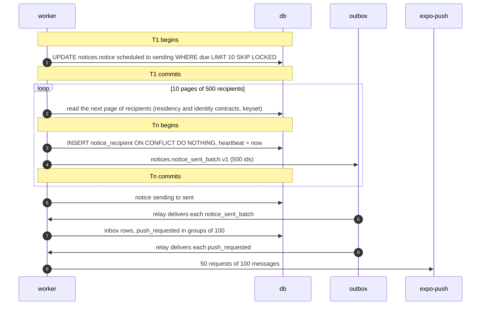

| Point | Durable | Ack |
| --- | --- | --- |
| Arrow 2 (T1) | The notice `sending` | none |
| Each Tn | 500 recipient rows and one event; the heartbeat | none |
| Arrow 10 | The notice `sent` | `W-Notice-Stats` shows the counts |

NFR-04 measures from the claim (arrow 2) to the last Expo request returned (arrow 14): within 60 s for 5,000 recipients (DR-80, EXP-06). The failure of this flow is §4.3.

**Verification:** NT- tests (DOC-31, P4-05), FN- tests of FL-32 (DOC-48), EXP-06 (DOC-95).

### 3.11 QR show and scan

The QR proves "an active membership in this unit, and the newest code of the last 15 minutes". Showing the code rotates the nonce; the scan reads and compares, and writes only a view log (original SDD §9.1, DR-48). DOC-29 owns the token format and the log.

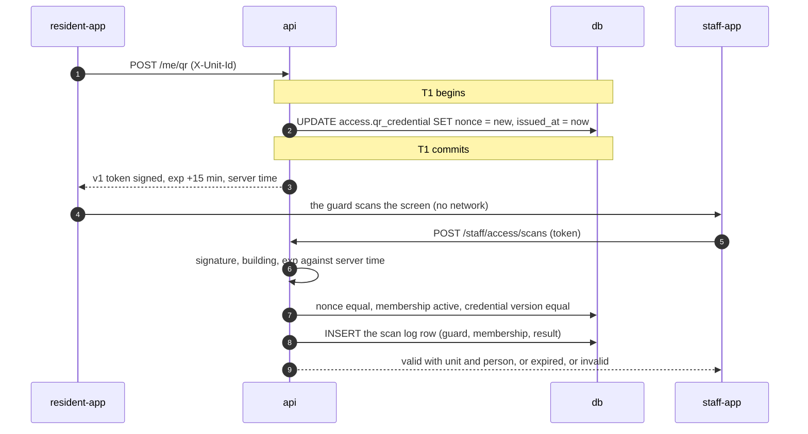

| Point | Durable | Ack |
| --- | --- | --- |
| Arrow 3 (T1) | The new nonce: every earlier code of this membership is dead | Arrow 4 |
| Arrow 9 | The view log (who saw whose data) | Arrow 10 |

A lock or removal of the member in `residency` increments the credential version in `residency`'s own transaction, so the next scan is `invalid` without any cross-module transaction (DR-48). A lost response at arrow 4 is harmless: the app asks for a new code, which kills the previous one.

**Verification:** QC- tests (DOC-29, P5-01), FN- tests of FL-34 and FL-35 (DOC-48), EXP-05 (DOC-94).

### 3.12 Export

The Manager exports the debt-aging report to Excel. The request writes a job row; the worker runs the query, streams the file to `s3`, and tells the requester (DR-55). DOC-33 owns the job; DOC-37 owns the signed URL.

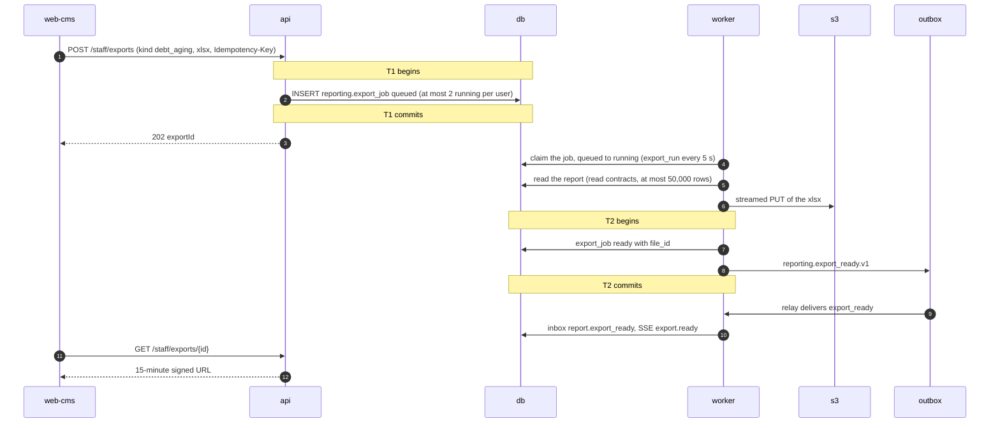

| Point | Durable | Ack |
| --- | --- | --- |
| Arrow 3 (T1) | The job `queued` | Arrow 4 |
| Arrow 8 | The file in `s3`, not yet referenced | none |
| Arrow 11 (T2) | The job `ready` with its file, the event | The SSE event and the inbox entry |

A worker that dies between arrows 8 and 11 leaves an object no row points to and a job `running`; DOC-33 owes the rule that reclaims a `running` job after a lease and the purge of unreferenced export objects (**DR-285** proposes a 10-minute lease like the notice heartbeat, and the 7-day purge of `exports/` by prefix age, which deletes such objects anyway). The file is kept 7 days.

**Verification:** RP- tests (DOC-33, P6-01), FA- tests of FL-40 (DOC-49), FS- tests (DOC-37).

## 4. Failure flows

### 4.1 PostgreSQL down in the middle of a settlement

The database stops while the webhook of §3.4 is inside `settle()`. Nothing commits, so nothing is half-written; payOS retries; the re-query and the statement path are the second and third nets (original SDD §19.3).

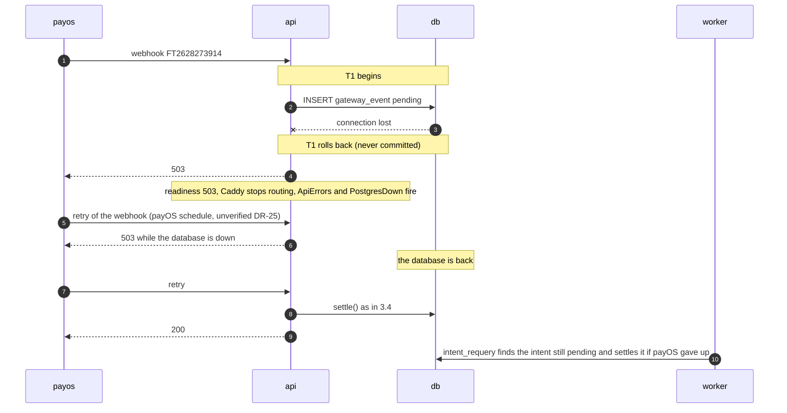

| Question | Answer |
| --- | --- |
| What the user sees | The resident's poll fails (the app shows its offline state) and then shows `paid` once a path settles. Every API request is 503 meanwhile |
| What is durable | Nothing of the failed attempt. The transfer is at payOS |
| What retries | payOS retries the webhook (its schedule is a fact to verify, DR-25 item 5); `intent_requery` re-queries `pending` intents every 5 minutes for 60 minutes; after that, the statement path (§3.7) |
| Alerts | `PostgresDown` (1 min), `ReadinessFailing` (30 s), `ApiErrors` (5xx above 2% over 5 min), all RB-09; later `PaymentsStuck` if intents pass 60 minutes (RB-02) |
| End state | One payment for the transfer, whichever path commits first (DOC-23 §7.1) |

The webhook route answers 503, never 200, when `settle()` throws for an infrastructure reason (DOC-42 §6, §7.3). A database error after the `gateway_event` insert but before commit rolls the insert back too, so the reference is not occupied.

**Verification:** UC-18 E4; IN-34 (forced failures), EXP-01 (DOC-90) kill and outage scenarios.

### 4.2 Process killed after commit, before the 200

`api-1` dies (out of memory, a deploy that skipped the drain) between the commit of `settle()` and the answer. payOS sees a dropped connection and retries.

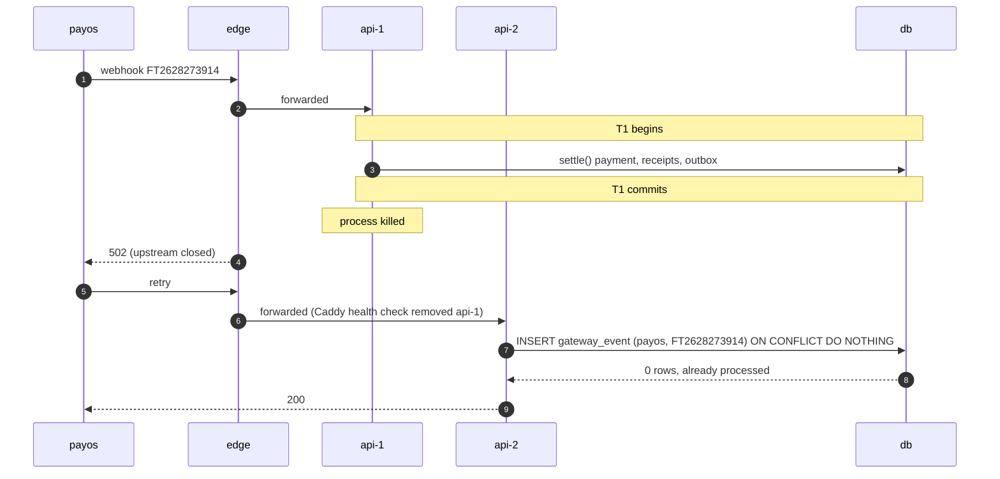

| Question | Answer |
| --- | --- |
| What the user sees | Nothing unusual: the poll shows `paid` from arrow 5 on |
| What is durable | The payment, its receipts and the outbox rows (arrow 5) |
| What retries | payOS's webhook; the retry is a no-op on the `gateway_event` key (FR-08.6) |
| Alerts | `ApiDown` only if both replicas are down; a restart is otherwise silent |
| End state | One payment, one set of receipts, one push |

The same shape holds for every other mutation: a manual payment retried with its `Idempotency-Key` replays the stored 201 (§3.2); a publish retried gets 409 with the fresh state (§3.1); an outbox handler killed after its commit is skipped by its inbox row (§1.3). A deploy avoids the case by the drain: the `api` stops answering readiness, waits `SHUTDOWN_DRAIN_SECONDS`, then finishes the requests in flight (DOC-38 §5.4, DR-272).

**Verification:** IN-35 (DOC-23), LG-18 (DOC-22), EXP-01 kill-after-commit scenario.

### 4.3 Worker killed in the middle of a fan-out

The worker is killed after 4 of the 10 recipient batches of §3.10.

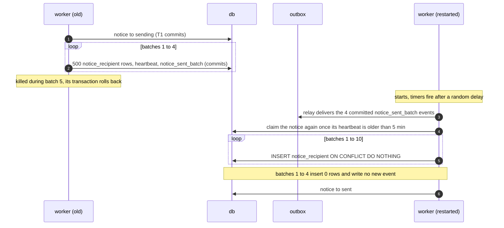

| Question | Answer |
| --- | --- |
| What the user sees | The first 2,000 recipients get the notice at once; the other 3,000 about 5 minutes later. Nobody gets it twice |
| What is durable | Batches 1–4 and their events; the notice `sending` with a heartbeat |
| What retries | The scheduler reclaims a `sending` notice whose heartbeat is older than 5 minutes; the relay redelivers the committed events; the outbox claims of the dead worker return after their 60 s lease (DOC-38 §5.4) |
| Alerts | `WorkerDown` (2 min, RB-04) while it is down; `OutboxLag` (2 min, RB-04); `IntegrityFindings` if a notice stays `sending` (the weekly `integrity_notices` job) |
| End state | 5,000 recipient rows, 10 events delivered once each, the notice `sent` |

**The event must not repeat.** A rerun batch that inserts zero rows writes no event; a batch that inserts some rows writes an event with only the new ids. DR-51 and DOC-31 fix the statement; this flow assumes `INSERT … RETURNING` drives the event's ids (**DR-286**).

**Verification:** NT- tests (DOC-31), JB-09 (DOC-38), EXP-06 (DOC-95) kill scenario.

### 4.4 payOS timeout at link creation

payOS does not answer `createLink` within 10 s (§3.3 arrow 7).

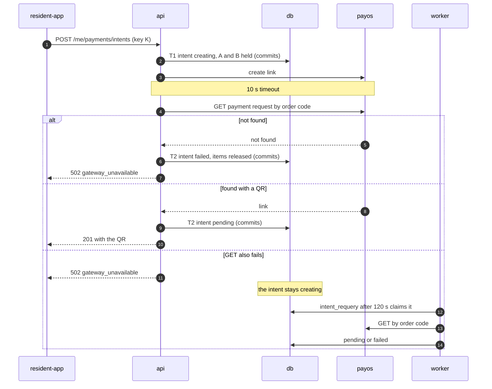

| Question | Answer |
| --- | --- |
| What the user sees | "Could not create the payment. Try again." (UC-03 5a) or the QR if the link was found. Paying at the office is always possible |
| What is durable | The intent and its holds from T1; then `failed` (holds released) or `pending` |
| What retries | The resident retries; while an intent of the same charges is `creating`, a second request returns it (DOC-23 §4.4). `intent_requery` resolves a `creating` intent after 120 s |
| Alerts | `PaymentsStuck` when more than 5 intents are `creating` for more than 2 minutes (RB-02); `GatewayErrors` when more than half of the gateway calls in 10 minutes fail (DOC-23 §14) |
| End state | `pending` with a link, or `failed` with the charges payable again |

A link found by `GET` that carries no QR is `pending` and the next creation supersedes it (DOC-23 §4.5, DR-280).

**Verification:** IN-11, IN-12, IN-13 (DOC-23), PX- tests (DOC-24).

### 4.5 Expo down

Expo Push answers 503 for an hour. The inbox entry is the record; the push is a convenience (original SDD §19.3, DR-52).

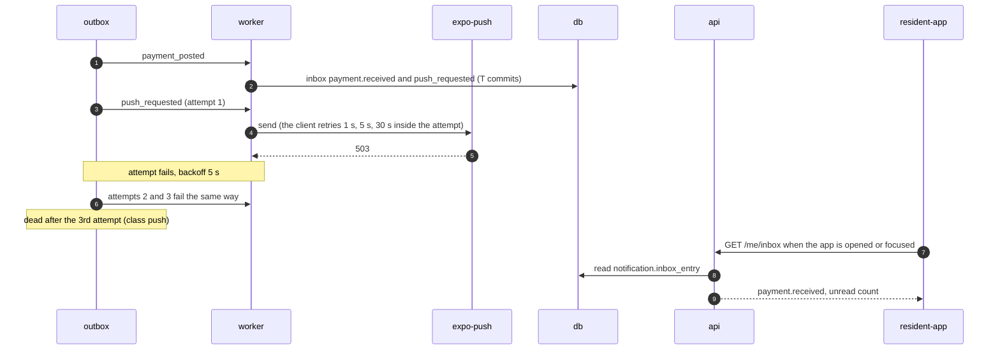

| Question | Answer |
| --- | --- |
| What the user sees | No push; the inbox entry and the unread count on the next app open or focus; `Pay-Done` already showed the receipts if the payer was on the screen |
| What is durable | The inbox entry (committed before any push) |
| What retries | The Expo client 3 times inside an attempt; the outbox 3 attempts (class `push`); then the message is dead and is not requeued: a push an hour late is worse than none (DOC-09 §4.2) |
| Alerts | `DeadLetters` (RB-05) for the dead push messages |
| End state | Every inbox entry present; pushes lost for the outage window; the notice statistics count them as "push failed" |

**Verification:** NT- tests (DOC-31), MC- tests of the push class (DOC-09).

### 4.6 SMS provider down

The SMS provider rejects every send. The OTP endpoint is synchronous but sending is not, so the API infers the outage from the recent SMS commands and refuses new challenges instead of issuing codes that never arrive (DR-134, DOC-26 §5.4).

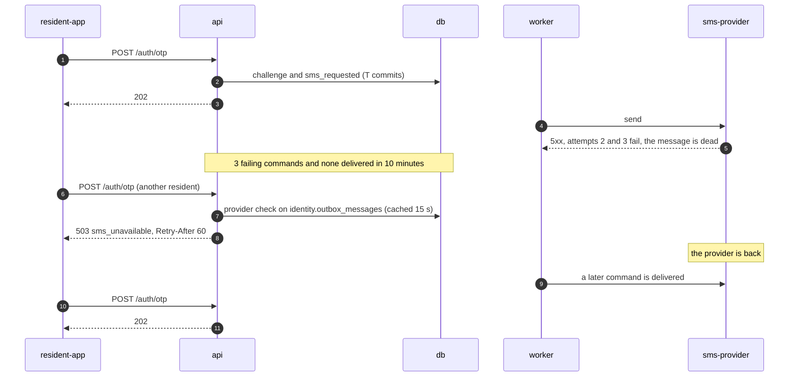

| Question | Answer |
| --- | --- |
| What the user sees | The first residents get "Code sent" and no SMS (they may resend after 45 s); later ones get "Could not send the code. Try again later." Residents already signed in are unaffected (refresh tokens last 180 days) |
| What is durable | The challenges and the commands; dead commands stay for RB-06 |
| What retries | 3 attempts per command (class `sms`); an expired command is skipped, never sent late (FR-15.7) |
| Alerts | `SmsProviderDown` (`sms_provider_down = 1` for 5 min) and `SmsFailures`, RB-06; `DeadLetters` (RB-05) |
| End state | New challenges are issued again after the first delivered command or when the 10-minute window passes |

A command skipped as expired counts as delivered, so a provider down for a long time may let one request through per window: a known false negative, covered by `OutboxLag` (DOC-26 §5.4).

**Verification:** AU- tests of the provider check (DOC-26 §12, AU-S10), EXP-09 (DOC-98).

## 5. Decisions owed

Three choices were not answered by a document or a DR. They are recorded in the decision register: DR-284 was decided by the Owner on 2026-11-02 (it changes what the statement path settles), DR-285 and DR-286 under delegation. The owner documents apply them when they are written.

| ID | Problem | Decision | Owner |
| --- | --- | --- | --- |
| DR-284 (decided) | A statement upload interrupted after its lines committed leaves order-code lines unmatched; a repeated upload finds every line `already_recorded` | The order-code step runs over every `unmatched` line of the building that has an order code and was not tried since the gateway last answered for it, not only over the lines the upload inserted | DOC-25 |
| DR-285 (decided) | A worker that dies after writing an export file and before marking the job `ready` leaves a `running` job and an unreferenced object | A `running` export older than 10 minutes is reclaimed; unreferenced export objects are removed by the 7-day prefix purge | DOC-33 |
| DR-286 (decided) | A rerun fan-out batch must not repeat its event | The event carries only the ids returned by `INSERT … ON CONFLICT DO NOTHING RETURNING`; a batch with zero new rows writes no event | DOC-31 |

## 6. Not in this document

| Topic | Lives in |
| --- | --- |
| Every screen, endpoint, class and error branch of a flow | DOC-44…49 (`FL-xx`) |
| Statements, state machines, races in full | DOC-21, DOC-22, DOC-23, DOC-25, DOC-26, DOC-28, DOC-29, DOC-31, DOC-33 |
| Message schemas, handlers, retry classes | DOC-09 |
| The relay, the job runtime, shutdown | DOC-38 |
| Containers, ports, deployment | DOC-07, DOC-70 |
| Alert expressions and runbooks | DOC-40, `09-operations/runbooks/` |
| Capacity and latency budgets | DOC-10 |

## 7. Traceability

| Flow | Requirements | Use cases | Experiments |
| --- | --- | --- | --- |
| 3.1 Publish and push | FR-03, FR-29 | UC-01, UC-19 | — |
| 3.2 Manual payment | FR-05, NFR-01 | UC-02 | EXP-03 |
| 3.3 Create the intent | FR-07 | UC-03 | — |
| 3.4 Webhook | FR-08, FR-09, NFR-01, NFR-02 | UC-18 | EXP-01 |
| 3.5 Re-query | FR-10, FR-08.3 | UC-18 | EXP-02 |
| 3.6 Recall against a payment | FR-04.3, FR-49.5 | UC-04, UC-18 | EXP-04 |
| 3.7 Statement | FR-11 | UC-06 | — |
| 3.8 OTP sign-in | FR-15 | UC-14 | EXP-09 |
| 3.9 Ticket change | FR-22, FR-29 | UC-09 | — |
| 3.10 Notice fan-out | FR-27, FR-29, NFR-04 | UC-11, UC-19 | EXP-06 |
| 3.11 QR | FR-25, FR-26 | UC-16 | EXP-05 |
| 3.12 Export | FR-35, FR-48 | UC-25 | — |
| 4.1…4.6 Failures | NFR-01, NFR-02, NFR-10 | UC-18 E4, E5; UC-14 E4; UC-03 5a | EXP-01, EXP-02, EXP-06, EXP-09, EXP-12 |

## Open questions

1. **DR-284** (decided by the Owner 2026-11-02, money, P3): an interrupted statement upload is finished by uploading the file again. It changes only the statement path of §3.7, which DOC-25 specifies in P3; no other flow depends on it. DR-285 and DR-286 are decided; DOC-25, DOC-33 and DOC-31 apply the three when they are written.
2. The payOS webhook retry schedule (§4.1) and whether `GET` returns the QR of a link (§4.4) are facts to verify against a sandbox (DR-25).
3. The flows of §3.3…3.7 follow DOC-23 (DR-27, 28, 30, 31, 280, 281 and 283, decided 2026-11-02); this document changes with it.
