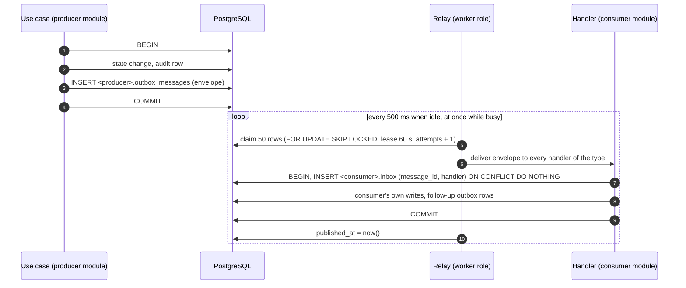

# Messaging contracts

> Status: **Approved** (Owner, 2026-10-21) · Updated: 2026-10-20 (DR-129, DR-132, DR-135, DR-140: session revocation reasons, step-up, `IdentityApi` and `ResidencyApi` additions) · DOC-09
> Depends on: original SDD §4.1, §4.2, §10.4, [DR](../00-decision-register.md) (DR-02, 42, 48, 51, 52, 53, 55, 62, 75, 84, 87, 97, 98, 101, 114, 115, 116, 117, 118, 119, 122), [ADR-0009](../04-adr/0009-transactional-outbox-inbox-and-contracts.md), [ADR-0015](../04-adr/0015-jobs-and-worker-topology.md), [DOC-07](system-context-and-containers.md) §5–§6, [DOC-12](code-architecture.md) §4, §6, §8, [DOC-17](../05-data/operations-model.md) §3.3, [DOC-38](../06-design/jobs-and-outbox-runtime.md)
> Main readers: P1-04, P1-05 (messaging runtime), every task that adds an event, a handler or a contract, DOC-31 (notification handlers), DOC-38, DOC-42, DOC-88

This document is the catalog of everything one module says to another: the **events and commands** that travel through the outbox (the envelope, every payload with its schema and an example, who consumes it, how it is retried) and the **synchronous contracts** (`ResidencyApi`, `IdentityApi`, …) with their DTOs. It also fixes the rules that keep both compatible over time. It does not hold the relay mechanics, the timers or the job catalog (DOC-38), the tables (DOC-17 §3.3 for `outbox_messages` and `inbox`), the template keys and their texts (DOC-31), or the exception-to-code mapping (DOC-42).

Every new decision in this document is recorded as DR-116, DR-117, DR-118 or DR-122 (and DR-119) and summarized in §10. The JSON Schema of each message is a file in [`event-schemas/`](event-schemas/) (30 files: 28 payloads, `common`, `envelope`). Until the producer modules exist, those files are the source; P1-05 moves each payload schema to `modules/<producer>/src/contracts/schemas/` and the contract tests of §9 read them from there. The schemas and every example in this document were validated with Ajv 8.20 (JSON Schema draft 2020-12, strict mode) on 2026-10-19: all 28 examples pass, and each schema refuses a payload with an extra field or a missing required field.

## 1. Scope and reading guide

| Question | Answer lives in |
| --- | --- |
| How does a message get from a use case to a handler? | §2, then DOC-38 §2 for the relay |
| What does a message look like on the wire? | §3 |
| How many times is a message retried, and what does a handler do when it fails? | §4 |
| Which events exist, who produces and who consumes them? | §5 |
| What are the fields of event X? | §6 |
| Which module calls which module synchronously, and with which DTOs? | §7 |
| What may change in a message without breaking a consumer? | §8 |
| How is all of it tested? | §9 |
| Where is a table, a timer, a configuration key? | DOC-17 §3.3 · DOC-38 · DOC-41 |

## 2. The model in one page



1. **One transaction writes the change and its messages** (ADR-0009). `OutboxWriter.add` throws if no transaction is open.
2. **Delivery is at least once**, in id order within one `aggregate_id`, with no order across aggregates and none promised between handlers. A handler assumes duplicates and reordering.
3. **A handler is a consumer group**: `(consumer module, handler name)`. A message with three handlers is delivered to each; one failing handler makes the relay retry the whole message, and the handlers that already succeeded are skipped by their inbox row.
4. **A command and an event travel the same way.** A command (`…_requested`) has exactly one consumer and one intended effect (send an SMS, cancel a link, render a PDF); an event states a fact and may have none, one or several consumers. The name tells which.
5. **Producers never call back.** The payload carries what the handler needs. When a handler needs more it calls a synchronous contract of §7, in its own transaction, never a table of another module.
6. **A message is never the only record.** Every message either repeats a fact already stored by the producer or asks for an effect that has a stored fallback (an inbox entry, an on-demand PDF, an expiring link). Losing one is a defect with a runbook (RB-05), not a data loss.

## 3. The message

### 3.1 Envelope

Written by `DrizzleOutboxWriter` to `<producer>.outbox_messages` (DDL: DOC-17 §3.3) and handed unchanged to handlers. Schema: [`envelope.schema.json`](event-schemas/envelope.schema.json).

| Field | Column | Meaning |
| --- | --- | --- |
| `id` | `id` | UUIDv7. Time-ordered, so `ORDER BY id` is `ORDER BY time`. The inbox key together with the handler name. |
| `type` | `type` | `<module>.<name>.v<major>` (§3.3). |
| `source` | — | The producing module; equals the first segment of `type`. A test pins it (MC-02). |
| `aggregateId` | `aggregate_id` | Ordering and grouping key: the payload field named in §5. Messages of one aggregate never run at the same time and start in id order. |
| `occurredAt` | `occurred_at` | When the state change was written. |
| `payload` | `payload` | The schema named by `type` (§6). |
| `headers` | `headers` | `correlationId` (the request id that started the chain), `causationId` (the request id, or the id of the message that caused this one). `traceparent` is allowed by the schema and absent in phase 1: no traces are built (DR-63, DR-118). |

```json
{
  "id": "0192f3c4-8e21-7000-8000-00000000a001",
  "type": "finance.payment_posted.v1",
  "source": "finance",
  "aggregateId": "0192f3c4-5a1e-7000-8000-000000000030",
  "occurredAt": "2026-10-19T03:21:44.512Z",
  "payload": {
    "buildingId": "0192f3c4-5a1e-7000-8000-000000000001",
    "paymentId": "0192f3c4-5a1e-7000-8000-000000000030",
    "unitId": "0192f3c4-5a1e-7000-8000-000000000021",
    "source": "online",
    "payerAccountId": "0192f3c4-5a1e-7000-8000-000000000041",
    "postedAt": "2026-10-19T03:21:44.512Z"
  },
  "headers": { "correlationId": "01JC0REQ7M3K9X", "causationId": "01JC0REQ7M3K9X" }
}
```

### 3.2 Where each piece lives

| Piece | Location |
| --- | --- |
| Payload types (TypeScript) | `modules/<producer>/src/contracts/events.ts`: one interface per event, named in the `<Producer>Events` map (DOC-12 §4.1) |
| Payload schemas | `modules/<producer>/src/contracts/schemas/<type>.schema.json` (now: [`event-schemas/`](event-schemas/)); `common.schema.json` and `envelope.schema.json` stay in `packages/core-messaging/schemas/` |
| What the consumer does with it | `modules/<producer>/src/integrations/<consumer>.ts` for `notification` and `realtime` (DOC-12 §4.4); `modules/<consumer>/src/application/handlers/` for every other consumer |
| Handler registry | `AppModule.handlers` of the consumer; the name is the second part of the inbox key |

### 3.3 Names

| Thing | Rule | Example |
| --- | --- | --- |
| Event or command | `<module>.<snake_case_name>.v<major>`; events are past tense (`batch_published`), commands are `…_requested` | `finance.intent_cancel_requested.v1` |
| Handler | `<consumer module>.<snake_case_effect>_on_<producer>_<event>` for a handler that reacts; `<module>.<verb>_<object>` for the sender of a command it owns | `notification.inbox_on_finance_batch_published`, `identity.send_sms` |
| Payload field | camelCase; ids end in `Id`; instants are RFC 3339 UTC with `Z`; dates are `YYYY-MM-DD` in building time (ADR-0013); money, if present, is an integer in đồng | `postedAt`, `dueDate` |
| Retry class | one of `default`, `sms`, `push`, `intent_cancel` (§4.2) | |

### 3.4 Payload rules (DR-118, DR-117)

1. **`buildingId` is the first field of every payload.** It is `null` only for the events about an account that spans buildings: the resident OTP, sessions and account deletion (marked in §6). The consumer builds its `BuildingScope` from it.
2. **Ids and codes, not data.** A payload names the objects and carries only what the consumer cannot get cheaply otherwise. It holds no phone number, no email, no amount in a push-bound message, no name, no ticket text (DR-52, FR-24.1). Money appears only in `finance.money_unposted.v1`, whose consumers are staff screens.
3. **At most 64 KB** (`OUTBOX_MAX_PAYLOAD_BYTES`, checked by the writer wrapper: a larger payload is a programming error and fails the transaction). The largest payload allowed by the schemas is `finance.debt_reminder_sent.v1` with 500 reminders: 51,114 bytes, computed from the examples.
4. **Fan-out is chunked.** An action that concerns many units or accounts writes several messages of at most 500 ids each (the same 500 as the batches of `listNoticeRecipients`, DR-51), in the action's transaction, with `part` and `parts`. A batch of 5,000 charged units is 10 messages of `finance.batch_published.v1`; they share the `aggregate_id`, so they run in order. A handler never needs `parts` to be correct (each part is complete by itself); it is there for logs and tests.
5. **A secret is never plaintext in a payload** (DR-117). The two commands that carry one (`identity.sms_requested.v1`, `identity.mail_requested.v1`) hold `secretEnc`, the secret encrypted with the key ring of the settings (`SETTINGS_ENCRYPTION_KEYS`, AES-256-GCM, format `v1:<keyId>:<iv>:<ciphertext+tag>` as `gateway_config.secrets_enc`, DR-33). The handler decrypts in memory, sends and forgets. A rotation keeps the retired key in the ring for at least 24 hours after the new one is in use, the longest `expiresAt` of any command (the staff invite link, 24 h); RB-12 says so. A message that still cannot be decrypted is dead-lettered and the user asks again (a new OTP, a resent invitation).
6. **The contact comes from the owner's table.** The sender handlers of `identity` read the phone from `resident_account` and the address from `staff_account` by id, so a contact detail sits in no outbox row (DR-117).
7. **A command that can go stale says when** (`expiresAt`). The handler that finds it past due returns success without sending, so a stale OTP SMS neither reaches a phone nor lands in the dead letters (FR-15.7).

## 4. Delivery settings

### 4.1 Relay settings (DR-62, DR-101)

The mechanics (claiming statement, leases, per-aggregate concurrency, cleanup, pause) are DOC-38 §2. The values are these; the key names are DOC-38's and DOC-41 lists them.

| Setting | Default | Meaning |
| --- | --- | --- |
| Poll interval when idle | 500 ms | The relay sleeps only when a pass found nothing; while busy it loops at once |
| Batch size | 50 | Rows claimed per pass |
| Lease | 60 s | `locked_until`; a crashed relay's rows return after it |
| Backoff | `min(5 s × 2^(attempts − 1), 15 min)` | The wait after a failed attempt |
| Defer budget | 24 h from `occurred_at` | For `RetryLaterError` only (§4.4) |
| Retention | 7 days | Published `outbox_messages` and delivered `inbox` rows are deleted by the relay cleanup, at most every 10 minutes (DR-101) |
| Maximum payload | 64 KB | §3.4 |

### 4.2 Retry classes

A class is the number of attempts a message gets. The relay reads the class of a type from a map in the module manifest (`outboxPolicies`), so a new type needs one line there and one row in §5.

| Class | Attempts | Types | Why |
| --- | --- | --- | --- |
| `default` | 8 | every type not named below (25 of 28) | DR-62 |
| `sms` | 3 | `identity.sms_requested.v1` | A late SMS is useless; the handler also skips it after `expiresAt` (5 min) |
| `push` | 3 | `notification.push_requested.v1` | The Expo client already retries 3 times inside one attempt (DR-52) |
| `intent_cancel` | 8 | `finance.intent_cancel_requested.v1` | DR-31; same number as `default`, named so it can change alone |

Attempts are counted at claim time, so a crash also uses one. With the default backoff the waits after attempts 1 to 7 are:

| After attempt | 1 | 2 | 3 | 4 | 5 | 6 | 7 |
| --- | --- | --- | --- | --- | --- | --- | --- |
| Wait | 5 s | 10 s | 20 s | 40 s | 80 s | 160 s | 320 s |

The eighth failure dead-letters the message, 635 s (about 10 min 35 s) after the first. The 15-minute cap is therefore never reached with 8 attempts; it bounds the value if the attempt count is raised. A longer outage is handled by the dead-letter alert and `outbox:requeue` (RB-05), not by a longer backoff. The reference relay has one global `maxAttempts` (10) and a fixed backoff of `min(2^attempts, 300)` seconds (`kit-messaging/src/outbox/outbox-relay.ts`, read 2026-10-19). The vendored `core-messaging` therefore gains a `policy(type) → { maxAttempts }` hook and the options `backoffBaseSeconds` and `backoffMaxSeconds`, recorded under `local-changes` of `packages/CORE_VERSION` (P1-02, DR-118).

### 4.3 Inbox modes

The inbox row `(message_id, handler)` makes a handler's database effect happen once. Which of the two modes of the reference a handler uses depends on where its effect lives (DOC-12 §8.4):

| Mode | When | Shape | Duplicate risk |
| --- | --- | --- | --- |
| `transactional` | The effect is rows in the consumer's own schema (and follow-up outbox rows) | One transaction: insert the inbox row `ON CONFLICT DO NOTHING RETURNING`, return if it conflicted, else do the writes | None: effectively once |
| `afterSideEffect` | The effect leaves the database (SMTP, SMS, Expo, payOS, R2) | Check the inbox row, do the effect, insert the inbox row | One repeat if the process dies between the effect and the insert; the effect must tolerate it |
| none | A live push to connected browsers (`realtime`) | No inbox row | A repeat is harmless: the browser gets the same SSE event twice and ignores it |

A second net under every `transactional` handler is a natural key on the rows it writes, so a bug in the inbox cannot create a duplicate:

| Effect | Natural key |
| --- | --- |
| Inbox entry | `UNIQUE (account_kind, account_id, source_kind, source_id, template_key)` (DR-53) |
| Notice recipient | `UNIQUE (notice_id, account_id)` (original SDD §16.2) |
| Device token delete, membership removal, profile clear | Idempotent statements: a second run changes no row |
| Receipt PDF | One cached file per `(owner_ref, variant)`; a second render reuses the content hash (DOC-34) |

A repeat of the Expo push (the only accepted duplicate side effect besides a repeat SMS) costs one extra notification; the inbox entry is the record. Expo has no idempotency key, so no stronger rule exists.

### 4.4 What a handler does when it fails

| The handler … | Effect | Use for |
| --- | --- | --- |
| throws | The relay counts the attempt, waits per §4.2, and retries the whole message | A database error, a timeout, a 5xx from a provider |
| throws `RetryLaterError(reason, retryAfterMs)` | The attempt is given back; the message returns after `retryAfterMs` (default 30 s) plus 0–10 % jitter; dead only after the 24 h budget | A provider rate limit (Expo 429, SMS provider quota), a lock held by another process |
| returns normally | The inbox row is written; the message is done | Success, a duplicate, a message past its `expiresAt`, and a permanent per-recipient failure (an invalid address, a revoked device token), logged at `warn` |

A permanent failure must not throw: it would dead-letter the message for every other consumer and every other recipient in a chunk. The mapping from exception classes to these three outcomes is DOC-42 §7's.

A message that reaches `dead_at` raises `outbox_dead_letters` and the alert of RB-05. Dead rows stay until an operator requeues or removes them (DOC-20 §2.2).

## 5. The catalog

### 5.1 Events and commands

28 types: 23 from DR-42 and DR-87, 3 from DR-116 (`finance.debt_reminder_sent`, `vehicles.vehicle_submitted`, `notification.staff_inbox_created`) and 2 from DR-122 (`building.file_delete_requested`, `building.thumbnail_requested`). An import has no event: validation is synchronous (DR-21). The QR rotation uses `credential_version`, not a message (DR-48).

| Event | Kind | Producer | `aggregate_id` | Consumers (handler names) | Retry class | Source |
| --- | --- | --- | --- | --- | --- | --- |
| `finance.batch_published.v1` | event | finance | `batchId` | `notification.inbox_on_finance_batch_published` | `default` | DR-42 |
| `finance.batch_recalled.v1` | event | finance | `batchId` | `notification.inbox_on_finance_batch_recalled` | `default` | DR-42 |
| `finance.batch_due_extended.v1` | event | finance | `batchId` | `notification.inbox_on_finance_batch_due_extended` | `default` | DR-42 |
| `finance.charge_voided.v1` | event | finance | `chargeId` | `notification.inbox_on_finance_charge_voided` | `default` | DR-42 |
| `finance.payment_posted.v1` | event | finance | `paymentId` | `notification.inbox_on_finance_payment_posted` | `default` | DR-42 |
| `finance.payment_voided.v1` | event | finance | `paymentId` | `notification.inbox_on_finance_payment_voided` | `default` | DR-42 |
| `finance.receipt_issued.v1` | event | finance | `receiptId` | none in phase 1 | `default` | DR-42 |
| `finance.money_unposted.v1` | event | finance | `rowId` | `notification.inbox_on_finance_money_unposted`<br>`realtime.sse_on_finance_money_unposted` | `default` | DR-42 |
| `finance.intent_cancel_requested.v1` | command | finance | `intentId` | `finance.cancel_intent_link` | `intent_cancel` | DR-42 |
| `finance.receipt_render_requested.v1` | command | finance | `receiptId` | `finance.render_receipt_pdf` | `default` | DR-42 |
| `finance.debt_reminder_sent.v1` | event | finance | `buildingId` | `notification.inbox_on_finance_debt_reminder_sent` | `default` | DR-116 |
| `residency.membership_changed.v1` | event | residency | `unitId` | `notification.inbox_on_residency_membership_changed` | `default` | DR-42 |
| `residency.owner_changed.v1` | event | residency | `unitId` | `notification.inbox_on_residency_owner_changed` | `default` | DR-42 |
| `identity.sms_requested.v1` | command | identity | `requestId` | `identity.send_sms` | `sms` | DR-117 |
| `identity.mail_requested.v1` | command | identity | `staffId` | `identity.send_mail`<br>`notification.inbox_on_identity_mail_requested` | `default` | DR-117 |
| `identity.session_revoked.v1` | event | identity | `accountId` | `realtime.close_stream_on_identity_session_revoked`<br>`notification.drop_device_token_on_identity_session_revoked` | `default` | DR-42 |
| `identity.account_deletion_executed.v1` | event | identity | `accountId` | `residency.clear_profile_on_identity_account_deletion_executed`<br>`notification.drop_tokens_on_identity_account_deletion_executed`<br>`building.null_terms_ip_on_identity_account_deletion_executed` | `default` | DR-42, DR-87 |
| `tickets.ticket_changed.v1` | event | tickets | `ticketId` | `notification.inbox_on_tickets_ticket_changed`<br>`realtime.sse_on_tickets_ticket_changed` | `default` | DR-42 |
| `tickets.ticket_assigned.v1` | event | tickets | `ticketId` | `notification.inbox_on_tickets_ticket_assigned` | `default` | DR-42 |
| `vehicles.vehicle_submitted.v1` | event | vehicles | `vehicleId` | `notification.inbox_on_vehicles_vehicle_submitted` | `default` | DR-116 |
| `vehicles.vehicle_reviewed.v1` | event | vehicles | `vehicleId` | `notification.inbox_on_vehicles_vehicle_reviewed` | `default` | DR-42 |
| `notices.notice_sent_batch.v1` | event | notices | `noticeId` | `notification.inbox_on_notices_notice_sent_batch` | `default` | DR-42 |
| `notices.notice_read.v1` | event | notices | `noticeId` | `notification.mark_read_on_notices_notice_read` | `default` | DR-42 |
| `notification.push_requested.v1` | command | notification | `sourceId` | `notification.send_expo_push` | `push` | DR-42 |
| `notification.staff_inbox_created.v1` | event | notification | `staffId` | `realtime.sse_on_notification_staff_inbox_created` | `default` | DR-116 |
| `reporting.export_ready.v1` | event | reporting | `exportId` | `notification.inbox_on_reporting_export_ready`<br>`realtime.sse_on_reporting_export_ready` | `default` | DR-42 |
| `building.file_delete_requested.v1` | command | building | `fileId` | `building.delete_file_object` | `default` | DR-122 |
| `building.thumbnail_requested.v1` | command | building | `fileId` | `building.make_thumbnail` | `default` | DR-122 |

### 5.2 Handlers

34 handlers. A handler that reads from a table writes only its own schema; the cross-module reads it needs are the contracts of §7. The **idempotency key** of every delivery is `(message id, handler name)` in the consumer's inbox; the last column is the second net, the natural key that keeps a repeat harmless even without the inbox row (§4.3).

| Handler | Consumes | Inbox mode | Effect | Second net (natural key) |
| --- | --- | --- | --- | --- |
| `notification.inbox_on_finance_batch_published` | `finance.batch_published.v1` | transactional | Per unit: inbox entry `fee.batch_published` and a push for each active owner, family member and tenant; none for helpers | `inbox_entry` `(account_kind, account_id, source_kind, source_id, template_key)` |
| `notification.inbox_on_finance_batch_recalled` | `finance.batch_recalled.v1` | transactional | Per unit: inbox entry `fee.batch_recalled` and a push to the same recipients as the publish | `inbox_entry` `(account_kind, account_id, source_kind, source_id, template_key)` |
| `notification.inbox_on_finance_batch_due_extended` | `finance.batch_due_extended.v1` | transactional | Per unit: inbox entry `fee.batch_due_extended` and a push | `inbox_entry` `(account_kind, account_id, source_kind, source_id, template_key)` |
| `notification.inbox_on_finance_charge_voided` | `finance.charge_voided.v1` | transactional | Inbox entry `fee.charge_voided` and a push for the unit's recipients who can see fees | `inbox_entry` `(account_kind, account_id, source_kind, source_id, template_key)` |
| `notification.inbox_on_finance_payment_posted` | `finance.payment_posted.v1` | transactional | Inbox entry `payment.received` and a push "Payment received" for the unit's recipients who can see fees, the payer included | `inbox_entry` `(account_kind, account_id, source_kind, source_id, template_key)` |
| `notification.inbox_on_finance_payment_voided` | `finance.payment_voided.v1` | transactional | Inbox entry `payment.voided` and a push for the unit's recipients who can see fees | `inbox_entry` `(account_kind, account_id, source_kind, source_id, template_key)` |
| `notification.inbox_on_finance_money_unposted` | `finance.money_unposted.v1` | transactional | Inbox entry `finance.money_unposted` for every active Manager and Admin; no push content with an amount | `inbox_entry` `(account_kind, account_id, source_kind, source_id, template_key)` |
| `realtime.sse_on_finance_money_unposted` | `finance.money_unposted.v1` | none | SSE `money_log.opened` | none: a repeated SSE event is ignored by the browser |
| `finance.cancel_intent_link` | `finance.intent_cancel_requested.v1` | afterSideEffect | `CancelIntentLink`: cancel the link at the gateway; if it is already paid, run `getStatus` and `settle` (DR-31) | Conditional update of the intent status; the gateway cancel is idempotent |
| `finance.render_receipt_pdf` | `finance.receipt_render_requested.v1` | afterSideEffect | Render the PDF from the frozen snapshot and write it to the files bucket (DOC-34) | One cached file per `(owner_ref, variant)`; the content hash skips a re-render |
| `notification.inbox_on_finance_debt_reminder_sent` | `finance.debt_reminder_sent.v1` | transactional | Per unit: inbox entry `fee.reminder` and a push for recipients who can see fees | `inbox_entry` `(account_kind, account_id, source_kind, source_id, template_key)` |
| `notification.inbox_on_residency_membership_changed` | `residency.membership_changed.v1` | transactional | For `added`: inbox entry `member.added` for the added account; other changes produce nothing | `inbox_entry` `(account_kind, account_id, source_kind, source_id, template_key)` |
| `notification.inbox_on_residency_owner_changed` | `residency.owner_changed.v1` | transactional | Inbox entry `member.added` for the new owner (no new template key) | `inbox_entry` `(account_kind, account_id, source_kind, source_id, template_key)` |
| `identity.send_sms` | `identity.sms_requested.v1` | afterSideEffect | Send through the SMS driver (DR-68); skip if `expiresAt` has passed | none: a repeat sends a second message; `expiresAt` bounds it |
| `identity.send_mail` | `identity.mail_requested.v1` | afterSideEffect | Send through SMTP; skip if `expiresAt` has passed | none: a repeat sends a second message; `expiresAt` bounds it |
| `notification.inbox_on_identity_mail_requested` | `identity.mail_requested.v1` | transactional | Only for kind `step_up_notice`: inbox entry `staff.step_up_done` for `staffId`; all other kinds are ignored | `inbox_entry` `(account_kind, account_id, source_kind, source_id, template_key)` |
| `realtime.close_stream_on_identity_session_revoked` | `identity.session_revoked.v1` | none | Close the SSE streams of that session; SSE `session.revoked` (staff only) | none: a repeated SSE event is ignored by the browser |
| `notification.drop_device_token_on_identity_session_revoked` | `identity.session_revoked.v1` | transactional | Delete the `device_token` rows of that session | `DELETE` by session or account: a second run deletes nothing |
| `residency.clear_profile_on_identity_account_deletion_executed` | `identity.account_deletion_executed.v1` | transactional | Remove the account's memberships and clear its `resident_profile` rows (DOC-16 §5.2) | Clearing fields that are already null; `cleared_at` is set once |
| `notification.drop_tokens_on_identity_account_deletion_executed` | `identity.account_deletion_executed.v1` | transactional | Delete the account's device tokens | `DELETE` by session or account: a second run deletes nothing |
| `building.null_terms_ip_on_identity_account_deletion_executed` | `identity.account_deletion_executed.v1` | transactional | Set `terms_acceptance.ip` to null for the account (DR-115) | `SET ip = NULL`: a second run changes nothing |
| `notification.inbox_on_tickets_ticket_changed` | `tickets.ticket_changed.v1` | transactional | Maps `change` and `toStatus` to the `ticket.*` template keys of DR-53 and picks the recipients (resident side or staff side) | `inbox_entry` `(account_kind, account_id, source_kind, source_id, template_key)` |
| `realtime.sse_on_tickets_ticket_changed` | `tickets.ticket_changed.v1` | none | SSE `ticket.created` when `change = created`, otherwise `ticket.changed` | none: a repeated SSE event is ignored by the browser |
| `notification.inbox_on_tickets_ticket_assigned` | `tickets.ticket_assigned.v1` | transactional | Inbox entry `ticket.assigned` and a push for the assignee | `inbox_entry` `(account_kind, account_id, source_kind, source_id, template_key)` |
| `notification.inbox_on_vehicles_vehicle_submitted` | `vehicles.vehicle_submitted.v1` | transactional | Inbox entry `vehicle.pending_review` for the reviewers (recipients: DOC-31) | `inbox_entry` `(account_kind, account_id, source_kind, source_id, template_key)` |
| `notification.inbox_on_vehicles_vehicle_reviewed` | `vehicles.vehicle_reviewed.v1` | transactional | Inbox entry `vehicle.approved` or `vehicle.rejected` and a push for the submitter | `inbox_entry` `(account_kind, account_id, source_kind, source_id, template_key)` |
| `notification.inbox_on_notices_notice_sent_batch` | `notices.notice_sent_batch.v1` | transactional | Insert `inbox_entry` rows (`ON CONFLICT DO NOTHING`) and write `notification.push_requested.v1` in groups of 100 | `inbox_entry` `(account_kind, account_id, source_kind, source_id, template_key)` |
| `notification.mark_read_on_notices_notice_read` | `notices.notice_read.v1` | transactional | Set `inbox_entry.read_at` where `source_kind = notice` and `source_id = noticeId` for the account | `read_at` set only where null: a second run changes no row |
| `notification.send_expo_push` | `notification.push_requested.v1` | afterSideEffect | Resolve device tokens and languages, send in one Expo request of at most 100, store `push_ticket`s | none: a repeat sends a second push; the inbox entry is the record |
| `realtime.sse_on_notification_staff_inbox_created` | `notification.staff_inbox_created.v1` | none | SSE `inbox.created` to the streams of that staff member | none: a repeated SSE event is ignored by the browser |
| `notification.inbox_on_reporting_export_ready` | `reporting.export_ready.v1` | transactional | Inbox entry `report.export_ready` for the requester | `inbox_entry` `(account_kind, account_id, source_kind, source_id, template_key)` |
| `realtime.sse_on_reporting_export_ready` | `reporting.export_ready.v1` | none | SSE `export.ready` | none: a repeated SSE event is ignored by the browser |
| `building.delete_file_object` | `building.file_delete_requested.v1` | afterSideEffect | Load the row; if its status is `deleted`, call `DeleteObject` on the files bucket (a missing key is success); otherwise do nothing (DOC-37 §14) | `DeleteObject` of a missing key is success |
| `building.make_thumbnail` | `building.thumbnail_requested.v1` | afterSideEffect | Resize with `sharp` to 480 px (512 px for the logo), WebP, and register it as a `thumbnail` file with `owner_ref = thumb:<fileId>`; skip if it exists; an undecodable image is logged and skipped (DOC-37 §10) | A `thumbnail` row with `owner_ref = thumb:<fileId>` exists: skip |

### 5.3 From an event to a template key

Every template key of the inbox catalog (DR-53) has exactly one source, so adding a key without an event, or an event without a key, fails the catalog test (MC-09).

| Template key | Source | Recipients (resolved by the handler) |
| --- | --- | --- |
| `fee.batch_published`, `fee.batch_recalled`, `fee.batch_due_extended` | `finance.batch_published`, `batch_recalled`, `batch_due_extended` | `ResidencyApi.listRecipients(unitId, 'view_fees')` per unit: active owner, family, tenant; not helpers (DR-20) |
| `fee.charge_voided` | `finance.charge_voided` | the same |
| `fee.reminder` | `finance.debt_reminder_sent` | the same |
| `payment.received`, `payment.voided` | `finance.payment_posted`, `finance.payment_voided` | the same |
| `finance.money_unposted` | `finance.money_unposted` | `IdentityApi.listActiveStaff(buildingId, ['manager', 'admin'])` |
| `ticket.new_unassigned` | `tickets.ticket_changed` with `change = created` | active Manager and Admin |
| `ticket.assigned` | `tickets.ticket_assigned` | the assignee |
| `ticket.status_changed`, `ticket.commented` | `tickets.ticket_changed` (`status_changed`; `message_added` with `messageVisibility = public`) | the unit's recipients who hold the `tickets` capability |
| `ticket.rejected`, `ticket.awaiting_close` | `tickets.ticket_changed` whose `toStatus` is the technician's rejection or `resolved` (DOC-28 names the literals) | the Manager and Admin |
| `vehicle.pending_review` | `vehicles.vehicle_submitted` | the reviewers (DOC-31) |
| `vehicle.approved`, `vehicle.rejected` | `vehicles.vehicle_reviewed` | `submittedByAccountId` |
| `notice.published` | `notices.notice_sent_batch` | the `recipients` of the message |
| `member.added` | `residency.membership_changed` with `change = added`; `residency.owner_changed` | the added account; the new owner |
| `report.export_ready` | `reporting.export_ready` | `requestedBy` |
| `staff.step_up_done` | `identity.mail_requested` with `kind = step_up_notice` | `staffId` (one message per Admin, FR-50.4) |
| `staff.invited` | none | The invited person has no session to read an inbox and receives the invitation by mail (`staff_invite`); the key is unused and DOC-31 drops it (DR-116) |

A transfer of another amount creates no inbox entry and no push (FR-09.2, FR-29.7): `finance.money_unposted` goes to staff only, and the resident sees `unmatchedTransfer` in the app.

### 5.4 From an event to a live SSE event (DR-75)

| SSE event | Source | Handler |
| --- | --- | --- |
| `inbox.created` | `notification.staff_inbox_created` | `realtime.sse_on_notification_staff_inbox_created` |
| `ticket.created` | `tickets.ticket_changed` with `change = created` | `realtime.sse_on_tickets_ticket_changed` |
| `ticket.changed` | `tickets.ticket_changed`, any other change | the same |
| `money_log.opened` | `finance.money_unposted` | `realtime.sse_on_finance_money_unposted` |
| `export.ready` | `reporting.export_ready` | `realtime.sse_on_reporting_export_ready` |
| `session.revoked` | `identity.session_revoked` (staff only) | `realtime.close_stream_on_identity_session_revoked` |

`realtime` is a strict leaf: these mappings live in the producers' `integrations/realtime.ts` (DOC-12 §4.4).

## 6. Event reference

Each section gives the producer's trigger, the field table (types are those of the schema; `uuid`, `date`, `month`, `instant`, `locale`, `accountKind` are the definitions of [`common.schema.json`](event-schemas/common.schema.json)) and a payload that passes its schema. The consumers and their inbox modes are in §5.2.

### 6.1 finance

#### `finance.batch_published.v1`

- **Event**, produced by `finance` when: Publish a batch (FR-03.3). `aggregate_id` = `batchId`. Retry class `default`. Chunked: at most 500 ids per message (§3.4).

| Field | Type | Meaning |
| --- | --- | --- |
| `buildingId` | uuid | The building. The first field of every payload. |
| `batchId` | uuid | The published batch. |
| `code` | string | Batch code, `PH-YYMM-NN` (DR-10). |
| `feeMonth` | month | Fee month, `YYYY-MM`. |
| `dueDate` | date | Due date in building time. |
| `part` | integer | Position of this message among the messages of one action, from 1. |
| `parts` | integer | Number of messages the action wrote; the handler needs no other knowledge of the total. |
| `unitIds` | array of uuid (≤ 500) | Charged units of this part, at most 500. |

Example payload:

```json
{
  "buildingId": "0192f3c4-5a1e-7000-8000-000000000001",
  "batchId": "0192f3c4-5a1e-7000-8000-000000000010",
  "code": "PH-2610-01",
  "feeMonth": "2026-10",
  "dueDate": "2026-11-10",
  "part": 1,
  "parts": 1,
  "unitIds": [
    "0192f3c4-5a1e-7000-8000-000000000021",
    "0192f3c4-5a1e-7000-8000-000000000022",
    "0192f3c4-5a1e-7000-8000-000000000023"
  ]
}
```

#### `finance.batch_recalled.v1`

- **Event**, produced by `finance` when: Recall a published batch (FR-04). `aggregate_id` = `batchId`. Retry class `default`. Chunked: at most 500 ids per message (§3.4).

| Field | Type | Meaning |
| --- | --- | --- |
| `buildingId` | uuid | The building. The first field of every payload. |
| `batchId` | uuid | The recalled batch. |
| `code` | string | Batch code. |
| `feeMonth` | month | Fee month. |
| `part` | integer | Position of this message among the messages of one action, from 1. |
| `parts` | integer | Number of messages the action wrote; the handler needs no other knowledge of the total. |
| `unitIds` | array of uuid (≤ 500) | Units that had a non-void charge in the batch (DR-97), at most 500. |

Example payload:

```json
{
  "buildingId": "0192f3c4-5a1e-7000-8000-000000000001",
  "batchId": "0192f3c4-5a1e-7000-8000-000000000010",
  "code": "PH-2610-01",
  "feeMonth": "2026-10",
  "part": 1,
  "parts": 1,
  "unitIds": ["0192f3c4-5a1e-7000-8000-000000000021","0192f3c4-5a1e-7000-8000-000000000022"]
}
```

#### `finance.batch_due_extended.v1`

- **Event**, produced by `finance` when: Extend the due date of a published batch (FR-44). `aggregate_id` = `batchId`. Retry class `default`. Chunked: at most 500 ids per message (§3.4).

| Field | Type | Meaning |
| --- | --- | --- |
| `buildingId` | uuid | The building. The first field of every payload. |
| `batchId` | uuid | The batch. |
| `code` | string | Batch code. |
| `previousDueDate` | date | The date before the change. |
| `dueDate` | date | The new, later date. |
| `part` | integer | Position of this message among the messages of one action, from 1. |
| `parts` | integer | Number of messages the action wrote; the handler needs no other knowledge of the total. |
| `unitIds` | array of uuid (≤ 500) | Units that still have an `open` charge in the batch, at most 500. Units that paid are not told. |

Example payload:

```json
{
  "buildingId": "0192f3c4-5a1e-7000-8000-000000000001",
  "batchId": "0192f3c4-5a1e-7000-8000-000000000010",
  "code": "PH-2610-01",
  "previousDueDate": "2026-11-10",
  "dueDate": "2026-11-20",
  "part": 1,
  "parts": 1,
  "unitIds": ["0192f3c4-5a1e-7000-8000-000000000021"]
}
```

#### `finance.charge_voided.v1`

- **Event**, produced by `finance` when: Void a single open charge (FR-49). `aggregate_id` = `chargeId`. Retry class `default`.

| Field | Type | Meaning |
| --- | --- | --- |
| `buildingId` | uuid | The building. The first field of every payload. |
| `chargeId` | uuid | The voided charge. |
| `batchId` | uuid | Its batch. |
| `unitId` | uuid | Its unit. |
| `feeMonth` | month | Fee month of the batch. |

Example payload:

```json
{
  "buildingId": "0192f3c4-5a1e-7000-8000-000000000001",
  "chargeId": "0192f3c4-5a1e-7000-8000-000000000011",
  "batchId": "0192f3c4-5a1e-7000-8000-000000000010",
  "unitId": "0192f3c4-5a1e-7000-8000-000000000021",
  "feeMonth": "2026-10"
}
```

#### `finance.payment_posted.v1`

- **Event**, produced by `finance` when: A payment is posted: online settlement or manual entry (FR-05, FR-08). `aggregate_id` = `paymentId`. Retry class `default`.
- Written in the same transaction as the payment, its allocations and receipts. The amount is not in the payload; the app fetches it after authentication.

| Field | Type | Meaning |
| --- | --- | --- |
| `buildingId` | uuid | The building. The first field of every payload. |
| `paymentId` | uuid | The payment. |
| `unitId` | uuid | The unit that paid. |
| `source` | `online` · `cash` · `bank_transfer` | How the money arrived (DR-23). |
| `payerAccountId` | uuid or `null` | The resident who started the payment, `null` for a manual entry. |
| `postedAt` | instant | When the payment was posted. |

Example payload:

```json
{
  "buildingId": "0192f3c4-5a1e-7000-8000-000000000001",
  "paymentId": "0192f3c4-5a1e-7000-8000-000000000030",
  "unitId": "0192f3c4-5a1e-7000-8000-000000000021",
  "source": "online",
  "payerAccountId": "0192f3c4-5a1e-7000-8000-000000000041",
  "postedAt": "2026-10-19T03:21:44.512Z"
}
```

#### `finance.payment_voided.v1`

- **Event**, produced by `finance` when: Void a manual payment (FR-06). `aggregate_id` = `paymentId`. Retry class `default`.

| Field | Type | Meaning |
| --- | --- | --- |
| `buildingId` | uuid | The building. The first field of every payload. |
| `paymentId` | uuid | The voided payment. |
| `unitId` | uuid | Its unit. |
| `source` | `cash` · `bank_transfer` | Only manual payments can be voided. |
| `voidedAt` | instant | When it was voided. |

Example payload:

```json
{
  "buildingId": "0192f3c4-5a1e-7000-8000-000000000001",
  "paymentId": "0192f3c4-5a1e-7000-8000-000000000030",
  "unitId": "0192f3c4-5a1e-7000-8000-000000000021",
  "source": "cash",
  "voidedAt": "2026-10-19T08:02:10.100Z"
}
```

#### `finance.receipt_issued.v1`

- **Event**, produced by `finance` when: A receipt is issued, one per allocation (DR-17). `aggregate_id` = `receiptId`. Retry class `default`.
- The integration seam for e-invoices. No consumer in phase 1.

| Field | Type | Meaning |
| --- | --- | --- |
| `buildingId` | uuid | The building. The first field of every payload. |
| `receiptId` | uuid | The receipt. |
| `receiptNo` | string | Receipt number, `BL-YYMM-NNNN` (DR-10). |
| `paymentId` | uuid | Its payment. |
| `allocationId` | uuid | Its allocation. |
| `chargeId` | uuid | The charge it paid. |
| `unitId` | uuid | The unit. |
| `issuedAt` | instant | Issue time. |

Example payload:

```json
{
  "buildingId": "0192f3c4-5a1e-7000-8000-000000000001",
  "receiptId": "0192f3c4-5a1e-7000-8000-000000000031",
  "receiptNo": "BL-2610-0042",
  "paymentId": "0192f3c4-5a1e-7000-8000-000000000030",
  "allocationId": "0192f3c4-5a1e-7000-8000-000000000032",
  "chargeId": "0192f3c4-5a1e-7000-8000-000000000011",
  "unitId": "0192f3c4-5a1e-7000-8000-000000000021",
  "issuedAt": "2026-10-19T03:21:44.512Z"
}
```

#### `finance.money_unposted.v1`

- **Event**, produced by `finance` when: A new open row in the money log (FR-46.4). `aggregate_id` = `rowId`. Retry class `default`.

| Field | Type | Meaning |
| --- | --- | --- |
| `buildingId` | uuid | The building. The first field of every payload. |
| `kind` | `gateway_event` · `statement_line` | Which table holds the row. |
| `rowId` | uuid | Id of the `gateway_event` or `statement_line`. |
| `outcome` | string | `gateway_event.outcome` or `statement_line.match_status` of the row. |
| `amount` | integer | Amount in đồng, shown to staff only. |
| `receivedAt` | instant | When the transfer arrived. |

Example payload:

```json
{
  "buildingId": "0192f3c4-5a1e-7000-8000-000000000001",
  "kind": "gateway_event",
  "rowId": "0192f3c4-5a1e-7000-8000-000000000034",
  "outcome": "amount_short",
  "amount": 2000000,
  "receivedAt": "2026-10-19T03:25:01.000Z"
}
```

#### `finance.intent_cancel_requested.v1`

- **Command**, produced by `finance` when: An intent leaves `pending`: expiry, a new request, recall, void or a payment elsewhere (DR-31). `aggregate_id` = `intentId`. Retry class `intent_cancel`.
- Best effort; correctness never depends on the cancel (glossary: intent cancel).

| Field | Type | Meaning |
| --- | --- | --- |
| `buildingId` | uuid | The building. The first field of every payload. |
| `intentId` | uuid | The intent whose link is cancelled. |
| `reason` | `expired` · `resident_cancelled` · `replaced` · `batch_recalled` · `charge_voided` · `charge_paid` | Why; for the log only. |

Example payload:

```json
{
  "buildingId": "0192f3c4-5a1e-7000-8000-000000000001",
  "intentId": "0192f3c4-5a1e-7000-8000-000000000033",
  "reason": "batch_recalled"
}
```

#### `finance.receipt_render_requested.v1`

- **Command**, produced by `finance` when: A receipt is issued or voided (FR-36). `aggregate_id` = `receiptId`. Retry class `default`.
- One per receipt, written in the same transaction as `receipt_issued` or the void. A missing PDF is rendered on demand by `GET …/pdf` (DR-56).

| Field | Type | Meaning |
| --- | --- | --- |
| `buildingId` | uuid | The building. The first field of every payload. |
| `receiptId` | uuid | The receipt. |
| `variant` | `issued` · `void` | `void` renders the watermarked copy (DR-17). |

Example payload:

```json
{
  "buildingId": "0192f3c4-5a1e-7000-8000-000000000001",
  "receiptId": "0192f3c4-5a1e-7000-8000-000000000031",
  "variant": "issued"
}
```

#### `finance.debt_reminder_sent.v1`

- **Event**, produced by `finance` when: The Manager sends debt reminders (FR-12.4). `aggregate_id` = `buildingId`. Retry class `default`. Chunked: at most 500 ids per message (§3.4).
- The template `fee.reminder` had no event in DR-42. One `debt_reminder` row per unit per building day is the throttle and the source id of the inbox entry.

| Field | Type | Meaning |
| --- | --- | --- |
| `buildingId` | uuid | The building. The first field of every payload. |
| `reminderDate` | date | The building day of the reminders. |
| `part` | integer | Position of this message among the messages of one action, from 1. |
| `parts` | integer | Number of messages the action wrote; the handler needs no other knowledge of the total. |
| `reminders` | array of object {reminderId, unitId} (≤ 500) | The `debt_reminder` rows of this part, at most 500. |

Example payload:

```json
{
  "buildingId": "0192f3c4-5a1e-7000-8000-000000000001",
  "reminderDate": "2026-10-19",
  "part": 1,
  "parts": 1,
  "reminders": [
    {
      "reminderId": "0192f3c4-5a1e-7000-8000-000000000035",
      "unitId": "0192f3c4-5a1e-7000-8000-000000000021"
    }
  ]
}
```

### 6.2 residency

#### `residency.membership_changed.v1`

- **Event**, produced by `residency` when: A membership is added, removed, retyped, locked or unlocked (FR-17.3). `aggregate_id` = `unitId`. Retry class `default`.

| Field | Type | Meaning |
| --- | --- | --- |
| `buildingId` | uuid | The building. The first field of every payload. |
| `unitId` | uuid | The unit. |
| `membershipId` | uuid | The membership. |
| `accountId` | uuid | The member's resident account. |
| `change` | `added` · `removed` · `type_changed` · `can_pay_changed` · `locked` · `unlocked` | What happened. |
| `memberType` | `owner` · `family` · `tenant` · `helper` | Type after the change. |

Example payload:

```json
{
  "buildingId": "0192f3c4-5a1e-7000-8000-000000000001",
  "unitId": "0192f3c4-5a1e-7000-8000-000000000021",
  "membershipId": "0192f3c4-5a1e-7000-8000-000000000061",
  "accountId": "0192f3c4-5a1e-7000-8000-000000000042",
  "change": "added",
  "memberType": "tenant"
}
```

#### `residency.owner_changed.v1`

- **Event**, produced by `residency` when: The Manager transfers ownership, or an import sets an owner (FR-18.3). `aggregate_id` = `unitId`. Retry class `default`.

| Field | Type | Meaning |
| --- | --- | --- |
| `buildingId` | uuid | The building. The first field of every payload. |
| `unitId` | uuid | The unit. |
| `unitCode` | string | Unit code, for the inbox text. |
| `newOwnerAccountId` | uuid | The new owner. |
| `previousOwnerAccountId` | uuid or `null` | The old owner, `null` for a first owner. |
| `keepMembers` | boolean | `true` when the Manager ticked "keep members". |

Example payload:

```json
{
  "buildingId": "0192f3c4-5a1e-7000-8000-000000000001",
  "unitId": "0192f3c4-5a1e-7000-8000-000000000021",
  "unitCode": "A-1508",
  "newOwnerAccountId": "0192f3c4-5a1e-7000-8000-000000000041",
  "previousOwnerAccountId": "0192f3c4-5a1e-7000-8000-000000000043",
  "keepMembers": false
}
```

### 6.3 identity

#### `identity.sms_requested.v1`

- **Command**, produced by `identity` when: A resident OTP or a member invitation (FR-15.1, FR-17.1). `aggregate_id` = `requestId`. Retry class `sms`.
- No phone number and no plaintext code: the handler reads the phone from `resident_account` and decrypts `secretEnc`. A command whose `expiresAt` has passed is skipped, not failed (FR-15.7). Demo accounts send no SMS (DR-37).

| Field | Type | Meaning |
| --- | --- | --- |
| `buildingId` | uuid or `null` | The building, or `null` for an event about an account that belongs to no single building (resident sign-in, sessions, deletion). |
| `requestId` | uuid | A fresh id per send; the aggregate key. |
| `accountId` | uuid | The resident account whose phone receives the message. |
| `kind` | `otp` · `member_invitation` | Which message. |
| `locale` | locale | Language of the SMS (the account's `language`). |
| `params` | object | Template parameters that are not secrets, e.g. `{"unitCode": "A-1508"}`. |
| `secretEnc` | encrypted or `null` | The OTP, AES-256-GCM encrypted (`v1:<keyId>:<iv>:<ciphertext+tag>`, DR-117); `null` for an invitation. |
| `expiresAt` | instant | After this instant the message is useless (the OTP expiry; for an invitation, creation + 5 min). |

Example payload:

```json
{
  "buildingId": null,
  "requestId": "0192f3c4-5a1e-7000-8000-000000000076",
  "accountId": "0192f3c4-5a1e-7000-8000-000000000041",
  "kind": "otp",
  "locale": "vi",
  "params": {},
  "secretEnc": "v1:k1:Zm9vYmFyYmF6cXV4:q83vU2lGZGVmZ2hpamtsbW5vcHFyc3R1dnd4eXo",
  "expiresAt": "2026-10-19T03:26:00.000Z"
}
```

#### `identity.mail_requested.v1`

- **Command**, produced by `identity` when: Staff invite, password reset, step-up code and step-up notice (FR-13, FR-14, FR-50). `aggregate_id` = `staffId`. Retry class `default`.
- The address is read from `staff_account` by the handler. The step-up notice has two consumers: the mail, and the inbox entry `staff.step_up_done` for the same Admin (FR-50.4).

| Field | Type | Meaning |
| --- | --- | --- |
| `buildingId` | uuid or `null` | The building, or `null` for an event about an account that belongs to no single building (resident sign-in, sessions, deletion). |
| `staffId` | uuid | The staff member who receives the mail. |
| `kind` | `staff_invite` · `password_reset` · `step_up_code` · `step_up_notice` | Which mail. |
| `locale` | locale | Language of the mail. |
| `params` | object | Non-secret parameters, e.g. `{"action": "gateway_config", "actorName": "Lê Minh"}`. |
| `secretEnc` | encrypted or `null` | The raw link token or the 6-digit step-up code, encrypted as in `identity.sms_requested.v1`; `null` for a notice. |
| `expiresAt` | instant or `null` | Expiry of the link or code; `null` for a notice. |

Example payload:

```json
{
  "buildingId": "0192f3c4-5a1e-7000-8000-000000000001",
  "staffId": "0192f3c4-5a1e-7000-8000-000000000052",
  "kind": "step_up_code",
  "locale": "en",
  "params": {"action":"gateway_config"},
  "secretEnc": "v1:k1:cXdlcnR5dWlvcGFz:b2tpcGhuZ2ZkYXNkZmdoamts",
  "expiresAt": "2026-10-19T03:31:00.000Z"
}
```

#### `identity.session_revoked.v1`

- **Event**, produced by `identity` when: A session family is revoked (FR-45, FR-13). `aggregate_id` = `accountId`. Retry class `default`.

| Field | Type | Meaning |
| --- | --- | --- |
| `buildingId` | uuid or `null` | The building, or `null` for an event about an account that belongs to no single building (resident sign-in, sessions, deletion). |
| `accountKind` | accountKind | Staff or resident. |
| `accountId` | uuid | The account. |
| `sessionId` | uuid | The refresh family. |
| `reason` | `sign_out` · `user_revoked` · `token_reuse` · `cap_exceeded` · `account_locked` · `account_disabled` · `role_changed` · `phone_changed` · `password_changed` · `deleted` | Why; the same words as `refresh_family.revoked_reason` (DOC-26 §3.8). *Revised 2026-10-20 (DR-129):* the earlier list (`logout`, `revoked_by_user`, `revoked_by_admin`, `reuse_detected`, `account_deleted`) had no word for a cap eviction, a lock or a phone change. |

Example payload:

```json
{
  "buildingId": "0192f3c4-5a1e-7000-8000-000000000001",
  "accountKind": "staff",
  "accountId": "0192f3c4-5a1e-7000-8000-000000000051",
  "sessionId": "0192f3c4-5a1e-7000-8000-000000000062",
  "reason": "token_reuse"
}
```

#### `identity.account_deletion_executed.v1`

- **Event**, produced by `identity` when: The daily `account_deletion` job executes an approved deletion (DR-59, DR-115). `aggregate_id` = `accountId`. Retry class `default`.

| Field | Type | Meaning |
| --- | --- | --- |
| `buildingId` | uuid or `null` | The building, or `null` for an event about an account that belongs to no single building (resident sign-in, sessions, deletion). |
| `accountId` | uuid | The resident account that was cleared. |
| `executedAt` | instant | When identity cleared the account. |

Example payload:

```json
{
  "buildingId": null,
  "accountId": "0192f3c4-5a1e-7000-8000-000000000043",
  "executedAt": "2026-10-19T03:45:07.000Z"
}
```

### 6.4 tickets

#### `tickets.ticket_changed.v1`

- **Event**, produced by `tickets` when: A ticket is created, assigned, changes status, gets a message or a rating (FR-19…24). `aggregate_id` = `ticketId`. Retry class `default`.
- The payload never carries message text or an internal note (FR-24.1). `messageVisibility = internal` makes the notification consumer send nothing (FR-24.2).

| Field | Type | Meaning |
| --- | --- | --- |
| `buildingId` | uuid | The building. The first field of every payload. |
| `ticketId` | uuid | The ticket. |
| `code` | string | Ticket code, `YC-YYMMDD-NNN` (DR-10). |
| `unitId` | uuid | The unit that raised it. |
| `change` | `created` · `assigned` · `status_changed` · `message_added` · `rated` | What happened. |
| `fromStatus` | string or `null` | Status before; `null` for `created`. |
| `toStatus` | string | Status after (the ticket status literals of DOC-28). |
| `actorKind` | `staff` · `resident` · `system` | Who acted. |
| `actorId` | uuid or `null` | The acting account, `null` for `system`. |
| `messageVisibility` | `public` · `internal` or `null` | Set for `message_added`, otherwise `null`. |

Example payload:

```json
{
  "buildingId": "0192f3c4-5a1e-7000-8000-000000000001",
  "ticketId": "0192f3c4-5a1e-7000-8000-000000000070",
  "code": "YC-261019-004",
  "unitId": "0192f3c4-5a1e-7000-8000-000000000021",
  "change": "created",
  "fromStatus": null,
  "toStatus": "submitted",
  "actorKind": "resident",
  "actorId": "0192f3c4-5a1e-7000-8000-000000000041",
  "messageVisibility": null
}
```

#### `tickets.ticket_assigned.v1`

- **Event**, produced by `tickets` when: The Manager assigns or reassigns a ticket (FR-20). `aggregate_id` = `ticketId`. Retry class `default`.
- An assignment writes this event and a `ticket_changed` with `change = assigned`: this one tells the technician, that one tells the resident and the web CMS.

| Field | Type | Meaning |
| --- | --- | --- |
| `buildingId` | uuid | The building. The first field of every payload. |
| `ticketId` | uuid | The ticket. |
| `code` | string | Ticket code. |
| `assigneeId` | uuid | The staff member now assigned. |
| `assignedBy` | uuid | The staff member who assigned. |
| `previousAssigneeId` | uuid or `null` | The earlier assignee, `null` for a first assignment. |

Example payload:

```json
{
  "buildingId": "0192f3c4-5a1e-7000-8000-000000000001",
  "ticketId": "0192f3c4-5a1e-7000-8000-000000000070",
  "code": "YC-261019-004",
  "assigneeId": "0192f3c4-5a1e-7000-8000-000000000053",
  "assignedBy": "0192f3c4-5a1e-7000-8000-000000000051",
  "previousAssigneeId": null
}
```

### 6.5 vehicles

#### `vehicles.vehicle_submitted.v1`

- **Event**, produced by `vehicles` when: A resident registers a vehicle or edits an approved one (FR-30). `aggregate_id` = `vehicleId`. Retry class `default`.
- The template `vehicle.pending_review` had no event in DR-42.

| Field | Type | Meaning |
| --- | --- | --- |
| `buildingId` | uuid | The building. The first field of every payload. |
| `vehicleId` | uuid | The vehicle. |
| `unitId` | uuid | Its unit. |
| `isRevision` | boolean | `true` when an approved vehicle was edited and a revision awaits review. |

Example payload:

```json
{
  "buildingId": "0192f3c4-5a1e-7000-8000-000000000001",
  "vehicleId": "0192f3c4-5a1e-7000-8000-000000000071",
  "unitId": "0192f3c4-5a1e-7000-8000-000000000021",
  "isRevision": false
}
```

#### `vehicles.vehicle_reviewed.v1`

- **Event**, produced by `vehicles` when: The Manager approves or rejects a vehicle (FR-30). `aggregate_id` = `vehicleId`. Retry class `default`.

| Field | Type | Meaning |
| --- | --- | --- |
| `buildingId` | uuid | The building. The first field of every payload. |
| `vehicleId` | uuid | The vehicle. |
| `unitId` | uuid | Its unit. |
| `decision` | `approved` · `rejected` | The outcome. |
| `rejectCode` | `over_limit` · `unclear_photo` · `paper_mismatch` · `other` or `null` | Set when rejected (DR-49). |
| `submittedByAccountId` | uuid or `null` | The resident who registered it, `null` when staff did. |
| `reviewedBy` | uuid | The reviewing staff member. |

Example payload:

```json
{
  "buildingId": "0192f3c4-5a1e-7000-8000-000000000001",
  "vehicleId": "0192f3c4-5a1e-7000-8000-000000000071",
  "unitId": "0192f3c4-5a1e-7000-8000-000000000021",
  "decision": "rejected",
  "rejectCode": "unclear_photo",
  "submittedByAccountId": "0192f3c4-5a1e-7000-8000-000000000041",
  "reviewedBy": "0192f3c4-5a1e-7000-8000-000000000051"
}
```

### 6.6 notices

#### `notices.notice_sent_batch.v1`

- **Event**, produced by `notices` when: The fan-out has written one batch of `notice_recipient` rows (FR-29.2, DR-51). `aggregate_id` = `noticeId`. Retry class `default`.
- One per batch of 500 recipients, in the batch's transaction. The title is in the payload because the push text is "New notice: {title}" (DR-52).

| Field | Type | Meaning |
| --- | --- | --- |
| `buildingId` | uuid | The building. The first field of every payload. |
| `noticeId` | uuid | The notice. |
| `title` | string | Notice title. |
| `urgent` | boolean | `true` selects the Android channel `urgent` (DR-52). |
| `batchNo` | integer | Batch number of the fan-out, from 1. |
| `recipients` | array of object {accountKind, accountId} (≤ 500) | Accounts of this batch, at most 500. |

Example payload:

```json
{
  "buildingId": "0192f3c4-5a1e-7000-8000-000000000001",
  "noticeId": "0192f3c4-5a1e-7000-8000-000000000072",
  "title": "Water shut-off on 21 October",
  "urgent": false,
  "batchNo": 1,
  "recipients": [
    {"accountKind":"resident","accountId":"0192f3c4-5a1e-7000-8000-000000000041"},
    {"accountKind":"resident","accountId":"0192f3c4-5a1e-7000-8000-000000000042"}
  ]
}
```

#### `notices.notice_read.v1`

- **Event**, produced by `notices` when: A recipient opens a notice for the first time (FR-28.3). `aggregate_id` = `noticeId`. Retry class `default`.
- Written only when `read_at` goes from null to a value, so a second open emits nothing.

| Field | Type | Meaning |
| --- | --- | --- |
| `buildingId` | uuid | The building. The first field of every payload. |
| `noticeId` | uuid | The notice. |
| `accountKind` | accountKind | Account kind. |
| `accountId` | uuid | The reader. |
| `readAt` | instant | First read time. |

Example payload:

```json
{
  "buildingId": "0192f3c4-5a1e-7000-8000-000000000001",
  "noticeId": "0192f3c4-5a1e-7000-8000-000000000072",
  "accountKind": "resident",
  "accountId": "0192f3c4-5a1e-7000-8000-000000000041",
  "readAt": "2026-10-20T01:14:09.000Z"
}
```

### 6.7 notification

#### `notification.push_requested.v1`

- **Command**, produced by `notification` when: An inbox handler asks for a push to up to 100 accounts (DR-52). `aggregate_id` = `sourceId`. Retry class `push`.
- Payload privacy (DR-52): the template key and `params` carry no amount, name, phone number or ticket text; `route`, `unitId`, `entityId` are the only `data` the device gets.

| Field | Type | Meaning |
| --- | --- | --- |
| `buildingId` | uuid | The building. The first field of every payload. |
| `templateKey` | string | Push template key in the shared catalog. |
| `sourceKind` | string | Kind of the source object. |
| `sourceId` | uuid | Id of the source object; also the collapse key of the push. |
| `params` | object | Template parameters. |
| `channel` | `default` · `urgent` | Android channel. |
| `route` | string | App route opened by a tap, e.g. `/fees`. |
| `unitId` | uuid or `null` | The unit the tap should select, or `null`. |
| `entityId` | uuid or `null` | The object the tap should open, or `null`. |
| `recipients` | array of object {accountKind, accountId} (≤ 100) | At most 100 accounts. |

Example payload:

```json
{
  "buildingId": "0192f3c4-5a1e-7000-8000-000000000001",
  "templateKey": "notice.published",
  "sourceKind": "notice",
  "sourceId": "0192f3c4-5a1e-7000-8000-000000000072",
  "params": {"title":"Water shut-off on 21 October"},
  "channel": "default",
  "route": "/notices",
  "unitId": null,
  "entityId": "0192f3c4-5a1e-7000-8000-000000000072",
  "recipients": [{"accountKind":"resident","accountId":"0192f3c4-5a1e-7000-8000-000000000041"}]
}
```

#### `notification.staff_inbox_created.v1`

- **Event**, produced by `notification` when: An inbox entry is created for a staff account. `aggregate_id` = `staffId`. Retry class `default`.
- Staff only, so the volume is a few per day. Residents' entries do not emit it: a notice to 5,000 residents would write 5,000 rows for a stream nobody listens to.

| Field | Type | Meaning |
| --- | --- | --- |
| `buildingId` | uuid | The building. The first field of every payload. |
| `staffId` | uuid | The staff member. |
| `entryId` | uuid | The `inbox_entry`. |
| `templateKey` | string | Template key of the entry. |

Example payload:

```json
{
  "buildingId": "0192f3c4-5a1e-7000-8000-000000000001",
  "staffId": "0192f3c4-5a1e-7000-8000-000000000051",
  "entryId": "0192f3c4-5a1e-7000-8000-000000000075",
  "templateKey": "finance.money_unposted"
}
```

### 6.8 reporting

#### `reporting.export_ready.v1`

- **Event**, produced by `reporting` when: The worker finishes an export (FR-48.1). `aggregate_id` = `exportId`. Retry class `default`.

| Field | Type | Meaning |
| --- | --- | --- |
| `buildingId` | uuid | The building. The first field of every payload. |
| `exportId` | uuid | The `export_job`. |
| `kind` | string | Export kind, e.g. `debt_aging`. |
| `format` | `xlsx` · `pdf` | File format. |
| `requestedBy` | uuid | The requesting staff member. |
| `fileId` | uuid | The `file_object` of the result. |
| `expiresAt` | instant | When the file is deleted (7 days, DR-55). |

Example payload:

```json
{
  "buildingId": "0192f3c4-5a1e-7000-8000-000000000001",
  "exportId": "0192f3c4-5a1e-7000-8000-000000000073",
  "kind": "debt_aging",
  "format": "xlsx",
  "requestedBy": "0192f3c4-5a1e-7000-8000-000000000051",
  "fileId": "0192f3c4-5a1e-7000-8000-000000000074",
  "expiresAt": "2026-10-26T04:10:00.000Z"
}
```

### 6.9 building

#### `building.file_delete_requested.v1`

- **Command**, produced by `building` when: A file moves to `deleted`: a failed verify, `FilesApi.remove`, or the orphan job (DR-122). `aggregate_id` = `fileId`. Retry class `default`.
- Written in the same transaction as the status change. The handler deletes the object only when the row is `deleted`; it never deletes the object of a live file.

| Field | Type | Meaning |
| --- | --- | --- |
| `buildingId` | uuid | The building. The first field of every payload. |
| `fileId` | uuid | The `file_object` whose object is removed. |

Example payload:

```json
{
  "buildingId": "0192f3c4-5a1e-7000-8000-000000000001",
  "fileId": "0192f3c4-5a1e-7000-8000-000000000074"
}
```

#### `building.thumbnail_requested.v1`

- **Command**, produced by `building` when: An image of a purpose with a thumbnail is verified (DR-122). `aggregate_id` = `fileId`. Retry class `default`.

| Field | Type | Meaning |
| --- | --- | --- |
| `buildingId` | uuid | The building. The first field of every payload. |
| `fileId` | uuid | The verified original. |

Example payload:

```json
{
  "buildingId": "0192f3c4-5a1e-7000-8000-000000000001",
  "fileId": "0192f3c4-5a1e-7000-8000-000000000074"
}
```

## 7. Synchronous contracts

### 7.1 Rules (DR-42)

1. A contract is an interface in `modules/<provider>/src/contracts/<provider>-api.ts` with plain DTOs in and out: no entity, no Drizzle type, no `Date` (instants are ISO strings), money as integer đồng.
2. A call **joins the caller's ambient transaction** and never takes a transaction argument (DOC-12 §8.2). It does not open a second one. The only exception is the failure counting of `IdentityApi.verifyStepUp`, which must survive the caller's rollback (`database.autonomous`, DR-132).
3. A list call is **keyset-paginated**: `{ items, next }` with an opaque cursor and `limit` from 1 to 500 (default 100). A call that takes a list of ids takes at most 500 (5,000 for the one import call), and an unknown id is simply absent from the answer.
4. A read of one thing returns `null` when it does not exist; it does not throw. A command that can be refused throws a typed exception (DOC-12 §12) that the caller does not catch: `FilesApi.attach` on another account's file, `IdentityApi.verifyStepUp` with a wrong code.
5. A contract **never filters on the caller's behalf**: the caller passes the building where the data has one and the contract trusts it. Authorization is the caller's (DOC-12 §11).
6. A caller imports only the interface from `@mod/<provider>/contracts` (dependency-cruiser, DOC-12 §6.2). The provider's implementation file `…-api-impl.ts` is bound at the composition root.
7. A contract change follows §8.

```ts
type Uuid = string                    // UUIDv7
type Instant = string                 // RFC 3339 UTC, 'Z'
interface Page<T> { items: T[]; next: string | null }          // next is null on the last page
interface PageRequest { cursor?: string; limit?: number }       // limit 1…500, default 100
type StaffRole = 'admin' | 'manager' | 'technician' | 'guard'
type MemberType = 'owner' | 'family' | 'tenant' | 'helper'
type Capability = 'broadcast_notices' | 'personal_notifications' | 'view_fees' | 'pay'
                | 'tickets' | 'vehicles' | 'library' | 'manage_members'      // DOC-12 §11.2, table in DOC-27
```

### 7.2 `ResidencyApi` (provider `residency`)

```ts
interface ResidencyApi {
  getMembership(accountId: Uuid, unitId: Uuid): Promise<MembershipDto | null>
  listRecipients(unitId: Uuid, capability: Capability, page?: PageRequest): Promise<Page<RecipientDto>>
  listNoticeRecipients(buildingId: Uuid, cursor: string | null, limit: number): Promise<Page<NoticeRecipientDto>>
  activeUnitIds(accountId: Uuid): Promise<Uuid[]>
  getUnits(ids: Uuid[]): Promise<UnitDto[]>
  getMembershipForScan(membershipId: Uuid): Promise<ScanMembershipDto | null>
  ownedUnitIds(accountId: Uuid): Promise<Uuid[]>            // DR-125: units where the account is the active owner
  listActiveMemberships(accountId: Uuid): Promise<ActiveMembershipDto[]>                  // DR-140
  buildingIdsOfAccounts(accountIds: Uuid[]): Promise<Array<{ accountId: Uuid; buildingId: Uuid }>>   // DR-140
  lookup(buildingId: Uuid, q: string, opts?: { limitPerKind?: number }): Promise<LookupDto>          // DR-140
}
interface ActiveMembershipDto { membershipId: Uuid; buildingId: Uuid; unitId: Uuid; unitCode: string; memberType: MemberType; canPay: boolean }
interface LookupDto { units: UnitHitDto[]; residents: ResidentHitDto[] }    // the hit DTOs are in DOC-27 §2.1; the phone is full E.164, masked by the caller's audience
interface MembershipDto {                 // the request guard reads it on every request
  membershipId: Uuid; buildingId: Uuid; unitId: Uuid; accountId: Uuid
  memberType: MemberType; canPay: boolean; status: 'active' | 'locked'
  startedAt: Instant                      // membership.created_at: the history filter of DR-40
}
interface RecipientDto { accountId: Uuid; membershipId: Uuid; memberType: MemberType; canPay: boolean }
interface NoticeRecipientDto { accountId: Uuid }          // one row per resident account with an active membership, however many units
interface UnitDto { unitId: Uuid; code: string; floor: number | null; occupancy: 'occupied' | 'rented' | 'vacant' }
interface ScanMembershipDto {
  membershipId: Uuid; buildingId: Uuid; unitId: Uuid; accountId: Uuid
  memberType: MemberType; status: 'active' | 'locked' | 'removed'; credentialVersion: number
}
```

| Call | Behavior |
| --- | --- |
| `getMembership` | The row of `(accountId, unitId)` whose status is not `removed`; `null` otherwise. A `locked` row is returned so the guard can answer `membership_inactive`; the policy function decides (DOC-27). One primary-key lookup through `membership_one_per_account_unit`. |
| `listRecipients` | Active memberships of the unit whose type holds `capability` (the policy table). Language and push setting are not here: the caller asks `IdentityApi.getResidentAccounts` for the account ids. Keyset on `membership.id`. |
| `listNoticeRecipients` | Distinct accounts with an active membership in the building, keyset on `account_id`, through `membership_building_active_idx` (DR-51). Used by the notice fan-out, 500 per call. |
| `activeUnitIds` | The units where the account has an `active` membership; the inbox visibility filter (DR-53). Not paginated: an account has a handful of memberships. More than 500 rows is a data defect and the call throws. |
| `getUnits` | Unit code, floor and occupancy for up to 500 ids; reports and the debt list use it for one page at a time (DR-42). |
| `getMembershipForScan` | The membership by id with its `credentialVersion`, whatever its status; the QR scan compares status and version (DR-48). `null` for an unknown id. |
| `ownedUnitIds` | The ids of the units whose owner row is the account's and is not removed (a locked owner counts, DR-257); `[]` when none. Identity asks it at the approval and at the execution of an account deletion (`owner_must_transfer`, DOC-35 §10). |
| `listActiveMemberships` | The `active` memberships of the account with the unit code, ordered by unit code; a `locked` one is not returned. More than 500 rows is a data defect and the call throws. The sign-in answer, `GET /me` and `Unit-Pick` use it (DOC-26 §3.4, DOC-27 §2.1). |
| `buildingIdsOfAccounts` | The distinct buildings of the non-removed memberships of up to 500 accounts; an account with none is absent. The boot guard check 1 of DOC-36 §10.1 uses it. |
| `lookup` | The union search of units and residents (DOC-27 §11), `limitPerKind` 1…20, default 20. The DTO holds the full phone; the route that serves `GET /staff/lookup` (in `access`, DR-140) maps it to the audience (a Guard gets it masked, DOC-29). |

### 7.3 `IdentityApi` (provider `identity`)

```ts
interface IdentityApi {
  getStaff(ids: Uuid[]): Promise<StaffDto[]>
  listActiveStaff(buildingId: Uuid, roles: StaffRole[], page?: PageRequest): Promise<Page<StaffDto>>
  getResidentAccounts(ids: Uuid[]): Promise<ResidentAccountDto[]>
  findResidentAccountsByPhoneFragment(fragment: string, limit: number): Promise<ResidentAccountDto[]>
  findResidentAccountsByPhones(phones: string[]): Promise<Array<{ phone: string; accountId: Uuid; displayName: string | null; status: 'active' | 'deletion_requested' }>>   // DR-114, DR-258
  listDeletionRequests(page?: PageRequest): Promise<Page<{ accountId: Uuid; requestedAt: Instant; approvedAt: Instant | null }>>   // DR-125
  verifyStepUp(staff: StaffContext, action: StepUpAction, proof: { password: string; code: string }): Promise<void>
  findOrCreateResidentAccount(phone: string, displayName: string): Promise<{ accountId: Uuid; created: boolean }>   // DR-135
  changeResidentPhone(accountId: Uuid, newPhone: string): Promise<void>                                          // DR-135
  queueMemberInvitation(accountId: Uuid, params: { unitCode: string }): Promise<void>                          // DR-135
}
type StepUpAction = 'gateway_config' | 'admin_change' | 'staff_email'     // DR-39, the stored names of password_token.action (DR-126)
interface StaffDto { staffId: Uuid; fullName: string; role: StaffRole; status: 'invited' | 'active' | 'locked' | 'disabled'
                     language: 'vi' | 'en'; pushEnabled: boolean }
interface ResidentAccountDto { accountId: Uuid; phone: string; displayName: string | null; language: 'vi' | 'en'
                               pushEnabled: boolean; status: 'active' | 'deletion_requested' | 'deleted'
                               lastAppOpenAt: Instant | null }   // P1-14, DR-261: the "never signed in" filter of W-Residents
```

| Call | Behavior |
| --- | --- |
| `getStaff`, `listActiveStaff` | `listActiveStaff` returns only `active` staff of the roles asked, keyset on `staff_id`. No email in the DTO: nobody but `identity` mails staff. |
| `getResidentAccounts` | Up to 500 ids. The DTO has the phone (E.164) because `residency` shows it masked in the unit detail; a caller never logs it. A `deleted` account is returned with its `deleted:<id>` phone so a caller can tell. |
| `findResidentAccountsByPhoneFragment` | Suffix match on the digits, at least 4 characters (FR-18.5, DR-41; the index is `resident_account_phone_suffix_idx`), `limit` up to 500 (the lookup uses 20 per kind). *Revised 2026-10-20 (DR-140):* DOC-09 said "contains, at least 3"; DR-41 and DOC-16 §4.2 say suffix, at least 4 digits. |
| `findResidentAccountsByPhones` | Exact E.164 match, at most 5,000 numbers (more is a `RangeError`): the units import asks which owner phones already have an account (DR-114). A `deleted` account has the phone `deleted:<id>` and never matches. *As built (P1-13, DR-258):* the answer carries `displayName` and `status`, the shape DOC-18 §1.5 uses. |
| `listDeletionRequests` | The accounts in `deletion_requested`, oldest first, keyset on `account_id`, with the two dates; `W-Residents` joins the names from its own profiles (DOC-35 §10.2). *As built (P1-14, DR-261):* the page is `{items, next}` with `next` the last `accountId`, `limit` up to 500 (default 100). |
| `verifyStepUp` | In the caller's transaction: checks the password, consumes the live step-up code of `(staff, action)` with the atomic statement of `password_token`, counts a wrong password toward the lockout. Throws `StepUpFailedError` on any failure; the failure counters are committed in an **autonomous transaction** before the throw, the one exception to rule 2 (DR-132, DOC-26 §4.5). On success it writes one `identity.mail_requested.v1` kind `step_up_notice` per active Admin of the building. The caller (`building`) does its change in the same transaction, so a rollback leaves the code consumed only if the transaction committed (DR-39). |
| `findOrCreateResidentAccount` | Parses the phone (`libphonenumber-js/max`, region VN); invalid: `ValidationError` rule `phone_invalid`. `INSERT … ON CONFLICT (phone) DO NOTHING`; an existing account is returned unchanged (its name is not overwritten) with `created: false`. Used by the household add, the owner creation and the units-import commit (DOC-26 §2.2, DOC-27). |
| `changeResidentPhone` | One conditional `UPDATE` of the phone (`status` `active` or `deletion_requested`): none is `NotFoundError`, `23505` is 409 `phone_in_use`; revokes every refresh family with reason `phone_changed` and writes one `identity.session_revoked.v1` each. The audit row is the caller's (DOC-26 §2.2). |
| `queueMemberInvitation` | Writes `identity.sms_requested.v1` kind `member_invitation` after drawing one token from `otp:phone:<e164>`; an empty bucket throws `RateLimitedError`, so the caller's transaction rolls back. The owner's daily cap is the caller's (DOC-26 §2.2, DOC-27). |

### 7.4 Other contracts

| Contract | Provider | Signature (DTO in brief) | Callers | Notes |
| --- | --- | --- | --- | --- |
| `FinanceApi.getOutstandingByUnit` | finance | `(unitIds: Uuid[]) → Array<{ unitId, openChargeCount: number, openAmount: number, oldestDueDate: string \| null }>`; up to 500 ids; units with nothing open are returned with zeros | residency (unit detail), reporting | DOC-22 defines "open"; amounts are integer đồng |
| `FinanceApi.reportQueries` | finance | an object of named read methods, one per report kind of DR-55 (`collectionByFeeItem`, `debtAging`, `collectionByMonth`, `onlineTransactions`), each `(filter) → Page<Row>`; no join on another schema | reporting | Rows and filters: DOC-33 |
| `TicketsApi.getDashboardCounts`, `VehiclesApi.getDashboardCounts`, `NoticesApi.getDashboardCounts` | tickets, vehicles, notices | `(buildingId) → Record<string, number>`; each answers from its own indexed tables | reporting | The keys are DOC-33's dashboard definition (FR-34) |
| `AuditApi.record` | audit | `(entry: { actor: StaffContext \| SystemActor, action: string, object: { type: string, id: Uuid }, changes: AuditChange[], reason?: string, details?: object }) → void` | every module | Joins the caller's transaction; fills actor, role, IP and request id from the request context (DOC-12 §8.3; columns: DOC-17 §2) |
| `FilesApi` | building | `register`, `verify`, `attach`, `remove`, `usage` (DR-42), plus `signedUrl` and `storeGenerated` (DR-119) | every module with files | Signatures, errors and the status machine: [DOC-37](../06-design/files-and-uploads.md) §3 |
| `BuildingApi.getSettings` | building | `(buildingId) → BuildingSettings`, the saved keys overlaid on the code defaults (DR-111) | all | Keys and ranges: DOC-17 §1.2, DOC-36 |
| `BuildingApi.getGatewayConfig` | building | `(buildingId, provider, opts?: { lock?: 'share' }) → { id, provider, driver, status, receivingAccount, secrets: Record<string, string> } \| null`; with `lock: 'share'` it skips the cache and takes `FOR SHARE` (DR-126) | finance (intent creation uses the lock), the webhook route | `secrets` is decrypted in memory only, cached 60 s per process, never logged (DOC-10 §4.1) |
| `BuildingApi.hasAcceptedLatestTerms` | building | `(accountId, buildingId) → boolean`; true when the account has accepted the highest `version` of every kind (DR-111) | resident guard | `terms_required` (403) when false |
| `BuildingApi.getBuilding` · `listBuildings` · `isDemo` | building | `(buildingId) → BuildingDto \| null` · `() → BuildingDto[]` · `(buildingId) → boolean`; `BuildingDto = { buildingId, code, name, timeZone, isDemo }` (DR-126) | jobs, senders, the boot guard, the demo reset | Cached 60 s (DOC-36 §3) |
| `BuildingApi.missingTerms` | building | `(accountId, buildingId) → Array<{ kind, version, versionId }>`: the latest versions not yet accepted (DR-125) | resident guard | `terms_required` carries the rows |
| `ActiveIntentProbe.hasActive` | declared by building, implemented by finance (`integrations/building`) | `(buildingId, provider) → boolean` (DR-126) | building (gateway change) | Keeps the modules acyclic; DOC-36 §7.3 |
| `FeatureApi.get` | building | `(buildingId) → Record<string, boolean>` | all | Flags: DOC-36 §3.3 |

Contracts owed by documents not yet written: the units-import commit creates resident accounts in its own transaction (DR-114, DOC-27); `AuditApi` reads for `GET /staff/audit` are the audit module's own routes, not a contract.

## 8. Compatibility rules

Each rule has a check (MC- tests of §9, or CI).

| # | Rule | Check |
| --- | --- | --- |
| R1 | A payload change inside `v1` may only **add an optional field**, or add a value to an enum that consumers treat with a default branch. Everything else (remove, rename, retype, make a field required, change its meaning, narrow an enum) is a new major version. | MC-10 compares each schema with the one of the previous release: allowed diffs only |
| R2 | A **consumer ignores fields it does not know** and handles an unknown enum value by the default branch (usually "do nothing" plus a `warn` log). The schemas refuse extra fields (`additionalProperties: false`) because they are the **producer's** test; a consumer never validates with them. | MC-11 feeds each handler a payload with an extra field and an unknown enum value |
| R3 | A breaking change publishes `<module>.<name>.v2` **beside** `v1`: (1) release A: consumers handle both; (2) release B: the producer writes `v2` only; (3) release C, after `OUTBOX_RETENTION_DAYS` and no pending `v1` row, the `v1` handler is removed. A release is a deploy; the three never merge. | MC-12 fails the build when a producer writes a type whose consumers lack a handler, and when a handler of a removed type still has pending rows (staging check) |
| R4 | The **same type is never reused** for another meaning, and a retired type keeps its name reserved. A name change is a new type. | The catalog test lists retired names |
| R5 | A new event or handler needs, in one change: a row in §5, a schema, an example, a handler idempotency test (MC-07), a line in `outboxPolicies` if it is not `default`, and the consumer's template key if it feeds the inbox (§5.3). | Review checklist, DOC-12 §14 |
| R6 | A producer writes an event **only in the transaction of the state change**; a handler writes follow-up messages only in its own inbox transaction. | `OutboxWriter.add` throws outside a transaction (MC-03) |
| R7 | A synchronous contract changes the same way: add an optional parameter or a field; for anything else add a new method (`getMembershipV2`) and migrate the callers before removing the old one. A DTO field is never removed in the release that stops filling it. | TypeScript compile of all callers; a contract diff in review |
| R8 | The two sides of a deploy run together for a short time (`api-1`, `api-2`, then `worker` restarts one after another, DOC-07 §4.3). A message written by the new `api` can be read by the old `worker` and the reverse, so R1–R3 hold between **adjacent releases**, not only across majors. | MC-13 runs the previous release's handlers against the current producers' fixtures |

## 9. Required tests

Prefix `MC-` (messaging contracts). They run in the `messaging` suite of the core package and in each module's integration tests (DOC-88 indexes the prefix). **Run in P1-05 (2026-10-21)** against PostgreSQL 18.6 with a `probe` module: MC-02 (source and aggregate; the correlation headers need a request context and are run with the first use case), MC-03, MC-04, MC-05 (the limit and the missing `buildingId`; the 500-reminder example waits for DOC-31's fixture), MC-07, MC-08, MC-16, MC-17 and MC-18. The others need the catalog files or the handlers of their modules.

| ID | Given | When | Then |
| --- | --- | --- | --- |
| MC-01 | The catalog of §5.1 and the files of `schemas/` | The catalog test runs | Every type has one schema and one example; every schema is in the catalog; every example validates; each schema refuses an extra field and each missing required field |
| MC-02 | Every producer's fixture for each type | It is written through `OutboxWriter` | `source` equals the module of `type`; `aggregateId` equals the field named in §5; `headers` carry both ids |
| MC-03 | No open transaction | `OutboxWriter.add` is called | It throws; nothing is written |
| MC-04 | A use case that writes an event | Its transaction rolls back | No outbox row exists (R6) |
| MC-05 | A payload above 64 KB | The writer wrapper receives it | It throws and the transaction fails; the largest allowed payload (500 reminders, 51,114 bytes) passes |
| MC-06 | 1,201 charged units | A batch is published | Three `finance.batch_published.v1` rows with `part` 1…3, `parts` 3, 500 + 500 + 201 distinct ids, and their union is the charged units |
| MC-07 | Every handler of §5.2 | The same envelope is delivered twice | The second delivery changes no row and sends no message (for `afterSideEffect` handlers: with the process killed between the effect and the inbox insert, the effect is repeated at most once) |
| MC-08 | A message with three handlers, the second failing | The relay delivers it | The first and third write their inbox rows once; the retry runs only the second; the message is published after the second succeeds |
| MC-09 | The template catalog of DR-53 | The catalog test runs | Every key except `staff.invited` has a source in §5.3 and the handler that creates it; every event of §5.1 that feeds the inbox has a key |
| MC-10 | A change to a schema | CI compares it with the previous release | An added optional field or enum value passes; a removed or required field fails |
| MC-11 | Each handler, a payload with an unknown field and an unknown enum value | It runs | It succeeds, writes nothing for the unknown value, and logs one `warn` |
| MC-12 | A producer that writes `x.v2` while a consumer has only `x.v1` | The registry check runs | The build fails naming the type |
| MC-13 | The handlers of the previous release (a tagged build in CI) | They receive the current fixtures | Every message of an unchanged major is handled |
| MC-14 | `identity.sms_requested.v1` for the OTP `482913` | It is written | The payload text contains neither `482913` nor a phone number; `secretEnc` decrypts to `482913` with the key ring |
| MC-15 | An SMS command whose `expiresAt` is 6 minutes old | `identity.send_sms` runs | Nothing is sent, the inbox row is written, no dead letter (FR-15.7) |
| MC-16 | A command with 3 attempts (`sms`) that always fails | The relay runs 3 times | The message is dead after the third attempt with `last_error` set; the dead-letter gauge is 1 |
| MC-17 | A handler throws `RetryLaterError(…, 60000)` | The relay processes it | `attempts` is unchanged after the claim is given back; `next_attempt_at` is 60–66 s later; the message is dead only after 24 h from `occurred_at` |
| MC-18 | Two messages of one aggregate and two of another | One relay pass runs | The aggregates run in parallel; within one aggregate the handlers start in id order |
| MC-19 | `tickets.ticket_changed.v1` with `messageVisibility = internal` | The notification handler runs | No inbox entry and no push request (FR-24.2) |
| MC-20 | `finance.money_unposted.v1` for a gateway event | The handlers run | Every active Manager and Admin gets one `finance.money_unposted` entry, the resident gets none (FR-46.4, FR-09.2) |

## 10. Decisions made while writing

| ID | Decision | Where used |
| --- | --- | --- |
| DR-116 | Three events that the template catalog needs and DR-42 omits (`finance.debt_reminder_sent`, `vehicles.vehicle_submitted`, `notification.staff_inbox_created`); a due-date extension tells only units with an open charge; an ownership transfer reuses `member.added` for the new owner; an assignment writes both ticket events; the step-up notice has two consumers; `staff.invited` is unused | §5, §6 |
| DR-117 | Commands carry the id of the account, not its phone or address; a secret in a command is encrypted with the settings key ring; a command past its `expiresAt` is skipped, not failed | §3.4, §6 |
| DR-118 | Message shape: `buildingId` first (nullable for account-level events), 64 KB cap, chunks of 500 ids, no `traceparent` in phase 1; retry classes with a per-type policy hook in the vendored relay; backoff `min(5 s × 2^(n−1), 15 min)` | §3, §4 |
| DR-119 | `FilesApi` gains `signedUrl` and `storeGenerated` | §7.4 |
| DR-122 | Two commands of `building`: delete an object from the bucket, make a thumbnail; `building` becomes a publishing module | §5, §6 |
| DR-125 | `ResidencyApi.ownedUnitIds` and `IdentityApi.listDeletionRequests` for the account-deletion workflow | §7.2, §7.3 |
| DR-126 | `BuildingApi` gains `getBuilding`, `listBuildings`, `isDemo`, `missingTerms` and the `lock` option; the port `ActiveIntentProbe`; the step-up action names are the stored ones (`gateway_config`, `admin_change`, `staff_email`) | §7.3, §7.4 |

## 11. Not in this document

| Topic | Lives in |
| --- | --- |
| The relay's statements, leases, cleanup, pause and the timers; the job catalog | DOC-38 |
| `outbox_messages` and `inbox` DDL | DOC-17 §3.3 |
| Template keys, texts, the inbox table, push content rules, device tokens | DOC-31 |
| Exception classes and their codes; which exceptions are "retry later" | DOC-42 |
| The SSE endpoint, its authentication and replay buffer | DOC-52 |
| Configuration keys of the relay and `OUTBOX_MAX_PAYLOAD_BYTES` | DOC-38 §2.6, DOC-41 |
| Metrics and alerts on the outbox (`outbox_oldest_unpublished_age_seconds`, `outbox_dead_letters`) | DOC-40; runbooks RB-04, RB-05 |
| The semantics of each action that writes a message (what a recall does, when an intent is cancelled) | DOC-21, DOC-22, DOC-23, DOC-27, DOC-28, DOC-31 |
| `FilesApi` semantics | DOC-37 |

## 12. Traceability

| Section | Decisions | Requirements and tests |
| --- | --- | --- |
| §2–§4 delivery | DR-42, DR-62, DR-101, DR-118, ADR-0009, ADR-0015 | NFR-01, NFR-04; MC-03…08, MC-16…18 |
| §3.4 payload rules | DR-52, DR-117, DR-118 | NFR-14, FR-24.1; MC-05, MC-06, MC-14 |
| §5.1 catalog | DR-42, DR-87, DR-116 | FR-03…06, FR-09, FR-12, FR-17, FR-19…23, FR-27…30, FR-46, FR-48, FR-50; MC-01, MC-02, MC-09 |
| §5.3 templates | DR-53, DR-84, DR-116 | FR-29, FR-09.2; MC-09, MC-19, MC-20 |
| §7 contracts | DR-42, DR-87, DR-111, DR-114 | NFR-02; DOC-12 §6 lint |
| §8 compatibility | DR-118 | NFR-13; MC-10…13 |

## Open questions

None. The decisions made while writing (DR-116 to DR-119 and DR-122) are decided and do not block Phase 1. The exact status literals that distinguish `ticket.rejected` and `ticket.awaiting_close` are DOC-28's; §5.3 names the rule and DOC-28 supplies the literals.
