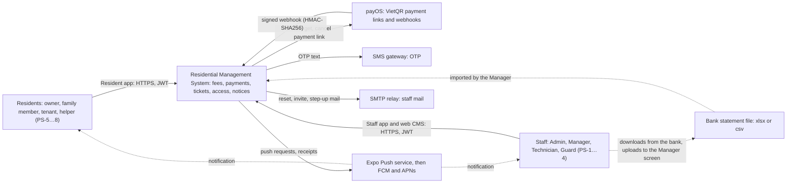
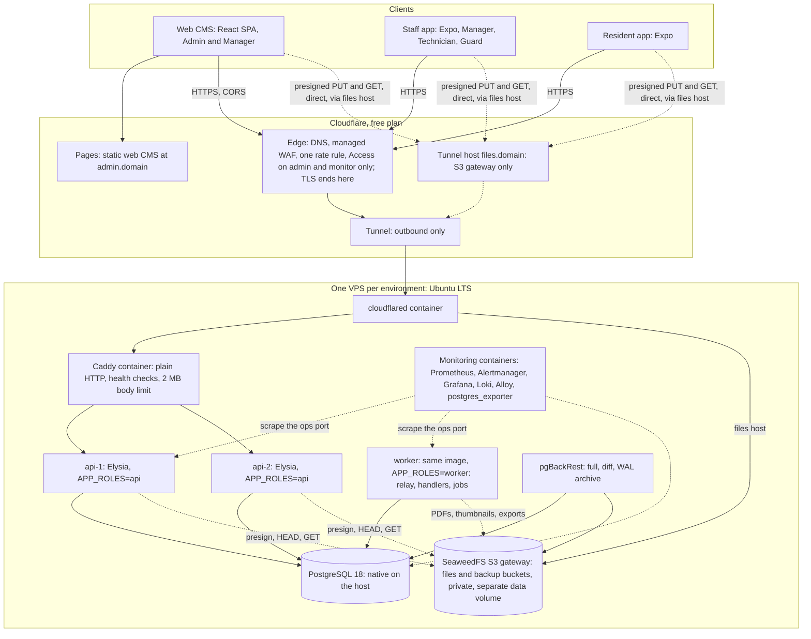
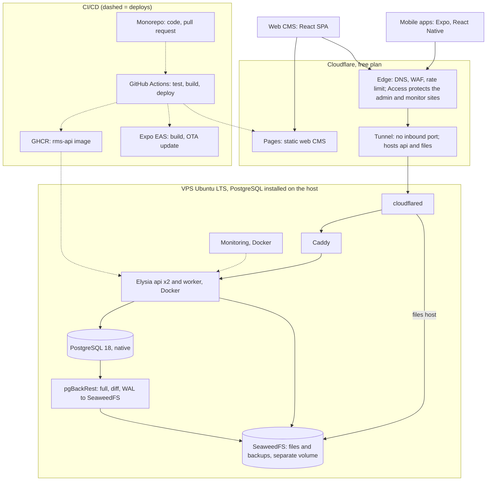
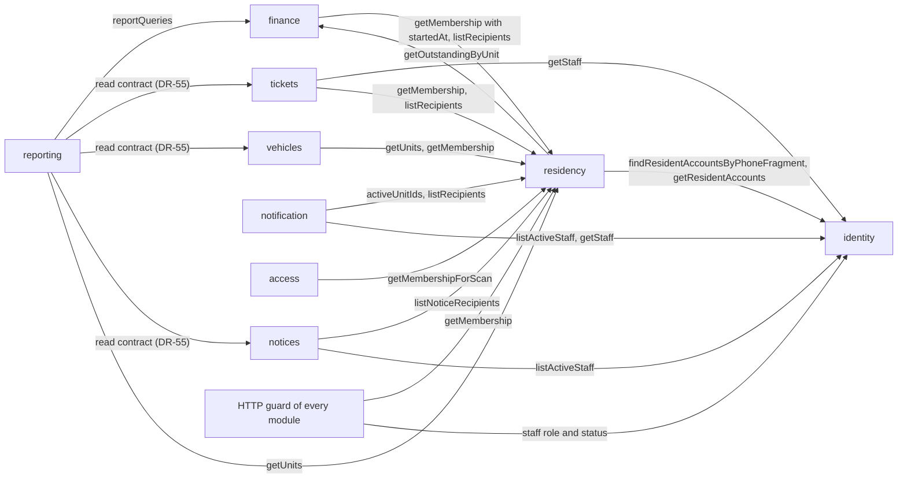
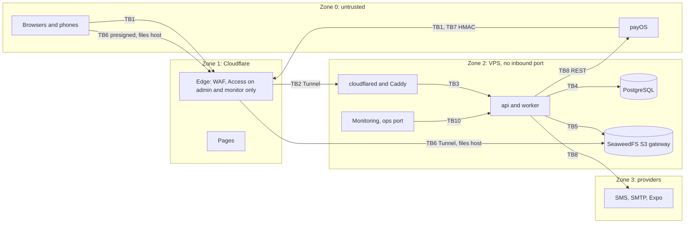

# System context and containers

> Status: **Approved** (Owner, 2026-10-21) · Updated: 2026-10-27 (DR-272: the rolling order is worker, api-1, api-2) · 2026-10-26 (DR-268: SeaweedFS on the VPS replaces R2 in the `vn` profile; `files.<domain>` host; earlier 2026-10-22 (DR-245: `fee_notice_job`; DOC-15 names `debt_reminder` and `fake_gateway_link`; DR-239: the trunk is `dev`; earlier 2026-10-20: DR-160 decided: TB1 revised; earlier: DR-88 decided; DR-111, DR-114, DR-116, DR-119, DR-122) · DOC-07
> Depends on: original SDD §4, §16, §19, [DR](../00-decision-register.md) (DR-02…08, 33, 36, 42, 48, 52, 55, 56, 58, 61…68, 74, 75, 83, 268), [ADR-0027](../04-adr/0027-seaweedfs-on-the-vps-for-files-and-backups-in-vietnam.md), [DOC-01](../01-product/vision-and-scope.md), [DOC-03](../01-product/requirements.md), [DOC-06](../02-glossary.md)
> Main readers: DOC-08…12, DOC-14…17 (table owners), DOC-19, DOC-37…41, DOC-69…72, P0-21, P1-02, P1-03, P1-18, P1-20

This document shows the system from the outside (who and what it talks to), from the inside (containers, modules) and from the ground (where each container runs, who owns each table, topic and bucket prefix, where trust changes and which container holds which secret). It holds no sequence of calls (DOC-08), no event schema (DOC-09), no resource budget or capacity figure (DOC-10), no version pin (DOC-11) and no folder layout of the code (DOC-12).

Diagrams are Mermaid. Numbers marked *planned* are design values; none is measured yet.

## 1. Scope and reading guide

| Question | Section |
| --- | --- |
| Who uses the system and which outside services does it call? | §2 |
| Which containers exist and what does each one do? | §3 |
| Where does each container run, how are environments different? | §4 |
| Which modules exist, and how do they talk? | §5 |
| Who may write a table, a topic or a bucket prefix, and who may read it? | §6 |
| Where does trust change, and where is each secret used? | §7 |
| Which other document holds the detail? | §8 |

Not in this document:

| Topic | Lives in |
| --- | --- |
| Sequence of each flow, failure flows | DOC-08 |
| Event names with schemas, headers, retry classes | DOC-09 |
| Latency budget, capacity, memory and CPU limits as figures | DOC-10 |
| Versions, licences, compatibility table | DOC-11 |
| Layers, dependency rules, module template | DOC-12 |
| DDL, indexes, columns | DOC-14…17 |
| Hosts, Caddyfile, `cloudflared` config, step-by-step setup | DOC-70 |
| STRIDE per boundary, endpoint × role matrix | DOC-39 |

## 2. System context (C4 level 1)

Residents and staff use three clients of one system. The system calls five outside services and reads one file that a person carries in (the bank statement).

| External system | Role | Direction and protocol | Authentication | Environment drivers | If it is down (detail: original SDD §19.3) |
| --- | --- | --- | --- | --- | --- |
| payOS (or a VietQR gateway, DR-25) | Payment links, status query, cancel; webhook on payment | Out: REST over HTTPS from `api` (link creation) and `worker` (query, cancel). In: HTTPS `POST` to `/api/v1/payments/webhooks/<provider>/{gatewayConfigId}` | Out: client id, API key, checksum key from `building.gateway_config` (DR-33). In: HMAC-SHA256 of the body; the signature is the only gate, a call from an unknown IP is logged and never blocked (DR-32) | `local`: `fake` driver. `staging`: payOS sandbox if the Owner reports one, else `fake`. `production`: `payos`; the demo building uses `fake` (DR-26, DR-60) | Link creation fails; the resident is told to retry or pay at the office. Lost webhooks are caught by the re-query job and by statement reconciliation (DR-30, DR-35) |
| SMS gateway | Resident OTP | Out: provider API from `worker` (command `identity.sms_requested.v1`) | Provider credentials `SMS_*` (DR-65) | `local`: `console`. `staging`: `allowlist`. `production`: provider (DR-37, DR-68) | OTP requests answer 503 `sms_unavailable`; signed-in residents are unaffected |
| Expo Push, FCM, APNs | Push notifications | Out: HTTPS from `worker` in groups of 100; receipts read 15 min later (DR-52) | `EXPO_ACCESS_TOKEN` | A separate push project per environment | The in-app inbox still holds every entry; push is retried 3 times |
| SMTP relay | Staff reset, invite, step-up and alert mail | Out: SMTP from `worker` (`identity.mail_requested.v1`) | `SMTP_*` | `local`: `console`. `staging`: `allowlist`. `production`: real relay (DR-68) | Links are delayed; the outbox retries with backoff |
| Bank statement | The company's receiving-account statement | A file: the Manager uploads it through the web CMS (presigned PUT, then `POST` of its key) | None (a person carries it in) | Generic profile until the real sample arrives (DR-34) | Reconciliation waits; payments are unaffected |

Cloudflare (Pages, edge, Tunnel) is infrastructure of the system, not an external actor, and appears at level 2. **Two deployment profiles (DR-268, ADR-0027).** `vn` (staging and production now) keeps files and backups in **SeaweedFS on the VPS**; no object storage of Cloudflare is used. `global` is the DR-83 topology with Cloudflare R2, kept as the reference for a deployment outside Vietnam (ADR-0016, ADR-0017, ADR-0020). This document draws `vn`; §3 and §4 say what `global` changes. The profile changes `S3_*` and the pgBackRest repository settings only.

## 3. Containers (C4 level 2)

Containers and their jobs:

| Container | Technology | Responsibility | Port (planned; fixed in DOC-69) | Protocol |
| --- | --- | --- | --- | --- |
| Web CMS | React SPA on Cloudflare Pages | Admin and Manager screens. No business rule; types come from the API by Eden Treaty (type-only import, DR-04). Security headers from the Pages `_headers` file (DR-64) | — (static) | HTTPS to `api.<domain>`, cross-origin with `credentials: include` (DR-38) |
| Staff app | Expo, React Native, New Architecture | Manager, Technician, Guard tabs by role; QR scan for Guards | — | HTTPS, bearer token; refresh token in `expo-secure-store` |
| Resident app | Expo, React Native | Fees, payment, tickets, QR, notices, household; every request carries `X-Unit-Id` | — | HTTPS, bearer token |
| Cloudflare edge | Cloudflare free plan | DNS, TLS, managed WAF, one rate rule on `/api/v1/auth/*`, Access in front of `admin.<domain>` and `monitor.<domain>` only, never in front of `api.<domain>` (DR-83, DR-88) | 443 | HTTPS |
| Tunnel + `cloudflared` | Official image | The only way in: outbound connection from the VPS to Cloudflare; routes the API hostname to Caddy and the files hostname to the SeaweedFS S3 gateway (DR-268) | none inbound | QUIC/HTTP2 outbound |
| Caddy | Official image, `auto_https off` | Reverse proxy to `api-1`/`api-2` with active health checks on `/health/ready`, 2 MB request body limit, no buffering on the SSE path, API security headers, real client IP from `CF-Connecting-IP` (DR-83 item 3) | 80 (Docker network only) | HTTP |
| `api-1`, `api-2` | Bun, Elysia, image `rms-api`, `APP_ROLES=api` | Every HTTP route: `/api/v1/staff`, `/me`, `/auth`, `/public`, `/payments/webhooks`, SSE `/staff/events`. Stateless; scaling unit is the container | 3000 (`PORT`) | HTTP; ops port separate |
| `worker` | Same image, `APP_ROLES=worker` | Outbox relay and handlers, every job timer (DR-62), PDF rendering, exports, thumbnails. No public route; `/health/*` and `/metrics` on the ops port only | ops port only | — |
| PostgreSQL 18 | Native on the host (apt) | The only stateful dependency besides SeaweedFS (`vn`; R2 in `global`): data, outbox/inbox, rate buckets, job claims, counters, idempotency keys. One schema per module (§6). Direct connection for `LISTEN/NOTIFY` and the relay (DR-62, DR-67) | 5432 (localhost and Docker bridge gateway only) | PostgreSQL wire, `scram-sha-256` |
| pgBackRest | Native on the host, cron | Weekly full, daily differential 02:00, continuous WAL archive (`archive_timeout` 60 s) to the SeaweedFS backup bucket (`global`: R2), encrypted repository; weekly `pg_dump` (DR-66, DR-268) | — | S3 API over TLS on the Docker bridge, path-style |
| SeaweedFS | Official release in Docker Compose (master, volume, filer and S3 gateway; version pinned in DOC-11 when P1-20 verifies it) | Two private buckets per environment with separate S3 identities: `rms-<env>-files` and `rms-<env>-backup`. Data on a **separate volume** from the OS and PostgreSQL disks. Reachable only on the Docker network and through the Tunnel route `files.<domain>` (staging `files-staging.<domain>`); no replica yet (DR-268, ADR-0027). In `global`, R2 takes this place (DR-83 item 8) | gateway on the Docker network only (fixed in DOC-69) | S3 API, presigned URLs |
| Monitoring | Prometheus, Alertmanager, Grafana, Loki, Grafana Alloy, `postgres_exporter` containers | Metrics, alert rules, dashboards, log search with 14-day retention (DR-63). Alertmanager sends email and Telegram | 9090, 9093, 3000, 3100, 12345, 9187 (software defaults, Docker network only) | HTTP |
| Uptime probe | External free-tier service | Probes `GET /api/v1/health/ready` every 60 s for NFR-10 | — | HTTPS |
| CI/CD | GitHub Actions, GHCR, `wrangler`, Expo EAS | Verify, test, build image, deploy over the Tunnel, deploy Pages, build and update the apps (DR-08, DR-83 item 9; DOC-71) | — | — |

Notes:

- There is no PgBouncer in phase 1: `api` and `worker` open pooled connections straight to the native PostgreSQL (`max_connections` 100). If PgBouncer is added later, request traffic may use transaction mode with `DB_PREPARE=false`; `LISTEN` and the relay keep a direct connection (DR-62, original SDD §19.6).
- The `api` and `worker` roles run the same image with the same module set; the role decides which routes, handlers and timers start (DR-05). The webhook route lives only on `api`, so a worker restart never drops a webhook.
- `GET /api/v1/health/ready` is the only health route routed through Caddy and the Tunnel (for the uptime probe); `/health/*` and `/metrics` on the ops port are never routed (DR-07).

## 4. Deployment

### 4.1 Topology (DR-83)

The VPS firewall denies all inbound traffic, SSH included. Operators and the deploy job reach SSH through the Tunnel with a Cloudflare Access service token; the provider's console is the break-glass path (DR-83 item 2).

**`vn` and `global` (DR-268).** In `vn` the database, the files and the backups share one VPS: a lost VPS or provider account loses all three until a SeaweedFS replica on another server exists (a later step, not built now). NFR-11 (RPO ≤ 5 min, RTO ≤ 4 h) holds for PostgreSQL faults, not for the loss of the whole VPS (DOC-10 §7). In `global`, files and backups sit in R2 and survive the VPS (the DR-83 topology, ADR-0020).

### 4.2 Environments

| | `local` | `staging` | `production` |
| --- | --- | --- | --- |
| Process model | `bun run dev`: one process, `APP_ROLES=api,worker` | Compose: api ×1, worker | Compose: api ×2, worker |
| Host | Developer machine; PostgreSQL 18 and an S3-compatible store from compose (`bun run infra:up`, DOC-69) | VPS 2 vCPU, 4 GB, 60 GB (DR-06) | VPS 4 vCPU, 8 GB, 100 GB (DR-06) |
| Web CMS | Vite dev server | Pages branch at `admin-staging.<domain>` | Pages production at `admin.<domain>` |
| API host | `localhost` | `api-staging.<domain>` through its own Tunnel | `api.<domain>` through its own Tunnel |
| Files | Local S3-compatible bucket (SeaweedFS from compose) | SeaweedFS on the staging VPS: `rms-staging-files`, `rms-staging-backup`; clients use `files-staging.<domain>` | SeaweedFS on the production VPS: `rms-production-files`, `rms-production-backup`; clients use `files.<domain>` |
| Payment driver | `fake` | payOS sandbox if reported, else `fake` (DR-25, DR-26) | `payos`; `fake` only for the demo building |
| SMS and mail | `console` | `allowlist` (real provider for listed test phones only) | Real providers (DR-37, DR-68) |
| Push | Real devices allowed with a development project | Separate push project | Production push project |
| Demo building | Seeded | Present (`is_demo = true`) | Present, for store review (DR-60) |
| Deploy trigger | — | push to `dev` (DR-239) | `v*` tag with manual approval (DR-08) |
| API docs (Scalar) | On | On | Off (DR-64) |
| PostgreSQL | Container, same major version | Native 18 | Native 18 with a 3 GB budget (`shared_buffers` 1 GB) |

### 4.3 Deployment units (DR-05, DR-06)

| Unit | Image | `APP_ROLES` | Replicas (staging / production) | Serves | Memory limit (DR-06) |
| --- | --- | --- | --- | --- | --- |
| `api-1`, `api-2` | `rms-api` | `api` | 1 / 2 | All HTTP routes including the webhook and SSE | 1 GB each |
| `worker` | `rms-api` | `worker` | 1 / 1 | Relay, handlers, job timers; `/health/*` and `/metrics` on the ops port | 1.5 GB (EXP-08 measures the real need) |
| `caddy` | official `caddy` | — | 1 / 1 | Plain-HTTP reverse proxy with active health checks | 128 MB |
| `cloudflared` | official `cloudflared` | — | 1 / 1 | Outbound Tunnel | Limit set after EXP-07 measures it |
| monitoring | official images | — | 1 / 1 | Prometheus, Alertmanager, Grafana, Loki, Alloy, `postgres_exporter` | 1 GB in total |
| PostgreSQL 18 | apt package, not a container | — | 1 / 1 | Database | Host budget; DOC-10 |
| Web CMS | none (static on Pages) | — | — | Static files | — |
| Migration step | `rms-api` image, one-shot, role `rms_migrator` | — | before each rollout | drizzle-kit migrations per module (expand/contract, DR-08) | — |

A second worker is safe by design (singleton jobs take a transaction-level advisory lock, DR-62) but is not deployed in phase 1. A rolling deploy restarts `worker` first and waits for `/health/ready`, then `api-1`, then `api-2`: the consumer goes before the producer, so that an event of a new type written by the new `api` finds its handler (DR-272). An `api` waits `SHUTDOWN_DRAIN_SECONDS` before it closes its port, and Caddy retries a refused connection for 5 s, so a deploy costs no request. The maintenance flag `platform.maintenance` is not part of routine deploys; it stays available for a contract migration that cannot be backward compatible (DR-05).

### 4.4 Operator access to monitoring

Grafana is reached at `monitor.<domain>` (staging: `monitor-staging.<domain>`): a Tunnel public hostname whose origin is the `grafana` container, behind a Cloudflare Access application that allows the operators' emails only, and Grafana keeps its own sign-in (DR-88). Prometheus, Loki and Alertmanager have no host; Grafana reads them, and alerts are listed and silenced in Grafana. Alerts leave the host by email and Telegram whether or not the dashboards are reachable.

## 5. Modules

### 5.1 Module list (DR-03)

The code is one modular monolith: `apps/api` is the composition root that installs the modules. Each module owns one PostgreSQL schema and exposes only `contracts/` to other modules (DR-04, DR-42). Layers and rules are in DOC-12.

| Module | Schema | Responsibility | Origin | Runs in |
| --- | --- | --- | --- | --- |
| `identity` | `identity` | Staff and resident accounts, staff password flow, resident OTP, step-up codes, tokens, refresh families, sessions, rate buckets for sign-in; sends SMS and mail from its handlers | Fork of the reference `identity` (DR-03) | `api`, `worker` |
| `building` | `building` | Building, settings, gateway configuration and its encryption, terms and acceptance, `file_object` and the files API, `job_run`, feature flags, demo reset | New | `api`, `worker` |
| `residency` | `residency` | Units, resident profiles (CCCD encrypted), memberships and `credential_version`, unit history, units/owners import, lookup | New | `api` |
| `finance` | `finance` | Fee batches, charges, payments, allocations, receipts, payment intents, `settle()`, the money log, statement reconciliation, fee import, the `PaymentGateway` port and its drivers, receipt and fee-notice PDFs | New | `api`, `worker` |
| `tickets` | `tickets` | Ticket lifecycle, messages, attachments, ratings, types, assignment | New | `api` |
| `access` | `access` | QR credentials and scans, lookup log | New | `api` |
| `vehicles` | `vehicles` | Vehicles, revisions, plate key, review, plate search | New | `api` |
| `notices` | `notices` | Notices, recipients, scheduling, fan-out, read tracking | New | `api`, `worker` |
| `notification` | `notification` | Inbox, device tokens, Expo push and receipts, templates | Fork of the reference `notification` (DR-03) | `api`, `worker` |
| `wiki` | `wiki` | Document library: folders, pages, versions, search | New | `api` |
| `audit` | `audit` | Audit log writer and reader, purge function | New | `api`, `worker` |
| `reporting` | `reporting` | Dashboard composition through read contracts, export jobs | New (DR-55) | `api`, `worker` |
| `realtime` | `realtime` | SSE over `LISTEN/NOTIFY` for the web CMS, replay buffer | Reused as is (DR-03) | `api` |

`notification` and `realtime` are generic leaf modules: they never import a producer. What they know about a producer lives in the producer's `integrations/<consumer>` entry point (reference `generic-modules-are-leaves`, DR-04). The reference modules `privacy`, `profile` and `billing` are not used (DR-03).

Below the modules sit the vendored `@core/*` packages (config, db, messaging, http, auth, runtime, storage, mail, i18n, telemetry, testing, `core-web`), mapped in DOC-12. The `platform` schema belongs to those packages, not to a module (§6.2).

### 5.2 Synchronous contracts

A caller invokes a contract in its own ambient transaction; a contract never takes a transaction argument; list calls are keyset-paginated with `limit ≤ 500` (DR-42). Edges every module has (`AuditApi.record`, `FilesApi`, `BuildingApi.getSettings`, `FeatureApi.get`) are omitted from the diagram.

| Contract | Provider | Main callers | Source |
| --- | --- | --- | --- |
| `ResidencyApi.getMembership(accountId, unitId)` (returns `startedAt`) | residency | HTTP guard, finance | DR-42, DR-40 |
| `ResidencyApi.listRecipients(unitId, capability)`, `listNoticeRecipients(buildingId, cursor, limit)`, `activeUnitIds(accountId)`, `getUnits(ids)`, `getMembershipForScan(id)` | residency | finance, tickets, notices, notification, access, vehicles, reporting | DR-42 |
| `IdentityApi.getStaff(ids)`, `listActiveStaff(buildingId, roles, cursor, limit)`, `findResidentAccountsByPhoneFragment`, `getResidentAccounts(ids)`, `findResidentAccountsByPhones(phones)` (≤ 5,000 numbers, for the units import) | identity | tickets, notices, notification, residency | DR-42; the last one DR-114 |
| `FinanceApi.getOutstandingByUnit(unitIds)`, `FinanceApi.reportQueries` | finance | residency (unit detail), reporting | DR-42 |
| `TicketsApi`, `VehiclesApi`, `NoticesApi` read contracts for the dashboard | tickets, vehicles, notices | reporting | DR-55 (not in the DR-42 table: DR-87) |
| `AuditApi.record(entry)` | audit | every module; joins the caller's transaction | DR-42, DR-57 |
| `FilesApi.register/verify/attach/remove/usage`, `signedUrl`, `storeGenerated` | building | every module with uploads | DR-42, DR-61, DR-119 |
| `BuildingApi.getSettings(buildingId)`, `FeatureApi.get(buildingId)` | building | all | DR-42 |
| `BuildingApi.getGatewayConfig(...)`, `BuildingApi.hasAcceptedLatestTerms(accountId, buildingId)`, `IdentityApi.verifyStepUp(...)` | building, building, identity | finance and the webhook (gateway configuration and its secrets); resident guard (`terms_required`); building (sensitive configuration change) | Needed by DR-33, DR-59, DR-39 (not in the DR-42 table: DR-87); `hasAcceptedLatestTerms` takes the building because the latest version is per building (DR-111) |

The QR rotation uses `membership.credential_version`, not a shared transaction (DR-48). An import has no event: validation is synchronous (DR-21).

### 5.3 Events

Events are named `<module>.<name>.v1`, written to the producer's outbox in the state-change transaction and delivered by the `worker` relay to idempotent handlers (inbox keyed by message and handler; DR-42, DR-62). Schemas, headers and retry classes are in DOC-09; this table says who produces and who consumes.

| Event (DR-42) | Producer | Consumers |
| --- | --- | --- |
| `finance.batch_published.v1`, `batch_recalled.v1`, `batch_due_extended.v1`, `charge_voided.v1`, `payment_voided.v1` | finance | notification (inbox and push) |
| `finance.payment_posted.v1` | finance | notification (the receipt PDF is rendered by the command `finance.receipt_render_requested.v1`, one per receipt) |
| `finance.receipt_issued.v1` | finance | none in phase 1 (e-invoice seam, DR-17) |
| `finance.money_unposted.v1` | finance | notification (Manager and Admin inbox), realtime (`money_log.opened`) |
| `finance.intent_cancel_requested.v1` (command) | finance | finance (`CancelIntentLink` handler) |
| `finance.receipt_render_requested.v1` (command) | finance | finance (renderer in the worker) |
| `residency.membership_changed.v1`, `residency.owner_changed.v1` | residency | notification |
| `identity.sms_requested.v1`, `identity.mail_requested.v1` (commands) | identity | identity (sender handlers in the worker); notification for the step-up notice (inbox entry `staff.step_up_done`, DR-116) |
| `identity.session_revoked.v1` | identity | realtime (closes the stream), notification (deletes the device token) |
| `tickets.ticket_changed.v1`, `tickets.ticket_assigned.v1` | tickets | notification, realtime |
| `vehicles.vehicle_reviewed.v1` | vehicles | notification |
| `notices.notice_sent_batch.v1`, `notices.notice_read.v1` | notices | notification |
| `notification.push_requested.v1` (command) | notification | notification (Expo sender) |
| `reporting.export_ready.v1` | reporting | notification, realtime (`export.ready`) |
| `finance.debt_reminder_sent.v1` | finance | notification (`fee.reminder`) |
| `vehicles.vehicle_submitted.v1` | vehicles | notification (`vehicle.pending_review`) |
| `notification.staff_inbox_created.v1` | notification | realtime (`inbox.created`) |
| `identity.account_deletion_executed.v1` | identity | residency (remove memberships, clear profile), notification (delete tokens), building (null the terms-acceptance IP, DR-115); DR-87 |

Consumers are read from DR-42, DR-52, DR-53 and DR-75; DOC-09 §5 is the source and lists 26 types with their handlers.

## 6. Data ownership

### 6.1 Rules

1. **One writer per table.** Only the owning module writes a table, and only through its own repositories. Another module changes it by calling a contract or by publishing an event the owner handles. The one exception is `audit.audit_log`, which every module writes through `AuditApi.record` inside its own transaction (DR-57).
2. **No cross-schema foreign keys.** A reference to another module's row is a plain `uuid` column checked through a contract (DR-42, original SDD §16). Foreign keys exist only inside one schema.
3. **Reads cross a module only through `contracts/`.** Reports compose from read contracts, never from joins on another schema (DR-55). The "Readers" column lists the module and the contract; "own" means no one else.
4. **Every business table has `building_id`** and the scope guard applies (DR-12). Global tables sit on the allow-list of DOC-14 §5.3 (DR-104): `platform.*`, the sign-in and session tables of `identity`, `building.building`, `outbox_messages` and `inbox`.
5. **Database roles do not isolate modules.** One application role `rms_app` serves all modules; isolation is by convention and dependency-cruiser. `rms_migrator` owns the schemas; `rms_readonly` cannot read `identity.*_hash` columns; `rms_backup` is for backup (DR-67, DOC-19).
6. **Each module has its own `outbox_messages` and `inbox` tables** in its schema (the reference helpers create them per schema) and its own migration history `drizzle_<module>` (original SDD §16.1).

### 6.2 Tables

"Writer" is the module that owns the table. Bold names are the arbiters of races named in the original SDD (DOC-22, DOC-23, DOC-28).

#### `identity`

| Table | Writer | Readers |
| --- | --- | --- |
| `staff_account` | identity | own; staff guard of every module (role and status re-read per request); `IdentityApi.getStaff`, `listActiveStaff` → tickets, notices, notification |
| `resident_account` | identity | own; `IdentityApi.getResidentAccounts`, `findResidentAccountsByPhoneFragment` → residency, notification |
| `otp_challenge`, `refresh_family`, `refresh_token` | identity | own |
| `password_token` (kinds `reset`, `invite`, `step_up`) | identity | own; `IdentityApi.verifyStepUp` → building |
| `rate_bucket` (sign-in, OTP, reset buckets) | identity | own |
| `outbox_messages`, `inbox` | identity | relay (worker) |

#### `building`

| Table | Writer | Readers |
| --- | --- | --- |
| `building`, `building_setting` | building | all, `BuildingApi.getSettings` |
| `gateway_config` (one `secrets_enc` blob) | building | finance and the webhook route, `BuildingApi.getGatewayConfig` (decrypts in memory only) |
| `terms_version`, `terms_acceptance` | building | resident guard, `BuildingApi.hasAcceptedLatestTerms` |
| `file_object` | building (through `FilesApi`) | every module, `FilesApi` |
| `outbox_messages`, `inbox` | building (delete and thumbnail commands, DR-122) | relay |
| `job_run` | building (the job runner calls the `JobRunStore` port that building implements) | own metrics collector (`job_last_success_timestamp`) |

#### `residency`

| Table | Writer | Readers |
| --- | --- | --- |
| `unit` | residency | all, `ResidencyApi.getUnits` |
| `resident_profile` (CCCD encrypted, date of birth) | residency | own (detail view logged, `pii.read`) |
| `membership` (with `credential_version`) | residency | guard, finance, access, notification, notices, vehicles, tickets, via `ResidencyApi` |
| `unit_history` | residency | own |
| `import_job` (units and owners) | residency | own |
| `outbox_messages`, `inbox` | residency | relay |

#### `finance`

| Table | Writer | Readers |
| --- | --- | --- |
| `fee_batch`, `charge`, `charge_line` | finance | own; `FinanceApi.getOutstandingByUnit` → residency; `reportQueries` → reporting |
| `payment`, `allocation` | finance | own; `reportQueries` → reporting |
| `receipt` (with reserved `external_invoice`) | finance | own; PDF renderer (worker) |
| `payment_intent`, `payment_intent_item` | finance | own |
| `gateway_event`, `webhook_rejection` | finance | own (money log and signature screens) |
| `statement_import`, `statement_line` | finance | own |
| `import_job` (fee batches) | finance | own |
| `document_counter` (series `receipt`, `batch`, `intent`), sequence `order_code_seq` | finance | own |
| `debt_reminder` (one row per unit per building day, DR-87; DDL in DOC-15 §10.3) | finance | own |
| `fake_gateway_link` (links of the `fake` driver, local, staging and demo only, DR-87; DDL in DOC-15 §10.4) | finance | own |
| `fee_notice_job` (bulk fee-notice requests, *added 2026-10-22, DR-245*) | finance | own; claimed by `fee_notice_run` in the worker |
| `outbox_messages`, `inbox` | finance | relay |

#### Other module schemas

| Schema | Tables | Writer | Readers |
| --- | --- | --- | --- |
| `tickets` | `ticket`, `ticket_event`, `ticket_message`, `ticket_attachment`, `ticket_type`, `ticket_rating`, `document_counter` (series `ticket`) | tickets | own; read contract → reporting |
| `access` | `qr_credential`, `qr_scan`, `lookup_log` | access | own |
| `vehicles` | `vehicle`, `vehicle_revision` | vehicles | own; plate search; read contract → reporting |
| `notices` | `notice`, `notice_attachment`, `notice_recipient` | notices | own; read contract → reporting; `notice_read` marks the inbox through an event |
| `notification` | `inbox_entry`, `device_token`, `push_ticket` | notification | own |
| `wiki` | `folder`, `page`, `page_version`, `page_attachment` | wiki | own |
| `audit` | `audit_log` (append-only: the runtime role cannot `UPDATE` or `DELETE`; monthly `audit.purge` is a `SECURITY DEFINER` function) | every module through `AuditApi.record` | audit (`GET /staff/audit`) |
| `reporting` | `export_job` | reporting | own |
| `realtime` | `events` (replay buffer for opt-in events) | realtime | own |
| each module above that publishes or consumes events | `outbox_messages`, `inbox` | that module | relay (worker) |

#### `platform` (belongs to the core packages, not to a module; DR-85)

| Table | Writer | Readers |
| --- | --- | --- |
| `maintenance` (single row, outside every module's migrations) | core runtime (maintenance plugin and deploy script) | every process, polled every 1 s |
| `idempotency_key` (24-hour retention, DR-74) | core HTTP idempotency plugin, inside the request transaction | same plugin |
| `rate_bucket` (limits of every module except sign-in: webhook 60/min/IP, `POST /me/qr`, intents, reminders, uploads; DR-64) | core HTTP rate-limit plugin | same plugin |

The master plan lists `idempotency_key` with DOC-16; DR-74 and original SDD §16.1 place it in `platform`. DOC-17 §3 holds its DDL.

### 6.3 Events and topics

Events (the in-process bus plus outbox) are the only topics; there is no message broker. Their producers and consumers are in §5.3. Two further channels carry no business data:

| Channel | Owner | Used for |
| --- | --- | --- |
| PostgreSQL `LISTEN/NOTIFY` on a direct connection | realtime | Wake-up of SSE streams on any `api` instance (DR-75) |
| SSE `GET /api/v1/staff/events` | realtime (route on `api`) | `inbox.created`, `ticket.created`, `ticket.changed`, `money_log.opened`, `export.ready`, `session.revoked`; heartbeat at least every 30 s (DR-75, DR-83 item 10) |

### 6.4 Object storage

Keys follow `{env}/{building_id}/{module}/{yyyy}/{mm}/{uuid}.{ext}` (DR-61). The owning module registers, verifies and attaches each object through `FilesApi`; the client writes directly with a presigned PUT, and reads through signed GET URLs inside DTOs (15 min; 5 min for vehicle papers). There is no public bucket and no CDN.

| Bucket | Prefix `{module}/` | Contents (`file_object.purpose`) | Writer | Readers | Lifetime |
| --- | --- | --- | --- | --- | --- |
| `rms-<env>-files` | `identity/` | Avatars | identity (client upload) | the account, staff | until deleted |
| | `building/` | Company logo (resized to 512 px once) | building | PDF renderers, web CMS | until replaced |
| | `residency/` | `unit_owner` import files (contain CCCD) | residency (client upload) | residency (validation, commit) | deleted at commit or expiry (DR-22) |
| | `finance/` | Fee import files; statement files; receipt PDFs; fee-notice PDFs and bulk ZIPs | finance (client upload, worker render) | finance; residents and staff by signed URL | Imports 30 days; statements 1 year (DR-34); PDFs cached with a content hash (DR-56) |
| | `tickets/` | Photos and videos (phases `report`, `before`, `after`, `result`) | tickets (client upload) | tickets; residents see `report` always, `after`/`result` after close (DR-45) | until the ticket is purged |
| | `vehicles/` | Plate photo, registration paper front and back | vehicles (client upload) | vehicles; Guards see the plate photo only | until retired and purged |
| | `notices/` | Attachments, inline images | notices (client upload) | notices recipients | until deleted |
| | `wiki/` | Attachments, inline images | wiki (client upload) | wiki readers by role | until deleted |
| | `reporting/` | Export files | reporting (worker) | the requester, 15-minute signed URL | 7 days (DR-55) |
| `rms-<env>-backup` | `pgbackrest/` | Encrypted repository: full, differential, WAL | pgBackRest on the host | restore procedure (RB-10) | 4 full + 7 differential (DR-83) |
| | `pg_dump/` | Weekly logical dump | host cron | restore procedure | 4 weeks (DR-66) |

Unattached files (`pending` and `verified`) older than 24 hours are deleted by the hourly job; usage over 50 GiB per building refuses new client uploads (DR-61, DR-123). A thumbnail of an image is an object of its own in the same prefix as the original (`purpose = thumbnail`, DR-122); a `bulk_zip` lives 7 days. The backup bucket has its own API token; the files token cannot read it (DR-83 item 7). DR-56 names the fee-notice cache `batch/<id>/unit/<unit>.pdf`; it is the logical key in `file_object.owner_ref`, while the object key follows DR-61 (DR-86).

### 6.5 Other stores

| Store | Written by | Read by |
| --- | --- | --- |
| Secrets as files under `/etc/rms/secrets` (root, 0400), read through `*_FILE` | Operator (RB-12) | `api`, `worker` at boot |
| pgBackRest repository passphrase | Operator; sealed offline copy | pgBackRest |
| Prometheus data, Loki data (14 days), Grafana state | monitoring containers | operators |
| Container logs (JSON, pino, with `request_id`) | `api`, `worker`, Caddy | Alloy → Loki |

## 7. Trust boundaries and secrets

### 7.1 Boundaries

| ID | Boundary | Who authenticates, how | What crosses | Refs |
| --- | --- | --- | --- | --- |
| TB1 | Internet → Cloudflare edge | TLS ends here. Managed WAF; one rate rule on `/api/v1/auth/*`; WAF challenges and Bot Fight Mode skipped for the API host and the webhook path (native apps cannot solve a challenge). Access (login) in front of `admin.<domain>` and `monitor.<domain>` only, never in front of `api.<domain>`. *Revised (DR-160):* Bot Fight Mode cannot be skipped on the free plan, so it is off for the zone; the webhook path skips managed and rate rules (DR-159) | All client traffic, payOS webhooks | DR-07, DR-83, DR-159, DR-160 |
| TB2 | Cloudflare → VPS | The VPS opens an outbound Tunnel; no inbound port, SSH included. Operators and CI reach SSH through the Tunnel with an Access service token | HTTP to Caddy; SSH | DR-83 item 2 |
| TB3 | Caddy → `api` | Docker network, plain HTTP. Caddy trusts the private Docker ranges and passes `CF-Connecting-IP`; the API keeps `TRUSTED_PROXY_HOPS=1`. Body limit 2 MB | Requests with the client IP | DR-07 |
| TB4 | `api`, `worker` → PostgreSQL | `scram-sha-256` from the Docker subnet; roles `rms_app` (DML only) and `rms_migrator` (migrations only); direct connection for `LISTEN` and the relay | SQL | DR-67, DR-83 item 6 |
| TB5 | `api`, `worker` → SeaweedFS | S3 credentials `S3_*` (files bucket) over the Docker network; a separate S3 identity for the backup bucket held only by pgBackRest, which the files identity cannot read | Presigns, `HEAD`, `GET`, PDF and export `PUT` | DR-268 (`global`: R2, DR-83 item 8) |
| TB6 | Client → SeaweedFS through the files host | Presigned `PUT` (15 min, `Content-Type` signed, key chosen by the server), size and magic bytes verified afterwards; signed `GET` (15 min, 5 min for papers). Bucket CORS allows `PUT`/`GET` from `admin.<domain>` only. The client reaches the gateway only through the Tunnel host `files.<domain>` (`S3_PUBLIC_ENDPOINT`; staging `files-staging.<domain>`); no other route to the S3 port exists; the CSP `connect-src` and the CORS rule name this host (DR-64). The file bytes cross the Tunnel (100 MB per request on the free plan; the video limit is 50 MB) | File bytes, never through the API | DR-61, DR-64, DR-268 |
| TB7 | payOS → webhook route | HMAC-SHA256 with the checksum key is the only gate; body ≤ 16 KB; a call from an unknown IP is logged, never blocked; failures go to `finance.webhook_rejection`, never to `gateway_event` | Signed confirmations | DR-32 |
| TB8 | `api`, `worker` → providers | API keys and passwords from secret files (`SMS_*`, `SMTP_*`, `EXPO_ACCESS_TOKEN`); payOS credentials decrypted from `gateway_config`. Payloads carry no personal text for push (DR-52) | Link requests, OTP text, mail, push | DR-52, DR-58 |
| TB9 | CI → registry and VPS | GitHub Actions pushes the image to GHCR; the VPS pulls with a read-only token; deploy runs over the Tunnel with an Access service token | Image, deploy commands | DR-08, DR-83 item 9 |
| TB10 | Monitoring plane | `/health/*` and `/metrics` are on the ops port, bound to the Docker network and not routed by Caddy or the Tunnel; only Grafana has a public host, `monitor.<domain>`, behind Access; Prometheus, Loki and Alertmanager have none | Metrics, logs | DR-07, DR-63, DR-88 |

The authorization inside the API (token kind, role, membership policy) is not a boundary in this table: it is specified in DOC-26, DOC-27 and DOC-39. A staff token on a resident route, and the reverse, is refused (FR-16.4).

### 7.2 Where each secret is used

Secrets are Docker secrets as files, read through `*_FILE`; nothing is in the image, the repository, CI logs or `/metrics` (DR-65). Rotation is in DR-65 and RB-12.

| Secret | Variable | Used by | Used for | Rotation |
| --- | --- | --- | --- | --- |
| Database URLs | `DATABASE_URL` (`rms_app`), `MIGRATION_DATABASE_URL` (`rms_migrator`) | `api`, `worker`; migration step only | Queries; migrations | On staff change |
| JWT signing keys | `JWT_KEYS` (kid → PEM) | `api` | Sign and verify access tokens (ES256, 15 min) | Yearly, overlap ≥ 30 min |
| QR keys | `QR_KEYS` (`v1`, `v2`) | `api` | Sign on `POST /me/qr`; verify on scan | Yearly, overlap ≥ 15 min |
| OTP HMAC key | `OTP_HMAC_KEY` | `api` | HMAC of OTP codes and step-up codes | On suspicion |
| Settings encryption keys | `SETTINGS_ENCRYPTION_KEYS` | `api`, `worker` | Encrypt and decrypt `gateway_config.secrets_enc` (the worker re-queries and cancels links) | Re-encrypt job, RB-12 |
| PII encryption keys | `PII_ENCRYPTION_KEYS` | `api`; the re-encrypt job | `resident_profile.cccd_enc`; sealed offline copy is mandatory | Re-encrypt job, RB-12 |
| Files bucket credentials | `S3_*` | `api`, `worker` | Presign, `HEAD`, `GET`, PDFs, exports, thumbnails | Operator (SeaweedFS identity; per provider in `global`) |
| SMS credentials | `SMS_*` | `worker` | OTP delivery | Per provider |
| SMTP credentials | `SMTP_*` | `worker` | Staff mail | Per provider |
| Expo access token | `EXPO_ACCESS_TOKEN` | `worker` | Push requests and receipts | Per provider |
| payOS credentials (client id, API key, checksum key) | In the database, encrypted: not an environment variable | `api` (link creation, webhook verification), `worker` (query, cancel) | Gateway calls and webhook HMAC | Admin edits with step-up (DR-33, DR-39) |
| Tunnel token | `cloudflared` configuration | `cloudflared` | Outbound Tunnel | Operator |
| pgBackRest passphrase, backup-bucket S3 identity (`global`: R2 token), gateway CA file | Host files (root) | pgBackRest | Encrypt and write the repository | Operator; the passphrase is kept **off the VPS**, offline copy (DR-268) |
| GHCR read token | `docker login` on the VPS | Docker on the VPS | Pull `rms-api` | Operator |
| CI secrets: Access service token, Cloudflare Pages token, `EXPO_TOKEN`, GHCR push (`GITHUB_TOKEN`) | GitHub Actions secrets | CI | Deploy, build, publish | Operator |
| Alert delivery: Telegram bot token, Alertmanager SMTP, Grafana admin password | Monitoring configuration | Alertmanager, Grafana | Alerts, dashboards | Operator |

Never logged: OTP codes, tokens, passwords, CCCD, full phone numbers, QR tokens (DR-58). The last four rows are infrastructure secrets outside DR-65; DOC-70 lists them in full and DOC-41 holds the application keys.

## 8. Traceability

| This document | Continues in |
| --- | --- |
| §2 external systems | DOC-24 (payOS), DOC-31 (push), DOC-26 (SMS, mail), DOC-25 (statement) |
| §3 containers, §4 topology | DOC-70 (setup), DOC-71 (CI/CD), DOC-69 (local), DOC-73 (apps), ADR-0020 |
| §4.3 deployment units, resource limits | DOC-10 (budgets), DOC-38 (jobs per role) |
| §5 modules and contracts | DOC-12 (layers, dependency rules), DOC-09 (event schemas), ADR-0002, ADR-0009, ADR-0014 |
| §6.2 tables | DOC-14 (conventions), DOC-15 (finance), DOC-16 (identity, residency), DOC-17 (the rest), DOC-19 (grants) |
| §6.4 buckets | DOC-37 (files), DOC-34 (PDF), DOC-72 (backup), ADR-0016, ADR-0017 |
| §7 boundaries and secrets | DOC-39 (STRIDE, matrix), DOC-41 (keys), RB-12 (rotation), ADR-0022, ADR-0021 |
| Requirements | NFR-03, NFR-08, NFR-10, NFR-11, FR-16.4, FR-37.4, FR-40 |

## Open questions

Decisions made while writing: DR-85, DR-86 and DR-87 (decided, Claude delegated by the Owner) and DR-88 (decided by the Owner, 2026-10-20).

- **DR-88 · Operators reach Grafana at `monitor.<domain>` behind Cloudflare Access.** Decided by the Owner on 2026-10-20 (it replaces the SSH port-forward first proposed). Not blocking Phase 1; the host is created with the staging environment in P1-20.
- The payload of `identity.sms_requested.v1` has to carry the OTP code until it is sent. Whether it is stored encrypted in `outbox_messages` is decided in DOC-09 and DOC-26.
