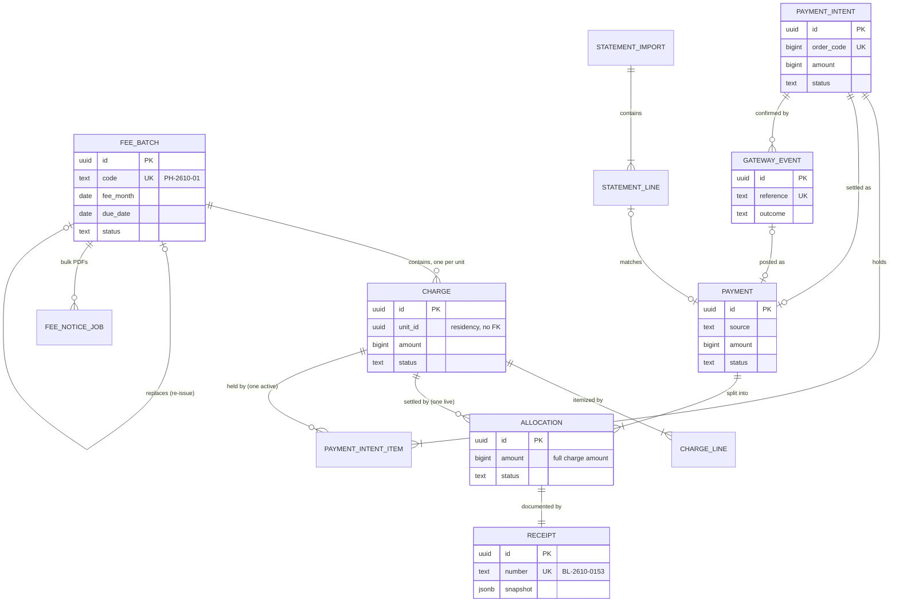
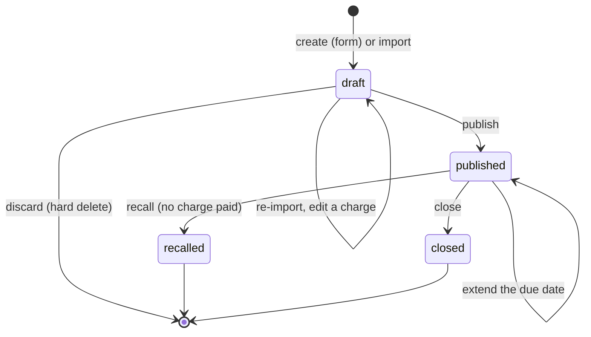
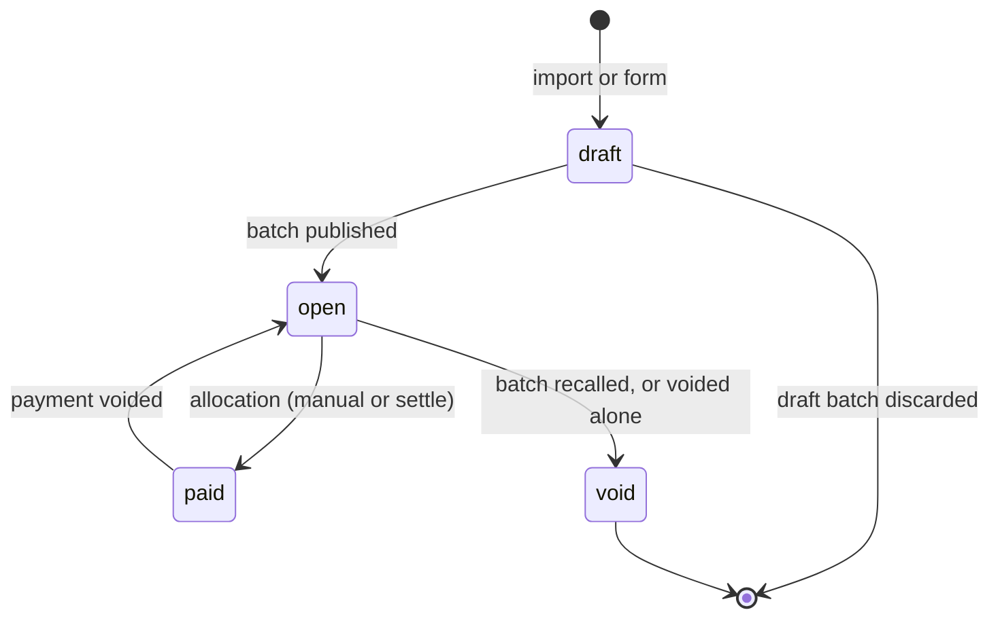
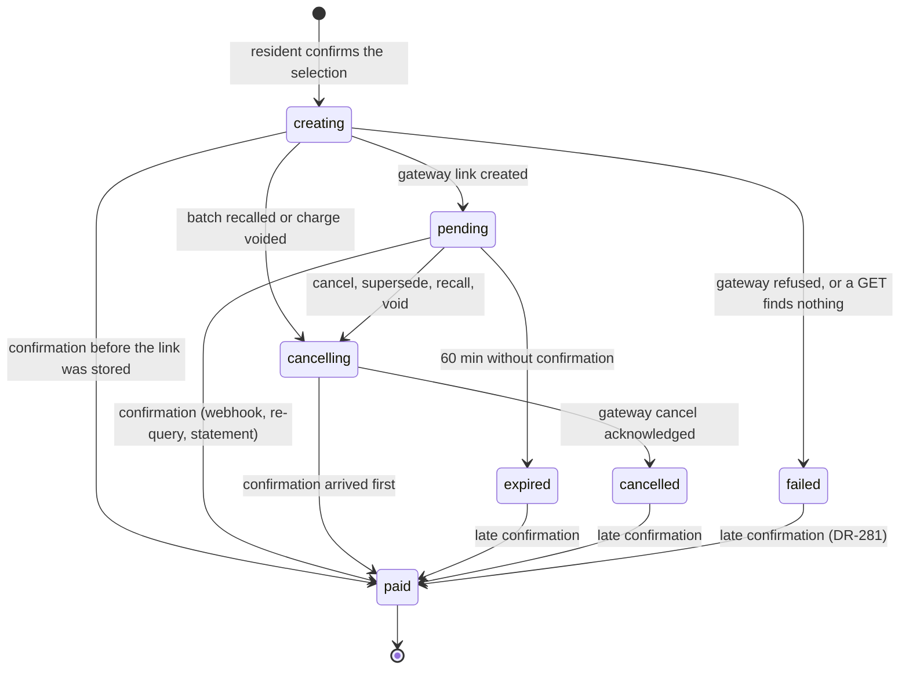
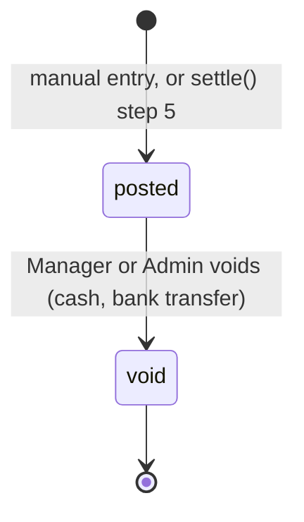
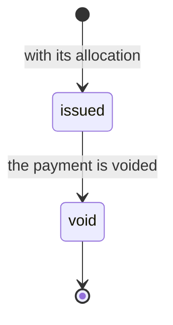
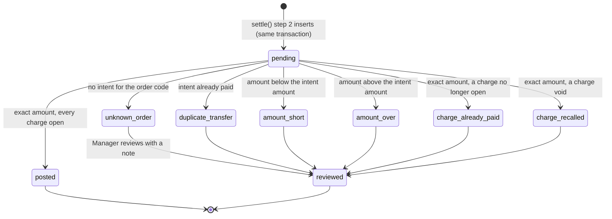
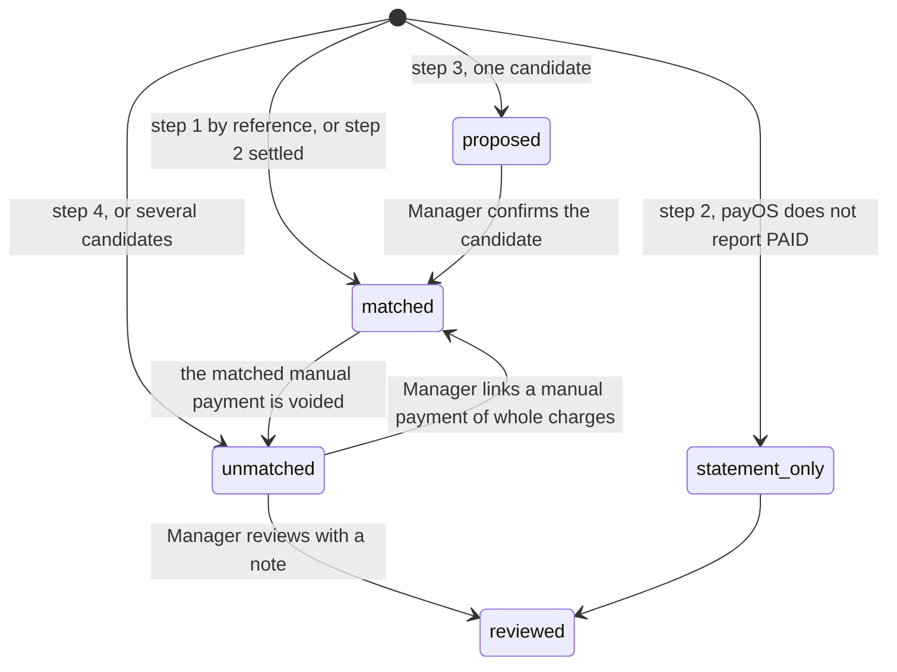
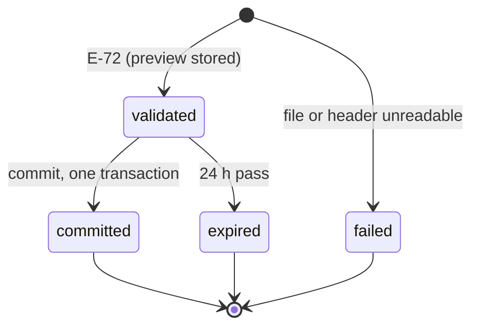
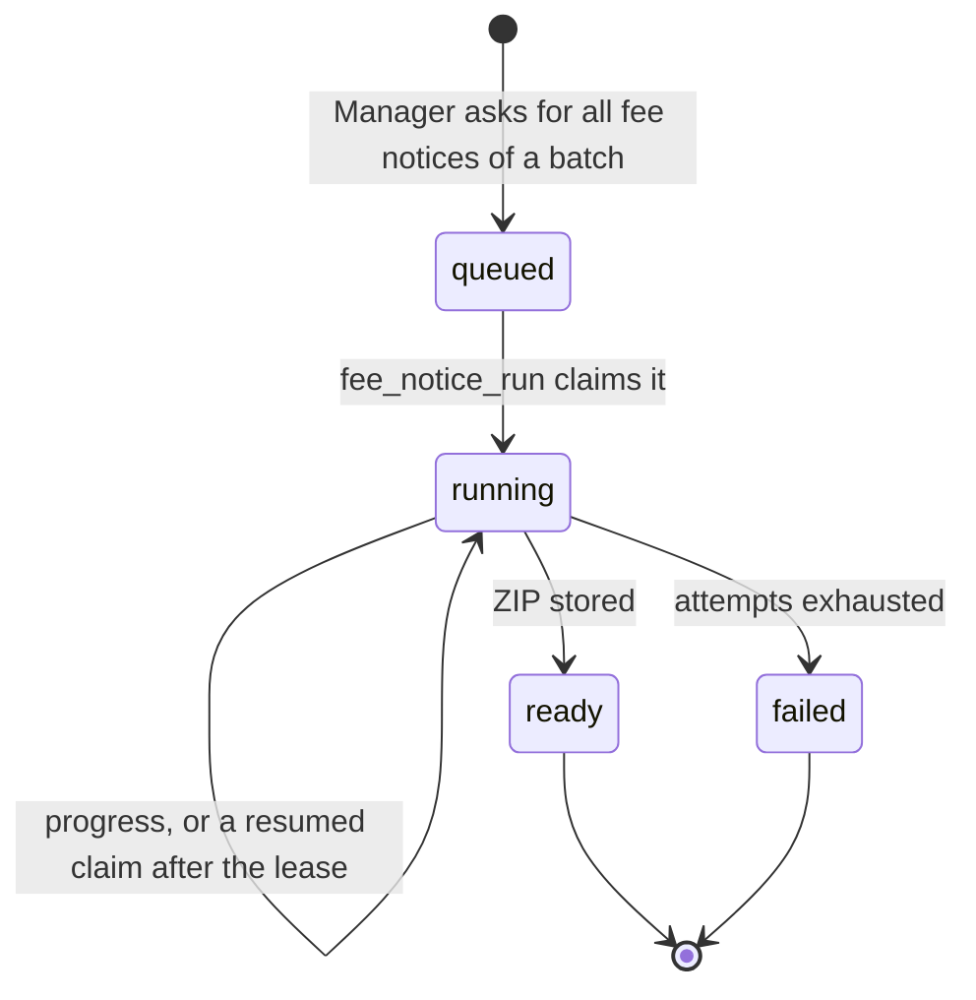

# Finance model

> Status: **Draft** · Updated: 2026-11-01 (DR-326, DR-327: `provider` is a pattern, `payment_customer`, outcomes `refunded` and `disputed`) · 2026-10-28 (DR-281, proposed: `ck_payment_intent_failed` reads `<=`; DR-243…245 confirmed by the Owner) · 2026-10-22 · DOC-15
> Depends on: original SDD §5, §6, §16, [DR](../00-decision-register.md) (DR-09…14, 16…21, 23…35, 56, 60, 84, 86, 87, 96, 97, 105, 109, 115, 119, 120, 126, DR-243…245), [ADR-0005](../04-adr/0005-ledger-charges-and-allocations-paid-in-full.md), [ADR-0006](../04-adr/0006-allocation-write-path-all-or-nothing.md), [ADR-0008](../04-adr/0008-settlement-idempotency.md), [ADR-0014](../04-adr/0014-schema-per-module-no-cross-module-foreign-keys.md), [DOC-14](data-conventions.md), [DOC-16](identity-and-residency-model.md) §5.5, [DOC-07](../03-architecture/system-context-and-containers.md) §6, [DOC-20](data-lifecycle.md) §2.4, [DOC-36](../06-design/building-configuration-and-demo.md) §10, [DOC-03](../01-product/requirements.md) (FR-01…12, 44, 46, 47, 49), [DOC-06](../02-glossary.md)
> Main readers: P2-01 (finance schema), P2-02 (counters), P2-03, P2-06…P2-11, P2-13, P3-02…P3-07, DOC-21, DOC-22, DOC-23, DOC-24, DOC-25, DOC-34, DOC-19 (grants), DOC-100 (EXP-11), DOC-75 (RB-01)

This document holds every table of the `finance` schema: fee batches, charges and their lines, payment intents, payments, allocations, receipts, the money log, the bank statements, the fee import, the bulk fee-notice requests, debt reminders, the fake gateway's links, the counter and the order-code sequence. For each table it gives the grain, keys, writers and readers, runnable DDL with the reason of every index, the state machine of every status column and the sample statements the use cases build on. It also holds the triggers that keep ledger rows frozen. It does not hold the rules of the flows: batches and imports are DOC-21, the ledger, the money log and debt are DOC-22, intents and `settle()` are DOC-23, the gateway adapter is DOC-24, reconciliation is DOC-25, PDFs are DOC-34. The conventions every table follows are DOC-14's.

**DDL tested on PostgreSQL 18.6 (`postgres:18.6`, x86_64) on 2026-10-22.** The blocks of §3.1 and §4–§11 were applied in order with `psql -v ON_ERROR_STOP=1` on an empty database, then the 123 constraint tests of §13.2 and the 12 statement tests of §13.3 ran: **135 of 135 passed**, including a race of 8 sessions over 300 pairs of charges. The blocks are the files the tests ran; a block that is edited is run again.

Every new decision in this document is recorded as a DR (DR-243…245) and summarized in §16. The intent and statement tables follow DR-27, DR-28, DR-30, DR-34 and DR-35, which are still **proposed**; the open questions at the end say what each one can still change.

## 1. Scope

### 1.1 Tables in this document

"Writer" is the one module that writes the table (DOC-07 §6.1); every table here is written by `finance`. Readers outside `finance` go through `FinanceApi` (DOC-07 §5.2). Row counts are **planned** from the capacity assumptions of DOC-10 §5.1 (1.2 charges per unit per month, 1.5 charges per payment, 70% online) for the sample building (240 units) and the design scale (5,000 units), per year.

| Table | Grain | Business key | Rows per year (240 units / 5,000 units) | Section |
| --- | --- | --- | --- | --- |
| `document_counter` | one series in one period of one building | `(building_id, series, period)` | about 400 / 400 per building | §4 |
| sequence `order_code_seq` | one gateway order code | the value | one per intent | §4 |
| `fee_batch` | one batch of one fee month | `(building_id, code)` | 15 / 300 | §5.1 |
| `charge` | what one unit owes in one batch | `(building_id, batch_id, unit_id)` | 3,500 / 72,000 | §5.2 |
| `charge_line` | one itemized row of a charge | `(charge_id, position)` | 14,000 / 290,000 | §5.3 |
| `payment_intent` | one online payment attempt | `order_code`; `(building_id, code)` | 2,500 / 50,000 | §6.1 |
| `payment_intent_item` | one charge held by one intent | `(building_id, intent_id, charge_id)` | 3,700 / 75,000 | §6.2 |
| `payment` | money posted for whole charges | `(provider, gateway_reference)`; `(building_id, intent_id)`; `(building_id, client_key)` | 2,300 / 48,000 | §7.1 |
| `allocation` | one charge settled by one payment | one live row per charge | 3,500 / 72,000 | §7.2 |
| `receipt` | the document of one allocation | `(building_id, number)` | 3,500 / 72,000 | §7.3 |
| `gateway_event` | one authenticated confirmation of one bank transaction | `(provider, reference)` | 1,800 / 37,000 | §8.1 |
| `webhook_rejection` | one rejected webhook call | `id` | purged after 30 days; tens of rows | §8.2 |
| `statement_import` | one uploaded bank statement | `id` | 250 / 5,000 | §9.1 |
| `statement_line` | one credit line of the receiving account | `(building_id, dedup_key)` | 2,500 / 50,000 | §9.2 |
| `import_job` | one fee-file import | `id` | purged after 30 days; about 5 rows | §10.1 |
| `fee_notice_job` | one bulk fee-notice request | one active per batch | 15 / 300 | §10.2 |
| `debt_reminder` | one reminder to one unit on one building day | `(building_id, unit_id, reminder_day)` | purged after 30 days; under 2,000 rows | §10.3 |
| `fake_gateway_link` | one link of the `fake` driver | `(building_id, gateway_config_id, order_code)` | demo and staging only | §10.4 |
| `outbox_messages`, `inbox` | created by the core helper in this schema (DR-42, DR-62) | — | — | DOC-09, DOC-38 |

### 1.2 What lives elsewhere

| Item | Where | Why |
| --- | --- | --- |
| Shape and upsert of `document_counter` | DOC-14 §10 | One helper (`GaplessCounter`) creates the table in `finance` and `tickets`; DOC-14 owns its DDL. §4 repeats the block so this document runs alone. |
| `building.gateway_config` (one `secrets_enc` blob, receiving account) | DOC-17 §1.3 | Building data, read through `BuildingApi.getGatewayConfig` (DR-33, DR-87). Intents keep its id and a snapshot of the receiving account. |
| `building.file_object` (receipt PDFs, fee-notice PDFs, ZIPs, import and statement files) | DOC-17 §3.1, DOC-37 | Every object is a `file_object` row (DR-86, DR-119). Finance stores its id (`pdf_file`, `zip_file`) or, for the two import tables, the object key (`file_key`, as DOC-16 §5.5 does). |
| `platform.idempotency_key` | DOC-17 §3.4 | The HTTP idempotency store of every module. A manual payment also keeps its key in `payment.client_key` (DR-23). |
| `audit.audit_log` | DOC-17 §2 | Rows of `finance.*` actions belong to the five-year class (DR-57, DR-110). |
| `residency.import_job` | DOC-16 §5.5 | Same columns as `finance.import_job` (DR-109). |

## 2. How the conventions apply here

The conventions are DOC-14's (UUIDv7 ids made by the application, `building_id` second and first in indexes, text + `CHECK` enumerations, `updated_at` and `version` set by the statement, bilingual `jsonb`). This section lists only what is particular to `finance`.

| Topic | Rule here |
| --- | --- |
| Money | `bigint` đồng everywhere (`amount`, `unit_price`, `paid_amount`); quantity `numeric(12,3)`; the half-up line formula is a `CHECK` on fee lines (DR-11, DOC-14 §6). |
| `building_id` | On every table. None is on the scope-lint allow-list. Jobs that work across buildings (`intent_requery`, `fee_notice_run`, `invariant_check`, `finance_purge`) loop over `BuildingApi.listBuildings()` and query one building at a time, so every claim has a `building_id` predicate and an index that starts with it (DR-244). |
| Global keys | Three keys are global by nature (DOC-14 §5.1 rule 2): `payment (provider, gateway_reference)`, `gateway_event (provider, reference)` and `payment_intent (order_code)`. Every other unique key starts with `building_id`; a partial unique index on a uuid column (`allocation`, `payment_intent_item`) has `building_id` in front of the uuid, which changes nothing in what it allows because ids are unique. |
| Foreign keys | Only inside `finance`. A reference to another module's row is a plain `uuid`: `unit_id` (residency), `created_by`, `recorded_by`, `voided_by`, `reviewed_by`, `requested_by`, `sent_by` (staff or resident accounts), `gateway_config_id` (building), `pdf_file` and `zip_file` (building `file_object`). `ON DELETE CASCADE` exists only from a batch to its charges and from a charge to its lines, which are deleted only while `draft` (DOC-14 §12). |
| Deletion | Nothing in `finance` is deleted except drafts, the purged work rows (§15) and a demo building's rows during the reset. The triggers of §11 refuse every other `DELETE` (DR-243). |
| Frozen rows | Once a charge leaves `draft`, its amount, unit and lines never change; payments, allocations and receipts change only their void columns; a `gateway_event` keeps the confirmation as received. The triggers of §11 enforce it (DR-243; original SDD §5.1 "Changes after creation"). |
| Versions | `version` is on `fee_batch`, `charge` and `payment_intent` (aggregates two actors edit). Payments, allocations and receipts have no `version`: their only change is a conditional `UPDATE … WHERE status = 'posted'` (or `'live'`, `'issued'`). |
| Time | `timestamptz` for instants, `date` for `fee_month`, `due_date`, `booked_on`, `reminder_day`, `period_from/to`. Every "today" is the building day (DR-09). |
| `created_at` | Present on every table except `gateway_event` and `webhook_rejection`, where `received_at` plays that role: DR-13 and DR-32 name the column, and a second column with the same value would be noise. |
| Personal data | `payment.payer_name` and the receipt snapshot hold the payer's name (DR-58, DOC-35 §8). `gateway_event.payload` may hold the payer's bank account name and number as sent by the gateway (DR-25 item 1). `statement_line.content` holds what the bank printed, which is often a name. None is ever deleted (ledger); DOC-35 owns the inventory. |

## 3. Entities



Every line is a foreign key inside `finance`. The tables `webhook_rejection`, `import_job`, `debt_reminder`, `fake_gateway_link` and `document_counter` have no foreign key and are left out of the diagram. Links to other modules (unit, accounts, gateway configuration, files) are plain `uuid` columns checked through contracts (ADR-0014).

### 3.1 Prerequisites

```sql
CREATE EXTENSION IF NOT EXISTS pg_trgm;
CREATE EXTENSION IF NOT EXISTS unaccent;
CREATE EXTENSION IF NOT EXISTS citext;

CREATE SCHEMA IF NOT EXISTS platform;
CREATE SCHEMA IF NOT EXISTS finance;

-- DOC-14 §2.2; repeated so this document's DDL runs alone
CREATE OR REPLACE FUNCTION platform.is_bilingual(v jsonb) RETURNS boolean
  LANGUAGE sql IMMUTABLE PARALLEL SAFE
  AS $$
    SELECT coalesce(
         jsonb_typeof(v) = 'object'
         AND jsonb_typeof(v -> 'vi') = 'string' AND btrim(v ->> 'vi') <> ''
         AND (v -> 'en' IS NULL OR jsonb_typeof(v -> 'en') = 'string')
         AND (v - 'vi' - 'en') = '{}'::jsonb,
       false)
  $$;
```

## 4. Counters and the order code

`finance.document_counter` holds three series (DR-10, DOC-14 §10). The DDL is DOC-14's, repeated:

```sql
CREATE TABLE finance.document_counter (
  building_id uuid        NOT NULL,
  series      text        NOT NULL,
  period      text        NOT NULL,
  last        integer     NOT NULL DEFAULT 0,
  updated_at  timestamptz NOT NULL DEFAULT now(),
  CONSTRAINT pk_document_counter PRIMARY KEY (building_id, series, period),
  CONSTRAINT ck_document_counter_series CHECK (series IN ('receipt', 'batch', 'intent')),
  CONSTRAINT ck_document_counter_period CHECK (period ~ '^[0-9]{4}([0-9]{2})?$'),
  CONSTRAINT ck_document_counter_last   CHECK (last >= 0)
);

-- DR-27: starts at 1,000,000; the ceiling 32^7 - 1 keeps "TT" + Crockford base 32 at 9 characters
CREATE SEQUENCE finance.order_code_seq AS bigint
  START WITH 1000000 MINVALUE 1000000 MAXVALUE 34359738367 NO CYCLE;
```

| Series | Code | `period` | Taken by | Gapless |
| --- | --- | --- | --- | --- |
| `batch` | `PH-YYMM-NN` | `YYMM` of the fee month | batch creation and re-issue (DOC-21) | No: a discarded draft's code is not reused (FR-02.4) |
| `intent` | `TT-YYMMDD-NNNN` | `YYMMDD` of the creation day, building time | intent creation (DOC-23) | No |
| `receipt` | `BL-YYMM-NNNN` | `YYMM` of the issue month, building time | the transaction that inserts the receipt (DOC-22) | **Yes** |

**Counter upsert** (the statement of DOC-14 §10; one per receipt, right before the receipt insert):

```sql
INSERT INTO finance.document_counter (building_id, series, period, last)
VALUES (:building_id, 'receipt', :yymm, 1)
ON CONFLICT (building_id, series, period)
DO UPDATE SET last = document_counter.last + 1, updated_at = now()
RETURNING last;   -- number = 'BL-' || :yymm || '-' || lpad(last::text, 4, '0')
```

A rolled-back transaction rolls back its increment (FNM-S02). The counter rows are never deleted (FNM-117).

**Order code.** `order_code = nextval('finance.order_code_seq')` is taken in the intent's creation transaction (DR-27). A sequence value is not transactional: a rolled-back creation burns a number, which is harmless because order codes need not be gapless. The transfer content is `TT` + the Crockford base-32 encoding of the order code (alphabet `0123456789ABCDEFGHJKMNPQRSTVWXYZ`, no padding). The ceiling of the sequence is the largest code whose content fits payOS's 9-character description (DR-25 item 6); `nextval` past it fails with SQLSTATE `2200H` (FNM-83), which is an alert, not a silent truncation.

| Order code | Transfer content | Length |
| --- | --- | --- |
| 1,000,000 (first) | `TTYGJ0` | 6 |
| 2,610,153 | `TT2FMZ9` | 7 |
| 34,359,738,367 (ceiling) | `TTZZZZZZZ` | 9 |
| 34,359,738,368 | `TT10000000` | 10: refused by the sequence |

The encodings were computed by a script on 2026-10-22 and match the examples of DR-27.

## 5. Fees

### 5.1 `fee_batch`

- **Grain:** one batch of charges of one fee month. **Business key:** `(building_id, code)`.
- **Written by:** `finance` (Manager creates, imports, edits, publishes, extends, recalls, closes, re-issues; Admin does the same). **Read by:** `finance`; `reporting` through `FinanceApi.reportQueries`.

```sql
CREATE TABLE finance.fee_batch (
  id                uuid        NOT NULL,
  building_id       uuid        NOT NULL,
  code              text        NOT NULL,                       -- PH-YYMM-NN (DR-10)
  name              jsonb       NOT NULL,                       -- {"vi": …, "en": …}
  fee_month         date        NOT NULL,
  due_date          date        NOT NULL,
  status            text        NOT NULL DEFAULT 'draft',
  replaces_batch_id uuid,                                       -- re-issue of a recalled batch (DR-20)
  created_by        uuid        NOT NULL,                       -- staff_account.id
  published_at      timestamptz,
  published_by      uuid,
  recalled_at       timestamptz,
  recalled_by       uuid,
  closed_at         timestamptz,
  closed_by         uuid,
  version           integer     NOT NULL DEFAULT 1,
  created_at        timestamptz NOT NULL DEFAULT now(),
  updated_at        timestamptz NOT NULL DEFAULT now(),
  CONSTRAINT pk_fee_batch PRIMARY KEY (id),
  CONSTRAINT uq_fee_batch_building_code UNIQUE (building_id, code),
  CONSTRAINT fk_fee_batch_replaces FOREIGN KEY (replaces_batch_id) REFERENCES finance.fee_batch (id),
  CONSTRAINT ck_fee_batch_status    CHECK (status IN ('draft', 'published', 'recalled', 'closed')),
  CONSTRAINT ck_fee_batch_code      CHECK (code ~ '^PH-[0-9]{4}-[0-9]{2,}$'),
  CONSTRAINT ck_fee_batch_fee_month CHECK (fee_month = date_trunc('month', fee_month)::date),
  CONSTRAINT ck_fee_batch_name      CHECK (platform.is_bilingual(name)),
  CONSTRAINT ck_fee_batch_version   CHECK (version >= 1),
  CONSTRAINT ck_fee_batch_published CHECK ((status = 'draft') = (published_at IS NULL)
                                           AND (published_at IS NULL) = (published_by IS NULL)),
  CONSTRAINT ck_fee_batch_recalled  CHECK ((status = 'recalled') = (recalled_at IS NOT NULL)
                                           AND (recalled_at IS NULL) = (recalled_by IS NULL)),
  CONSTRAINT ck_fee_batch_closed    CHECK ((status = 'closed') = (closed_at IS NOT NULL)
                                           AND (closed_at IS NULL) = (closed_by IS NULL)),
  CONSTRAINT ck_fee_batch_not_self  CHECK (replaces_batch_id IS DISTINCT FROM id)
);
CREATE INDEX ix_fee_batch_building_fee_month ON finance.fee_batch (building_id, fee_month DESC, id DESC);
CREATE INDEX ix_fee_batch_building_replaces  ON finance.fee_batch (building_id, replaces_batch_id)
  WHERE replaces_batch_id IS NOT NULL;
```

| Column | Meaning |
| --- | --- |
| `code` | `PH-YYMM-NN` from the `batch` series of the fee month (FR-03.4). Taken at creation; a discarded draft's code is not reused. |
| `name` | Bilingual name shown on the bill and in the app (`{"vi": "Phí tháng 10/2026", "en": "October 2026 fees"}`). |
| `fee_month` | First day of the month (`2026-10-01`); every row of an import must carry this month (DOC-18 §2). |
| `due_date` | The last payable day before the charge is overdue (DR-09). The only field that changes after publishing: a later date (FR-44.1). |
| `replaces_batch_id` | Set on a re-issue: the recalled batch this draft corrects (FR-04.5). |
| `*_at`, `*_by` | Who published, recalled or closed, and when; each pair is set exactly in its state (`ck_fee_batch_*`). The due-date extension is audited (`finance.batch.extend_due`, DOC-35) and has no column. |
| `version` | Optimistic lock of the draft edits, publish, extension, recall and close (FR-02.2). |

**Indexes**

| Index | Reason and query |
| --- | --- |
| `uq_fee_batch_building_code` | One code per building (FR-03.4); the batch lookup by code. |
| `ix_fee_batch_building_fee_month` `(building_id, fee_month DESC, id DESC)` | `W-Fees`: batches newest month first, keyset cursor `(fee_month, id)` (DR-74). |
| `ix_fee_batch_building_replaces` partial | The "re-issued as" link on a recalled batch: `WHERE replaces_batch_id = :id`. |

**Status machine** (original SDD §5.2, DR-20)



| From → to | By whom | When | Effects in the same transaction |
| --- | --- | --- | --- |
| (none) → `draft` | Manager, Admin | Batch form (`W-Fee-Import` header) or re-issue | Code from the counter; `created_by` |
| `draft` → (deleted) | Manager, Admin | Discard | Charges and lines cascade; the code is not reused |
| `draft` → `published` | Manager, Admin | ≥ 1 charge, every charge > 0, `due_date ≥ buildingToday` (FR-03.1) | Charges `draft → open` (trigger checks each amount against its lines, §11); `finance.batch_published.v1` |
| `published` → `published` | Manager, Admin | A later `due_date` (FR-44.1) | `version + 1`; audit row; `finance.batch_due_extended.v1` |
| `published` → `recalled` | Manager, Admin | No charge `paid` (FR-04.2, DR-97) | Charges `open → void` (`void_kind = 'recall'`); active intents holding them → `cancelling`; `finance.batch_recalled.v1` |
| `published` → `closed` | Manager | Manual freeze for reporting (DR-20) | Charges unchanged and payable |

The trigger of §11 refuses every other transition (FNM-36) and any change of `code`, `name`, `fee_month` or `replaces_batch_id` once published (FNM-34).

**Publish** (one statement on the batch, then the charges; a second publish finds no draft and changes nothing, FR-03.2, FNM-S01):

```sql
WITH b AS (
  UPDATE finance.fee_batch
     SET status = 'published', published_at = now(), published_by = :staff_id, version = version + 1, updated_at = now()
   WHERE id = :batch_id AND building_id = :building_id AND status = 'draft' AND version = :expected_version
  RETURNING id)
UPDATE finance.charge c
   SET status = 'open', version = c.version + 1, updated_at = now()
  FROM b
 WHERE c.building_id = :building_id AND c.batch_id = b.id AND c.status = 'draft'
RETURNING c.id;
-- 0 rows from b: another publish won or the version is stale -> 409 with the fresh batch
```

**Recall** (the count rule of DR-97: the expected count is the batch's charges that are not `void`, read after the batch row is locked):

```sql
UPDATE finance.fee_batch
   SET status = 'recalled', recalled_at = now(), recalled_by = :staff_id, version = version + 1, updated_at = now()
 WHERE id = :batch_id AND building_id = :building_id AND status = 'published'
RETURNING id;                                                      -- 0 rows -> 409 invalid_transition
SELECT count(*) AS expected FROM finance.charge
 WHERE building_id = :building_id AND batch_id = :batch_id AND status <> 'void';
UPDATE finance.charge
   SET status = 'void', void_kind = 'recall', voided_at = now(), voided_by = :staff_id, version = version + 1, updated_at = now()
 WHERE building_id = :building_id AND batch_id = :batch_id AND status = 'open';
-- updated rows <> expected: a charge is paid -> ROLLBACK, 409 batch_has_payments (FNM-S04)
```

### 5.2 `charge`

- **Grain:** what one unit owes in one batch. **Business key:** `(building_id, batch_id, unit_id)`.
- **Written by:** `finance` (import and draft edits, publish, settlement, payment void, single void, recall). **Read by:** `finance`; `residency` (unit detail) and `reporting` through `FinanceApi.getOutstandingByUnit` and `reportQueries`.

```sql
CREATE TABLE finance.charge (
  id          uuid        NOT NULL,
  building_id uuid        NOT NULL,
  batch_id    uuid        NOT NULL,
  unit_id     uuid        NOT NULL,                             -- residency.unit.id (no foreign key)
  unit_code   text        NOT NULL,                             -- snapshot for documents
  amount      bigint      NOT NULL,                             -- đồng; = Σ charge_line.amount (checked at publish)
  status      text        NOT NULL DEFAULT 'draft',
  void_kind   text,                                             -- 'recall' (whole batch) or 'single' (FR-49)
  void_reason text,
  voided_at   timestamptz,
  voided_by   uuid,                                             -- staff_account.id
  version     integer     NOT NULL DEFAULT 1,
  created_at  timestamptz NOT NULL DEFAULT now(),
  updated_at  timestamptz NOT NULL DEFAULT now(),
  CONSTRAINT pk_charge PRIMARY KEY (id),
  CONSTRAINT fk_charge_batch FOREIGN KEY (batch_id) REFERENCES finance.fee_batch (id) ON DELETE CASCADE,
  CONSTRAINT uq_charge_batch_unit UNIQUE (building_id, batch_id, unit_id),
  CONSTRAINT ck_charge_status    CHECK (status IN ('draft', 'open', 'paid', 'void')),
  CONSTRAINT ck_charge_amount    CHECK (amount > 0),
  CONSTRAINT ck_charge_version   CHECK (version >= 1),
  CONSTRAINT ck_charge_void_kind CHECK (void_kind IN ('recall', 'single')),
  CONSTRAINT ck_charge_void      CHECK ((status = 'void') = (void_kind IS NOT NULL)
                                        AND (status = 'void') = (voided_at IS NOT NULL)
                                        AND (status = 'void') = (voided_by IS NOT NULL)),
  CONSTRAINT ck_charge_void_reason CHECK ((void_kind IS NOT DISTINCT FROM 'single') = (void_reason IS NOT NULL)
                                          AND (void_reason IS NULL OR char_length(btrim(void_reason)) BETWEEN 5 AND 500))
);
-- debt, aging, intent creation, the manual-payment form: open charges of a unit
CREATE INDEX ix_charge_building_unit_open ON finance.charge (building_id, unit_id) WHERE status = 'open';
-- a unit's fee history (paid and void too), FinanceApi.getOutstandingByUnit by unit list
CREATE INDEX ix_charge_building_unit      ON finance.charge (building_id, unit_id, batch_id);
-- batch screen, publish, recall (WHERE batch_id = … AND status = 'open'), counts per status
CREATE INDEX ix_charge_building_batch     ON finance.charge (building_id, batch_id, status);
```

| Column | Meaning |
| --- | --- |
| `unit_code` | The unit's code when the charge was created, printed on notices and receipts; a later rename of the unit (DR-141) does not change it. |
| `amount` | The sum of the lines, above zero (FR-01.6). Frozen once the charge leaves `draft` (FR-02.3); the trigger also checks it equals the sum of the lines at the move to `open` (FNM-21). |
| `status` | `draft`, `open`, `paid` (one live allocation exists), `void` (recalled or voided alone). There is no `paid_amount`: a charge is paid whole (DR-84). |
| `void_kind`, `void_reason`, `voided_at`, `voided_by` | Set exactly when `void`. `recall` for the batch recall (no reason; the batch row says why), `single` for FR-49 with a reason of 5 to 500 characters (FR-49.2). A voided charge is never reopened (FR-49.4). |
| `version` | The draft edit guard (FR-02.2) and the guard of the single void. |

**Indexes**

| Index | Reason and query |
| --- | --- |
| `uq_charge_batch_unit` | One charge per unit and batch; the import's upsert of a unit's charge in a draft. |
| `ix_charge_building_unit_open` partial | The debt query of DR-18 (`WHERE building_id = :b AND status = 'open'`, grouped by unit; ≤ 50 ms at 5,000 units × 24 batches, FR-12.5); the open charges of one unit for `Fees`, intent creation and `W-Fee-Record`. The original SDD calls it `charge_open_by_unit`. |
| `ix_charge_building_unit` | The fee history of a unit, every status (`Fee-History`, unit detail). |
| `ix_charge_building_batch` | `W-Fee-Batch` (charges of one batch), publish and recall (`batch_id` and `status`), counts per status. |

**Status machine**



| From → to | By whom | When | Statement |
| --- | --- | --- | --- |
| `draft` → `open` | publish | §5.1 | Trigger: amount = Σ lines |
| `open` → `paid` | manual payment, `settle()` | The all-or-nothing update of §7.2 | `WHERE status = 'open' AND amount = :expected` |
| `paid` → `open` | payment void (`cash`, `bank_transfer` only) | FR-06.1 | `WHERE status = 'paid'` |
| `open` → `void` | recall; single void | FR-04.1; FR-49.1 (no live allocation) | `WHERE status = 'open'` |

`paid → void`, `void → open` and every other pair are refused by the trigger (FNM-40, FNM-50), so a paid charge cannot be voided and a voided one cannot be reopened even by a bug.

**Single void** (DR-20; the intents that hold the charge are cancelled in the same transaction by DOC-23's statements):

```sql
UPDATE finance.charge
   SET status = 'void', void_kind = 'single', void_reason = :reason, voided_at = now(), voided_by = :staff_id,
       version = version + 1, updated_at = now()
 WHERE id = :charge_id AND building_id = :building_id AND status = 'open' AND version = :expected_version
RETURNING id;
-- 0 rows: paid meanwhile, already void, or a stale version -> 409 with the fresh charge (FR-49.2, FR-49.5)
```

### 5.3 `charge_line`

- **Grain:** one itemized row of a charge. **Business key:** `(charge_id, position)`.
- **Written by:** `finance` while the charge is `draft` (import, draft edit, re-issue copy). **Read by:** `finance` (bill, fee detail, receipt snapshot, fee-notice PDF), `reporting` (collection per item).

```sql
CREATE TABLE finance.charge_line (
  id          uuid          NOT NULL,
  building_id uuid          NOT NULL,
  charge_id   uuid          NOT NULL,
  position    smallint      NOT NULL,
  kind        text          NOT NULL DEFAULT 'fee',
  item_name   jsonb         NOT NULL,
  quantity    numeric(12,3) NOT NULL DEFAULT 1,
  unit_price  bigint        NOT NULL,
  amount      bigint        NOT NULL,
  note        text,                                             -- the reason of an adjustment, shown on the bill
  created_at  timestamptz   NOT NULL DEFAULT now(),
  CONSTRAINT pk_charge_line PRIMARY KEY (id),
  CONSTRAINT fk_charge_line_charge FOREIGN KEY (charge_id) REFERENCES finance.charge (id) ON DELETE CASCADE,
  CONSTRAINT uq_charge_line_charge_position UNIQUE (charge_id, position),
  CONSTRAINT ck_charge_line_kind       CHECK (kind IN ('fee', 'adjustment')),
  CONSTRAINT ck_charge_line_position   CHECK (position >= 1),
  CONSTRAINT ck_charge_line_item_name  CHECK (platform.is_bilingual(item_name)),
  CONSTRAINT ck_charge_line_quantity   CHECK (quantity >= 0),
  CONSTRAINT ck_charge_line_unit_price CHECK (unit_price >= 0),
  CONSTRAINT ck_charge_line_sign       CHECK ((kind = 'fee' AND amount > 0) OR (kind = 'adjustment' AND amount <> 0)),
  CONSTRAINT ck_charge_line_amount     CHECK (kind = 'adjustment'
                                              OR amount = (((quantity * 1000)::bigint * unit_price) + 500) / 1000),
  CONSTRAINT ck_charge_line_note       CHECK ((kind = 'fee' OR (note IS NOT NULL AND btrim(note) <> ''))
                                              AND (note IS NULL OR char_length(note) <= 500))
);
CREATE INDEX ix_charge_line_building_charge ON finance.charge_line (building_id, charge_id);
```

| Column | Meaning |
| --- | --- |
| `kind` | `fee` (amount > 0, computed half up from quantity and unit price) or `adjustment` (any non-zero amount entered by hand: a discount, a waiver, the offset of a paid overcharge, DR-19). The charge total must stay above zero (`ck_charge_amount`). |
| `item_name` | Bilingual item name (`{"vi": "Phí quản lý", "en": "Management fee"}`). |
| `quantity`, `unit_price`, `amount` | `amount = ((quantity × 1000) × unit_price + 500) / 1000`, integer division, for a fee line (DR-11; 12.345 × 15,000 = 185,175, FNM-14). An adjustment row's quantity and unit price are filled by the import rules of DOC-18 §2. |
| `note` | Free text on any line; **required on an adjustment**, because the reason is shown on the bill (DR-19, DR-244; FNM-15). At most 500 characters. |

Index `ix_charge_line_building_charge` `(building_id, charge_id)` reads the lines of one charge (fee detail, receipt snapshot, re-issue copy) and the lines of many charges for the fee-notice PDFs. The trigger of §11 refuses an insert, update or delete of a line whose charge is not `draft` (FNM-29…31).

## 6. Payment intents

### 6.1 `payment_intent`

- **Grain:** one online payment attempt by one member for 1 to 10 whole charges of one unit. **Business keys:** `order_code` (global, unique per payOS merchant, DR-27) and `(building_id, code)`.
- **Written by:** `finance` (creation by the resident app, the payOS answer, `settle()`, the re-query job, cancel, the recall and void cascades). **Read by:** `finance` (status endpoint, `W-Transactions`, `UnitMoneyPanel`).

```sql
CREATE TABLE finance.payment_intent (
  id                uuid        NOT NULL,
  building_id       uuid        NOT NULL,
  unit_id           uuid        NOT NULL,
  code              text        NOT NULL,                       -- TT-YYMMDD-NNNN (DR-10)
  order_code        bigint      NOT NULL,                       -- nextval('finance.order_code_seq') (DR-27)
  amount            bigint      NOT NULL,                       -- Σ charge.amount of the items
  status            text        NOT NULL DEFAULT 'creating',
  gateway_config_id uuid        NOT NULL,                       -- building.gateway_config.id
  provider          text        NOT NULL DEFAULT 'stripe',
  link_id           text,                                       -- paymentLinkId
  qr_payload        text,                                       -- EMVCo VietQR string
  checkout_url      text,                                       -- the redirect presentation (Stripe, VNPay); null for a QR driver
  receiving         jsonb,                                      -- {bin, bankName, accountNumber, accountName} snapshot
  created_by        uuid        NOT NULL,                       -- identity.resident_account.id
  display_until     timestamptz NOT NULL,                       -- expiredAt sent to the gateway (30 min)
  expires_at        timestamptz NOT NULL,                       -- end of the re-query window (60 min)
  next_check_at     timestamptz,                                -- re-query schedule and claim lease (DR-30)
  last_checked_at   timestamptz,
  check_count       integer     NOT NULL DEFAULT 0,
  check_failures    smallint    NOT NULL DEFAULT 0,             -- consecutive gateway errors: backoff 30 s, 60 s, 2 min, 5 min
  paid_at           timestamptz,
  gateway_reference text,
  cancel_reason     text,
  cancel_requested_at timestamptz,
  cancelled_at      timestamptz,
  expired_at        timestamptz,
  failed_at         timestamptz,
  version           integer     NOT NULL DEFAULT 1,
  created_at        timestamptz NOT NULL DEFAULT now(),
  updated_at        timestamptz NOT NULL DEFAULT now(),
  CONSTRAINT pk_payment_intent PRIMARY KEY (id),
  CONSTRAINT uq_payment_intent_order_code UNIQUE (order_code),
  CONSTRAINT uq_payment_intent_building_code UNIQUE (building_id, code),
  CONSTRAINT ck_payment_intent_status   CHECK (status IN ('creating', 'pending', 'cancelling', 'paid', 'failed', 'expired', 'cancelled')),
  CONSTRAINT ck_payment_intent_provider CHECK (provider ~ '^[a-z][a-z0-9]{2,15}$'),   -- DR-326: a driver adds a word, not a migration
  CONSTRAINT ck_payment_intent_code     CHECK (code ~ '^TT-[0-9]{6}-[0-9]{4,}$'),
  CONSTRAINT ck_payment_intent_order_code CHECK (order_code BETWEEN 1000000 AND 34359738367),
  CONSTRAINT ck_payment_intent_amount   CHECK (amount > 0),
  CONSTRAINT ck_payment_intent_window   CHECK (display_until > created_at AND expires_at >= display_until),
  CONSTRAINT ck_payment_intent_link     CHECK (status NOT IN ('pending', 'expired') OR link_id IS NOT NULL),
  CONSTRAINT ck_payment_intent_paid     CHECK ((status = 'paid') = (paid_at IS NOT NULL)
                                               AND (paid_at IS NULL) = (gateway_reference IS NULL)),
  CONSTRAINT ck_payment_intent_cancel_reason CHECK (cancel_reason IN
                                               ('resident', 'staff', 'superseded', 'batch_recalled', 'charge_voided')),
  CONSTRAINT ck_payment_intent_cancelling CHECK (status NOT IN ('cancelling', 'cancelled')
                                               OR (cancel_reason IS NOT NULL AND cancel_requested_at IS NOT NULL)),
  CONSTRAINT ck_payment_intent_cancelled CHECK ((status = 'cancelled') <= (cancelled_at IS NOT NULL)),
  CONSTRAINT ck_payment_intent_expired   CHECK ((status = 'expired') <= (expired_at IS NOT NULL)),
  CONSTRAINT ck_payment_intent_failed    CHECK ((status = 'failed') <= (failed_at IS NOT NULL)),   -- DR-281: failed_at survives a late payment
  CONSTRAINT ck_payment_intent_checks    CHECK (check_count >= 0 AND check_failures >= 0),
  CONSTRAINT ck_payment_intent_receiving CHECK (receiving IS NULL OR jsonb_typeof(receiving) = 'object'),
  CONSTRAINT ck_payment_intent_version   CHECK (version >= 1)
);
-- intent_requery claim per building: WHERE building_id = :b AND status IN (…) AND next_check_at <= now()
CREATE INDEX ix_payment_intent_building_requery ON finance.payment_intent (building_id, next_check_at)
  WHERE status IN ('creating', 'pending', 'cancelling');
-- intents of a unit (W-Transactions, UnitMoneyPanel), newest first
CREATE INDEX ix_payment_intent_building_unit ON finance.payment_intent (building_id, unit_id, created_at DESC);
```

| Column | Meaning |
| --- | --- |
| `code`, `order_code` | The display code the Manager reads (`TT-261019-0007`) and the number the gateway knows (DR-27). The transfer content is derived from `order_code` (§4) and not stored. |
| `amount` | The sum of the items' amounts at creation (DR-28 rule 1). A confirmation is posted only for exactly this amount (DR-84). |
| `gateway_config_id`, `provider`, `receiving` | The configuration that created the link and a snapshot of the receiving account shown on `Pay-VietQR`. Intent creation reads the configuration `FOR SHARE` (DR-126), so the snapshot is never older than an Admin's change. `provider` has one value today; a second gateway adds one (an expand migration). |
| `link_id`, `qr_payload`, `checkout_url` | What payOS returned (DR-27). Present from `pending` on; a `creating` intent cancelled by a recall has none. |
| `display_until`, `expires_at` | 30 and 60 minutes after creation (original SDD §6.5 parameters, DR-28). |
| `next_check_at`, `last_checked_at`, `check_count`, `check_failures` | The re-query schedule (DR-30): the claim moves `next_check_at` forward as a 60 s lease; `check_failures` counts consecutive gateway errors and picks the backoff step. |
| `paid_at`, `gateway_reference` | Set together in step 5 of `settle()` (DR-29). |
| `cancel_reason` | Why a cancel was asked: `resident` (the creator or another paying member), `staff`, `superseded` (DR-28 rule 3), `batch_recalled`, `charge_voided` (DR-20, DR-31). Kept when a late confirmation then pays the intent. |
| `cancel_requested_at`, `cancelled_at`, `expired_at`, `failed_at` | When each state was reached; `W-Transactions` shows them. |

`unmatchedTransfer` of the status endpoint (DR-84 item 8, DR-96) is not a column: it is the newest `gateway_event` of the intent whose outcome is `amount_short`, `amount_over`, `charge_already_paid` or `charge_recalled` (index `ix_gateway_event_building_intent`, §8.1).

**Indexes**

| Index | Reason and query |
| --- | --- |
| `uq_payment_intent_order_code` | One intent per order code (original SDD §16.2); `settle()` resolves the intent from the order code. |
| `uq_payment_intent_building_code` | The display code is unique per building. |
| `ix_payment_intent_building_requery` partial | The claim of `intent_requery` (FNM-S11), per building (DR-244). |
| `ix_payment_intent_building_unit` | The intents of a unit, newest first (`W-Transactions`, `UnitMoneyPanel`, the gauges of DOC-40 by age). |

**Status machine** (original SDD §6.2; the transitions and their statements are DOC-23's)



| From → to | By whom | Effects |
| --- | --- | --- |
| (none) → `creating` | resident with `can_pay` (FR-07) | Items inserted; `order_code` taken |
| `creating` → `pending` | the creation request, after the gateway answers | Link fields set; `next_check_at` |
| `creating` → `failed` | gateway error, or `intent_requery` after 2 minutes | `failed_at`; items released |
| `creating`, `pending` → `cancelling` | resident, Manager, Admin (`pending` only); supersede (`pending`); recall and single void (any active state) | `cancel_reason`, `cancel_requested_at`; items released; `finance.intent_cancel_requested.v1` |
| `pending` → `expired` | `intent_requery` at `expires_at` | `expired_at`; items released; cancel command |
| `cancelling` → `cancelled` | `CancelIntentLink` handler | `cancelled_at` |
| any state but `paid` → `paid` | `settle()` step 4 | `paid_at`, `gateway_reference`; items released. *Revised (DR-281, proposed):* `failed` is claimable too, as DR-29 says; the row keeps `failed_at` (DOC-23 §3) |

"Active" means `creating`, `pending` or `cancelling`. The rows of a `creating` intent cancelled before its link existed keep `link_id` null (FNM-122); `pending` and `expired` require it (FNM-75, FNM-123).

### 6.2 `payment_intent_item`

- **Grain:** one charge held by one intent. **Business key:** `(building_id, intent_id, charge_id)`; at most one unreleased row per charge.
- **Written and read by:** `finance`.

```sql
-- DR-326: the provider's customer of a resident account, for saved cards. Holds ids only; no name, phone or e-mail.
CREATE TABLE finance.payment_customer (
  id                   uuid        NOT NULL,
  building_id          uuid        NOT NULL,
  account_id           uuid        NOT NULL,                    -- identity.resident_account.id (no foreign key across modules, ADR-0014)
  provider             text        NOT NULL,
  provider_customer_id text        NOT NULL,                    -- Stripe: cus_…
  created_at           timestamptz NOT NULL DEFAULT now(),
  CONSTRAINT pk_payment_customer PRIMARY KEY (id),
  CONSTRAINT uq_payment_customer_account_provider UNIQUE (building_id, account_id, provider),
  CONSTRAINT ck_payment_customer_provider CHECK (provider ~ '^[a-z][a-z0-9]{2,15}$')
);

CREATE TABLE finance.payment_intent_item (
  id          uuid        NOT NULL,
  building_id uuid        NOT NULL,
  intent_id   uuid        NOT NULL,
  charge_id   uuid        NOT NULL,
  amount      bigint      NOT NULL,                             -- charge.amount at creation
  released_at timestamptz,                                      -- set when the intent leaves the active states
  created_at  timestamptz NOT NULL DEFAULT now(),
  CONSTRAINT pk_payment_intent_item PRIMARY KEY (id),
  CONSTRAINT fk_payment_intent_item_intent FOREIGN KEY (intent_id) REFERENCES finance.payment_intent (id),
  CONSTRAINT fk_payment_intent_item_charge FOREIGN KEY (charge_id) REFERENCES finance.charge (id),
  CONSTRAINT uq_payment_intent_item_intent_charge UNIQUE (building_id, intent_id, charge_id),
  CONSTRAINT ck_payment_intent_item_amount CHECK (amount > 0)
);
-- one active intent per charge (original SDD §6.2)
CREATE UNIQUE INDEX uq_payment_intent_item_charge_active ON finance.payment_intent_item (building_id, charge_id)
  WHERE released_at IS NULL;
```

`uq_payment_intent_item_charge_active` is the "one active intent per charge" index of original SDD §6.2 (named `payment_intent_item_one_active` there and in master plan A.4). A creation that collides with it (FNM-78) is the branch of DR-28 rule 3: the same charges → return the existing intent; a holder past `display_until` → supersede it; otherwise 409 `payment_in_progress`. `uq_payment_intent_item_intent_charge` keeps a charge from appearing twice in one intent and serves "items of an intent" by its prefix. Items are released, never deleted.

## 7. Payments, allocations, receipts

### 7.1 `payment`

- **Grain:** money posted for whole charges of one unit: one manual entry, or one online confirmation that settled an intent. **Business keys:** `(provider, gateway_reference)` for online, `(building_id, intent_id)`, `(building_id, client_key)` for manual.
- **Written by:** `finance` (`W-Fee-Record`, `settle()`, payment void, reconciliation). **Read by:** `finance`; `reporting` through `reportQueries`.

```sql
CREATE TABLE finance.payment (
  id                uuid        NOT NULL,
  building_id       uuid        NOT NULL,
  unit_id           uuid        NOT NULL,                       -- a payment exists only when it settles whole charges (DR-84)
  source            text        NOT NULL,
  amount            bigint      NOT NULL,                       -- = Σ live allocation.amount
  received_at       timestamptz NOT NULL,
  payer_name        text,                                       -- snapshot (DR-58)
  provider          text,                                       -- 'payos' for online
  gateway_reference text,                                       -- the gateway's unique transaction reference
  intent_id         uuid,
  bank_reference    text,                                       -- optional, typed by the Manager (DR-23)
  statement_line_id uuid,                                       -- the line this manual payment was created from (FR-11.6)
  reconciled_at     timestamptz,                                -- a statement line matched it (DR-35)
  client_key        text,                                       -- Idempotency-Key of a manual entry
  recorded_by       uuid,                                       -- staff_account.id of a manual entry
  note              text,
  status            text        NOT NULL DEFAULT 'posted',
  void_reason       text,
  voided_at         timestamptz,
  voided_by         uuid,
  created_at        timestamptz NOT NULL DEFAULT now(),
  updated_at        timestamptz NOT NULL DEFAULT now(),
  CONSTRAINT pk_payment PRIMARY KEY (id),
  CONSTRAINT fk_payment_intent FOREIGN KEY (intent_id) REFERENCES finance.payment_intent (id),
  CONSTRAINT uq_payment_gateway_reference UNIQUE (provider, gateway_reference),
  CONSTRAINT uq_payment_building_intent   UNIQUE (building_id, intent_id),
  CONSTRAINT uq_payment_building_client_key UNIQUE (building_id, client_key),
  CONSTRAINT ck_payment_source CHECK (source IN ('cash', 'bank_transfer', 'online')),
  CONSTRAINT ck_payment_status CHECK (status IN ('posted', 'void')),
  CONSTRAINT ck_payment_amount CHECK (amount > 0),
  CONSTRAINT ck_payment_online CHECK (
    (source = 'online'
       AND provider IS NOT NULL AND gateway_reference IS NOT NULL AND intent_id IS NOT NULL
       AND client_key IS NULL AND recorded_by IS NULL AND statement_line_id IS NULL)
    OR
    (source IN ('cash', 'bank_transfer')
       AND provider IS NULL AND gateway_reference IS NULL AND intent_id IS NULL
       AND client_key IS NOT NULL AND recorded_by IS NOT NULL
       AND payer_name IS NOT NULL AND btrim(payer_name) <> '')),
  CONSTRAINT ck_payment_statement_line CHECK (statement_line_id IS NULL OR source = 'bank_transfer'),
  CONSTRAINT ck_payment_void CHECK ((status = 'void') = (voided_at IS NOT NULL)
                                    AND (voided_at IS NULL) = (voided_by IS NULL)
                                    AND (voided_at IS NULL) = (void_reason IS NULL)),
  CONSTRAINT ck_payment_void_source CHECK (status = 'posted' OR source <> 'online'),
  CONSTRAINT ck_payment_void_reason CHECK (void_reason IS NULL OR char_length(btrim(void_reason)) BETWEEN 5 AND 500)
);
-- a unit's payments and the history filter received_at >= membership start (DR-40)
CREATE INDEX ix_payment_building_unit_received ON finance.payment (building_id, unit_id, received_at DESC);
-- W-Transactions, newest first; "not seen in bank" by date range
CREATE INDEX ix_payment_building_received ON finance.payment (building_id, received_at DESC, id DESC);
-- reconciliation step 3: unreconciled bank transfers of one amount within ±1 day (DR-35)
CREATE INDEX ix_payment_building_unreconciled ON finance.payment (building_id, amount, received_at)
  WHERE source = 'bank_transfer' AND status = 'posted' AND reconciled_at IS NULL;
-- reconciliation step 1 by the Manager's bank reference
CREATE INDEX ix_payment_building_bank_reference ON finance.payment (building_id, bank_reference)
  WHERE bank_reference IS NOT NULL;
```

| Column | Meaning |
| --- | --- |
| `source` | `cash`, `bank_transfer` (manual entries, DR-23) or `online` (posted by `settle()`). `ck_payment_online` fixes which columns each kind has: an online payment has the gateway reference and the intent and no idempotency key; a manual one has the key, the recorder and the payer name. |
| `amount` | Exactly the sum of the whole charges it settles; never typed (DR-84, FR-05.2). |
| `received_at` | When the money arrived: the confirmation's `paid_at` for online; for a manual entry `now()` when `receivedOn` is today, otherwise 12:00 local of that day (DR-09). The history filter of DR-40 compares it with the membership start. |
| `payer_name` | The name printed on the receipt: typed by the Manager, or the creator's name for online (DOC-23). A snapshot, never updated (DR-58). |
| `bank_reference`, `statement_line_id`, `reconciled_at` | Reconciliation data (DR-35): a reference the Manager typed; the line a manual payment was created from (FR-11.6); when a line matched this payment. |
| `client_key` | The `Idempotency-Key` of a manual entry; a replay finds the payment by it (FR-05.4, FNM-44). |
| `status`, `void_reason`, `voided_at`, `voided_by` | `posted → void` for `cash` and `bank_transfer` only (FR-06.3, `ck_payment_void_source`, FNM-71), with a reason of at least 5 characters (FR-06.2, FNM-63). |

**Indexes**

| Index | Reason and query |
| --- | --- |
| `uq_payment_gateway_reference` | One payment per gateway transaction (original SDD §16.2). NULLs are distinct, so manual payments do not collide. |
| `uq_payment_building_intent` | One payment per intent: the last net if `settle()` ever ran its steps out of order (original SDD §6.5). |
| `uq_payment_building_client_key` | A double-submitted manual entry is recorded once (FR-05.4). |
| `uq_payment_building_statement_line` partial (§9.2) | A statement line creates at most one posted manual payment. |
| `ix_payment_building_unit_received` | The payments of a unit, newest first, and `GET /me/fees/history`, `GET /me/receipts` with `received_at >= :started_at` (DR-40). |
| `ix_payment_building_received` | `W-Transactions` (newest first, keyset `(received_at, id)`); "not seen in bank" over a date range (DR-35). |
| `ix_payment_building_unreconciled` partial | Reconciliation step 3: `WHERE building_id = :b AND amount = :amount AND received_at BETWEEN :day - 1 AND :day + 2` among unreconciled bank transfers. |
| `ix_payment_building_bank_reference` partial | Reconciliation step 1 by the Manager's reference. Step 1 by the gateway reference uses `uq_payment_gateway_reference` with `provider = 'payos'`. |

**Status machine**



| From → to | By whom | When | Effects in the same transaction |
| --- | --- | --- | --- |
| (none) → `posted` | Manager, Admin; `settle()` | DR-23; DR-29 step 5 | Allocations, charges `paid`, receipts, `finance.payment_posted.v1` |
| `posted` → `void` | Manager, Admin | `source` is not `online` (FR-06) | Allocations `void`, charges `open`, receipts `void`, a linked statement line back to `unmatched`, `finance.payment_voided.v1`, audit with before and after |

**Void cascade** (FR-06.1; FNM-64):

```sql
UPDATE finance.payment
   SET status = 'void', void_reason = :reason, voided_at = now(), voided_by = :staff_id, updated_at = now()
 WHERE id = :payment_id AND building_id = :building_id AND status = 'posted' AND source IN ('cash', 'bank_transfer')
RETURNING id;                                                       -- 0 rows -> 409 (already void, or online)
UPDATE finance.allocation SET status = 'void', voided_at = now(), updated_at = now()
 WHERE building_id = :building_id AND payment_id = :payment_id AND status = 'live'
RETURNING charge_id;
UPDATE finance.charge SET status = 'open', version = version + 1, updated_at = now()
 WHERE building_id = :building_id AND id = ANY (:charge_ids) AND status = 'paid';
UPDATE finance.receipt SET status = 'void', voided_at = now(), updated_at = now()
 WHERE building_id = :building_id AND payment_id = :payment_id AND status = 'issued';
UPDATE finance.statement_line SET match_status = 'unmatched', payment_id = NULL, updated_at = now()
 WHERE building_id = :building_id AND payment_id = :payment_id;     -- FR-06.4
```

### 7.2 `allocation`

- **Grain:** one charge settled by one payment, for the charge's full amount. **Business key:** one `live` row per charge.
- **Written by:** `finance` (manual payment, `settle()`, payment void). **Read by:** `finance`; `reporting`.

```sql
CREATE TABLE finance.allocation (
  id          uuid        NOT NULL,
  building_id uuid        NOT NULL,
  payment_id  uuid        NOT NULL,
  charge_id   uuid        NOT NULL,
  amount      bigint      NOT NULL,                             -- the full charge amount
  status      text        NOT NULL DEFAULT 'live',
  voided_at   timestamptz,
  created_at  timestamptz NOT NULL DEFAULT now(),
  updated_at  timestamptz NOT NULL DEFAULT now(),
  CONSTRAINT pk_allocation PRIMARY KEY (id),
  CONSTRAINT fk_allocation_payment FOREIGN KEY (payment_id) REFERENCES finance.payment (id),
  CONSTRAINT fk_allocation_charge  FOREIGN KEY (charge_id)  REFERENCES finance.charge (id),
  CONSTRAINT uq_allocation_payment_charge UNIQUE (building_id, payment_id, charge_id),
  CONSTRAINT ck_allocation_status CHECK (status IN ('live', 'void')),
  CONSTRAINT ck_allocation_amount CHECK (amount > 0),
  CONSTRAINT ck_allocation_void   CHECK ((status = 'void') = (voided_at IS NOT NULL))
);
-- a charge is paid at most once (original SDD §16.2, DR-84 item 7)
CREATE UNIQUE INDEX uq_allocation_charge_live ON finance.allocation (building_id, charge_id) WHERE status = 'live';
-- allocations of a charge (fee detail, history of a re-paid charge)
CREATE INDEX ix_allocation_building_charge ON finance.allocation (building_id, charge_id);
```

`uq_allocation_charge_live` is `allocation_one_live_per_charge` of original SDD §16.1: even a code path that skipped the conditional update cannot commit a second live allocation (FNM-47). `uq_allocation_payment_charge` serves "allocations of a payment" (void, invariant I3) by its prefix and keeps a charge from appearing twice in one payment. `ix_allocation_building_charge` lists every allocation of a charge, live and void, for the fee detail. A voided charge's payment can be followed by a new payment of the same charge: the old row stays `void`, a new one is `live` (FNM-67…69).

**The all-or-nothing write** (DR-14, ADR-0006). One statement per charge, in ascending `charge.id` order, inside the transaction that inserted the payment; the allocation and the receipt follow only when it returns a row:

```sql
UPDATE finance.charge
   SET status = 'paid', version = version + 1, updated_at = now()
 WHERE id = :charge_id AND building_id = :building_id AND status = 'open' AND amount = :expected_amount
RETURNING id;
-- 1 row: INSERT the allocation (amount = :expected_amount), take a receipt number (§4), INSERT the receipt
-- 0 rows: the charge is no longer open, or its amount differs
--   manual entry: ROLLBACK, 409 charge_changed with the fresh state (FNM-S03)
--   settle():     ROLLBACK TO SAVEPOINT, outcome charge_already_paid or charge_recalled (DOC-23)
```

Measured on 2026-10-22 (§13.3, FNM-S12): 8 sessions each tried to pay all 300 pairs of charges, half of them naming the pair as (A, B) and half as (B, A), 2,400 attempts in 2.6 s. Exactly one payment won each pair (300 won, 2,100 refused), 0 deadlocks, 0 charges with two live allocations, and 600 receipts numbered with no gap. The `LG-` race tests of P2-03 repeat this at 10,000 attempts against the real use case (DOC-22).

### 7.3 `receipt`

- **Grain:** the document of one allocation (one receipt per allocation, DR-17). **Business key:** `(building_id, number)`.
- **Written by:** `finance` (with the allocation; void; the renderer sets `pdf_file`). **Read by:** `finance` (`/me/receipts`, `Pay-Done`, `W-Transactions`, the PDF renderer).

```sql
CREATE TABLE finance.receipt (
  id               uuid        NOT NULL,
  building_id      uuid        NOT NULL,
  number           text        NOT NULL,                        -- BL-YYMM-NNNN, gapless (DR-10)
  allocation_id    uuid        NOT NULL,
  payment_id       uuid        NOT NULL,
  charge_id        uuid        NOT NULL,
  unit_id          uuid        NOT NULL,
  amount           bigint      NOT NULL,
  snapshot         jsonb       NOT NULL,                        -- the only input of the PDF (DR-17)
  pdf_file         uuid,                                        -- building.file_object.id, purpose receipt_pdf
  status           text        NOT NULL DEFAULT 'issued',
  issued_at        timestamptz NOT NULL DEFAULT now(),
  voided_at        timestamptz,
  external_invoice jsonb,                                       -- reserved, {provider, number, issuedAt, url} (DR-17)
  created_at       timestamptz NOT NULL DEFAULT now(),
  updated_at       timestamptz NOT NULL DEFAULT now(),
  CONSTRAINT pk_receipt PRIMARY KEY (id),
  CONSTRAINT fk_receipt_allocation FOREIGN KEY (allocation_id) REFERENCES finance.allocation (id),
  CONSTRAINT fk_receipt_payment    FOREIGN KEY (payment_id)    REFERENCES finance.payment (id),
  CONSTRAINT fk_receipt_charge     FOREIGN KEY (charge_id)     REFERENCES finance.charge (id),
  CONSTRAINT uq_receipt_building_number     UNIQUE (building_id, number),
  CONSTRAINT uq_receipt_building_allocation UNIQUE (building_id, allocation_id),
  CONSTRAINT ck_receipt_number   CHECK (number ~ '^BL-[0-9]{4}-[0-9]{4,}$'),
  CONSTRAINT ck_receipt_status   CHECK (status IN ('issued', 'void')),
  CONSTRAINT ck_receipt_amount   CHECK (amount > 0),
  CONSTRAINT ck_receipt_void     CHECK ((status = 'void') = (voided_at IS NOT NULL)),
  CONSTRAINT ck_receipt_snapshot CHECK (jsonb_typeof(snapshot) = 'object'),
  CONSTRAINT ck_receipt_external_invoice CHECK (external_invoice IS NULL OR jsonb_typeof(external_invoice) = 'object')
);
-- /me/receipts and the fee history of a unit, newest first
CREATE INDEX ix_receipt_building_unit_issued ON finance.receipt (building_id, unit_id, issued_at DESC);
-- receipts of a payment (Pay-Done, void cascade)
CREATE INDEX ix_receipt_building_payment ON finance.receipt (building_id, payment_id);
```

| Column | Meaning |
| --- | --- |
| `number` | `BL-YYMM-NNNN` from the `receipt` series of the issue month; a void receipt keeps it (DR-10). |
| `payment_id`, `charge_id`, `unit_id`, `amount` | Copies of the allocation's links, so the receipt list and the void cascade need no join. They never change (§11). |
| `snapshot` | Frozen at issue; the PDF renders only from it (DR-17). Shape below. |
| `pdf_file` | The cached PDF (`file_object`, purpose `receipt_pdf`, DR-86, DR-119). The renderer sets it after commit; a void replaces it with the watermarked copy (DOC-34). |
| `status`, `voided_at` | `issued → void` with the payment's void (FR-06.1). |
| `external_invoice` | Reserved for a future e-invoice integration (DR-17); nothing writes it in phase 1. The trigger allows it to be set later. |

**Snapshot** (DR-17; `paidAt` and `issuedAt` in UTC; a name in two languages is `{vi, en}`):

```json
{
  "company": { "name": { "vi": "Công ty Quản lý Vận hành An Phú", "en": "An Phu Property Management Co." },
               "address": "12 Nguyễn Văn Linh, Quận 7, TP. Hồ Chí Minh", "hotline": "028 3775 1234",
               "logoKey": "0192f3c4-9d02-7000-8000-00000000f0a1" },
  "building": { "name": { "vi": "Chung cư Sunrise", "en": "Sunrise Residences" } },
  "unitCode": "A-1508",
  "payer": { "name": "Trần Minh Anh", "memberType": "owner" },
  "batch": { "code": "PH-2610-01", "name": { "vi": "Phí tháng 10/2026", "en": "October 2026 fees" }, "feeMonth": "2026-10-01" },
  "lines": [
    { "kind": "fee", "name": { "vi": "Phí quản lý", "en": "Management fee" }, "quantity": "1", "unitPrice": 2488000, "amount": 2488000, "note": null },
    { "kind": "fee", "name": { "vi": "Nước", "en": "Water" }, "quantity": "12.345", "unitPrice": 15000, "amount": 185175, "note": null },
    { "kind": "adjustment", "name": { "vi": "Điều chỉnh", "en": "Adjustment" }, "quantity": "1", "unitPrice": 0, "amount": -35175,
      "note": "Trừ phí nước tính thừa tháng 9" }
  ],
  "amount": 2638000,
  "method": "online",
  "reference": "FT2628273914",
  "paidAt": "2026-10-09T02:12:41Z",
  "issuedAt": "2026-10-09T02:12:42Z"
}
```

`quantity` is a decimal string so `12.345` survives JSON; `method` is the payment's `source`; `reference` is the gateway reference for online, the Manager's bank reference or `null` for manual. DR-17's example omits `kind` and `note` on a line; they are added here because an adjustment's reason is printed (DR-19, DR-244). The company and building names are fictional examples.

**Indexes:** `uq_receipt_building_number` (gapless numbers are unique; FNM-52), `uq_receipt_building_allocation` (one receipt per allocation; FNM-53), `ix_receipt_building_unit_issued` (`GET /me/receipts` newest first, with the history filter applied through the payment's `received_at`, DR-40), `ix_receipt_building_payment` (the receipts of one payment for `Pay-Done` and the void).

**Status machine**



## 8. The money log

The money log is not a table of its own: it is every row of `gateway_event` and the reviewable rows of `statement_line`, with review columns (DR-16, DR-84). It never changes the ledger.

### 8.1 `gateway_event`

- **Grain:** one authenticated confirmation of one bank transaction, from any source (webhook, re-query, statement). **Business key:** `(provider, reference)`, global.
- **Written by:** `finance` (`settle()` only; the Manager's review). **Read by:** `finance` (`W-Money-Log`, `UnitMoneyPanel`, the intent status endpoint, the gauge `money_log_open`).

```sql
CREATE TABLE finance.gateway_event (
  id           uuid        NOT NULL,
  building_id  uuid        NOT NULL,
  provider     text        NOT NULL,
  reference    text        NOT NULL,                            -- unique per bank transaction (DR-25 item 2)
  order_code   bigint,
  amount       bigint      NOT NULL,
  paid_at      timestamptz NOT NULL,
  source       text        NOT NULL,
  payload      jsonb       NOT NULL,
  intent_id    uuid,                                            -- resolved from order_code when known
  unit_id      uuid,
  outcome      text        NOT NULL,
  payment_id   uuid,                                            -- set when outcome = 'posted'
  reviewed_by  uuid,
  reviewed_at  timestamptz,
  review_note  text,
  received_at  timestamptz NOT NULL DEFAULT now(),              -- plays the role of created_at (DR-13)
  CONSTRAINT pk_gateway_event PRIMARY KEY (id),
  CONSTRAINT fk_gateway_event_intent  FOREIGN KEY (intent_id)  REFERENCES finance.payment_intent (id),
  CONSTRAINT fk_gateway_event_payment FOREIGN KEY (payment_id) REFERENCES finance.payment (id),
  CONSTRAINT uq_gateway_event_provider_reference UNIQUE (provider, reference),
  CONSTRAINT ck_gateway_event_provider CHECK (provider ~ '^[a-z][a-z0-9]{2,15}$'),
  CONSTRAINT ck_gateway_event_source   CHECK (source IN ('webhook', 'requery', 'statement')),
  CONSTRAINT ck_gateway_event_outcome  CHECK (outcome IN ('pending', 'posted', 'amount_short', 'amount_over',
                                              'duplicate_transfer', 'charge_already_paid', 'charge_recalled', 'unknown_order',
                                              'refunded', 'disputed')),   -- DR-326, DR-327: written for an event after posting; they change no ledger row
  CONSTRAINT ck_gateway_event_amount   CHECK (amount > 0),
  CONSTRAINT ck_gateway_event_payload  CHECK (jsonb_typeof(payload) = 'object'),
  CONSTRAINT ck_gateway_event_posted   CHECK ((outcome = 'posted') = (payment_id IS NOT NULL)),
  CONSTRAINT ck_gateway_event_intent   CHECK (outcome IN ('pending', 'unknown_order') OR intent_id IS NOT NULL),
  CONSTRAINT ck_gateway_event_review   CHECK ((reviewed_at IS NULL) = (reviewed_by IS NULL)
                                              AND (reviewed_at IS NULL) = (review_note IS NULL)),
  CONSTRAINT ck_gateway_event_reviewable CHECK (reviewed_at IS NULL OR outcome NOT IN ('pending', 'posted')),
  CONSTRAINT ck_gateway_event_review_note CHECK (review_note IS NULL OR char_length(btrim(review_note)) BETWEEN 5 AND 1000)
);
-- W-Money-Log, newest first
CREATE INDEX ix_gateway_event_building_received ON finance.gateway_event (building_id, received_at DESC, id DESC);
-- UnitMoneyPanel
CREATE INDEX ix_gateway_event_building_unit ON finance.gateway_event (building_id, unit_id, received_at DESC)
  WHERE unit_id IS NOT NULL;
-- unmatchedTransfer of an intent (DR-96), events of an intent
CREATE INDEX ix_gateway_event_building_intent ON finance.gateway_event (building_id, intent_id)
  WHERE intent_id IS NOT NULL;
-- open rows: the "open" filter, the money_log_open gauge, the dashboard counter
CREATE INDEX ix_gateway_event_building_open ON finance.gateway_event (building_id, received_at DESC)
  WHERE outcome NOT IN ('pending', 'posted') AND reviewed_at IS NULL;
```

| Column | Meaning |
| --- | --- |
| `provider`, `reference` | The gateway and its unique transaction reference (assumed `data.reference` for payOS until the sandbox confirms it, DR-25 item 2). The unique key is the arbiter of webhook vs re-query (original SDD §6.5, ADR-0008). |
| `order_code`, `amount`, `paid_at` | As the gateway reported them; `paid_at` is payOS's `transactionDateTime` read as `Asia/Ho_Chi_Minh` local time (DR-29). `order_code` is null when the payload has none. |
| `source` | `webhook`, `requery` or `statement` (a statement line whose intent payOS then reported `PAID`, DR-35 step 2). |
| `payload` | The authenticated data object as received: the webhook's `data`, or the transaction of the `GET` answer. It may hold the payer's bank account name and number (§2, personal data). DOC-24 owns the field mapping; the sample below is from the provider documentation and **unverified** (DR-25). |
| `intent_id`, `unit_id` | Resolved from `order_code` in `settle()` step 2; null for `unknown_order`. |
| `outcome` | `pending` exists only inside the `settle()` transaction (step 2 inserts it, steps 3–5 replace it before commit); a committed `pending` row is a bug that invariant I8 reports. The other values are DR-16's. |
| `payment_id` | Set exactly when `posted` (`ck_gateway_event_posted`). |
| `reviewed_by`, `reviewed_at`, `review_note` | The Manager's review of an open row: written once, all three together, note of 5 to 1,000 characters, never on `posted` (FR-46, FNM-89…91). |

"Open" means `outcome NOT IN ('pending', 'posted') AND reviewed_at IS NULL`; that is the predicate of `ix_gateway_event_building_open`, of the gauge `money_log_open` (demo buildings excluded, DOC-40) and of the dashboard counter "money to check" (FR-47).

**Sample payload** (payOS webhook `data`, shape from the provider documentation; unverified, DR-25):

```json
{ "orderCode": 2610153, "amount": 2638000, "description": "TT2FMZ9", "accountNumber": "0071001234567",
  "reference": "FT2628273914", "transactionDateTime": "2026-10-09 09:12:41", "currency": "VND",
  "paymentLinkId": "7f3a2c1d9e8b4a6f", "code": "00", "desc": "success",
  "counterAccountBankId": "970436", "counterAccountBankName": "Vietcombank",
  "counterAccountName": "TRAN MINH ANH", "counterAccountNumber": "1023456789",
  "virtualAccountName": "", "virtualAccountNumber": "" }
```

**Indexes**

| Index | Reason and query |
| --- | --- |
| `uq_gateway_event_provider_reference` | A repeated webhook or a re-query of the same transfer is processed once (FNM-85, FNM-S05). Global by nature (DOC-14 §5.1 rule 2). |
| `ix_gateway_event_building_received` | `W-Money-Log` newest first, keyset `(received_at, id)`, with filters on outcome, unit and dates (FR-47.1). |
| `ix_gateway_event_building_unit` partial | `UnitMoneyPanel` of one unit (FR-47.3). |
| `ix_gateway_event_building_intent` partial | `unmatchedTransfer` of the intent status endpoint (DR-96); the events of an intent on `W-Transactions`. |
| `ix_gateway_event_building_open` partial | The "open" filter, the gauge and the counter. |

**Outcome machine** (the money-log row; DR-16, DR-29)



"Reviewed" is not an outcome value: it is `reviewed_at IS NOT NULL` on a row whose outcome stays as it was. The trigger of §11 lets the outcome leave `pending` once (FNM-88) and the review be written once (FNM-91).

**Entry of `settle()`** (DR-29 step 2; the rest of the function is DOC-23):

```sql
INSERT INTO finance.gateway_event (id, building_id, provider, reference, order_code, amount, paid_at, source, payload, outcome)
VALUES (:id, :building_id, 'payos', :reference, :order_code, :amount, :paid_at, :source, :payload, 'pending')
ON CONFLICT (provider, reference) DO NOTHING
RETURNING id;
-- 0 rows: already processed (or being processed: the second insert waits for the first to commit) -> COMMIT, answer 200
```

**Review** (FR-46.1; one statement, so a second review changes nothing):

```sql
UPDATE finance.gateway_event
   SET reviewed_at = now(), reviewed_by = :staff_id, review_note = :note
 WHERE id = :id AND building_id = :building_id AND reviewed_at IS NULL AND outcome NOT IN ('pending', 'posted')
RETURNING id;   -- 0 rows -> 409 (already reviewed, or a posted row: FR-46.2)
```

### 8.2 `webhook_rejection`

- **Grain:** one webhook call that failed a check after its gateway configuration was found (DR-32). **Written and read by:** `finance` (the webhook route; "signature errors" on `W-Transactions`; the alert of DOC-40). Purged after 30 days.

```sql
CREATE TABLE finance.webhook_rejection (
  id                uuid        NOT NULL,
  building_id       uuid        NOT NULL,
  gateway_config_id uuid        NOT NULL,
  received_at       timestamptz NOT NULL DEFAULT now(),         -- plays the role of created_at
  ip                inet,
  reason            text        NOT NULL,
  body_sha256       text        NOT NULL,
  body_excerpt      text,
  CONSTRAINT pk_webhook_rejection PRIMARY KEY (id),
  CONSTRAINT ck_webhook_rejection_reason  CHECK (reason IN ('bad_signature', 'bad_account', 'malformed', 'unknown_config', 'foreign_building')),
  CONSTRAINT ck_webhook_rejection_sha256  CHECK (body_sha256 ~ '^[0-9a-f]{64}$'),
  CONSTRAINT ck_webhook_rejection_excerpt CHECK (body_excerpt IS NULL OR octet_length(body_excerpt) <= 2048)
);
-- "signature errors" on W-Transactions and the alert count, newest first
CREATE INDEX ix_webhook_rejection_building_received ON finance.webhook_rejection (building_id, received_at DESC);
-- finance_purge after 30 days
CREATE INDEX ix_webhook_rejection_received ON finance.webhook_rejection (received_at);
```

The row exists only when the route knows the building, from the configuration id in the path (`/payments/webhooks/{provider}/{gatewayConfigId}`). A path that names no configuration, or an inactive one, is answered 404 with no row (DR-32's order of checks), so the reason `unknown_config` is kept in the list for DR-32's vocabulary but is not written by the order of checks DOC-24 implements. `body_excerpt` is at most 2 KB (FNM-96); `body_sha256` is the lowercase hex digest. Rows are never in `gateway_event`, so a forged body cannot occupy a real `(provider, reference)` (DR-32, ADR-0008). Inserts are limited to 60 per minute per IP in the application (`WEBHOOK_PER_MINUTE_PER_IP`, DOC-41).

## 9. Bank statements

This section follows DR-34 and DR-35, which are **proposed** until the company's real statement sample arrives (P0-05). The tables are needed in P3 (P3-07); P2 creates them with the rest of the schema so the money-log viewer and the payment void have their columns.

### 9.1 `statement_import`

- **Grain:** one uploaded statement of the receiving account. **Written and read by:** `finance` (`W-Statement`, "not seen in bank"). Never deleted; the file is deleted after 1 year.

```sql
CREATE TABLE finance.statement_import (
  id              uuid        NOT NULL,
  building_id     uuid        NOT NULL,
  profile_key     text        NOT NULL,
  file_key        text        NOT NULL,                         -- object key, purpose statement; file kept 1 year
  file_name       text,
  status          text        NOT NULL,
  period_from     date,
  period_to       date,
  line_count      integer     NOT NULL DEFAULT 0,               -- lines read
  credit_count    integer     NOT NULL DEFAULT 0,               -- credit lines kept
  duplicate_count integer     NOT NULL DEFAULT 0,               -- already_recorded (same dedup_key)
  matched_count   integer     NOT NULL DEFAULT 0,
  error           jsonb,                                        -- {code, params} when failed
  created_by      uuid        NOT NULL,
  file_deleted_at timestamptz,
  created_at      timestamptz NOT NULL DEFAULT now(),
  updated_at      timestamptz NOT NULL DEFAULT now(),
  CONSTRAINT pk_statement_import PRIMARY KEY (id),
  CONSTRAINT ck_statement_import_status CHECK (status IN ('processed', 'failed')),
  CONSTRAINT ck_statement_import_period CHECK ((period_from IS NULL) = (period_to IS NULL) AND period_from <= period_to),
  CONSTRAINT ck_statement_import_processed CHECK (status = 'failed' OR period_from IS NOT NULL),
  CONSTRAINT ck_statement_import_counts CHECK (line_count >= credit_count + duplicate_count AND credit_count >= 0
                                               AND duplicate_count >= 0 AND matched_count BETWEEN 0 AND credit_count),
  CONSTRAINT ck_statement_import_failed CHECK ((status = 'failed') = (error IS NOT NULL))
);
-- statement list; "not seen in bank" needs the covered periods
CREATE INDEX ix_statement_import_building_created ON finance.statement_import (building_id, created_at DESC);
CREATE INDEX ix_statement_import_building_period  ON finance.statement_import (building_id, period_from, period_to)
  WHERE status = 'processed';
```

| Column | Meaning |
| --- | --- |
| `profile_key` | The statement profile used (`generic` or a bank's key, DR-34). |
| `status` | `processed` (the lines were read and matched in the request) or `failed` (the file or its header could not be read; `error` says why). The statement import has no preview step: lines are facts from the bank and are stored as read (DOC-25 confirms). |
| `period_from`, `period_to` | The first and last `booked_on` of the file; "not seen in bank" looks only at payments inside a processed period (DR-35). |
| `line_count`, `credit_count`, `duplicate_count`, `matched_count` | Counts shown after the upload. A line already stored by an earlier statement is **counted** as `already_recorded` and not inserted again: the unique `dedup_key` makes a second row impossible (FR-11.2). |

### 9.2 `statement_line`

- **Grain:** one credit line of the receiving account, seen once. **Business key:** `(building_id, dedup_key)`.
- **Written by:** `finance` (the upload, matching, the Manager's confirmation or link, the review, a payment void). **Read by:** `finance` (`W-Statement`, `W-Money-Log`).

```sql
CREATE TABLE finance.statement_line (
  id                   uuid        NOT NULL,
  building_id          uuid        NOT NULL,
  import_id            uuid        NOT NULL,
  line_no              integer     NOT NULL,
  booked_on            date        NOT NULL,
  amount               bigint      NOT NULL,                    -- credit lines only
  content              text        NOT NULL DEFAULT '',
  bank_reference       text,
  dedup_key            text        NOT NULL,                    -- sha256(bank_reference ‖ booked_on ‖ amount ‖ normalized content)
  match_status         text        NOT NULL DEFAULT 'unmatched',
  payment_id           uuid,                                    -- matched payment
  candidate_payment_id uuid,                                    -- the one candidate of step 3
  intent_id            uuid,                                    -- the intent found by order code (step 2)
  note                 text,                                    -- e.g. "amount differs from intent TT-261019-0007"
  reviewed_by          uuid,
  reviewed_at          timestamptz,
  review_note          text,
  created_at           timestamptz NOT NULL DEFAULT now(),
  updated_at           timestamptz NOT NULL DEFAULT now(),
  CONSTRAINT pk_statement_line PRIMARY KEY (id),
  CONSTRAINT fk_statement_line_import    FOREIGN KEY (import_id) REFERENCES finance.statement_import (id),
  CONSTRAINT fk_statement_line_payment   FOREIGN KEY (payment_id) REFERENCES finance.payment (id),
  CONSTRAINT fk_statement_line_candidate FOREIGN KEY (candidate_payment_id) REFERENCES finance.payment (id),
  CONSTRAINT fk_statement_line_intent    FOREIGN KEY (intent_id) REFERENCES finance.payment_intent (id),
  CONSTRAINT uq_statement_line_building_dedup UNIQUE (building_id, dedup_key),
  CONSTRAINT uq_statement_line_import_line_no UNIQUE (import_id, line_no),
  CONSTRAINT ck_statement_line_status   CHECK (match_status IN ('unmatched', 'proposed', 'matched', 'statement_only')),
  CONSTRAINT ck_statement_line_amount   CHECK (amount > 0),
  CONSTRAINT ck_statement_line_dedup    CHECK (dedup_key ~ '^[0-9a-f]{64}$'),
  CONSTRAINT ck_statement_line_matched  CHECK ((match_status = 'matched') = (payment_id IS NOT NULL)),
  CONSTRAINT ck_statement_line_proposed CHECK ((match_status = 'proposed') <= (candidate_payment_id IS NOT NULL)),
  CONSTRAINT ck_statement_line_review   CHECK ((reviewed_at IS NULL) = (reviewed_by IS NULL)
                                               AND (reviewed_at IS NULL) = (review_note IS NULL)),
  CONSTRAINT ck_statement_line_reviewable CHECK (reviewed_at IS NULL OR match_status IN ('unmatched', 'statement_only')),
  CONSTRAINT ck_statement_line_review_note CHECK (review_note IS NULL OR char_length(btrim(review_note)) BETWEEN 5 AND 1000)
);
-- reconciliation screen and the reviewable rows of the money log, by status and date
CREATE INDEX ix_statement_line_building_status ON finance.statement_line (building_id, match_status, booked_on DESC);
-- "not seen in bank": anti-join from payment
CREATE INDEX ix_statement_line_building_payment ON finance.statement_line (building_id, payment_id)
  WHERE payment_id IS NOT NULL;
-- lines of one import in file order
CREATE INDEX ix_statement_line_building_import ON finance.statement_line (building_id, import_id, line_no);

-- payment.statement_line_id → statement_line (created after both tables)
ALTER TABLE finance.payment
  ADD CONSTRAINT fk_payment_statement_line FOREIGN KEY (statement_line_id) REFERENCES finance.statement_line (id);
-- one manual payment per statement line
CREATE UNIQUE INDEX uq_payment_building_statement_line ON finance.payment (building_id, statement_line_id)
  WHERE statement_line_id IS NOT NULL AND status = 'posted';
```

| Column | Meaning |
| --- | --- |
| `booked_on`, `amount`, `content`, `bank_reference` | What the bank printed, read through the profile; only credit lines are stored (DR-34). Frozen (§11). |
| `dedup_key` | Lowercase hex SHA-256 of `bank_reference ‖ booked_on ‖ amount ‖ normalized(content)` (DR-34); DOC-25 fixes the separator and the normalization. |
| `match_status` | `unmatched`, `proposed` (one manual-transfer candidate, step 3), `matched` (`payment_id` set), `statement_only` (an order code whose intent payOS does not report paid, step 2). `already_recorded` (FR-11.2) is a count of the upload, not a stored value (§9.1). |
| `payment_id`, `candidate_payment_id`, `intent_id`, `note` | The matched payment; the single candidate of step 3 (several candidates are computed when the screen opens); the intent found by order code; a note such as "amount differs from intent TT-261019-0007" (FR-11.4). |
| `reviewed_*` | The review of an `unmatched` or `statement_only` line (DR-16), written once, as on `gateway_event`. |

**Match machine** (DR-35, proposed)



As on `gateway_event`, "reviewed" is `reviewed_at IS NOT NULL`, and a reviewed line keeps its status (§11, FNM-103).

## 10. Work tables

### 10.1 `import_job`

- **Grain:** one fee-file import into one draft batch (DR-21). **Written and read by:** `finance` (E-72, E-73, E-74 with `kind = fee_batch`, DR-149). Same columns as `residency.import_job` (DOC-16 §5.5, DR-109).

```sql
CREATE TABLE finance.import_job (
  id           uuid        NOT NULL,
  building_id  uuid        NOT NULL,
  kind         text        NOT NULL,
  status       text        NOT NULL,
  file_key     text        NOT NULL,
  file_name    text,
  params       jsonb       NOT NULL DEFAULT '{}',               -- {"batchId": "…"} (DR-109)
  result       jsonb       NOT NULL,
  created_by   uuid        NOT NULL,
  created_at   timestamptz NOT NULL DEFAULT now(),
  expires_at   timestamptz NOT NULL,
  committed_at timestamptz,
  CONSTRAINT pk_import_job PRIMARY KEY (id),
  CONSTRAINT ck_import_job_kind    CHECK (kind IN ('fee_batch')),
  CONSTRAINT ck_import_job_status  CHECK (status IN ('validated', 'failed', 'committed', 'expired')),
  CONSTRAINT ck_import_job_committed CHECK ((status = 'committed') = (committed_at IS NOT NULL)),
  CONSTRAINT ck_import_job_expiry  CHECK (expires_at > created_at),
  CONSTRAINT ck_import_job_params  CHECK (jsonb_typeof(params) = 'object' AND coalesce(jsonb_typeof(params -> 'batchId'), '') = 'string'),
  CONSTRAINT ck_import_job_result  CHECK (jsonb_typeof(result) = 'object')
);
CREATE INDEX ix_import_job_building_created ON finance.import_job (building_id, created_at DESC);
CREATE INDEX ix_import_job_created ON finance.import_job (created_at);   -- finance_purge, 30 days
```

`params.batchId` is required: a fee file is always imported into a draft batch whose header (name, fee month, due date) the form created (DR-22, FNM-108). The other columns mean what DOC-16 §5.5 says; `result` follows DOC-18 §2 and DOC-21. The commit is one conditional statement (FR-01.3, FNM-S08):

```sql
UPDATE finance.import_job SET status = 'committed', committed_at = now()
 WHERE id = :id AND building_id = :building_id AND status = 'validated' AND expires_at > now()
RETURNING result, params;
-- 0 rows: already committed (idempotent answer) or expired -> 409 import_expired (FR-01.4)
```



Indexes: `ix_import_job_building_created` for the history list (E-169 with `kind = fee_batch`, DR-226) and `ix_import_job_created` for `finance_purge` (rows and files after 30 days, DR-120). Unlike the residency import, a fee file holds no personal data, so it stays until the purge (DR-22).

### 10.2 `fee_notice_job`

- **Grain:** one bulk request for the fee-notice PDFs of one batch (DR-56: a per-unit PDF set and a ZIP). **Business key:** at most one active request per batch. **Written by:** `finance` (the request endpoint; the worker job `fee_notice_run`, DOC-38). **Read by:** `finance` (the request status on `W-Fee-Notice`). New table (DR-245).

```sql
CREATE TABLE finance.fee_notice_job (
  id            uuid        NOT NULL,
  building_id   uuid        NOT NULL,
  batch_id      uuid        NOT NULL,
  status        text        NOT NULL DEFAULT 'queued',
  language      text        NOT NULL,                           -- feeNoticeLanguage at request time
  unit_total    integer     NOT NULL,
  unit_done     integer     NOT NULL DEFAULT 0,
  cursor_charge uuid,                                           -- last charge rendered; a resumed run continues after it
  zip_file      uuid,                                           -- building.file_object.id, purpose bulk_zip
  attempts      smallint    NOT NULL DEFAULT 0,
  locked_until  timestamptz,                                    -- claim lease (DOC-38 claim mode)
  error         jsonb,
  requested_by  uuid        NOT NULL,
  started_at    timestamptz,
  finished_at   timestamptz,
  created_at    timestamptz NOT NULL DEFAULT now(),
  updated_at    timestamptz NOT NULL DEFAULT now(),
  CONSTRAINT pk_fee_notice_job PRIMARY KEY (id),
  CONSTRAINT fk_fee_notice_job_batch FOREIGN KEY (batch_id) REFERENCES finance.fee_batch (id),
  CONSTRAINT ck_fee_notice_job_status   CHECK (status IN ('queued', 'running', 'ready', 'failed')),
  CONSTRAINT ck_fee_notice_job_language CHECK (language IN ('vi', 'en', 'both')),
  CONSTRAINT ck_fee_notice_job_progress CHECK (unit_total >= 0 AND unit_done BETWEEN 0 AND unit_total),
  CONSTRAINT ck_fee_notice_job_ready    CHECK ((status = 'ready') = (zip_file IS NOT NULL)),
  CONSTRAINT ck_fee_notice_job_failed   CHECK ((status = 'failed') = (error IS NOT NULL)),
  CONSTRAINT ck_fee_notice_job_finished CHECK ((status IN ('ready', 'failed')) = (finished_at IS NOT NULL))
);
-- one bulk request at a time per batch
CREATE UNIQUE INDEX uq_fee_notice_job_batch_active ON finance.fee_notice_job (building_id, batch_id)
  WHERE status IN ('queued', 'running');
-- fee_notice_run claim per building, oldest first
CREATE INDEX ix_fee_notice_job_building_claim ON finance.fee_notice_job (building_id, created_at)
  WHERE status IN ('queued', 'running');
```

| Column | Meaning |
| --- | --- |
| `language` | The building's `feeNoticeLanguage` (`vi`, `en`, `both`) when the request was made (FR-36.1). |
| `unit_total`, `unit_done`, `cursor_charge` | Progress shown to the Manager; the worker renders charges in id order, so a run killed by its memory limit (DR-06) resumes after `cursor_charge` (DR-56). |
| `zip_file` | The ZIP (`file_object`, purpose `bulk_zip`), kept 7 days (DR-123). The per-unit PDFs are cached `file_object` rows found by their logical key (DR-86) and are not listed here. |
| `attempts`, `locked_until` | The claim lease of DOC-38's claim mode: `UPDATE … SET locked_until = now() + lease, attempts = attempts + 1 WHERE id IN (… FOR UPDATE SKIP LOCKED)`; DOC-34 fixes the lease and the attempt limit. |



A second request while one is active hits `uq_fee_notice_job_batch_active` (FNM-111) and returns the active one. Rows stay (15 a year); the ZIP file is purged after 7 days and a new request makes a new one.

### 10.3 `debt_reminder`

- **Grain:** one reminder sent to one unit on one building day: the throttle of FR-12.4 (DR-18, DR-87). **Written and read by:** `finance` (`W-Debts`). Purged after 30 days.

```sql
CREATE TABLE finance.debt_reminder (
  id           uuid        NOT NULL,
  building_id  uuid        NOT NULL,
  unit_id      uuid        NOT NULL,
  reminder_day date        NOT NULL,                            -- building day (DR-18)
  sent_by      uuid        NOT NULL,                            -- staff_account.id
  charge_count integer     NOT NULL,
  amount       bigint      NOT NULL,                            -- outstanding at sending
  created_at   timestamptz NOT NULL DEFAULT now(),
  CONSTRAINT pk_debt_reminder PRIMARY KEY (id),
  CONSTRAINT uq_debt_reminder_unit_day UNIQUE (building_id, unit_id, reminder_day),
  CONSTRAINT ck_debt_reminder_amounts  CHECK (charge_count >= 1 AND amount > 0)
);
CREATE INDEX ix_debt_reminder_created ON finance.debt_reminder (created_at);   -- finance_purge, 30 days
```

The throttle is the insert itself: a row inserted means "send" (and `finance.debt_reminder_sent.v1` is written in the same transaction); no row means the unit was reminded today (FNM-S09):

```sql
INSERT INTO finance.debt_reminder (id, building_id, unit_id, reminder_day, sent_by, charge_count, amount)
VALUES (:id, :building_id, :unit_id, (now() AT TIME ZONE :time_zone)::date, :staff_id, :charge_count, :amount)
ON CONFLICT (building_id, unit_id, reminder_day) DO NOTHING
RETURNING id;
```

### 10.4 `fake_gateway_link`

- **Grain:** one payment link created by the `fake` driver (DR-26, DR-87). Exists only for gateway configurations with driver `fake`: `local`, `staging` and the demo building (boot guard check 2, DOC-36 §10.1). **Written and read by:** `finance` (the fake driver; the simulator `payos:sim`, DOC-24).

```sql
CREATE TABLE finance.fake_gateway_link (
  id                uuid        NOT NULL,
  building_id       uuid        NOT NULL,
  gateway_config_id uuid        NOT NULL,
  order_code        bigint      NOT NULL,
  link_id           text        NOT NULL,
  amount            bigint      NOT NULL,
  description       text        NOT NULL,
  status            text        NOT NULL DEFAULT 'pending',
  expires_at        timestamptz NOT NULL,
  paid_reference    text,
  paid_amount       bigint,
  paid_at           timestamptz,
  created_at        timestamptz NOT NULL DEFAULT now(),
  updated_at        timestamptz NOT NULL DEFAULT now(),
  CONSTRAINT pk_fake_gateway_link PRIMARY KEY (id),
  CONSTRAINT uq_fake_gateway_link_config_order UNIQUE (building_id, gateway_config_id, order_code),
  CONSTRAINT uq_fake_gateway_link_link_id      UNIQUE (building_id, link_id),
  CONSTRAINT ck_fake_gateway_link_status CHECK (status IN ('pending', 'paid', 'cancelled', 'expired')),
  CONSTRAINT ck_fake_gateway_link_amount CHECK (amount > 0 AND (paid_amount IS NULL OR paid_amount > 0)),
  CONSTRAINT ck_fake_gateway_link_paid   CHECK ((status = 'paid') <= (paid_reference IS NOT NULL AND paid_at IS NOT NULL))
);
```

The columns mirror what `PaymentGateway.getStatus` returns (DR-26): a test sets a link `paid` with a reference and an amount, which may differ from `amount` so that the short and over cases can be played. The table follows the demo reset (DOC-20 §2.4) and is not a ledger table; its rows can be deleted.

## 11. Triggers

The triggers keep what the original SDD says "never changes" (§5.1 "Changes after creation", §16.2) true even against a bug, and they refuse deletes of ledger rows (DR-243). They follow DOC-14 §12: `BEFORE … FOR EACH ROW`, SQLSTATE `23000` (`integrity_constraint_violation`), no write, no call outside `finance`, never set `version` or `updated_at`. Business rules (later due date only, who may void, reason length beyond the CHECKs) stay in the use cases.

**The demo-reset exception.** The only legitimate delete of a ledger row is the nightly reset of the demo building (DR-60). `DemoReset` sets a transaction-local setting **to the demo building's id** after `building.assertDemo` (DOC-36 §10.2):

```sql
SELECT set_config('rms.demo_reset', :building_id::text, true);   -- true = local to this transaction
```

Every guard allows a delete of a row whose `building_id` equals that value and nothing else, so a reset of the demo building can never delete a real building's row even if a statement forgot its predicate (FNM-118, FNM-119). *Revised 2026-10-22 (DR-243):* DOC-36 §10.2 wrote the value as `'on'`; the building id is stricter and replaces it.

```sql
-- The one exception to "ledger rows are never deleted": DemoReset sets
--   SELECT set_config('rms.demo_reset', :building_id::text, true);   -- transaction-local
-- after building.assertDemo(:building_id). A row of any other building is still refused.
CREATE FUNCTION finance.is_demo_reset(p_building_id uuid) RETURNS boolean
  LANGUAGE sql STABLE PARALLEL SAFE
  AS $$ SELECT coalesce(current_setting('rms.demo_reset', true), '') = p_building_id::text $$;

-- fee_batch: frozen once published; allowed transitions only
CREATE FUNCTION finance.fee_batch_guard() RETURNS trigger LANGUAGE plpgsql AS $$
BEGIN
  IF TG_OP = 'DELETE' THEN
    IF OLD.status = 'draft' OR finance.is_demo_reset(OLD.building_id) THEN RETURN OLD; END IF;
    RAISE EXCEPTION 'fee_batch % cannot be deleted once %', OLD.id, OLD.status
      USING ERRCODE = 'integrity_constraint_violation';
  END IF;
  IF OLD.status <> 'draft' AND (NEW.building_id, NEW.code, NEW.name, NEW.fee_month, NEW.replaces_batch_id, NEW.created_by)
       IS DISTINCT FROM (OLD.building_id, OLD.code, OLD.name, OLD.fee_month, OLD.replaces_batch_id, OLD.created_by) THEN
    RAISE EXCEPTION 'fee_batch % is frozen once %; only due_date and status change', OLD.id, OLD.status
      USING ERRCODE = 'integrity_constraint_violation';
  END IF;
  IF NEW.status IS DISTINCT FROM OLD.status AND (OLD.status, NEW.status) NOT IN
       (('draft', 'published'), ('published', 'recalled'), ('published', 'closed')) THEN
    RAISE EXCEPTION 'fee_batch % cannot go from % to %', OLD.id, OLD.status, NEW.status
      USING ERRCODE = 'integrity_constraint_violation';
  END IF;
  RETURN NEW;
END $$;
CREATE TRIGGER trg_fee_batch_guard BEFORE UPDATE OR DELETE ON finance.fee_batch
  FOR EACH ROW EXECUTE FUNCTION finance.fee_batch_guard();

-- charge: frozen once not draft; allowed transitions; publish requires amount = Σ lines
CREATE FUNCTION finance.charge_guard() RETURNS trigger LANGUAGE plpgsql AS $$
DECLARE
  v_sum bigint;
BEGIN
  IF TG_OP = 'DELETE' THEN
    IF OLD.status = 'draft' OR finance.is_demo_reset(OLD.building_id) THEN RETURN OLD; END IF;
    RAISE EXCEPTION 'charge % cannot be deleted once %', OLD.id, OLD.status
      USING ERRCODE = 'integrity_constraint_violation';
  END IF;
  IF OLD.status <> 'draft' AND (NEW.building_id, NEW.batch_id, NEW.unit_id, NEW.unit_code, NEW.amount)
       IS DISTINCT FROM (OLD.building_id, OLD.batch_id, OLD.unit_id, OLD.unit_code, OLD.amount) THEN
    RAISE EXCEPTION 'charge % amount is immutable once %', OLD.id, OLD.status
      USING ERRCODE = 'integrity_constraint_violation';
  END IF;
  IF NEW.status IS DISTINCT FROM OLD.status THEN
    IF (OLD.status, NEW.status) NOT IN
         (('draft', 'open'), ('open', 'paid'), ('paid', 'open'), ('open', 'void')) THEN
      RAISE EXCEPTION 'charge % cannot go from % to %', OLD.id, OLD.status, NEW.status
        USING ERRCODE = 'integrity_constraint_violation';
    END IF;
    IF NEW.status = 'open' AND OLD.status = 'draft' THEN
      SELECT sum(amount) INTO v_sum FROM finance.charge_line WHERE charge_id = NEW.id;
      IF v_sum IS DISTINCT FROM NEW.amount THEN
        RAISE EXCEPTION 'charge % amount % differs from its lines (%)', NEW.id, NEW.amount, coalesce(v_sum::text, 'no lines')
          USING ERRCODE = 'integrity_constraint_violation';
      END IF;
    END IF;
  END IF;
  RETURN NEW;
END $$;
CREATE TRIGGER trg_charge_guard BEFORE UPDATE OR DELETE ON finance.charge
  FOR EACH ROW EXECUTE FUNCTION finance.charge_guard();

-- charge_line: written only while its charge is draft
CREATE FUNCTION finance.charge_line_guard() RETURNS trigger LANGUAGE plpgsql AS $$
DECLARE
  v_charge uuid := CASE WHEN TG_OP = 'DELETE' THEN OLD.charge_id ELSE NEW.charge_id END;
  v_building uuid := CASE WHEN TG_OP = 'DELETE' THEN OLD.building_id ELSE NEW.building_id END;
  v_status text;
BEGIN
  IF finance.is_demo_reset(v_building) THEN
    RETURN CASE WHEN TG_OP = 'DELETE' THEN OLD ELSE NEW END;
  END IF;
  SELECT status INTO v_status FROM finance.charge WHERE id = v_charge;
  -- no row on DELETE: the parent draft charge is being deleted (cascade)
  IF v_status = 'draft' OR (v_status IS NULL AND TG_OP = 'DELETE') THEN
    RETURN CASE WHEN TG_OP = 'DELETE' THEN OLD ELSE NEW END;
  END IF;
  IF TG_OP = 'UPDATE' AND NEW.charge_id IS DISTINCT FROM OLD.charge_id THEN
    RAISE EXCEPTION 'charge_line % cannot move to another charge', OLD.id
      USING ERRCODE = 'integrity_constraint_violation';
  END IF;
  RAISE EXCEPTION 'charge_line of charge % is immutable once %', v_charge, coalesce(v_status, 'missing')
    USING ERRCODE = 'integrity_constraint_violation';
END $$;
CREATE TRIGGER trg_charge_line_guard BEFORE INSERT OR UPDATE OR DELETE ON finance.charge_line
  FOR EACH ROW EXECUTE FUNCTION finance.charge_line_guard();

-- payment, allocation, receipt: append-only; only the void columns (and a few named ones) change
CREATE FUNCTION finance.payment_guard() RETURNS trigger LANGUAGE plpgsql AS $$
BEGIN
  IF TG_OP = 'DELETE' THEN
    IF finance.is_demo_reset(OLD.building_id) THEN RETURN OLD; END IF;
    RAISE EXCEPTION 'payment % is never deleted', OLD.id USING ERRCODE = 'integrity_constraint_violation';
  END IF;
  IF (NEW.building_id, NEW.unit_id, NEW.source, NEW.amount, NEW.received_at, NEW.payer_name, NEW.provider,
      NEW.gateway_reference, NEW.intent_id, NEW.client_key, NEW.recorded_by, NEW.created_at)
     IS DISTINCT FROM
     (OLD.building_id, OLD.unit_id, OLD.source, OLD.amount, OLD.received_at, OLD.payer_name, OLD.provider,
      OLD.gateway_reference, OLD.intent_id, OLD.client_key, OLD.recorded_by, OLD.created_at)
     OR (OLD.status = 'void' AND NEW.status <> 'void') THEN
    RAISE EXCEPTION 'payment % is append-only: only void and reconciliation columns change', OLD.id
      USING ERRCODE = 'integrity_constraint_violation';
  END IF;
  RETURN NEW;
END $$;
CREATE TRIGGER trg_payment_guard BEFORE UPDATE OR DELETE ON finance.payment
  FOR EACH ROW EXECUTE FUNCTION finance.payment_guard();

CREATE FUNCTION finance.allocation_guard() RETURNS trigger LANGUAGE plpgsql AS $$
BEGIN
  IF TG_OP = 'DELETE' THEN
    IF finance.is_demo_reset(OLD.building_id) THEN RETURN OLD; END IF;
    RAISE EXCEPTION 'allocation % is never deleted', OLD.id USING ERRCODE = 'integrity_constraint_violation';
  END IF;
  IF (NEW.building_id, NEW.payment_id, NEW.charge_id, NEW.amount, NEW.created_at)
     IS DISTINCT FROM (OLD.building_id, OLD.payment_id, OLD.charge_id, OLD.amount, OLD.created_at)
     OR (OLD.status = 'void' AND NEW.status <> 'void') THEN
    RAISE EXCEPTION 'allocation % is append-only: only live -> void', OLD.id
      USING ERRCODE = 'integrity_constraint_violation';
  END IF;
  RETURN NEW;
END $$;
CREATE TRIGGER trg_allocation_guard BEFORE UPDATE OR DELETE ON finance.allocation
  FOR EACH ROW EXECUTE FUNCTION finance.allocation_guard();

CREATE FUNCTION finance.receipt_guard() RETURNS trigger LANGUAGE plpgsql AS $$
BEGIN
  IF TG_OP = 'DELETE' THEN
    IF finance.is_demo_reset(OLD.building_id) THEN RETURN OLD; END IF;
    RAISE EXCEPTION 'receipt % is never deleted', OLD.id USING ERRCODE = 'integrity_constraint_violation';
  END IF;
  IF (NEW.building_id, NEW.number, NEW.allocation_id, NEW.payment_id, NEW.charge_id, NEW.unit_id, NEW.amount,
      NEW.snapshot, NEW.issued_at, NEW.created_at)
     IS DISTINCT FROM
     (OLD.building_id, OLD.number, OLD.allocation_id, OLD.payment_id, OLD.charge_id, OLD.unit_id, OLD.amount,
      OLD.snapshot, OLD.issued_at, OLD.created_at)
     OR (OLD.status = 'void' AND NEW.status <> 'void') THEN
    RAISE EXCEPTION 'receipt % is frozen: only status, voided_at, pdf_file and external_invoice change', OLD.id
      USING ERRCODE = 'integrity_constraint_violation';
  END IF;
  RETURN NEW;
END $$;
CREATE TRIGGER trg_receipt_guard BEFORE UPDATE OR DELETE ON finance.receipt
  FOR EACH ROW EXECUTE FUNCTION finance.receipt_guard();

-- gateway_event: the confirmation is frozen; the outcome leaves 'pending' once; a review is written once
CREATE FUNCTION finance.gateway_event_guard() RETURNS trigger LANGUAGE plpgsql AS $$
BEGIN
  IF TG_OP = 'DELETE' THEN
    IF finance.is_demo_reset(OLD.building_id) THEN RETURN OLD; END IF;
    RAISE EXCEPTION 'gateway_event % is never deleted', OLD.id USING ERRCODE = 'integrity_constraint_violation';
  END IF;
  IF (NEW.building_id, NEW.provider, NEW.reference, NEW.order_code, NEW.amount, NEW.paid_at, NEW.source,
      NEW.payload, NEW.received_at)
     IS DISTINCT FROM
     (OLD.building_id, OLD.provider, OLD.reference, OLD.order_code, OLD.amount, OLD.paid_at, OLD.source,
      OLD.payload, OLD.received_at)
     OR (OLD.outcome <> 'pending' AND (NEW.outcome, NEW.payment_id, NEW.intent_id, NEW.unit_id)
           IS DISTINCT FROM (OLD.outcome, OLD.payment_id, OLD.intent_id, OLD.unit_id))
     OR (OLD.reviewed_at IS NOT NULL AND (NEW.reviewed_at, NEW.reviewed_by, NEW.review_note)
           IS DISTINCT FROM (OLD.reviewed_at, OLD.reviewed_by, OLD.review_note)) THEN
    RAISE EXCEPTION 'gateway_event % is frozen: the outcome is set once, the review once', OLD.id
      USING ERRCODE = 'integrity_constraint_violation';
  END IF;
  RETURN NEW;
END $$;
CREATE TRIGGER trg_gateway_event_guard BEFORE UPDATE OR DELETE ON finance.gateway_event
  FOR EACH ROW EXECUTE FUNCTION finance.gateway_event_guard();

-- statement_line: the bank's data is frozen; never deleted; a review is written once
CREATE FUNCTION finance.statement_line_guard() RETURNS trigger LANGUAGE plpgsql AS $$
BEGIN
  IF TG_OP = 'DELETE' THEN
    IF finance.is_demo_reset(OLD.building_id) THEN RETURN OLD; END IF;
    RAISE EXCEPTION 'statement_line % is never deleted', OLD.id USING ERRCODE = 'integrity_constraint_violation';
  END IF;
  IF (NEW.building_id, NEW.import_id, NEW.line_no, NEW.booked_on, NEW.amount, NEW.content, NEW.bank_reference,
      NEW.dedup_key, NEW.created_at)
     IS DISTINCT FROM
     (OLD.building_id, OLD.import_id, OLD.line_no, OLD.booked_on, OLD.amount, OLD.content, OLD.bank_reference,
      OLD.dedup_key, OLD.created_at)
     OR (OLD.reviewed_at IS NOT NULL AND (NEW.reviewed_at, NEW.reviewed_by, NEW.review_note, NEW.match_status)
           IS DISTINCT FROM (OLD.reviewed_at, OLD.reviewed_by, OLD.review_note, OLD.match_status)) THEN
    RAISE EXCEPTION 'statement_line % is frozen: only matching and one review change', OLD.id
      USING ERRCODE = 'integrity_constraint_violation';
  END IF;
  RETURN NEW;
END $$;
CREATE TRIGGER trg_statement_line_guard BEFORE UPDATE OR DELETE ON finance.statement_line
  FOR EACH ROW EXECUTE FUNCTION finance.statement_line_guard();

-- Never deleted outside a demo reset: intents and their items, statement imports, the counters
CREATE FUNCTION finance.no_delete_guard() RETURNS trigger LANGUAGE plpgsql AS $$
BEGIN
  IF finance.is_demo_reset(OLD.building_id) THEN RETURN OLD; END IF;
  RAISE EXCEPTION '% row is never deleted', TG_TABLE_NAME USING ERRCODE = 'integrity_constraint_violation';
END $$;
CREATE TRIGGER trg_payment_intent_no_delete BEFORE DELETE ON finance.payment_intent
  FOR EACH ROW EXECUTE FUNCTION finance.no_delete_guard();
CREATE TRIGGER trg_payment_intent_item_no_delete BEFORE DELETE ON finance.payment_intent_item
  FOR EACH ROW EXECUTE FUNCTION finance.no_delete_guard();
CREATE TRIGGER trg_statement_import_no_delete BEFORE DELETE ON finance.statement_import
  FOR EACH ROW EXECUTE FUNCTION finance.no_delete_guard();
CREATE TRIGGER trg_document_counter_no_delete BEFORE DELETE ON finance.document_counter
  FOR EACH ROW EXECUTE FUNCTION finance.no_delete_guard();
```

| Trigger | Refuses | Allows | Tests |
| --- | --- | --- | --- |
| `trg_fee_batch_guard` | A change of code, name, fee month, `replaces_batch_id` or creator once published; any transition other than the three of §5.1; a delete once published | Draft edits; `due_date` and status columns; a draft delete | FNM-33, 34, 35, 36 |
| `trg_charge_guard` | A change of amount, unit, unit code or batch once not draft; `paid → void`, `void → *`, `draft → paid`…; `draft → open` with an amount that differs from the lines; a delete once not draft | The four transitions of §5.2; void columns; a draft delete | FNM-21, 28, 32, 40, 50 |
| `trg_charge_line_guard` | Any insert, update or delete of a line of a charge that is not `draft` | Writes while `draft`; the cascade from a deleted draft charge | FNM-29, 30, 31 |
| `trg_payment_guard`, `trg_allocation_guard`, `trg_receipt_guard` | Any change of the money columns; `void → posted`/`live`/`issued`; a delete | Void columns; `reconciled_at`, `statement_line_id`, `note` (payment); `pdf_file`, `external_invoice` (receipt) | FNM-56…62, 65, 66, 59 |
| `trg_gateway_event_guard` | A change of the confirmation; an outcome change after it left `pending`; a second review; a delete | Outcome, `payment_id`, `intent_id`, `unit_id` while `pending`; the first review | FNM-88, 91, 94 |
| `trg_statement_line_guard` | A change of the bank's data; a change after review; a delete | Matching columns; the first review | FNM-104, 105 |
| `trg_*_no_delete` | A delete of an intent, an item, a statement import or a counter row | — | FNM-82, 117 |

The publish check of `trg_charge_guard` reads the lines of each charge once: 240 charges publish in one statement with 240 lookups on `uq_charge_line_charge_position`. `rms_app` holds `DELETE` on these tables (DOC-19 §4.1) because drafts and the demo reset need it; the triggers are what refuse the rest.

## 12. Constraints and invariants

### 12.1 The constraints of original SDD §16.2

Every finance row of original SDD §16.2, with the object that enforces it here and the reason.

| Original SDD §16.2 | Enforced by | What it protects | Test |
| --- | --- | --- | --- |
| `allocation UNIQUE (charge_id) WHERE status = 'live'` | `uq_allocation_charge_live` | A charge is paid at most once, even if a code path skips the conditional update | FNM-47 |
| `charge.amount > 0` | `ck_charge_amount` | No zero or negative charge, even with adjustment lines | FNM-10 |
| Trigger: `charge.amount` and `charge_line` immutable unless `draft` | `trg_charge_guard`, `trg_charge_line_guard` | Published amounts never change under a code residents received (FR-02.3) | FNM-28…31 |
| `payment UNIQUE (provider, gateway_reference)` | `uq_payment_gateway_reference` | One payment per bank transfer | FNM-S12 (no duplicate) |
| `payment UNIQUE (intent_id)` | `uq_payment_building_intent` | One payment per intent | — (DOC-23 `IN-` tests) |
| `payment UNIQUE (building_id, client_key)` | `uq_payment_building_client_key` | A double-submitted manual entry is recorded once | FNM-44 |
| `gateway_event UNIQUE (provider, reference)` | `uq_gateway_event_provider_reference` | A repeated webhook or re-query is processed once | FNM-85, FNM-S05 |
| `payment_intent_item UNIQUE (charge_id) WHERE released_at IS NULL` | `uq_payment_intent_item_charge_active` | One active payment link per charge | FNM-78 |
| `payment_intent UNIQUE (order_code)` | `uq_payment_intent_order_code` | Gateway order codes map to one intent | FNM-73 |
| `receipt UNIQUE (building_id, number)`, `UNIQUE (allocation_id)` | `uq_receipt_building_number`, `uq_receipt_building_allocation` | Receipt numbers unique; one receipt per allocation | FNM-52, FNM-53 |
| `import_job` committed by `UPDATE … WHERE status = 'validated'` | The commit statement of §10.1 | A double-pressed "Save" commits once | FNM-S08 |

Added here beyond §16.2, each with its reason in its table's section: the line-amount and adjustment-note CHECKs (§5.3), the void columns that move together (§5.2, §7.1), the state transitions of the triggers (§11), one gateway confirmation shape per payment source (`ck_payment_online`), the sequence ceiling (§4), one active bulk request per batch (§10.2), one reminder per unit and day (§10.3) and one manual payment per statement line (§9.2).

### 12.2 Invariants

The ledger invariants (ADR-0005, DR-15 as superseded by DR-84) are checked nightly by `invariant_check` (03:00, DOC-38); DOC-22 owns the job and the twenty queries of DR-78 (EXP-11). The table-level queries below are the part this document guarantees the columns for; each returned 0 on the clean data of §13.3 and I1 returned 1 after a charge was set `paid` with no allocation (FNM-S07).

```sql
-- I1 a paid charge has exactly one live allocation of its full amount
SELECT count(*) FROM finance.charge c
 WHERE c.status = 'paid' AND 1 <> (SELECT count(*) FROM finance.allocation a
                                    WHERE a.charge_id = c.id AND a.status = 'live' AND a.amount = c.amount);
-- I2 every live allocation sits on a paid charge
SELECT count(*) FROM finance.allocation a JOIN finance.charge c ON c.id = a.charge_id
 WHERE a.status = 'live' AND c.status <> 'paid';
-- I3 a posted payment equals the sum of its live allocations
SELECT count(*) FROM finance.payment p
 WHERE p.status = 'posted' AND p.amount <> coalesce((SELECT sum(a.amount) FROM finance.allocation a
                                                      WHERE a.payment_id = p.id AND a.status = 'live'), 0);
-- I4 every live allocation has an issued receipt
SELECT count(*) FROM finance.allocation a
 WHERE a.status = 'live' AND NOT EXISTS (SELECT 1 FROM finance.receipt r WHERE r.allocation_id = a.id AND r.status = 'issued');
-- I5 receipt numbers have no gap against the counter
SELECT count(*) FROM finance.document_counter d
 WHERE d.series = 'receipt' AND d.last <> (SELECT count(*) FROM finance.receipt r
                                            WHERE r.building_id = d.building_id AND substr(r.number, 4, 4) = d.period);
-- I6 every posted log row has a posted payment
SELECT count(*) FROM finance.gateway_event g
 WHERE g.outcome = 'posted' AND NOT EXISTS (SELECT 1 FROM finance.payment p WHERE p.id = g.payment_id AND p.status = 'posted');
-- I7 an open or paid charge equals the sum of its lines
SELECT count(*) FROM finance.charge c
 WHERE c.status IN ('open', 'paid') AND c.amount <> (SELECT sum(l.amount) FROM finance.charge_line l WHERE l.charge_id = c.id);
-- I8 no committed log row is still pending
SELECT count(*) FROM finance.gateway_event WHERE outcome = 'pending';
```

The job runs them per building with `c.building_id = :b` added (DOC-22); here they run over the whole test database. I5 counts void receipts too, because a void receipt keeps its number (DR-10).

## 13. DDL tests

### 13.1 Method

DDL tested on PostgreSQL 18.6 (`postgres:18.6`, Docker, x86_64, session zone UTC) on 2026-10-22. The blocks of §3.1 and §4–§11 were applied in order with `psql -v ON_ERROR_STOP=1` on an empty database. Each constraint test runs one statement in a subtransaction and compares the SQLSTATE: `23505` unique violation, `23514` check violation, `23503` foreign-key violation, `23000` a trigger of §11, `2200H` the sequence limit, or "accepted". Accepted rows stay and build the state of the next test. The statement tests ran on a fresh schema. Result: **123 of 123** constraint tests and **12 of 12** statement tests passed. The first run found two `CHECK` expressions that passed on `NULL` (`ck_payment_intent_link`, `ck_charge_void_reason`) and a `params` check with the same flaw; they were rewritten with `IS NOT DISTINCT FROM` and `coalesce`, and FNM-121…123 pin them. The prefix `FNM-` (finance model) is new; DOC-88 indexes it. The business tests of the flows keep their prefixes (`LG-` DOC-22, `IN-` DOC-23, `ST-` DOC-25, `IM-` DOC-21).

### 13.2 Constraint tests

The fixture is one building with batch `PH-2610-01` and charges A-1508 (2,638,000 đ: 2,488,000 + 185,175 − 35,175), A-1509 (350,000 đ) and A-1510 (500,000 đ).

| ID | Scenario | Expected |
| --- | --- | --- |
| FNM-01 | Draft batch `PH-2610-01`, fee month 2026-10-01 | accepted |
| FNM-02 | Second batch with the same code in the same building | 23505 |
| FNM-03 | The same code in another building | accepted |
| FNM-04 | Fee month 2026-10-15 | 23514 |
| FNM-05 | Code `PH-26-10-02` | 23514 |
| FNM-06 | Name `{"en": "x"}` without `vi` | 23514 |
| FNM-07 | Insert with status `published` and no `published_at` | 23514 |
| FNM-08 | Draft charge A-1508 | accepted |
| FNM-09 | Second charge for the same batch and unit | 23505 |
| FNM-10 | Charge amount 0 | 23514 |
| FNM-11 | Charge of an unknown batch | 23503 |
| FNM-12 | Fee line 1 × 2,488,000 = 2,488,000 | accepted |
| FNM-13 | Fee line 12.345 × 15,000 with amount 185,000 | 23514 |
| FNM-14 | The same line with amount 185,175 | accepted |
| FNM-15 | Adjustment of −35,175 without a note | 23514 |
| FNM-16 | The same adjustment with the note "Trừ phí nước tính thừa tháng 9" | accepted |
| FNM-17 | Fee line with quantity 0 and amount 0 | 23514 |
| FNM-18 | Second line at position 1 | 23505 |
| FNM-19 | Draft amount set to 2,638,000 with `version + 1` | accepted |
| FNM-20 | Draft amount set to 2,700,000 (differs from the lines) | accepted (a draft) |
| FNM-21 | That charge moved to `open` | 23000 (amount differs from its lines) |
| FNM-22 | Draft amount back to 2,638,000 | accepted |
| FNM-23 | Draft charge A-1509 of 350,000 | accepted |
| FNM-24 | Its line 1 × 350,000 | accepted |
| FNM-25 | Draft charge A-1510 of 500,000 | accepted |
| FNM-26 | Its line 1 × 500,000 | accepted |
| FNM-27 | Publish: the batch `draft → published` and its 3 charges `draft → open` in one statement | accepted |
| FNM-28 | Amount of an open charge changed | 23000 |
| FNM-29 | A line of an open charge changed | 23000 |
| FNM-30 | A line inserted into an open charge | 23000 |
| FNM-31 | The lines of an open charge deleted | 23000 |
| FNM-32 | An open charge deleted | 23000 |
| FNM-33 | A published batch deleted | 23000 |
| FNM-34 | Fee month of a published batch changed | 23000 |
| FNM-35 | Due date of the published batch moved to 2026-10-25 | accepted |
| FNM-36 | Batch `published → draft` | 23000 |
| FNM-37 | Single void of A-1510 with the reason "sai" (3 characters) | 23514 |
| FNM-38 | Status `void` without `void_kind` | 23514 |
| FNM-39 | Single void of A-1510 with "billed to the wrong unit" | accepted |
| FNM-40 | The voided charge back to `open` | 23000 |
| FNM-41 | Cash payment without a payer name | 23514 |
| FNM-42 | Cash payment without an idempotency key | 23514 |
| FNM-43 | Cash payment of 2,988,000 with key K | accepted |
| FNM-44 | Second payment with key K | 23505 |
| FNM-45 | A-1508 `open → paid` by the conditional update with amount 2,638,000 | accepted |
| FNM-46 | Live allocation of A-1508 | accepted |
| FNM-47 | Second live allocation of A-1508 | 23505 |
| FNM-48 | A-1509 `open → paid` | accepted |
| FNM-49 | Live allocation of A-1509 | accepted |
| FNM-50 | Single void of the paid A-1509 | 23000 |
| FNM-51 | Receipt `BL-2610-0153` for the allocation of A-1508 | accepted |
| FNM-52 | Another receipt numbered `BL-2610-0153` | 23505 |
| FNM-53 | A second receipt for the same allocation | 23505 |
| FNM-54 | Number `BL-261-0154` | 23514 |
| FNM-55 | Receipt `BL-2610-0154` for A-1509 | accepted |
| FNM-56 | Payment amount changed | 23000 |
| FNM-57 | Allocation amount changed | 23000 |
| FNM-58 | Receipt snapshot changed | 23000 |
| FNM-59 | Receipt `pdf_file` set | accepted |
| FNM-60 | A payment deleted | 23000 |
| FNM-61 | An allocation deleted | 23000 |
| FNM-62 | A receipt deleted | 23000 |
| FNM-63 | Payment void with the reason "sai." (4 characters) | 23514 |
| FNM-64 | Payment void cascade: payment, 2 allocations, 2 charges back to `open`, 2 receipts `void` | accepted |
| FNM-65 | The voided allocation back to `live` | 23000 |
| FNM-66 | The voided payment back to `posted` | 23000 |
| FNM-67 | A new bank-transfer payment of A-1508 | accepted |
| FNM-68 | A-1508 `open → paid` again | accepted |
| FNM-69 | A new live allocation of A-1508 | accepted |
| FNM-70 | Online payment without an intent | 23514 |
| FNM-71 | An online payment in status `void` | 23514 |
| FNM-72 | Intent `TT-261019-0001`, `creating`, order code from the sequence | accepted |
| FNM-73 | An intent of another building with an order code already used | 23505 |
| FNM-74 | Order code 999,999 | 23514 |
| FNM-75 | Intent `pending` without a link | 23514 |
| FNM-76 | Item: the intent holds A-1509 | accepted |
| FNM-77 | A second intent, `creating` | accepted |
| FNM-78 | The second intent also holds A-1509 while the first item is unreleased | 23505 |
| FNM-79 | First intent `creating → pending` with its link | accepted |
| FNM-80 | `pending → cancelling` without a reason | 23514 |
| FNM-81 | `paid` without `paid_at` and reference | 23514 |
| FNM-82 | An intent deleted | 23000 |
| FNM-83 | `nextval` after `setval` to the ceiling 34,359,738,367 | 2200H |
| FNM-84 | `gateway_event` `pending` for `FT2628273914` | accepted |
| FNM-85 | The same `(payos, FT2628273914)` from the re-query | 23505 |
| FNM-86 | Outcome `amount_short` without an intent | 23514 |
| FNM-87 | Outcome `amount_short` with intent and unit | accepted |
| FNM-88 | That outcome changed to `charge_already_paid` | 23000 |
| FNM-89 | Review with the note "ok." | 23514 |
| FNM-90 | Review with "refunded by bank transfer 10/19" | accepted |
| FNM-91 | The review note changed | 23000 |
| FNM-92 | Outcome `posted` without a payment | 23514 |
| FNM-93 | An `unknown_order` row reviewed with the note "x" | 23514 |
| FNM-94 | A `gateway_event` deleted | 23000 |
| FNM-95 | Rejection reason `replayed` | 23514 |
| FNM-96 | Rejection excerpt of 2,049 bytes | 23514 |
| FNM-97 | Rejection excerpt of 2,048 bytes | accepted |
| FNM-98 | Statement import `processed` for 2026-10-01…19 | accepted |
| FNM-99 | Statement line of 2,638,000 with reference `FT2629100001` | accepted |
| FNM-100 | A line with the same `dedup_key` | 23505 |
| FNM-101 | `matched` without a payment | 23514 |
| FNM-102 | `matched` to the bank-transfer payment, which gets `reconciled_at` | accepted |
| FNM-103 | Review of a `matched` line | 23514 |
| FNM-104 | The line's amount changed | 23000 |
| FNM-105 | A statement line deleted | 23000 |
| FNM-106 | A cash payment with a `statement_line_id` | 23514 |
| FNM-107 | Import kind `unit_owner` in the finance table | 23514 |
| FNM-108 | Fee import without `params.batchId` | 23514 |
| FNM-109 | Fee import `validated` with `batchId` | accepted |
| FNM-110 | Bulk fee-notice request for the batch | accepted |
| FNM-111 | A second active request for the same batch | 23505 |
| FNM-112 | Request `ready` without a ZIP | 23514 |
| FNM-113 | Reminder to A-1508 on 2026-10-19 | accepted |
| FNM-114 | A second reminder to A-1508 the same day | 23505 |
| FNM-115 | Fake link `paid` without a reference | 23514 |
| FNM-116 | Counter series `ticket` in `finance` | 23514 |
| FNM-117 | A counter row deleted | 23000 |
| FNM-118 | `rms.demo_reset` set to building 2, then a receipt of building 1 deleted | 23000 |
| FNM-119 | `rms.demo_reset` set to building 1, then its receipt deleted | accepted (rolled back afterwards) |
| FNM-120 | The setting after that transaction | empty: it was local |
| FNM-121 | A charge that is not void carrying a void reason | 23514 |
| FNM-122 | An intent `creating → cancelling` (`batch_recalled`) with no link yet | accepted |
| FNM-123 | An intent `expired` without a link | 23514 |

### 13.3 Statement tests

| ID | Statement | Result |
| --- | --- | --- |
| FNM-S01 | Publish of §5.1 run twice on a draft of 3 charges | 3 charges opened, then 0 |
| FNM-S02 | Receipt counter upsert in a rolled-back transaction, then again | `BL-2610-0001` both times: no gap |
| FNM-S03 | Manual payment of A-1510 alone, then of A-1509 and A-1510 together (ascending ids) | the first posted; the second rolled back on A-1510 (`charge_changed`), A-1509 still `open`, 1 payment, 1 receipt |
| FNM-S04 | Recall of a batch with 2 open charges and 1 voided alone; recall of a batch with 1 paid charge | `recalled, 2 of 2`; `409 batch_has_payments (2 of 3)`, the batch stays `published` with 2 open charges |
| FNM-S05 | The `settle()` entry insert of §8.1 for `FT2628273914`, then the same from the re-query | 1 row, then 0 rows |
| FNM-S06 | The debt query of DR-18 for building day 2026-10-16 (due 2026-10-15) | A-1508 2,638,000 and A-1509 350,000, both in 1–30 |
| FNM-S07 | Invariants I1…I8 on the clean data, then after `UPDATE charge SET status = 'paid'` with no allocation | all 0; then I1 = 1, the others 0 |
| FNM-S08 | Fee import commit twice, then the commit of a job past `expires_at` | 1, 0, 0 |
| FNM-S09 | Reminder insert twice on the same building day | 1, 0 |
| FNM-S10 | Open money-log rows of the building | 1 (the `unknown_order` row of S05) |
| FNM-S11 | Two claims of `intent_requery` on 30 due intents, limit 20 | 20, then 10: disjoint rows by `SKIP LOCKED` and the lease |
| FNM-S12 | Race: 8 sessions, each paying all 300 pairs of charges (A 100,000, B 250,000) in its own transactions, four naming each pair (A, B) and four (B, A); the use case locks in ascending id; 2 ms between the two charges | 2,400 attempts in 2.6 s: 300 won, 2,100 refused, 0 deadlocks, 0 charges with two live allocations, 600 of 600 charges paid, 300 payments, 600 receipts and the counter at 600; I1…I8 all 0 |

The test scripts are not committed: P2-01 turns the two tables above into `bun test` cases against a template database, built from the blocks of this document, as DOC-14 §16 and DOC-16 §9 do.

## 14. Index catalog

Every index with the query it serves. Primary keys serve the by-id lookups and are not listed.

| Index | Kind | Query it serves | Source |
| --- | --- | --- | --- |
| `uq_fee_batch_building_code` | UNIQUE | Batch code per building | FR-03.4 |
| `ix_fee_batch_building_fee_month` | btree | `W-Fees` list, keyset | DR-74 |
| `ix_fee_batch_building_replaces` | partial | Re-issue link | FR-04.5 |
| `uq_charge_batch_unit` | UNIQUE | One charge per unit and batch | original SDD §16.1 |
| `ix_charge_building_unit_open` | partial | Debt, aging, open charges of a unit | DR-18, FR-12.5 |
| `ix_charge_building_unit` | btree | Fee history of a unit | FR-17.6 |
| `ix_charge_building_batch` | btree | Batch screen, publish, recall | FR-03, FR-04 |
| `uq_charge_line_charge_position` | UNIQUE | Line order; the lines of a charge (also the publish check of §11) | original SDD §16.1 |
| `ix_charge_line_building_charge` | btree | Lines of many charges by building (PDFs, re-issue) | DOC-14 §5.1 rule 5 |
| `uq_payment_intent_order_code` | UNIQUE | Intent from the order code | original SDD §16.2 |
| `uq_payment_intent_building_code` | UNIQUE | Display code | DR-10 |
| `ix_payment_intent_building_requery` | partial | `intent_requery` claim | DR-30 |
| `ix_payment_intent_building_unit` | btree | Intents of a unit | DR-72 |
| `uq_payment_intent_item_intent_charge` | UNIQUE | Items of an intent; no duplicate | DR-28 |
| `uq_payment_intent_item_charge_active` | partial UNIQUE | One active intent per charge | original SDD §6.2 |
| `uq_payment_gateway_reference` | UNIQUE | One payment per transfer; reconciliation step 1 | original SDD §16.2, DR-35 |
| `uq_payment_building_intent` | UNIQUE | One payment per intent | original SDD §16.2 |
| `uq_payment_building_client_key` | UNIQUE | Manual-entry idempotency | FR-05.4 |
| `uq_payment_building_statement_line` | partial UNIQUE | One manual payment per statement line | FR-11.6 |
| `ix_payment_building_unit_received` | btree | Payments of a unit; history filter | DR-40 |
| `ix_payment_building_received` | btree | `W-Transactions`; not seen in bank | DR-35 |
| `ix_payment_building_unreconciled` | partial | Reconciliation step 3 | DR-35 |
| `ix_payment_building_bank_reference` | partial | Reconciliation step 1 by the typed reference | DR-35 |
| `uq_allocation_payment_charge` | UNIQUE | Allocations of a payment | I3 |
| `uq_allocation_charge_live` | partial UNIQUE | A charge paid once | DR-84 item 7 |
| `ix_allocation_building_charge` | btree | Allocations of a charge | fee detail |
| `uq_receipt_building_number` | UNIQUE | Gapless numbers unique | DR-10 |
| `uq_receipt_building_allocation` | UNIQUE | One receipt per allocation | DR-17 |
| `ix_receipt_building_unit_issued` | btree | `/me/receipts` | DR-40 |
| `ix_receipt_building_payment` | btree | Receipts of a payment | FR-06.1 |
| `uq_gateway_event_provider_reference` | UNIQUE | Process a transfer once | ADR-0008 |
| `ix_gateway_event_building_received` | btree | `W-Money-Log` | FR-47.1 |
| `ix_gateway_event_building_unit` | partial | `UnitMoneyPanel` | FR-47.3 |
| `ix_gateway_event_building_intent` | partial | `unmatchedTransfer` | DR-96 |
| `ix_gateway_event_building_open` | partial | Open rows, gauge, counter | FR-46.4 |
| `ix_webhook_rejection_building_received` | btree | Signature errors | DR-32 |
| `ix_webhook_rejection_received` | btree | `finance_purge` | DR-120 |
| `ix_statement_import_building_created` | btree | Statement list | DR-34 |
| `ix_statement_import_building_period` | partial | Covered periods | DR-35 |
| `uq_statement_line_building_dedup` | UNIQUE | Idempotent re-upload | FR-11.2 |
| `uq_statement_line_import_line_no` | UNIQUE | Lines of an import | DR-34 |
| `ix_statement_line_building_status` | btree | Reconciliation screen; reviewable rows | DR-16 |
| `ix_statement_line_building_payment` | partial | Not seen in bank | DR-35 |
| `ix_statement_line_building_import` | btree | Lines of an import in file order | DR-34 |
| `ix_import_job_building_created` | btree | Import history (E-169) | DR-226 |
| `ix_import_job_created` | btree | `finance_purge` | DR-120 |
| `uq_fee_notice_job_batch_active` | partial UNIQUE | One active bulk request per batch | DR-245 |
| `ix_fee_notice_job_building_claim` | partial | `fee_notice_run` claim | DR-120 |
| `uq_debt_reminder_unit_day` | UNIQUE | Reminder throttle | FR-12.4 |
| `ix_debt_reminder_created` | btree | `finance_purge` | DR-115 |
| `uq_fake_gateway_link_config_order` | UNIQUE | Fake link by order code | DR-26 |
| `uq_fake_gateway_link_link_id` | UNIQUE | Fake link by link id | DR-26 |

The publish check of §11 looks lines up by `charge_id` alone and uses `uq_charge_line_charge_position`; every query of the use cases carries `building_id` and uses the indexes that start with it. Real plans at 5,000 units are read in the P2-10 acceptance (aging ≤ 200 ms, debt per unit ≤ 50 ms) and in EXP-07.

## 15. Retention and purge

The periods are DOC-20 §2.4; the jobs are DOC-38. This table names what each purge deletes and what is never deleted.

| Table | Purge | Never deleted |
| --- | --- | --- |
| `fee_batch`, `charge`, `charge_line` | none; drafts are hard-deleted by the Manager | non-draft rows (trigger) |
| `payment`, `allocation`, `receipt`, `payment_intent`, `payment_intent_item` | none | every row (trigger) |
| `gateway_event`, `statement_line` (the money log) | none | every row (trigger) |
| `statement_import` | none; `finance_purge` deletes the file after 1 year and sets `file_deleted_at` | the row (trigger) |
| `document_counter` | none | every row (trigger) |
| `webhook_rejection` | `finance_purge`, weekly Sunday 04:00, `received_at` older than 30 days | — |
| `import_job` | `finance_purge`, rows and files older than 30 days | — |
| `debt_reminder` | `finance_purge`, older than 30 days | — |
| `fee_notice_job` | none (about 15 rows a year); `finance_purge` removes the ZIP after 7 days (DR-123) | — |
| `fake_gateway_link` | `demo_reset` for the demo building; kept on `local` and `staging` until the database is rebuilt | — |

Every "never deleted" row of a demo building is deleted by the demo reset under the setting of §11 (DOC-36 §10.2).

## 16. Decisions made while writing

Every new decision is a DR, decided by Claude (delegated by the Owner) on 2026-10-22 and confirmed by the Owner on 2026-10-28. Items 4 and 8 of DR-244 (`cancel_reason`, the sequence ceiling) follow DR-28 and DR-27, which are still proposed.

| ID | Decision | Where used |
| --- | --- | --- |
| DR-243 | Ledger guards: triggers freeze the columns of non-draft fees and of payments, allocations, receipts, `gateway_event` and `statement_line`; they allow only the transitions of the state machines; they refuse deletes of ledger rows. The one exception is the demo reset, whose transaction-local setting `rms.demo_reset` holds the demo building's id (not `'on'`, DOC-36 §10.2 revised) | §11, §15 |
| DR-244 | The columns DR-13 leaves open: void columns on `charge` (`void_kind` `recall`/`single`) and `payment`; actor columns on `fee_batch`; `receipt.payment_id` and `receipt.pdf_file` (a `file_object` id, replacing DR-13's `pdf_key`); intent columns `check_failures`, `cancel_reason` (five values), `cancel_requested_at`, `cancelled_at`, `expired_at`, `failed_at`; a required note on an adjustment line, also in the receipt snapshot; `statement_line.candidate_payment_id`, `intent_id`, `note`, and `already_recorded` as an upload count, not a stored status; `finance.import_job.params.batchId` required; the sequence ceiling 34,359,738,367; `building_id` in front of every unique key except the three global ones; cross-building jobs claim per building; `gateway_event.outcome = 'pending'` only inside the `settle()` transaction | §4–§10 |
| DR-245 | `finance.fee_notice_job` holds the bulk fee-notice requests that `fee_notice_run` claims (DR-56, DR-120): one active request per batch, progress with a resume cursor, the ZIP's `file_object` id | §10.2 |

## 17. Not in this document

| Topic | Lives in |
| --- | --- |
| Conventions, `document_counter` shape, extension list, migrations | DOC-14 |
| Batch lifecycle rules, the fee import and draft editing, single void (`IM-`, `LG-`) | DOC-21 |
| Allocation, manual payment, void, receipts, the money log, debt and aging, the nightly check (`LG-`) | DOC-22 |
| Intent creation, supersede, `settle()`, re-query, cancel (`IN-`) | DOC-23 |
| Gateway port, payOS and fake drivers, payload mapping, signature (`PX-`) | DOC-24 |
| Statement profiles, parser, matching (`ST-`) | DOC-25 |
| Fee import rules (`DQ-`, header aliases) | DOC-18 §2 |
| Receipt and fee-notice PDFs, bulk ZIP | DOC-34 |
| Events and their payloads | DOC-09 |
| Endpoints and error codes | DOC-50, DOC-51 |
| Grants of `finance` and the permission tests | DOC-19 |
| Retention periods | DOC-20 §2.4 |

## 18. Traceability

| Item here | Decision | Requirements and tests |
| --- | --- | --- |
| §4 counters, order code | DR-10, DR-27 | FR-03.4, FR-05.1, FR-07; FNM-83, FNM-S02 |
| §5 fees | DR-11, DR-12, DR-19, DR-20, DR-97 | FR-01…04, FR-44, FR-49; FNM-01…40, FNM-S01, FNM-S04 |
| §6 intents | DR-27, DR-28, DR-30, DR-31 | FR-07, FR-10; FNM-72…83, FNM-122, 123, FNM-S11 |
| §7 payments, allocations, receipts | DR-14, DR-17, DR-23, DR-24, DR-84 | FR-05, FR-06, NFR-01; FNM-41…71, FNM-S03, FNM-S12 |
| §8 money log | DR-16, DR-29, DR-32, DR-96 | FR-08, FR-09, FR-46, FR-47; FNM-84…97, FNM-S05, FNM-S10 |
| §9 statements | DR-34, DR-35 | FR-11; FNM-98…106 |
| §10 work tables | DR-21, DR-26, DR-56, DR-87, DR-109, DR-115, DR-245 | FR-01.3, FR-12.4, FR-36; FNM-107…116, FNM-S08, FNM-S09 |
| §11 triggers | DR-243, DR-60, original SDD §16.2 | FR-02.3, FR-49.4, NFR-01; FNM-117…120 |
| §12 invariants | DR-15, DR-78, DR-84 | NFR-09, EXP-11; FNM-S07 |

## Open questions

Decisions made while writing are DR-243…245 (§16), confirmed by the Owner on 2026-10-28. The document stays **Draft** because five tables follow DRs that are still proposed; each line says what the decision can still change.

- **DR-27 (order code and transfer content).** The sequence start, the ceiling and `uq_payment_intent_order_code` follow it. A gateway sandbox that allows a longer description or a different code range changes the ceiling only (a migration of the sequence and of `ck_payment_intent_order_code`).
- **DR-28 (intent lifecycle).** `cancel_reason`, the supersede rule and the active states follow it. P2-06 builds `settle()` on these columns.
- **DR-30 (re-query job).** `next_check_at`, `last_checked_at`, `check_count`, `check_failures` and `ix_payment_intent_building_requery` follow it.
- **DR-25, DR-26 (payOS facts, fake driver).** `gateway_event.reference` is assumed unique per bank transaction; the sample payload is unverified; `fake_gateway_link` mirrors an assumed `getStatus`.
- **DR-34, DR-35 (statements).** §9 follows the proposals. They are needed in P3 (P3-07); a real sample can change the profile and the counts, not the money columns.

Proposal for the P2 gate (P2-00): approve §1–§8, §10–§16 for P2 once DR-27, DR-28 and DR-30 are decided (or accepted as defaults), and §9 for P3 with DR-34 and DR-35, the same split as DOC-17.
