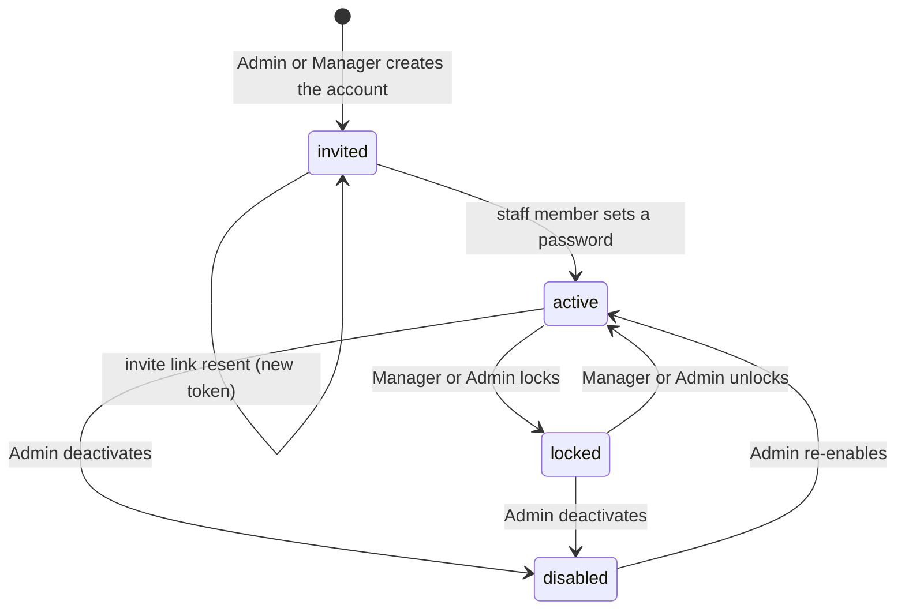
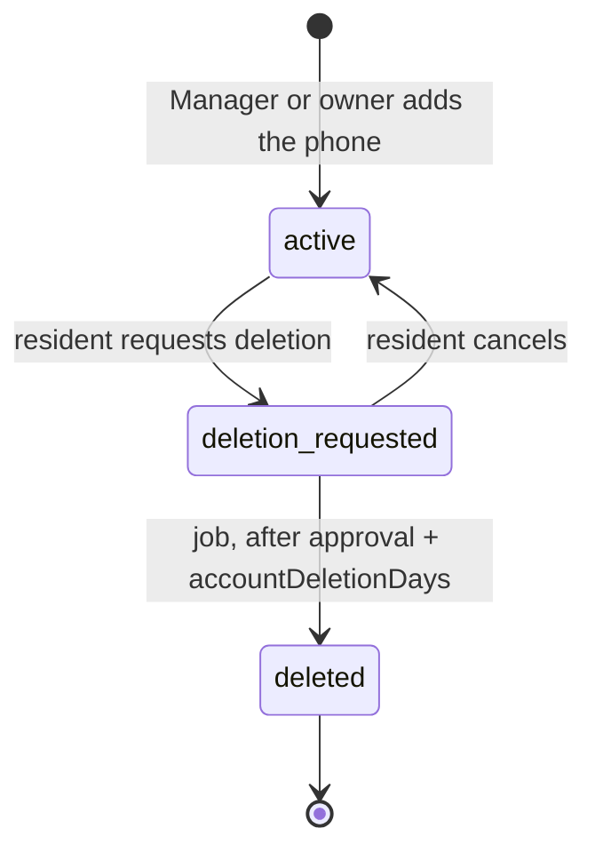
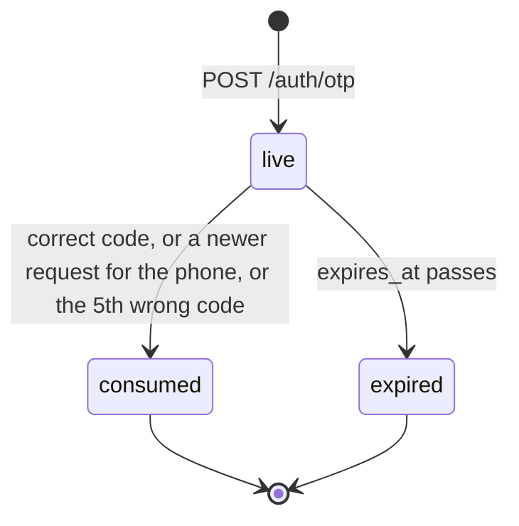
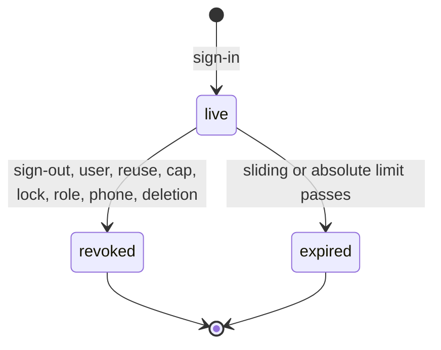
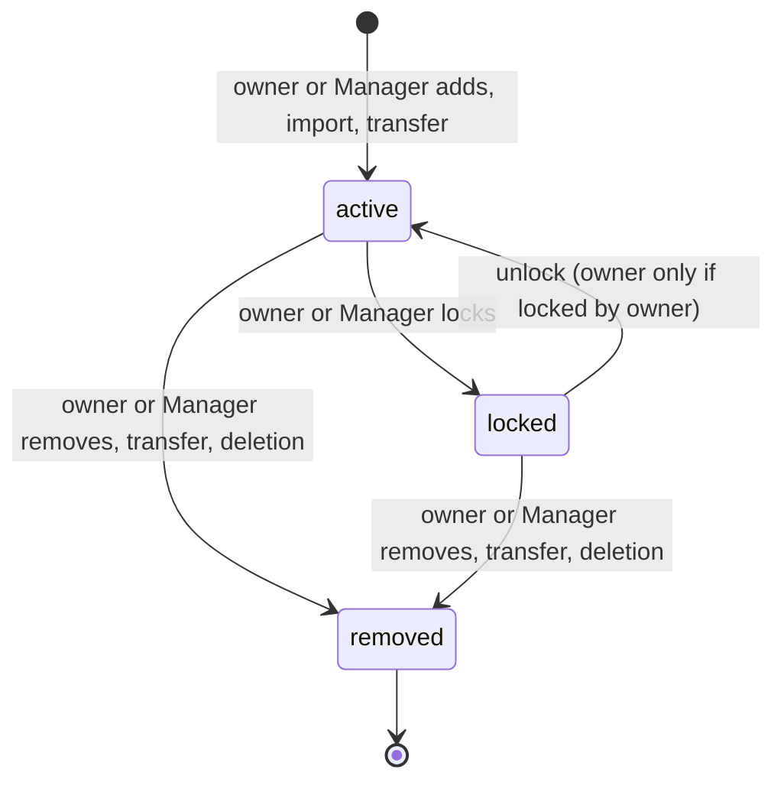
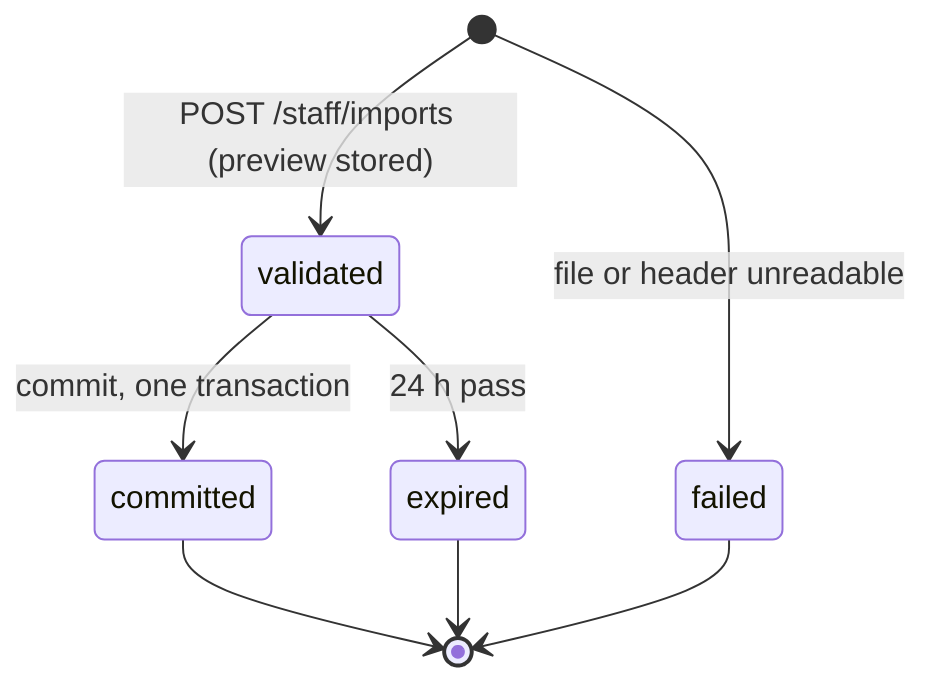

# Identity and residency model

> Status: **Review** · Updated: 2026-10-21 (DR-225: `refresh_family.client`; DR-129: two more revocation reasons; DR-141: import kind `unit_owner`, history wording) · DOC-16
> Depends on: original SDD §7, §11, §16, [DR](../00-decision-register.md) (DR-09…12, 21, 36…42, 48, 59, 64, 85, 87), [ADR-0010](../04-adr/0010-two-account-kinds-membership-scoped-authorization.md), [ADR-0011](../04-adr/0011-tokens-refresh-families-and-cookies.md), [ADR-0014](../04-adr/0014-schema-per-module-no-cross-module-foreign-keys.md), [DOC-03](../01-product/requirements.md) (FR-13…18, 39, 45, 50), [DOC-07](../03-architecture/system-context-and-containers.md) §5–§6, [DOC-06](../02-glossary.md)
> Main readers: P1-10 (identity), P1-11 (residency), P1-13 (imports), DOC-19 (grants), DOC-26, DOC-27, DOC-35, DOC-46, DOC-51, EXP-09, EXP-10

This document holds the tables of two modules: `identity` (accounts, challenges, tokens, sessions, sign-in buckets) and `residency` (units, resident profiles, memberships, unit history, the units-and-owners import). It gives the grain, keys, writers and readers of every table, runnable DDL with the reason of every index, the state machines of the status columns and sample statements. It does not hold the rules of the flows (lockout, OTP, step-up and sessions are DOC-26; households, transfers and lookups are DOC-27), the endpoints (DOC-51), the grants (DOC-19) or the conventions every table follows (DOC-14). The tables of `building`, `audit`, `platform` and the finance tables are in DOC-15 and DOC-17.

## 1. Scope

### 1.1 Tables in this document

"Writer" is the one module that writes the table (DOC-07 §6.1). "Readers" go through the contracts of DOC-07 §5.2. Row counts are **planned** for the sample building (240 units, about 650 accounts, DR-81) and for the design scale of 5,000 units.

| Schema | Table | Writer | Grain | Business key | Rows (240 units / 5,000 units) |
| --- | --- | --- | --- | --- | --- |
| `identity` | `staff_account` | identity | one staff member | `email` | 10 / 200 |
| `identity` | `resident_account` | identity | one phone number | `phone` | 650 / 13,000 |
| `identity` | `otp_challenge` | identity | one SMS code sent | live challenge per `phone` | purged daily; about 100 live rows |
| `identity` | `password_token` | identity | one reset link, invite link or step-up code | `token_hash` (links); `(staff_id, kind, action)` live | purged daily; under 50 |
| `identity` | `refresh_family` | identity | one sign-in on one device (`sid`) | `id` | 1,500 / 30,000 live |
| `identity` | `refresh_token` | identity | one rotation step | `token_hash` | 3,000 / 60,000 |
| `identity` | `rate_bucket` | identity | one bucket key | `key` | under 2,000, idle ones purged |
| `residency` | `unit` | residency | one apartment | `(building_id, code)` | 240 / 5,000 |
| `residency` | `resident_profile` | residency | one person in one building | `(building_id, account_id)` | 650 / 13,000 |
| `residency` | `membership` | residency | one person's right in one unit, from its start | `(account_id, unit_id)` while not removed | 700 / 14,000 |
| `residency` | `unit_history` | residency | one change of a unit | `id` | about 300 per year |
| `residency` | `import_job` | residency | one units-and-owners import | `id` | a few per year; purged after 30 days |
| both | `outbox_messages`, `inbox` | the schema's module | created by the core helper in each schema (DR-42, DR-62) | — | DOC-09, DOC-38 |

### 1.2 Tables the master plan lists here that live elsewhere

| Table | Where | Why |
| --- | --- | --- |
| `idempotency_key` | `platform.idempotency_key`, DDL in DOC-17 §3 | It is written by the core HTTP idempotency plugin inside the request transaction for creates of every module (tickets, vehicles, notices, payments), not by `identity`. A table owned by the core packages belongs to the `platform` schema (DR-85, DR-74). |
| `platform.rate_bucket` | DOC-17 §3 | The buckets of every limit except sign-in, OTP and reset (webhook, QR, intents, reminders, uploads; DR-64). `identity.rate_bucket` (§4.6) keeps only the three sign-in families so that an unauthenticated flood cannot touch the table the whole API uses. |
| `finance.import_job` | DOC-15 | Each module that imports owns its table (DR-21). Both tables are created by one core helper and have the same columns (§5.5). |
| `access.qr_credential` | DOC-17 §5 | The QR module owns the nonce; it reads `membership.credential_version` through `ResidencyApi.getMembershipForScan` (DR-48). |
| `building.terms_acceptance`, `building.building_setting` | DOC-17 §1 | Terms and the lockout and deletion settings (`lockout {5, 15}`, `accountDeletionDays`) are building data. |

## 2. How the conventions apply here

The conventions are DOC-14's (UUIDv7, standard columns, deletion rules, time, `building_id` first in indexes). This section lists only what is particular to these two schemas.

| Topic | Rule here |
| --- | --- |
| Ids | UUIDv7 made by the application (`Bun.randomUUIDv7()` or the core helper, DR-10). No database default. The tests below use `uuidv7()` of PostgreSQL 18 only to seed rows. |
| Enumerations | `text` with a `CHECK (… IN (…))`, never a PostgreSQL enum, so a value is added by an expand migration (DR-12, DOC-14). |
| `building_id` | Present on every table except the five on the scope-lint allow-list: `identity.resident_account`, `otp_challenge`, `refresh_token`, `rate_bucket` (a resident or a sign-in attempt belongs to no building) and `refresh_family` (a resident family has none; a staff family carries `building_id`, enforced by a `CHECK`). Allow-list owner: DOC-12 §7.3. |
| Foreign keys | Only inside one schema (`password_token → staff_account`, `refresh_token → refresh_family`, `membership → unit`, `unit_history → unit`). A reference to another module's row is a plain `uuid`: `membership.account_id` and `resident_profile.account_id` point to `identity.resident_account`; `refresh_family.account_id` points to either account table by `kind`; `import_job.created_by` and `membership.added_by` point to an account by kind (ADR-0014). |
| Deletion | Units are never deleted. Accounts, memberships and challenges change `status` or are purged by the jobs of DOC-38; nothing in these schemas is soft-deleted by a flag other than `status`. A removed membership stays as history. |
| Versions | `version` is on `staff_account`, `resident_account`, `unit` and `resident_profile` (aggregates edited by several actors, DR-12). `membership` has no `version`: its changes are conditional updates on `status` and bump `credential_version` (§5.3). |
| Time | `timestamptz` everywhere; every "today" of these tables is a building date computed from `building.time_zone` (DR-09). |
| Prerequisites | Extensions `citext`, `pg_trgm`, `unaccent` and the function `platform.immutable_unaccent` (DR-41). DOC-14 owns the extension list; the block is repeated in §3.1 so that this document's DDL runs alone. |

## 3. Entities

```mermaid
erDiagram
  STAFF_ACCOUNT ||--o{ PASSWORD_TOKEN : "has"
  REFRESH_FAMILY ||--o{ REFRESH_TOKEN : "rotates through"
  STAFF_ACCOUNT ||..o{ REFRESH_FAMILY : "signs in as (uuid)"
  RESIDENT_ACCOUNT ||..o{ REFRESH_FAMILY : "signs in as (uuid)"
  RESIDENT_ACCOUNT ||..o{ OTP_CHALLENGE : "requested by phone"
  RESIDENT_ACCOUNT ||..o{ MEMBERSHIP : "holds (uuid)"
  RESIDENT_ACCOUNT ||..o| RESIDENT_PROFILE : "described by (uuid)"
  UNIT ||--o{ MEMBERSHIP : "has"
  UNIT ||--o{ UNIT_HISTORY : "records"
  STAFF_ACCOUNT ||..o{ IMPORT_JOB : "starts (uuid)"

  STAFF_ACCOUNT {
    uuid id PK
    uuid building_id
    citext email UK
    text role
    text status
    text password_hash
  }
  RESIDENT_ACCOUNT {
    uuid id PK
    text phone UK
    text status
    boolean is_demo
  }
  MEMBERSHIP {
    uuid id PK
    uuid building_id
    uuid account_id
    uuid unit_id FK
    text member_type
    text status
    int credential_version
  }
  UNIT {
    uuid id PK
    uuid building_id
    text code UK
    text occupancy
  }
  RESIDENT_PROFILE {
    uuid building_id PK
    uuid account_id PK
    text cccd_enc
  }
```



Solid lines are foreign keys inside one schema. Dotted lines are plain `uuid` columns checked through a contract (DOC-07 §5.2). The identity side of the diagram is `identity.*`, the rest is `residency.*`.

### 3.1 Prerequisites

```sql
CREATE EXTENSION IF NOT EXISTS citext;
CREATE EXTENSION IF NOT EXISTS pg_trgm;
CREATE EXTENSION IF NOT EXISTS unaccent;

CREATE SCHEMA IF NOT EXISTS platform;
CREATE SCHEMA IF NOT EXISTS identity;
CREATE SCHEMA IF NOT EXISTS residency;

-- The immutable wrapper that DR-41 asks for, so unaccent can be used in an index expression.
CREATE OR REPLACE FUNCTION platform.immutable_unaccent(text) RETURNS text
  LANGUAGE sql IMMUTABLE PARALLEL SAFE STRICT
  AS $$ SELECT public.unaccent('public.unaccent'::regdictionary, $1) $$;
```

## 4. Schema `identity`

### 4.1 `staff_account`

- **Grain:** one staff member (Admin, Manager, Technician, Guard) of one building. Phase 1 gives a staff member one building (DR-36); a later multi-building staff adds a link table, not a second row.
- **Business key:** `email` (case-insensitive, unique across buildings; a staff member who is also a resident has a second account in `resident_account`, and the same email or phone may exist in both tables, DR-36).
- **Written by:** `identity` (Admin creates any role, Manager creates Technician and Guard, FR-14). **Read by:** `identity`; every module's staff guard re-reads `role` and `status` per request (FR-14.4); `IdentityApi.getStaff` and `listActiveStaff` for tickets, notices, notification.

```sql
CREATE TABLE identity.staff_account (
  id              uuid PRIMARY KEY,                       -- UUIDv7 made by the application
  building_id     uuid NOT NULL,
  email           citext NOT NULL,
  full_name       text NOT NULL,
  role            text NOT NULL CHECK (role IN ('admin', 'manager', 'technician', 'guard')),
  status          text NOT NULL DEFAULT 'invited'
                  CHECK (status IN ('invited', 'active', 'locked', 'disabled')),
  password_hash   text,                                   -- argon2id; NULL until the invite is accepted
  failed_attempts smallint NOT NULL DEFAULT 0 CHECK (failed_attempts >= 0),
  locked_until    timestamptz,                            -- temporary lockout after failed attempts
  language        text NOT NULL DEFAULT 'vi' CHECK (language IN ('vi', 'en')),
  push_enabled    boolean NOT NULL DEFAULT true,
  avatar_key      text,
  last_login_at   timestamptz,
  created_at      timestamptz NOT NULL DEFAULT now(),
  updated_at      timestamptz NOT NULL DEFAULT now(),
  version         integer NOT NULL DEFAULT 1,
  CONSTRAINT staff_account_password_when_not_invited
    CHECK (status = 'invited' OR password_hash IS NOT NULL)
);
CREATE UNIQUE INDEX staff_account_email_key ON identity.staff_account (email);
CREATE INDEX staff_account_building_role_idx ON identity.staff_account (building_id, role, status);
```

**What the columns mean**

| Column | Meaning |
| --- | --- |
| `status` | `invited` (no password yet), `active`, `locked` (locked by a Manager or Admin, FR-14.3), `disabled` (deactivated by the Admin). The temporary lockout after failed sign-ins is **not** a status: it is `locked_until` while the status stays `active` (DR-107). |
| `password_hash` | argon2id string; `NULL` only while `invited` (the `CHECK` below). |
| `failed_attempts`, `locked_until` | The lockout counter of FR-13.1 and the end of the temporary lock. Both are reset by a success, by an unlock and by a password reset. The limit and the duration (5 and 15 minutes) are building settings read by the use case, never hard-coded in SQL. |
| `language`, `push_enabled`, `avatar_key` | Profile settings (`avatar_key` holds the `file_object` id as text, *noted 2026-10-20, DR-146*); `language` decides the language of mail and push (FR-29). |
| `version` | Optimistic lock for edits by two Admins (DR-12). |

**Indexes**

| Index | Reason and query |
| --- | --- |
| `staff_account_email_key` UNIQUE `(email)` | One account per email, and the sign-in and reset lookup `WHERE email = :email` (SDD §16.2). It is global, not `(building_id, email)`: the sign-in screen does not know the building. |
| `staff_account_building_role_idx` `(building_id, role, status)` | `IdentityApi.listActiveStaff(buildingId, roles, …)`: recipients of "new unassigned ticket" and of money alerts (Managers and Admins), the assign dialog (Technicians and Guards). |

**Status machine**



| From → to | By whom | When | Effects in the same transaction |
| --- | --- | --- | --- |
| (none) → `invited` | Admin (any role), Manager (Technician, Guard) | `POST /staff/staff` (FR-14.1) | Row without `password_hash`; an `invite` token; mail through `identity.mail_requested.v1` |
| `invited` → `invited` | Admin; Manager for Technician and Guard | The link expired after 24 h (FR-14.2) | The older token is consumed, a new one is issued |
| `invited` → `active` | the staff member | `POST /auth/staff/password` with a valid invite token | `password_hash` set; token consumed |
| `active` → `locked` | Manager (Technician, Guard) or Admin | Manual lock; refused with 409 `staff_has_open_tickets` while the person holds tickets, unless the Admin forces with `reassignTo` (FR-14.3) | All refresh families revoked (`account_locked`); `version + 1` |
| `locked` → `active` | Manager or Admin | Unlock | `failed_attempts = 0`, `locked_until = NULL` |
| `active`, `locked` → `disabled` | Admin | The person leaves | Families revoked; the email stays reserved |
| `disabled` → `active` | Admin | The person returns | Counters cleared |

A change of `role` is not a state change but revokes every family of the account and takes effect on the next request because the guard re-reads the row (FR-14.4). Creating or promoting an Admin and changing `email` need a step-up (FR-14.5, FR-50, §4.4).

**Lockout statement.** One statement, so 20 parallel wrong passwords cannot push `failed_attempts` past 5 (FR-13.1). The `WHERE` makes a locked account answer no row; once `locked_until` has passed, the next wrong password starts a new count at 1 and clears the lock.

```sql
UPDATE identity.staff_account
   SET failed_attempts = CASE WHEN locked_until <= now() THEN 1 ELSE failed_attempts + 1 END,
       locked_until    = CASE WHEN (CASE WHEN locked_until <= now() THEN 1 ELSE failed_attempts + 1 END) >= :max_attempts
                              THEN now() + make_interval(mins => :lock_minutes)
                              WHEN locked_until <= now() THEN NULL
                              ELSE locked_until END
 WHERE email = :email AND (locked_until IS NULL OR locked_until <= now())
RETURNING failed_attempts, locked_until;
-- 0 rows: the account is locked now (or the email is unknown); the answer is the same 401 as a wrong password
-- success:  UPDATE … SET failed_attempts = 0, locked_until = NULL, last_login_at = now() WHERE id = :id
```

Run on PostgreSQL 18.6 with `pgbench -c 20`, 20 parallel wrong passwords left `failed_attempts = 5` and a lock; run one by one, attempts 6 and 7 changed 0 rows (§9.3).

### 4.2 `resident_account`

- **Grain:** one phone number. A resident account holds no rights; rights are memberships (§5.3). One person with two phones has two accounts; merging is out of scope (DR-40).
- **Business key:** `phone` in E.164 (`libphonenumber-js`, default region VN, any internationally valid number, DR-36).
- **Written by:** `identity` (created when a Manager or an owner adds a phone that has no account, FR-17.1; phone changed by the Manager, FR-18.4; deletion, FR-39). **Read by:** `identity`; `IdentityApi.getResidentAccounts(ids)` and `findResidentAccountsByPhoneFragment` for residency and notification.

```sql
CREATE TABLE identity.resident_account (
  id                    uuid PRIMARY KEY,
  phone                 text NOT NULL
                        CHECK (phone ~ '^\+[1-9][0-9]{6,14}$' OR phone ~ '^deleted:[0-9a-f-]{36}$'),
  display_name          text,
  avatar_key            text,
  language              text NOT NULL DEFAULT 'vi' CHECK (language IN ('vi', 'en')),
  push_enabled          boolean NOT NULL DEFAULT true,
  status                text NOT NULL DEFAULT 'active'
                        CHECK (status IN ('active', 'deletion_requested', 'deleted')),
  is_demo               boolean NOT NULL DEFAULT false,   -- DR-37: only these accounts accept the fixed OTP
  last_app_open_at      timestamptz,
  deletion_requested_at timestamptz,
  deletion_approved_at  timestamptz,
  deleted_at            timestamptz,
  created_at            timestamptz NOT NULL DEFAULT now(),
  updated_at            timestamptz NOT NULL DEFAULT now(),
  version               integer NOT NULL DEFAULT 1,
  CONSTRAINT resident_account_name_unless_deleted
    CHECK (status = 'deleted' OR display_name IS NOT NULL),
  CONSTRAINT resident_account_deletion_dates
    CHECK ((status = 'active' AND deletion_requested_at IS NULL AND deletion_approved_at IS NULL AND deleted_at IS NULL)
        OR (status = 'deletion_requested' AND deletion_requested_at IS NOT NULL AND deleted_at IS NULL)
        OR (status = 'deleted' AND deleted_at IS NOT NULL)),
  CONSTRAINT resident_account_deleted_phone
    CHECK ((status = 'deleted') = (phone LIKE 'deleted:%'))
);
CREATE UNIQUE INDEX resident_account_phone_key ON identity.resident_account (phone);
-- phone-fragment search (DR-41): a suffix match becomes a prefix match on the reversed number
CREATE INDEX resident_account_phone_suffix_idx ON identity.resident_account (reverse(phone) text_pattern_ops);
CREATE INDEX resident_account_deletion_idx ON identity.resident_account (deletion_approved_at)
  WHERE status = 'deletion_requested' AND deletion_approved_at IS NOT NULL;
```

| Column | Meaning |
| --- | --- |
| `phone` | E.164, or `deleted:<id>` after deletion execution (frees the number, FR-39.3). |
| `display_name` | Required until deletion clears it (DR-59). |
| `status` | `active`, `deletion_requested`, `deleted`. |
| `is_demo` | `true` only for the demo building's accounts: the fixed code `123456` is accepted only for them and they receive no SMS (DR-37, DR-60). The boot guard refuses to start in production if a flagged account has a membership in a building that is not a demo building (§5.3 query). |
| `deletion_requested_at`, `deletion_approved_at`, `deleted_at` | The three dates of the workflow of DR-59 (DR-108). Execution is `deletion_approved_at + accountDeletionDays` (building setting, default 30). |
| `last_app_open_at` | Shown in the unread list of notice statistics (FR-28.2). |

**Indexes**

| Index | Reason and query |
| --- | --- |
| `resident_account_phone_key` UNIQUE `(phone)` | One account per phone (SDD §16.2); the OTP request and the Manager's phone lookup. A deleted account's `deleted:<id>` value keeps the unique index satisfied and releases the real number (test IDM-14). |
| `resident_account_phone_suffix_idx` `(reverse(phone) text_pattern_ops)` | Phone-fragment search of at least 4 digits (FR-18.5, DR-41): a suffix match `phone LIKE '%4567'` becomes the prefix match `reverse(phone) LIKE '7654%'`, which a btree can serve. It needs no extension. |
| `resident_account_deletion_idx` partial `(deletion_approved_at)` | The daily deletion job finds approved requests whose cooling-off ended. |

**Status machine**



| From → to | By whom | When | Effects |
| --- | --- | --- | --- |
| (none) → `active` | `identity`, on a Manager's or owner's add | First membership of an unknown phone (FR-17.1) | Row with `display_name` from the add form; one invitation SMS |
| `active` → `deletion_requested` | the resident | `POST /me/account/deletion` (FR-39.2) | `deletion_requested_at = now()`; the account stays usable |
| `deletion_requested` → `active` | the resident | `DELETE` of the same resource | Both deletion dates cleared |
| `deletion_requested` (approved) | Manager | Approval in `W-Residents` | `deletion_approved_at = now()`; refused with 409 `owner_must_transfer` while the account is the active owner of a unit (FR-39.4) |
| `deletion_requested` → `deleted` | the deletion job | `deletion_approved_at + accountDeletionDays` has passed | Sessions revoked, `display_name` and `avatar_key` cleared, `phone = 'deleted:' \|\| id`; event `identity.account_deletion_executed.v1` (DR-87) makes residency remove memberships and clear the profile (§5.2) and notification delete device tokens |

The statement of the last row, run on PostgreSQL 18.6 (§9.3):

```sql
UPDATE identity.resident_account
   SET status = 'deleted', display_name = NULL, avatar_key = NULL, phone = 'deleted:' || id,
       deleted_at = now(), updated_at = now(), version = version + 1
 WHERE status = 'deletion_requested' AND deletion_approved_at <= now() - make_interval(days => :deletion_days)
RETURNING id;
```

**Boot guard (DR-37, DR-60).** `SELECT id FROM identity.resident_account WHERE is_demo` gives the flagged ids; `ResidencyApi` returns their memberships and `BuildingApi` says whether each building is a demo building; any flagged account in a non-demo building stops the process in `production`.

### 4.3 `otp_challenge`

- **Grain:** one SMS code sent to one phone. **Business key:** the live challenge of a phone.
- **Written by:** `identity`. **Read by:** `identity` only. No `building_id`: a challenge exists before the person has chosen a unit.

```sql
CREATE TABLE identity.otp_challenge (
  id           uuid PRIMARY KEY,
  phone        text NOT NULL,                             -- E.164; no foreign key: a challenge exists before sign-in
  code_hmac    text NOT NULL,                             -- HMAC-SHA256 of the code with a server key
  expires_at   timestamptz NOT NULL,
  resend_after timestamptz NOT NULL,
  attempts     smallint NOT NULL DEFAULT 0 CHECK (attempts BETWEEN 0 AND 5),
  consumed_at  timestamptz,
  ip           inet,
  created_at   timestamptz NOT NULL DEFAULT now(),
  CHECK (expires_at > created_at)
);
-- one live challenge per phone (DR-37): a new request first consumes the older one
CREATE UNIQUE INDEX otp_challenge_one_live_per_phone ON identity.otp_challenge (phone) WHERE consumed_at IS NULL;
CREATE INDEX otp_challenge_created_idx ON identity.otp_challenge (created_at);   -- otp_purge
```

| Column | Meaning |
| --- | --- |
| `code_hmac` | HMAC-SHA256 of the 6-digit code with a server key; a database leak does not reveal valid codes (SDD §7.3). The fixed demo code is never stored: a demo account sends no SMS (DR-37). |
| `expires_at`, `resend_after` | Now + 5 minutes and now + 45 seconds (`otp_ttl`, `otp_resend_after`, DOC-41). |
| `attempts` | Wrong codes; the fifth consumes the challenge (FR-15.3). |
| `consumed_at` | Set by a correct code, by a newer request for the same phone, or by the fifth wrong code. |

**Index.** `otp_challenge_one_live_per_phone` (unique on `phone` where `consumed_at IS NULL`) enforces "one live challenge per phone" (DR-37): the issue transaction first marks the older one consumed, then inserts the new one, so two parallel requests cannot leave two live codes (test IDM-16). `otp_challenge_created_idx` serves `otp_purge` (daily 03:45, DR-62).

**Derived state** (no status column):



**Issue and verify** (tested on PostgreSQL 18.6, §9.3):

```sql
-- issue, in one transaction
UPDATE identity.otp_challenge SET consumed_at = now() WHERE phone = :phone AND consumed_at IS NULL;
INSERT INTO identity.otp_challenge (id, phone, code_hmac, expires_at, resend_after, ip)
VALUES (:id, :phone, :hmac, now() + interval '5 minutes', now() + interval '45 seconds', :ip);

-- verify: one statement, the second tap on "verify" finds consumed_at set (FR-15.4)
UPDATE identity.otp_challenge SET consumed_at = now()
 WHERE id = :challenge_id AND code_hmac = :hmac AND consumed_at IS NULL AND expires_at > now() AND attempts < 5
RETURNING phone;
-- 0 rows: UPDATE … SET attempts = attempts + 1, consumed_at = CASE WHEN attempts + 1 >= 5 THEN now() END
--         WHERE id = :challenge_id AND consumed_at IS NULL RETURNING attempts;   -- then 400 otp_invalid
```

### 4.4 `password_token`

- **Grain:** one single-use credential of a staff member: a password-reset link, an invite link or a step-up code. **Business key:** `token_hash` for links; the live `(staff_id, kind, action)` for step-up.
- **Written by:** `identity`. **Read by:** `identity`; `IdentityApi.verifyStepUp` for `building` (DR-87).

```sql
CREATE TABLE identity.password_token (
  id          uuid PRIMARY KEY,
  building_id uuid NOT NULL,
  staff_id    uuid NOT NULL REFERENCES identity.staff_account (id),
  kind        text NOT NULL CHECK (kind IN ('reset', 'invite', 'step_up')),
  action      text CHECK (action IN ('gateway_config', 'admin_change', 'staff_email')),
  attempts    smallint NOT NULL DEFAULT 0 CHECK (attempts BETWEEN 0 AND 5),
  token_hash  text NOT NULL,   -- reset/invite: SHA-256 of 256 random bits; step_up: HMAC of the 6-digit code
  expires_at  timestamptz NOT NULL,
  consumed_at timestamptz,
  created_at  timestamptz NOT NULL DEFAULT now(),
  CONSTRAINT password_token_action_only_for_step_up CHECK ((kind = 'step_up') = (action IS NOT NULL)),
  CHECK (expires_at > created_at)
);
-- a link is found by its hash; a step-up code is not unique (6 digits), so it is found by staff and action instead
CREATE UNIQUE INDEX password_token_link_hash_key ON identity.password_token (token_hash)
  WHERE kind IN ('reset', 'invite');
-- one live token per staff member and kind (and action): issuing a new one consumes the older first
CREATE UNIQUE INDEX password_token_one_live ON identity.password_token (staff_id, kind, (COALESCE(action, '')))
  WHERE consumed_at IS NULL;
CREATE INDEX password_token_created_idx ON identity.password_token (created_at);   -- token_purge
```

| Column | Meaning |
| --- | --- |
| `kind` | `reset` (30 minutes), `invite` (24 hours), `step_up` (10 minutes) (DR-39). |
| `action` | Only for `step_up`: `gateway_config`, `admin_change`, `staff_email` (the `CHECK` ties it to the kind, tests IDM-23, IDM-24). |
| `token_hash` | Links: SHA-256 of 256 random bits. Step-up: HMAC of the 6-digit code (DR-36). |
| `attempts` | Wrong codes of a step-up; the fifth consumes it (FR-50.3). |
| `building_id` | Copied from the staff account so that the table is scoped like every staff table. |

**Indexes**

| Index | Reason and query |
| --- | --- |
| `password_token_link_hash_key` UNIQUE `(token_hash)` where `kind` is `reset` or `invite` | Finds a link by its hash. It is partial because a 6-digit step-up code is not unique across staff (tests IDM-26). |
| `password_token_one_live` UNIQUE `(staff_id, kind, COALESCE(action, ''))` where `consumed_at IS NULL` | One live token per staff member and kind (and action): issuing a new one first consumes the older (DR-39, FR-50.1; tests IDM-21, IDM-22, IDM-27). |
| `password_token_created_idx` `(created_at)` | `token_purge`. |

**Statements** (first use returns a row, the second none; tested, §9.3):

```sql
-- reset and invite link
UPDATE identity.password_token SET consumed_at = now()
 WHERE token_hash = :hash AND kind = :kind AND consumed_at IS NULL AND expires_at > now()
RETURNING staff_id;

-- step-up code, bound to the acting staff member and the action
UPDATE identity.password_token SET consumed_at = now()
 WHERE staff_id = :staff_id AND kind = 'step_up' AND action = :action AND token_hash = :code_hmac
   AND consumed_at IS NULL AND expires_at > now() AND attempts < 5
RETURNING id;
-- 0 rows: UPDATE … SET attempts = attempts + 1, consumed_at = CASE WHEN attempts + 1 >= 5 THEN now() END
--         WHERE staff_id = :staff_id AND kind = 'step_up' AND action = :action AND consumed_at IS NULL
```

### 4.5 `refresh_family` and `refresh_token`

- **Grain:** a family is one sign-in on one device and is the session (`sid` claim, FR-45); a token is one step of its rotation. **Business key:** `token_hash` of the token.
- **Written by:** `identity`. **Read by:** `identity`; the session list endpoints (FR-45.1); `identity.session_revoked.v1` tells realtime and notification (DOC-07 §5.3).

```sql
CREATE TABLE identity.refresh_family (          -- one family = one sign-in on one device; id is the session id (sid)
  id                  uuid PRIMARY KEY,
  kind                text NOT NULL CHECK (kind IN ('staff', 'resident')),
  account_id          uuid NOT NULL,            -- staff_account.id or resident_account.id, by kind (no foreign key)
  building_id         uuid,                     -- staff only; a resident token carries no building
  user_agent          text,
  client              text NOT NULL CHECK (client IN ('web', 'app')),   -- how the refresh token is delivered; set at sign-in (DR-130, DR-225)
  created_at          timestamptz NOT NULL DEFAULT now(),
  last_used_at        timestamptz NOT NULL DEFAULT now(),
  absolute_expires_at timestamptz NOT NULL,     -- staff 90 days, resident 365 days after created_at (DR-38)
  revoked_at          timestamptz,
  revoked_reason      text CHECK (revoked_reason IN ('sign_out', 'user_revoked', 'token_reuse', 'cap_exceeded',
                                                      'account_locked', 'account_disabled', 'role_changed',
                                                      'phone_changed', 'password_changed', 'deleted')),
  CONSTRAINT refresh_family_building_by_kind CHECK ((kind = 'staff') = (building_id IS NOT NULL)),
  CONSTRAINT refresh_family_reason_with_revocation CHECK ((revoked_at IS NULL) = (revoked_reason IS NULL))
);
CREATE INDEX refresh_family_account_idx ON identity.refresh_family (kind, account_id) WHERE revoked_at IS NULL;
CREATE INDEX refresh_family_expiry_idx ON identity.refresh_family (absolute_expires_at);   -- token_purge

CREATE TABLE identity.refresh_token (
  id             uuid PRIMARY KEY,
  family_id      uuid NOT NULL REFERENCES identity.refresh_family (id) ON DELETE CASCADE,
  token_hash     text NOT NULL,                 -- SHA-256 of 256 random bits
  expires_at     timestamptz NOT NULL,          -- sliding: staff 30 days, resident 180 days, capped by the family
  created_at     timestamptz NOT NULL DEFAULT now(),
  revoked_at     timestamptz,                   -- set when rotated or when the family is revoked
  replaced_by_id uuid REFERENCES identity.refresh_token (id) DEFERRABLE INITIALLY DEFERRED,   -- the successor is inserted after the consume
  CONSTRAINT refresh_token_replaced_only_if_revoked CHECK (replaced_by_id IS NULL OR revoked_at IS NOT NULL)
);
CREATE UNIQUE INDEX refresh_token_hash_key ON identity.refresh_token (token_hash);
CREATE INDEX refresh_token_family_idx ON identity.refresh_token (family_id);
```

| Column | Meaning |
| --- | --- |
| `kind`, `account_id` | Which account table `account_id` points to (no foreign key: it can be either). |
| `building_id` | Staff families only, so a staff request knows its building; a resident family has none (DR-38). Enforced by `refresh_family_building_by_kind`. |
| `absolute_expires_at` | Staff 90 days, resident 365 days after `created_at` (DR-38, FR-45.4). |
| `refresh_token.expires_at` | The sliding limit (staff 30 days, resident 180 days), never beyond the family's absolute limit. |
| `revoked_reason` | `sign_out`, `user_revoked`, `token_reuse`, `cap_exceeded`, `account_locked`, `account_disabled`, `role_changed`, `phone_changed`, `password_changed`, `deleted`. Required exactly when `revoked_at` is set. The same ten words are the `reason` of `identity.session_revoked.v1` (DOC-26 §3.8). *Revised 2026-10-20 (DR-129):* `account_disabled` and `password_changed` were added. |
| `replaced_by_id` | The successor of a rotated token; the foreign key is `DEFERRABLE INITIALLY DEFERRED` so the use case can consume the old token and insert the new one in either order inside the transaction. |

**Indexes**

| Index | Reason and query |
| --- | --- |
| `refresh_family_account_idx` `(kind, account_id)` where not revoked | The session list, "revoke all of an account" and the cap of 10 live families (FR-45.3). |
| `refresh_family_expiry_idx` `(absolute_expires_at)` | `token_purge`. |
| `refresh_token_hash_key` UNIQUE `(token_hash)` | The atomic consume: the only lookup of a refresh request. |
| `refresh_token_family_idx` `(family_id)` | Revoking a family and the cascade of the purge. |

**Family states** (derived from `revoked_at` and the expiry columns):



**Rotation** (reference pattern with reuse detection and a 10-second grace window; DR-38; tested, §9.3):

```sql
-- 1. consume the presented token and name its successor, in one transaction
UPDATE identity.refresh_token t SET revoked_at = now(), replaced_by_id = :next_id
  FROM identity.refresh_family f
 WHERE t.token_hash = :hash AND t.revoked_at IS NULL AND t.expires_at > now()
   AND f.id = t.family_id AND f.revoked_at IS NULL AND f.absolute_expires_at > now()
RETURNING t.family_id, f.kind, f.account_id, f.building_id;
-- 2. insert the successor (expires_at = least(now() + sliding, f.absolute_expires_at)) and
--    UPDATE refresh_family SET last_used_at = now() WHERE id = :family_id
-- 0 rows in step 1: look the hash up. Rotated more than 10 s ago (revoked_at set, replaced_by_id set):
UPDATE identity.refresh_family SET revoked_at = now(), revoked_reason = 'token_reuse' WHERE id = :family_id AND revoked_at IS NULL;
UPDATE identity.refresh_token SET revoked_at = now() WHERE family_id = :family_id AND revoked_at IS NULL;
-- and commit (return, do not throw), then answer 401 and emit identity.session_revoked.v1
```

**Cap of 10 live families** (before inserting the 11th, FR-45.3):

```sql
UPDATE identity.refresh_family SET revoked_at = now(), revoked_reason = 'cap_exceeded'
 WHERE id IN (SELECT id FROM identity.refresh_family
               WHERE kind = :kind AND account_id = :account_id AND revoked_at IS NULL
               ORDER BY created_at DESC OFFSET 9);
```

### 4.6 `rate_bucket`

- **Grain:** one bucket key. **Business key:** `key`. **Written and read by:** `identity` through the core token-bucket helper; no `building_id` (allow-list).

```sql
CREATE TABLE identity.rate_bucket (
  key        text PRIMARY KEY,                  -- e.g. 'otp:phone:+84901234567', 'staff-login:ip:203.0.113.7'
  tokens     double precision NOT NULL,         -- may be negative (debt)
  updated_at timestamptz NOT NULL DEFAULT now()
);
CREATE INDEX rate_bucket_updated_idx ON identity.rate_bucket (updated_at);   -- token_purge of idle buckets
```

Key catalog (limits are configuration, DOC-41; values from DR-37, DR-39, DR-64):

| Key | Limit |
| --- | --- |
| `otp:phone:<e164>` | Burst of 5 SMS, refill 5 per hour; at most 10 in any hour (`otp_per_phone`, DR-171) |
| `otp:ip:<ip>` | Burst of 20 challenges, refill 20 per hour; at most 40 in any hour (`otp_per_ip`, DR-171) |
| `staff-login:ip:<ip>` | 30 attempts per 15 minutes |
| `reset:email:<lower(email)>` | 3 requests per hour |
| `reset:ip:<ip>` | 10 requests per hour |

`rate_bucket_updated_idx` serves `token_purge` of idle buckets. The acquire statement is the reference's single upsert (a row means granted, no row means refused, and the refill is computed from the database clock):

```sql
INSERT INTO identity.rate_bucket AS b (key, tokens, updated_at) VALUES (:key, :cap::float8 - 1, now())
ON CONFLICT (key) DO UPDATE
   SET tokens = least(:cap::float8, b.tokens + extract(epoch FROM (now() - b.updated_at)) * :rate_per_s::float8) - 1,
       updated_at = now()
 WHERE least(:cap::float8, b.tokens + extract(epoch FROM (now() - b.updated_at)) * :rate_per_s::float8) >= 1
RETURNING tokens;
```

## 5. Schema `residency`

### 5.1 `unit`

- **Grain:** one apartment. **Business key:** `(building_id, code)` (`A-1508`).
- **Written by:** `residency` (Manager creates and edits; the units import updates, FR-18.1). **Read by:** every module through `ResidencyApi.getUnits(ids)`. A unit is never deleted, only marked `vacant` (DR-12); every change of owner is a `unit_history` row, and a change of occupancy across vacancy is one too (`moved_out` when it becomes `vacant`, `moved_in` when it leaves `vacant`; *revised 2026-10-20, DR-141*).

```sql
CREATE TABLE residency.unit (
  id          uuid PRIMARY KEY,
  building_id uuid NOT NULL,
  code        text NOT NULL,                    -- 'A-1508'
  floor       smallint,
  bedrooms    smallint CHECK (bedrooms >= 0),
  area_m2     numeric(8,2) CHECK (area_m2 > 0),
  occupancy   text NOT NULL DEFAULT 'vacant' CHECK (occupancy IN ('occupied', 'rented', 'vacant')),
  note        text,
  created_at  timestamptz NOT NULL DEFAULT now(),
  updated_at  timestamptz NOT NULL DEFAULT now(),
  version     integer NOT NULL DEFAULT 1
);
CREATE UNIQUE INDEX unit_code_key ON residency.unit (building_id, code);
CREATE INDEX unit_code_prefix_idx ON residency.unit (building_id, lower(code) text_pattern_ops);
```

| Column | Meaning |
| --- | --- |
| `code` | Unique in the building; the import matches on it (FR-01.1 shares the rule). |
| `floor`, `bedrooms`, `area_m2` | Attributes shown in `W-Units`; floors are not a module. |
| `occupancy` | `occupied`, `rented`, `vacant`, set by the Manager, never derived from memberships (DR-40). |

| Index | Reason and query |
| --- | --- |
| `unit_code_key` UNIQUE `(building_id, code)` | Unit codes unique per building (SDD §16.2) and the exact lookup of the import and of the lookup screen. |
| `unit_code_prefix_idx` `(building_id, lower(code) text_pattern_ops)` | The case-insensitive prefix search of `GET /staff/lookup` (DR-41): `lower(code) LIKE lower(:q) \|\| '%'`. A plain btree cannot serve `ILIKE`, so the index is on `lower(code)`. |

### 5.2 `resident_profile`

- **Grain:** what one building's management knows about one person: full name, email, CCCD, date of birth. **Business key:** `(building_id, account_id)` (DR-106; DR-40 wrote `account_id` alone, but DR-12 puts `building_id` on every business table and one phone may belong to two buildings later).
- **Written by:** `residency` (entered by the Manager). **Read by:** `residency` only; the detail view and every export of it write one `pii.read` audit row (DR-57, NFR-14).

```sql
CREATE TABLE residency.resident_profile (
  building_id   uuid NOT NULL,
  account_id    uuid NOT NULL,                  -- identity.resident_account.id (no foreign key)
  full_name     text,
  email         citext,
  cccd_enc      text,                           -- 'v1:<keyId>:<iv>:<ciphertext+tag>' with the PII key (DR-65)
  cccd_last4    text CHECK (cccd_last4 ~ '^[0-9]{4}$'),
  date_of_birth date,
  note          text,
  cleared_at    timestamptz,                    -- set when account deletion clears the personal fields (DR-59)
  created_at    timestamptz NOT NULL DEFAULT now(),
  updated_at    timestamptz NOT NULL DEFAULT now(),
  version       integer NOT NULL DEFAULT 1,
  PRIMARY KEY (building_id, account_id),
  CONSTRAINT resident_profile_name_unless_cleared CHECK (cleared_at IS NOT NULL OR full_name IS NOT NULL),
  CONSTRAINT resident_profile_cccd_pair CHECK ((cccd_enc IS NULL) = (cccd_last4 IS NULL))
);
-- name search without diacritics (DR-41)
CREATE INDEX resident_profile_name_trgm_idx ON residency.resident_profile
  USING gin (lower(platform.immutable_unaccent(full_name)) gin_trgm_ops);
```

| Column | Meaning |
| --- | --- |
| `cccd_enc`, `cccd_last4` | The number encrypted with the PII key (DR-65), and its last four digits for the masked display `•••• 1234`. Both or neither (`resident_profile_cccd_pair`, test IDM-46). |
| `cleared_at` | Set when deletion execution clears the personal fields (FR-39.3); the name may be `NULL` only then (test IDM-49). |

**Index.** `resident_profile_name_trgm_idx` (trigram GIN on `lower(platform.immutable_unaccent(full_name))`) serves the name search typed with or without diacritics (FR-31.2, DR-41); a query is `… WHERE lower(platform.immutable_unaccent(full_name)) LIKE '%' || lower(platform.immutable_unaccent(:q)) || '%'`. The primary key serves the profile lookup.

**Deletion clearing** (run by the `identity.account_deletion_executed.v1` handler; tested, §9.3):

```sql
UPDATE residency.resident_profile
   SET full_name = NULL, email = NULL, cccd_enc = NULL, cccd_last4 = NULL, date_of_birth = NULL, note = NULL,
       cleared_at = now(), updated_at = now(), version = version + 1
 WHERE account_id = :account_id;
```

### 5.3 `membership`

- **Grain:** one person's right in one unit, from its start to its removal. **Business key:** `(account_id, unit_id)` while the status is not `removed`. A person removed and added again gets a new row with a new `created_at`, so the history rule restarts (DR-40).
- **Written by:** `residency` (owner adds, edits, locks, unlocks, removes; Manager does the same and transfers ownership). **Read by:** the request guard, finance, access, notification, notices, vehicles, tickets through `ResidencyApi` (DOC-07 §5.2).

```sql
CREATE TABLE residency.membership (
  id                 uuid PRIMARY KEY,
  building_id        uuid NOT NULL,
  account_id         uuid NOT NULL,             -- identity.resident_account.id (no foreign key)
  unit_id            uuid NOT NULL REFERENCES residency.unit (id),
  member_type        text NOT NULL CHECK (member_type IN ('owner', 'family', 'tenant', 'helper')),
  can_pay            boolean NOT NULL DEFAULT false,   -- read only for a tenant (policy table); owner and family always pay
  status             text NOT NULL DEFAULT 'active' CHECK (status IN ('active', 'locked', 'removed')),
  locked_by          text CHECK (locked_by IN ('owner', 'manager')),
  credential_version integer NOT NULL DEFAULT 1 CHECK (credential_version >= 1),
  added_by_kind      text NOT NULL CHECK (added_by_kind IN ('staff', 'resident')),
  added_by           uuid NOT NULL,             -- staff_account.id or resident_account.id, by kind
  invited_at         timestamptz,               -- invitation SMS sent (cap of 10 a day per owner)
  note               text,
  removed_at         timestamptz,
  created_at         timestamptz NOT NULL DEFAULT now(),   -- the start of the membership: the history filter of DR-40
  updated_at         timestamptz NOT NULL DEFAULT now(),
  CONSTRAINT membership_locked_by_iff_locked CHECK ((status = 'locked') = (locked_by IS NOT NULL)),
  CONSTRAINT membership_removed_at_iff_removed CHECK ((status = 'removed') = (removed_at IS NOT NULL))
);
-- exactly one active (or locked) owner per unit (FR-16.5)
CREATE UNIQUE INDEX membership_one_owner_per_unit ON residency.membership (building_id, unit_id)
  WHERE member_type = 'owner' AND status <> 'removed';
-- one membership per account and unit (SDD 7.2); also the request guard's lookup, which runs before the building is known
CREATE UNIQUE INDEX membership_one_per_account_unit ON residency.membership (account_id, unit_id)
  WHERE status <> 'removed';
CREATE INDEX membership_unit_idx ON residency.membership (building_id, unit_id, status);
CREATE INDEX membership_building_active_idx ON residency.membership (building_id, id) WHERE status = 'active';
```

| Column | Meaning |
| --- | --- |
| `member_type`, `can_pay` | The four types and the right to pay. `can_pay` is read only for a tenant (owner and family always pay, helper never, SDD §7.4); the policy function ignores it for the others, so a change of type needs no extra write. |
| `status`, `locked_by` | `active`, `locked`, `removed`. `locked_by` is `owner` or `manager` exactly while `locked`; a membership locked by the Manager can be unlocked only by the Manager (FR-17.4). |
| `credential_version` | Incremented in the same transaction by any change of status, `member_type` or ownership; the QR scan compares it (DR-48). A change of `can_pay` alone does not bump it. |
| `added_by_kind`, `added_by` | Who created it: a staff account (Manager, import, transfer) or a resident account (the owner). |
| `invited_at` | When the invitation SMS was sent; the cap of 10 invitations a day per owner counts `invited_at` of memberships added by that owner (FR-17.2). |
| `created_at` | **The start of the membership.** `ResidencyApi.getMembership` returns it as `startedAt`, and finance shows a resident only payments dated on or after it (DR-40, FR-17.6). |

**Indexes (the constraints of SDD §7.2 and §16.2 with their queries)**

| Index | Reason and query |
| --- | --- |
| `membership_one_owner_per_unit` UNIQUE `(building_id, unit_id)` where owner and not removed | Exactly one owner per unit (FR-16.5). It also answers "who is the owner of A-1508": `WHERE building_id = :b AND unit_id = :u AND member_type = 'owner' AND status <> 'removed'` (the unit detail, the guard's scan result, the owner terms). A locked owner still counts. |
| `membership_one_per_account_unit` UNIQUE `(account_id, unit_id)` where not removed | One membership per person and unit. It is also the **request guard's lookup** (`X-Unit-Id` + token `sub`), which runs before the building is known, so it has no `building_id` prefix: the unit row gives the building. It serves `ResidencyApi.activeUnitIds(accountId)` by its `account_id` prefix too. This is the one index that does not start with `building_id` (DOC-14 exception, to be listed there). |
| `membership_unit_idx` `(building_id, unit_id, status)` | Members of a unit: `Members`, `listRecipients(unitId, capability)`. |
| `membership_building_active_idx` partial `(building_id, id)` where active | Keyset pages of `listNoticeRecipients(buildingId, cursor, limit)`: every active membership of the building in id order (DR-50). |

**Status machine**



| From → to | By whom | When | Effects in the same transaction |
| --- | --- | --- | --- |
| (none) → `active` | Owner (`Member-Add`, not an owner row), Manager (`W-Resident-Add`, import), transfer (new owner) | The phone may be new or have an account (FR-17.1) | `unit_history` row `member_added` or `moved_in`; event `residency.membership_changed.v1`; invitation SMS |
| `active` → `locked` | Owner (non-owner members, never themselves), Manager | FR-17.3 | `locked_by`; `credential_version + 1`; sessions are not revoked, the next request is refused (FR-16.1) |
| `locked` → `active` | Owner if `locked_by = 'owner'`; Manager always | FR-17.4 | `locked_by = NULL`; `credential_version + 1` (an old screenshot stays dead, FR-26.4) |
| `active`, `locked` → `removed` | Owner (non-owner), Manager, transfer (old owner; others by default), deletion execution | FR-17.3, FR-18.3, FR-39.3 | `removed_at`; `credential_version + 1`; `unit_history` `member_removed` or `moved_out` |
| type change (`family` ↔ `tenant`) | Owner, Manager | FR-17.3 | No status change; `credential_version + 1` |

**Sample statements** (all run on PostgreSQL 18.6, §9.3)

```sql
-- request guard: one lookup by account and unit; 0 rows or a status other than 'active' -> 403 membership_inactive
SELECT id, building_id, member_type, can_pay, status, created_at AS started_at
  FROM residency.membership
 WHERE account_id = :account_id AND unit_id = :unit_id AND status <> 'removed';

-- units a person can pick (Unit-Pick) and the units whose inbox entries are visible
SELECT unit_id FROM residency.membership WHERE account_id = :account_id AND status = 'active';

-- add a member whose phone may already have an account: a second add of the same pair changes nothing
INSERT INTO residency.membership (id, building_id, account_id, unit_id, member_type, can_pay, added_by_kind, added_by, invited_at)
VALUES (:id, :building_id, :account_id, :unit_id, 'tenant', false, 'resident', :owner_account_id, now())
ON CONFLICT (account_id, unit_id) WHERE status <> 'removed' DO NOTHING
RETURNING member_type, credential_version;           -- 0 rows -> 409 member_exists

-- owner locks a non-owner member; an owner's unlock needs locked_by = 'owner'
UPDATE residency.membership
   SET status = 'locked', locked_by = 'owner', credential_version = credential_version + 1, updated_at = now()
 WHERE id = :id AND unit_id = :owner_unit AND member_type <> 'owner' AND status = 'active'
RETURNING status, credential_version;
UPDATE residency.membership
   SET status = 'active', locked_by = NULL, credential_version = credential_version + 1, updated_at = now()
 WHERE id = :id AND status = 'locked' AND locked_by = 'owner'          -- the Manager's unlock omits the locked_by predicate
RETURNING status;
```

**Ownership transfer** (Manager, one transaction; the old owner leaves before the new one is inserted because of the unique index; `:keep_members` is the "keep members" tick, default false, DR-40):

```sql
BEGIN;
UPDATE residency.membership
   SET status = 'removed', locked_by = NULL, removed_at = now(), credential_version = credential_version + 1, updated_at = now()
 WHERE building_id = :b AND unit_id = :u AND status <> 'removed' AND (member_type = 'owner' OR NOT :keep_members);
INSERT INTO residency.membership (id, building_id, account_id, unit_id, member_type, added_by_kind, added_by)
VALUES (:id, :b, :new_owner_account, :u, 'owner', 'staff', :manager_id);
INSERT INTO residency.unit_history (id, building_id, unit_id, kind, actor_kind, actor_id, details)
VALUES (:hid, :b, :u, 'owner_changed', 'staff', :manager_id, jsonb_build_object('keepMembers', :keep_members));
COMMIT;
```

**History visibility (DR-40, FR-17.6).** A resident sees the open charges of the unit always, and paid charges, receipts and payer names only for payments dated on or after `membership.created_at`. Residency's part is returning `started_at` in the guard query above; finance applies `payment.received_at >= :started_at` in `GET /me/fees/history`, `GET /me/receipts` and the fee detail, and does not apply it for staff. A member added on 2026-10-01 therefore does not see a payment dated 2026-09-10 (test RM- in DOC-27).

### 5.4 `unit_history`

- **Grain:** one change of a unit: owner changed, moved in, moved out, member added or removed. Append-only. **Written and read by:** `residency` (`W-Unit-Detail` shows it, FR-18.6).

```sql
CREATE TABLE residency.unit_history (
  id          uuid PRIMARY KEY,
  building_id uuid NOT NULL,
  unit_id     uuid NOT NULL REFERENCES residency.unit (id),
  kind        text NOT NULL CHECK (kind IN ('owner_changed', 'moved_in', 'moved_out', 'member_added', 'member_removed')),
  actor_kind  text NOT NULL CHECK (actor_kind IN ('staff', 'resident', 'system')),
  actor_id    uuid,
  at          timestamptz NOT NULL DEFAULT now(),
  details     jsonb NOT NULL DEFAULT '{}',
  CONSTRAINT unit_history_actor_id CHECK ((actor_kind = 'system') = (actor_id IS NULL))
);
CREATE INDEX unit_history_unit_idx ON residency.unit_history (building_id, unit_id, at DESC);
```

`actor_kind` is `staff`, `resident` (an owner adding a member) or `system` (deletion execution, which has no `actor_id`; test IDM-63). `details` is a small `jsonb` such as `{"keepMembers": false}` or `{"from": "<account>", "to": "<account>"}`. Index `unit_history_unit_idx` `(building_id, unit_id, at DESC)` serves the history list of one unit.

### 5.5 `import_job`

- **Grain:** one units-and-owners import (`kind = unit_owner`, the name of DR-22 and the API; *revised 2026-10-20 (DR-141):* it was `units_owners`). **Written and read by:** `residency`. The fee import has its own table `finance.import_job` with the same columns (DR-21, DOC-15); the core helper creates both.

```sql
CREATE TABLE residency.import_job (
  id           uuid PRIMARY KEY,
  building_id  uuid NOT NULL,
  kind         text NOT NULL CHECK (kind IN ('unit_owner')),
  status       text NOT NULL CHECK (status IN ('validated', 'failed', 'committed', 'expired')),
  file_key     text NOT NULL,                   -- object key of a file with purpose 'import' (DR-61, DR-86); deleted on commit or expiry
  file_name    text,
  params       jsonb NOT NULL DEFAULT '{}',     -- request parameters (fee imports keep {"batchId": …} here)
  result       jsonb NOT NULL,                  -- counts, first 50 valid rows, up to 500 errors {row, column, code, message}
  created_by   uuid NOT NULL,                   -- staff_account.id
  created_at   timestamptz NOT NULL DEFAULT now(),
  expires_at   timestamptz NOT NULL,            -- created_at + 24 h: the commit endpoint refuses an older job
  committed_at timestamptz,
  CONSTRAINT import_job_committed_at_iff_committed CHECK ((status = 'committed') = (committed_at IS NOT NULL)),
  CHECK (expires_at > created_at)
);
CREATE INDEX import_job_building_idx ON residency.import_job (building_id, created_at DESC);
CREATE INDEX import_job_purge_idx ON residency.import_job (created_at);   -- import_purge keeps files and rows 30 days
```

| Column | Meaning |
| --- | --- |
| `status` | `validated` or `failed` (set by `POST /staff/imports` itself), then `committed` or `expired` (DR-21). There is no `validating` state: validation is synchronous. |
| `file_key` | The key of the uploaded object, a `file_object` with `purpose = 'import'` (DR-61, DR-86; DR-21 wrote "under `imports/`"). It holds CCCD numbers, so it is deleted on commit or expiry (FR-18.2). |
| `params` | The request parameters; `{}` for units, `{"batchId": …}` for fees (DR-109). |
| `result` | Counts, the first 50 valid rows, up to 500 errors `{row, column, code, message}`. |
| `expires_at` | `created_at + 24 h`. The commit endpoint refuses an older job with 409 `import_expired`. |



The commit is one conditional statement, so a double-pressed "Save" commits once (FR-01.3 for fees; the same rule here) and a stale job gets no row:

```sql
UPDATE residency.import_job SET status = 'committed', committed_at = now()
 WHERE id = :id AND status = 'validated' AND expires_at > now()
RETURNING result;
-- 0 rows: SELECT status, expires_at … -> 409 import_expired, or already committed -> idempotent answer
```

Indexes: `import_job_building_idx` `(building_id, created_at DESC)` for the import history list; `import_job_purge_idx` `(created_at)` for `import_purge` (weekly, keeps rows and files 30 days, DR-21, DR-62).

## 6. Index catalog

Every index with the query it serves, so none is speculative. "Source" is the constraint or decision behind it.

| Index | Kind | Query it serves | Source |
| --- | --- | --- | --- |
| `staff_account_email_key` | UNIQUE | Sign-in and reset by email | SDD §16.2 |
| `staff_account_building_role_idx` | btree | `listActiveStaff` by role | DR-42 |
| `resident_account_phone_key` | UNIQUE | OTP request, phone-in-use check | SDD §16.2, FR-18.4 |
| `resident_account_phone_suffix_idx` | btree on `reverse(phone)` | Phone fragment ≥ 4 digits | DR-41, FR-18.5 |
| `resident_account_deletion_idx` | partial btree | Deletion job | DR-59 |
| `otp_challenge_one_live_per_phone` | partial UNIQUE | One live challenge per phone | DR-37 |
| `otp_challenge_created_idx` | btree | `otp_purge` | DR-62 |
| `password_token_link_hash_key` | partial UNIQUE | Find a link by hash | DR-39 |
| `password_token_one_live` | partial UNIQUE | One live token per staff, kind, action | DR-39, FR-50.1 |
| `password_token_created_idx` | btree | `token_purge` | DR-62 |
| `refresh_family_account_idx` | partial btree | Session list, revoke all, cap of 10 | FR-45 |
| `refresh_family_expiry_idx` | btree | `token_purge` | DR-62 |
| `refresh_token_hash_key` | UNIQUE | Atomic consume | DR-38 |
| `refresh_token_family_idx` | btree | Revoke a family | DR-38 |
| `rate_bucket_updated_idx` | btree | `token_purge` of idle buckets | DR-62 |
| `unit_code_key` | UNIQUE | Unit code per building | SDD §16.2 |
| `unit_code_prefix_idx` | btree on `lower(code)` `text_pattern_ops` | Unit-code prefix search | DR-41 |
| `resident_profile_name_trgm_idx` | GIN trigram | Name search without diacritics | DR-41 |
| `membership_one_owner_per_unit` | partial UNIQUE | One owner per unit; owner of a unit | FR-16.5 |
| `membership_one_per_account_unit` | partial UNIQUE | One membership per person and unit; request guard; `activeUnitIds` | SDD §7.2 |
| `membership_unit_idx` | btree | Members of a unit | DR-42 |
| `membership_building_active_idx` | partial btree | Notice recipients, keyset pages | DR-50 |
| `unit_history_unit_idx` | btree | History of a unit | FR-18.6 |
| `import_job_building_idx` | btree | Import list | DR-21 |
| `import_job_purge_idx` | btree | `import_purge` | DR-21, DR-62 |

Primary keys serve the by-id lookups (`getStaff`, `getResidentAccounts`, `getMembershipForScan`, `getUnits`). The planner used each of the first-line indexes above for its query on PostgreSQL 18.6 with sequential scans disabled (the sample tables are too small for a cost-based choice); real plans with 5,000 units are read in the P1-11 acceptance and in EXP-07.

## 7. Retention and purge

The periods are fixed in DOC-20 and run by the jobs of DOC-38 (DR-62); this table says which index each purge uses and what is never deleted.

| Table | Purge | Never deleted |
| --- | --- | --- |
| `otp_challenge` | `otp_purge` daily 03:45, by `created_at` | — |
| `password_token`, `refresh_family`, `refresh_token`, `rate_bucket` | `token_purge` daily 03:45: consumed or expired tokens, expired or revoked families (their tokens cascade), idle buckets | — |
| `import_job` | `import_purge` weekly Sunday 04:00: rows and files older than 30 days | — |
| `staff_account`, `resident_account` | none; deletion clears fields and keeps the row (ledger and audit keep ids) | the rows |
| `unit`, `membership`, `unit_history` | none | units are never deleted; removed memberships and history stay (DR-12) |
| `resident_profile` | cleared (not deleted) on account deletion | the row |

## 8. Decisions made while writing

Every new decision in this document is a DR (decided, Claude delegated by the Owner) and is summarized here.

| ID | Decision | Where used |
| --- | --- | --- |
| DR-106 | `resident_profile` is keyed by `(building_id, account_id)` instead of `account_id` alone | §5.2 |
| DR-107 | Staff status semantics: the temporary lockout is `locked_until` with the status `active`; `locked` is the manual lock; `disabled` is the Admin's deactivation and is reversible by the Admin | §4.1 |
| DR-108 | `resident_account` carries `deletion_requested_at`, `deletion_approved_at`, `deleted_at`; `resident_profile` carries `cleared_at` (the columns DR-59's workflow needs) | §4.2, §5.2 |
| DR-109 | `import_job` has `params jsonb` and `expires_at`; the finance variant uses the same columns | §5.5 |

## 9. DDL tests

### 9.1 Method

DDL tested on PostgreSQL 18.6 (`postgres:18.6`, the tag of DOC-11 §1, container removed afterwards) on 2026-10-19. The files of §3.1 and §4–§5 were applied in order with `psql -v ON_ERROR_STOP=1` on an empty database, then dropped and applied again after the last change. Each test below inserts or updates rows and checks the SQLSTATE: `23505` unique violation, `23514` check violation, `23503` foreign-key violation, or success. Result: **68 of 68 passed**. The prefix `IDM-` (identity model) is new; DOC-88 indexes it. The business tests of the flows keep their own prefixes (`AU-` in DOC-26, `RM-` in DOC-27).

### 9.2 Constraint tests

| ID | Scenario | Expected |
| --- | --- | --- |
| IDM-01 | Second staff account whose email differs only by case | 23505 |
| IDM-02 | Staff role `superuser` | 23514 |
| IDM-03 | Status `active` without a password hash | 23514 |
| IDM-04 | Status `invited` without a password hash | accepted |
| IDM-05 | `failed_attempts = -1` | 23514 |
| IDM-06 | Second resident account with the same phone | 23505 |
| IDM-07 | Phone `0901234567` (no `+`) | 23514 |
| IDM-08 | Active resident account without a display name | 23514 |
| IDM-09 | Account with `is_demo = true` | accepted |
| IDM-10 | Status `deletion_requested` without a request date | 23514 |
| IDM-11 | Status `deletion_requested` with a request date | accepted |
| IDM-12 | Status `deleted` with the name cleared but the phone not replaced | 23514 |
| IDM-13 | Deletion execution: name and avatar cleared, phone `deleted:<id>` | accepted |
| IDM-14 | The freed number registered again by a new account | accepted |
| IDM-15 | First OTP challenge for a phone | accepted |
| IDM-16 | Second live challenge for the same phone | 23505 |
| IDM-17 | Consume the live challenge | accepted |
| IDM-18 | New live challenge after the consume | accepted |
| IDM-19 | `attempts = 6` | 23514 |
| IDM-20 | Reset token | accepted |
| IDM-21 | Second live reset token for the same staff member | 23505 |
| IDM-22 | Invite token for the same staff member (another kind) | accepted |
| IDM-23 | Kind `step_up` without an action | 23514 |
| IDM-24 | Kind `reset` with an action | 23514 |
| IDM-25 | Step-up for `gateway_config` | accepted |
| IDM-26 | Step-up for `staff_email` with the same code hash (another action) | accepted |
| IDM-27 | Second live step-up for the same staff member and action | 23505 |
| IDM-28 | Token for an unknown staff id | 23503 |
| IDM-29 | Staff refresh family with a building | accepted |
| IDM-30 | Resident refresh family without a building | accepted |
| IDM-31 | Staff refresh family without a building | 23514 |
| IDM-32 | Resident refresh family with a building | 23514 |
| IDM-33 | Revoke a family without a reason | 23514 |
| IDM-34 | Refresh token | accepted |
| IDM-35 | Second refresh token with the same hash | 23505 |
| IDM-36 | Refresh token for an unknown family | 23503 |
| IDM-37 | A token marked as replaced by itself without being revoked | 23514 |
| IDM-38 | First row of a rate bucket | accepted |
| IDM-39 | Second row with the same bucket key | 23505 |
| IDM-40 | Second unit with the same code in the same building | 23505 |
| IDM-41 | Same unit code in another building | accepted |
| IDM-42 | Occupancy `empty` | 23514 |
| IDM-43 | `area_m2 = 0` | 23514 |
| IDM-44 | Profile with an encrypted CCCD and its last four digits | accepted |
| IDM-45 | Second profile for the same building and account | 23505 |
| IDM-46 | `cccd_enc` without `cccd_last4` | 23514 |
| IDM-47 | `cccd_last4 = '12a4'` | 23514 |
| IDM-48 | The same person's profile in another building | accepted |
| IDM-49 | Profile with no name that is not cleared | 23514 |
| IDM-50 | Second owner for a unit | 23505 |
| IDM-51 | A family member in the same unit | accepted |
| IDM-52 | The same account twice in one unit | 23505 |
| IDM-53 | A tenant with `can_pay` in another unit | accepted |
| IDM-54 | Status `locked` without `locked_by` | 23514 |
| IDM-55 | Locked by the Manager with `credential_version + 1` | accepted |
| IDM-56 | Status `removed` without `removed_at` | 23514 |
| IDM-57 | Removed with `removed_at` and `credential_version + 1` | accepted |
| IDM-58 | The removed person added again as a new row | accepted |
| IDM-59 | Membership for an unknown unit | 23503 |
| IDM-60 | Member type `guest` | 23514 |
| IDM-61 | `credential_version = 0` | 23514 |
| IDM-62 | Unit history row with a staff actor | accepted |
| IDM-63 | Actor kind `system` with an actor id | 23514 |
| IDM-64 | Unknown history kind `renovated` | 23514 |
| IDM-65 | Import job `validated` | accepted |
| IDM-66 | Status `committed` without `committed_at` | 23514 |
| IDM-67 | Commit with `WHERE status = 'validated'` | accepted |
| IDM-68 | Import kind `fees` in the residency table | 23514 |

### 9.3 Statement tests

| ID | Statement | Result |
| --- | --- | --- |
| IDM-S01 | Lockout statement, 7 wrong passwords one after another (max 5) | `failed_attempts` 1, 2, 3, 4, 5, then no row changed for attempts 6 and 7; locked after the fifth |
| IDM-S02 | The same statement, 20 parallel wrong passwords (`pgbench -c 20`) | `failed_attempts = 5`, locked, 0 failed transactions |
| IDM-S03 | Lockout statement after `locked_until` has passed | `failed_attempts = 1`, `locked_until = NULL` |
| IDM-S04 | Reset token consume, twice | first call 1 row, second 0 rows |
| IDM-S05 | Token bucket acquire on a new key | 1 row (granted) |
| IDM-S06 | Refresh rotation in one transaction with the deferred successor key, then the old token presented again | rotation returns the family; the second consume returns 0 rows; the family revoke with `token_reuse` changes 1 row |
| IDM-S07 | Cap: ten live families plus a new sign-in | 10 live families after the revoke of the oldest |
| IDM-S08 | Add a member twice with `ON CONFLICT … DO NOTHING` | first call returns the row, second 0 rows |
| IDM-S09 | Owner locks a tenant, Manager sets `locked_by = 'manager'`, owner unlocks | lock returns `locked`/`owner`/`credential_version 2`; the owner's unlock changes 0 rows |
| IDM-S10 | Ownership transfer in one transaction | old owner `removed` (version 2), tenant `removed` (version 3), new owner `active` (version 1) |
| IDM-S11 | Account deletion execution and profile clearing | phone replaced, profile `cleared_at` set |
| IDM-S12 | Import commit twice, and after expiry | first call returns `committed`; second and expired 0 rows |
| IDM-S13 | OTP issue, wrong code, right code | wrong code 0 rows and `attempts = 1`; right code returns the phone |
| IDM-S14 | Owner of a unit; active units of an account; phone suffix `4567`; name search `tran minh` | 1, 2, 1, 1 rows |

## 10. Not in this document

| Topic | Lives in |
| --- | --- |
| Conventions: ids, standard columns, extension list, scope-lint allow-list, migrations | DOC-14 |
| `building`, `audit`, `platform` (`idempotency_key`, `rate_bucket`), `file_object`, QR and vehicle tables | DOC-17 |
| Finance tables, `finance.import_job` | DOC-15 |
| Sign-in, lockout, OTP, step-up and session rules and their tests (`AU-`) | DOC-26 |
| Household, transfer, lookup rules and the policy table (`RM-`) | DOC-27 |
| Role × schema grants and the permission tests | DOC-19 |
| Retention periods and the personal-data policy | DOC-20, DOC-35 |
| Endpoints and error codes | DOC-50, DOC-51 |

## Open questions

None. Decisions made while writing are DR-106…4 (§8); they are decided and do not block Phase 1.
