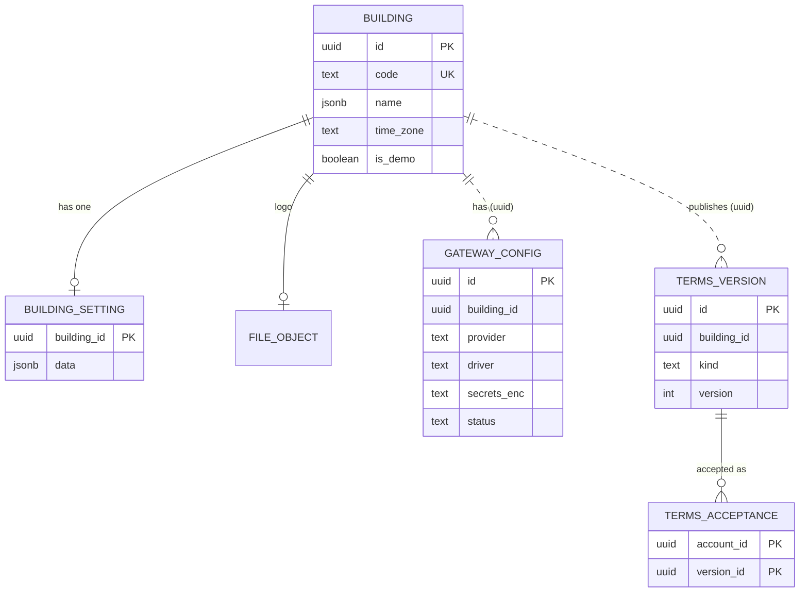
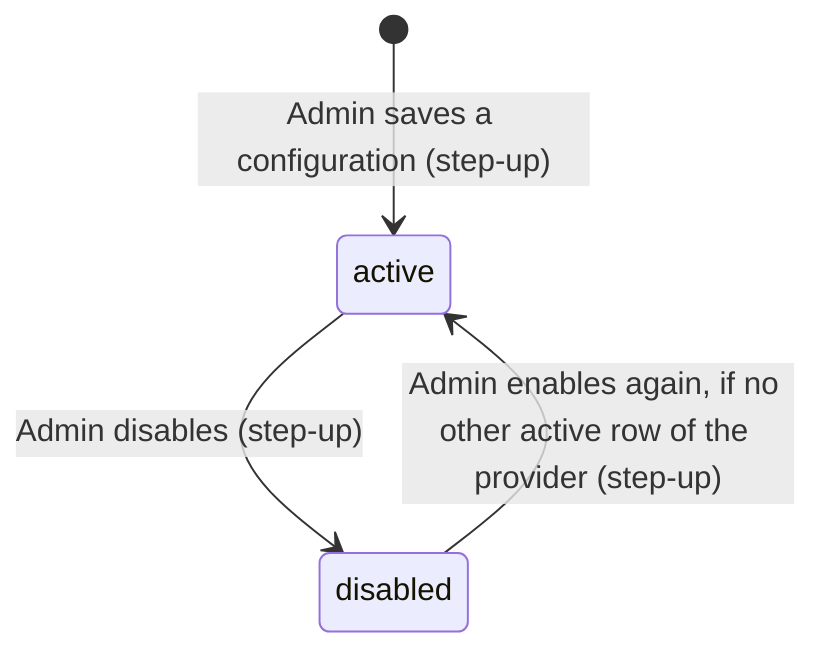
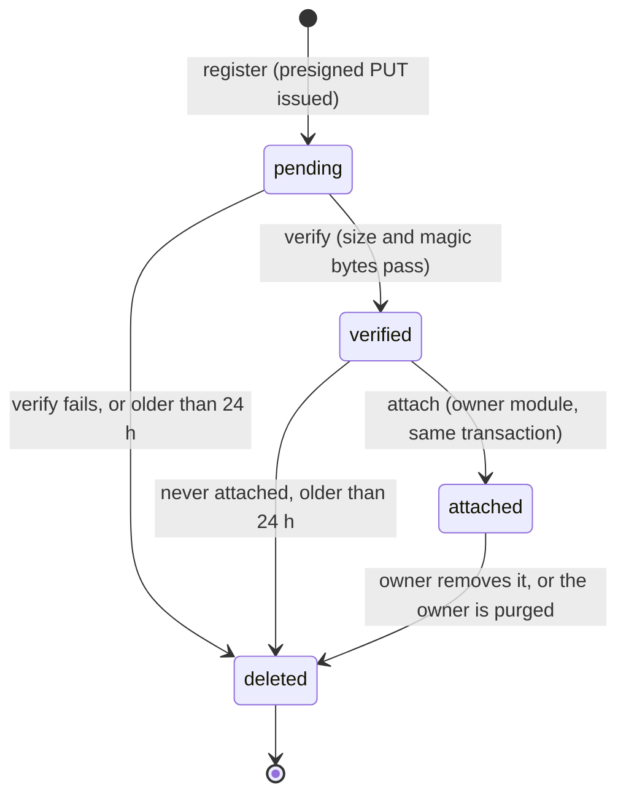
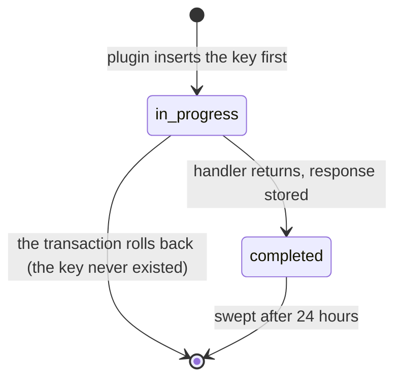
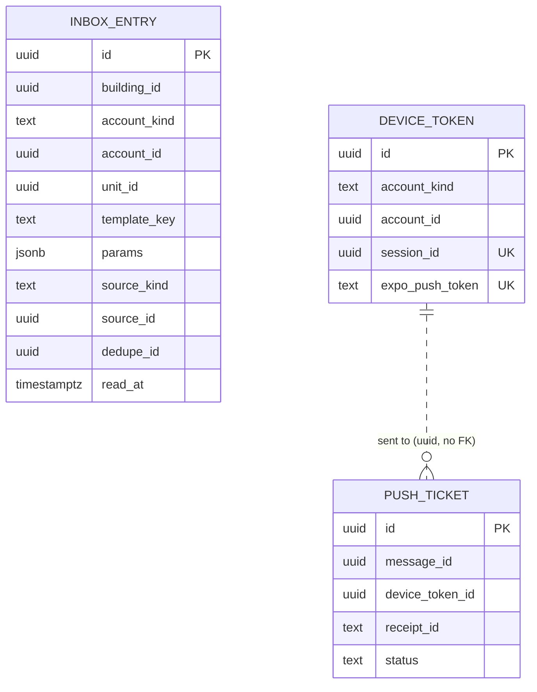
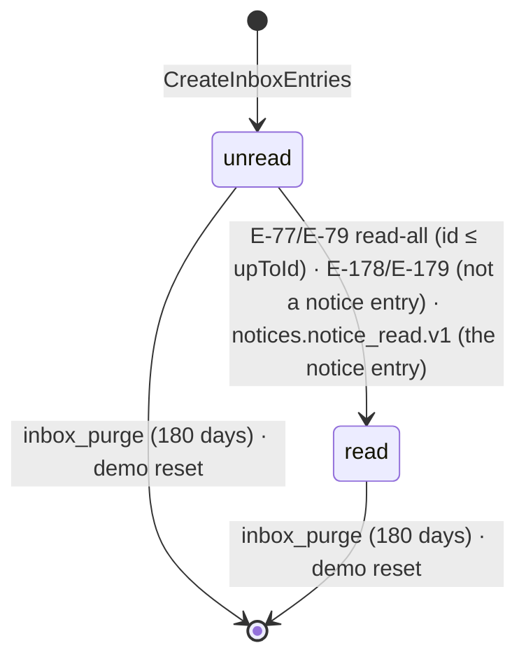
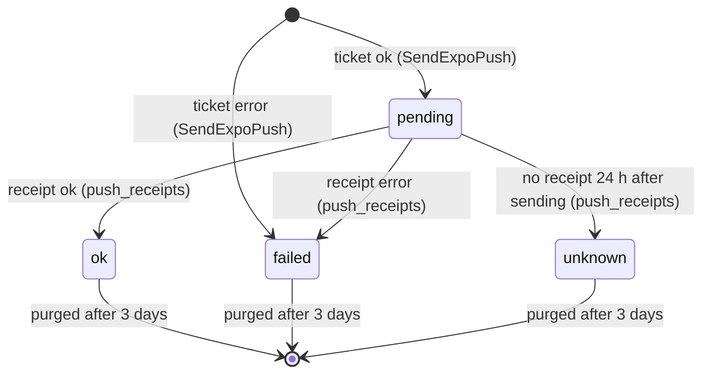

# Operations model

> Status: **Approved** (Owner, 2026-10-21, for §1–3 (gate P1); §6.1–§6.3, the notification tables, and §9.1 `realtime.events` are **Draft** for gate P2; the rest of §4–9 is owed to later phases) · Updated: 2026-10-28 (P1-26: §9.1 `realtime.events`, DR-289; §6.1–§6.3 `inbox_entry`, `device_token`, `push_ticket`, DR-299…301, DDL and `OPM-100…152`, `OPM-S13…S24` run on PostgreSQL 18.6) · 2026-10-28 (P1-29: §9A built as `modules/analytics/migrations/0000_init.sql`; DR-279) · 2026-10-26 (DR-268: the object store is SeaweedFS in `vn`, R2 in `global`) · 2026-10-22 (P1-07 and P1-08: the migrations exist, §13 run) · 2026-10-20 (DR-132: bucket `stepup:staff:<id>`; DR-154: label `job_name`) · DOC-17
> Depends on: original SDD §15, §16, [DR](../00-decision-register.md) (DR-33, 52, 53, 57, 58, 59, 60, 61, 62, 64, 74, 85, 86, 87, 101, 105, 110–113, 115, 146, 289, 299–301), [ADR-0014](../04-adr/0014-schema-per-module-no-cross-module-foreign-keys.md), [ADR-0016](../04-adr/0016-files-on-r2-presigned-put.md), [ADR-0027](../04-adr/0027-seaweedfs-on-the-vps-for-files-and-backups-in-vietnam.md), [ADR-0018](../04-adr/0018-audit-in-the-mutation-transaction.md), [ADR-0022](../04-adr/0022-personal-data-protection.md), [DOC-14](data-conventions.md) §2–§12, [DOC-16](identity-and-residency-model.md) §1.2, [DOC-07](../03-architecture/system-context-and-containers.md) §5–§6, [DOC-12](../03-architecture/code-architecture.md) §8, [DOC-31](../06-design/notices-and-notifications.md) (§6), [DOC-06](../02-glossary.md)
> Main readers: P1-05 (platform plugins), P1-06 (migrations), P1-07 (building and files), P1-08 (audit), P2-12 (notification tables), DOC-19 (grants), DOC-20 (retention), DOC-31, DOC-35, DOC-36, DOC-37, DOC-38, DOC-41

This document holds the tables of the schemas that run the system rather than the business: `building` (building, settings, gateway configuration, terms, files, job runs), `audit`, the `platform` tables of the core packages and, in §6, the `notification` tables. It gives the grain, keys, writers and readers of every table, runnable DDL, the reason of every index, the state machines and sample statements. **Sections 1–3 are complete; §6.1–§6.3 (the notification tables, gate P2) are written and Draft; the rest of sections 4–9 (tickets, access, the notice tables, vehicles, wiki, reporting and realtime) is written when its phase starts** (table in "Sections owed"), so the document stays `Draft` until then. It does not hold the rules of the flows (audit writing and the `pii.read` rules are DOC-35, building configuration and the demo reset DOC-36, uploads DOC-37, job runtime DOC-38), the grants (DOC-19), the retention periods (DOC-20) or the conventions every table follows (DOC-14).

**DDL tested on PostgreSQL 18.6 (`postgres:18.6`, aarch64) on 2026-10-19.** The blocks of §1–§3 were applied in order with `psql -v ON_ERROR_STOP=1` on a database that already held the bootstrap step of DOC-14 §2.2 and the tables of DOC-16, as the role `rms_migrator` of DOC-19; then the 78 constraint tests and 12 statement tests of §13 were run. If a block is edited, §13 is run again.

## Reading guide

| Question | Answer lives in |
| --- | --- |
| How is a column named, typed and constrained? | DOC-14 |
| What does `building.building` hold, and what are the keys of `building_setting`? | §1.1, §1.2 |
| How are the payment-gateway secrets stored and rotated? | §1.3 |
| How are terms versions and acceptances stored? | §1.4 |
| What does an audit row look like, and what deletes one? | §2 |
| How is a file registered, verified and counted against the quota? | §3.1 |
| What do the job runner, the outbox, the maintenance flag, the idempotency store and the rate buckets keep? | §3.2–§3.4 |
| What do the inbox entries, device tokens and push tickets keep? | §6.1–§6.3 |
| What does the replay buffer of the SSE stream keep? | §9.1 |
| Tickets, access, notices, vehicles, wiki, reporting | §4–§9 (owed) |
| What do the usage events and their daily rollup keep? | §9A |
| Which index serves which query | §10 |
| Retention and purge | §11 (the periods are DOC-20's) |

## Sections owed

| § | Schema | Tables | Written in | State |
| --- | --- | --- | --- | --- |
| 1 | `building` | `building`, `building_setting`, `gateway_config`, `terms_version`, `terms_acceptance` | P0-25 | Written |
| 2 | `audit` | `audit_log` | P0-25 | Written |
| 3 | `building`, `platform`, each module schema | `file_object`, `job_run`, `outbox_messages`, `inbox`, `maintenance`, `idempotency_key`, `rate_bucket` | P0-25 | Written |
| 4 | `tickets` | `ticket`, `ticket_event`, `ticket_message`, `ticket_attachment`, `ticket_type`, `ticket_rating`, `document_counter` (DR-43) | P3-11 | Not written |
| 5 | `access` | `qr_credential`, `qr_scan`, `lookup_log` (DR-48) | P4-11 | Not written |
| 6 | `notification` | `inbox_entry`, `device_token`, `push_ticket` (DR-52, DR-53) | P1-26 (2026-10-28) | Written (§6.1–§6.3), DDL run on PostgreSQL 18.6; Draft for gate P2 |
| 6 | `notices` | `notice`, `notice_attachment`, `notice_recipient` (DR-50, DR-51) | P4 (DOC-31 §13) | Not written |
| 7 | `vehicles` | `vehicle`, `vehicle_revision` (DR-49) | P4-11 | Not written |
| 8 | `wiki` | `folder`, `page`, `page_version`, `page_attachment` (DR-54) | P4-13 | Not written |
| 9A | `analytics` | `usage_event`, `usage_daily` (DR-279, ADR-0028) | 2026-10-28 (DOC-104) | Written, DDL run on PostgreSQL 18.6; migrated in P1-29 |
| 9 | `reporting` | `export_job` (DR-55; plus the requester's role, IP, user agent and request id, which the worker needs to write the `pii.read` row of an export, DOC-35 §6, DR-124) | P5-09 | Not written |
| 9 | `realtime` | `events` (DR-87, DR-289) | P1-26 (2026-10-28, with DOC-52) | Written (§9.1), DDL run on PostgreSQL 18.6; Draft for gate P2 (DR-287 proposed) |

The rules of DOC-14 §5.3 apply to every new table: a table with no `building_id` joins the allow-list in the same change as its DDL. This document adds `building.job_run` (§3.2) to it.

## How the conventions apply here

The conventions are DOC-14's. Only what is particular to these schemas is listed.

| Topic | Rule here |
| --- | --- |
| Names | Constraint and index names follow DOC-14 §11 (`pk_`, `uq_`, `ck_`, `fk_`, `ix_`, `trg_`). The tables created by the vendored core helper (`outbox_messages`, `inbox`) keep the helper's own names (`outbox_pending_idx`), because the code is copied (DR-02) and a local rename would be lost at the next sync. |
| Ids | UUIDv7 made by the application. The tests use `uuidv7()` of PostgreSQL 18 only to seed rows (DOC-14 §3). |
| `building_id` | On every table here except `building.building` (the root), `building.job_run` (infrastructure), `audit.audit_log` has it, the `platform` tables and the outbox and inbox tables (allow-list, DOC-14 §5.3). `building.terms_acceptance` has it although a resident account spans buildings: the version belongs to one building. |
| Foreign keys | Only inside one schema: `building.building.logo_file → file_object`, `terms_acceptance → terms_version`. `account_id`, `published_by`, `actor_id` and the `object_id` of an audit row point to other modules and are plain `uuid`. |
| Deletion | `file_object` rows are marked `deleted`, then purged (DOC-20). `terms_version` is write-once. `audit_log` is append-only. Nothing else here is deleted by the application, except the platform tables that are caches (`idempotency_key`, `rate_bucket`) and the logs of the runtime (`job_run`, outbox, inbox). |
| `updated_at`, `version` | Set by the `UPDATE` statement (DOC-14 §4.1). `version` is on `building`, `building_setting` and `gateway_config` (edited by several Admins). |
| Bilingual | `building.name`, `building.working_hours` and `terms_version.text` use `platform.is_bilingual` (DOC-14 §8). |

## 1. Building



Solid lines are foreign keys inside the schema; dotted lines are `building_id` columns, which never have a foreign key (DOC-14 §12).

### 1.1 `building`

- **Grain:** one building managed by the system (the scope root, DR-12). The sample deployment has one real building and one demo building (DR-60). **Business key:** `code`.
- **Written by:** `building` (the Admin edits the building and company information in `W-Building`; seeds create the first row). **Read by:** every module through `BuildingApi.getSettings(buildingId)` and `FeatureApi.get`; the PDF renderers (logo, company block); the job runner (time zone, `is_demo`).

```sql
CREATE TABLE building.building (
  id            uuid        NOT NULL,                                  -- UUIDv7 from the application; it is the building id
  code          text        NOT NULL,                                  -- short stable code, e.g. 'SUNRISE-A'
  name          jsonb       NOT NULL,                                  -- bilingual
  company       jsonb       NOT NULL,                                  -- management company: shape below
  address       text        NOT NULL,
  hotline       text,
  working_hours jsonb,                                                 -- bilingual, optional
  email         citext,
  logo_file     uuid,                                                  -- building.file_object.id (same schema)
  time_zone     text        NOT NULL DEFAULT 'Asia/Ho_Chi_Minh',
  is_demo       boolean     NOT NULL DEFAULT false,
  created_at    timestamptz NOT NULL DEFAULT now(),
  updated_at    timestamptz NOT NULL DEFAULT now(),
  version       integer     NOT NULL DEFAULT 1,
  CONSTRAINT pk_building PRIMARY KEY (id),
  CONSTRAINT uq_building_code UNIQUE (code),
  CONSTRAINT ck_building_code          CHECK (code ~ '^[A-Z0-9][A-Z0-9-]{1,31}$'),
  CONSTRAINT ck_building_name          CHECK (platform.is_bilingual(name)),
  CONSTRAINT ck_building_company       CHECK (jsonb_typeof(company) = 'object'),
  CONSTRAINT ck_building_working_hours CHECK (working_hours IS NULL OR platform.is_bilingual(working_hours)),
  CONSTRAINT ck_building_time_zone     CHECK (btrim(time_zone) <> ''),
  CONSTRAINT ck_building_version       CHECK (version >= 1)
);
```

(The foreign key from `logo_file` to `file_object` is added after that table exists, §3.1.)

| Column | Meaning |
| --- | --- |
| `code` | The short code printed nowhere a resident sees; used by seeds, logs and the demo guard. Upper case, digits and hyphens. |
| `name`, `working_hours` | Bilingual (`{"vi": …, "en": …}`), shown in the apps and on documents. |
| `company` | The management company that issues fee notices and receipts. Shape, validated in code: `{"name": {"vi", "en"?}, "taxCode"?, "address"?, "phone"?, "email"?, "representative"?}`. A receipt copies the block into its snapshot (DR-17), so a later change never alters an issued receipt (FR-36.2). |
| `address`, `hotline`, `email` | Contact details printed on documents and shown in the apps. |
| `logo_file` | The `file_object` of the logo, resized to 512 px once (DOC-07 §6.4). |
| `time_zone` | IANA zone, validated in code (a `CHECK` cannot read `pg_timezone_names`). Every "today" of the building uses it (DOC-14 §7). |
| `is_demo` | `true` for the demo building. The demo reset asserts it before it deletes anything (DR-60), and the production boot guard reads it. |

**Example row:**

```json
{
  "id": "018f0000-0000-7000-8000-000000000001",
  "code": "SUNRISE-A",
  "name": { "vi": "Chung cư Sunrise A", "en": "Sunrise A Apartments" },
  "company": {
    "name": { "vi": "Công ty TNHH Quản lý Tòa nhà Sunrise", "en": "Sunrise Building Management Co., Ltd." },
    "taxCode": "0312345678",
    "address": "12 Nguyễn Huệ, Quận 1, TP. Hồ Chí Minh",
    "phone": "028 3822 0000"
  },
  "address": "12 Nguyễn Huệ, Quận 1, TP. Hồ Chí Minh",
  "hotline": "1900 1234",
  "workingHours": { "vi": "Thứ 2 – Thứ 6, 8:00 – 17:00" },
  "timeZone": "Asia/Ho_Chi_Minh",
  "isDemo": false
}
```

There is no status machine: a building is never deleted or deactivated in phase 1. The unique `code` is the only index besides the primary key; both serve the by-id and by-code lookups of the boot guard and the seeds (the table has a handful of rows).

### 1.2 `building_setting`

- **Grain:** the settings of one building. **Business key:** `building_id` (one row).
- **Written by:** `building` (Admin only, audited, FR-38.1). **Read by:** every module through `BuildingApi.getSettings`, cached in the process for 60 s and dropped on the `version` change.

```sql
CREATE TABLE building.building_setting (
  building_id uuid        NOT NULL,
  data        jsonb       NOT NULL DEFAULT '{}',
  created_at  timestamptz NOT NULL DEFAULT now(),
  updated_at  timestamptz NOT NULL DEFAULT now(),
  version     integer     NOT NULL DEFAULT 1,
  CONSTRAINT pk_building_setting PRIMARY KEY (building_id),
  CONSTRAINT ck_building_setting_data    CHECK (jsonb_typeof(data) = 'object'),
  CONSTRAINT ck_building_setting_version CHECK (version >= 1)
);
```

`data` holds **only the keys an Admin saved**; `BuildingApi.getSettings` returns the defaults below overlaid with `data`, so a new key needs no migration and no backfill (DR-111). The TypeBox schema in `modules/building` is the validation (`additionalProperties: false`, so an unknown key or a value out of range is a 422 and nothing changes, FR-38.2); the database checks only that `data` is an object.

| Key | Type | Default | Allowed values | Used by |
| --- | --- | --- | --- | --- |
| `defaultLanguage` | string | `vi` | `vi`, `en` | Language of a new resident account and of mail sent before the person chooses (DR-71) |
| `defaultDueDays` | integer | 10 | 1…60 | Proposed due date of a new batch: creation date + days (FR-38.4) |
| `accountDeletionDays` | integer | 30 | 1…365 | Cooling-off between the Manager's approval and the execution of an account deletion (DR-59) |
| `lockout.maxAttempts` | integer | 5 | 3…10 | Wrong passwords before the temporary lock (FR-13.1; read by the sign-in use case, DOC-16 §4.1) |
| `lockout.minutes` | integer | 15 | 5…120 | Length of that lock |
| `maxCarsPerUnit` | integer | 2 | 1…20 | Warning, not a block, at the vehicle review (DR-49) |
| `storageQuotaBytes` | integer | 53,687,091,200 | 1,073,741,824…1,099,511,627,776 | File quota of the building: 50 GiB by default; the Admin is alerted at 80% and uploads are refused at 100% (DR-61). "GB" in the requirements means GiB (2³⁰ bytes) |
| `feeNoticeLanguage` | string | `vi` | `vi`, `en`, `both` | Language of fee notice and receipt PDFs (FR-36.1) |
| `reportColumns` | object | `{}` | report kind → array of column keys; kinds and keys are DOC-33's | The "report template set once at setup" (DR-55): the columns of each report |

DR-60 lists `termsVersion` among the settings; it is **not** a setting. The latest version of each kind is a row of `terms_version` (§1.4), and a copy in `data` could disagree with it (DR-111).

**Sample statements.** Creating a building writes both rows in one transaction; an Admin edit is a guarded update:

```sql
-- seed: the building and its (empty) settings
INSERT INTO building.building_setting (building_id, data) VALUES (:building_id, '{}');

-- Admin saves two keys: merge into data, guarded by the version the client read (If-Match)
UPDATE building.building_setting
   SET data = data || '{"defaultDueDays": 12, "feeNoticeLanguage": "both"}'::jsonb,
       version = version + 1, updated_at = now()
 WHERE building_id = :building_id AND version = :expected_version
RETURNING version;      -- 0 rows: someone else saved first, answer 409
```

### 1.3 `gateway_config`

- **Grain:** the payment-gateway configuration of one building for one provider (DR-33). **Business key:** `(building_id, provider)` while `active`.
- **Written by:** `building` (Admin only, with a step-up for any change to the secrets, the receiving account or the status, FR-38.3, DR-39). **Read by:** `finance` and the webhook route through `BuildingApi.getGatewayConfig(...)`, which decrypts in memory and never returns the blob; the connection check; the re-encrypt job (RB-12).

```sql
CREATE TABLE building.gateway_config (
  id                uuid        NOT NULL,
  building_id       uuid        NOT NULL,
  provider          text        NOT NULL,                              -- the gateway company
  driver            text        NOT NULL,                              -- the adapter that talks to it
  secrets_enc       text        NOT NULL,                              -- 'v1:<keyId>:<iv>:<ciphertext+tag>', one AES-256-GCM blob
  receiving_account jsonb       NOT NULL,                              -- the bank account that receives the money
  status            text        NOT NULL DEFAULT 'active',
  last_check_at     timestamptz,
  last_check_ok     boolean,
  created_at        timestamptz NOT NULL DEFAULT now(),
  updated_at        timestamptz NOT NULL DEFAULT now(),
  version           integer     NOT NULL DEFAULT 1,
  CONSTRAINT pk_gateway_config PRIMARY KEY (id),
  CONSTRAINT ck_gateway_config_provider CHECK (provider IN ('payos', 'vietqr')),
  CONSTRAINT ck_gateway_config_driver   CHECK (driver IN ('payos', 'vietqr', 'fake')),
  CONSTRAINT ck_gateway_config_status   CHECK (status IN ('active', 'disabled')),
  CONSTRAINT ck_gateway_config_secrets  CHECK (secrets_enc ~ '^v1:[A-Za-z0-9_-]{1,32}:[A-Za-z0-9_-]+:[A-Za-z0-9_-]+$'),
  CONSTRAINT ck_gateway_config_account  CHECK (jsonb_typeof(receiving_account) = 'object'),
  CONSTRAINT ck_gateway_config_check    CHECK ((last_check_at IS NULL) = (last_check_ok IS NULL)),
  CONSTRAINT ck_gateway_config_version  CHECK (version >= 1)
);
CREATE UNIQUE INDEX uq_gateway_config_building_provider_active
  ON building.gateway_config (building_id, provider) WHERE status = 'active';
```

| Column | Meaning |
| --- | --- |
| `provider`, `driver` | `provider` is the gateway company (`payos`, `vietqr`); `driver` is the adapter. They differ only for the `fake` driver, which pretends to be a provider in the demo building, in `local` and in `staging` (DR-26). The `CHECK` lists today's values; DOC-24 adds a value with an expand migration (DOC-14 §9). That `fake` belongs to a demo building is a cross-module rule: the boot guard and `BuildingApi` enforce it (DR-26), not the database. |
| `secrets_enc` | One encrypted JSON blob. Format `v1:<keyId>:<iv>:<ciphertext+tag>`, every part base64url; `keyId` names a key of `SETTINGS_ENCRYPTION_KEYS` (DR-65). The JSON inside is defined by each driver (payOS: client id, API key, checksum key); a new driver adds no column (DR-33). The `CHECK` pins the envelope only, so a plain-text value cannot be stored by mistake. |
| `receiving_account` | `{"bankBin": "970436", "accountNumber": "0011001234567", "accountName": "CONG TY QUAN LY SUNRISE"}`; the bank name is looked up from the BIN (DR-27). DOC-24 confirms the shape. Changing it while an intent is active is refused with 409 (FR-38.3). |
| `status` | `active` creates new intents. `disabled` keeps the row: a webhook for an intent created under it still verifies with its checksum key, because the webhook URL names the configuration (DR-32). |
| `last_check_at`, `last_check_ok` | Result of the "check connection" call (an authenticated, side-effect-free call plus a self-signed sample webhook, DR-33). Both set or both null. |



| From → to | By whom | When | Effects in the same transaction |
| --- | --- | --- | --- |
| (none) → `active` | Admin, with step-up | `PUT` of the gateway form | Secrets encrypted with the newest key; audit row lists the changed fields, never the values |
| `active` → `disabled` | Admin, with step-up | The building stops online payment or switches provider | New intents are refused; intents already created stay payable and their webhooks still verify |
| `disabled` → `active` | Admin, with step-up | The Admin re-enables | Fails with `23505` while another row of the same provider is `active` |

**Key rotation.** `SETTINGS_ENCRYPTION_KEYS` holds several keys (DR-65). The re-encrypt job (RB-12) reads every row, decrypts, encrypts with the newest key and writes with a compare-and-set, so a concurrent edit is never overwritten:

```sql
-- which keys are still in use (before a key is removed from the environment)
SELECT split_part(secrets_enc, ':', 2) AS key_id, count(*) FROM building.gateway_config GROUP BY 1;

-- re-encrypt one row: 1 row changed, or 0 when someone else wrote it first
UPDATE building.gateway_config
   SET secrets_enc = :new_blob, version = version + 1, updated_at = now()
 WHERE id = :id AND secrets_enc = :old_blob;
```

### 1.4 `terms_version` and `terms_acceptance`

- **Grain:** `terms_version` is one published text of the terms of use or of the privacy notice for one building; `terms_acceptance` is one resident account's acceptance of one version (FR-39, FR-41). **Business keys:** `(building_id, kind, version)`; `(account_id, version_id)`.
- **Written by:** `building` (the Admin publishes a version in `W-Building`; a resident accepts through `/me/terms`). **Read by:** the resident guard through `BuildingApi.hasAcceptedLatestTerms(accountId, buildingId)` (DR-59; the contract carries the building because the latest version is per building, DR-111).

```sql
CREATE TABLE building.terms_version (
  id           uuid        NOT NULL,
  building_id  uuid        NOT NULL,
  kind         text        NOT NULL,
  version      integer     NOT NULL,
  text         jsonb       NOT NULL,                                   -- bilingual Markdown, one string per language
  published_by uuid        NOT NULL,                                   -- identity.staff_account.id
  published_at timestamptz NOT NULL DEFAULT now(),
  created_at   timestamptz NOT NULL DEFAULT now(),
  CONSTRAINT pk_terms_version PRIMARY KEY (id),
  CONSTRAINT uq_terms_version_building_kind_version UNIQUE (building_id, kind, version),
  CONSTRAINT ck_terms_version_kind    CHECK (kind IN ('terms', 'privacy')),
  CONSTRAINT ck_terms_version_version CHECK (version >= 1),
  CONSTRAINT ck_terms_version_text    CHECK (platform.is_bilingual(text))
);

-- the text people accepted must never change: a correction is a new version
CREATE FUNCTION building.terms_version_freeze() RETURNS trigger LANGUAGE plpgsql AS $$
BEGIN
  RAISE EXCEPTION 'terms_version % is write-once', OLD.id
    USING ERRCODE = 'integrity_constraint_violation';
END $$;
CREATE TRIGGER trg_terms_version_freeze BEFORE UPDATE ON building.terms_version
  FOR EACH ROW EXECUTE FUNCTION building.terms_version_freeze();

CREATE TABLE building.terms_acceptance (
  building_id uuid        NOT NULL,
  account_id  uuid        NOT NULL,                                    -- identity.resident_account.id (no foreign key)
  version_id  uuid        NOT NULL,
  accepted_at timestamptz NOT NULL DEFAULT now(),
  ip          inet,
  app_version text,
  CONSTRAINT pk_terms_acceptance PRIMARY KEY (account_id, version_id),
  CONSTRAINT fk_terms_acceptance_version FOREIGN KEY (version_id) REFERENCES building.terms_version (id)
);
CREATE INDEX ix_terms_acceptance_building_version ON building.terms_acceptance (building_id, version_id);
```

- `terms` and `privacy` are numbered separately (`terms` v3 and `privacy` v1 can coexist, FR-41.2). Publishing is an insert with the next number of its kind; there is no draft state, because the Admin previews the text in the form before publishing.
- `terms_acceptance` is a pure association with no state, so it has a composite primary key (DOC-14 §3). It is kept after an account deletion as the legal record that the person accepted; DOC-20 sets how long.
- The guard's question "has this account accepted the latest version of each kind in this building?" is two lookups: the latest version of each kind, then the acceptance by primary key.

```sql
SELECT v.kind, v.version,
       EXISTS (SELECT 1 FROM building.terms_acceptance a WHERE a.account_id = :account_id AND a.version_id = v.id) AS accepted
  FROM (SELECT DISTINCT ON (kind) id, kind, version
          FROM building.terms_version WHERE building_id = :building_id
         ORDER BY kind, version DESC) v;
-- a kind with no row is not required; 403 terms_required names the kinds with accepted = false
```

`ix_terms_acceptance_building_version` serves the Admin's "how many residents accepted version 4" count in `W-Building`.

## 2. Audit

- **Grain:** one staff mutation, or one personal-data read, or one system settlement (DR-57). **Business key:** `id` (UUIDv7).
- **Written by:** every module, **only** through `AuditApi.record(entry)`, in the caller's transaction (ADR-0018, DOC-12 §8.3). **Read by:** `audit` (`GET /staff/audit`, keyset-paginated, filters on actor, action, object and date) and `rms_readonly` for support.

```sql
CREATE TABLE audit.audit_log (
  id              uuid        NOT NULL,
  building_id     uuid        NOT NULL,
  actor_kind      text        NOT NULL,
  actor_id        uuid,                                                -- identity.staff_account.id; null for the system actor
  actor_role      text,                                                -- the role the staff member acted as
  ip              inet,
  user_agent      text,
  request_id      text,
  action          text        NOT NULL,                                -- '<module>.<object>.<verb>', or 'pii.read'
  object_type     text        NOT NULL,
  object_id       uuid        NOT NULL,
  changes         jsonb       NOT NULL DEFAULT '[]',                   -- [{field, before, after}], secrets and CCCD masked
  details         jsonb       NOT NULL DEFAULT '{}',                   -- extra facts, e.g. {"recordCount": 300}
  reason          text,
  at              timestamptz NOT NULL DEFAULT now(),
  retention_class text        GENERATED ALWAYS AS (CASE WHEN action LIKE 'finance.%' THEN 'finance' ELSE 'standard' END) STORED,
  CONSTRAINT pk_audit_log PRIMARY KEY (id),
  CONSTRAINT ck_audit_log_actor_kind CHECK (actor_kind IN ('staff', 'system')),
  CONSTRAINT ck_audit_log_actor      CHECK ((actor_kind = 'system') = (actor_id IS NULL)),
  CONSTRAINT ck_audit_log_role       CHECK ((actor_kind = 'staff') = (actor_role IS NOT NULL)),
  CONSTRAINT ck_audit_log_action     CHECK (action ~ '^[a-z_]+(\.[a-z_]+)+$'),
  CONSTRAINT ck_audit_log_changes    CHECK (jsonb_typeof(changes) = 'array'),
  CONSTRAINT ck_audit_log_details    CHECK (jsonb_typeof(details) = 'object')
);
CREATE INDEX ix_audit_log_building_at     ON audit.audit_log (building_id, at DESC, id DESC);
CREATE INDEX ix_audit_log_building_object ON audit.audit_log (building_id, object_type, object_id, at DESC);
CREATE INDEX ix_audit_log_building_actor  ON audit.audit_log (building_id, actor_id, at DESC) WHERE actor_id IS NOT NULL;
CREATE INDEX ix_audit_log_purge           ON audit.audit_log (retention_class, at);
```

| Column | Meaning |
| --- | --- |
| `actor_kind` | `staff` for a person, `system` for a settlement posted by the webhook, the re-query or the statement path (FR-37.3). Resident actions are not audited here (FR-37 covers staff mutations). Adding a value is an expand migration. |
| `actor_id`, `actor_role` | Present exactly for `staff` (the `CHECK`s). |
| `ip`, `user_agent`, `request_id` | From the request context, not from each use case (DOC-12 §8.3). `request_id` joins an audit row to its log lines (DR-63). |
| `action` | `<module>.<object>.<verb>` (`finance.payment.void`, `building.gateway.update`) or the two-part `pii.read`. The catalog is DOC-35's. A `finance.` prefix is what puts a row in the five-year class. |
| `object_type`, `object_id` | What changed: a charge, a payment, a building, an export job. An action on a set (retire every vehicle of a unit) names the parent object. |
| `changes` | `[{"field": "status", "before": "posted", "after": "void"}]`. A secret or a national ID number is recorded as `"[masked]"`: the row says the field changed, never the value (DR-33, DR-58). |
| `details` | Facts that are not a field change: the record count of a `pii.read` export. |
| `reason` | The Manager's or Admin's text where the action requires one (void, recall, force-assign). |
| `at` | The instant of the row. The table uses `at` instead of `created_at` (DR-57); it is the one exception to DOC-14 §4.1 and has no `updated_at`: the table is append-only. |
| `retention_class` | `finance` or `standard`, **generated from `action`**, so no use case can mislabel a row; the monthly purge selects on it (DR-110). |

**Sample rows** (shown as JSON; `ip` and ids shortened):

```json
[
  { "actorKind": "staff", "actorRole": "manager", "action": "finance.payment.void", "objectType": "payment",
    "changes": [{ "field": "status", "before": "posted", "after": "void" }], "reason": "wrong unit" },
  { "actorKind": "system", "action": "finance.payment.post", "objectType": "payment", "changes": [], "details": { "source": "webhook" } },
  { "actorKind": "staff", "actorRole": "manager", "action": "pii.read", "objectType": "resident_profile", "details": { "view": "detail" } },
  { "actorKind": "staff", "actorRole": "admin", "action": "pii.read", "objectType": "export_job",
    "details": { "kind": "residents", "recordCount": 300 } },
  { "actorKind": "staff", "actorRole": "admin", "action": "building.gateway.update", "objectType": "gateway_config",
    "changes": [{ "field": "secrets", "before": "[masked]", "after": "[masked]" }, { "field": "receivingAccount.accountNumber", "before": "0011…4567", "after": "0011…9999" }] }
]
```

**Append-only, in two layers (DR-57).** The control is privilege: `rms_app` holds `SELECT` and `INSERT` on the table and nothing else (DOC-19). A trigger is the second layer, a seatbelt against a migration or a mistaken grant, not a security boundary:

```sql
CREATE FUNCTION audit.audit_log_append_only() RETURNS trigger LANGUAGE plpgsql AS $$
BEGIN
  IF TG_OP = 'DELETE' AND current_setting('audit.purging', true) = 'on' THEN
    RETURN OLD;                                        -- only audit.purge sets the flag, transaction-locally
  END IF;
  RAISE EXCEPTION 'audit_log is append-only (% refused)', TG_OP
    USING ERRCODE = 'integrity_constraint_violation';
END $$;
CREATE TRIGGER trg_audit_log_append_only BEFORE UPDATE OR DELETE ON audit.audit_log
  FOR EACH ROW EXECUTE FUNCTION audit.audit_log_append_only();
CREATE TRIGGER trg_audit_log_no_truncate BEFORE TRUNCATE ON audit.audit_log
  FOR EACH STATEMENT EXECUTE FUNCTION audit.audit_log_append_only();
```

Anyone who can `DELETE` can also set the flag, so the privileges matter most; the trigger catches the honest mistake (a data-fix migration that updates the table).

**The purge** is the only deleter. The monthly `audit_purge` job (day 1, 04:30, DR-62) runs as `rms_app` and calls the function below; it is `SECURITY DEFINER`, so it deletes with the owner's rights, and it **clamps** the cut-off to the retention floor, so a compromised `rms_app` cannot ask for more than the policy allows (DR-110):

```sql
CREATE FUNCTION audit.purge(p_before timestamptz, p_scope text) RETURNS bigint
  LANGUAGE plpgsql SECURITY DEFINER SET search_path = pg_catalog, audit
  AS $$
DECLARE
  v_floor  interval;
  v_cutoff timestamptz;
  v_rows   bigint;
BEGIN
  IF p_scope NOT IN ('finance', 'standard') THEN
    RAISE EXCEPTION 'unknown audit scope %', p_scope USING ERRCODE = 'invalid_parameter_value';
  END IF;
  v_floor  := CASE p_scope WHEN 'finance' THEN interval '5 years' ELSE interval '2 years' END;
  v_cutoff := least(p_before, now() - v_floor);          -- the caller can only ask for less than the floor allows
  PERFORM set_config('audit.purging', 'on', true);       -- transaction-local
  DELETE FROM audit.audit_log WHERE retention_class = p_scope AND at < v_cutoff;
  GET DIAGNOSTICS v_rows = ROW_COUNT;
  RETURN v_rows;
END $$;
REVOKE ALL ON FUNCTION audit.purge(timestamptz, text) FROM PUBLIC;
```

The job calls `SELECT audit.purge(now(), 'finance'); SELECT audit.purge(now(), 'standard');`. The floors (5 years for finance objects, 2 years for the rest) are the defaults of DR-57 and ADR-0018, confirmed in the legal dossier (P0-06); changing them is a new migration of this function and a new DR. The demo reset does not touch the audit log (DR-60); the demo building's rows age out here like any other.

**Indexes**

| Index | Reason and query |
| --- | --- |
| `ix_audit_log_building_at` `(building_id, at DESC, id DESC)` | The audit screen and its keyset page: `WHERE building_id = :b AND (at, id) < (:at, :id) ORDER BY at DESC, id DESC LIMIT 50`, with filters on action and date applied on the same scan. |
| `ix_audit_log_building_object` `(building_id, object_type, object_id, at DESC)` | "History of this object": the audit tab of a payment, a charge, a vehicle. |
| `ix_audit_log_building_actor` partial `(building_id, actor_id, at DESC)` | "What did this staff member do": the actor filter. Partial because system rows have no actor. |
| `ix_audit_log_purge` `(retention_class, at)` | `audit.purge`: `WHERE retention_class = :c AND at < :cutoff`. |

Four indexes make an audit insert write five index entries; at 40 rows per building per day the cost is negligible (DOC-10 §5.1) and the read paths above stay index-only for a page of 50.

## 3. Platform and files

### 3.1 `file_object`

- **Grain:** one stored object in the files bucket (DR-61, ADR-0016). **Business key:** `(building_id, object_key)`.
- **Written by:** `building`, through `FilesApi.register / verify / attach / remove` called by the owning module in its own transaction. **Read by:** every module that stores files, through `FilesApi`; the quota job; the orphan job.

```sql
CREATE TABLE building.file_object (
  id           uuid        NOT NULL,
  building_id  uuid        NOT NULL,
  module       text        NOT NULL,                                   -- the module that owns the file
  purpose      text        NOT NULL,
  object_key   text        NOT NULL,                                   -- '{env}/{building_id}/{module}/{yyyy}/{mm}/{uuid}.{ext}' (DR-61, DR-86)
  mime         text        NOT NULL,
  size         bigint      NOT NULL,                                   -- declared at register, the real size after verify
  checksum     text,                                                   -- SHA-256 hex when the server read the whole object
  status       text        NOT NULL DEFAULT 'pending',
  owner_ref    text,                                                   -- logical owner, set by attach, e.g. 'ticket:<uuid>'
  account_kind text        NOT NULL,                                   -- who registered the upload
  account_id   uuid        NOT NULL,
  created_at   timestamptz NOT NULL DEFAULT now(),
  updated_at   timestamptz NOT NULL DEFAULT now(),
  verified_at  timestamptz,
  attached_at  timestamptz,
  deleted_at   timestamptz,
  CONSTRAINT pk_file_object PRIMARY KEY (id),
  CONSTRAINT uq_file_object_building_key UNIQUE (building_id, object_key),
  CONSTRAINT ck_file_object_module  CHECK (module IN ('identity', 'building', 'residency', 'finance', 'tickets', 'vehicles', 'notices', 'wiki', 'reporting')),
  CONSTRAINT ck_file_object_purpose CHECK (purpose IN (
    'avatar', 'logo', 'import', 'statement', 'fee_notice_pdf', 'receipt_pdf', 'bulk_zip',
    'ticket_media', 'vehicle_plate_photo', 'vehicle_paper', 'notice_attachment', 'notice_image',
    'wiki_attachment', 'wiki_image', 'export', 'thumbnail')),
  CONSTRAINT ck_file_object_key     CHECK (object_key ~ '^[a-z]+/[0-9a-f-]{36}/[a-z]+/[0-9]{4}/(0[1-9]|1[0-2])/[0-9a-f-]{36}\.[a-z0-9]{1,8}$'),
  CONSTRAINT ck_file_object_size    CHECK (size >= 0),
  CONSTRAINT ck_file_object_status  CHECK (status IN ('pending', 'verified', 'attached', 'deleted')),
  CONSTRAINT ck_file_object_account CHECK (account_kind IN ('staff', 'resident', 'system')),
  CONSTRAINT ck_file_object_stamps  CHECK (
        (status = 'pending'  AND verified_at IS NULL AND attached_at IS NULL AND deleted_at IS NULL)
     OR (status = 'verified' AND verified_at IS NOT NULL AND attached_at IS NULL AND deleted_at IS NULL)
     OR (status = 'attached' AND verified_at IS NOT NULL AND attached_at IS NOT NULL AND deleted_at IS NULL)
     OR (status = 'deleted'  AND deleted_at IS NOT NULL))
);
CREATE INDEX ix_file_object_building_live       ON building.file_object (building_id) INCLUDE (size) WHERE status <> 'deleted';
CREATE INDEX ix_file_object_building_unattached ON building.file_object (building_id, created_at) WHERE status IN ('pending', 'verified');
CREATE INDEX ix_file_object_building_owner      ON building.file_object (building_id, owner_ref) WHERE owner_ref IS NOT NULL;
CREATE INDEX ix_file_object_building_deleted    ON building.file_object (building_id, deleted_at) WHERE status = 'deleted';

ALTER TABLE building.building
  ADD CONSTRAINT fk_building_logo_file FOREIGN KEY (logo_file) REFERENCES building.file_object (id);
```

| Column | Meaning |
| --- | --- |
| `module`, `purpose` | The owning module and the kind of file. `purpose` tells the kinds apart in one bucket and one key layout (DR-86): the upload purposes of DR-61 plus the generated ones (`fee_notice_pdf`, `receipt_pdf`, `bulk_zip`, `export`) and `thumbnail`, the 480 px copy of an image, a row of its own with `owner_ref = 'thumb:<id of the original>'` (DR-122). DOC-37 §4 owns the full table of purposes with the allowed MIME types and size limits; a new purpose is an expand migration of this `CHECK`. |
| `object_key` | The object key in the files bucket (SeaweedFS in `vn`, R2 in `global`, DR-268). The `CHECK` pins the shape of DR-61 (environment, building id, module, year, month, id, extension). The earlier wording "under `imports/`" in DR-21, DR-22 and DOC-16 §5.5 is superseded by DR-86: an import file is `purpose = 'import'` with this key. |
| `size` | The size the client declared at `register` (used for the quota check and the signed `Content-Length`), replaced by the real `HEAD` size at `verify`. Quota = Σ `size` of rows that are not `deleted` (DR-61). |
| `checksum` | SHA-256 of the object, set when the server read all of it (imports, statements, generated PDFs); null for large media. |
| `owner_ref` | The logical owner, set by `attach` (`ticket:<uuid>`, `vehicle:<uuid>`) or, for generated PDFs, the logical key of DR-56 (`batch/<id>/unit/<unit>.pdf`, DR-86). |
| `account_kind`, `account_id` | Who registered the upload. `attach` refuses a file registered by another account (a resident cannot attach a file uploaded by someone else, even with its id). `system` is the worker rendering a PDF. |
| `verified_at`, `attached_at`, `deleted_at` | The stamps of the status machine; the `CHECK` pins which are set in which status. |



| From → to | By whom | When | Effects |
| --- | --- | --- | --- |
| (none) → `pending` | `FilesApi.register` | The client asks for an upload URL | Quota check (413 `quota_exceeded` at 100%); row with the declared size |
| `pending` → `verified` | `FilesApi.verify` | The client reports the upload done | `HEAD` size ≤ the limit of the purpose, first 4 KB match the allowed type; `size`, `mime`, `checksum` set (422 `file_not_verified` otherwise) |
| `pending` → `deleted` | `verify` on failure; `orphan_uploads` (hourly) | Oversize, wrong type, or `created_at` older than 24 h | `deleted_at` set; the object is removed from the files bucket (DOC-37) |
| `verified` → `attached` | `FilesApi.attach` | The owning module saves the ticket, vehicle, notice… | `owner_ref` set; refused when `account_id` differs |
| `verified` → `deleted` | `orphan_uploads` | Verified but never attached for 24 h | As above. DR-61 names only `pending` files; a verified file nobody attached is the same waste (DR-112) |
| `attached` → `deleted` | `FilesApi.remove` | The owner module removes the attachment or purges its object | `deleted_at` set in the owner's transaction; the object delete is a command in the outbox (DOC-37) |

The physical removal of the stored object is the command `building.file_delete_requested.v1`, written in the same transaction as the status change (DR-122, DOC-37 §14); this table records the logical state and drives the quota.

**Indexes**

| Index | Reason and query |
| --- | --- |
| `uq_file_object_building_key` `(building_id, object_key)` | Business key; the lookup at `verify` and `attach`. |
| `ix_file_object_building_live` `(building_id) INCLUDE (size)` partial on live rows | The quota: `SELECT sum(size) … WHERE building_id = :b AND status <> 'deleted'`, hourly (`storage_quota`) and at every `register`. Index-only after a `VACUUM`. |
| `ix_file_object_building_unattached` `(building_id, created_at)` partial on `pending`, `verified` | `orphan_uploads`: one building at a time, `created_at < now() - interval '24 hours'`. The partial index holds only the few unattached rows. |
| `ix_file_object_building_owner` `(building_id, owner_ref)` partial | Files of an object, and the cache lookup of generated PDFs by logical key (DOC-34). |
| `ix_file_object_building_deleted` `(building_id, deleted_at)` partial on `deleted` | The purge of old `deleted` rows, one building at a time (DOC-20, `orphan_uploads`). |

**Sample statements**

```sql
-- quota of a building (hourly job, and the check before an upload URL is issued)
SELECT coalesce(sum(size), 0) AS used_bytes FROM building.file_object
 WHERE building_id = :building_id AND status <> 'deleted';

-- orphan_uploads, per building: pending or verified for more than 24 h
UPDATE building.file_object SET status = 'deleted', deleted_at = now(), updated_at = now()
 WHERE building_id = :building_id AND status IN ('pending', 'verified') AND created_at < now() - interval '24 hours'
RETURNING id, object_key;       -- the keys go to the outbox as delete commands

-- attach, in the owning module's transaction: one row or none
UPDATE building.file_object SET status = 'attached', attached_at = now(), owner_ref = :owner_ref, updated_at = now()
 WHERE id = :id AND building_id = :building_id AND status = 'verified' AND account_kind = :kind AND account_id = :account_id
RETURNING id;
```

### 3.2 `job_run`

- **Grain:** one run of a job that did work, failed, or is scheduled hourly or less often (DR-62, DR-101). **Business key:** `id`.
- **Written by:** `building`, through the `JobRunStore` port that the job runner calls (DOC-07 §6.2). **Read by:** the metrics collector at start-up, to restore `job_last_success_timestamp{job_name}` after a restart (DR-63).
- **Allow-list:** the table has no `building_id`; a job is not a business object of a building (some jobs loop over buildings and say so in `details`). It is added to DOC-14 §5.3 in this change.

```sql
CREATE TABLE building.job_run (
  id          uuid        NOT NULL,
  name        text        NOT NULL,
  started_at  timestamptz NOT NULL,
  finished_at timestamptz NOT NULL,
  status      text        NOT NULL,
  details     jsonb       NOT NULL DEFAULT '{}',
  CONSTRAINT pk_job_run PRIMARY KEY (id),
  CONSTRAINT ck_job_run_name    CHECK (name ~ '^[a-z][a-z0-9_]{2,40}$'),
  CONSTRAINT ck_job_run_status  CHECK (status IN ('succeeded', 'failed')),
  CONSTRAINT ck_job_run_times   CHECK (finished_at >= started_at),
  CONSTRAINT ck_job_run_details CHECK (jsonb_typeof(details) = 'object')
);
CREATE INDEX ix_job_run_started ON building.job_run (started_at);
CREATE INDEX ix_job_run_name_success ON building.job_run (name, finished_at DESC) WHERE status = 'succeeded';
```

- A row is written **once, at the end** of a run, so there is no `running` status: a worker that dies mid-run leaves no row, and the gauge `job_last_success_timestamp{job_name}` plus its alert (DOC-40) is what notices the silence. A run that waited for a singleton lock and found it taken writes nothing.
- `name` is the job name of the catalog in DR-62 (`invariant_check`, `audit_purge`, …). `details` carries the counts of the run (`{"deleted": 1204}`) and, for `failed`, a truncated error message (≤ 500 characters, never a payload).
- Rows older than `JOB_RUN_RETENTION_DAYS` = 30 are deleted by the daily `token_purge` slot (DR-101). `ix_job_run_started` serves that delete; `ix_job_run_name_success` serves the restart query.

```sql
-- after a restart: the last success of every job
SELECT name, max(finished_at) AS last_success FROM building.job_run WHERE status = 'succeeded' GROUP BY name;
```

### 3.3 `outbox_messages` and `inbox`

Each module schema that publishes or consumes events carries the two tables below, created by the core helper (`outboxTable(schema)`, `inboxTable(schema)`) in that module's first migration (DR-42, DOC-14 §2.1). The list of schemas that have them, with the events they carry, is DOC-09's; the DDL is the same in all of them. Shown for `finance`:

```sql
CREATE TABLE finance.outbox_messages (
  id              uuid        PRIMARY KEY,                             -- UUIDv7: ORDER BY id is ORDER BY time
  type            text        NOT NULL,                                -- '<module>.<event>.v1'
  aggregate_id    text        NOT NULL,                                -- ordering and grouping key
  payload         jsonb       NOT NULL,                                -- carries buildingId; small: ids and what the consumer needs
  headers         jsonb       NOT NULL,                                -- correlationId, causationId, traceparent
  occurred_at     timestamptz NOT NULL,
  attempts        integer     NOT NULL DEFAULT 0,
  next_attempt_at timestamptz NOT NULL DEFAULT now(),
  locked_until    timestamptz,                                         -- the relay's lease
  published_at    timestamptz,
  dead_at         timestamptz,
  last_error      text
);
CREATE INDEX outbox_pending_idx ON finance.outbox_messages (next_attempt_at)
  WHERE published_at IS NULL AND dead_at IS NULL;

CREATE TABLE finance.inbox (
  message_id   uuid        NOT NULL,
  handler      text        NOT NULL,
  processed_at timestamptz NOT NULL DEFAULT now(),
  PRIMARY KEY (message_id, handler)
);
```

- Both are on the scope-lint allow-list: they have no `building_id`, only the relay reads them, and the payload carries `buildingId` (DOC-14 §5.3).
- The partial index holds only pending rows. The relay claims with `FOR UPDATE SKIP LOCKED` and a lease; published rows and the inbox rows of delivered messages are deleted after `OUTBOX_RETENTION_DAYS` = 7 by the relay's cleanup (every 10 minutes, one instance, DR-101). At the design volume that is a few thousand rows, so the cleanup scans the table and needs no index.
- **A payload is data at rest.** The commands `identity.sms_requested.v1` and `identity.mail_requested.v1` carry a one-time code; they leave the table after 7 days, and `rms_readonly` has no access to any `outbox_messages` table (DOC-19).

### 3.4 `platform` tables

The tables of the core packages (DR-85), created by the bootstrap step because they must exist before and while migrations run (DOC-14 §2.1). They are on the allow-list.

#### `platform.maintenance`

```sql
CREATE TABLE platform.maintenance (
  id     boolean     PRIMARY KEY DEFAULT true CHECK (id),
  active boolean     NOT NULL DEFAULT false,
  reason text,
  since  timestamptz
);
```

One row by construction (`id` can only be `true`). The deploy script sets it on before the migration and off after the new version is ready (DOC-70); every process polls it once a second and answers 503 `maintenance` while `active` (the reference's maintenance mode, DOC-07 §6.2). **Only `rms_migrator` writes it; `rms_app` reads it** (DOC-19): the deploy script runs with the migration credentials, so the application cannot put the building into maintenance. `since` keeps the original time when the flag is set again while already on.

#### `platform.idempotency_key`

- **Grain:** one `Idempotency-Key` of one account (DR-74). **Written by:** the core HTTP idempotency plugin, inside the request transaction.

```sql
CREATE TABLE platform.idempotency_key (
  account_kind    text        NOT NULL,
  account_id      uuid        NOT NULL,
  key             text        NOT NULL,
  request_hash    text        NOT NULL,
  status          text        NOT NULL DEFAULT 'in_progress',
  response_status integer,
  response_body   jsonb,
  created_at      timestamptz NOT NULL DEFAULT now(),
  CONSTRAINT pk_idempotency_key PRIMARY KEY (account_kind, account_id, key),
  CONSTRAINT ck_idempotency_key_kind     CHECK (account_kind IN ('staff', 'resident')),
  CONSTRAINT ck_idempotency_key_key      CHECK (char_length(key) BETWEEN 8 AND 128),
  CONSTRAINT ck_idempotency_key_hash     CHECK (request_hash ~ '^[0-9a-f]{64}$'),
  CONSTRAINT ck_idempotency_key_status   CHECK (status IN ('in_progress', 'completed')),
  CONSTRAINT ck_idempotency_key_response CHECK ((status = 'completed') = (response_status IS NOT NULL)),
  CONSTRAINT ck_idempotency_key_http     CHECK (response_status IS NULL OR response_status BETWEEN 200 AND 599)
);
CREATE INDEX ix_idempotency_key_created ON platform.idempotency_key (created_at);
```

- `request_hash` is the SHA-256 (hex) of the method, path and canonical body: the same key with another hash is 422 `idempotency_key_reuse`.
- The plugin **inserts first** with `ON CONFLICT DO NOTHING`; zero rows means a duplicate, which waits on the row lock if the first request is still in its transaction and then replays the stored response with `Idempotent-Replayed: true`. In a one-transaction create the row is `in_progress` only inside that transaction, so a committed row is always `completed`. A create that commits before an outside call (the intent, DOC-23) commits the row as `in_progress` first and completes it later; what a duplicate arriving in between receives is DOC-50's rule.


| From → to | By whom | When |
| --- | --- | --- |
| (none) → `in_progress` | The idempotency plugin | The first request with a key, before the handler runs |
| `in_progress` → `completed` | The same plugin | The handler returned; `response_status` and `response_body` are set in the same statement (the `CHECK` ties them) |
| `completed` → deleted | The plugin's sweep and `token_purge` | Older than 24 hours |

`job_run.status` (§3.2) has no transitions: a row is written once with its final status.

- `response_body` is stored as sent; the plugin refuses to store a body over 256 KB (the creates it serves return small objects). Rows older than 24 hours are deleted by the plugin's own sweep and by `token_purge` (DR-74, DR-62); `ix_idempotency_key_created` serves both.
- Keys of a staff account and of a resident account never collide: `account_kind` is part of the primary key.

#### `platform.rate_bucket`

The token buckets of every limiter except sign-in, OTP and reset, which stay in `identity.rate_bucket` (DR-85, DOC-16 §4.6). Same shape and the same acquire statement:

```sql
CREATE TABLE platform.rate_bucket (
  key        text             PRIMARY KEY,
  tokens     double precision NOT NULL,
  updated_at timestamptz      NOT NULL DEFAULT now()
);
CREATE INDEX ix_rate_bucket_updated ON platform.rate_bucket (updated_at);
```

| Key | Limit (DR-64; values are configuration, DOC-41) |
| --- | --- |
| `webhook:ip:<ip>` | 60 per minute |
| `qr:account:<id>` | 30 per minute (`POST /me/qr`) |
| `intent:account:<id>` | 10 per minute (`POST /me/payments/intents`) |
| `reminder:account:<id>` | 10 per hour (`POST /staff/debts/reminders`) |
| `upload:account:<id>` | 60 per hour |
| `stepup:staff:<id>` | 5 per hour (`POST /staff/step-up`; DR-132, DOC-26 §6) |

A key holds a phone, an IP or an account id, so the table is personal data in a small way: idle buckets are deleted by `token_purge` (DOC-20), and `rms_readonly` cannot read it. `ix_rate_bucket_updated` serves that purge.

## 4. Tickets

Not written; P3-11 (DR-43, DOC-28).

## 5. Access

Not written; P4-11 (DR-48, DOC-29).

## 6. Notices and notification

The three tables of the `notification` module (DR-52, DR-53), written in P1-26 for gate P2; the behavior that writes and reads them is DOC-31. The notice tables (`notice`, `notice_attachment`, `notice_recipient`, DR-50, DR-51) are owed to P4 (DOC-31 §13). **DDL run on PostgreSQL 18.6 (`postgres:18.6`, x86_64) on 2026-10-28** in a throw-away container, with the constraint and statement tests of §13 (`OPM-100…152`, `OPM-S13…S24`). New decisions are marked `DR-299…301` (DOC-31 §16) until the register numbers them.



`inbox_entry` carries `building_id` and is scoped. `device_token` and `push_ticket` belong to a device of an account that may span buildings and have no `building_id`: they join the allow-list of DOC-14 §5.3, as DOC-14 already says (owed to DOC-14 in the same change, DOC-31 §19); their repositories narrow by account, session or id. No foreign key: `push_ticket.device_token_id` would block the delete of a token whose tickets wait for a receipt, and DOC-14 §12 allows only `NO ACTION` outside drafts.

### 6.1 `inbox_entry`

- **Grain:** one thing one account was told about, for one unit or for none. **Business key:** `uq_inbox_entry_dedupe` (DR-299). **Written by:** `notification` (`CreateInboxEntries`, the handlers of DOC-09 §5.2; `MarkInboxEntryRead`, `ReadAllInbox`; `mark_read_on_notices_notice_read`; `inbox_purge`; the demo reset). **Read by:** `notification` (E-76, E-78); an operator with `rms_readonly`.
- **No text** (DR-53, DOC-14 §8): `template_key` and `params` are rendered per reader (DOC-31 §3). `params` holds no amount, phone, resident name or text a resident wrote (DOC-09 §3.4).
- **`dedupe_id`** is the `source_id` for a template that happens once per object (a batch published, a payment received, a notice) and the event id for one that can repeat on an object (a due-date extension, a ticket status change); the catalog says which (DOC-31 §3.2). `unit_id` is part of the key with `NULLS NOT DISTINCT`, so a member of two charged units gets one row per unit and a building-wide row cannot be inserted twice. *Revised (DR-299):* DR-53's key `(account_kind, account_id, source_kind, source_id, template_key)` had neither.

```sql
CREATE SCHEMA notification;   -- created by the bootstrap step of DOC-14 §2.2; shown for the test run

CREATE TABLE notification.inbox_entry (
  id           uuid        NOT NULL,
  building_id  uuid        NOT NULL,
  account_kind text        NOT NULL,
  account_id   uuid        NOT NULL,
  unit_id      uuid,                                       -- the unit the entry is about; null for a building-wide or staff entry
  template_key text        NOT NULL,
  params       jsonb       NOT NULL DEFAULT '{}'::jsonb,
  source_kind  text        NOT NULL,
  source_id    uuid        NOT NULL,                       -- the object the entry is about (the tap target)
  dedupe_id    uuid        NOT NULL,                       -- source_id, or the event id for a template that repeats on one object
  created_at   timestamptz NOT NULL DEFAULT now(),
  read_at      timestamptz,
  CONSTRAINT pk_inbox_entry PRIMARY KEY (id),
  CONSTRAINT uq_inbox_entry_dedupe UNIQUE NULLS NOT DISTINCT
    (building_id, account_kind, account_id, source_kind, dedupe_id, template_key, unit_id),
  CONSTRAINT ck_inbox_entry_account_kind CHECK (account_kind IN ('resident', 'staff')),
  CONSTRAINT ck_inbox_entry_staff_unit   CHECK (account_kind = 'resident' OR unit_id IS NULL),
  CONSTRAINT ck_inbox_entry_template_key CHECK (template_key ~ '^[a-z]+\.[a-z_]+$' AND char_length(template_key) <= 40),
  CONSTRAINT ck_inbox_entry_params       CHECK (jsonb_typeof(params) = 'object' AND octet_length(params::text) <= 2048),
  CONSTRAINT ck_inbox_entry_source_kind  CHECK (source_kind IN ('batch', 'charge', 'debt_reminder', 'payment', 'gateway_event',
                                                                'statement_line', 'ticket', 'vehicle', 'notice', 'membership',
                                                                'unit', 'export', 'step_up')),
  CONSTRAINT ck_inbox_entry_read_at      CHECK (read_at IS NULL OR read_at >= created_at)
);
CREATE INDEX ix_inbox_entry_building_account        ON notification.inbox_entry (building_id, account_kind, account_id, id DESC);
CREATE INDEX ix_inbox_entry_building_account_unread ON notification.inbox_entry (building_id, account_kind, account_id) WHERE read_at IS NULL;
CREATE INDEX ix_inbox_entry_building_created        ON notification.inbox_entry (building_id, created_at);
```

- The template key's catalog (21 keys) is checked by the application against `@rms/shared-types` (DOC-31 §2.2); the `CHECK` only refuses a malformed key, so a new key needs no migration.
- `ck_inbox_entry_read_at` refuses a read time before the creation; the read statements use the database clock (DOC-31 §4.3, found by OPM-S18).
- No `updated_at`: the only update is `read_at`, which is its own stamp (DOC-14 §4.1 allows a document to say so).

Read state (no status column; `read_at` is the state):



| From → to | By | When |
| --- | --- | --- |
| unread → read | the reader (E-77, E-79, E-178, E-179) | once; `WHERE read_at IS NULL` makes a repeat change nothing |
| unread → read | `notification.mark_read_on_notices_notice_read` | the first open of a notice (DR-51) |
| any → deleted | `inbox_purge`; the demo reset | 180 days after `created_at` (DR-53); every demo night |

**Sample insert (a handler page):**

```sql
INSERT INTO notification.inbox_entry (id, building_id, account_kind, account_id, unit_id, template_key, params, source_kind, source_id, dedupe_id)
SELECT r.id, :buildingId, r.account_kind, r.account_id, r.unit_id, 'fee.batch_published',
       '{"batchCode": "PH-2610-01", "feeMonth": "2026-10"}', 'batch', :batchId, :batchId
FROM unnest(:ids::uuid[], :kinds::text[], :accounts::uuid[], :units::uuid[]) AS r(id, account_kind, account_id, unit_id)
ON CONFLICT ON CONSTRAINT uq_inbox_entry_dedupe DO NOTHING
RETURNING id, account_kind, account_id, unit_id;
```

### 6.2 `device_token`

- **Grain:** one Expo push token of one session (`sid`). **Business keys:** `uq_device_token_token` (a token belongs to one account at a time) and `uq_device_token_session` (a session has one token). **Written by:** `notification` (`RegisterDevice` E-22/E-34, `RemoveDevice` E-23/E-35, the two token handlers, `SendExpoPush`, `push_receipts`). **Read by:** `notification` (`SendExpoPush`). **Denied** to `rms_readonly` (DOC-19 §5).
- *Revised (DR-300):* DR-52's columns `locale` and `last_seen_at` are not built. The push language is the account's `language` read at send time; `updated_at` is set by every registration and plays the part of `last_seen_at`.

```sql
CREATE TABLE notification.device_token (
  id              uuid        NOT NULL,
  account_kind    text        NOT NULL,
  account_id      uuid        NOT NULL,
  session_id      uuid        NOT NULL,                    -- the refresh family (sid) that registered it
  expo_push_token text        NOT NULL,
  platform        text        NOT NULL,
  app_version     text        NOT NULL,
  created_at      timestamptz NOT NULL DEFAULT now(),
  updated_at      timestamptz NOT NULL DEFAULT now(),      -- the last registration (DR-52's last_seen_at)
  CONSTRAINT pk_device_token PRIMARY KEY (id),
  CONSTRAINT uq_device_token_token   UNIQUE (expo_push_token),
  CONSTRAINT uq_device_token_session UNIQUE (session_id),
  CONSTRAINT ck_device_token_account_kind CHECK (account_kind IN ('resident', 'staff')),
  CONSTRAINT ck_device_token_token   CHECK (char_length(expo_push_token) <= 200
                                            AND expo_push_token ~ '^Expo(nent)?PushToken\[[A-Za-z0-9_-]{1,180}\]$'),
  CONSTRAINT ck_device_token_platform CHECK (platform IN ('ios', 'android')),
  CONSTRAINT ck_device_token_version  CHECK (app_version ~ '^[0-9]{1,4}\.[0-9]{1,4}\.[0-9]{1,4}$')
);
CREATE INDEX ix_device_token_account ON notification.device_token (account_kind, account_id);
```

- `uq_device_token_token` is the target of the registration upsert (a token registered by another account is reassigned, keeping its `id`); `uq_device_token_session` serves the delete by session and keeps one token per session.
- No status: a token exists or not. It is deleted at sign-out, revocation, `DeviceNotRegistered`, account deletion and when the sender finds its session dead (DOC-31 §5.2); never by age (DR-115).

**Sample upsert (E-22):** DOC-31 §5.1, run as OPM-S19.

### 6.3 `push_ticket`

- **Grain:** one message sent to one device for one push request. **Business key:** `uq_push_ticket_message_device` (a retried push request skips a device that has a ticket, DR-301). **Written by:** `notification` (`SendExpoPush`, `push_receipts`). **Read by:** `push_receipts`; the notice statistics of P4 (by `source_kind = 'notice'`); an operator.
- `receipt_id` is Expo's ticket id, the key of the receipt request; it is null when Expo refused the message at once (a ticket error).

```sql
CREATE TABLE notification.push_ticket (
  id              uuid        NOT NULL,
  message_id      uuid        NOT NULL,                    -- the envelope id of notification.push_requested.v1
  device_token_id uuid        NOT NULL,                    -- no foreign key: the token may be deleted before the receipt
  account_kind    text        NOT NULL,
  account_id      uuid        NOT NULL,
  template_key    text        NOT NULL,
  source_kind     text        NOT NULL,
  source_id       uuid        NOT NULL,
  receipt_id      text,                                    -- Expo's ticket id; null when the ticket itself was an error
  status          text        NOT NULL DEFAULT 'pending',
  error           text,                                    -- Expo's details.error, e.g. DeviceNotRegistered
  next_check_at   timestamptz,                             -- when push_receipts may read the receipt; also its lease
  checked_at      timestamptz,
  created_at      timestamptz NOT NULL DEFAULT now(),
  CONSTRAINT pk_push_ticket PRIMARY KEY (id),
  CONSTRAINT uq_push_ticket_message_device UNIQUE (message_id, device_token_id),
  CONSTRAINT ck_push_ticket_account_kind CHECK (account_kind IN ('resident', 'staff')),
  CONSTRAINT ck_push_ticket_status  CHECK (status IN ('pending', 'ok', 'failed', 'unknown')),
  CONSTRAINT ck_push_ticket_receipt CHECK (receipt_id IS NULL OR char_length(receipt_id) BETWEEN 1 AND 100),
  CONSTRAINT ck_push_ticket_shape   CHECK (
    (status = 'pending' AND receipt_id IS NOT NULL AND next_check_at IS NOT NULL AND error IS NULL AND checked_at IS NULL) OR
    (status = 'ok'      AND receipt_id IS NOT NULL AND error IS NULL AND checked_at IS NOT NULL) OR
    (status = 'unknown' AND receipt_id IS NOT NULL AND error IS NULL AND checked_at IS NOT NULL) OR
    (status = 'failed'  AND error IS NOT NULL AND (receipt_id IS NULL OR checked_at IS NOT NULL)))
);
CREATE INDEX ix_push_ticket_pending ON notification.push_ticket (next_check_at) WHERE status = 'pending';
CREATE INDEX ix_push_ticket_created ON notification.push_ticket (created_at);
```



| From → to | By | When |
| --- | --- | --- |
| (new) → `pending` | `SendExpoPush` | Expo answered `ok`; `next_check_at` = now + 15 min |
| (new) → `failed` | `SendExpoPush` | Expo answered `error` (a `DeviceNotRegistered` also deletes the token) |
| `pending` → `ok`, `failed` | `push_receipts` | the receipt says so; a conditional `UPDATE … WHERE status = 'pending'` |
| `pending` → `unknown` | `push_receipts` | no receipt and the ticket is older than 24 h (Expo keeps receipts 24 h) |
| any → deleted | `push_receipts` | 3 days after `created_at` (DR-52, `PUSH_TICKET_RETENTION_DAYS`) |

**Sample claim (`push_receipts`):** DOC-31 §7, run as OPM-S22.

## 7. Vehicles

Not written; P4-11 (DR-49, DOC-30).

## 8. Wiki

Not written; P4-13 (DR-54, DOC-32).

## 9. Reporting and realtime

`reporting.export_job` (DR-55) is not written; P5-09. `realtime.events` is written below for gate P2 (DR-289; the server side of the stream is built in P2-12 under the proposed DR-287).

### 9.1 `realtime.events` (Draft, gate P2)

**Grain.** One row per outbox event that the stream of the web CMS carries (DOC-52 §6): one source message gives at most one row (`uq_events_source`). **Writer:** the `realtime` handlers in the worker, in one statement that inserts the row and calls `pg_notify` (DOC-52 §9.1); a repeated message inserts nothing and notifies nothing. **Readers:** the replay of E-75 (DOC-52 §8.2). **Purge:** `realtime_purge`, hourly, rows older than 24 hours (DR-115, DOC-20). The table is scoped: each row has its building, and a stream replays its own building only, so it is not on the allow-list of DOC-14 §5.3 (DR-104).

A row targets either one account (`target_account_id`: `inbox.created`, `export.ready`, `session.revoked`) or the staff roles of its building (`target_roles`: `ticket.*`, `money_log.opened`), never both. `close_session_id` is set only on `session.revoked` and names the session whose streams close. `data` is the event payload of DOC-52 §6, ids only, at most 2 KB.

```sql
CREATE TABLE realtime.events (
  id                uuid        NOT NULL,
  building_id       uuid        NOT NULL,
  source_message_id uuid        NOT NULL,
  type              text        NOT NULL,
  target_account_id uuid,
  target_roles      text[],
  close_session_id  uuid,
  data              jsonb       NOT NULL,
  created_at        timestamptz NOT NULL DEFAULT now(),
  CONSTRAINT pk_events PRIMARY KEY (id),
  CONSTRAINT uq_events_source UNIQUE (source_message_id),
  CONSTRAINT ck_events_id_v7   CHECK (uuid_extract_version(id) = 7),
  CONSTRAINT ck_events_type    CHECK (type IN ('inbox.created','ticket.created','ticket.changed','money_log.opened','export.ready','session.revoked')),
  CONSTRAINT ck_events_target  CHECK ((target_account_id IS NULL) <> (target_roles IS NULL)),
  CONSTRAINT ck_events_roles   CHECK (target_roles IS NULL OR (cardinality(target_roles) >= 1 AND target_roles <@ ARRAY['admin','manager','technician','guard'])),
  CONSTRAINT ck_events_close   CHECK ((close_session_id IS NOT NULL) = (type = 'session.revoked')),
  CONSTRAINT ck_events_data    CHECK (jsonb_typeof(data) = 'object' AND octet_length(data::text) <= 2048)
);
CREATE INDEX ix_events_building_created ON realtime.events (building_id, created_at);
```

The table has no status column. The DDL, ten refused rows, the publish statement, the replay and the purge were run on PostgreSQL 18.6 (`postgres:18.6`, x86_64, Docker) on 2026-10-28; the cases and results are DOC-52 §19 (tests `SE-11…13`, `SE-21`).

## 9A. Analytics

The two tables of the usage record (DR-279, ADR-0028; behavior in DOC-104). Schema `analytics`, owned by the module `analytics`. **DDL run on PostgreSQL 18.6 (`postgres:18.6`, aarch64) on 2026-10-28** in a scratch database, with the statements of DOC-104 §7 (DOC-104 §13.1). The section is numbered 9A so that §10…§15 keep the numbers that other documents cite.

Both tables carry `building_id` (the building of the token) and no foreign key (ADR-0014); every query on them carries the scope (`check:scope`). Neither is on the allow-list of DOC-14 §5.3.

### 9A.1 `usage_event`

- **Grain:** one screen view, one tap, one opening or one closing of the app that a signed-in client reported. **Business key:** `id` (UUIDv7, made by the application, DOC-14 §3). **Written by:** `analytics` (`RecordUsageEvents`, E-173 and E-174), one `INSERT … SELECT FROM unnest(…)` per batch. **Read by:** the job `usage_rollup`; an operator with `rms_readonly`. Never updated.
- **No person:** the table has no column for an account, membership, unit, role, device, token, IP address or user agent, and none may be added without a new DR (DR-279 (3)). `session_id` is a random UUID that the client made in memory; it is not a key to anything else.

```sql
CREATE SCHEMA analytics;

CREATE TABLE analytics.usage_event (
  id          uuid        NOT NULL,
  building_id uuid        NOT NULL,
  occurred_at timestamptz NOT NULL,                      -- the receive time minus ageMs, to the second
  app         text        NOT NULL,
  platform    text        NOT NULL,
  app_version text        NOT NULL,
  audience    text        NOT NULL,                      -- the kind of the token, never the role
  session_id  uuid        NOT NULL,
  event       text        NOT NULL,
  name        text        NOT NULL,                      -- a screen id, '<Screen>.<control>' for a tap, Launch / Resume / Background
  duration_s  integer,                                   -- app_close only: the seconds of the foreground stretch
  CONSTRAINT pk_usage_event PRIMARY KEY (id),
  CONSTRAINT ck_usage_event_app       CHECK (app IN ('resident', 'staff', 'web')),
  CONSTRAINT ck_usage_event_platform  CHECK (platform IN ('ios', 'android', 'web')),
  CONSTRAINT ck_usage_event_version   CHECK (app_version ~ '^[0-9]{1,4}\.[0-9]{1,4}\.[0-9]{1,4}$'),
  CONSTRAINT ck_usage_event_audience  CHECK (audience IN ('resident', 'staff')),
  CONSTRAINT ck_usage_event_event     CHECK (event IN ('screen_view', 'tap', 'app_open', 'app_close')),
  CONSTRAINT ck_usage_event_name      CHECK (char_length(name) <= 60 AND name ~ '^[A-Z][A-Za-z0-9-]*(\.[a-z][a-z0-9_]*)?$'),
  CONSTRAINT ck_usage_event_name_form CHECK ((event = 'tap') = (position('.' IN name) > 0)),
  CONSTRAINT ck_usage_event_lifecycle CHECK (
    (event = 'app_open'  AND name IN ('Launch', 'Resume')) OR
    (event = 'app_close' AND name = 'Background') OR
    event IN ('screen_view', 'tap')),
  CONSTRAINT ck_usage_event_duration  CHECK ((event = 'app_close') = (duration_s IS NOT NULL) AND (duration_s IS NULL OR duration_s BETWEEN 0 AND 86400))
);
CREATE INDEX ix_usage_event_building_at ON analytics.usage_event (building_id, occurred_at);
```

- The checks are the last line: the application validates the lists (DOC-104 §4) and drops a name that is not in them; the checks refuse a name with a query string, a path or a space, a tap without a control, an `app_open` or `app_close` with a name that is not one of the three lifecycle words, and a duration on any event but `app_close` (or none on it), whatever the application does.
- `duration_s` is a number of seconds of one foreground stretch that the client measured on its monotonic clock (DOC-104 §5.6). It is not a time of day and not an identifier.
- `ix_usage_event_building_at` serves the rollup window and the purge, both by `(building_id, occurred_at)`.

### 9A.2 `usage_daily`

- **Grain:** one day (in the building's time zone), app, platform, audience, event and name. **Business key:** the primary key. **Written by:** the job `usage_rollup` (an upsert that recomputes the day from `usage_event`). **Read by:** an operator with `rms_readonly`; Grafana does not read it (DOC-104 §9).
- `events` is the count of events of the group; `sessions` the count of distinct `session_id` in it, and `seconds` the sum of `duration_s` (0 for every event but `app_close`). A session that crosses midnight counts on both days, so a sum of `sessions` over days is an upper bound.

```sql
CREATE TABLE analytics.usage_daily (
  building_id uuid    NOT NULL,
  day         date    NOT NULL,
  app         text    NOT NULL,
  platform    text    NOT NULL,
  audience    text    NOT NULL,
  event       text    NOT NULL,
  name        text    NOT NULL,
  events      integer NOT NULL,
  sessions    integer NOT NULL,
  seconds     bigint  NOT NULL DEFAULT 0,                -- the sum of duration_s of the app_close rows of the group
  CONSTRAINT pk_usage_daily PRIMARY KEY (building_id, day, app, platform, audience, event, name),
  CONSTRAINT ck_usage_daily_app      CHECK (app IN ('resident', 'staff', 'web')),
  CONSTRAINT ck_usage_daily_platform CHECK (platform IN ('ios', 'android', 'web')),
  CONSTRAINT ck_usage_daily_audience CHECK (audience IN ('resident', 'staff')),
  CONSTRAINT ck_usage_daily_event    CHECK (event IN ('screen_view', 'tap', 'app_open', 'app_close')),
  CONSTRAINT ck_usage_daily_counts   CHECK (events >= 1 AND sessions BETWEEN 1 AND events),
  CONSTRAINT ck_usage_daily_seconds  CHECK (event = 'app_close' OR seconds = 0)
);
```

- The primary key leads with `(building_id, day)`, so "the top names of the last 30 days" is a range scan of the key; no other index is built.
- The table holds no session id and no time of day: it cannot be joined back to a person or to a moment.

## 10. Index catalog

Every index of §1–§3, §6, §9.1 and §9A with the query it serves, so none is speculative. The tables of §4–§9 add theirs when they are written.

| Index | Kind | Query it serves | Source |
| --- | --- | --- | --- |
| `uq_building_code` | UNIQUE | By-code lookup of the seeds and the demo guard | DR-60 |
| `uq_gateway_config_building_provider_active` | partial UNIQUE | One active configuration per building and provider; the lookup of the active configuration | DR-33 |
| `uq_terms_version_building_kind_version` | UNIQUE | Next version number; the latest version per kind | DR-59 |
| `ix_terms_acceptance_building_version` | btree | Acceptance count per version | FR-41.1 |
| `ix_audit_log_building_at` | btree | Audit list, keyset page | DR-57 |
| `ix_audit_log_building_object` | btree | History of one object | DR-57 |
| `ix_audit_log_building_actor` | partial btree | Actor filter | DR-57 |
| `ix_audit_log_purge` | btree | `audit.purge` | DR-57, DR-110 |
| `uq_file_object_building_key` | UNIQUE | Lookup by object key | DR-61 |
| `ix_file_object_building_live` | partial covering | Quota | DR-61 |
| `ix_file_object_building_unattached` | partial btree | `orphan_uploads` | DR-61, DR-112 |
| `ix_file_object_building_owner` | partial btree | Files of an object; PDF cache by logical key | DR-86 |
| `ix_file_object_building_deleted` | partial btree | Purge of old `deleted` rows | DOC-20 |
| `ix_job_run_started` | btree | `job_run` retention delete | DR-101 |
| `ix_job_run_name_success` | partial btree | Last success per job after a restart | DR-63 |
| `outbox_pending_idx` | partial btree | Relay claim | ADR-0009 |
| `ix_idempotency_key_created` | btree | 24-hour sweep | DR-74 |
| `ix_rate_bucket_updated` | btree | Idle-bucket purge | DR-64 |
| `uq_inbox_entry_dedupe` | UNIQUE `NULLS NOT DISTINCT` | The `ON CONFLICT` of every inbox handler; the mark-read of a notice entry (DOC-31 §4.3) | DR-53, DR-299 |
| `ix_inbox_entry_building_account` | btree | Inbox page E-76/E-78, keyset on `id` (OPM-S14) | DR-53 |
| `ix_inbox_entry_building_account_unread` | partial btree | `unreadCount` (OPM-S15) and read-all (OPM-S17) | DR-53 |
| `ix_inbox_entry_building_created` | btree | `inbox_purge` (OPM-S24) | DR-53, DR-62 |
| `uq_device_token_token` | UNIQUE | Registration upsert (OPM-S19) | DR-52 |
| `uq_device_token_session` | UNIQUE | One token per session; delete by session (OPM-S20) | DR-52, DR-300 |
| `ix_device_token_account` | btree | Tokens of a push request's accounts (OPM-S21); delete by account | DR-52 |
| `uq_push_ticket_message_device` | UNIQUE | A retried push skips devices already sent (the anti-join of OPM-S21) | DR-301 |
| `ix_push_ticket_pending` | partial btree | `push_receipts` claim (OPM-S22) | DR-52 |
| `ix_push_ticket_created` | btree | `unknown` after 24 h (OPM-S23) and the 3-day purge (OPM-S24) | DR-52 |
| `ix_events_building_created` | btree | Replay of E-75 by building and time; `realtime_purge` (DOC-52 §8.2) | DR-75, DR-289 |
| `ix_usage_event_building_at` | btree | Rollup window and raw purge of `usage_event` (§9A.1) | DR-279 |
| `pk_usage_daily` | primary key | Top names over a period; the rollup upsert; the 730-day purge (§9A.2) | DR-279 |

Primary keys serve the by-id lookups. The plans were read on PostgreSQL 18.6 (§13, S01–S08); the sample tables are too small for a cost-based choice, so the plans were read with `enable_seqscan = off`. The two indexes of `file_object` were also read on a table of 20,000 to 20,030 rows (after `VACUUM ANALYZE` for the quota), where the planner chose them without help.

## 11. Retention and purge

The periods are fixed in DOC-20 and run by the jobs of DOC-38 (DR-62); this table says what is kept in these tables and what is never deleted.

| Table | Rule here | Never deleted |
| --- | --- | --- |
| `building.building`, `building_setting`, `gateway_config` | No purge; changes are `UPDATE`s with audit rows | The rows |
| `terms_version`, `terms_acceptance` | No purge in phase 1 (DOC-20 sets the rule for acceptances of deleted accounts) | The versions |
| `audit.audit_log` | `audit.purge` monthly, 5 years for `finance`, 2 years for `standard` (DR-57) | — |
| `building.file_object` | `deleted` rows purged by age (DOC-20); live rows follow their owner | Live rows |
| `building.job_run` | 30 days, `token_purge` (DR-101) | — |
| `<schema>.outbox_messages`, `inbox` | 7 days after publication or delivery (DR-101); dead letters stay until requeued or removed by an operator | Dead letters |
| `platform.idempotency_key` | 24 hours (DR-74) | — |
| `platform.rate_bucket` | Idle buckets, `token_purge` | — |
| `platform.maintenance` | One row | The row |
| `notification.inbox_entry` | 180 days after `created_at`, read or not, `inbox_purge` weekly, batches of 1,000 (DR-53, `INBOX_RETENTION_DAYS`); demo rows every demo night | — |
| `notification.device_token` | No age purge: deleted with its session, its account, a `DeviceNotRegistered` or a dead session (DR-115, DOC-31 §5.2) | — |
| `notification.push_ticket` | 3 days, `push_receipts` (DR-52, `PUSH_TICKET_RETENTION_DAYS`) | — |
| `realtime.events` | 24 hours, `realtime_purge` hourly (DR-115, DR-120) | — |
| `analytics.usage_event` | 90 days, `usage_rollup`, only up to the newest rolled-up day (DR-279) | — |
| `analytics.usage_daily` | 730 days, `usage_rollup` (DR-279) | — |

## 12. Decisions made while writing

Every new decision here is a DR, decided by Claude under the Owner's delegation, and applied in the text above. They are summarized in the register (DR-110…112 are written there in full).

| ID | Decision | Where used |
| --- | --- | --- |
| DR-110 | `audit_log` columns and purge: `retention_class` generated from the action, a `details` column, `object_id uuid NOT NULL`, `actor_kind` ∈ `staff`, `system`; a trigger behind the privileges; `audit.purge` clamps the cut-off to the retention floor | §2 |
| DR-111 | Building settings: `termsVersion` is not a setting; `data` stores only saved keys and the reader overlays defaults; ranges and defaults of each key (quota 50 GiB, `feeNoticeLanguage` `vi`); `terms_version` is write-once; `hasAcceptedLatestTerms` takes the building | §1.2, §1.4 |
| DR-112 | Platform tables: `file_object` carries the registering account and the status stamps, and the orphan job covers verified files too; `job_run` is written at the end with two statuses and joins the allow-list; the maintenance flag is written only by the migration role | §3 |

§6 was written with DOC-31 (P1-26); its decisions are proposed there as `DR-299` (the inbox entry's key: `dedupe_id` and `unit_id`), `DR-300` (the device token's columns, one token per session) and `DR-301` (the push ticket per message and device) and take register numbers when merged.

The decision on database roles, the grants step and the denied tables is DOC-19's and is listed there.

## 13. DDL tests

### 13.1 Method

**As run in P1-07 and P1-08 (2026-10-22):** the constraint and statement tests below are `modules/building/test/opm.integration.test.ts` (OPM-01…99 and S01, S02, S03, S04, S05, S09…S12, each as `rms_migrator` in a rolled-back transaction, against the tables that the migrations create); OPM-44 is a test of its own because the purge flag lives as long as the transaction that sets it. OPM-S06, S07 and S08 (the idempotency insert, the audit pages, the outbox claim) belong to the tasks that own those statements. The method below is the one of 2026-10-19.

DDL tested on PostgreSQL 18.6 (`postgres:18.6`, the tag of DOC-11 §1, container removed afterwards) on 2026-10-19. The files of DOC-14 §2.2, DOC-16 §3.1, §4–§5 and the blocks of §1–§3 above were applied in this order, as the role `rms_migrator`, with `psql -v ON_ERROR_STOP=1` on a fresh database; then each test below inserted or updated rows and compared the SQLSTATE: `23505` unique violation, `23514` check violation, `23503` foreign-key violation, `23000` raised by a trigger, `428C9` generated column, `22023` bad argument, or success. Result: **78 of 78 constraint tests and 12 of 12 statement tests passed.** The prefix `OPM-` (operations model) is new; DOC-88 indexes it. The business tests of the flows keep their own prefixes (`AD-` in DOC-35, `BD-` in DOC-36, `FS-` in DOC-37, `JB-` in DOC-38).

**§6, run in P1-26 (2026-10-28):** the DDL of §6 alone (no other table is referenced) on `postgres:18.6` (x86_64, Docker, throw-away container, removed afterwards) as the superuser; each constraint test ran through a helper that executes the statement and compares the SQLSTATE, and the statement tests ran on 20,000 background inbox entries and 20,200 device tokens with `ANALYZE` (no `enable_seqscan = off`). Result: **41 of 41 constraint tests (`OPM-100…117`, `120…129`, `140…152`) and 12 of 12 statement tests (`OPM-S13…S24`) passed.** P2-12 reruns them as `modules/notification/test/opm.integration.test.ts` as `rms_migrator`.

### 13.2 Constraint tests

| ID | Scenario | Expected |
| --- | --- | --- |
| OPM-01 | Building with a bilingual name, a company object and the default zone | accepted |
| OPM-02 | Second building with the same `code` | 23505 |
| OPM-03 | Lower-case code `sunrise-b` | 23514 |
| OPM-04 | Name with only `en` | 23514 |
| OPM-05 | `company` as an array | 23514 |
| OPM-06 | `working_hours` with only `en` | 23514 |
| OPM-07 | Demo building with working hours | accepted |
| OPM-08 | Blank `time_zone` | 23514 |
| OPM-09 | `logo_file` that is no `file_object` | 23503 |
| OPM-10 | Setting row `{"defaultDueDays": 12}` | accepted |
| OPM-11 | Second setting row for the same building | 23505 |
| OPM-12 | `data` an array | 23514 |
| OPM-13 | Active payOS configuration with a `v1:` blob | accepted |
| OPM-14 | Second active configuration of the same building and provider | 23505 |
| OPM-15 | A disabled configuration of the same provider | accepted |
| OPM-16 | An active configuration of another provider | accepted |
| OPM-17 | Driver `stripe` | 23514 |
| OPM-18 | `secrets_enc` holding plain JSON | 23514 |
| OPM-19 | `last_check_at` without `last_check_ok` | 23514 |
| OPM-20 | `fake` driver in another building with a check result | accepted |
| OPM-21 | Terms version 1 | accepted |
| OPM-22 | Same building, kind and version again | 23505 |
| OPM-23 | Privacy version 1 (its own numbering) | accepted |
| OPM-24 | Terms text with only `en` | 23514 |
| OPM-25 | Kind `cookies` | 23514 |
| OPM-26 | `UPDATE` of a published version | 23000 |
| OPM-27 | Acceptance with IP and app version | accepted |
| OPM-28 | Same account accepts the same version twice | 23505 |
| OPM-29 | Acceptance of an unknown version | 23503 |
| OPM-30 | Staff audit row with role, IP, request id, changes and reason | accepted |
| OPM-31 | System audit row | accepted |
| OPM-32 | System row with an actor id | 23514 |
| OPM-33 | Staff row without a role | 23514 |
| OPM-34 | `actor_kind = 'resident'` | 23514 |
| OPM-35 | Action `VoidPayment` | 23514 |
| OPM-36 | Action `pii` (one part) | 23514 |
| OPM-37 | `changes` an object | 23514 |
| OPM-38 | Insert into the generated column `retention_class` | 428C9 |
| OPM-39 | `UPDATE` of any audit row | 23000 |
| OPM-40 | `DELETE` of audit rows | 23000 |
| OPM-41 | `TRUNCATE` of the audit log | 23000 |
| OPM-42 | `pii.read` export row with `recordCount` 300 | accepted |
| OPM-43 | `audit.purge` with scope `all` | 22023 |
| OPM-44 | `DELETE` after a purge, without the flag | 23000 |
| OPM-50 | Pending file with a valid key | accepted |
| OPM-51 | Same `(building_id, object_key)` again | 23505 |
| OPM-52 | Module `platform` | 23514 |
| OPM-53 | Purpose `selfie` | 23514 |
| OPM-54 | Key `imports/2026/photo.jpg` (not the DR-61 layout) | 23514 |
| OPM-55 | Key with month `13` | 23514 |
| OPM-56 | Negative size | 23514 |
| OPM-57 | Status `verified` without `verified_at` | 23514 |
| OPM-58 | `pending` → `verified` with `verified_at` | accepted |
| OPM-59 | `verified` → `attached` with `attached_at` and `owner_ref` | accepted |
| OPM-60 | `attached` → `deleted` without `deleted_at` | 23514 |
| OPM-61 | Account kind `robot` | 23514 |
| OPM-62 | A `deleted` row with `deleted_at` | accepted |
| OPM-63 | A logo file registered 30 hours ago | accepted |
| OPM-64 | `building.logo_file` set to an existing file | accepted |
| OPM-65 | An `attached` file of purpose `thumbnail`, `owner_ref = 'thumb:<id>'`, account kind `system` with the nil UUID (DR-122) | accepted |
| OPM-66 | Purpose `cccd` (no national ID is ever a file, DOC-37) | 23514 |
| OPM-70 | Successful run of `invariant_check` with counts | accepted |
| OPM-71 | Status `running` | 23514 |
| OPM-72 | `finished_at` before `started_at` | 23514 |
| OPM-73 | Name `Invariant Check` | 23514 |
| OPM-74 | `details` an array | 23514 |
| OPM-80 | Outbox row for `finance.payment_posted.v1` | accepted |
| OPM-81 | Inbox row for a message and handler | accepted |
| OPM-82 | Same message and handler again | 23505 |
| OPM-83 | Same message, another handler | accepted |
| OPM-90 | Maintenance flag row | accepted |
| OPM-91 | A second maintenance row (`id` true again) | 23505 |
| OPM-92 | Maintenance row with `id` false | 23514 |
| OPM-93 | Idempotency key in progress | accepted |
| OPM-94 | Key shorter than 8 characters | 23514 |
| OPM-95 | Upper-case request hash | 23514 |
| OPM-96 | `completed` without a response status | 23514 |
| OPM-97 | Complete with status 201 and a body | accepted |
| OPM-98 | Insert of the same key again | 23505 |
| OPM-99 | First row of a platform rate bucket | accepted |
| OPM-100 | Inbox entry `fee.batch_published` for a resident and a unit | accepted |
| OPM-101 | The same account, object, template and unit again | 23505 |
| OPM-102 | The same account and object, template `fee.batch_recalled` | accepted |
| OPM-103 | `fee.batch_due_extended` with an event id as `dedupe_id` | accepted |
| OPM-104 | A second extension of the same batch (another event id) | accepted |
| OPM-105 | A staff entry with a `unit_id` | 23514 |
| OPM-106 | A staff entry `finance.money_unposted` without a unit | accepted |
| OPM-107 | `account_kind = 'robot'` | 23514 |
| OPM-108 | Template key `Fee.BatchPublished` | 23514 |
| OPM-109 | `params` an array | 23514 |
| OPM-110 | `params` of 2,100 bytes | 23514 |
| OPM-111 | Source kind `invoice` | 23514 |
| OPM-112 | `read_at` before `created_at` | 23514 |
| OPM-113 | The same object in another building | accepted |
| OPM-114 | The same template and object for a staff account | accepted |
| OPM-115 | The same object for the account's second unit | accepted |
| OPM-116 | A building-wide `notice.published` entry (unit null) | accepted |
| OPM-117 | The same building-wide entry again (`NULLS NOT DISTINCT`) | 23505 |
| OPM-120 | Device token `ExponentPushToken[…]` for a resident session | accepted |
| OPM-121 | The same token for another account by `INSERT` (not the upsert) | 23505 |
| OPM-122 | A second token for the same session | 23505 |
| OPM-123 | A staff token `ExpoPushToken[Ab_9-zz]` | accepted |
| OPM-124 | Token `fcm:abcdef` | 23514 |
| OPM-125 | Token with a space inside the brackets | 23514 |
| OPM-126 | Token with 181 characters inside the brackets | 23514 |
| OPM-127 | Platform `web` | 23514 |
| OPM-128 | App version `1.0.3-beta` | 23514 |
| OPM-129 | Account kind `guest` | 23514 |
| OPM-140 | `pending` ticket with a receipt id and `next_check_at` | accepted |
| OPM-141 | A second ticket for the same message and device | 23505 |
| OPM-142 | `failed` ticket without a receipt id (a ticket error) | accepted |
| OPM-143 | `pending` without a receipt id | 23514 |
| OPM-144 | `failed` without an error | 23514 |
| OPM-145 | Status `sent` | 23514 |
| OPM-146 | `ok` without `checked_at` | 23514 |
| OPM-147 | `ok` with `checked_at` | accepted |
| OPM-148 | `failed` from a receipt (`MessageTooBig`) with `checked_at` | accepted |
| OPM-149 | `ok` with an error | 23514 |
| OPM-150 | `failed` with a receipt id but no `checked_at` | 23514 |
| OPM-151 | `unknown` with `checked_at` | accepted |
| OPM-152 | Receipt id of 101 characters | 23514 |

### 13.3 Statement tests

| ID | Statement | Result |
| --- | --- | --- |
| OPM-S01 | Quota of building 1 (a 3.4 MB attached file, a 200 KB pending logo, a 9 MB `deleted` file) | 3,600,000; the plan is an index-only scan on `ix_file_object_building_live` |
| OPM-S02 | Orphans: unattached rows older than 24 h; plan on 20,030 rows | The 30-hour logo row; `ix_file_object_building_unattached` |
| OPM-S03 | Re-encrypt compare-and-set, twice with the same old blob | 1 row, then 0 rows |
| OPM-S04 | Last success per job | one row per job with a success |
| OPM-S05 | Latest terms version per kind and the acceptance | `terms` accepted, `privacy` not |
| OPM-S06 | Idempotency insert-first, twice | 1 row, then 0 rows |
| OPM-S07 | Audit keyset page, object history, actor filter | `ix_audit_log_building_at`, `ix_audit_log_building_object`, `ix_audit_log_building_actor` |
| OPM-S08 | Outbox claim with `FOR UPDATE SKIP LOCKED` | `outbox_pending_idx` |
| OPM-S09 | `audit.purge(now() + 10 years, 'finance')` with finance rows of 6 and 4 years | 1 row (only the 6-year row: the cut-off is clamped to 5 years) |
| OPM-S10 | `audit.purge(now(), 'standard')` with standard rows of 3 and 1 years | 1 row (the 3-year row) |
| OPM-S11 | `audit.purge('1990-01-01', 'standard')` | 0 rows (the caller asked for less than the floor) |
| OPM-S12 | Retention class of `finance.payment.void`, `finance.payment.post`, `pii.read` | `finance`, `finance`, `standard` |
| OPM-S13 | A handler page for one owner of two charged units, run twice (DOC-31 §4.1) | 2 rows, then 0 |
| OPM-S14 | Inbox page of 20 (+1) with the unit filter (one unit inactive), then the next page by cursor | 21 rows, none of the inactive unit; 16 on page 2; `ix_inbox_entry_building_account` |
| OPM-S15 | Unread count capped at 100 | 36; `ix_inbox_entry_building_account_unread` |
| OPM-S16 | Read one `payment.received` entry twice; read a `notice` entry | 1, then 0; 0 |
| OPM-S17 | Read-all up to the fourth newest id, twice | 43, then 0; 3 stay unread; `ix_inbox_entry_building_account_unread` |
| OPM-S18 | Mark the notice entry read (`notices.notice_read.v1`), twice | 1, then 0. The first version set `read_at` from the event's `readAt`, which `ck_inbox_entry_read_at` refused for an entry created later: the statement uses `now()` |
| OPM-S19 | Register a token; the same session with a new token; another account with the same token | inserted; the old row replaced (1 row for the session); the same `id`, `inserted = false`, the new account |
| OPM-S20 | Delete by id by the former owner of a reassigned token; delete by session twice | 0; 1, then 0 |
| OPM-S21 | Tokens of 100 accounts minus the devices already ticketed for the message (20,200 tokens) | 148 of 150; `ix_device_token_account` and an anti-join on `uq_push_ticket_message_device` |
| OPM-S22 | Claim of 1,500 due tickets, twice inside the lease; a receipt outcome twice | 1,000, then 500; 1, then 0; `ix_push_ticket_pending` with `LockRows` |
| OPM-S23 | Tickets with no receipt after 25 h | 2 become `unknown` |
| OPM-S24 | Ticket purge after 3 days; inbox purge after 180 days in batches of 1,000 | 612 tickets (`ix_push_ticket_created`); 1,000, 1,000, 500 entries (`ix_inbox_entry_building_created`, then `pk_inbox_entry` through `id = ANY(ARRAY(…))`) |

### 13.4 Not run

| Item | Why | Done in |
| --- | --- | --- |
| The Drizzle schema files and the migration folders for these tables | **Done in P1-07 and P1-08** (2026-10-22): `modules/building/migrations` and `modules/audit/migrations` are what `drizzle-kit generate` made from the schemas plus one hand-written file each (the covering index, the write-once trigger; the append-only triggers and `audit.purge`); the generated `CREATE SCHEMA` is removed because the bootstrap creates the schemas. `DESC` keys are `DESC NULLS FIRST`, which is what `ORDER BY … DESC` asks for | P1-06, P1-07, P1-08 |
| The core helper's own DDL for `outbox_messages` and `inbox` | **Done in P1-07**: the SQL that drizzle-kit makes from `outboxTable` and `inboxTable` has the columns, the defaults and the partial index `outbox_pending_idx` of this block; the inbox primary key is named `inbox_message_id_handler_pk` by the helper (OPM-80…83) | P1-02 (compare the generated SQL with this block) |
| Behaviour under concurrent writers (two Admins saving settings, two `register` calls at the quota edge) | **Done in P1-07**: two Admins saving at the same version (BD-09), two Admins publishing the same version (BD-45), a change of the receiving account against an intent that holds the share lock (BD-25). Two `register` calls at the quota edge are the accepted overshoot of DOC-37 §11 and are not tested | P1-07 (`BD-`, `FS-`) |
| Grants and the role that runs each statement | Written in DOC-19 and tested there with the same DDL | P1-06 |
| §6 as `rms_migrator` and `rms_app`, the Drizzle schema of `notification`, the grants of the three tables (`device_token` denied to `rms_readonly`) | §6 ran as the superuser on its own DDL; the module does not exist yet | P2-12 (`OPM-100…152`, `OPM-S13…S24` again; GRT- rows of DOC-19) |
| `IdentityApi.liveSessionIds` (the statement on `identity.refresh_family`) | Identity's statement; owed to DOC-26 (DOC-31 §19) | P2-12 |

## 14. Not in this document

| Topic | Lives in |
| --- | --- |
| Conventions: ids, standard columns, extensions, allow-list, migrations | DOC-14 |
| Identity and residency tables | DOC-16 |
| Finance tables and `finance.document_counter` | DOC-15 |
| Roles, grants, the permission tests | DOC-19 |
| Retention periods, purge jobs, deletion execution, personal-data policy | DOC-20, DOC-35 |
| The audit writer, the action catalog, the `pii.read` rules | DOC-35 |
| Building configuration screens, the demo reset | DOC-36 |
| Upload flow, allowed types and limits, the object delete command | DOC-37 |
| Job runner, outbox relay settings | DOC-38 |
| Event envelope and the list of schemas with an outbox | DOC-09 |
| Configuration keys (`SETTINGS_ENCRYPTION_KEYS`, `JOB_RUN_RETENTION_DAYS`, `OUTBOX_RETENTION_DAYS`) | DOC-41 |
| What writes and reads the notification tables: the template catalog, unit visibility, the push sender, the receipts job | DOC-31 |

## 15. Traceability

| Rule here | Decision | Requirements and checks |
| --- | --- | --- |
| §1.1, §1.2 building and settings | DR-60, DR-111 | FR-38.1, FR-38.2, FR-38.4, FR-36.1; OPM-01…12 |
| §1.3 gateway configuration | DR-33, DR-26, DR-65 | FR-38.3; OPM-13…20, OPM-S03 |
| §1.4 terms | DR-59, DR-111 | FR-39.1, FR-41.1, FR-41.2; OPM-21…29, OPM-S05 |
| §2 audit | DR-57, DR-110, ADR-0018 | FR-37.1…37.6; OPM-30…44, OPM-S07, OPM-S09…12 |
| §3.1 files | DR-61, DR-86, DR-112, ADR-0016 | FR-40.1…40.4; OPM-50…64, OPM-S01, OPM-S02 |
| §3.2 job runs | DR-62, DR-101 | NFR-09; OPM-70…74, OPM-S04 |
| §3.3 outbox and inbox | DR-42, DR-101, ADR-0009 | OPM-80…83, OPM-S08 |
| §3.4 platform | DR-74, DR-64, DR-85 | FR-05.4; OPM-90…99, OPM-S06 |
| §6.1 inbox entries | DR-53, DR-51, DR-299 | FR-29.4, FR-29.5; OPM-100…117, OPM-S13…S18, OPM-S24 |
| §6.2 device tokens | DR-52, DR-115, DR-146, DR-300 | FR-29.6; OPM-120…129, OPM-S19…S21 |
| §6.3 push tickets | DR-52, DR-301 | FR-29.6; OPM-140…152, OPM-S21…S24 |

## Open questions

None for §1–§3. The decisions made while writing (DR-110…112) are decided and do not block Phase 1. §6.1–§6.3 depend on DR-299…301 (DOC-31 §16), proposed for a delegated decision; they stay Draft until the register records them. Sections 4–9 raise their own questions when they are written.
