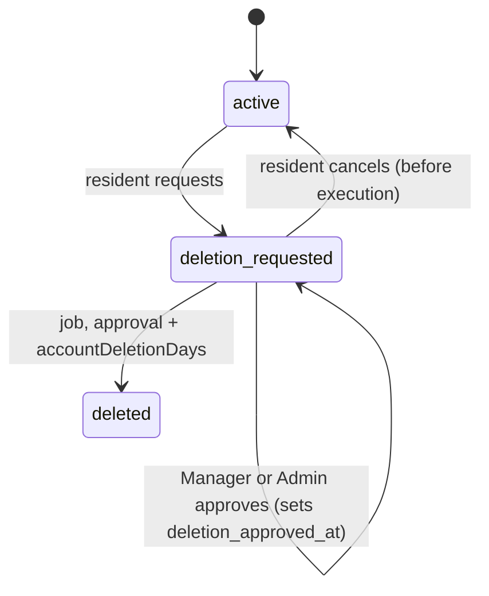

# Audit, privacy and terms

> Status: **Approved** (Owner, 2026-10-21) · Updated: 2026-10-20 (DR-202: E-13 shows the cooling-off; DR-215: rule 6 of §6) · DOC-35
> Depends on: original SDD §15, §19.1, §19.5, [DR](../00-decision-register.md) (DR-33, 36, 39, 40, 57, 58, 59, 74, 87, 90, 103, 108, 110, 111, 115, 124, 125, 202), [ADR-0018](../04-adr/0018-audit-in-the-mutation-transaction.md), [ADR-0022](../04-adr/0022-personal-data-protection.md), [DOC-03](../01-product/requirements.md) (FR-37, FR-39, FR-41, FR-50, NFR-14), [DOC-09](../03-architecture/messaging-contracts.md) §7, [DOC-12](../03-architecture/code-architecture.md) §8.3, [DOC-16](../05-data/identity-and-residency-model.md) §4.2, §5.2, [DOC-17](../05-data/operations-model.md) §1.4, §2, [DOC-19](../05-data/db-roles-and-grants.md), [DOC-20](../05-data/data-lifecycle.md), [DOC-06](../02-glossary.md)
> Main readers: P1-08 (`audit` module), P1-11 (terms gate), P1-12, P6-04 (account deletion), DOC-26, DOC-27, DOC-33, DOC-36, DOC-39, DOC-42, DOC-46 (FL-19, FL-24), DOC-51, DOC-60, DOC-65, DOC-67

This document says how the system keeps evidence and respects people: how a use case writes an audit row and what the row may hold, which actions are audited, how personal-data reads are logged, who may read the log, where each personal field lives and how it is protected, the retention table in one place, how terms of use and privacy notices are versioned and enforced, and the account-deletion workflow from request to execution. It does not hold the table definitions (`audit.audit_log`, `terms_version`, `terms_acceptance`: DOC-17 §1.4 and §2; the deletion columns: DOC-16 §4.2 and §5.2), the grants (DOC-19), the purge statements and the order of execution steps (DOC-20 §5, §8), the building settings and the terms administration screens (DOC-36), the error catalog (DOC-42) or the legal texts, which are the client's deliverable (P0-06).

New decisions of this document are DR-124 (audit writer) and DR-125 (terms gate and account deletion); §14 lists them. The SQL below was run on PostgreSQL 18.6 (`postgres:18.6`, aarch64) on 2026-10-19 against the DDL of DOC-14, DOC-16 and DOC-17 (§13).

## 1. Scope and reading guide

| Question | Answer lives in |
| --- | --- |
| How does a use case write an audit row? | §3 |
| Which actions are audited, and what does each row hold? | §4 |
| Who reads the log, and how? | §5 |
| What is a `pii.read` row, and when is one written? | §6 |
| Where does each personal field live, and who sees it? | §7 |
| How long does each kind of data live? | §8 (the table is DOC-20's; this is the summary the legal dossier checks) |
| How are terms versioned, accepted and enforced? | §9 |
| What happens from "Delete my account" to the cleared account? | §10 |
| What is configured, measured, refused? | §11, §12 |
| How is it tested? | §13 |

## 2. Principles

1. **Evidence is written with the change.** An audit row lives in the transaction of the mutation it describes: both commit or neither does (ADR-0018, FR-37.1). No queue, no trigger, no second transaction.
2. **The log records intent, not columns.** "Void payment, reason: wrong unit" is one row with the actor, the reason and the fields that changed. A trigger could not know the reason or the actor.
3. **The log holds no secret and no personal value it does not need.** Secrets are masked; personal fields are recorded in their masked form (§3.4), so an account deletion never has to rewrite the log (DOC-20 §8, "audit rows keep ids only").
4. **Reading sensitive data is itself an event, and it fails closed.** If the `pii.read` row cannot be written, the data is not returned (§6).
5. **Nothing the application can delete.** `rms_app` has `SELECT` and `INSERT` on `audit.audit_log` and nothing else; the purge function clamps its own cut-off (DOC-17 §2, DR-110).
6. **A person is told what is kept and for how long.** The privacy notice states the retention periods, the backup tail, the processors outside Vietnam and what survives an account deletion (§9.5). The text is the client's (P0-06); the checklist is here.

## 3. The audit writer

Provider: `audit`. Callers: every module with staff mutations (DOC-07 §5.2, DR-42). The table is DOC-17 §2.

### 3.1 Contract

```ts
const MASKED = '[masked]'
type AuditValue = string | number | boolean | null          // already masked where the field is personal or secret

interface AuditChange { field: string; before: AuditValue; after: AuditValue }   // field: dotted path, e.g. 'receivingAccount.accountNumber'

type AuditAction = `${ModuleName}.${string}.${string}` | 'pii.read'              // '<module>.<object>.<verb>' (DOC-17 §2)

interface SystemActor { kind: 'system'; source: 'webhook' | 'requery' | 'statement' | 'job'; buildingId: Uuid }
type AuditActor = StaffContext | SystemActor                                    // StaffContext carries scope.buildingId, staffId, role

interface AuditEntry {
  actor: AuditActor
  action: AuditAction
  object: { type: string; id: Uuid }          // an action on a set names its parent object (DOC-17 §2)
  changes: AuditChange[]                      // [] when the action changes no field (a state change with a reason)
  reason?: string                             // required by the actions of §3.5
  details?: Record<string, JsonValue>         // facts that are not field changes: { recordCount: 300 }
}

interface AuditApi { record(entry: AuditEntry): Promise<void> }                 // DOC-09 §7.4
```

`record` behaves like `OutboxWriter.add` (DOC-12 §8.1): it **throws when no transaction is open**, because an audit row written outside the mutation's transaction would defeat the purpose. It joins the caller's transaction, never opens its own, and fills `id` (UUIDv7), `building_id`, `actor_kind`, `actor_id`, `actor_role`, `ip`, `user_agent` and `request_id` itself (§3.2). The column `at` takes `now()`, which is the **start of the transaction**: two rows of one transaction share `at` and are ordered by `id`, and a settlement shows the time its transaction began, a few milliseconds before the commit.

### 3.2 The wrapper and the request context

A use case does not call `record` by hand. It is wrapped by `audited` (DOC-12 §8.3), which runs the use case body inside the caller's transaction, then records; the body returns the result and the changes it made:

```ts
export const voidCharge = audited(
  { action: 'finance.charge.void', object: (r: ChargeDto) => ({ type: 'charge', id: r.chargeId }), reason: (_s, cmd) => cmd.reason },
  async (staff: StaffContext, cmd: { chargeId: ChargeId; reason: string }) => {
    /* conditional UPDATE … RETURNING, intents cancelled, outbox row */
    return { result: toChargeDto(voided), changes: [{ field: 'status', before: 'open', after: 'void' }] }
  },
)
```

The request context comes from `@core/context` (an `AsyncLocalStorage`), set once per request by the HTTP plugin:

| Field | Source | In a job or an inbox handler |
| --- | --- | --- |
| `ip` | `CF-Connecting-IP`, trusted with `TRUSTED_PROXY_HOPS=1` (DR-07); `null` when absent or not a valid address | `null` |
| `userAgent` | `User-Agent`, cut at 500 characters | `null` |
| `requestId` | `X-Request-Id`, generated when the client sends none (DR-74) | the message id (handler) or the `job_run` id (job) |

### 3.3 Actions: grammar, declaration, refusal

`<module>.<object>.<verb>` in lower snake case, `pii.read` being the one two-part action (the `CHECK` of DOC-17 §2). The module is the **writer** of the audited object, not the caller of a contract: a Manager who locks a membership produces `residency.membership.lock`, even when the call arrives through a screen that belongs to another feature.

- A module declares its actions in its manifest (`auditActions: ['finance.charge.void', …]`), next to `outboxPolicies` (DOC-09 §4.2). `AuditApi.record` throws `UndeclaredAuditActionError` for an action that is not declared by the module of its first segment (every module may declare `pii.read`). The error is an invariant error (500 `internal_error`, the transaction rolls back): it is a programming mistake, caught by AD-05 before it reaches production.
- A static check (`check:audit`) lists every `audited(...)` spec and every `record` call and compares them with the manifests and with the catalog of §4 (AD-06). A new action therefore enters the code, the manifest and §4 in one change.
- Verbs: `create`, `update`, `delete` (only for the objects that can be deleted), and domain verbs (`publish`, `recall`, `void`, `assign`, `approve`, `lock`, `transfer`). A rename is a new action; an old action name is never reused for something else (the log outlives the code).

### 3.4 Changes: diff, masking, limits

1. **The diff is computed by the use case**, from the row before and after, field by field; an unchanged field is not listed. A created object lists no `changes` (its first state is the object); a deleted one lists none (its last state is in the object).
2. **Masking is by field class** (§7). The module declares, per object type, which fields are personal or secret and with which mask; the wrapper applies it before the entry reaches `record`, and `record` re-checks: a field named in the global deny-list of §7.3 that is not masked is refused with `UnmaskedAuditFieldError` (AD-09).

   | Class | Recorded as | Example |
   | --- | --- | --- |
   | Secret (gateway secrets, tokens, passwords, hashes, step-up codes) | `[masked]` | `{"field":"secrets","before":"[masked]","after":"[masked]"}` |
   | CCCD number, date of birth, full name, free-text `note` | `[masked]` | `{"field":"cccd","before":"[masked]","after":"[masked]"}` |
   | Phone | the masked form `+84•••••123`: country code, five bullets, last three digits (fixed length, so the length is not revealed) | `{"field":"phone","before":"+84•••••567","after":"+84•••••999"}` |
   | Email | first character, three bullets, domain: `l•••@example.com` | |
   | Everything else (statuses, amounts, codes, dates of business facts) | the value | `{"field":"status","before":"posted","after":"void"}` |

3. **Limits.** A string value is cut at 500 characters with `…`. The whole entry (`changes` + `details`) is at most 32,768 bytes of JSON; a larger one throws `AuditEntryTooLargeError` (500; a use case that edits many rows uses the bulk form).
4. **Bulk form.** An action over many rows (a units import commit, a batch publish of 240 charges, a retire of every vehicle of a unit) writes **one** row naming the parent object, with `changes: []` and the counts in `details` (`{"created": 200, "updated": 30, "skipped": 10}`). The per-row history lives in the module's own history table (`unit_history`, `ticket_event`, `vehicle_revision`, the money log).
5. **One row per request.** A request that performs two audited actions (settings and building edited by one `PATCH`) writes two rows with the same `request_id`.

### 3.5 Reasons

An action that undoes or overrides something carries a reason of 5 to 500 characters after trimming (DR-20, FR-06.2). The wrapper refuses a missing or short reason with `RuleViolationError` (422 `validation_failed`, rule `reason_too_short`) **before** the body runs. Actions that require a reason:

`finance.payment.void`, `finance.charge.void`, `finance.batch.recall`, `finance.money_log.review` (the note), `residency.owner.transfer`, `identity.staff.force_lock` (with `reassignTo`), `tickets.ticket.cancel` (by the Manager), `tickets.ticket.force_assign`, `vehicles.vehicle.reject`, `wiki.page.restore`. DOC-28, DOC-30 and DOC-32 confirm the list for their objects.

### 3.6 The system actor

A system row has `actor_kind = 'system'` and no actor id or role (the `CHECK`s of DOC-17 §2). It is written only where the system changes a fact no staff member asked for. The list is closed (DR-124):

| Action | `details.source` | Written by | Why audited |
| --- | --- | --- | --- |
| `finance.payment.post` | `webhook`, `requery`, `statement` | The settlement transaction (DOC-23) | Money moved with no actor (FR-37.3) |
| `identity.account.delete_execute` | `job` | The `account_deletion` job (DOC-20 §8 step 1) | Personal data was cleared with no actor |

Everything else the worker does (intent expiry, notice fan-out, purges, PDF renders, the demo reset) is operational and is recorded in `job_run` and the logs, not here. A settlement that ends as a money-log row (an unposted outcome) writes no audit row: the log row is its record (DR-84, DOC-22).

### 3.7 Failure and ordering

| Situation | Behavior |
| --- | --- |
| The insert fails (constraint, connection) | The exception propagates; the transaction rolls back; the request answers 500 `internal_error`; the metric `audit_write_failures_total` counts it (DOC-40) |
| The mutation fails after `record` | The transaction rolls back, and so does the row (FR-37.1) |
| A serialization retry (`40001`, DOC-12 §8.1) | The wrapper retries the whole body; the first attempt's row went with its rolled-back transaction, so a row never appears twice |
| `record` called outside a transaction | `NoTransactionError` (500); AD-04 |
| The idempotent replay of a `POST` (DR-74) | Returns the stored response; nothing is re-executed, so no second row is written |

## 4. The action catalog

One row per action the design knows today. Each document that adds staff mutations adds its rows here in the same change (§3.3). "Reason" is `R` when required (§3.5); "Class" is the retention class that `action` yields (`finance.` → `finance`, else `standard`).

### 4.1 finance (class `finance`)

| Action | Object | Who | Changes | R | Source |
| --- | --- | --- | --- | --- | --- |
| `finance.batch.create` | `fee_batch` | Manager, Admin | — (counts in `details`) | | FR-01 |
| `finance.batch.import_commit` | `import_job` | Manager, Admin | — (`created`, `updated`) | | FR-01.3 |
| `finance.batch.update` | `fee_batch` | Manager, Admin | edited draft fields | | FR-02 |
| `finance.batch.publish` | `fee_batch` | Manager, Admin | `status` | | FR-03 |
| `finance.batch.extend_due` | `fee_batch` | Manager, Admin | `dueDate` | | FR-44 |
| `finance.batch.recall` | `fee_batch` | Manager, Admin | `status` | R | FR-04 |
| `finance.batch.close` | `fee_batch` | Manager, Admin | `status` | | DR-20 |
| `finance.batch.reissue` | `fee_batch` | Manager, Admin | — (`replaces`) | | DR-20 |
| `finance.charge.update` | `charge` | Manager, Admin | edited fields of a draft charge | | FR-02 |
| `finance.charge.void` | `charge` | Manager, Admin | `status` | R | FR-49 |
| `finance.payment.post` | `payment` | Manager, Admin; **system** (§3.6) | — (`source`, `amount` in `details`) | | FR-05, FR-37.3 |
| `finance.payment.void` | `payment` | Manager, Admin | `status` | R | FR-06 |
| `finance.money_log.review` | `gateway_event` or `statement_line` | Manager, Admin | `reviewed`, note | R | FR-46 |
| `finance.statement.import` | `statement_import` | Manager, Admin | — (`lines`, `period`) | | FR-11 |
| `finance.statement.assign` · `.dismiss` · `.confirm` | `statement_line` | Manager, Admin | `status` | | FR-11 |
| `finance.reminder.send` | `unit` | Manager, Admin | — (`unitCount`) | | FR-12 |

### 4.2 residency, identity, building (class `standard`)

| Action | Object | Who | Changes | R | Source |
| --- | --- | --- | --- | --- | --- |
| `residency.import.commit` | `import_job` | Manager, Admin | — (`created`, `updated`, `skipped`) | | FR-18 |
| `residency.unit.create` · `.update` | `unit` | Manager, Admin | edited fields | | FR-18 |
| `residency.profile.update` | `resident_profile` | Manager, Admin | masked fields (§3.4) | | FR-18 |
| `residency.membership.add` · `.update` · `.lock` · `.unlock` · `.remove` | `membership` | Manager, Admin | `status`, `memberType`, `canPay` | | FR-17, FR-18 |
| `residency.owner.transfer` | `unit` | Manager, Admin | `owner` (member id), `removedOthers` | R | FR-18 |
| `residency.login_phone.change` | `resident_account` | Manager, Admin | `phone` (masked) | | FR-18.4 |
| `identity.staff.create` · `.update` · `.lock` · `.unlock` · `.disable` · `.enable` | `staff_account` | Admin; Manager for Technician and Guard | `role`, `status`, `email` (masked) | | FR-14 (*revised 2026-10-20, DR-147:* `PATCH /staff/me` writes `.update` with `details.self = true` and `fullName` masked; `.disable` and a role change with `reassignTo` carry `details.reassignedTo` and a reason) |
| `identity.staff.force_lock` | `staff_account` | Admin | `status`, `reassignedTo` | R | FR-14.3 |
| `identity.account.deletion_approve` | `resident_account` | Manager, Admin | `deletionApprovedAt` | | FR-39.3 |
| `identity.account.delete_execute` | `resident_account` | **system** (§3.6) | `status` | | FR-39.3 |
| `building.building.update` | `building` | Admin | edited fields | | FR-38 |
| `building.settings.update` | `building_setting` | Admin | keys changed (§3.4 diff of `data`) | | FR-38.1 |
| `building.gateway.update` | `gateway_config` | Admin, **with step-up** | `secrets` (`[masked]`), `receivingAccount.*`, `status`; `details.stepUp = true` | | FR-38.3, FR-50 |
| `building.terms.publish` | `terms_version` | Admin | — (`kind`, `version`) | | FR-41 |
| `building.demo.reset` | `building` | Admin of the demo building | — (`durationMs`, `units`) | | DR-60 |

`building.demo.reset` is written only when the Admin runs the reset through the API (a staff mutation, DOC-36 §10.4); the nightly job writes none (§3.6).

### 4.3 Other modules (rows owed)

The following actions are known by name; their documents confirm objects and `changes`.

| Module | Actions | Confirmed in |
| --- | --- | --- |
| tickets | `tickets.ticket.assign` · `.reassign` · `.force_assign` · `.accept` · `.reject` · `.start` · `.hold` · `.resume` · `.resolve` · `.close` · `.cancel` · `.reopen`; `tickets.type.update` | DOC-28 |
| vehicles | `vehicles.vehicle.approve` · `.reject` · `.retire` · `.update` | DOC-30 |
| notices | `notices.notice.create` · `.update` · `.send` · `.cancel` | DOC-31 |
| wiki | `wiki.folder.create` · `.update` · `.move` · `.delete`; `wiki.page.create` · `.update` · `.publish` · `.restore` · `.move` · `.delete` | DOC-32 |
| reporting | `pii.read` (an export), `reporting.export.create` (an export without personal data) | DOC-33, §6 |
| access | none: a scan and a Guard lookup are not staff mutations; they go to `qr_scan` and `lookup_log` (DOC-29) | DOC-29 |

Resident actions are not audited here (FR-37 covers staff mutations); a resident's history lives in the module tables (`ticket_event`, `vehicle_revision`, `unit_history`).

## 5. Reading the log

`GET /staff/audit` (keyset-paginated, 50 per page, filters on actor, action prefix, object type and id, date range, `request_id`). The read itself is not audited.

| Role | Sees | Why |
| --- | --- | --- |
| Admin | Every row of the building | UC-17 F |
| Manager | Rows whose action module is `finance`, `residency`, `tickets`, `vehicles`, `notices`, `wiki` or `reporting`, **excluding** `pii.read` | The "history of this payment, this charge, this unit" tabs (UC-05); the Manager does not read who read whose CCCD, nor settings and staff changes |
| Technician, Guard | Nothing: 403 `forbidden` | |

The restriction is a `WHERE` on the same index scan, not another index (DR-124):

```sql
-- Manager, next page (the Admin's query is the same without the two action predicates)
SELECT id, at, actor_kind, actor_id, actor_role, action, object_type, object_id, changes, details, reason
  FROM audit.audit_log
 WHERE building_id = :building_id
   AND split_part(action, '.', 1) = ANY ('{finance,residency,tickets,vehicles,notices,wiki,reporting}')
   AND action <> 'pii.read'
   AND (at, id) < (:cursor_at, :cursor_id)
 ORDER BY at DESC, id DESC
 LIMIT 50;
```

On 80,000 rows of one building, a page 10 days back used `ix_audit_log_building_at`, removed 29 rows by the filter and ran in 0.04 ms (AD-28). "History of one object" adds `object_type` and `object_id` and uses `ix_audit_log_building_object`.

A row whose actor or object no longer resolves (a cleared account, a retired object) is still shown: the log holds ids, and the screen shows the id when it cannot find a name.

## 6. `pii.read`

A `pii.read` row says that a staff member received personal data of residents. It is written in two cases (FR-37.5, DR-57, DR-90):

| Case | When the row is written | `object` | `details` |
| --- | --- | --- | --- |
| **Detail view** | In the request that returns the profile detail with the full CCCD number or the date of birth (`GET /staff/residents/{id}`, DOC-27) | `resident_profile`, the account id | `{"view": "detail", "fields": ["cccd", "dateOfBirth"]}` |
| **Export** | When the export job finishes, in the same transaction that marks the job `ready` and attaches the file (DOC-33) | `export_job`, the job id | `{"view": "export", "kind": "residents", "recordCount": 300}` |

Rules (DR-124):

1. **One row per response, never per record.** A list never returns a full CCCD or a date of birth (it shows `•••• 1234`), so a list writes no row. A detail view that is fetched again writes another row: the client keeps the profile in its cache while the screen is open and does not poll.
2. **A query that returns these fields opens a short transaction** to read and to write the row (the one exception to "a query use case opens none", DOC-12 §8.2). The data is returned **after** the commit of the row. If the insert fails the request answers 500 and no data leaves: it fails closed.
3. **Exports carry no full CCCD and no date of birth.** The `residents` and `units` exports hold names, phones, emails and the masked CCCD (`•••• 1234`). They are logged as `pii.read` all the same, because they carry the personal data of many people (DR-90).
4. **The export row is written by the worker**, with the requester as the actor: the job stores `requested_by`, the role, `ip`, `user_agent` and `request_id` of the request when it is created, and the worker passes them to the wrapper as the context of the row. The file becomes available (`ready`, `export.ready` event) only when the row is committed. DOC-17 §9 owes these columns to `reporting.export_job`.
5. **Guards.** A Guard's lookup shows the owner's phone masked with a Call button; every view writes `access.lookup_log` (DR-48), a table of its own, not an audit row. The Guard never sees a CCCD or a date of birth.
6. **A create form reads no more than a list.** The phone lookup of `W-Resident-Add` calls the list (`GET /staff/residents`, E-63) and shows the name, the phone, the masked ID number and the units; the full ID number and the date of birth exist only on the detail view of `W-Residents` (E-65), which writes the `pii.read` row (DR-215).
7. **Never logged, anywhere:** OTP codes, tokens, passwords, the full CCCD, full phone numbers, QR tokens, signed URLs (DR-58, DOC-37 §2).

Example rows (JSON of the columns that matter):

```json
[
  { "actorKind": "staff", "actorRole": "manager", "action": "pii.read", "objectType": "resident_profile",
    "details": { "view": "detail", "fields": ["cccd", "dateOfBirth"] } },
  { "actorKind": "staff", "actorRole": "admin", "action": "pii.read", "objectType": "export_job",
    "details": { "view": "export", "kind": "residents", "recordCount": 300 } }
]
```

## 7. Personal data

### 7.1 Inventory

Classes are those of DR-58 and ADR-0022: **sensitive** (CCCD number), **personal**, **operational**. "Sees" is the audience of the API; "Read logged" says whether a read writes a `pii.read` row. A column the table does not list does not hold personal data; a new one is added here in the change that creates it (§7.3).

| Data | Class | Column | Protection | Sees | Read logged | Leaves when |
| --- | --- | --- | --- | --- | --- | --- |
| CCCD number | sensitive | `residency.resident_profile.cccd_enc` | AES-256-GCM, PII key (DR-65), AAD `cccd\|<buildingId>\|<accountId>`; never in an import preview, an export or a log | Manager, Admin (detail view only) | Yes | Profile cleared at account deletion |
| CCCD last four digits | personal | `resident_profile.cccd_last4` | Masked display `•••• 1234` | Manager, Admin | No | With the profile |
| Date of birth | personal | `resident_profile.date_of_birth` | Excluded from `rms_readonly` (DOC-19 §4.2); never exported | Manager, Admin (detail view only) | Yes | With the profile |
| Full name, email, note | personal | `resident_profile.full_name`, `email`, `note` | Role-based API | Manager, Admin; the unit's own members see names of their unit | No | With the profile |
| Phone | personal | `identity.resident_account.phone` | E.164; masked for Guards (DR-48) and in logs and audit | Manager, Admin; the unit's own members; Guards masked | No (list and detail show it; the Manager needs it) | Replaced by `deleted:<id>` at deletion |
| Display name, avatar | personal | `resident_account.display_name`, `avatar_key` | Avatar is a private file | The unit's members, staff | No | Nulled at deletion; the avatar object is removed |
| Staff name, email | personal | `identity.staff_account.full_name`, `email` | | Admin, Manager (own scope) | No | Never deleted; a former staff member is `disabled` |
| Payer name on a payment or receipt | personal | `finance.payment.payer_name` and the receipt snapshot (DOC-15) | Snapshot of the name at payment time | Staff; the unit's members from the start of their membership (DR-40) | No | Never: an accounting record (SDD §19.5) |
| Vehicle papers, plate photos | personal | Files, purposes `vehicle_paper`, `vehicle_plate_photo` | Private bucket, signed URL of 5 minutes (papers) or 15 (photos), no thumbnail for papers (DOC-37) | The unit's members, Manager, Admin; Guards: the plate photo only | No | Never deleted (DR-115) |
| Ticket text and media | operational | `tickets.*`, files | | The unit's members and the ticket's staff | No | Never deleted (DR-115) |
| IP address, user agent | personal | `audit.audit_log.ip`, `user_agent`; `building.terms_acceptance.ip`; `identity.otp_challenge.ip`; `refresh_family.user_agent` | | Admin (audit); nobody else through the API | No | With the row (§8); `terms_acceptance.ip` nulled at account deletion |
| Push tokens | personal | `notification.device_token` | Denied to `rms_readonly` | Nobody through the API | No | Sign-out, revocation, `DeviceNotRegistered`, account deletion |
| Access scans | personal | `access.qr_scan`, `lookup_log` (member id, guard id) | | Manager, Admin | No | 90 days |

### 7.2 Rules

1. **Masked everywhere except the profile detail.** Lists, searches, imports' previews, exports, push, logs, audit `changes` and error `details` never carry a full CCCD, a date of birth or a full phone (Guards and logs see `+84•••••123`).
2. **Role-based field filters.** The DTO mapper of each endpoint drops fields the caller's audience may not see; it does not rely on the screen to hide them (FR-16.4, NFR-14, EXP-10 asserts per role).
3. **Push is generic.** Title and body come from templates and carry no amount, name, phone or ticket text; `data` is `{route, unitId, entityId}` (DR-52, FR-29.3).
4. **Cross-border flows, and only these:** Expo, FCM and APNs (generic payload); Cloudflare edge, Pages and R2 (DR-83); the SMS and mail providers, chosen from Vietnam-hosted vendors where possible (DR-68). No error tracker (DR-103). A new processor needs a new DR that adds it to this list and to the privacy notice.
5. **The CCCD number is never a file.** No upload purpose holds a CCCD image (DOC-37 §2).

### 7.3 Keeping the inventory true

A test reads `information_schema.columns` of the migrated database and fails when a column whose name matches `phone|email|cccd|birth|full_name|display_name|payer_name|plate|(^|_)ip$|user_agent|avatar|note` is not in the inventory file `modules/audit/test/personal-columns.json` (generated from §7.1: schema, table, column, class), or when an inventory entry names a column that does not exist (AD-30, AD-31). The same file is the deny-list of §3.4: a field of an audited object that appears in it must be masked (AD-09).

## 8. Retention

DOC-20 §2 is the table of every table and file; §5 holds the purge statements run on PostgreSQL 18.6. This is the summary of what the legal dossier (P0-06) must confirm; a period changes by a new DR and one purge statement, nothing else.

| Data | Rule | Period | Mechanism |
| --- | --- | --- | --- |
| Ledger: charges, lines, payments, allocations, receipts, intents, `gateway_event`, `statement_line` (the money log) | Never deleted | — | Voided or logged, not removed (DR-57, DR-84) |
| Audit rows of finance objects (`retention_class = 'finance'`) | Deleted by age | 5 years (default until P0-06) | `audit_purge`, monthly day 1 at 04:30; `audit.purge` clamps the cut-off to the floor (DR-110) |
| Other audit rows | Deleted by age | 2 years (default until P0-06) | The same |
| Units, memberships, `unit_history`, terms versions, terms acceptances | Never deleted | — | `terms_acceptance.ip` set to null at account deletion |
| Tickets, vehicles, notices, library and their files | Never deleted | — | Bounded by the 50 GiB quota (DR-115) |
| Resident personal fields | Cleared at account deletion | `accountDeletionDays` after approval (30) | §10 |
| OTP challenges; reset, invite and step-up tokens; sessions | Deleted by age | 24 h; 7 days; 30 days after revocation | `otp_purge`, `token_purge` daily 03:45 |
| Scans and Guard lookups | Deleted by age | 90 days | `qr_scan_purge` |
| Logs | Deleted by age | 14 days in Loki | Alloy and Loki (DR-63) |
| Backups | Deleted by age | About 5 weeks tail (DOC-20 §6) | pgBackRest retention; the notice says so |

**What the notice must say about the tail:** personal data removed from the database remains in backups until the last backup that holds it expires, about 5 weeks after a deletion; backups are encrypted with a key that is not on R2 (ADR-0022).

## 9. Terms of use and privacy

### 9.1 Versions

Two kinds, `terms` and `privacy`, numbered separately per building (FR-41.2). A version is a row of `building.terms_version` (DOC-17 §1.4): bilingual Markdown, write-once, never deleted. The Admin publishes a version in `W-Building` (`POST /staff/terms`, DOC-36 §8); there is no draft state. The latest version of a kind is the row with the highest `version`. Publishing writes one `building.terms.publish` audit row and emits no event: residents learn of it at their next request (§9.2).

### 9.2 The gate

The resident guard checks the terms **after** it knows the building (from the active membership, DOC-12 §5.3) and **before** the route runs. One statement answers; it is not cached, because FR-41.1 wants the very next request to be refused after a publish, and two API containers cannot share an invalidation (DR-125):

```sql
SELECT v.id AS version_id, v.kind, v.version
  FROM (SELECT DISTINCT ON (kind) id, kind, version
          FROM building.terms_version WHERE building_id = :building_id
         ORDER BY kind, version DESC) v
 WHERE NOT EXISTS (SELECT 1 FROM building.terms_acceptance a
                    WHERE a.account_id = :account_id AND a.version_id = v.id)
 ORDER BY v.kind;
-- 0 rows: proceed.  Rows: 403 terms_required.
```

With 3 versions the plan read `terms_version` through `uq_terms_version_building_kind_version` and `terms_acceptance` through its primary key `pk_terms_acceptance` (bitmap index scans joined by a hash anti-join); it is DOC-17's two lookups as one statement. It adds one indexed read to each resident request, next to the membership lookup (NFR-03 budget, DOC-10).

The refusal is 403 `terms_required`:

```json
{ "error": { "code": "terms_required", "message": "Please accept the updated terms to continue.",
             "details": { "required": [ { "kind": "terms", "version": 4, "versionId": "018f…c4" },
                                        { "kind": "privacy", "version": 1, "versionId": "018f…c3" } ] } } }
```

*Noted 2026-10-20 (DR-143):* the gate runs inside the `unit(capability)` guard, so a token-only route (`/me`, `/me/contact`, `/me/sessions`, `/me/devices`, `/me/terms*`, `/me/account/deletion`) is without a gate by construction; the list below names them for clarity.

**Exempt routes** (they answer without acceptance): `/auth/*`, `GET /me`, `PATCH /me`, `/me/terms*`, `/public/*`, `/health/*`, and `POST/DELETE /me/account/deletion`. The last is an addition to DR-59's list: a person who does not accept the new terms must still be able to leave (DR-125). Staff routes have no terms gate.

A building with no published version of a kind requires nothing of that kind. Publishing version 1 of each kind before go-live is an item of DOC-103; the demo seed publishes placeholder versions (DOC-36 §9).

### 9.3 Acceptance

`GET /me/terms` returns the latest version of each kind for the building of the account's active memberships, with `accepted: true|false` and the text in the caller's language (DR-71). `POST /me/terms {versionIds: [...]}` accepts several in one call.

```sql
INSERT INTO building.terms_acceptance (building_id, account_id, version_id, ip, app_version)
SELECT v.building_id, :account_id, v.id, :ip, :app_version
  FROM building.terms_version v
 WHERE v.id = :version_id AND v.building_id = :building_id
   AND v.version = (SELECT max(version) FROM building.terms_version WHERE building_id = v.building_id AND kind = v.kind)
ON CONFLICT (account_id, version_id) DO NOTHING
RETURNING version_id;
```

| Result | Answer |
| --- | --- |
| One row | 204; the acceptance is stored with the IP (personal data, §7.1) and the app version |
| No row, and an acceptance of that version already exists | 204: the earlier acceptance is kept (UC-27 E3) |
| No row, the version is not the latest of its kind | 409 `terms_version_superseded` with the current `versionId`; the app reloads `GET /me/terms` |
| No row, the id is unknown or of another building | 404 `not_found` |

With phase 1's single building, `GET /me/terms` has one building to answer for; when a deployment serves several, it lists one block per building (DR-115 fixes one building per deployment).

### 9.4 What the texts must contain

The texts are the client's legal deliverable (P0-06, `vi` and `en`). The system needs these statements to be true, and the dossier checks them:

| Text | Must state |
| --- | --- |
| Terms of use (all members) | Who the management company is (`building.company`); that fees are paid in full per charge, with no partial payment or credit; that the receipt is a "Biên lai thu tiền" and not a tax invoice, and that an e-invoice is issued on request outside the system (DR-17) |
| Terms of use, owner section | That **debt follows the unit but history does not**: a member sees the open charges of the unit at any time, and paid history, receipts and payer names only from the start of their own membership (DR-40, DR-59) |
| Privacy notice | The data kept (§7.1), why, and who sees it; the processors outside Vietnam (§7.2); the retention periods (§8); that payer names stay on receipts after deletion; the backup tail of about 5 weeks; the deletion procedure and its cooling-off (`accountDeletionDays`); the Manager's contact for questions |

### 9.5 Not built

Requests by a person to **see or export their data**, to **correct** it or to **object** to processing are not features of the system: the Manager handles them outside the system and the privacy notice says how to ask. A resident corrects a name or a phone through the Manager (UC-13). If the legal dossier requires an in-app export, it is a new requirement and a new DR.

## 10. Account deletion

The statuses and columns are DOC-16 §4.2 (DR-108); the execution steps and the order across modules are DOC-20 §8. This section fixes the workflow around them (FR-39.2…4, UC-27).



### 10.1 Steps and statements

All four statements are conditional updates on the status, so a race is decided by the row (DOC-12 §9.1). Run on PostgreSQL 18.6 (§13).

| Step | Who | Endpoint | Statement | Zero rows means |
| --- | --- | --- | --- | --- |
| Request | the resident | `POST /me/account/deletion` | `UPDATE identity.resident_account SET status = 'deletion_requested', deletion_requested_at = now(), updated_at = now(), version = version + 1 WHERE id = :id AND status = 'active'` | Already requested: 204 (idempotent), or `deleted`: 404 |
| Cancel | the resident | `DELETE /me/account/deletion` | `… SET status = 'active', deletion_requested_at = NULL, deletion_approved_at = NULL, … WHERE id = :id AND status = 'deletion_requested'` | Nothing to cancel: 204; `deleted`: 404 (UC-27 race) |
| Approve | Manager, Admin | `POST /staff/residents/{accountId}/deletion/approve` | `… SET deletion_approved_at = now(), … WHERE id = :id AND status = 'deletion_requested' AND deletion_approved_at IS NULL RETURNING deletion_approved_at + make_interval(days => :days)` | Not requested: 409 `deletion_not_requested`; already approved: 200 with the existing date |
| Execute | the `account_deletion` job | — (03:45 daily) | The statement of DOC-16 §4.2, then the steps of DOC-20 §8 | Already executed: nothing to do |

Properties:

1. **The account stays usable** after the request and after the approval; the resident can cancel at any time before execution, even after the approval, and a cancel clears both dates. A cancelled request can be made again.
2. **Approval and refusal.** There is no "reject": a Manager who does not approve leaves the account `deletion_requested` (UC-27 2a). The Manager sees the pending requests in `W-Residents` (`IdentityApi.listDeletionRequests`, below).
3. **`owner_must_transfer`** is checked at the approval (409, FR-39.4) and again at the execution. An owner may *request* deletion; ownership is transferred before the Manager approves. If the account is still an owner when the job runs (an approval followed by a re-appointment is rare but possible), the job leaves the account `deletion_requested`, logs `warn` with the unit ids, and counts it in the gauge `account_deletion_blocked`. It tries again the next day.
4. **The cooling-off** is `building_setting.accountDeletionDays` (default 30, 1…365) added to `deletion_approved_at` as an interval of days, not calendar days. The job runs once a day, so execution happens within 24 hours after the cooling-off ends. A change of the setting applies to approvals already given (the job reads it at run time).

   *Revised 2026-10-20 (DR-202):* the resident reads the length. `GET /me` (E-13) returns `account.deletion.cooloffDays` (the setting, from `BuildingApi.getSettings`; one building in phase 1, DR-12) and `executeAfter` (`deletion_approved_at` plus that many days, `null` until the approval), computed on read. The setting is still readable in full only by the Admin (E-47). `Account-Deletion` (DOC-60) shows the days before the request and the date after the approval.
5. **Staff accounts** have no deletion workflow: a former staff member is `disabled` and the email stays reserved (DOC-20 §2.1).
6. **What stays:** the account row and its id, removed memberships and `unit_history`, the payer-name snapshots of payments and receipts, audit rows (ids only), ticket and vehicle rows (account id), the terms acceptance without its IP, and backups for about 5 weeks (§8).

### 10.2 Contracts it needs

```ts
// ResidencyApi (DOC-09 §7.2) gains:
ownedUnitIds(accountId: Uuid): Promise<Uuid[]>        // units where the account is the active owner; [] when none

// IdentityApi (DOC-09 §7.3) gains:
listDeletionRequests(page?: PageRequest): Promise<Page<{ accountId: Uuid; requestedAt: Instant; approvedAt: Instant | null }>>
```

`ownedUnitIds` serves the approval and the execution. `listDeletionRequests` serves `W-Residents`, which joins the names from its own profiles; `identity` owns the status, so `residency` cannot filter on it. Both are added to DOC-09 with this document (DR-125).

### 10.3 Audit and notification

The approval writes `identity.account.deletion_approve` (staff actor, `changes: [{"field":"deletionApprovedAt", …}]`); the execution writes `identity.account.delete_execute` (system actor, `details: {"source": "job", "blocked": false}`). The request and the cancel are resident actions and are not audited (§4.3); the account row's dates are their record. Neither step sends a notification in phase 1: the resident sees the status in `Account-Deletion`.

## 11. Configuration, metrics, logs

| Item | Value | Where |
| --- | --- | --- |
| `accountDeletionDays` | Building setting, default 30, 1…365 | DOC-17 §1.2, DOC-36 |
| Audit limits | String 500 characters; entry 32,768 bytes; user agent 500 characters | Constants in `modules/audit` (not configuration: a change is a code change and a new test) |
| Terms and privacy text | At most 100 KB per language | DOC-36 §8 |

Metrics owed to DOC-40: `audit_write_failures_total` (counter), `audit_purge_rows_total{class}`, `account_deletion_blocked` (gauge: approved, due and refused for `owner_must_transfer`; warning when above 0 for 7 days), `account_deletions_executed_total`. Log lines (level `info`): `audit.record` with `action`, `objectType`, `requestId`, and **no** `changes`; `account_deletion.executed` with the account id; `account_deletion.blocked` at `warn` with the unit ids. A log line never carries the phone or name of a deleted or deleting account.

## 12. Errors

The catalog and the shape are DOC-42; the codes this document uses:

| Situation | HTTP · code | Where |
| --- | --- | --- |
| The latest terms are not accepted | 403 `terms_required` (`details.required[]`) | §9.2 |
| Accepting a version that is no longer the latest | 409 `terms_version_superseded` | §9.3 |
| Approving a deletion that was not requested | 409 `deletion_not_requested` | §10.1 |
| Approving the deletion of the active owner of a unit | 409 `owner_must_transfer` (`details.unitIds`) | §10.1 |
| A reason shorter than 5 characters on a reason action | 422 `validation_failed` (`details[0].code = reason_too_short`) | §3.5 |
| A Technician or Guard reads the log; a Manager reads `pii.read` rows by id | 403 `forbidden`; the Manager's filtered list simply omits them | §5 |
| The audit insert fails | 500 `internal_error`; nothing committed | §3.7 |

## 13. Required tests

Prefix `AD-` (audit and privacy; unused before this document; DOC-88 indexes it). A test marked **(S)** has its SQL run in §13.1 on PostgreSQL 18.6 (2026-10-19) against the DDL of DOC-14, DOC-16 and DOC-17. The others are application tests written in P1-08, P1-11, P1-12 and P6-04 and are **not run** yet.

| ID | Scenario | Expected |
| --- | --- | --- |
| AD-01 | A use case writes its change and `record`, then throws | No change and no audit row (FR-37.1) |
| AD-02 | A committed mutation | Exactly one row, in the same transaction; its `at` equals the transaction start |
| AD-03 | `record` fails (the table is renamed in the test) | The mutation fails with 500; the changed row is unchanged |
| AD-04 | `record` is called with no open transaction | `NoTransactionError` |
| AD-05 | `record` with an action the module did not declare | `UndeclaredAuditActionError`; nothing written |
| AD-06 | `check:audit` over the repository | Every `audited` spec and `record` call names a declared action of §4 |
| AD-07 | Void a payment with the reason "wrong unit" | One row with actor, role, IP, request id, action, object, `changes` (`status` posted → void), reason and time (FR-37.2) |
| AD-08 | A reason of 4 characters on `finance.payment.void` | `reason_too_short` before the body runs; no row |
| AD-09 | A change on `secrets`, `cccd`, `dateOfBirth`, `fullName`, `note` with a plain value | `UnmaskedAuditFieldError`; with the mask, the row holds `[masked]` |
| AD-10 | A phone change `+84901234567` → `+84907654999` | The row holds `+84•••••567` → `+84•••••999` |
| AD-11 | A string value of 600 characters in `changes` | Stored cut at 500 characters with `…` |
| AD-12 | An entry larger than 32,768 bytes | `AuditEntryTooLargeError` |
| AD-13 | A units import commit of 240 rows | One row, `changes: []`, `details.created = 200`… |
| AD-14 | A webhook settlement posts a payment | A row with `actor_kind = 'system'`, no actor id or role, `details.source = 'webhook'` (FR-37.3) |
| AD-15 | A settlement that ends as a money-log row | No audit row |
| AD-16 | The `account_deletion` job executes one account | One `identity.account.delete_execute` row, system actor |
| AD-17 | `rms_app` runs `UPDATE` and `DELETE` on `audit.audit_log` | Both fail with 42501 (FR-37.4, GRT) |
| AD-18 | `audit.purge(now(), 'finance')` and `'standard'` on rows 5 years + 1 day and 2 years + 1 day old | One deleted in each class (DLC-14) |
| AD-19 | `audit.purge('2100-01-01', …)` on rows of 5 years + 1 day, 4 years (finance) and 2 years + 1 day, 1 year (standard) | Only the two older rows are deleted: the cut-off is clamped (DR-110, S) |
| AD-20 | A Manager opens a profile detail, then exports 300 residents | One `pii.read` row for the view; one for the export with `recordCount = 300`; not 300 rows (FR-37.5) |
| AD-21 | The `pii.read` insert fails on a detail view | 500 and no personal data in the response |
| AD-22 | A residents list and a search | No `pii.read` row; no full CCCD, date of birth or full phone in any item |
| AD-23 | A `residents` export file | Masked CCCD only, no date of birth; the file is not `ready` before its `pii.read` row is committed |
| AD-24 | A Guard looks up a unit | The phone is masked, a `lookup_log` row exists, no audit row (DR-48) |
| AD-25 | `GET /staff/audit` as Admin, Manager, Technician | Admin: all rows; Manager: no `pii.read`, no `building.*`, no `identity.*`; Technician: 403 |
| AD-26 | Keyset paging over 120 rows with equal `at` | Pages of 50, 50, 20; no row repeated or skipped |
| AD-27 | The same audit row written by two rows of one transaction | Ordered by `id` |
| AD-28 | The Manager page on 80,000 rows | Uses `ix_audit_log_building_at`; the filter removes the excluded actions (S, S-AD-10) |
| AD-29 | Log lines of a request that audits | No `changes`, phone, CCCD or token in any line |
| AD-30 | The personal-columns test (§7.3) on the migrated schema | Every matching column is in the inventory |
| AD-31 | An inventory entry for a column that does not exist | The test fails |
| AD-32 | A resident who has not accepted the latest terms calls `GET /me/fees` | 403 `terms_required` with `details.required[]`; `/auth/*`, `/me`, `/me/terms`, `/me/account/deletion` answer (FR-39.1) |
| AD-33 | Version 4 published for 650 residents who accepted version 3 | The very next request of each is refused; after `POST /me/terms` it passes (FR-41.1) |
| AD-34 | `terms` v3 and `privacy` v1 published | Each versioned separately; the gate lists only the unaccepted kind (S) |
| AD-35 | Accepting twice, then accepting the superseded version 3 | 204, 204, 409 `terms_version_superseded` (S) |
| AD-36 | An acceptance row | Account, version, time, IP and app version are stored (FR-41.1) |
| AD-37 | A building with no terms version | No `terms_required` |
| AD-38 | Request, use the app, cancel; request again | `deletion_requested` and usable; back to `active` with both dates null; a new request works (FR-39.2, S) |
| AD-39 | Approve twice; approve an `active` account | 200 with the same date; 409 `deletion_not_requested` (S) |
| AD-40 | Cancel after approval | `active`, `deletion_approved_at` null; the job skips it |
| AD-41 | Approve the active owner of a unit | 409 `owner_must_transfer` with the unit ids (FR-39.4) |
| AD-42 | Ownership transferred, then approved; day 30 passes | The job executes: sessions revoked, device tokens deleted, memberships removed, profile cleared, phone `deleted:<id>`, payer names kept, audit ids kept (FR-39.3) |
| AD-43 | The account is the owner again when the job runs | The account stays `deletion_requested`; `account_deletion_blocked` = 1; `warn` logged |
| AD-44 | The job runs twice, and after a restore | The second run changes nothing |
| AD-45 | `accountDeletionDays` = 7 | An account approved 8 days ago is executed; one approved 6 days ago is not |
| AD-46 | The deleted phone number is used for a new account | Accepted (IDM-14) |

### 13.1 Statements run

| ID | Statement | Seeded | Result |
| --- | --- | --- | --- |
| S-AD-1 | Request, twice | 1 active account | 1 row, then 0 |
| S-AD-2 | Approve, twice | the requested account | 1 row (`executes` in 30 days), then 0 |
| S-AD-3 | Cancel after approval; approve again | the approved account | `active` with `deletion_approved_at` null; approve changes 0 rows |
| S-AD-4 | Gate, nothing accepted; two kinds published | `terms` v1, v2; `privacy` v1 | Rows: `privacy` 1, `terms` 2 |
| S-AD-5 | Accept the superseded v1 | | 0 rows |
| S-AD-6 | Accept the latest of both kinds, twice | | 2 rows, then 0 |
| S-AD-7 | Gate after accepting; publish `terms` v3 | | 0 rows; then one row (`terms` 3) |
| S-AD-8 | Plan of the gate | 3 versions, `enable_seqscan = off` | `uq_terms_version_building_kind_version`, `pk_terms_acceptance` |
| S-AD-9 | `pii.read` and system rows | | `retention_class` is `standard` for both |
| S-AD-10 | The Manager page on 80,000 rows | 8 actions in rotation | `ix_audit_log_building_at`, 29 rows removed by the filter, 0.04 ms |
| S-AD-11 | `audit.purge('2100-01-01', 'finance')` and `'standard'` | 4 rows: finance 5 years + 1 day and 4 years; standard 2 years + 1 day and 1 year | 1 deleted in each class; the two newer rows stay |

## 14. Decisions made while writing

| ID | Decision | Where used |
| --- | --- | --- |
| DR-124 | Audit writer: a module declares its actions and `record` refuses others; personal fields are recorded masked; limits of 500 characters and 32 KB and a bulk form; the system actor only for payment posting and deletion execution; a `pii.read` per response written in a short transaction (fail closed), the export row written by the worker at completion; exports carry no full CCCD or date of birth; the Manager reads the operational rows but not `pii.read` | §3, §4, §5, §6 |
| DR-125 | Terms gate and deletion: checked on every request with one statement and no cache; `/me/account/deletion` is exempt from the gate; acceptance only of the latest version, idempotent; deletion has no reject, a cancel is possible until execution and clears both dates, `owner_must_transfer` is checked at approval and at execution, a blocked execution is retried daily and counted; two contracts (`ResidencyApi.ownedUnitIds`, `IdentityApi.listDeletionRequests`); no in-app data export | §9, §10 |

## 15. Not in this document

| Topic | Lives in |
| --- | --- |
| `audit.audit_log`, `terms_*` DDL, the purge function | DOC-17 §1.4, §2 |
| The deletion columns | DOC-16 §4.2, §5.2 |
| Purge statements and the deletion execution order | DOC-20 §5, §8 |
| Grants | DOC-19 |
| The settings and terms screens, the terms administration endpoint | DOC-36 |
| The export job and the Excel columns | DOC-33 |
| Error shape and the code catalog | DOC-42 |
| Metrics and alerts | DOC-40 |
| STRIDE rows and the masking tests of logs | DOC-39 |
| The legal texts and the retention confirmation | The legal dossier (P0-06) |

## 16. Traceability

| Rule here | Decision | Requirements and checks |
| --- | --- | --- |
| §3 audit writer | DR-57, DR-110, DR-124, ADR-0018 | FR-37.1…4; AD-01…19 |
| §4 action catalog | DR-57, DR-20, DR-39 | FR-37.2; AD-06, AD-07 |
| §5 reading the log | DR-124 | UC-17 F; AD-25, AD-26, AD-28 |
| §6 `pii.read` | DR-57, DR-58, DR-90, DR-124 | FR-37.5, NFR-14; AD-20…24 |
| §7 personal data | DR-58, DR-48, DR-52, ADR-0022 | NFR-14; AD-22, AD-29…31, EXP-10 |
| §8 retention | DR-57, DR-115, DR-66 | FR-37.6; AD-18, AD-19, DLC-14 |
| §9 terms | DR-59, DR-111, DR-125 | FR-39.1, FR-41; AD-32…37 |
| §10 account deletion | DR-59, DR-108, DR-115, DR-125 | FR-39.2…4; AD-38…46 |

## Open questions

None. The retention periods are defaults until the legal dossier (P0-06) confirms them; a confirmed change is a new DR and one purge statement.
