# Files and uploads

> Status: **Approved** (Owner, 2026-10-21) · Updated: 2026-10-28 (P1-26: `findByOwnerRef`, DR-293; store then swap, DR-295; a replaced logo is kept, DR-296) · 2026-10-26 (DR-268: no R2 in the `vn` profile; files in SeaweedFS on the VPS behind `files.<domain>`; R2 kept as the `global` profile) · 2026-10-22 (P1-07: §12 results, the signer, `FileActor.role`, DR-252) · 2026-10-19 · DOC-37
> Depends on: original SDD §12, §16, §19.1, [DR](../00-decision-register.md) (DR-07, 21, 22, 55, 56, 61, 64, 74, 83, 86, 111, 112, 115, 119, 122, 123, 268), [ADR-0016](../04-adr/0016-files-on-r2-presigned-put.md) (the `global` profile), [ADR-0027](../04-adr/0027-seaweedfs-on-the-vps-for-files-and-backups-in-vietnam.md), [ADR-0017](../04-adr/0017-backup-with-point-in-time-recovery.md), [DOC-07](../03-architecture/system-context-and-containers.md) §6.4, [DOC-09](../03-architecture/messaging-contracts.md), [DOC-11](../03-architecture/tech-stack-and-versions.md), [DOC-17](../05-data/operations-model.md) §3.1, [DOC-20](../05-data/data-lifecycle.md) §3, [DOC-38](jobs-and-outbox-runtime.md)
> Main readers: P1-07 (`building` module and files), every task that uploads or serves a file (tickets, vehicles, notices, library, imports, statements, PDFs, exports), DOC-34, DOC-39, DOC-51, DOC-70, RB-12

This document says how a file gets into the system and out of it: the `FilesApi` that every module uses, the purposes and their limits, the upload flow on the S3 store (SeaweedFS on the VPS in the `vn` profile, Cloudflare R2 in the `global` profile; register, presigned `PUT`, verify, attach), signed downloads, thumbnails, files the worker generates, the per-building quota, and how a file leaves (orphans, removal, the physical delete). It does not hold the `file_object` DDL (DOC-17 §3.1), the HTTP shapes of the upload endpoints (DOC-51), the CORS and security headers of the web CMS (DOC-39), what a module does with its files (DOC-28 tickets, DOC-30 vehicles, DOC-31 notices, DOC-32 library, DOC-34 PDFs, DOC-33 exports), or the retention periods (DOC-20).

Every new decision in this document is recorded as DR-122 or DR-123 (and DR-119 earlier) and summarized in §16. **Profiles (DR-268, 2026-10-26).** The Vietnam deployment (`vn`: staging and production) does not use R2: files live in **SeaweedFS** (S3 gateway, Docker Compose) on the environment's VPS, on a data volume apart from PostgreSQL and the OS disk, and clients reach it only through the Tunnel host `files.<domain>` (staging `files-staging.<domain>`, which is `S3_PUBLIC_ENDPOINT`). The `global` profile keeps the R2 design of ADR-0016 as the reference. The code, `FilesApi` and the flow below do not change between profiles; only `S3_*` differs (§11). A replica of SeaweedFS on another server is a later step (DR-268 item 4), not built now. The R2 facts that follow were read on 2026-10-19 in the Cloudflare documentation and describe the `global` profile; the SeaweedFS behavior is what §12 measured ([presigned URLs](https://developers.cloudflare.com/r2/api/s3/presigned-urls/), [S3 API compatibility](https://developers.cloudflare.com/r2/api/s3/api/)): presigned URLs support `GET`, `HEAD`, `PUT` and `DELETE` with an expiry from 1 second to 7 days; there is no presigned `POST`; a signed `Content-Type` is enforced (a different one gives `403 SignatureDoesNotMatch`); the documentation does not say whether `Content-Length` can be signed (checked in P1-07, §12); presigned URLs do not work with custom domains and are bearer tokens until they expire; `GetObject` supports `Range`; multipart upload and bucket lifecycle rules are implemented; `PutObject` accepts `If-None-Match` and checks it atomically.

## 1. Scope and reading guide

| Question | Answer lives in |
| --- | --- |
| What can a module call? | §3 |
| Which kinds of file exist, how big, who may upload them? | §4 |
| Where do the bytes live, and how are keys, buckets and CORS set? | §5 |
| What exactly happens from "I want to upload" to "the ticket has its photo"? | §6 |
| How is a file recognized as the type it claims to be? | §7 |
| How does a resident or a staff member see a file? | §8 |
| How does the worker store a PDF or an export? | §9 |
| Thumbnails | §10 |
| The quota | §11 |
| What was proven on the store (SeaweedFS; R2 not run) | §12 |
| How does a file leave? | §14 |
| How is it tested? | §13 |

## 2. Principles

1. **No upload byte passes through the API.** The client writes to the store with a presigned `PUT`; the API only issues the URL and later looks at the result (ADR-0016). The Caddy body limit stays 2 MB (DR-07).
2. **The database decides what a file is.** An object in the bucket without a `file_object` row does not exist for the system; a row says which module, which account, which purpose, which status. The bucket is never listed to find files.
3. **Nothing is trusted until verified.** A client says "this is a 3 MB JPEG"; the server checks the size and the first bytes in the bucket before the file can be attached (§6).
4. **No network call inside a transaction.** Presigning is local arithmetic and may happen inside one; `HEAD`, `GET`, `PUT` and `DELETE` on the store happen between transactions or in the worker (DOC-12 §8.2).
5. **Everything is private.** One private bucket per environment, no public access, no CDN. The only public name is the files host of the S3 gateway (`files.<domain>`, Tunnel route to the gateway alone), and every object on it needs a signature. A person sees a file through a signed `GET` URL inside an authorised response, valid for 15 minutes (5 for vehicle papers). The URL is a bearer token: it is never logged, stored, put in a push or sent by mail.
6. **No file holds a national ID.** There is no purpose for a CCCD image; the number is an encrypted column, never a file (DR-58, ADR-0016).
7. **Generated files do not fight the quota.** A receipt PDF must render even when a building is at its limit; only client uploads are refused at 100% (DR-123).

## 3. `FilesApi`

Provider: `building`. Callers: every module with files (DOC-07 §5.2, DR-42, DR-119). A call joins the caller's ambient transaction (DOC-09 §7.1) except where it says otherwise.

```ts
interface FileActor {                          // who is acting; built from StaffContext, UnitContext or the system
  accountKind: 'staff' | 'resident' | 'system'
  accountId: Uuid                              // SYSTEM_ACCOUNT_ID (the nil UUID) for 'system'
  buildingId: Uuid
  scope: BuildingScope
  role?: StaffRole                             // a staff account's role: §4 allows some purposes to some roles only (DR-252)
}
type Purpose =
  | 'avatar' | 'logo' | 'import' | 'statement' | 'ticket_media' | 'vehicle_plate_photo' | 'vehicle_paper'
  | 'notice_attachment' | 'notice_image' | 'wiki_attachment' | 'wiki_image'          // uploaded by a client
  | 'fee_notice_pdf' | 'receipt_pdf' | 'bulk_zip' | 'export' | 'thumbnail'            // written by the system

interface FilesApi {
  register(actor: FileActor, input: { module: ModuleName; purpose: UploadPurpose; mime: string; size: number }): Promise<UploadTicket>
  verify(actor: FileActor, fileId: Uuid): Promise<FileDto>
  attach(actor: FileActor, fileId: Uuid, ownerRef: string): Promise<void>
  remove(actor: FileActor, fileId: Uuid): Promise<void>
  read(actor: FileActor, fileId: Uuid, expect: { module: ModuleName; purpose: Purpose; ownerRef?: string }): Promise<Uint8Array>   // DR-258
  usage(buildingId: Uuid): Promise<{ usedBytes: number; quotaBytes: number; ratio: number }>
  signedUrl(fileId: Uuid, opts?: { variant?: 'original' | 'thumb'; downloadName?: string }): Promise<string | null>
  storeGenerated(input: { buildingId: Uuid; module: ModuleName; purpose: GeneratedPurpose; ownerRef: string;
                          mime: string; body: Uint8Array | ReadableStream<Uint8Array> }): Promise<FileDto>
  findByOwnerRef(buildingId: Uuid, key: { module: ModuleName; purpose: Purpose; ownerRef: string }): Promise<FileDto | null>   // DR-293
}
interface UploadTicket { fileId: Uuid; method: 'PUT'; url: string; headers: { 'Content-Type': string }; expiresAt: Instant; maxBytes: number }
interface FileDto { fileId: Uuid; purpose: Purpose; mime: string; size: number; status: 'pending' | 'verified' | 'attached' | 'deleted'; createdAt: Instant }
```

| Call | Transaction | What it does and refuses |
| --- | --- | --- |
| `register` | Its own short one (also joins an open one) | Checks the audience, the purpose, the module, the mime, the declared size, the rate bucket `upload:account:<id>` (60 per hour, DR-64) and the quota; inserts a `pending` row; presigns the `PUT`. Errors: 403 `forbidden`, 400 `validation_failed` (`file_type_not_allowed`, `file_too_large`), 429, 413 `quota_exceeded` |
| `verify` | **Must be called outside any transaction**: it calls the store and throws an invariant error if one is open | §6.3. Errors: 404 for a file of another account or building; 422 `file_not_verified` |
| `attach` | **Requires the caller's open transaction** | One conditional `UPDATE` (§6.4). Zero rows (not verified, another account, another building, already attached) throws `FileNotVerifiedError` → 422 `file_not_verified`; the owner's transaction rolls back |
| `remove` | Requires the caller's open transaction | `attached` or `verified` → `deleted`, its thumbnail too, and one `building.file_delete_requested.v1` per file (§14) |
| `read` | **Outside any transaction**: it reads the bucket (DR-258) | The bytes of a file the server itself must read, the units-and-owners import (DOC-18, DOC-27 §9). A `verified` file must be the caller's; an `attached` one is read by any account of the building that names its `ownerRef` (the commit reads the upload again). Unknown, another building's or another account's file: 404; a file that is not `verified` or `attached` to that owner, or of another module or purpose: 422 `file_not_verified` (`missing` when the object is gone). It never gives out a URL |
| `usage` | None | The quota sum of §11 |
| `signedUrl` | None; no store call | §8. Returns `null` for an unknown or `deleted` file |
| `storeGenerated` | Its own short transactions around the upload | §9 |
| `findByOwnerRef` | None (also inside one); no store call | *Added 2026-10-28 (DR-293).* The `attached` row of the building with that module, purpose and `owner_ref`, through `ix_file_object_building_owner`; `null` when none. The PDF cache of DOC-34 §8 finds a rendered fee notice or receipt with it; the bytes are then read with `read` |

An ordinary module never reads `building.file_object` or the bucket (DOC-07 §6.1); a repository holds the `file_id` of its own row (no cross-schema foreign key, ADR-0014) and the owner reference goes the other way as `owner_ref`.

## 4. Purposes and limits

"MB" in this document and in the requirements is the mebibyte, 1,048,576 bytes, as "GB" is the gibibyte for the quota (DR-111, DR-123). A limit is a configuration key (§11.1); the values here are the defaults.

| Purpose | Module | Who may register | Types (MIME → extension) | Maximum | Thumbnail | Signed URL | Leaves |
| --- | --- | --- | --- | --- | --- | --- | --- |
| `avatar` | identity | resident, staff | image | 10 MB | 480 px | 15 min | When replaced (the owner calls `remove`) or the account is cleared (DOC-20 §8) |
| `logo` | building | Admin | `image/png`, `image/jpeg` | 1 MB | 512 px (the PDFs use this copy, DR-56) | 15 min | When replaced. *Revised 2026-10-28 (DR-296):* never; a replaced logo stays `attached`, because receipt snapshots name it by id |
| `import` | residency or finance (the caller says which) | Manager, Admin | `.xlsx` | 5 MB | none | never given out: the server reads it | Commit, expiry or 30 days (DOC-20 §3) |
| `statement` | finance | Manager, Admin | `.xlsx`, `.csv` | 5 MB | none | never given out | 1 year (DR-34) |
| `ticket_media` | tickets | resident, Technician, Manager, Admin | image; `video/mp4`, `video/quicktime` | 10 MB image; 50 MB video | images, 480 px | 15 min | Never (DR-115) |
| `vehicle_plate_photo` | vehicles | resident, Manager, Admin | image | 10 MB | 480 px | 15 min | Never |
| `vehicle_paper` | vehicles | resident, Manager, Admin | image | 10 MB | none (a paper is sensitive) | **5 min** | Never |
| `notice_attachment` | notices | Manager, Admin | PDF, DOCX, XLSX, PPTX, `image/jpeg`, `image/png` | 20 MB | none | 15 min | Never |
| `notice_image` | notices | Manager, Admin | image | 10 MB | 480 px | 15 min | Never |
| `wiki_attachment` | wiki | Manager, Admin | as `notice_attachment` | 20 MB | none | 15 min | Never |
| `wiki_image` | wiki | Manager, Admin | image | 10 MB | 480 px | 15 min | Never |
| `fee_notice_pdf` | finance | the system | `application/pdf` | 5 MB | none | 15 min | Cached with the batch (DR-56). *Revised 2026-10-28 (DR-293):* one row per language and render-input hash, `owner_ref = batch/<b>/unit/<u>/<lang>/<hash16>.pdf`; superseded variants stay; a draft is never stored |
| `receipt_pdf` | finance | the system | `application/pdf` | 2 MB | none | 15 min | With the receipt; a void receipt gets a second file (DR-17). *Revised 2026-10-28 (DR-295):* `owner_ref` `receipt/<id>/issued.pdf` or `receipt/<id>/void.pdf`; the issued copy is removed once the void copy is in place |
| `bulk_zip` | finance | the system | `application/zip` | 1 GiB | none | 15 min | **7 days** (DR-123) |
| `export` | reporting | the system | `.xlsx`, `application/pdf` | 100 MB | none | 15 min | 7 days (DR-55) |
| `thumbnail` | the original's module | the system | `image/webp` | 1 MB | — | 15 min | With its original |

"image" is `image/jpeg`, `image/png`, `image/webp`. The resident app resizes a photo to 1,920 px as JPEG at quality 0.8 and converts HEIC to JPEG before upload (DR-61), so a typical photo is under 1 MB; 10 MB is the ceiling. A CSV is registered as `text/csv`: the web CMS sets it from the extension, because Windows browsers report `application/vnd.ms-excel` for a `.csv`.

The MIME to extension map (the extension ends the object key): `image/jpeg` → `jpg`, `image/png` → `png`, `image/webp` → `webp`, `video/mp4` → `mp4`, `video/quicktime` → `mov`, `application/pdf` → `pdf`, `text/csv` → `csv`, `application/zip` → `zip`, and the three Office types (`application/vnd.openxmlformats-officedocument.spreadsheetml.sheet`, `…wordprocessingml.document`, `…presentationml.presentation`) → `xlsx`, `docx`, `pptx`.

A purpose is a value of the closed `CHECK` of `file_object.purpose` (DOC-17 §3.1); a new one is an expand migration (DR-112). `thumbnail` is added by DR-122.

## 5. Keys, buckets, CORS and lifecycle

**Key.** `{env}/{building_id}/{module}/{yyyy}/{mm}/{uuid}.{ext}` for every object (DR-61, DR-86); `env` is `local`, `staging` or `production`; year and month are UTC and carry no business meaning; `uuid` is a UUIDv7 generated by the application, the same as the `file_object.id`. The `CHECK` of the table refuses any other shape (FS-03).

```
production/0192f3c4-5a1e-7000-8000-000000000001/tickets/2026/10/0192f3c4-9d02-7000-8000-00000000f001.jpg
```

**Buckets.** `rms-<env>-files` holds every object of this document; `rms-<env>-backup` holds the database backups and is not touched by `FilesApi`. The files identity cannot read the backup bucket (DR-268, DR-83, ADR-0016). In `vn` both buckets are in the SeaweedFS of the environment's VPS, in separate collections on a separate data volume, with separate S3 identities; in `global` they are R2 buckets with separate tokens. Locally and in CI the same SeaweedFS runs in the dev stack (DOC-69); the code uses only the S3 operations of §6 and so runs against either. No SSE header is sent (R2 does not support SSE-KMS). **Residual risk in `vn` (DR-268):** until the SeaweedFS replica on another server exists (a later step), the files live on the same VPS as the database, so the loss of the whole VPS loses the files too; the separate data volume only covers a disk fault (DOC-72, DOC-10).

**Two endpoints.** The API talks to the store at `S3_ENDPOINT`: the SeaweedFS S3 gateway on the Docker network in `vn` (its address is DOC-70's), the account endpoint in `global` (`https://<account>.r2.cloudflarestorage.com`). The URLs given to clients use `S3_PUBLIC_ENDPOINT`: `https://files.<domain>` in production and `https://files-staging.<domain>` in staging (`vn`), which differs from `S3_ENDPOINT` because a client outside the VPS cannot reach the gateway's container host name; it equals `S3_ENDPOINT` on R2. The URLs are signed for that public host, in path style (`/<bucket>/<key>`). The Tunnel routes this host to the gateway only; the filer, master and volume ports are never exposed (DR-268). The CSP of the web CMS allows this host in `img-src`, `media-src` and `connect-src` (DR-64). The CSP of the web CMS allows this host in `img-src`, `media-src` and `connect-src` (DR-64). Uploads and downloads cross the Cloudflare Tunnel, whose free plan limits a request to 100 MB; the largest object, a 50 MB video, fits.

**CORS** (the browser `PUT` of the web CMS; the mobile apps send no `Origin`):

```json
{ "CORSRules": [ { "AllowedOrigins": ["https://admin.<domain>"], "AllowedMethods": ["PUT", "GET"],
                   "AllowedHeaders": ["content-type"], "ExposeHeaders": ["etag"], "MaxAgeSeconds": 3600 } ] }
```

In `vn` the rule is set on the SeaweedFS gateway (the files host answers the preflight; checked by U11 on the staging host in P1-07 and P1-20). Staging uses `https://admin-staging.<domain>`, local `http://localhost:5173`. DOC-39 holds the rest of the web security headers.

**Lifecycle.** One rule on the files bucket: abort incomplete multipart uploads after 1 day. There is no expiry rule: the database, not the bucket, decides when an object goes (§14), and versioning is not enabled (DOC-20 §3).

## 6. The upload flow

```mermaid
sequenceDiagram
  autonumber
  participant C as Client (app or web CMS)
  participant A as API
  participant DB as PostgreSQL
  participant R as S3 store
  C->>A: POST /me|staff/uploads {purpose, mime, size}
  A->>DB: quota, rate bucket; INSERT file_object (pending)
  A-->>C: {fileId, url, headers, expiresAt}
  C->>R: PUT url (Content-Type signed, body)
  C->>A: POST /me|staff/uploads/{id}/verify
  A->>R: HEAD, then GET Range 0-4095
  A->>DB: UPDATE status = verified (size, stamps); thumbnail command for images
  A-->>C: {fileId, status: verified}
  C->>A: the owning action, e.g. POST /me/tickets {fileIds}
  A->>DB: BEGIN; attach each file; owner rows; outbox; COMMIT
```

### 6.1 Register

1. Authorise: the audience column of §4 for the caller's account kind and role; the module is the one in the table (for `import` the caller states `residency` or `finance`). A purpose the system writes is refused here with 403.
2. Validate: `mime` is in the purpose's list; `1 ≤ size ≤ maximum` (400 `validation_failed` with `file_type_not_allowed` or `file_too_large`). A request for a CCCD image fails the same way: there is no such purpose.
3. Rate: take one token from `upload:account:<id>` (60 per hour); 429 with `Retry-After` when empty.
4. Quota: `usedBytes + size > quotaBytes` gives 413 `quota_exceeded` (§11).
5. Insert the row (`status = 'pending'`, `account_kind`, `account_id`, the declared `size`, the key of §5) and presign: method `PUT`, expiry `FILES_UPLOAD_URL_TTL_SECONDS` (900), signed header `Content-Type` = the registered mime. `Content-Length` can be signed too (SeaweedFS enforces it, U3) but is not, because a client that sets another length would fail with an opaque 403; `If-None-Match` is not signed (U6). The design does not depend on either (§12).

The response example (`headers` must be sent exactly):

```json
{
  "fileId": "0192f3c4-9d02-7000-8000-00000000f001",
  "method": "PUT",
  "url": "https://files.<domain>/rms-production-files/production/0192f3c4-5a1e-7000-8000-000000000001/tickets/2026/10/0192f3c4-9d02-7000-8000-00000000f001.jpg?X-Amz-Algorithm=AWS4-HMAC-SHA256&X-Amz-Expires=900&X-Amz-SignedHeaders=content-type%3Bhost&X-Amz-Signature=…",
  "headers": { "Content-Type": "image/jpeg" },
  "expiresAt": "2026-10-19T03:36:12.000Z",
  "maxBytes": 10485760
}
```

### 6.2 The `PUT`

The client sends the bytes to `url` with the header. The store refuses a different `Content-Type` (403; U2). The API sees nothing of this step. The size is not enforced by the store: a presigned `POST` with `content-length-range` is not used (R2 has none, which is the `global` reason in ADR-0016; in `vn` SeaweedFS support for it is not relied on, DR-268 item 6); §6.3 enforces the size afterwards (ADR-0016).

### 6.3 Verify

Called by the client after the `PUT` (`POST /me|staff/uploads/{id}/verify`, DR-123). No transaction is open while it talks to the store.

1. Load the row of this building and this account; `status` must be `pending`. A file that is already `verified` answers the same 200 without touching the store (a retry after a lost response, *revised 2026-10-20, DR-146*); an `attached` or `deleted` file, and another account's file, are 404.
2. `HEAD` the object. Missing: 422 `file_not_verified` with `details[0].code = "missing"`; the row stays `pending` so the client can retry within the window.
3. Size: `ContentLength` must be between 1 and the maximum of the purpose; `ContentType` must equal the registered mime. A failure goes to step 6.
4. Magic bytes: `GET` with `Range: bytes=0-4095` and apply the rule of §7 for the mime. A failure goes to step 6.
5. One short transaction: `status = 'verified'`, `verified_at = now()`, `size` = the real `ContentLength`, `updated_at`; for an image of a purpose that has a thumbnail (a video of `ticket_media` has none), write `building.thumbnail_requested.v1`. Answer 200.
6. On failure, one short transaction: `status = 'deleted'`, `deleted_at = now()`, write `building.file_delete_requested.v1`; answer 422 `file_not_verified` with `details[0].code` one of `too_large`, `empty`, `wrong_type`, `bad_content`. The object is deleted by the worker, not by this request.

Planned cost: one `HEAD` and one ranged `GET` to the store and one short transaction, about 150 to 250 ms from the VPS for the store (planned, not measured; P1-07 measures); with SeaweedFS on the same VPS the two calls are local to the host and should be faster, but they cross the gateway (not measured). Verifying right after each `PUT`, not at submit, spreads that cost over the time the user spends choosing the next photo.

For `import` and `statement` the server later reads the whole object (the import or the statement parser) and sets `checksum` (SHA-256 hex) in the same statement that consumes the file; for large media `checksum` stays null.

### 6.4 Attach

In the owning module's transaction, for each file:

```sql
UPDATE building.file_object
   SET status = 'attached', attached_at = now(), owner_ref = :owner_ref, updated_at = now()
 WHERE id = :id AND building_id = :building_id AND status = 'verified'
   AND account_kind = :account_kind AND account_id = :account_id
RETURNING id;
```

Zero rows means the file was not verified, belongs to someone else, or is already attached: `FileNotVerifiedError`, the owner's transaction rolls back and the response is 422 `file_not_verified`. The `owner_ref` is `<kind>:<uuid>` (`ticket:<id>`, `vehicle:<id>`, `notice:<id>`), the logical owner. A rolled-back owner action leaves the file `verified`, and the orphan job removes it after 24 hours (§14).

### 6.5 What each failure looks like

| Step | Failure | HTTP | Row after | Object after |
| --- | --- | --- | --- | --- |
| Register | Not allowed for the caller | 403 `forbidden` | none | none |
| Register | Type or size not allowed | 400 `validation_failed` | none | none |
| Register | Over 60 per hour | 429 `rate_limited` + `Retry-After` | none | none |
| Register | Quota would be exceeded | 413 `quota_exceeded` | none | none |
| `PUT` | Wrong `Content-Type`, URL expired | 403 from the store | `pending` | none |
| Verify | Object not there yet | 422 `file_not_verified` (`missing`) | `pending` | none |
| Verify | Oversize, empty, wrong type, bad content | 422 `file_not_verified` | `deleted` | deleted by the worker |
| Verify | The store or the database unavailable | 503 | `pending` | unchanged; the client retries |
| Attach | Not verified, someone else's, already attached | 422 `file_not_verified` | unchanged | unchanged |
| Anywhere | The owner's transaction rolls back | the owner's error | `verified` | deleted after 24 h by `orphan_uploads` |

## 7. Content rules (magic bytes)

The first 4,096 bytes are read; each type has one rule. A magic check is a filter: it proves the file begins like its type, not that the rest is sound or safe. There is no malware scan in phase 1; files are served from a private bucket only through signed URLs and are never opened or rendered by the server except imports and statements (parsed by `exceljs`, which rejects a malformed file) and images (decoded by `sharp` for thumbnails).

| Type | Rule | Example first bytes |
| --- | --- | --- |
| JPEG | starts `FF D8 FF` | `ff d8 ff e0 00 10 4a 46 49 46` |
| PNG | starts `89 50 4E 47 0D 0A 1A 0A` | `89 50 4e 47 0d 0a 1a 0a 00 00 00 0d` |
| WebP | bytes 0–3 `RIFF` and bytes 8–11 `WEBP` | `52 49 46 46 xx xx xx xx 57 45 42 50` |
| MP4, MOV | bytes 4–7 `ftyp` (any brand) | `00 00 00 18 66 74 79 70 6d 70 34 32` |
| PDF | starts `%PDF-` | `25 50 44 46 2d 31 2e 37` |
| XLSX, DOCX, PPTX | starts `50 4B 03 04` (a ZIP local header); the inner type is not checked here | `50 4b 03 04 14 00 06 00` |
| CSV | the 4,096 bytes are valid UTF-8 (a BOM is allowed) and contain no NUL byte | `ef bb bf 4e 67 c3 a0 79` |
| ZIP, generated PDFs, exports | not verified: the system wrote them (§9) | — |

## 8. Downloads

`signedUrl(fileId, opts)` presigns a `GET` locally (no store call): `FILES_DOWNLOAD_URL_TTL_SECONDS` = 900, or `FILES_PAPER_URL_TTL_SECONDS` = 300 for `vehicle_paper` (FR-40.4). `downloadName` adds `response-content-disposition: attachment; filename*=UTF-8''…` so an attachment saves under its display name (the owner module stores the name; `file_object` does not). The module that builds a DTO calls `signedUrl` for the files it has already authorised; the authorisation (membership, role, the history rule, internal notes) is the module's, never `FilesApi`'s.

DTO fragment of a ticket message with a photo (the mapper adds the URLs; the `thumbUrl` is the 480 px copy, or the original while the thumbnail does not exist):

```json
{
  "id": "0192f3c4-b001-7000-8000-000000000a01",
  "attachments": [
    { "fileId": "0192f3c4-9d02-7000-8000-00000000f001", "mime": "image/jpeg", "size": 812345,
      "url": "https://files.<domain>/…?X-Amz-Expires=900&…",
      "thumbUrl": "https://files.<domain>/…?X-Amz-Expires=900&…" }
  ]
}
```

A URL is regenerated on every response, so a client never stores one; a list of 50 attachments costs 50 local signatures (microseconds). Logs, audit rows, errors and push payloads never hold a URL (the logger redacts the query string of any URL under the bucket host, FS-11).

## 9. Files the worker generates

`storeGenerated` is called by the worker (receipt and fee-notice PDFs, bulk ZIPs, exports) as account kind `system` with `account_id` = the nil UUID `00000000-0000-0000-0000-000000000000`.

1. Insert a `pending` row (quota is **not** checked: DR-123), key of §5, `owner_ref` = the logical key (DR-86), for example `batch/0192…/unit/0192….pdf` (*revised 2026-10-28, DR-293, DR-295:* `batch/<b>/unit/<u>/<lang>/<hash16>.pdf`, `receipt/<id>/issued.pdf`; the shapes are DOC-34 §8).
2. Upload the body: a `Uint8Array` with `PutObject`; a stream (a ZIP, a large export) with the multipart writer of `ObjectStorage.writeStream`, parts of 8 MB with a flush after each (that bounds memory, U9); on an error the parts already sent are left to the lifecycle rule of §5, which aborts them within a day. The SHA-256 is computed while streaming.
3. One transaction: `status = 'attached'` with `verified_at` and `attached_at` both set (the `CHECK` of the table allows it), real `size`, `checksum`.
4. A failure leaves the row `pending`; the orphan job removes it after 24 hours and the lifecycle rule aborts the multipart parts after 1 day.

Replacing a cached file (a void receipt, a re-rendered notice): the worker calls `remove` on the old row and `storeGenerated` for the new one in that order. A content hash in the logical key (DOC-34) makes a re-render of unchanged data find the existing row and skip.

*Revised 2026-10-28 (DR-295):* the order is reversed, so the pointer never names a missing file: the worker calls `storeGenerated` for the new file first, swaps the owner's pointer in one conditional update, and calls `remove` on the old row in that same transaction; if the swap finds another path already won, it removes the file it just stored (DOC-34 §8.2). A fee notice is never replaced: a changed input has a new hash and a new row (DR-293).

## 10. Thumbnails

An image purpose with a thumbnail (§4) gets one derived file.

- **Trigger.** `verify` writes `building.thumbnail_requested.v1 {buildingId, fileId}` in the transaction that marks the file `verified` (DOC-09).
- **Handler** `building.make_thumbnail` (worker, `afterSideEffect`): load the original; skip unless its status is `verified` or `attached`; skip if a `thumbnail` row with `owner_ref = 'thumb:<fileId>'` exists; download the object; resize with `sharp` to a longest side of `FILES_THUMBNAIL_WIDTH` (480; `FILES_LOGO_WIDTH` 512 for `logo`), without enlarging, rotate by EXIF, strip metadata, encode WebP at quality 80; upload with `storeGenerated`-style insertion (purpose `thumbnail`, same module as the original, `owner_ref = 'thumb:<fileId>'`, `attached` at once). A thumbnail counts toward the quota (typically 20 to 60 KB).
- **Failures.** A transient error (the store, memory) throws and is retried by the default class. A file that cannot be decoded (a truncated JPEG that passed the magic check) returns normally after a `warn` log: no thumbnail is made and the DTO falls back to the original.
- **Reading.** `signedUrl(fileId, { variant: 'thumb' })` finds the row through `ix_file_object_building_owner (building_id, owner_ref)`; if there is none it returns the original's URL.
- **Removal.** `remove(original)` also marks its thumbnail `deleted` and writes its delete command in the same transaction.
- **Limit.** Videos get no thumbnail; the app shows a play icon. `sharp` 0.35.5 on Bun is proven in P1-07 (§12); if it fails the choice of another resizer is a DR (DR-61).

## 11. The quota

```sql
SELECT coalesce(sum(size), 0) AS used_bytes
  FROM building.file_object
 WHERE building_id = :building_id AND status <> 'deleted';       -- index-only: ix_file_object_building_live
```

- **Limit.** `storageQuotaBytes` of the building settings: default 53,687,091,200 (50 GiB), range 1 GiB to 1 TiB (DR-111). "50 GB" in the requirements means 50 GiB.
- **Check.** At `register`: `used + declared size > quota` gives 413 `quota_exceeded`. The check and the insert are not one atomic step, so several uploads registered at the same instant can overshoot by at most their number times 50 MB; that is accepted, and the hourly job and the alert correct it.
- **Alert.** The hourly `storage_quota` job sets the gauge `storage_usage_ratio` (DOC-38 §4.2); DOC-40 alerts at 0.8 (40 GiB), by email and Telegram to the Owner and the Admin (DR-63, FR-40.1), and at 1.0.
- **At 100%.** Client uploads are refused; text-only actions continue; generated files continue (DR-123). The remedy is to raise `storageQuotaBytes` or remove old files (degraded mode, DOC-10 §8).
- **Breakdown** (*noted 2026-10-20, DR-148*): `GET /staff/storage` adds `byPurpose [{purpose, files, bytes}]` and `computedAt` from one `GROUP BY purpose` over the same rows; no new index.
- **Counted.** Every row not `deleted`: pending, verified and attached files, thumbnails and generated files. A `deleted` row stops counting at once, before the object leaves the store.
- **Planned growth.** About 4.6 GB per building per year (DOC-10 §5.3), so the alert is reached after about 8.7 years; the figure is planned, from the sample building.

### 11.1 Configuration keys

DOC-41 lists them. Defaults:

| Key | Default | Meaning |
| --- | --- | --- |
| `S3_ENDPOINT`, `S3_PUBLIC_ENDPOINT`, `S3_REGION`, `S3_BUCKET`, `S3_FORCE_PATH_STYLE` | The store's gateway (`global`: the R2 account endpoint); = `S3_ENDPOINT`; `auto`; `rms-<env>-files`; `false` | Where the API reaches the bucket and what clients are told. The `vn` profile sets `S3_ENDPOINT` to the SeaweedFS gateway, `S3_PUBLIC_ENDPOINT` to the files host, `S3_FORCE_PATH_STYLE` to `true` and leaves `S3_REGION` at `auto` (SeaweedFS does not check the region; the signer needs a value). DR-268 |
| `S3_ACCESS_KEY_ID_FILE`, `S3_SECRET_ACCESS_KEY_FILE` | `/etc/rms/secrets/…` | Credentials, read through `*_FILE` (DOC-07 §7.2) |
| `FILES_UPLOAD_URL_TTL_SECONDS` | 900 | Presigned `PUT` |
| `FILES_DOWNLOAD_URL_TTL_SECONDS`, `FILES_PAPER_URL_TTL_SECONDS` | 900, 300 | Presigned `GET` |
| `FILES_MAX_IMAGE_BYTES`, `FILES_MAX_VIDEO_BYTES`, `FILES_MAX_ATTACHMENT_BYTES`, `FILES_MAX_IMPORT_BYTES`, `FILES_MAX_LOGO_BYTES` | 10,485,760; 52,428,800; 20,971,520; 5,242,880; 1,048,576 | §4 |
| `FILES_GENERATED_MAX_BYTES` | 1,073,741,824 | Ceiling of a generated file; the per-purpose maxima of §4 apply below it |
| `FILES_THUMBNAIL_WIDTH`, `FILES_LOGO_WIDTH` | 480, 512 | §10 |
| `FILES_ORPHAN_AFTER_HOURS`, `FILES_DELETED_ROW_RETENTION_DAYS`, `FILES_BULK_ZIP_DAYS` | 24, 90, 7 | §14 |
| `UPLOAD_RATE_PER_HOUR` | 60 | Bucket `upload:account:<id>` (DR-64) |

## 12. Upload checks of P1-07

DR-61 and the dropped spike S-05 (2026-10-19) moved these checks into task P1-07. They are the test file `tools/compat/uploads.test.ts` (`bun run check:compat`), which runs against whichever store `S3_ENDPOINT`, `S3_BUCKET` and the keys name and prints one line per check (`UPLOAD-CHECK U2: …`). With `sharp` 0.35.5 and, in the first version of this section, `@aws-sdk/client-s3` and `@aws-sdk/s3-request-presigner` 3.1152.0 (DOC-11); the AWS packages were not adopted (DR-252). **Run on 2026-10-22 against SeaweedFS 4.48, the store of the `vn` profile (DR-268); the R2 bucket of the `global` profile is not run** (no credentials, and it is no longer a staging target): it is the same command with its keys. Since DR-268 the staging run is against the SeaweedFS behind `files-staging.<domain>` with `UPLOAD_CHECK_ORIGIN` set to the CMS origin: P1-07 and P1-20 repeat U1…U11 there, through the Tunnel. The results are here and in the compatibility table of DOC-11.

| # | Check | Expected | Result |
| --- | --- | --- | --- |
| U1 | A browser (CORS) and an app (`fetch`) `PUT` to a presigned URL with the signed `Content-Type` | 200 | **Pass** (SeaweedFS 4.48, 2026-10-22; the URL signs `content-type;host`). A real browser's CORS is not run |
| U2 | The same `PUT` with another `Content-Type` | 403 `SignatureDoesNotMatch` | **Pass** on SeaweedFS: 403 `SignatureDoesNotMatch`. **Bun's `S3File.presign({ type })` does not sign the header**: with it the same `PUT` returned 200 and the object was stored under `image/png`. `@core/storage` signs the `PUT` itself (DR-252) |
| U3 | A `PUT` whose body is larger than a signed `Content-Length` | Refused; if accepted, the design is unchanged and §6.3 is the only size control | **SeaweedFS honors it**: a body of 5,000 bytes against a signed length of 100 was refused with 403, an exact body passed. R2 (`global`) not run. The design is unchanged and §6.3 stays the size control; the register does not sign the length |
| U4 | `HEAD` returns `ContentLength`, `ContentType`, `ETag`; `GET` with `Range: bytes=0-4095` returns 206 and 4,096 bytes | As stated | **Pass**: size and `Content-Type` from `HEAD` (the storage `stat`), `Range: bytes=0-4095` returns 206 and 4,096 bytes |
| U5 | A client that lies: registers 5 MB, `PUT`s 11 MB; verify | 422 `file_not_verified` (`too_large`); the object is gone after the delete command | **Pass** (FS-04): the store takes the 11 MB body (200), verify answers 422 `file_not_verified` (`too_large`), the row is `deleted` and the worker's command removes the object |
| U6 | A second `PUT` to the same key with a signed `If-None-Match: *` | 412; if it works it is adopted as hardening against replacing a verified file inside the URL's 15 minutes | **Not run**: the presigner signs `content-type` (and optionally `content-length`) only; the residual risk below stays accepted |
| U7 | `DeleteObject` on a missing key | Success | **Pass**: `DeleteObject` of a missing key, twice |
| U8 | `sharp` on Bun: a 1,920 px JPEG to a 480 px WebP; timing and RSS for 100 images | Under 150 ms each; RSS growth under 200 MB | **Pass**: a 1,109,229-byte 1,920 px JPEG becomes a 3,454-byte 480 px WebP; the first image 22 ms, the mean of 100 images 20 ms, resident memory did not grow (`sharp` 0.35.5, Bun 1.4.3, Apple silicon) |
| U9 | A 200 MB stream through the multipart helper from the worker; kill it midway | Parts aborted by the lifecycle rule within a day | **Pass for 64 MB** (the local store has 4 GB of volumes; `UPLOAD_CHECK_STREAM_MB=200` runs the size of the table): 0.4 s and 1 MB of resident memory with a flush per 8 MB part, 132 MB without it. The lifecycle rule that aborts parts is a bucket setting that the local compose does not carry: not tested |
| U10 | A presigned `GET` with `response-content-disposition` | The header is honoured | **Pass**: `Content-Disposition: attachment; filename*=UTF-8''Bi%C3%AAn%20lai%2010-2026.pdf` |
| U11 | A CORS preflight from `https://admin-staging.<domain>` | Allowed for `PUT`/`GET`, `content-type`; refused from another origin | **Pass** on the rule of P1-03: `http://localhost:5173` allowed (`GET, PUT, HEAD`), `https://evil.example` refused (403, no allow-origin header) |

**Residual risk, stated.** A presigned URL is a bearer token and can be used again until it expires. After a file is verified, the holder of its `PUT` URL could write different bytes to the same key until the URL's 15 minutes pass. The file is then not what was verified. The holder is the authenticated account that registered it, so it can only change its own upload; the object is served with the registered `Content-Type` from a private bucket by signed URL; staff open photos as images. The risk is accepted for phase 1 and reduced to zero if U6 passes.

## 13. Required tests

Prefix `FS-` (files). They run against a local S3-compatible store and the real PostgreSQL, with a fake clock. DOC-88 indexes the prefix.

**Run in P1-13 (2026-10-23, DR-258):** FS-17 over HTTP in `apps/api/tests/integration/import.integration.test.ts` (the upload of a committed import is `deleted` and has its delete command) and `FilesApi.read` in `modules/building/test/files.integration.test.ts`; the `Idempotency-Key` of E-36 (P1-28) in `apps/api/tests/integration/import.integration.test.ts`; the jobs `import_expire` and `import_purge` remove the file of a job that is not committed.

**Run in P1-07 (2026-10-22, `modules/building/test/files.integration.test.ts`):** FS-01…16, FS-18, FS-20, FS-21 and FS-22, against SeaweedFS 4.48 and, when no store answers (CI has none yet), against `FakeStorage` of `@core/testing`, which refuses a `PUT` whose `Content-Type` is not the signed one. FS-17 (an import is consumed) waits for P1-13 and FS-19 (`finance_purge`) for P2. FS-11 asserts the lifetimes and the host of the URL; that no log line holds its query string is the logger's redaction (DOC-42 §8.3), not tested here.

| ID | Given | When | Then |
| --- | --- | --- | --- |
| FS-01 | A resident, a Manager | The resident registers `logo`, `import` and a `cccd` purpose; the Manager registers `receipt_pdf`; either registers `ticket_media` with `application/zip`, and a 11 MB image | 403 for `logo`, `import`, `receipt_pdf`; 400 `validation_failed` for the unknown purpose, the type and the size; no row for any |
| FS-02 | A building with 49.99 GiB used and a 50 GiB quota | A 50 MB upload is registered; then a worker stores a 2 MB receipt PDF | 413 `quota_exceeded` and no row; the PDF is stored |
| FS-03 | A valid register | The row and the URL are read | `status = pending`; the key matches `ck_file_object_key`; the URL expires in 900 s and signs `content-type` |
| FS-04 | A registered 5 MB image whose object is 11 MB | Verify runs | 422 `file_not_verified` (`too_large`); the row is `deleted`; one `file_delete_requested` command; after the worker runs, `HEAD` gives 404 (FR-40.2) |
| FS-05 | A `.jpg` whose first bytes are PNG, and a text file named `.jpg` | Verify runs for each | 422 for both; rows `deleted` (FR-40.2) |
| FS-06 | A good 800 KB JPEG | Verify runs | 200; `size` is the real size; `status = verified`; one `thumbnail_requested` command |
| FS-06b | Four parallel verifies of one pending file (DR-255) | each answers the same 200; one thumbnail command |
| FS-07 | A registered file with no object yet | Verify runs; the client `PUT`s; verify runs again | First 422 (`missing`) with the row `pending`; second 200 |
| FS-08 | A file registered by account A | Account B verifies it; account B's ticket attaches it | 404; 422 `file_not_verified`; the file is unchanged |
| FS-09 | A verified file and a ticket transaction that rolls back after `attach` | The transaction ends | The file is `verified` again, `owner_ref` null |
| FS-09b | Two owners attach one verified file in parallel (DR-255) | one attaches; the other is 422 `not_verified` |
| FS-10 | Files `pending` 25 h, `verified` 25 h, `attached` 25 h and `pending` 1 h (fake clock) | `orphan_uploads` runs | The first two are `deleted` with commands; the others are unchanged (FR-40.3) |
| FS-11 | An attached photo and a vehicle paper | `signedUrl` is called; the request is logged | 900 s and 300 s; the host is `S3_PUBLIC_ENDPOINT`; no log line holds the query string of the URL |
| FS-12 | An attached image before and after its thumbnail exists | `signedUrl(variant: 'thumb')` is called | The original's URL; then the thumbnail's |
| FS-13 | An attached image with a thumbnail | `remove` runs in a transaction | Both rows `deleted`; two delete commands in that transaction |
| FS-13b | Three parallel removes of one file (DR-255) | the file is `deleted`; one delete command |
| FS-14 | A `deleted` row, and an `attached` row named by a stray command | `building.delete_file_object` runs twice for each | The first is deleted from the bucket and the second run changes nothing; the second row's object is not touched |
| FS-15 | A 25 MB generated stream | `storeGenerated` runs; then a run where the stream fails at 10 MB | The first is `attached` with a SHA-256; the second leaves a `pending` row and aborts its multipart upload |
| FS-16 | 40 GiB of 50 GiB used | `storage_quota` runs | `storage_usage_ratio` is 0.8 |
| FS-17 | A units-and-owners import file | The import is committed | The file is `deleted` in the commit transaction and its delete command exists (DR-22) |
| FS-18 | A CSV with a NUL byte; a CSV with a BOM and Vietnamese text | Verify runs | The first 422 `bad_content`; the second 200 |
| FS-19 | A `bulk_zip` 8 days old and one 6 days old | `finance_purge` runs | The first is removed; the second stays |
| FS-20 | An account that registered 60 files in an hour | It registers a 61st | 429 with `Retry-After` |
| FS-21 | A `logo` thumbnail request | The handler runs | A 512 px WebP; for an avatar, 480 px; neither is enlarged if smaller |
| FS-22 | A truncated JPEG with a valid header | The thumbnail handler runs | No thumbnail, no dead letter, one `warn` log |

## 14. How a file leaves

```mermaid
stateDiagram-v2
  [*] --> pending: register
  pending --> verified: verify passes
  pending --> deleted: verify fails, or older than 24 h
  verified --> attached: attach (owner's transaction)
  verified --> deleted: never attached, older than 24 h; or remove
  attached --> deleted: remove (the owner drops it or is purged)
  deleted --> [*]: the row is deleted 90 days later
```



- **The logical delete is a status change in a transaction**; the physical delete is a command. Every move to `deleted` (verify failure, `remove`, the orphan job) writes `building.file_delete_requested.v1 {buildingId, fileId}` in the same transaction (DR-122). The handler `building.delete_file_object` loads the row, does nothing unless its status is `deleted` (it never deletes the object of a live file), calls `DeleteObject` (idempotent: a missing key is success) and returns. Store errors throw and are retried by the default class; a dead letter alerts (RB-05). The row stays `deleted` for 90 days, then `orphan_uploads` deletes it (DOC-20 §3).
- **`orphan_uploads`** (hourly, per building): marks `pending` and `verified` rows older than 24 hours `deleted` and writes one command each, in batches of 1,000; then deletes `deleted` rows older than 90 days (statements: DOC-20 §5, DOC-38 §4.2).
- **Owners** call `remove` when they drop a file (the avatar replaced, an import committed or expired, a statement past one year, an export past 7 days) and never delete a `file_object` row themselves. *Revised 2026-10-28 (DR-296):* a replaced logo is not removed. Tickets, vehicles, notices and the library keep their files for ever (DR-115).
- **`bulk_zip`** objects are removed 7 days after creation by the weekly `finance_purge` (so a ZIP lives 7 to 14 days). The per-unit PDFs stay as the cache of DR-56.
- **Account deletion** removes the avatar through `FilesApi.remove` (DOC-20 §8). Vehicle papers and ticket photos stay (DR-115).
- **Nothing lists the bucket.** If a delete command is lost beyond repair, the object stays, costs storage, and is found by the operator from the dead-letter list. A `files:reconcile` script that compares a prefix with the table is not built; it can be added when a real loss appears.

## 15. Not in this document

| Topic | Lives in |
| --- | --- |
| The DDL, indexes and sample statements of `file_object` | DOC-17 §3.1 |
| The command messages, their schemas and handlers' retry | DOC-09 |
| The endpoints and their JSON (`POST /me/uploads`, `…/verify`) | DOC-51 |
| The security headers, the CSP and the CORS of the web CMS | DOC-39 |
| What a module does with its files; the PDF layout; the export formats | DOC-28, DOC-30, DOC-31, DOC-32, DOC-33, DOC-34 |
| Retention of each purpose | DOC-20 §3 |
| The `storage_quota`, `orphan_uploads` jobs | DOC-38 §4 |
| Metrics, alerts | DOC-40 |
| Backup of the database | DOC-72, RB-10 |
| Rotation of the S3 credentials | RB-12 |
| The personal-data and cross-border review of the store (no R2 in `vn`) | DOC-35, DR-268 |

## 16. Decisions made while writing

| ID | Decision | Where used |
| --- | --- | --- |
| DR-119 | `FilesApi.signedUrl` and `storeGenerated` | §3, §8, §9 |
| DR-258 | `FilesApi.read`: the bytes of an import, for the file's owner (or the owner named by `ownerRef`), outside a transaction | §3 |
| DR-122 | Removing an object from the store and making a thumbnail are outbox commands of `building`; a thumbnail is a `file_object` row of purpose `thumbnail` with `owner_ref = 'thumb:<fileId>'`; the width is 480 px (512 px for the logo) | §10, §14 |
| DR-123 | Verification is an endpoint (`POST /me\|staff/uploads/{id}/verify`); "MB" is the mebibyte; the limits per purpose of §4 (avatar as an image; no thumbnail for papers); generated files bypass the quota; `bulk_zip` lives 7 days; the residual risk of a reused `PUT` URL is accepted and `If-None-Match` is tried in P1-07 | §4, §6, §9, §11, §12 |
| DR-268 | The `vn` profile stores files in SeaweedFS on the VPS behind `files.<domain>`; R2 stays as the `global` profile; the flow and `FilesApi` do not change | Intro, §5, §6.2, §11, §12 |

## 17. Traceability

| Section | Decisions | Requirements and tests |
| --- | --- | --- |
| §3 contract | DR-42, DR-119 | FR-40; FS-01, FS-08, FS-09 |
| §4 purposes and limits | DR-50, DR-55, DR-61, DR-111, DR-123 | FR-40.2, NFR-08; FS-01, FS-05, FS-18 |
| §5 keys and buckets | DR-61, DR-83, DR-86 | FR-40.4; FS-03 |
| §6 upload flow | DR-61, DR-74, DR-123, ADR-0016 | FR-40.2; FS-03…09 |
| §7 content rules | DR-61 | FR-40.2; FS-05, FS-18 |
| §8 downloads | DR-61, DR-64 | FR-40.4; FS-11, FS-12 |
| §9 generated files | DR-56, DR-86, DR-123 | FR-36, FR-48; FS-02, FS-15 |
| §10 thumbnails | DR-56, DR-61, DR-122 | FS-06, FS-12, FS-13, FS-21, FS-22 |
| §11 quota | DR-61, DR-111, DR-123 | FR-40.1; FS-02, FS-16, FS-20 |
| §14 leaving | DR-112, DR-115, DR-122 | FR-40.3; FS-10, FS-13, FS-14, FS-17, FS-19 |

## Open questions

None. The decisions made while writing (DR-122, DR-123) are decided and do not block Phase 1. The results of §12 are the acceptance of P1-07 and may change §6.1 (what the `PUT` signs) without changing the flow.
