# Fees and payments flows (ledger level)

> Status: **Draft** · Updated: 2026-10-28 (P1-25: first version) · DOC-44
> Depends on: [DOC-43](README.md), [DOC-04](../../01-product/use-cases.md) (UC-01, UC-02, UC-04, UC-05, UC-18, UC-21), [DOC-03](../../01-product/requirements.md) (FR-01…06, FR-08, FR-09, FR-12, FR-44, FR-46, FR-47, FR-49), [DOC-21](../fee-batches-and-import.md), [DOC-22](../ledger-and-allocation.md), [DOC-23](../payment-intents-and-settlement.md), [DOC-15](../../05-data/finance-model.md), [DOC-09](../../03-architecture/messaging-contracts.md) §6, §7, [DOC-37](../files-and-uploads.md), [DOC-35](../audit-privacy-and-terms.md) §4, [DOC-42](../error-handling.md) §5, [DOC-68](../../08-ux-ui/ui-states-and-copy.md), [DOC-51](../../07-api/api-endpoints.md) §2, [DOC-50](../../07-api/api-guidelines.md) §8, §9, [DR](../../00-decision-register.md) (DR-10, 11, 14, 16, 18, 19, 20, 21, 22, 23, 24, 29, 72, 74, 84, 96, 97, 149, 265, 267, DR-280), [DOC-06](../../02-glossary.md)
> Main readers: P2-04 (fee import and draft editing), P2-05 (publish, close, extend, re-issue), P2-06 (`settle()`), P2-07 (recall, single void), P2-08 (manual payment, receipts), P2-09 (void, money log), P2-10 (debt, reminders), P2-15 and P2-16 (fee screens), DOC-58, DOC-66, DOC-88, EXP-03, EXP-04

This document holds the ten flows of fees and payments at ledger level: how a Manager imports a fee file and edits the draft, publishes it, recalls, re-issues, extends or closes a batch, voids one wrong open charge and issues a corrected one, records and voids a manual payment, follows debt and sends reminders, and reviews money that was not posted; and how `settle()` turns one confirmation into a payment or a money-log row. Each flow expands a use case of DOC-04 and is written to template A.8 (DOC-43 §1). The mechanisms (statements, state machines, the allocation, the counters) are DOC-21, DOC-22 and DOC-23; the endpoint schemas are DOC-51; the messages are DOC-68. This document says which call crosses which boundary, in which transaction, and what the user sees if the process dies after each commit.

The online side (the resident's intent, the webhook route, the re-query, the statement) is DOC-45 (FL-10…16); FL-09 here is only what `settle()` does to the ledger once a confirmation is authenticated.

The document stays **Draft** while DOC-21, DOC-22 and DOC-23 are Draft. It makes no decision of its own; the open points are in "Open questions".

## Flows in this document

| FL | Flow | UC | Endpoints | Sub-flows |
| --- | --- | --- | --- | --- |
| [FL-01](#fl-01) | Manager imports a fee file and saves a draft | UC-01 | E-71, E-90, E-36, E-37, E-72, E-73, E-74, E-93, E-94, E-170…E-172 | FL-01.1…2 |
| [FL-02](#fl-02) | Manager publishes a batch | UC-01 | E-99, E-95, E-94 | |
| [FL-03](#fl-03) | Manager recalls a batch, with the race | UC-04 | E-96 | FL-03.1…2 |
| [FL-04](#fl-04) | Manager re-issues, extends or closes a batch | UC-04 | E-98, E-92, E-97 | FL-04.1…3 |
| [FL-05](#fl-05) | Manager records a manual payment | UC-02 | E-102, E-104, E-106 | |
| [FL-06](#fl-06) | Manager voids a payment | UC-02 | E-105, E-54 | |
| [FL-07](#fl-07) | Manager reviews money that was not posted | UC-21 | E-75, E-108, E-109, E-110 | |
| [FL-08](#fl-08) | Manager follows debt and sends reminders | UC-05 | E-101, E-102, E-103 | |
| [FL-09](#fl-09) | `settle()` turns a confirmation into a payment or a log row | UC-18 | — (called by E-117, the re-query job, the cancel handler and the statement path) | FL-09.1…2 |
| [FL-44](#fl-44) | Manager voids one open charge and issues a corrected charge | UC-04 | E-93, E-100, E-90, E-170, E-95 | FL-44.1…2 |

**Test IDs.** Prefix `FF-` (DOC-43 §1, DR-142), one block per flow:

| Flow | Block | Flow | Block |
| --- | --- | --- | --- |
| FL-01 | `FF-01…12` | FL-06 | `FF-59…66` |
| FL-02 | `FF-13…20` | FL-07 | `FF-67…74` |
| FL-03 | `FF-21…30` | FL-08 | `FF-75…82` |
| FL-04 | `FF-31…40` | FL-09 | `FF-83…94` |
| FL-05 | `FF-41…58` | FL-44 | `FF-95…102` |

**Sample data** (DOC-43 §1, DOC-21, DOC-22, DOC-23): Manager Lê Minh (`minh.le@sunrise.example`, staff id `…0051`); unit `A-1508` (id `…0021`) owned by Nguyễn Văn An; batch `PH-2610-01` "Phí tháng 10/2026", fee month 10/2026, due 2026-10-15, 240 charges, of which charge A of `A-1508` (`…00c1`, management fee 2,488,000 đ); batch `PH-2610-02` "Gửi xe tháng 10/2026" with charge B of `A-1508` (`…00c2`, parking 350,000 đ); receipts `BL-2610-0153` and `BL-2610-0154`; intent `TT-261019-0001`, order code 2,610,153, transfer content `TT2FMZ9`, reference `FT2628273914`. Times are building time (`Asia/Ho_Chi_Minh`) unless written with `Z`.

## FL-01 · Manager imports a fee file and saves a draft

- **UC / FR:** UC-01 (main flow 1–6, alternative flows 3a, 5a, 6a, 6b, error flows E1, E2, E3, E5) · FR-01.1…7, FR-02.1…4, FR-03.4 · **Screens:** `W-Fees`, `W-Fee-Import`, `W-Fee-Batch` · **Endpoints:** E-71 `GET /staff/imports/templates/{kind}`, E-90 `POST /staff/fee-batches`, E-36 `POST /staff/uploads`, E-37 `POST /staff/uploads/{id}/verify`, E-72 `POST /staff/imports`, E-73 `GET /staff/imports/{id}`, E-74 `POST /staff/imports/{id}/commit`, E-93 `GET /staff/fee-batches/{id}/charges`, E-94 `PUT /staff/charges/{id}`, E-170 `POST /staff/fee-batches/{id}/charges`, E-171 `DELETE /staff/charges/{id}`, E-172 `DELETE /staff/fee-batches/{id}` · **Events:** none (a draft is seen by no resident, DOC-21 §2.2)
- **Trigger:** The Manager presses "Import batch" on `W-Fees` to bill fee month 10/2026.
- **Preconditions:** The Manager (or an Admin) is signed in on the web CMS (FL-17). The building's units exist (FL-23) and every unit to charge has an active owner.

### Participants

| Participant | Kind | Code | Defined in |
| --- | --- | --- | --- |
| `Manager` | Actor | Manager or Admin (`<OPERATION>_ROLES = ['admin', 'manager']`) | DOC-21 §1 |
| `W-Fees`, `W-Fee-Import`, `W-Fee-Batch` | Screen | batch list, import form, draft editor (screen files owed) | DOC-66 |
| `api` | API | finance staff routes, `modules/finance` | DOC-51 |
| `CreateFeeBatch` | Use case | `CreateFeeBatch.execute(staff, header)` | DOC-21 §3.1 |
| `FilesApi` | Contract | the upload of purpose `import` (presigned `PUT`, verify by `HEAD`) | DOC-37 §3, §4 |
| `ValidateFeeImport`, `CommitFeeImport` | Use case | validation and commit of `kind = fee_batch` | DOC-21 §4 |
| `ReplaceDraftCharge`, `AddDraftCharge`, `RemoveDraftCharge`, `DiscardFeeBatch` | Use case | draft edits | DOC-21 §3.2, §3.8 |
| `ResidencyApi` | Contract | `findUnitsByCodes(buildingId, codes)` | DOC-21 §4.3, DR-265 |
| `s3` | Data store | the import object | DOC-37 |
| `db` | Data store | `finance.document_counter`, `finance.fee_batch`, `finance.import_job`, `finance.charge`, `finance.charge_line`, `audit.audit_log` | DOC-15 §4, §5, §10.1 |

### FL-01.1 · Create the draft, upload and validate

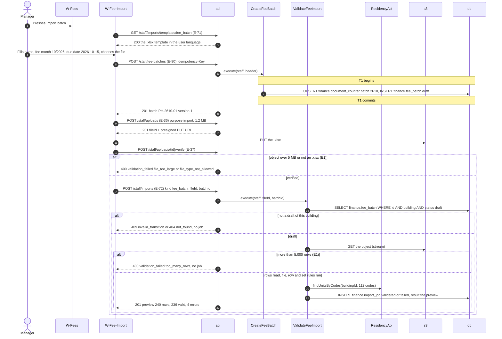

#### Step details

| Step | From → To | Call | Data | Rules and checks | Error → handling |
| --- | --- | --- | --- | --- | --- |
| 2–3 | `W-Fee-Import` → `api` | E-71 | `kind = fee_batch` | Sheet `Phí` or `Fees`, header row 1 in the user's language, one example row per kind (DOC-21 §4.2) | — |
| 5 | `W-Fee-Import` → `api` | E-90, marked `R` | `{ "name": { "vi": "Phí tháng 10/2026", "en": "October 2026 fees" }, "feeMonth": "2026-10-01", "dueDate": "2026-10-15" }` | `feeMonth` the first of a month; the due date is not checked here (the publish checks it, DOC-21 §3.1) | 400 `validation_failed` on `feeMonth` |
| 7 | `CreateFeeBatch` → `db` | Counter upsert and insert | period `2610` of the **fee month** → `PH-2610-01` | One transaction; a rolled-back create leaves no code (FR-03.4) | — |
| 8 | `api` → `W-Fee-Import` | 201 | `{ "id": "…00b1", "code": "PH-2610-01", "status": "draft", "version": 1 }` | A double click with the same key returns the same batch (`Idempotent-Replayed: true`, DR-74) | — |
| 9–13 | `W-Fee-Import` → `api`, `s3` | E-36, `PUT`, E-37 | purpose `import`, `.xlsx`, ≤ 5 MB (`FILES_MAX_IMPORT_BYTES`) | The type and size are checked by `HEAD` (DOC-37 §4) | E1 → "The file is too large. The limit is 5 MB." |
| 14 | `W-Fee-Import` → `api` | E-72, marked `R` | `{ "kind": "fee_batch", "fileId": "…f001", "batchId": "…00b1" }` | DR-149: the id of a verified upload | — |
| 16–17 | `ValidateFeeImport` → `db` | Read the batch | — | A batch that is not a draft of this building stores no job (DOC-21 §4.1) | 409 `invalid_transition` → "This can no longer be done in its current state."; 404 |
| 18–19 | `ValidateFeeImport` → `s3` | Streamed read | — | `.xlsx`, first sheet, 5,000 rows at most, headers by alias (DOC-18 §1.1) | E1 → 400 `too_many_rows` "The file has more than 5000 rows. Split it into smaller files." No job |
| 20 | `ValidateFeeImport` → `ResidencyApi` | `findUnitsByCodes` | the 112 distinct lower-cased codes in **one** call | `unit_not_found`, `unit_without_owner` per row (DOC-21 §4.3) | — |
| 21 | `ValidateFeeImport` → `db` | `INSERT finance.import_job` | `status validated`, `expires_at = created_at + 24 h`, `result` = the preview, `params {batchId}` | A file-level `fail` (`import_no_header`, `import_no_price`) stores `failed` (DOC-21 §4.4) | — |
| 22 | `api` → `W-Fee-Import` | 201 | The preview of DOC-21 §4.4: `counts {rows 240, valid 236, errors 4}`, the first 50 valid rows, issues at rows 12 (`unit_not_found`), 57 (`fee_month_mismatch`), 58 (`charge_item_duplicate`), 201 (`amount_mismatch` 185,000 vs 185,175) | A row is never recomputed silently (FR-01.5, E2); a unit with one wrong row keeps its valid rows only | — |

### FL-01.2 · Commit, edit or discard the draft

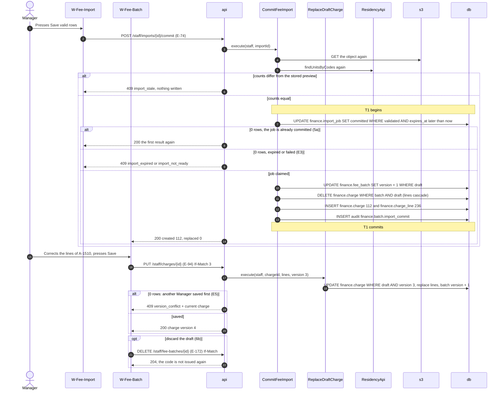

#### Step details

| Step | From → To | Call | Data | Rules and checks | Error → handling |
| --- | --- | --- | --- | --- | --- |
| 2 | `W-Fee-Import` → `api` | E-74 | — | Not marked `R`: the job claim is the idempotency (FR-01.3) | — |
| 4–5 | `CommitFeeImport` → `s3`, `ResidencyApi` | Re-read and re-validate | — | Counts differ from the preview (a unit lost its owner) → nothing written (DOC-21 §4.5, DQ-50) | 409 `import_stale` → "The data changed since the preview. Upload the file again." |
| 7 | `CommitFeeImport` → `db` | Claim the job | `WHERE status = 'validated' AND expires_at > now()` | **The arbiter of two commits** (IM-72) | — |
| 8 | `api` → `W-Fee-Import` | 200 | the stored result | A double "Save" or two tabs see one commit; the draft rows exist once | — |
| 9 | `api` → `W-Fee-Import` | 409 | — | A job older than 24 h (FR-01.4); a `failed` job | E3 → "This preview has expired. Upload the file again." / "This import is not ready to commit." |
| 10 | `CommitFeeImport` → `db` | Bump the batch | `version 1 → 2` | Zero rows (the batch was published or discarded meanwhile): ROLLBACK, 409 `invalid_transition`. The bump makes a publish prepared earlier fail with 409 `version_conflict` (DOC-21 §3.3) | 409 → "This can no longer be done in its current state." |
| 11–12 | `CommitFeeImport` → `db` | Replace | 112 charges of 236 lines in chunks of 1,000 rows | A re-import replaces **every** draft charge, hand-added ones too (3a, FR-02.1); an adjustment line (`kind adjustment`, −200,000, note required) is a row like any other (6a, DR-19) | — |
| 14 | `api` → `W-Fee-Batch` | 200 | `{ "created": 112, "replaced": 0 }` | The draft shows the units without a charge (open question 1) | — |
| 16 | `W-Fee-Batch` → `api` | E-94 | `If-Match: "3"`, `{ "lines": [ { "kind": "fee", "itemName": { "vi": "Phí quản lý" }, "quantity": "1", "unitPrice": 2488000 } ] }` | Only a draft charge (DOC-21 §3.2); a total ≤ 0 is 422 `charge_total_zero` | — |
| 18 | `ReplaceDraftCharge` → `db` | Conditional update | `WHERE status = 'draft' AND version = 3` | **The arbiter** of two Managers editing one charge (FR-02.2, LG-63) | — |
| 19 | `api` → `W-Fee-Batch` | 409 | `details.current` = the fresh charge | — | E5 → "This was changed by someone else. Reload and try again." |
| 21 | `W-Fee-Batch` → `api` | E-172 | `If-Match` of the batch | Draft only; batch and charges deleted; `PH-2610-02` is never issued again (FR-02.4, DOC-21 §3.8) | 409 on a published batch |

E-170 (add one unit's charge) and E-171 (remove one) follow the shape of steps 16–20 with the guards of DOC-21 §3.2. A Manager can also re-import a corrected file while the batch is a draft (3a): FL-01.1 steps 14–22 and FL-01.2 again, ending with exactly the rows of the new file.

### Transactions and concurrency

- T1 of FL-01.1 holds the counter and the batch insert; nothing else is written until the job insert, which is one statement. T1 of FL-01.2 holds the job claim, the batch version, the delete, the inserts and the audit row; nothing goes to the network inside it.
- **Two commits of one job:** the claim `WHERE status = 'validated'`; the second sees `committed` and returns the first result (IM-72).
- **Commit and publish at once:** the batch row and its version; the commit's bump makes the publish 409 `version_conflict`, or the publish wins and the commit's bump updates 0 rows (409 `invalid_transition`) (IM-73).
- **The process dies** after T1 of FL-01.1: the draft exists with no charge and is reused (the form keeps `batchId`). After the job insert: the preview is in E-73 (`GET /staff/imports/{id}`) for 24 hours. After T1 of FL-01.2 and before the answer: a retry of E-74 returns the stored result.

### Errors and handling

| Situation | Step | HTTP status / code | UI behavior and message |
| --- | --- | --- | --- |
| E1 A 5.2 MB file | FL-01.1 13 | 400 `validation_failed` (`file_too_large`) | "The file is too large. The limit is 5 MB." No job |
| E1 5,001 rows | FL-01.1 19 | 400 `validation_failed` (`too_many_rows`) | "The file has more than 5000 rows. Split it into smaller files." No job |
| E2 Unknown unit, wrong fee month, duplicate item, `amount ≠ quantity × unit price` | FL-01.1 22 | 201 with `issues` | The preview lists the row, column and message; the row is not saved |
| A file without a price or amount column, or without a header | FL-01.1 22 | 201, job `failed` (`import_no_price`, `import_no_header`) | The preview shows the file error; "Save" is disabled; a commit is 409 `import_not_ready` |
| The batch is not a draft (at validation, or published before the commit) | FL-01.1 17, FL-01.2 10 | 409 `invalid_transition` | "This can no longer be done in its current state." |
| E3 Commit after 24 h | FL-01.2 9 | 409 `import_expired` | "This preview has expired. Upload the file again." |
| The data changed since the preview | FL-01.2 6 | 409 `import_stale` | "The data changed since the preview. Upload the file again." |
| E5 Stale `If-Match` on a draft charge | FL-01.2 19 | 409 `version_conflict` | "This was changed by someone else. Reload and try again." with the fresh charge |
| A charge whose total is 0 or less | FL-01.2 18 | 422 `charge_total_zero` | "A charge in this batch has a total of zero." |
| A Technician or Guard calls any of these endpoints | FL-01.1 5, 14, FL-01.2 16 | 403 `forbidden` | The menu entry does not exist for them |

### Required tests

The lower layer is `IM-50…77` (import) and `LG-63`, `LG-68`, `LG-69` (DOC-21 §9); these rows go through `W-Fee-Import` and `W-Fee-Batch`.

| ID | Scenario | Expected |
| --- | --- | --- |
| FF-01 | Lê Minh creates `PH-2610-01` and imports the 240-row file with errors at rows 12, 57, 58, 201 | The preview shows 236 valid and 4 errors with row, column and message; `finance.import_job` is `validated` with `expires_at` +24 h |
| FF-02 | "Save valid rows" | 200 `{created: 112}`; `W-Fee-Batch` lists 112 charges; the batch `version` is 2; one audit row `finance.batch.import_commit` |
| FF-03 | "Save" pressed twice, and the same job committed from two tabs (barrier) | One commit; the second response equals the first; the draft has 112 charges, not 224 (FR-01.3) |
| FF-04 | Upload a 5.2 MB file; a file of 5,001 rows | 400 with the size message; 400 `too_many_rows`; no `import_job` row in either case (FR-01.2) |
| FF-05 | Commit at +24 h 1 s (fake clock) | 409 `import_expired` and the expiry message; the draft unchanged (FR-01.4) |
| FF-06 | A unit loses its owner between the preview and the commit | 409 `import_stale`; nothing written |
| FF-07 | Re-import a 200-row file into the draft of 240 charges, after one charge was added by hand | Exactly 200 charges; the hand-added one is gone; `version` increased (FR-02.1) |
| FF-08 | An adjustment row −200,000 with the note "Miễn phí gửi xe tháng 10" | The charge of the unit is its fee lines minus 200,000 and stays above 0; the line keeps its note (FR-01.6) |
| FF-09 | Two Managers save charge `A-1510` at version 3 | One 200 (version 4); the other 409 with the fresh charge and the message (FR-02.2) |
| FF-10 | Discard `PH-2610-02`, then create another October batch | `PH-2610-02` and its charges are gone; the new code is `PH-2610-03` (FR-02.4) |
| FF-11 | A batch created at 00:30 on 2026-10-01 local (17:30Z on 09-30) for fee month 10/2026 | Code `PH-2610-01` (fee month, not the UTC date) |
| FF-12 | A 2,000-row file with 40 errors | The preview answers in ≤ 10 s with 40 issues and 50 valid rows listed (FR-01.7, NFR-12, IM-74, IM-77) |

## FL-02 · Manager publishes a batch

- **UC / FR:** UC-01 (main flow 6–9, alternative flow 8a, error flows E4, E6, E7) · FR-03.1…4, FR-02.3 · **Screens:** `W-Fee-Batch`, `W-Fee-Notice` · **Endpoints:** E-99 `POST /staff/fee-batches/{id}/pdf`, E-95 `POST /staff/fee-batches/{id}/publish`, E-94 (refused after publish) · **Events:** `finance.batch_published.v1` (`unitIds` in parts of at most 500)
- **Trigger:** The Manager presses "Publish" on `W-Fee-Batch` after previewing a fee notice.
- **Preconditions:** A draft batch with at least one charge (FL-01). The Manager's screen holds the batch `version` as `If-Match`.

### Participants

| Participant | Kind | Code | Defined in |
| --- | --- | --- | --- |
| `Manager` | Actor | Manager or Admin | DOC-21 §1 |
| `W-Fee-Batch`, `W-Fee-Notice` | Screen | draft editor, fee notice preview | DOC-66 |
| `api` | API | finance staff routes | DOC-51 |
| `PublishFeeBatch` | Use case | `PublishFeeBatch.execute(staff, batchId, version)` | DOC-21 §3.3 |
| `db`, `outbox` | Data store | `finance.fee_batch`, `finance.charge`, `finance.fee_notice_job`, `audit.audit_log`; `finance.outbox_messages` | DOC-15 §5, §10.2 |
| `worker` | Worker | `notification.inbox_on_finance_batch_published`, `finance.fee_notice_run` | DOC-09 §7, DOC-34 |
| `ResidencyApi` | Contract | `listRecipients(unitId, 'view_fees')` | DOC-09 §7.1 |
| `expo-push` | External | the push service | DOC-31 |

### Sequence diagram

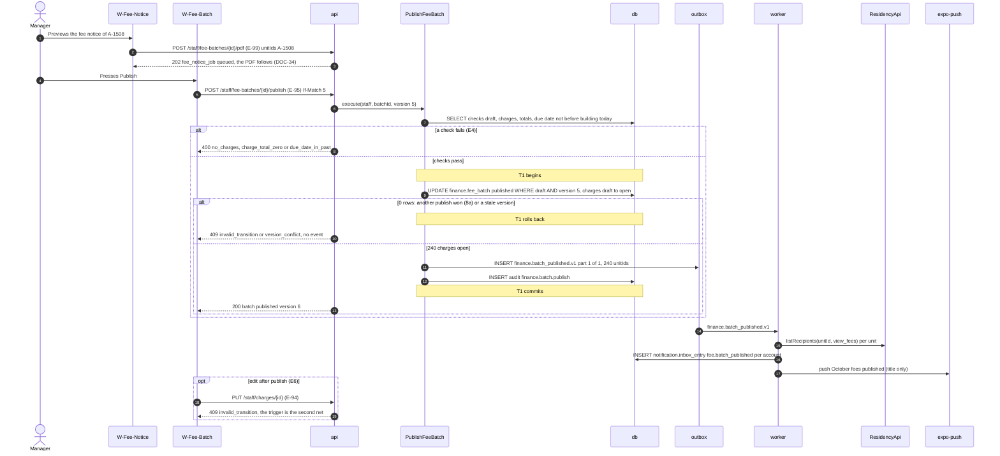

### Step details

| Step | From → To | Call | Data | Rules and checks | Error → handling |
| --- | --- | --- | --- | --- | --- |
| 2–3 | `W-Fee-Notice` → `api` | E-99 | `{ "unitIds": ["…0021"], "language": "vi-en" }` | A `fee_notice_job` row; the worker renders it (DOC-34). The preview never changes the batch | — |
| 5 | `W-Fee-Batch` → `api` | E-95 | `If-Match: "5"` | Missing `If-Match` → 428 `precondition_required` (DOC-50 §9) | "Reload and try again." |
| 7 | `PublishFeeBatch` → `db` | Checks, in order | draft; ≥ 1 charge; every total > 0; `due_date >= buildingToday` (2026-10-15 ≥ 2026-10-05) | The first failure answers; nothing changes (FR-03.1, DOC-21 §3.3) | — |
| 8 | `api` → `W-Fee-Batch` | 400 | `no_charges`; `charge_total_zero` with the units; `due_date_in_past` | — | E4 → "This batch has no charges yet." / "A charge in this batch has a total of zero." / "The due date cannot be in the past." |
| 9 | `PublishFeeBatch` → `db` | The statement of DOC-15 §5.1 | `WHERE status = 'draft' AND version = 5` | **The arbiter** of two publishes; `trg_charge_guard` refuses `draft → open` when a charge differs from its lines (FNM-21) | — |
| 10 | `api` → `W-Fee-Batch` | 409 | `details.current` | The loser writes **no** event: one round of notifications (FR-03.2, LG-61) | 8a → "This can no longer be done in its current state." and the page reloads as published; a stale version → "This was changed by someone else. Reload and try again." |
| 11 | `PublishFeeBatch` → `outbox` | `finance.batch_published.v1` | `{ "buildingId": "…0001", "batchId": "…00b1", "unitIds": [240 ids], "part": 1, "parts": 1 }` | Parts of at most 500 ids; 1,201 units give three rows (MC-06) | — |
| 14 | `outbox` → `worker` | The relay | — | After commit; a dead worker leaves the row until it returns (E7) | — |
| 15–17 | `worker` → `ResidencyApi`, `db`, `expo-push` | Handler `notification.inbox_on_finance_batch_published` | inbox `fee.batch_published`, push "October fees published" | Owners, family members and tenants of each charged unit; helpers get nothing (FR-03.3) | Expo down → the push command retries 3 times (DOC-42 §7.1); the inbox entry exists anyway (E7) |
| 19 | `api` → `W-Fee-Batch` | 409 | — | A published charge is never edited; a direct `UPDATE` of its amount is refused by `trg_charge_guard` (FR-02.3, LG-80) | E6 → "This can no longer be done in its current state." |

### Transactions and concurrency

- T1 holds the batch update, the 240 charge updates, the event rows and the audit row. The checks of step 7 read without a lock; the conditional update of step 10 is the arbiter, so a check that passed on a stale read cannot publish a changed draft (the `version` predicate).
- **Two publishes at once:** the second updates 0 rows, writes no event and answers 409 (FNM-S01, LG-61).
- **Publish against a draft edit or an import commit:** the batch `version` (LG-62, IM-73).
- **The process dies** after T1 commits and before the answer: the batch is published and the event is in the outbox; the Manager reloads and sees `published`. A retried E-95 answers 409 `invalid_transition`; no second round of notifications is ever written.
- The notification handler is transactional and inbox-guarded (DOC-09 §7): a redelivered `batch_published` part writes no second inbox entry.

### Errors and handling

| Situation | Step | HTTP status / code | UI behavior and message |
| --- | --- | --- | --- |
| E4 No charge, a total of 0, a due date in the past | 8 | 400 `no_charges`, `charge_total_zero`, `due_date_in_past` | The message of the failed check; the batch stays a draft |
| 8a Another Manager published first | 10 | 409 `invalid_transition` | "This can no longer be done in its current state." The page shows the published batch |
| The draft changed since the screen was loaded | 10 | 409 `version_conflict` | "This was changed by someone else. Reload and try again." |
| `If-Match` missing | 5 | 428 `precondition_required` | "Reload and try again." |
| E6 An edit of a published charge | 19 | 409 `invalid_transition` | The editor is read-only after publish; the API refuses as well |
| E7 The worker or Expo is down | 14–17 | — (the publish committed) | The batch is published at once; inbox entries and pushes appear when the worker returns |

### Required tests

The lower layer is `LG-61`, `LG-62`, `LG-64`, `LG-80` (DOC-21) and `MC-06` (DOC-09).

| ID | Scenario | Expected |
| --- | --- | --- |
| FF-13 | Lê Minh publishes `PH-2610-01` (240 charges) on 2026-10-05 | 200; 240 charges `open`; one event row with 240 ids; one audit row; Nguyễn Văn An's app shows "October fees published" and the charge on `Fees` (FR-03.2, FR-03.3) |
| FF-14 | Two Managers press "Publish" at the same instant (barrier) | One 200, one 409 `invalid_transition`; exactly one `batch_published.v1`; each resident receives one push (FR-03.2) |
| FF-15 | Publish an empty draft; a draft with a charge of total 0; a draft due 2026-10-04 on 2026-10-05 | The three 400 codes and messages; nothing changes (FR-03.1) |
| FF-16 | A due date of today at 23:30 local (16:30Z) | Accepted: the comparison is in building time |
| FF-17 | Publish with `If-Match` of version 4 after an edit made version 5 | 409 `version_conflict` |
| FF-18 | A unit whose members are an owner, a tenant with `can_pay` off and a helper | The owner and the tenant receive the inbox entry and the push; the helper nothing (FR-03.3) |
| FF-19 | The worker stopped during the publish, started 5 minutes later | The publish answers 200 at once; the inbox entries appear after the restart; no entry is written twice |
| FF-20 | `PUT /staff/charges/{id}` on a published charge; a direct `UPDATE finance.charge SET amount` | 409; the trigger refuses the statement (FR-02.3) |

## FL-03 · Manager recalls a batch, with the race

- **UC / FR:** UC-04 (main flow "recall" 1–4, alternative flow 3a, error flows E1, E2, E5, E6; race table rows 1–5, 7) · FR-04.1…4, FR-09.5, FR-10.6 · **Screens:** `W-Fees`, `W-Fee-Recall` · **Endpoints:** E-96 `POST /staff/fee-batches/{id}/recall` · **Events:** `finance.batch_recalled.v1`, `finance.intent_cancel_requested.v1` (one per cancelled intent); in the race, `finance.money_unposted.v1`
- **Trigger:** The Manager finds a wrong batch after publishing and presses "Recall".
- **Preconditions:** The batch is `published`. If any of its charges is `paid`, the recall is refused and the Manager voids single charges instead (FL-44).

### Participants

| Participant | Kind | Code | Defined in |
| --- | --- | --- | --- |
| `Manager` | Actor | Manager or Admin | DOC-21 §1 |
| `W-Fees`, `W-Fee-Recall` | Screen | batch list, recall dialog with the consequences (screen files owed) | DOC-66, DR-72 |
| `api` | API | finance staff routes | DOC-51 |
| `RecallFeeBatch` | Use case | `RecallFeeBatch.execute(staff, batchId, version, reason)` | DOC-21 §3.5 |
| `IntentCancellation` | Port | `cancelHolding(tx, scope, chargeIds, 'batch_recalled')` | DOC-23 §5.4 |
| `settle` | Function | the settlement of a confirmation (FL-09) | DOC-23 §6 |
| `db`, `outbox` | Data store | `finance.fee_batch`, `finance.charge`, `finance.payment_intent`, `finance.payment_intent_item`, `finance.gateway_event`, `audit.audit_log` | DOC-15 |
| `worker` | Worker | `finance.cancel_intent_link`, `notification.inbox_on_finance_batch_recalled` | DOC-23 §9, DOC-09 §7 |

### FL-03.1 · Recall

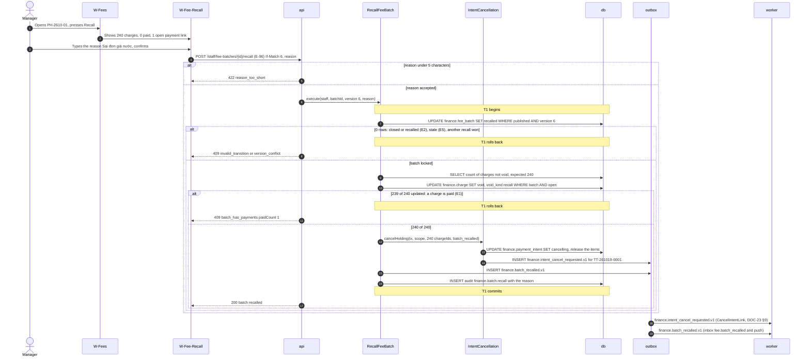

#### Step details

| Step | From → To | Call | Data | Rules and checks | Error → handling |
| --- | --- | --- | --- | --- | --- |
| 2 | `W-Fees` → `W-Fee-Recall` | Dialog | the counts from E-91 and the intents of E-107 | The dialog says the open payment links will be cancelled and the residents told | — |
| 4 | `W-Fee-Recall` → `api` | E-96 | `If-Match: "6"`, `{ "reason": "Sai đơn giá nước" }` | Reason 5 to 500 characters, kept in the audit row only (DOC-21 §3.5) | — |
| 5 | `api` → `W-Fee-Recall` | 422 | `reason_too_short {min: 5}` | — | "Write at least 5 characters." |
| 7 | `RecallFeeBatch` → `db` | Conditional update of the batch | `WHERE status = 'published' AND version = 6` | Locks the batch row; two recalls serialize here (UC-04 race row 5) | — |
| 8 | `api` → `W-Fee-Recall` | 409 | — | A closed or recalled batch (FR-04.4); a stale version | E2 → "This can no longer be done in its current state."; E5 → "This was changed by someone else. Reload and try again." |
| 9 | `RecallFeeBatch` → `db` | Expected count | `count(*) WHERE batch_id AND status <> 'void'` read **after** the lock | A charge voided alone earlier is not counted, so it never blocks the recall (DR-97) | — |
| 10 | `RecallFeeBatch` → `db` | Charges `open → void` | `void_kind = 'recall'` | **The arbiter** of the race with any payment is each charge row (FL-03.2) | — |
| 11 | `api` → `W-Fee-Recall` | 409 | `{ "paidCount": 1 }` | Batch, charges and intents are all unchanged (FR-04.2) | E1 → "This batch has payments and cannot be recalled. Void individual charges instead." with a link to the charge list (FL-44) |
| 12–14 | `RecallFeeBatch` → `IntentCancellation` → `db`, `outbox` | `cancelHolding` | intent `TT-261019-0001` holds charge A of this batch and charge B of `PH-2610-02` | The **whole** intent becomes `cancelling` (`cancel_reason batch_recalled`), every item is released, B included (FR-04.1, DR-31, DOC-23 §5.4). With no active intent nothing is written here (3a) | — |
| 15 | `RecallFeeBatch` → `outbox` | `finance.batch_recalled.v1` | parts of at most 500 unit ids | — | — |
| 18 | `outbox` → `worker` | The cancel command | `reason batch_recalled` | Best effort at the gateway; a 5xx is retried 8 times (5 s doubling), then dead-lettered with an alert; "already paid" runs `getStatus` and `settle` (E6, FR-10.6). The rest is FL-14 and DOC-23 §9 | — |
| 19 | `outbox` → `worker` | The recall notice | inbox `fee.batch_recalled` and a push to the publish's recipients | A resident on `Pay-VietQR` sees the intent `cancelling` on the next poll of E-86 and starts again | — |

### FL-03.2 · The race with a payment

The arbiter is the charge row: the recall's `open → void` and a payment's `open → paid` meet on it and the second sees zero rows (DOC-22 §10, EXP-04). The diagram shows the recall against an exact online settlement of charge A of `A-1508`.

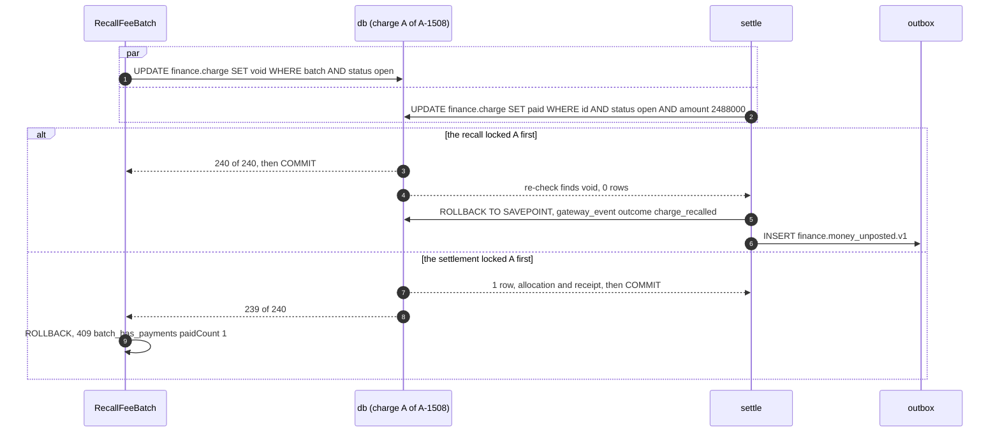

| Concurrent pair (UC-04 race table) | Arbiter | What each side sees |
| --- | --- | --- |
| Recall and an exact online settlement | The charge row | Recall first: the transfer is a money-log row `charge_recalled`, nothing posted; the Manager refunds outside the system (FL-07). Settlement first: the recall is 409 `batch_has_payments` (FR-04.3) |
| Recall and a manual payment (FL-05) | The charge row | Recall first: the entry is 409 `charge_changed`. Payment first: the recall is 409 `batch_has_payments` |
| Recall and a resident creating an intent (FL-10) | `FOR SHARE` on the charges in the creation transaction (DOC-23 §4.3, DR-280) | Recall first: creation is 409 `charge_changed`. Creation first: the recall waits for it, then `cancelHolding` cancels the new intent as a whole |
| Recall and a late confirmation of an intent already `cancelling` | The intent claim, then the charge | The charges are `void`: `charge_recalled`, logged, nothing posted (FR-09.5) |
| Two Managers press "Recall" | The batch row | One recall; the second is 409 `version_conflict` (stale `If-Match`) or `invalid_transition` |
| A single void before the recall (FL-44) | The charge row | The voided charge is not in the expected count; the recall succeeds (DR-97) |

When the recall and a settlement hold the same intent and charge at the same instant, the two lock orders (recall: charges, then intents; `settle()`: intent, then charges) can meet; PostgreSQL aborts one with `40P01` after 1 s and the wrapper retries it; the retry ends in one of the two rows above (DOC-23 §7.2, IN-36).

### Transactions and concurrency

- T1 holds the batch update, the 240 charge updates, the intent cancels and their item releases, the cancel commands, the recall event and the audit row. If any charge is `paid`, everything rolls back, including the batch status (FR-04.2). The gateway is never called inside T1: the cancel is a command (DOC-23 §9).
- **The process dies** after T1 commits and before the answer: the batch is recalled; the Manager reloads and sees `recalled`; a retried E-96 is 409 `invalid_transition`. The commands are in the outbox and run after restart.
- **Every order ends consistent:** no recalled charge carries a live allocation and no confirmed money vanishes; it is a payment or a log row (NFR-01). The nightly check is the last net (DOC-22 §12).

### Errors and handling

| Situation | Step | HTTP status / code | UI behavior and message |
| --- | --- | --- | --- |
| E1 A charge of the batch is `paid` | 11 | 409 `batch_has_payments {paidCount}` | "This batch has payments and cannot be recalled. Void individual charges instead." The dialog links to the charge list |
| E2 The batch is `closed` or already `recalled` | 8 | 409 `invalid_transition` | "This can no longer be done in its current state." |
| E5 Stale `If-Match` | 8 | 409 `version_conflict` | "This was changed by someone else. Reload and try again." |
| A reason under 5 characters | 5 | 422 `reason_too_short` | "Write at least 5 characters." |
| E6 The gateway refuses the cancel with a 5xx | 18 | — (after commit) | Nothing on `W-Fee-Recall`; the command is retried 8 times, then dead-lettered with the alert of DOC-40 (RB-05); "already paid" is settled (FL-14) |
| A Technician or Guard | 4 | 403 `forbidden` | The action is not shown |

### Required tests

The lower layer is `LG-70…72`, `LG-81` (DOC-21), `IN-09`, `IN-23`, `IN-36` (DOC-23) and EXP-04.

| ID | Scenario | Expected |
| --- | --- | --- |
| FF-21 | Recall `PH-2610-01` (240 open charges, no intent) with the reason "Sai đơn giá nước" | 200; 240 charges `void` with `void_kind recall`; the batch `recalled`; one audit row with the reason; residents get `fee.batch_recalled`; debt no longer counts the charges (FR-04.1) |
| FF-22 | The same with intent `TT-261019-0001` holding A of this batch and B of `PH-2610-02` | The intent `cancelling` (`batch_recalled`), A and B released, one `intent_cancel_requested.v1`; Nguyễn Văn An's `Pay-VietQR` shows the cancelled payment on its next poll; B is payable again |
| FF-23 | Recall with A paid | 409 `batch_has_payments {paidCount: 1}` and the message; all 240 charges and the batch unchanged (FR-04.2) |
| FF-24 | Recall of a closed batch; of a recalled batch; with `If-Match` 5 when the batch is at 6 | 409 `invalid_transition`; 409 `invalid_transition`; 409 `version_conflict` (FR-04.4) |
| FF-25 | Recall and an exact webhook for A released together (barrier), 200 rounds on fresh batches | Every round: recalled and a `charge_recalled` row in `W-Money-Log`, or A paid and the recall 409; 0 recalled charges with a live allocation (FR-04.3, EXP-04) |
| FF-26 | Recall and a manual payment of A (barrier) | Recalled and the entry 409 `charge_changed`, or paid and the recall 409 |
| FF-27 | Recall and an intent creation for A (barrier) | Creation 409 `charge_changed`, or the new intent `cancelling` after the recall commits; never an active intent on a `void` charge |
| FF-28 | A late exact confirmation of the cancelled intent after the recall | `charge_recalled` in the money log; nothing posted; the Manager sees an inbox entry; the resident sees `unmatchedTransfer` (FR-09.5, DR-96) |
| FF-29 | One charge voided alone (FL-44), then the recall | Recalled: expected 239, updated 239 (DR-97) |
| FF-30 | The fake gateway answers 500 to the cancel 8 times | The command is dead after the 8th attempt; `outbox_dead_letters` rises; the intent is re-queried at +15 min (DOC-23 §8) |

## FL-04 · Manager re-issues, extends or closes a batch

- **UC / FR:** UC-04 (main flow "recall and re-issue" step 5, main flow "extend a due date", alternative flow 2a, error flows E2, E4, E5) · FR-04.4, FR-04.5, FR-44.1…3 · **Screens:** `W-Fee-Reissue`, `W-Fee-Batch`, `W-Fees` · **Endpoints:** E-98 `POST /staff/fee-batches/{id}/reissue`, E-92 `PATCH /staff/fee-batches/{id}`, E-97 `POST /staff/fee-batches/{id}/close` · **Events:** `finance.batch_due_extended.v1` (extension only)
- **Trigger:** After a recall the Manager presses "Re-issue"; or the Manager gives residents more time; or the Manager freezes a batch for reporting.
- **Preconditions:** Re-issue: the batch is `recalled`. Extend: `published`. Close: `published`.

### Participants

| Participant | Kind | Code | Defined in |
| --- | --- | --- | --- |
| `Manager` | Actor | Manager or Admin | DOC-21 §1 |
| `W-Fee-Reissue`, `W-Fee-Batch`, `W-Fees` | Screen | re-issue dialog, draft editor, batch list | DOC-66, DR-72 |
| `api` | API | finance staff routes | DOC-51 |
| `ReissueFeeBatch`, `UpdateFeeBatch`, `CloseFeeBatch` | Use case | DOC-21 §3.7, §3.4, §3.6 | DOC-21 |
| `db`, `outbox` | Data store | `finance.fee_batch`, `finance.charge`, `finance.charge_line`, `finance.document_counter`, `audit.audit_log` | DOC-15 |
| `worker` | Worker | `notification.inbox_on_finance_batch_due_extended` | DOC-09 §7 |

### FL-04.1 · Re-issue a recalled batch

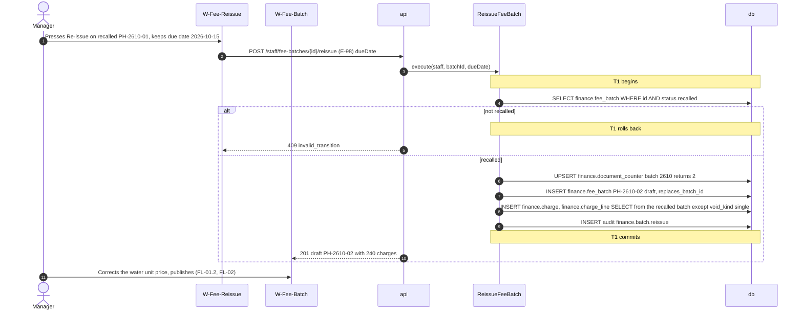

| Step | From → To | Call | Data | Rules and checks | Error → handling |
| --- | --- | --- | --- | --- | --- |
| 2 | `W-Fee-Reissue` → `api` | E-98 | `{ "dueDate": "2026-10-15" }` | Fee month and name are copied; the due date may change and is checked at publish (DOC-21 §3.7) | — |
| 5 | `api` → `W-Fee-Reissue` | 409 | — | Only a `recalled` batch (LG-74) | "This can no longer be done in its current state." |
| 6–8 | `ReissueFeeBatch` → `db` | Counter, batch, copy | new code `PH-2610-02` (the next of the fee month), new ids, same positions and amounts | A charge voided alone is **not** copied: it was wrong by itself and is corrected by hand (FL-44, DR-265) | — |
| 10 | `api` → `W-Fee-Batch` | 201 | `{ "id": "…00b3", "code": "PH-2610-02", "replacesBatchId": "…00b1", "status": "draft" }` | E-98 is not marked `R`: a second press creates a second draft that the Manager discards (E-172); the button is disabled while the request runs | — |
| 11 | Manager → `W-Fee-Batch` | Edit and publish | — | A recalled batch is never published again; residents see a new batch and never an amount that changed under a code (DR-20) | — |

### FL-04.2 · Extend the due date

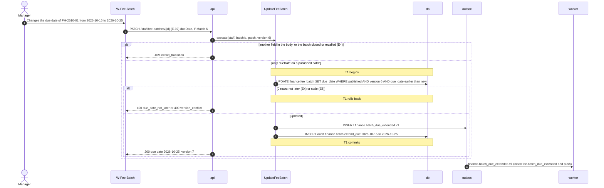

| Step | From → To | Call | Data | Rules and checks | Error → handling |
| --- | --- | --- | --- | --- | --- |
| 2 | `W-Fee-Batch` → `api` | E-92 | `If-Match: "6"`, `{ "dueDate": "2026-10-25" }` | The only edit of a published batch (FR-44.2, DOC-21 §3.4) | — |
| 4 | `api` → `W-Fee-Batch` | 409 | — | A `name` in the body, a closed or recalled batch | E4 → "This can no longer be done in its current state." |
| 5 | `UpdateFeeBatch` → `db` | Conditional update | `due_date < '2026-10-25'` in the statement | Two Managers cannot move a date backwards by racing | — |
| 6 | `api` → `W-Fee-Batch` | 400 / 409 | — | The same or an earlier date (FR-44.1) | E4 → "Choose a date later than the current due date."; E5 → "This was changed by someone else. Reload and try again." |
| 10 | `outbox` → `worker` | Notice | `fee.batch_due_extended` to the publish's recipients | Aging follows at the next read: a charge 3 days past due becomes "not yet due" with no other write (FR-44.3) | — |

### FL-04.3 · Close a batch

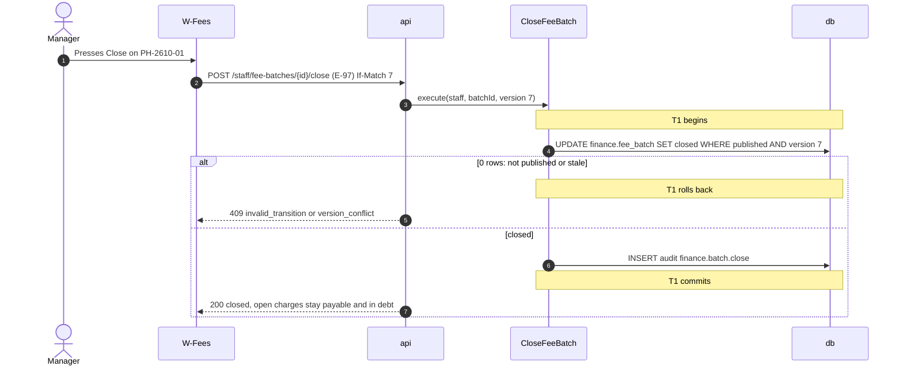

A close is a freeze **for reporting only** (DR-20): no event, no notification; open charges stay payable (online and manual) and stay in debt; a closed batch can no longer be recalled (FR-04.4) or extended.

### Transactions and concurrency

- Each sub-flow is one transaction: the re-issue holds the counter, the new batch, the copy and the audit row; the extension holds one conditional update, the event and the audit row; the close holds one conditional update and the audit row.
- **Extension against publish or recall:** the batch `version`; the second to commit is 409 `version_conflict` (UC-04 race row 8).
- **The process dies** after a commit and before the answer: the re-issue draft exists (the Manager sees it on `W-Fees`, "re-issued as `PH-2610-02`"); the extension and the close are visible on reload, and a retry is 409.

### Errors and handling

| Situation | Step | HTTP status / code | UI behavior and message |
| --- | --- | --- | --- |
| Re-issue of a batch that is not `recalled` | FL-04.1 5 | 409 `invalid_transition` | "This can no longer be done in its current state." |
| E4 An extension to the same or an earlier date | FL-04.2 6 | 400 `due_date_not_later` | "Choose a date later than the current due date." |
| E4 Any other field on a published batch; an extension of a closed batch | FL-04.2 4 | 409 `invalid_transition` | As above |
| E5 Stale `If-Match` | FL-04.2 6, FL-04.3 5 | 409 `version_conflict` | "This was changed by someone else. Reload and try again." |
| 2a Close of a recalled or closed batch | FL-04.3 5 | 409 `invalid_transition` | As above |

### Required tests

The lower layer is `LG-66`, `LG-67`, `LG-73`, `LG-74`, `LG-75` (DOC-21) and `LG-37` (DOC-22).

| ID | Scenario | Expected |
| --- | --- | --- |
| FF-31 | Re-issue recalled `PH-2610-01` of 240 charges | A draft `PH-2610-02` with `replaces_batch_id`, 240 charges and their lines under new ids; `W-Fees` shows "re-issued as `PH-2610-02`" on the old batch (FR-04.5) |
| FF-32 | Re-issue when one charge had been voided alone before the recall | 239 charges copied; the voided one is not (DR-265) |
| FF-33 | Re-issue of a published batch | 409 `invalid_transition` |
| FF-34 | The corrected draft is published | A second batch appears in the residents' `Fees`; the recalled one is gone from debt; no amount changed under a code |
| FF-35 | Extend 2026-10-15 to 2026-10-25 on 2026-10-18 | 200; audit row with both dates; residents get `fee.batch_due_extended`; `A-1508`'s charge moves from "3 days overdue" to "not yet due" on `W-Debts` (FR-44.1, FR-44.3) |
| FF-36 | Extend to 2026-10-10; with `If-Match` 6 after another extension made 7; with a `name` field | 400 `due_date_not_later`; 409 `version_conflict`; 409 `invalid_transition` (FR-44.2) |
| FF-37 | Two Managers extend to 10-25 and 10-20 at once | One wins; the other is 409 `version_conflict`; the date never moves backwards |
| FF-38 | Close `PH-2610-01`; pay one of its open charges online; read debt | The payment posts; debt counts the remaining open charges; a recall is 409 `invalid_transition` (FR-04.4, DR-20) |
| FF-39 | Close twice | The second is 409 `invalid_transition` |
| FF-40 | A Technician calls E-98, E-92, E-97 | 403 each |

## FL-05 · Manager records a manual payment

- **UC / FR:** UC-02 (main flow "record" 1–6, alternative flows 2a, 4a, 5a, error flows E1, E2, E3, E6; race table rows 1–3) · FR-05.1…8 · **Screens:** `W-Fee-Record` · **Endpoints:** E-102 `GET /staff/units/{id}/debt`, E-104 `POST /staff/payments`, E-106 `GET /staff/receipts/{id}/pdf` · **Events:** `finance.payment_posted.v1`, `finance.receipt_issued.v1` and `finance.receipt_render_requested.v1` (one each per receipt)
- **Trigger:** Nguyễn Văn An pays 2,838,000 đ in cash at the office for charges A and B of `A-1508`.
- **Preconditions:** The unit has `open` charges of `published` or `closed` batches. The Manager is signed in.

### Participants

| Participant | Kind | Code | Defined in |
| --- | --- | --- | --- |
| `Manager` | Actor | Manager or Admin (`RECORD_MANUAL_PAYMENT_ROLES`) | DOC-22 §5 |
| `W-Fee-Record` | Screen | the unit's debt, the payment form, receipt history (screen file owed) | DOC-66 |
| `api` | API | finance staff routes, the `idempotent` wrapper of P1-28 | DOC-51, DOC-50 §8 |
| `RecordManualPayment` | Use case | `RecordManualPayment.execute(staff, cmd)` | DOC-22 §5.2 |
| `ChargeAllocator` | Collaborator | `allocate(tx, scope, payment, charges, ctx)` | DOC-22 §2.1, §4 |
| `db`, `outbox` | Data store | `platform.idempotency_key`, `finance.charge`, `finance.payment`, `finance.allocation`, `finance.receipt`, `finance.document_counter`, `audit.audit_log` | DOC-15 §7 |
| `worker` | Worker | `finance.render_receipt_pdf`, `notification.inbox_on_finance_payment_posted` | DOC-34, DOC-09 §7 |

### Sequence diagram

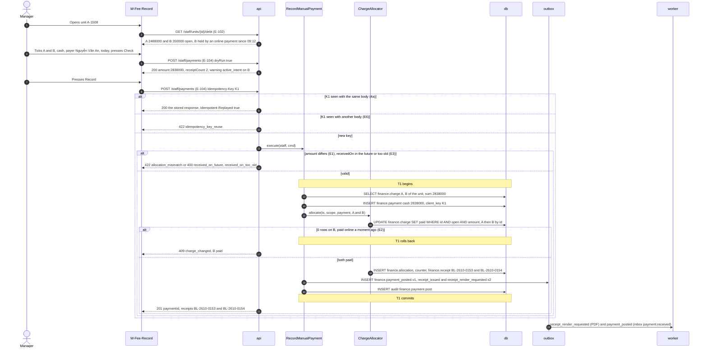

### Step details

| Step | From → To | Call | Data | Rules and checks | Error → handling |
| --- | --- | --- | --- | --- | --- |
| 2–3 | `W-Fee-Record` → `api` | E-102 | open charges with `activeIntent {since: "2026-10-19T02:12:00Z"}` on B | The warning comes from `payment_intent_item` (DOC-22 §5.2); it does **not** block the entry, because the cash is already in hand (FR-05.6) | — |
| 4 | Manager → `W-Fee-Record` | Form | `method cash`, `payerName "Nguyễn Văn An"`, `receivedOn 2026-10-19` | The form has **no amount field** and no credit box (DR-23, DR-72); the sum is shown | — |
| 5–6 | `W-Fee-Record` → `api` | E-104 `dryRun: true` | `{ "dryRun": true, "amount": 2838000, "receiptCount": 2, "warnings": [ { "chargeId": "…00c2", "code": "active_intent" } ] }` | Nothing written, no receipt number reserved (DOC-22 §5.3, FR-05.7) | — |
| 8 | `W-Fee-Record` → `api` | E-104, marked `R` | `Idempotency-Key: 0192f3c4-b101-7000-8000-000000000a01`, the body of DOC-22 §5.1 with `chargeIds` A, B | The key is made once when the form mounts and reused on every retry (DOC-55 §4.3) | 400 `validation_failed` without the header |
| 9 | `api` → `W-Fee-Record` | 200 | the first response, `Idempotent-Replayed: true` | A double tap or a retry after a timeout: one payment (FR-05.4) | — |
| 10 | `api` → `W-Fee-Record` | 422 | — | The same key with another body | E6 → "This request was already used with different content." |
| 12 | `api` → `W-Fee-Record` | 422 / 400 | `allocation_mismatch {expected: 2838000, got: 2000000}`; `received_on_future`; `received_on_too_old` | An `amount` in the request is refused when it differs (FR-05.2); `receivedOn` ≤ today and ≥ today − 90 days unless an Admin (FR-05.5, 2a) | E1 → "The amount does not match the selected charges."; E3 → "The payment date cannot be in the future." / "The payment date is more than 90 days ago." |
| 13 | `RecordManualPayment` → `db` | Read without a lock | A and B `open` | A charge already not `open` is refused here at once (409); the update below is still the arbiter | — |
| 14 | `RecordManualPayment` → `db` | `INSERT finance.payment` | `source cash`, `received_at` = now (today) or 12:00 local of a past day | A concurrent duplicate that slipped the wrapper fails on `uq_payment_building_client_key` and the stored payment is answered | — |
| 16 | `ChargeAllocator` → `db` | The statement of DOC-22 §4.1 | ascending `charge.id`: A (`…00c1`) then B (`…00c2`) | **The arbiter** with an online settlement and with another entry; the id order prevents a deadlock with a payment of (B, A) (FR-05.8, DR-14) | — |
| 17 | `api` → `W-Fee-Record` | 409 | `{ "charges": [ { "chargeId": "…00c2", "status": "paid", "version": 2 } ] }` | The whole transaction rolls back: A is not paid either, no receipt number is used (FR-05.3) | E2 → "This charge has just changed. Check the list and try again." The form reloads the charges and keeps the payer and method |
| 18 | `ChargeAllocator` → `db` | Allocations and receipts | `BL-2610-0153` (A, 2,488,000), `BL-2610-0154` (B, 350,000) | One receipt per allocation; the number is taken right before the receipt insert; the snapshot is frozen (DOC-22 §7) | — |
| 21 | `api` → `W-Fee-Record` | 201 | the response of DOC-22 §5.2 | — | — |
| 22 | `outbox` → `worker` | PDFs and notice | inbox `payment.received` and push "Payment received" to the unit's members who can see fees | The resident sees the receipts on `Fee-History` (FR-05.1) | — |

The receipt PDF is downloaded with E-106 `GET /staff/receipts/{id}/pdf`; a PDF not rendered yet is rendered on demand (DOC-22 §7). A payment recorded from an unmatched statement line carries `statementLineId` and the line becomes `matched` in the same transaction (DOC-22 §5.2 step 6); that entry starts on `W-Statement` and is FL-15.

**5a. The online transfer arrives after the cash.** B was held by the intent `TT-261019-0001`. The entry above paid B; the intent is not edited (DR-28 rule 5). When the bank confirms the transfer for A + B, `settle()` claims the intent and finds B `paid`: outcome `charge_already_paid`, nothing posted, the Manager gets an inbox entry and refunds outside the system (FL-09.2, FL-07). The resident's `Pay-VietQR` shows the neutral mismatch message (DR-96).

### Transactions and concurrency

- T1 holds the payment, the two charge updates, the allocations, the receipts, the counter increments, the outbox rows and the audit row. The idempotency record is written by the wrapper after a committed 2xx (DR-74).
- **Manual entry and exact online settlement of B** (UC-02 race row 1): the charge row; exactly one wins; the manual loser is 409, the online loser a log row (LG-14, EXP-03).
- **Two entries (A, B) and (B, A)** (row 2): both lock A first; the second sees `paid` and is 409; no deadlock (LG-15).
- **Entry and recall** (row 3): FL-03.2.
- **The process dies** after T1 commits and before the answer: the client retries with K1 and gets the stored response with `Idempotent-Replayed: true` (LG-18). Before the commit: nothing exists; the retry runs the entry.

### Errors and handling

| Situation | Step | HTTP status / code | UI behavior and message |
| --- | --- | --- | --- |
| E1 A request `amount` that differs | 12 | 422 `allocation_mismatch {expected, got}` | "The amount does not match the selected charges." The form recomputes the total |
| E2 A charge paid, recalled or voided meanwhile | 17 | 409 `charge_changed {charges}` | "This charge has just changed. Check the list and try again." |
| E3 `receivedOn` tomorrow, or 91 days back by a Manager | 12 | 400 `received_on_future`, `received_on_too_old` | The field message; an Admin may go further back |
| E6 The key reused with another body | 10 | 422 `idempotency_key_reuse` | "This request was already used with different content." |
| 0 or more than 50 charges | 12 | 400 `too_few_charges`, `too_many_charges` | The form allows 1 to 50 (DR-267) |
| A charge of another unit | 13 | 404 `not_found` | The list reloads |
| A Technician or Guard | 8 | 403 `forbidden` | The screen is not in their menu |

### Required tests

The lower layer is `LG-01…20` and `LG-28…33` (DOC-22).

| ID | Scenario | Expected |
| --- | --- | --- |
| FF-41 | Lê Minh records A and B for `A-1508` in cash, payer "Nguyễn Văn An" | 201; `W-Fee-Record` shows `BL-2610-0153` and `BL-2610-0154`; both charges `paid`; the unit's debt falls by 2,838,000 đ; the owner's app shows the receipts and gets "Payment received" (FR-05.1) |
| FF-42 | "Check" before "Record" | The sum 2,838,000 and "2 receipts"; no payment and no counter change (FR-05.7) |
| FF-43 | The browser sends the entry twice with one key (double click, and a retry after a 30 s timeout) | One payment; the second answer has `Idempotent-Replayed: true` and the same receipt numbers (FR-05.4) |
| FF-44 | The same key with `payerName` changed | 422 `idempotency_key_reuse` |
| FF-45 | A request carrying `amount: 2000000` | 422 `allocation_mismatch` and the message; nothing saved (FR-05.2) |
| FF-46 | B is paid online one instant before "Record" | 409 `charge_changed` naming B; A not paid; no receipt number used; the form reloads with only A open (FR-05.3) |
| FF-47 | `receivedOn` 2026-10-20 on 2026-10-19; 91 days back as a Manager; 91 days back as an Admin | 400; 400; 201 (FR-05.5) |
| FF-48 | B held by intent `TT-261019-0001` | The form shows "online payment open since 09:12"; the entry succeeds (FR-05.6) |
| FF-49 | Then the exact transfer for that intent arrives | `charge_already_paid` in `W-Money-Log`; nothing posted; one inbox entry for each Manager and Admin (5a) |
| FF-50 | A manual entry and an exact webhook for B released together (barrier), 500 charges | Exactly one payment per charge; each loser a 409 or a `charge_already_paid` row (FR-05.8, EXP-03) |
| FF-51 | Two Managers enter (A, B) and (B, A) at once | One 201, one 409; no deadlock |
| FF-52 | Receipts at 23:59 on 2026-10-31 and 00:01 on 2026-11-01 local | `BL-2610-…` and `BL-2611-…` |
| FF-53 | A forced failure after the allocations (fault injection) | Everything rolls back; the next entry reuses the receipt number (FNM-S02) |
| FF-54 | A Technician opens `W-Fee-Record` by URL and posts E-104 | 403 |
| FF-55 | The receipt PDF via E-106 before the worker rendered it | 200 with the PDF, rendered on demand |
| FF-56 | 51 charges selected | 400 `too_many_charges` |
| FF-57 | The process is killed after commit, before the answer; the client retries with the same key | One payment; the replay returns it |
| FF-58 | A payment of 50 charges | 50 allocations and receipts with consecutive numbers in ascending charge id |

## FL-06 · Manager voids a payment

- **UC / FR:** UC-02 (main flow "void" 1–3, alternative flows void-a, void-b, error flows E4, E5; race table row 4) · FR-06.1…5 · **Screens:** `W-Fee-Record`, `W-Audit` · **Endpoints:** E-105 `POST /staff/payments/{id}/void`, E-54 `GET /staff/audit` · **Events:** `finance.payment_voided.v1`, `finance.receipt_render_requested.v1` (`variant void`, one per receipt)
- **Trigger:** The Manager finds that the cash entry of FL-05 was recorded on the wrong unit.
- **Preconditions:** A `posted` payment of source `cash` or `bank_transfer`.

### Participants

| Participant | Kind | Code | Defined in |
| --- | --- | --- | --- |
| `Manager` | Actor | Manager or Admin | DOC-22 §6 |
| `W-Fee-Record`, `W-Audit` | Screen | payment history and void dialog; the audit log | DOC-66, DOC-64 |
| `api` | API | finance staff routes; audit routes | DOC-51 |
| `VoidPayment` | Use case | `VoidPayment.execute(staff, paymentId, reason)` | DOC-22 §6 |
| `db`, `outbox` | Data store | `finance.payment`, `finance.allocation`, `finance.charge`, `finance.receipt`, `finance.statement_line`, `audit.audit_log` | DOC-15 §7, §9 |
| `worker` | Worker | `finance.render_receipt_pdf` (watermark), `notification.inbox_on_finance_payment_voided` | DOC-34, DOC-09 |

### Sequence diagram

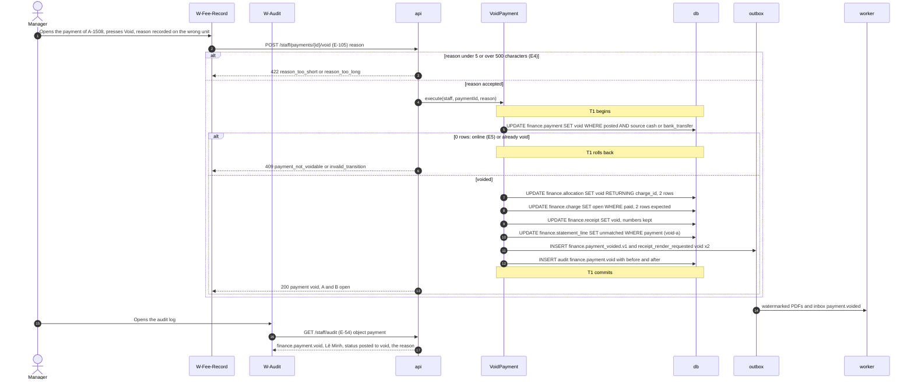

### Step details

| Step | From → To | Call | Data | Rules and checks | Error → handling |
| --- | --- | --- | --- | --- | --- |
| 2 | `W-Fee-Record` → `api` | E-105 | `{ "reason": "Ghi nhầm căn hộ" }` | 5 to 500 characters after trimming; no time limit: the audit row is the control (DR-24) | — |
| 3 | `api` → `W-Fee-Record` | 422 | `reason_too_short {min: 5}` | — | E4 → "Write at least 5 characters." |
| 5 | `VoidPayment` → `db` | Conditional update | `WHERE status = 'posted' AND source IN ('cash', 'bank_transfer')` | **The arbiter** of two voids; `ck_payment_void_source` is the second net for online (FR-06.3) | — |
| 6 | `api` → `W-Fee-Record` | 409 | `payment_not_voidable {kind: "online"}` | Money confirmed by the bank is undone only by a refund outside the system | E5 → "Money confirmed by the bank cannot be undone here. Refund it outside the system."; a second void → "This can no longer be done in its current state." |
| 8 | `VoidPayment` → `db` | Charges `paid → open` | 2 charges | If the count differs from the voided allocations, an invariant is broken: rollback, 500 and an alert, never a repair (DOC-22 §6) | 500 → the generic error message |
| 9 | `VoidPayment` → `db` | Receipts `issued → void` | `BL-2610-0153`, `BL-2610-0154` keep their numbers | The cached PDF is replaced by a copy watermarked "VOID" (DR-17) | — |
| 10 | `VoidPayment` → `db` | Statement line | — | A payment created from a statement line returns the line to `unmatched` (void-a, FR-06.4) | — |
| 13 | `api` → `W-Fee-Record` | 200 | `{ "paymentId": "…0030", "status": "void" }` | The charges are payable at once, online too (FR-06.5) | — |
| 16–17 | `W-Audit` → `api` | E-54 | — | The row shows actor, time, before and after, and the reason (FR-37) | — |

**void-b. Edit is void plus a new entry.** To move the payment to the right unit, the Manager runs FL-05 for that unit; the receipts handed out stay valid documents with a visible void status.

### Transactions and concurrency

- T1 holds the payment, allocations, charges, receipts, the statement line, the outbox rows and the audit row.
- **Void and a new entry for one of its charges** (UC-02 race row 4): the new entry's `UPDATE … WHERE status = 'open'` waits for the void's lock; after the void commits it succeeds; if it ran first it is 409 `charge_changed` (LG-19).
- **Void and the money log are independent:** a void never creates, changes or reviews a log row (DR-16).
- **The process dies** after T1 commits and before the answer: the payment is void; a retry is 409 `invalid_transition`; the reload shows `void`.

### Errors and handling

| Situation | Step | HTTP status / code | UI behavior and message |
| --- | --- | --- | --- |
| E4 A reason of 4 characters; of 501 characters | 3 | 422 `reason_too_short`, `reason_too_long` | "Write at least 5 characters." / the length message (open question 3) |
| E5 An online payment | 6 | 409 `payment_not_voidable` | "Money confirmed by the bank cannot be undone here. Refund it outside the system." The button is hidden for online payments |
| A second void | 6 | 409 `invalid_transition` | "This can no longer be done in its current state." |
| A broken invariant (a charge not `paid`) | 8 | 500 `internal_error` | The generic message; `LedgerInvariantViolation` follows at the nightly check |
| A Technician or Guard | 2 | 403 `forbidden` | — |

### Required tests

The lower layer is `LG-19`, `LG-21…27`, `LG-33` (DOC-22).

| ID | Scenario | Expected |
| --- | --- | --- |
| FF-59 | Void the cash payment of FL-05 with "Ghi nhầm căn hộ" | Payment `void`; both allocations `void`; A and B `open`; both receipts `void` with their numbers; the PDFs show "VOID"; one audit row with before and after; the residents get `payment.voided` (FR-06.1) |
| FF-60 | A reason of 4 characters | 422 and "Write at least 5 characters."; nothing changes (FR-06.2) |
| FF-61 | Void an online payment through the API | 409 `payment_not_voidable` and the message; the button does not exist on screen (FR-06.3) |
| FF-62 | Void a `bank_transfer` payment created from a statement line | The line returns to `unmatched` in `W-Money-Log` (FR-06.4) |
| FF-63 | After the void, Nguyễn Văn An opens `Fees` | A and B are listed as open and can be paid online (FR-06.5) |
| FF-64 | Void twice | The second is 409 `invalid_transition` |
| FF-65 | Void and a new entry for B at the same instant (barrier) | The new entry succeeds after the void or is 409; never two live allocations on B |
| FF-66 | Void, then record B again | New receipt `BL-2610-0155`; `BL-2610-0154` stays `void` |

## FL-07 · Manager reviews money that was not posted

- **UC / FR:** UC-21 (main flow 1–6, alternative flows 2a, 3a, error flows E1…E4) · FR-46.1…4, FR-47.1…3 · **Screens:** `W-Dashboard`, `W-Money-Log` (a tab of `W-Transactions`), `UnitMoneyPanel` on `W-Unit-Detail` and `W-Debts` · **Endpoints:** E-75 `GET /staff/events`, E-108 `GET /staff/money-log`, E-109 `POST /staff/money-log/{kind}/{id}/review`, E-110 `GET /staff/units/{id}/money-log` · **Events:** consumes `finance.money_unposted.v1` (SSE `money_log.opened`); writes none
- **Trigger:** Lê Minh gets the inbox entry `finance.money_unposted` or sees "money to check: 3" on `W-Dashboard`.
- **Preconditions:** At least one open money-log row: here a `gateway_event` with outcome `amount_short`, 2,000,000 đ received for intent `TT-261019-0001` of 2,838,000 đ.

### Participants

| Participant | Kind | Code | Defined in |
| --- | --- | --- | --- |
| `Manager` | Actor | Manager or Admin | DOC-22 §9 |
| `W-Dashboard`, `W-Money-Log`, `UnitMoneyPanel` | Screen | the counter; the log list and drawer; the unit panel | DOC-66, DR-72 |
| `api` | API | finance staff routes; the SSE stream (DOC-52) | DOC-51 |
| `MoneyLogQueries` | Query service | `list`, `forUnit` | DOC-22 §9.4 |
| `ReviewMoneyLogRow` | Use case | `ReviewMoneyLogRow.execute(staff, kind, id, note)` | DOC-22 §9.2 |
| `db` | Data store | `finance.gateway_event`, `finance.statement_line`, `audit.audit_log` | DOC-15 §8, §9 |

### Sequence diagram

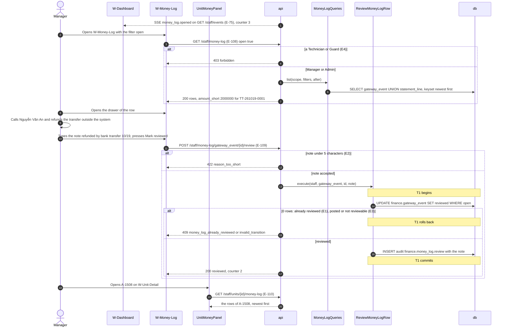

### Step details

| Step | From → To | Call | Data | Rules and checks | Error → handling |
| --- | --- | --- | --- | --- | --- |
| 1 | `api` → `W-Dashboard` | SSE `money_log.opened` | `{ "kind": "gateway_event", "rowId": "…0034", "outcome": "amount_short" }` | From `finance.money_unposted.v1` (DOC-09 §6); the web CMS refreshes the counter and the list (2a, FR-46.4). Without SSE it refetches on focus | — |
| 3 | `W-Money-Log` → `api` | E-108 | `?open=true&limit=50` | Staff only; a resident never sees the log (FR-47.3, DR-84) | E4 → 403 |
| 6 | `MoneyLogQueries` → `db` | The union of DOC-22 §9.4 | keyset `(at, id)` | `ix_gateway_event_building_open` with `open` | — |
| 7 | `api` → `W-Money-Log` | 200 | `{ "kind": "gateway_event", "id": "…0034", "at": "2026-10-19T02:16:05Z", "amount": 2000000, "status": "amount_short", "unitCode": "A-1508", "intentCode": "TT-261019-0001", "reference": "FT2628273991" }` | The drawer shows only `reference`, `description`, `transactionDateTime`, `counterAccountBankName` of the payload, never the payer's account (DR-267 item 7, FR-47.2) | — |
| 9 | Manager | Outside the system | — | The system offers nothing that changes the ledger here: no credit, no match to another charge (DR-84 item 5). A manual payment of whole charges (FL-05), an adjustment line in a later batch (FL-01) or a void of one charge (FL-44) are separate actions the Manager decides alone (3a) | — |
| 11 | `W-Money-Log` → `api` | E-109 | `{ "note": "Đã hoàn tiền qua chuyển khoản 19/10" }` | Note 5 to 1,000 characters | — |
| 12 | `api` → `W-Money-Log` | 422 | `reason_too_short` | — | E2 → "Write at least 5 characters." |
| 14 | `ReviewMoneyLogRow` → `db` | The conditional update of DOC-22 §9.2 | `WHERE outcome NOT IN ('pending','posted') AND reviewed_at IS NULL` | **The arbiter** of two reviews; a row is reviewed once; the ledger never changes (FR-46.1, FR-46.3) | — |
| 15 | `api` → `W-Money-Log` | 409 | `money_log_already_reviewed {reviewedAt}`; `invalid_transition` for a `posted` row or a `matched` line | — | E1 → "This row has already been reviewed."; E3 → "This can no longer be done in its current state." |
| 17 | `api` → `W-Money-Log` | 200 | the row with `reviewedBy` Lê Minh, `reviewedAt`, the note | The counter "money to check" falls by 1 | — |
| 19–20 | `UnitMoneyPanel` → `api` | E-110 | the rows of `A-1508` | `ix_gateway_event_building_unit`; statement lines have no unit and are not in the panel (FR-47.3) | — |

A statement line (`kind = statement_line`, `unmatched` or `statement_only`) is reviewed the same way with the line's own statement (DOC-22 §9.2); dismissing it from `W-Statement` is FL-15.

### Transactions and concurrency

- T1 holds one conditional update and the audit row. Reads take no lock.
- **Two Managers review one row:** the update's `reviewed_at IS NULL`; the second is 409 `money_log_already_reviewed`.
- **The process dies** after T1 commits and before the answer: the row is reviewed; a retry is 409 with `reviewedAt`, which the web CMS shows as already done.

### Errors and handling

| Situation | Step | HTTP status / code | UI behavior and message |
| --- | --- | --- | --- |
| E1 A second review | 15 | 409 `money_log_already_reviewed {reviewedAt}` | "This row has already been reviewed." The drawer reloads |
| E2 A note of 4 characters | 12 | 422 `reason_too_short` | "Write at least 5 characters." |
| E3 A `posted` row; a `matched`, `proposed` statement line | 15 | 409 `invalid_transition` | The "Mark reviewed" button is not shown on such rows |
| E4 A Technician, a Guard, a resident | 4 | 403 `forbidden` | — |

### Required tests

The lower layer is `LG-45…53` (DOC-22).

| ID | Scenario | Expected |
| --- | --- | --- |
| FF-67 | A short transfer of 2,000,000 đ arrives while Lê Minh is on `W-Money-Log` | The SSE event refreshes the list without a reload; the counter rises from 2 to 3; every active Manager and Admin has one inbox entry; Nguyễn Văn An has no inbox entry and no push (FR-46.4, FR-09.2) |
| FF-68 | Lê Minh reviews the row with "Đã hoàn tiền qua chuyển khoản 19/10" | The row shows "Reviewed by Lê Minh" with the note; the counter falls by 1; one audit row; payments, allocations and charges are identical to before (FR-46.1, FR-46.3) |
| FF-69 | Review it again; with a note of 4 characters | 409 and "This row has already been reviewed."; 422 and "Write at least 5 characters." |
| FF-70 | Try to review a `posted` row through the API | 409 `invalid_transition`; the button is absent on screen (FR-46.2) |
| FF-71 | Filters outcome `charge_already_paid`, unit `A-1508`, 2026-10-01…2026-10-31, `reviewed` | Only matching rows, newest first, pages of 50 (FR-47.1) |
| FF-72 | The drawer of a row whose payload holds the payer's account number | The number is not shown and is not in the response (FR-47.2) |
| FF-73 | `UnitMoneyPanel` of `A-1508` on `W-Unit-Detail` and on `W-Debts` | The same rows as `W-Money-Log` filtered by the unit (FR-47.3) |
| FF-74 | A Technician and a resident call E-108 and E-110 | 403 each (EXP-10) |

## FL-08 · Manager follows debt and sends reminders

- **UC / FR:** UC-05 (main flow 1–5, alternative flows 3a, 3b, error flows E1, E2) · FR-12.1…5 · **Screens:** `W-Debts`, `UnitMoneyPanel` · **Endpoints:** E-101 `GET /staff/debts`, E-102 `GET /staff/units/{id}/debt`, E-103 `POST /staff/debts/reminders` · **Events:** `finance.debt_reminder_sent.v1`
- **Trigger:** The due date 2026-10-15 has passed; on 2026-11-25 Lê Minh opens `W-Debts`.
- **Preconditions:** Published or closed batches with `open` charges.

### Participants

| Participant | Kind | Code | Defined in |
| --- | --- | --- | --- |
| `Manager` | Actor | Manager or Admin | DOC-22 §8 |
| `W-Debts`, `UnitMoneyPanel` | Screen | debt list and unit panel | DOC-66 |
| `api` | API | finance staff routes | DOC-51 |
| `DebtQueries` | Query service | `list`, `forUnit` | DOC-22 §8.2 |
| `ResidencyApi` | Contract | `getUnits(ids)` for the page | DOC-22 §2.2 |
| `SendDebtReminders` | Use case | `SendDebtReminders.execute(staff, unitIds)` | DOC-22 §8.5 |
| `db`, `outbox` | Data store | `finance.charge`, `finance.fee_batch`, `finance.debt_reminder`, `platform.rate_bucket` | DOC-15 §5, §10.3 |
| `worker` | Worker | `notification.inbox_on_finance_debt_reminder_sent` | DOC-09 §7 |

### Sequence diagram

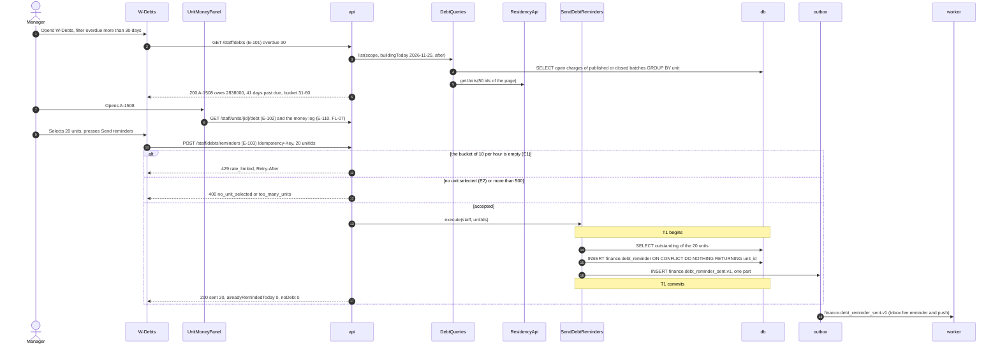

### Step details

| Step | From → To | Call | Data | Rules and checks | Error → handling |
| --- | --- | --- | --- | --- | --- |
| 2 | `W-Debts` → `api` | E-101 | `?overdueMoreThan=30&limit=50` | Keyset `(outstanding, unit_id)` (DOC-22 §8.2) | — |
| 3 | `api` → `DebtQueries` | `list` | `buildingToday` computed **once** per request in `Asia/Ho_Chi_Minh` | Days past due use the building day, never UTC (FR-12.2, DR-09) | — |
| 4 | `DebtQueries` → `db` | The debt query | outstanding = `Σ amount` of `open` charges of `published` or `closed` batches | Draft, paid and void charges never count (FR-12.3); ≤ 50 ms at 5,000 units is planned (FR-12.5) | — |
| 6 | `api` → `W-Debts` | 200 | `{ "unitCode": "A-1508", "outstanding": 2838000, "openCharges": 2, "oldestDue": "2026-10-15", "maxDaysPastDue": 41, "bucket": "31-60" }` | Buckets not yet due, 1–30, 31–60, 61–90, over 90 (FR-12.1, DR-18) | — |
| 8 | `UnitMoneyPanel` → `api` | E-102, E-110 | the unit's open charges with `daysPastDue`, and its log rows | — | — |
| 10 | `W-Debts` → `api` | E-103, marked `R` | `{ "unitIds": [20 ids] }` | 1 to 500 units (DR-267) | — |
| 11 | `api` → `W-Debts` | 429 | `Retry-After: 1800` | `DEBT_REMINDER_PER_HOUR` = 10 calls per hour per account | E1 → "Too many attempts. Try again later." |
| 12 | `api` → `W-Debts` | 400 | `no_unit_selected`; `too_many_units {max: 500}` | — | E2 → "Select at least one unit." / "Select at most 500 units at a time." |
| 15 | `SendDebtReminders` → `db` | Insert with `ON CONFLICT (building_id, unit_id, reminder_day) DO NOTHING` | `reminder_day` = the building day | **The arbiter**: one reminder per unit per building day (FR-12.4); a unit with nothing open is skipped as `noDebt` | — |
| 17 | `api` → `W-Debts` | 200 | `{ "sent": 20, "alreadyRemindedToday": 0, "noDebt": 0 }` | 3a: the same selection 2 hours later answers `{ "sent": 0, "alreadyRemindedToday": 20 }` | — |
| 18 | `outbox` → `worker` | Handler | inbox `fee.reminder` and a push to the members who can see fees | — | — |

3b. The debt aging export is a kind of the export center: FL-40 (DOC-49).

### Transactions and concurrency

- The reads take no lock and do not need one: debt is computed. T1 of the reminder holds the inserts and the event.
- **Two Managers remind the same unit the same day:** the unique key of `debt_reminder`; the second counts it as `alreadyRemindedToday`.
- **The process dies** after T1 commits and before the answer: a retry with the same key replays the answer; a new key answers `alreadyRemindedToday` for the 20 units, so no resident gets a second push.

### Errors and handling

| Situation | Step | HTTP status / code | UI behavior and message |
| --- | --- | --- | --- |
| E1 The eleventh call in an hour | 11 | 429 `rate_limited`, `Retry-After` | "Too many attempts. Try again later." |
| E2 No unit selected | 12 | 400 `no_unit_selected` | "Select at least one unit." |
| More than 500 units | 12 | 400 `too_many_units` | "Select at most 500 units at a time." |
| A Technician or Guard | 2, 10 | 403 `forbidden` | — |

### Required tests

The lower layer is `LG-34…44` (DOC-22).

| ID | Scenario | Expected |
| --- | --- | --- |
| FF-75 | `W-Debts` on 2026-11-25 for `A-1508` (A and B due 2026-10-15) | 2,838,000 đ, 2 open charges, 41 days past due, bucket 31–60 (FR-12.1) |
| FF-76 | The same unit at 23:30 on 2026-10-15 and at 00:30 on 2026-10-16 local | "Not yet due" (0), then 1–30 (1) (FR-12.2) |
| FF-77 | A unit with one open, one paid, one void charge and one in a draft batch | Only the open charge counts (FR-12.3) |
| FF-78 | Remind 20 selected units; again 2 hours later; again at 00:30 the next local day | 20 pushes; `{sent: 0, alreadyRemindedToday: 20}`; 20 pushes (FR-12.4) |
| FF-79 | The eleventh reminder call within an hour | 429 and the message; the button shows the wait |
| FF-80 | No unit selected; 501 units | 400 with each message |
| FF-81 | A selected unit that owes nothing | Counted as `noDebt`; no push |
| FF-82 | `W-Debts` with 5,000 units | The list answers within the planned 50 ms server time (FR-12.5, LG-41) |

## FL-09 · `settle()` turns a confirmation into a payment or a log row

- **UC / FR:** UC-18 (main flow (a) steps 2–7 at ledger level, (b) step 2, (d); alternative flows 3a, 5a, 5b, 3b; error flows E3, E4, E5; the race table) · FR-08.1…3, FR-08.6, FR-08.8, FR-09.1…8, NFR-01 · **Screens:** none (the outcome shows on `Pay-Done`, `Pay-Mismatch`, `W-Money-Log`) · **Endpoints:** none of its own: the callers are E-117 (FL-12), `intent_requery` (FL-13), `finance.cancel_intent_link` (FL-14) and the statement path (FL-15) · **Events:** `finance.payment_posted.v1`, `finance.receipt_issued.v1`, `finance.receipt_render_requested.v1`, `finance.money_unposted.v1`
- **Trigger:** A caller holds an authenticated `Confirmation`: here the webhook for `FT2628273914`, 2,838,000 đ, order code 2,610,153, paid at 09:14:31 local.
- **Preconditions:** The confirmation is authenticated by its source (the HMAC and the receiving account for the webhook, DOC-24; the gateway's own answer for the re-query and the cancel handler; a `PAID` answer for the statement path, DR-35). The building is known from the gateway configuration or the intent.

UC-18 error flows E1 (bad signature), E2 (malformed body), E6 (gateway errors during the re-query) and E7 (the cancel command fails) happen before `settle()` is called and are FL-12, FL-13 and FL-14 (DOC-45) and DOC-23 §8, §9.

### Participants

| Participant | Kind | Code | Defined in |
| --- | --- | --- | --- |
| `caller` | Service | the webhook route of E-117, `intent_requery`, `CancelIntentLink`, the statement matcher | DOC-24, DOC-23 §8, §9, DOC-25 |
| `settle` | Function | `settle(confirmation): SettleResult`, `application/settle.ts` | DOC-23 §2.1, §6 |
| `ChargeAllocator` | Collaborator | `allocate(tx, scope, payment, charges, ctx)` | DOC-22 §2.1 |
| `IdentityApi`, `ResidencyApi` | Contract | the creator's name and member type for the snapshot | DOC-23 §2.2 |
| `db`, `outbox` | Data store | `finance.payment_intent`, `finance.payment_intent_item`, `finance.gateway_event`, `finance.payment`, `finance.allocation`, `finance.charge`, `finance.receipt`, `finance.document_counter`, `audit.audit_log` | DOC-15 |

### FL-09.1 · Record once and classify

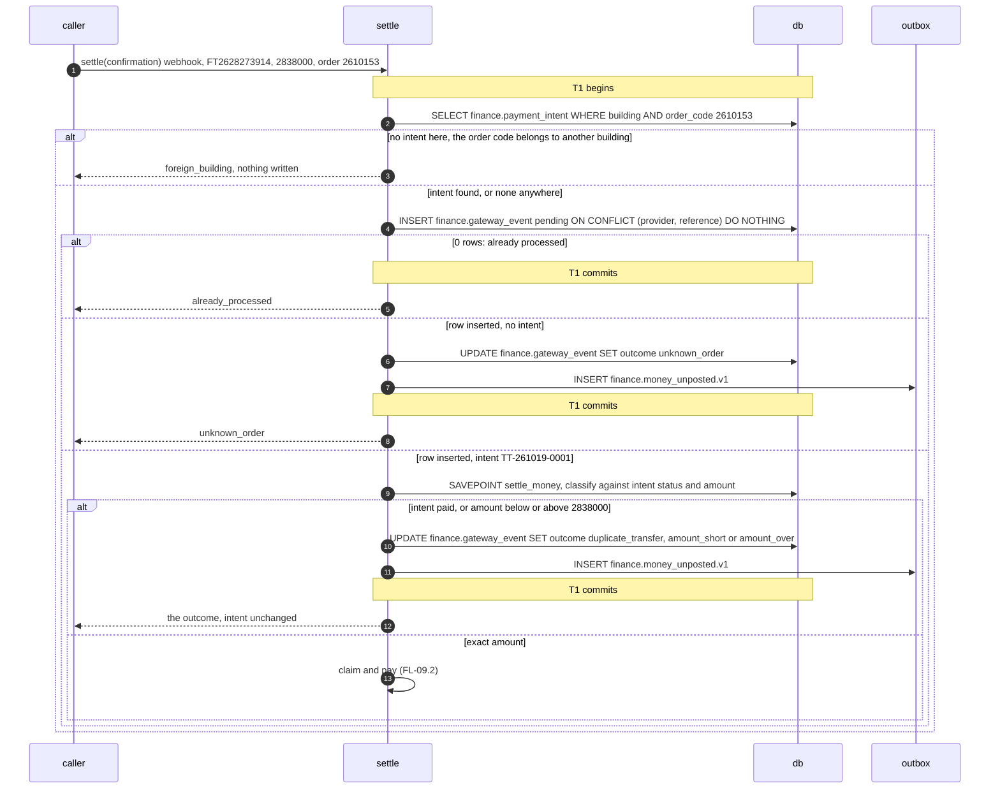

#### Step details

| Step | From → To | Call | Data | Rules and checks | Error → handling |
| --- | --- | --- | --- | --- | --- |
| 1 | caller → `settle` | `settle(c)` | `{ buildingId: "…0001", gatewayConfigId, provider: "payos", reference: "FT2628273914", orderCode: 2610153, amount: 2838000, paidAt: "2026-10-19T02:14:31Z", source: "webhook", payload }` | `paidAt` is the gateway's local `transactionDateTime` read as `Asia/Ho_Chi_Minh` (DR-29) | — |
| 2 | `settle` → `db` | Intent by `(building_id, order_code)` | — | No lock; the claim of FL-09.2 is the arbiter | — |
| 3 | `settle` → caller | `foreign_building` | — | Decided **before** the insert by one unscoped existence read (DOC-23 §6.1), so a misrouted confirmation never occupies its reference; the webhook route writes `webhook_rejection` and answers 400 | — |
| 4 | `settle` → `db` | The insert of DOC-23 §6.1 step 2 | `outcome 'pending'`, `intent_id`, `unit_id` | **The first arbiter** (ADR-0008): a repeated webhook, a re-query or a statement of the same transfer stop here; a concurrent second insert waits for the first commit and returns no row | — |
| 5 | `settle` → caller | `already_processed` | — | The webhook answers 200 (FR-08.2, FR-08.6) | — |
| 6–8 | `settle` → `db`, `outbox` | `unknown_order` | `money_unposted {kind: "gateway_event", outcome: "unknown_order", amount}` | An inbox entry for each Manager and Admin; no intent, no resident message | — |
| 9 | `settle` → `db` | `SAVEPOINT settle_money` and the classification | intent `pending`, amount 2,838,000 | `paid` → `duplicate_transfer` (FR-09.4); below → `amount_short` (FR-09.2); above → `amount_over` (FR-09.3) | — |
| 10–12 | `settle` → `db`, `outbox` | The outcome | — | The intent keeps its status; E-86 then returns `unmatchedTransfer {amount, receivedAt}` for short and over (DR-96, 3b); the resident gets no push and no inbox entry | — |

### FL-09.2 · Claim the intent and pay the charges

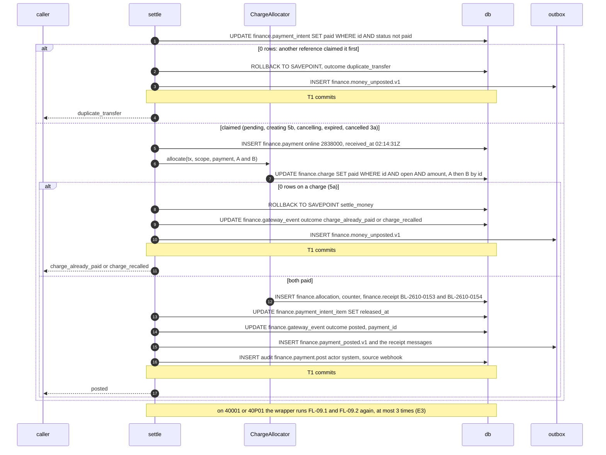

#### Step details

| Step | From → To | Call | Data | Rules and checks | Error → handling |
| --- | --- | --- | --- | --- | --- |
| 1 | `settle` → `db` | The claim of DOC-23 §6.1 step 4 | `WHERE status <> 'paid'` | **The second arbiter**: two different references for one intent both reach here; the second waits, re-evaluates, updates 0 rows (FR-09.4). A late exact confirmation of an `expired`, `cancelled` or `cancelling` intent is claimed (3a, FR-09.7); a `creating` intent too (5b); a `failed` one per DR-281 (proposed) | — |
| 2–4 | `settle` → `db`, `outbox`, caller | `duplicate_transfer` | — | The payer transferred twice; the Manager refunds outside (FL-07) | — |
| 5 | `settle` → `db` | `INSERT finance.payment` | `source online`, `provider payos`, `gateway_reference FT2628273914`, `intent_id`, `payer_name "Nguyễn Văn An"` (the creator; `null` for a deleted account) | `uq_payment_building_intent` and `uq_payment_gateway_reference` are the last net | — |
| 7 | `ChargeAllocator` → `db` | The statement of DOC-22 §4.1 | A (`…00c1`), then B (`…00c2`) | **The third arbiter**: a charge paid in cash or recalled a moment ago gives 0 rows | — |
| 8–11 | `settle` → `db`, `outbox`, caller | Roll back to the savepoint | `paid` → `charge_already_paid` (FR-09.1); `void` → `charge_recalled` (FR-09.5) | The claim, the payment, the first charge's allocation and receipt and the counter increment all go back; the `gateway_event` row stays (DR-14). No part of the intent is posted on its own | — |
| 12 | `ChargeAllocator` → `db` | Allocations and receipts | `BL-2610-0153` (A), `BL-2610-0154` (B); snapshot `payer.name` "Nguyễn Văn An", `method online`, `reference FT2628273914` | DOC-22 §7 | — |
| 13 | `settle` → `db` | Release | the two items | A late confirmation finds none left to release | — |
| 15 | `settle` → `outbox` | `finance.payment_posted.v1` | `{ source: "online", payerAccountId: the creator }` | The resident's next poll of E-86 shows `paid` with the receipts; the inbox and push "Payment received" follow (FR-08.4, FR-08.7) | — |
| 17 | `settle` → caller | `posted` | — | The webhook answers 200 only after this commit (FR-08.6) | — |

### Transactions and concurrency

- One transaction at READ COMMITTED holds the event, the claim, the payment, the allocations, the charges, the receipts, the counter, the release, the outbox rows and the audit row; the savepoint after the event insert keeps the event when a later step fails (DOC-42 §7.3). Nothing calls the network inside it.
- **Arbiters, in order:** the `gateway_event` key, the intent row, each charge in ascending id. The race table of UC-18 maps onto them: five deliveries of one reference (the key, FR-08.2); webhook and re-query of one transfer (the key, then the claim, FR-08.3); two references for one intent (the claim); a manual entry or a recall against the settlement (the charge, FL-05, FL-03.2); a cancel against the confirmation (the claim, DOC-23 §7.2); a statement line and a webhook of one transfer (the key, UC-18 (d)).
- **Retries (E3):** on `40001` or `40P01` the whole function runs again from FL-09.1 step 1, at most 3 times with 20–60 ms jitter (FR-08.8); a confirmation recorded meanwhile by a concurrent caller then ends `already_processed`.
- **The process dies (E4, E5):** before the commit nothing is written, the gateway retries the webhook and the re-query settles within one cycle; after the commit and before the answer, the retry finds the reference and answers 200 (FR-08.6).

### Errors and handling

| Situation | Step | Result | What users see |
| --- | --- | --- | --- |
| E3 `40001`, `40P01` | any | retried up to 3 times; a fourth failure throws and the webhook answers 503 | Nothing; the gateway retries |
| E4 PostgreSQL down mid-settlement | any | throws; nothing committed; 503 | The resident's QR screen keeps polling; the re-query settles once the database is back |
| E5 Killed after commit, before the 200 | FL-09.2 17 | posted once; the retry is `already_processed` | `Pay-Done` on the next poll |
| A broken invariant in the allocator (an `open` charge whose amount differs) | FL-09.2 7 | `charge_already_paid` and an error log (DOC-22 §4.3) | A log row for the Manager |

### Required tests

The lower layer is `IN-24…39` (DOC-23) and `LG-14…17` (DOC-22); these rows check what each outcome leaves in the ledger and on the screens.

| ID | Scenario | Expected |
| --- | --- | --- |
| FF-83 | The exact webhook for `TT-261019-0001` (A + B) | One payment `online` 2,838,000; A and B `paid`; receipts `BL-2610-0153`, `BL-2610-0154`; event `posted`; Nguyễn Văn An's `Pay-VietQR` moves to `Pay-Done` within 5 s at p95 of the webhook (FR-08.1, FR-08.4, FR-08.7) |
| FF-84 | The same reference 5 times in random order | 1 payment, 2 receipts; `W-Transactions` shows one settlement and four duplicates blocked (FR-08.2) |
| FF-85 | 2,000,000 đ for the intent | Nothing posted; the intent `pending`; `Pay-Mismatch` with the neutral message; one `W-Money-Log` row `amount_short`; no push to the resident (FR-09.2) |
| FF-86 | 3,000,000 đ | `amount_over`; the same screens (FR-09.3) |
| FF-87 | A second reference after the intent is `paid` | `duplicate_transfer`; the resident keeps seeing the receipts (FR-09.4) |
| FF-88 | A paid in cash (FL-05) before the exact transfer | `charge_already_paid`; B still open on `Fees`; `Pay-Mismatch` (FR-09.1) |
| FF-89 | The batch of A recalled before the exact transfer | `charge_recalled`; nothing posted (FR-09.5) |
| FF-90 | An exact transfer for an `expired` intent whose charges are open | Posted; `W-Transactions` shows the intent `paid` after `expired` (FR-09.7) |
| FF-91 | An order code no intent has | `unknown_order` in `W-Money-Log`; no intent link (FR-09.6) |
| FF-92 | Webhook and re-query of one transfer at the same instant over 1,000 intents, 10 rounds | 1 payment per intent; 0 deadlocks; 0 errors to the gateway (FR-08.3, EXP-02) |
| FF-93 | `40P01` forced on the first attempt | One payment; one `settle.retry` log line (FR-08.8) |
| FF-94 | The process killed after commit and before the 200; the gateway retries | One payment; the retry answers 200 (FR-08.6) |

## FL-44 · Manager voids one open charge and issues a corrected charge

- **UC / FR:** UC-04 (main flow "void a single open charge" 1–4, alternative flow void-a, error flows E3, E5; race table rows 6, 7) · FR-49.1…5 · **Screens:** `W-Fee-Batch`, `W-Charge-Void`, `W-Fees` · **Endpoints:** E-93 `GET /staff/fee-batches/{id}/charges`, E-100 `POST /staff/charges/{id}/void`, E-90 `POST /staff/fee-batches`, E-170 `POST /staff/fee-batches/{id}/charges`, E-95 `POST /staff/fee-batches/{id}/publish` · **Events:** `finance.charge_voided.v1`, `finance.intent_cancel_requested.v1` (one per cancelled intent)
- **Trigger:** `PH-2610-01` cannot be recalled because other units have paid; the charge billed to `A-1508` belongs to `A-1510`.
- **Preconditions:** The charge is `open` and has no live allocation. E-98 (re-issue) does not apply: it needs a recalled batch and never copies a charge voided alone (DR-265).

### Participants

| Participant | Kind | Code | Defined in |
| --- | --- | --- | --- |
| `Manager` | Actor | Manager or Admin (`VOID_CHARGE_ROLES`) | DOC-21 §3.9 |
| `W-Fee-Batch`, `W-Charge-Void`, `W-Fees` | Screen | batch charge list, void dialog, batch list | DOC-66, DR-72 |
| `api` | API | finance staff routes | DOC-51 |
| `VoidCharge`, `CreateFeeBatch`, `AddDraftCharge` | Use case | DOC-21 §3.9, §3.1, §3.2 | DOC-21 |
| `IntentCancellation` | Port | `cancelHolding(tx, scope, [chargeId], 'charge_voided')` | DOC-23 §5.4 |
| `db`, `outbox` | Data store | `finance.charge`, `finance.payment_intent`, `finance.payment_intent_item`, `finance.fee_batch`, `audit.audit_log` | DOC-15 |
| `worker` | Worker | `notification.inbox_on_finance_charge_voided`, `finance.cancel_intent_link` | DOC-09, DOC-23 §9 |

### FL-44.1 · Void the wrong charge

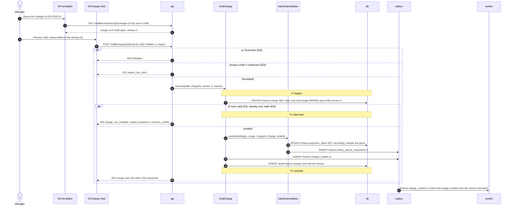

| Step | From → To | Call | Data | Rules and checks | Error → handling |
| --- | --- | --- | --- | --- | --- |
| 5 | `W-Charge-Void` → `api` | E-100 | `If-Match: "2"`, `{ "reason": "Tính nhầm cho căn A-1508" }` | Reason 5 to 500 characters, stored in `charge.void_reason` (FR-49.2) | — |
| 6 | `api` → `W-Charge-Void` | 403 | — | `VOID_CHARGE_ROLES = ['admin', 'manager']` | E3 → the action is not shown to a Technician |
| 7 | `api` → `W-Charge-Void` | 422 | `reason_too_short {min: 5}` | — | E3 → "Write at least 5 characters." |
| 9 | `VoidCharge` → `db` | The statement of DOC-21 §3.9 | `WHERE status = 'open' AND version = 2` | **The arbiter** of the race with a settlement (FR-49.5, row 6) | — |
| 10 | `api` → `W-Charge-Void` | 409 | `charge_not_voidable {status: "paid"}`; `invalid_transition`; `version_conflict` | A paid charge is not voided: an overcharge already paid is offset by a negative adjustment line in a later batch or refunded outside (void-a, DR-19) | E3 → "This charge has been paid and cannot be voided."; E5 → "This was changed by someone else. Reload and try again." |
| 11–13 | `VoidCharge` → `IntentCancellation` → `db`, `outbox` | `cancelHolding` | an intent holding this charge and charge B | The **whole** intent is cancelled (FR-49.3); the resident on `Pay-VietQR` sees it on the next poll and starts again | — |
| 17 | `outbox` → `worker` | Notices | `fee.charge_voided` to the unit's members who can see fees | A late exact confirmation of the cancelled intent finds the charge `void`: `charge_recalled` (FL-09.2) | — |

### FL-44.2 · Issue the corrected charge

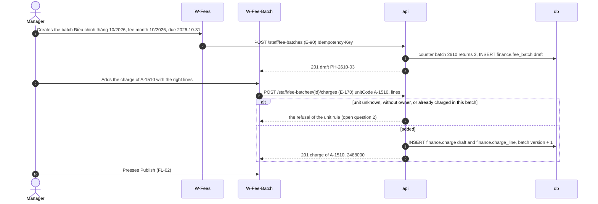

The corrected charge is a new charge in a new batch; the voided one is never reopened (FR-49.4). A batch with a charge voided alone can still be recalled later (FL-03, DR-97).

### Transactions and concurrency

- T1 of FL-44.1 holds the charge update, the intent cancels and releases, the commands, the event and the audit row. FL-44.2 is FL-01's create and draft edit.
- **Void and an exact settlement of the same charge** (row 6): the charge row; void first → the transfer is `charge_recalled`; settlement first → the void is 409 `charge_not_voidable` (LG-79, EXP-04).
- **Void before a recall of its batch** (row 7): FL-03.1 step 9 does not count it (DR-97).
- **The process dies** after T1 commits and before the answer: the charge is void; a retry is 409 `invalid_transition`; the reload shows it.

### Errors and handling

| Situation | Step | HTTP status / code | UI behavior and message |
| --- | --- | --- | --- |
| E3 A `paid` charge or one with a live allocation | 10 | 409 `charge_not_voidable {status}` | "This charge has been paid and cannot be voided." |
| E3 A reason of 4 characters | 7 | 422 `reason_too_short` | "Write at least 5 characters." |
| E3 A Technician | 6 | 403 `forbidden` | — |
| An already void charge | 10 | 409 `invalid_transition` | "This can no longer be done in its current state." |
| E5 Stale `If-Match` | 10 | 409 `version_conflict` | "This was changed by someone else. Reload and try again." |

### Required tests

The lower layer is `LG-76…79` (DOC-21) and `IN-23` (DOC-23).

| ID | Scenario | Expected |
| --- | --- | --- |
| FF-95 | Void the charge of `A-1508` in `PH-2610-01` with "Tính nhầm cho căn A-1508" | The charge `void` (`single`); the other 239 untouched; one audit row; the residents of `A-1508` get `fee.charge_voided`; the charge leaves their `Fees` and the debt (FR-49.1) |
| FF-96 | Void a `paid` charge; with a reason of 4 characters; as a Technician; with `If-Match` 1 | 409 `charge_not_voidable`; 422; 403; 409 `version_conflict` (FR-49.2) |
| FF-97 | The charge is held by an intent that also holds B | The intent `cancelling` as a whole; B released; Nguyễn Văn An's `Pay-VietQR` shows the cancelled payment (FR-49.3) |
| FF-98 | Create `PH-2610-03` and add the charge of `A-1510`, then publish | A new open charge for `A-1510`; the voided charge stays `void` (FR-49.4) |
| FF-99 | Void and an exact webhook for the charge at the same instant (barrier), 200 rounds | Each round: voided with a `charge_recalled` row, or paid with the void 409; never a `void` charge with a live allocation (FR-49.5, EXP-04) |
| FF-100 | A late exact confirmation of the cancelled intent | `charge_recalled` in `W-Money-Log`; nothing posted |
| FF-101 | Void one charge, then recall the batch | The recall succeeds (expected 239) (DR-97) |
| FF-102 | Re-issue after that recall | The voided charge is not copied (DR-265) |

## Decisions made while writing

None. Every rule above comes from DOC-21, DOC-22, DOC-23 and their DRs. Two points are left open below rather than decided here, because the documents that own them (DOC-51 and DOC-66, P2) are not written for these endpoints yet.

## Not in this document

| Topic | Lives in |
| --- | --- |
| The statements, state machines and counters | DOC-21, DOC-22, DOC-23 |
| Tables, constraints and triggers | DOC-15 |
| The resident's online payment, the webhook route, the re-query, the cancel of a link, the statement | DOC-45 (FL-10…16), DOC-24, DOC-25 |
| The import rule catalog with `DQ-` numbers | DOC-18 §2 |
| Endpoint schemas and samples | DOC-51 |
| Screen layouts, states and copy | DOC-58, DOC-66, DOC-68 |
| Notification texts and the push | DOC-31 |
| Receipt and fee-notice PDFs | DOC-34 |
| The debt export | FL-40 (DOC-49), DOC-33 |
| The notice fan-out as a flow | FL-32 (DOC-48) |

## Traceability

| Flow | UC | FR | Design | Lower-layer tests |
| --- | --- | --- | --- | --- |
| FL-01 | UC-01 | FR-01, FR-02, FR-03.4 | DOC-21 §3.1, §3.2, §3.8, §4 | IM-50…77, LG-63, LG-68, LG-69 |
| FL-02 | UC-01 | FR-02.3, FR-03 | DOC-21 §3.3 | LG-61, LG-62, LG-64, LG-80, MC-06 |
| FL-03 | UC-04 | FR-04.1…4, FR-09.5 | DOC-21 §3.5, DOC-22 §10, DOC-23 §5.4, §7 | LG-70…72, LG-81, IN-09, IN-23, IN-36 |
| FL-04 | UC-04 | FR-04.4, FR-04.5, FR-44 | DOC-21 §3.4, §3.6, §3.7 | LG-66, LG-67, LG-73…75, LG-37 |
| FL-05 | UC-02 | FR-05 | DOC-22 §4, §5, §7 | LG-01…20, LG-28…33 |
| FL-06 | UC-02 | FR-06 | DOC-22 §6 | LG-19, LG-21…27 |
| FL-07 | UC-21 | FR-46, FR-47 | DOC-22 §9 | LG-45…53 |
| FL-08 | UC-05 | FR-12 | DOC-22 §8 | LG-34…44 |
| FL-09 | UC-18 | FR-08, FR-09, NFR-01 | DOC-23 §6, §7, DOC-22 §4.3 | IN-24…39, LG-14…17 |
| FL-44 | UC-04 | FR-49 | DOC-21 §3.9, DOC-23 §5.4 | LG-76…79, IN-23 |

## Open questions

1. **The units without a charge on `W-Fee-Batch`** (UC-01 step 6): no endpoint returns the units of the building that have no charge in a draft. E-93 lists charges only. DOC-51 (the finance group, P2) and DOC-66 decide whether E-93 gains a `missing` view (finance reads `ResidencyApi` for the unit list) or the screen computes it from the unit list.
2. **The refusals of E-170** (FL-44.2, FL-01): DOC-21 §3.2 says a unit is "looked up like an import row" but gives no HTTP status or code for an unknown unit, a unit without owner or a unit already charged in the draft. DOC-51 fixes them with the finance endpoint specifications (P2).
3. **`reason_too_long`** is used by DOC-21 and DOC-22 (a void or recall reason over 500 characters) but has no row in DOC-42 §5 and no copy in DOC-68; it is owed there.
