# Identity and household flows

> Status: **Approved** (Owner, 2026-10-21) · Updated: 2026-10-26 (DR-268: the object store participant is `s3`, not `r2`) · 2026-10-20 · DOC-46
> Depends on: [DOC-43](README.md), [DOC-04](../../01-product/use-cases.md) (UC-13, UC-14, UC-15, UC-17, UC-27), [DOC-03](../../01-product/requirements.md) (FR-13…18, FR-39, FR-41, FR-45, FR-50), [DOC-26](../identity-and-sessions.md), [DOC-27](../residency-and-memberships.md), [DOC-35](../audit-privacy-and-terms.md) §9, §10, [DOC-36](../building-configuration-and-demo.md) §7, [DOC-37](../files-and-uploads.md), [DOC-18](../../05-data/data-quality-rules.md) §1, [DOC-42](../error-handling.md), [DOC-51](../../07-api/api-endpoints.md), [DOC-50](../../07-api/api-guidelines.md), [DR](../../00-decision-register.md) (DR-36…41, 59, 74, 127…141, DR-142…), [DOC-06](../../02-glossary.md)
> Main readers: P1-10…P1-17, P1-14 (staff, unit and resident API), P1-21, P1-22, DOC-57, DOC-60, DOC-61, DOC-64, DOC-65, DOC-67, DOC-88, EXP-09, EXP-10

This document holds the nine flows of identity and household: how a staff member signs in, is invited and resets a password; how a resident signs in with an OTP, accepts the terms and picks a unit; how an owner manages members; how a Manager transfers ownership, changes a login phone and imports units and owners; how an account is deleted; and how an Admin confirms a sensitive action with step-up. Each flow expands a use case of DOC-04 and is written to template A.8 (DOC-43 §1). The mechanisms (statements, buckets, state machines) are DOC-26 and DOC-27; the endpoint schemas are DOC-51; this document says which call crosses which boundary, in which transaction, and what the user sees if the process dies after each commit.

Every new decision in this document is recorded as DR-147, DR-149 and DR-150 and summarized in "Decisions made while writing".

## Flows in this document

| FL | Flow | UC | Endpoints | Sub-flows |
| --- | --- | --- | --- | --- |
| [FL-17](#fl-17) | Staff member signs in and meets the lockout | UC-17 | E-05, E-11 | |
| [FL-18](#fl-18) | Staff invite, resend and password reset | UC-17 | E-40, E-08, E-06, E-07 | FL-18.1…3 |
| [FL-19](#fl-19) | Resident signs in with an OTP and accepts the terms | UC-14, UC-27 | E-09, E-10, E-16, E-17 | FL-19.1…3 |
| [FL-20](#fl-20) | Resident picks a unit and every request is authorized against it | UC-14 | E-13, E-15, E-22, E-26 | FL-20.1…2 |
| [FL-21](#fl-21) | Owner adds, locks or removes a member | UC-15 | E-26…E-29, E-64, E-69 | FL-21.1…3 |
| [FL-22](#fl-22) | Manager transfers ownership or changes a login phone | UC-13 | E-59, E-61, E-65, E-67 | FL-22.1…2 |
| [FL-23](#fl-23) | Import units and owners | UC-13 | E-36, E-37, E-71…E-74 | FL-23.1…2 |
| [FL-24](#fl-24) | Account deletion | UC-27 | E-18, E-19, E-63, E-68 | FL-24.1…3 |
| [FL-45](#fl-45) | Admin confirms a sensitive action with step-up | UC-17 | E-38, E-50, E-40, E-42 | FL-45.1…2 |

<a id="fl-17"></a>

## FL-17 · Staff member signs in and meets the lockout

- **UC / FR:** UC-17 (alternative flow A, error flow E3; the weak password of E4 is FL-18.3), UC-26 (reload of the web CMS) · FR-13.1, FR-13.2, FR-13.4, FR-45.4, FR-16.4 · **Screens:** `W-Login`, `S-Login`, `S-Login-Error` · **Endpoints:** E-05 `POST /auth/staff/login`, E-11 `POST /auth/refresh` · **Events:** `identity.session_revoked.v1` (only when the 11th sign-in evicts the oldest session)
- **Trigger:** The staff member presses "Sign in" on the web CMS (`client: "web"`) or in the staff app (`client: "app"`); the web CMS later reloads and restores its session.
- **Preconditions:** The account exists with `status = 'active'` and a password (an invited person has set one through FL-18.3). The client is not below `MIN_APP_VERSION[staff]` (the staff app only, DOC-50 §8).

### Participants

| Participant | Kind | Code | Defined in |
| --- | --- | --- | --- |
| `Staff member` | Actor | any of Admin, Manager, Technician, Guard | DOC-26 §1.2 |
| `W-Login` | Screen | web CMS sign-in (screen file owed) | DOC-64 |
| `S-Login`, `S-Login-Error` | Screen | staff app sign-in and its error state (screen files owed) | DOC-61 |
| `api` | API | `POST /auth/staff/login` route of `modules/identity` | DOC-51 E-05 |
| `StaffSignIn` | Service | `StaffSignIn.execute(i)` | DOC-26 §2.3, §4.1 |
| `BuildingApi` | Contract | `BuildingApi.getSettings(buildingId)` | DOC-36 §3 |
| `TokenSigner` | Service | `TokenSigner.signAccess(claims)` | DOC-26 §2.1, §3.1 |
| `db` | Data store | `identity.rate_bucket`, `identity.staff_account`, `identity.refresh_family`, `identity.refresh_token` | DOC-16 §4.1, §4.5, §4.6 |

### Sequence diagram

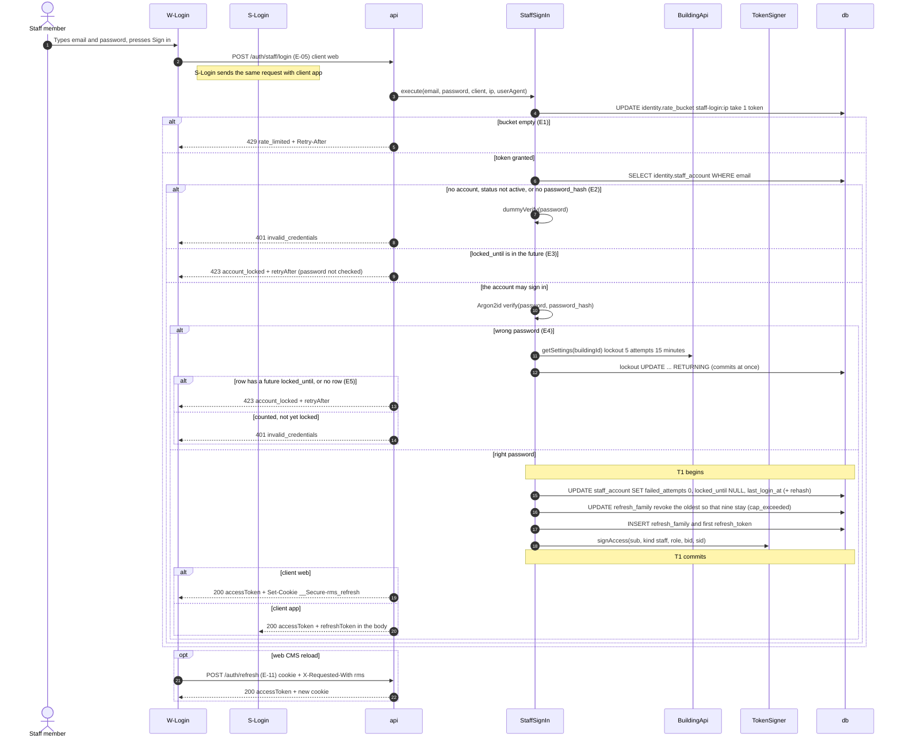

### Step details

| Step | From → To | Call | Data | Rules and checks | Error → handling |
| --- | --- | --- | --- | --- | --- |
| 1 | Staff member → `W-Login` | Form submit | `minh.le@sunrise.example`, `Sunrise2026!` | The form checks only that the email is an address | — |
| 2 | `W-Login` → `api` | `POST /auth/staff/login` (E-05) | `{ "email": "minh.le@sunrise.example", "password": "Sunrise2026!", "client": "web" }`; header `X-App-Id: web`. The staff app sends `X-App-Id: staff`, `X-App-Version: 1.0.0`, `client: "app"` | Email at most 254 characters and a valid address, password at most 128: a longer password is refused before any hashing (DOC-26 §4.1). The app version gate runs first for the app (DOC-50 §8) | 400 `validation_failed` → field messages; 426 `upgrade_required` → "Update the app to continue." |
| 3 | `api` → `StaffSignIn` | `execute(i)` | `ip` from the trusted-proxy rule (DOC-39), `userAgent` | No transaction yet | — |
| 4 | `StaffSignIn` → `db` | Bucket upsert (DOC-16 §4.6) | key `staff-login:ip:203.0.113.7`, capacity 30, refill 30 per 15 min | Every attempt spends one token, successful or not (FR-13.2). The refusal comes before the account is read | Empty → step 5 |
| 5 | `api` → `W-Login` | Answer | `Retry-After: 120` | — | 429 `rate_limited` → "Too many attempts. Try again later." (E1) |
| 6 | `StaffSignIn` → `db` | `SELECT … FROM identity.staff_account WHERE email = :email` | `email` is `citext`, case does not matter | One indexed read | — |
| 7 | `StaffSignIn` | `PasswordHasher.dummyVerify(password)` | One Argon2id verify against a fixed hash of the configured parameters | Keeps the timing class of an unknown email equal to a wrong password (ER-20, DR-128) | — |
| 8 | `api` → `W-Login` | Answer | `{ "error": { "code": "invalid_credentials", … } }` | The same body for an unknown email, an `invited`, `locked` or `disabled` account, an account with no `password_hash`, and (step 14) a wrong password | 401 → "The email or password is not correct." (E2) |
| 9 | `api` → `W-Login` | Answer | `{ "error": { "code": "account_locked", "details": { "retryAfter": 900 } } }` + `Retry-After: 900` | The password is **not** checked: the correct password is refused during the lock (FR-13.1) | 423 → "Too many attempts. Try again in 15 minutes." (E3; `{minutes}` is `ceil(retryAfter / 60)`, copy owed to DOC-68) |
| 10 | `StaffSignIn` | `PasswordHasher.verify` | Argon2id, about 19 ms on the development machine (DOC-26 §4.2) | — | — |
| 11 | `StaffSignIn` → `BuildingApi` | `getSettings(buildingId)` | `lockout.maxAttempts` 5, `lockout.minutes` 15 | Read from the 60-second cache (DOC-36 §3.1); never hard-coded in SQL | — |
| 12 | `StaffSignIn` → `db` | Lockout statement (DOC-16 §4.1) | `:max_attempts 5`, `:lock_minutes 15` | **The arbiter**: one `UPDATE … RETURNING`; the `WHERE` returns no row for an account that is locked now, so 20 parallel wrong passwords leave `failed_attempts = 5` (AU-01). Committed before the answer | — |
| 13 | `api` → `W-Login` | Answer | as step 9 | The attempt that reaches the limit is the first to see 423; a parallel attempt that finds the account already locked (0 rows) answers 423 too | 423 as step 9 (E5) |
| 14 | `api` → `W-Login` | Answer | as step 8 | No count of tries left is returned: an unknown email has no counter (DR-128) | 401 → "The email or password is not correct." (E4; `S-Login-Error` in the app) |
| 15 | `StaffSignIn` → `db` | `UPDATE identity.staff_account SET failed_attempts = 0, locked_until = NULL, last_login_at = now() [, password_hash = :rehash] WHERE id = :id` | — | T1 begins. `needsRehash(password_hash)` compares `m` and `t` with `ARGON2_MEMORY_KIB`, `ARGON2_TIME_COST`; the new hash is stored in the same statement (AU-11) | — |
| 16 | `StaffSignIn` → `db` | Cap statement (DOC-16 §4.5) | keeps nine live families | One `identity.session_revoked.v1` per evicted family, reason `cap_exceeded` (FR-45.3) | — |
| 17 | `StaffSignIn` → `db` | Insert the family and its first token | `kind staff`, `user_agent`, absolute limit 90 days, sliding 30 days, the token stored as SHA-256 | — | — |
| 18 | `StaffSignIn` → `TokenSigner` | `signAccess` | ES256, `kid k2`, 15 minutes, claims `sub`, `kind`, `role`, `bid`, `sid` | `role` is informational; the guard reads it from the database on every request (DOC-26 §3.1). T1 commits after this step | — |
| 19 | `api` → `W-Login` | `200` | `{ "accessToken": "eyJ…", "expiresIn": 900, "staff": { "id": "0192f3c4-5a1e-7000-8000-000000000051", "fullName": "Lê Minh", "role": "manager", "buildingId": "0192f3c4-5a1e-7000-8000-000000000001", "language": "vi" } }` and `Set-Cookie: __Secure-rms_refresh=…; Path=/api/v1/auth; Secure; HttpOnly; SameSite=Strict; Max-Age=2592000` | The SPA keeps the access token in memory; the refresh token never appears in the body (DOC-26 §3.3) | — |
| 20 | `api` → `S-Login` | `200` | The same body plus `"refreshToken": "Zm9vYmFy…"` and no cookie | The staff app stores the refresh token in `expo-secure-store` | — |
| 21 | `W-Login` → `api` | `POST /auth/refresh` (E-11) | No body; the cookie travels with `credentials: 'include'` and the header `X-Requested-With: rms` | Without the header 403 `forbidden`; a body `refreshToken` wins over the cookie (DOC-26 §3.3). The refresh re-checks the account: a manually `locked` or `disabled` account is revoked with 401, a temporary lockout does not stop it (DOC-26 §3.5 step 5) | 401 → the SPA shows `W-Login` (E9) |
| 22 | `api` → `W-Login` | `200` | New `accessToken` and a new cookie | — | — |

### Transactions and concurrency

- The bucket upsert (step 4) and the lockout statement (step 12) are single statements that commit by themselves, so a refusal still counts. T1 (steps 15 to 18) holds the counter reset, the eviction, the new family and the first token; nothing is sent to the network inside it.
- **Arbiter of the lockout race:** the `WHERE` clause of the lockout `UPDATE`. Twenty parallel wrong passwords produce `failed_attempts = 5` and a lock of 15 minutes; the attempts that arrive after the fifth see 0 rows and answer 423 (AU-01).
- **Two sign-ins of one account at once** are independent: each inserts its own family. At the eleventh live family the cap statement revokes the oldest.
- **The process dies** after step 12 and before the answer: the failure is counted, the screen shows a network error and the next attempt counts again. After T1 commits and before the answer: a family exists that the client never received; the staff member signs in again and the orphan is listed in "Sessions" (UC-26) until evicted or revoked.

### Errors and handling

| Situation | Step | HTTP status / code | UI behavior and message |
| --- | --- | --- | --- |
| E1 More than 30 attempts from one IP in 15 minutes | 5 | 429 `rate_limited`, `Retry-After` | `W-Login` / `S-Login-Error`: "Too many attempts. Try again later." The button is disabled for `Retry-After` seconds |
| E2 Unknown email, `invited`, `locked`, `disabled`, no `password_hash` | 8 | 401 `invalid_credentials` | "The email or password is not correct." No counter moves; no hint of the cause |
| E3 Temporary lock (UC-17 E3) | 9 | 423 `account_locked`, `details.retryAfter` | "Too many attempts. Try again in 15 minutes." The correct password is also refused |
| E4 Wrong password | 14 | 401 `invalid_credentials` | "The email or password is not correct." (`S-Login-Error` in the app). No "tries left" (DR-128) |
| E5 The wrong password that reaches 5, or a parallel attempt that finds the lock | 13 | 423 `account_locked` | As E3 |
| E6 Staff app below `MIN_APP_VERSION[staff]` | 2 | 426 `upgrade_required`, `details {minVersion, storeUrl}` | "Update the app to continue." Answered before any credential is read |
| E7 Password longer than 128 characters, malformed email | 2 | 400 `validation_failed` (`max_length`, `format`) | Field message; nothing is hashed |
| E8 Database down or pool exhausted | 6 to 18 | 503 `service_unavailable`, `Retry-After` | "The service is busy. Try again in a moment." |
| E9 Refresh of a manually locked or disabled account | 21 | 401 `unauthenticated` | The SPA returns to `W-Login`; the family is revoked (`account_locked`, `account_disabled`) |

### Required tests

Prefix `FI-` (this document; DOC-88 indexes it). The lower layer is covered by `AU-01…11`, `AU-34`, `AU-39`, `AU-40`; these rows check the journey.

| ID | Scenario | Expected |
| --- | --- | --- |
| FI-01 | Manager `minh.le@sunrise.example` signs in on `W-Login` with the right password, then the browser reloads | Step 20 answer has no `refreshToken` and one cookie with the attributes of AU-39; after the reload `POST /auth/refresh` with the header is 200 and the SPA shows the dashboard without a second sign-in (AU-39, AU-40) |
| FI-02 | Technician signs in on `S-Login` (`client: "app"`) | The body holds `refreshToken`, no `Set-Cookie` is sent, and the app stores the token in the secure store |
| FI-03 | Five wrong passwords, then the right one, then the right one 15 minutes 1 second later (fake clock) | Attempts 1 to 4 show "The email or password is not correct."; attempt 5 shows "Too many attempts. Try again in 15 minutes." (`retryAfter` 900); the right password at once is 423 and Argon2 is not called; at +15 min 1 s it is 200 and `failed_attempts` is 0 (AU-01, AU-02, AU-03) |
| FI-04 | An unknown email and a wrong password for a known email | Status, body bytes and the visible message are identical; both call Argon2 once (AU-09) |
| FI-05 | Right password for an `invited`, a manually `locked` and a `disabled` account; then the Manager unlocks the locked one | Each of the three shows "The email or password is not correct."; no counter moves; after `POST /staff/accounts/{id}/unlock` the same credentials sign in (AU-08, AU-10) |
| FI-06 | One IP makes 31 attempts across 31 emails in 15 minutes | The 31st is 429 with "Too many attempts. Try again later." even with a right password; the first 30 were answered normally (AU-04) |
| FI-07 | 20 parallel wrong passwords for one account, then the Manager's right password | Every response is 401 or 423, none is 500; `failed_attempts` is 5; the right password is 423 (AU-01) |
| FI-08 | Account whose stored hash has `m = 4096`; right password | 200 and the stored hash now has `m = 19456, t = 2` (AU-11) |
| FI-09 | The same staff member signs in 11 times on different devices | Ten live families; the oldest device's next refresh is 401 and the staff app returns to `S-Login`; one `identity.session_revoked.v1` with reason `cap_exceeded` (AU-34) |
| FI-10 | Staff app 0.9.0 with `MIN_APP_VERSION[staff] = 1.0.0` sends a wrong password; the web CMS sends `X-App-Id: web` without a version | The app gets 426 "Update the app to continue." and no counter moves; the web CMS gets the ordinary 401 (gate order, DOC-50 §8) |

<a id="fl-18"></a>

## FL-18 · Staff invite, resend and password reset

- **UC / FR:** UC-17 (main flow "create a staff account", alternative flows B and C, error flows E1, E4, E8) · FR-13.3, FR-13.4, FR-13.5, FR-13.6, FR-14.1, FR-14.2, FR-14.5, FR-45.1 · **Screens:** `W-Staff-New`, `W-Staff`, `W-Reset`, `W-Forgot-Sent`, `S-Forgot`, `S-Forgot-Sent` · **Endpoints:** E-40 `POST /staff/accounts`, E-08 `POST /auth/staff/invite/resend`, E-06 `POST /auth/staff/password-reset`, E-07 `POST /auth/staff/password` · **Events:** `identity.mail_requested.v1` (kinds `staff_invite`, `password_reset`), `identity.session_revoked.v1`
- **Trigger:** An Admin or a Manager creates an account or resends an invitation; a staff member asks for a reset link; the staff member opens a link and sets a password.
- **Preconditions:** For the invite, the actor is signed in on the web CMS as Admin (any role) or Manager (Technician and Guard only). For the reset, the account is `active`; for the invite, `invited`. The links open in a browser, never in the apps (DR-39).

The flow has three sub-flows that link to each other: **FL-18.1** invite and resend, **FL-18.2** request a reset, **FL-18.3** set the password from a link (invite and reset share it). The tables of one `password_token` row: `reset` lives 30 minutes (`RESET_TTL_MINUTES`), `invite` 24 hours (`INVITE_TTL_HOURS`), one live token per staff member and kind (DOC-26 §4.3, DOC-16 §4.4).

### Participants

| Participant | Kind | Code | Defined in |
| --- | --- | --- | --- |
| `Admin`, `Manager` | Actor | creates and resends | DOC-26 §4.4 |
| `Staff member` | Actor | the invitee or the person who forgot the password | DOC-26 §4.3 |
| `W-Staff-New`, `W-Staff` | Screen | create form and staff list with the row action "Resend invite" | DOC-65, DOC-67 |
| `W-Login`, `W-Forgot-Sent`, `W-Reset` | Screen | web CMS sign-in (with its "Forgot password" form, DOC-64 to confirm), confirmation, set-password page | DOC-64 |
| `S-Forgot`, `S-Forgot-Sent` | Screen | staff app reset request and confirmation | DOC-61 |
| `api` | API | routes `POST /staff/accounts` (E-40), `/auth/staff/*` (E-06, E-07, E-08) | DOC-51 |
| `StaffGuard` | Guard | `staff('admin', 'manager')` | DOC-12 §5.3 |
| `StaffAccounts` | Service | `StaffAccounts.create`, `StaffAccounts.resendInvite` | DOC-26 §4.4 |
| `StaffPasswordFlows` | Service | `StaffPasswordFlows.request`, `StaffPasswordFlows.setPassword` | DOC-26 §1.1, §4.3 |
| `IdentityApi` | Contract | `IdentityApi.verifyStepUp` | DOC-09 §7.3, DOC-26 §4.5 |
| `AuditApi` | Contract | `AuditApi.record` | DOC-35 §3 |
| `db` | Data store | `identity.staff_account`, `identity.password_token`, `identity.rate_bucket`, `identity.refresh_family`, `identity.refresh_token`, `platform.idempotency_key` | DOC-16 §4 |
| `outbox` | Data store | `identity.outbox_messages` | DOC-09 §4 |
| `worker` | Worker | handler `identity.send_mail` | DOC-26 §5.4, DOC-38 |
| `mail-relay` | External | SMTP relay through `Mailer` | DOC-26 §2.1 |

### FL-18.1 · Create an account, send the invite, resend it

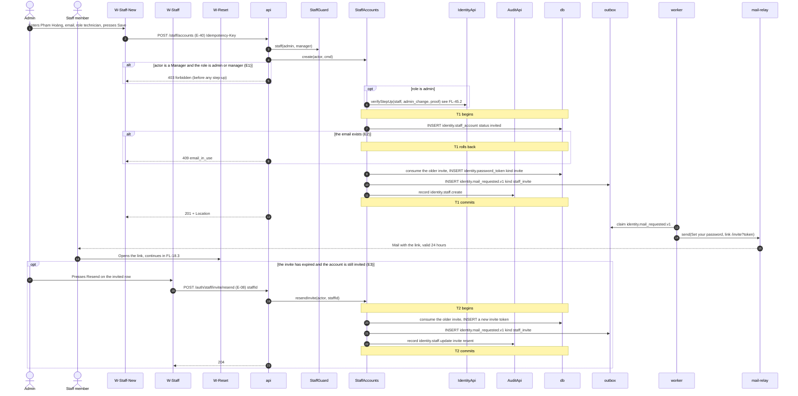

| Step | From → To | Call | Data | Rules and checks | Error → handling |
| --- | --- | --- | --- | --- | --- |
| 1 | Admin → `W-Staff-New` | Form | `Phạm Hoàng`, `hoang.pham@sunrise.example`, role Technician, language `vi` | — | — |
| 2 | `W-Staff-New` → `api` | `POST /staff/accounts` (E-40) | `{ "fullName": "Phạm Hoàng", "email": "hoang.pham@sunrise.example", "role": "technician", "language": "vi" }`, `Idempotency-Key: 5d0e7b4a-3c1f-4e0a-9d52-1f7a6c2b8e90` | The key is required (DOC-51 §2); a retry with the same key and body replays the 201 with `Idempotent-Replayed: true` and sends no second mail | 400 `validation_failed` → field messages |
| 3 | `api` → `StaffGuard` | `staff('admin', 'manager')` | Role and status read from `IdentityApi.getStaff` | A Technician, a Guard or a resident token is refused | 401, 403 `forbidden` |
| 4 | `api` → `StaffAccounts` | `create(actor, cmd)` | — | One `uow.run` (DOC-12 §8.3) | — |
| 5 | → `W-Staff-New` | Answer | | A Manager may create only Technician and Guard (DR-133 rule 1); the role rule runs before any step-up is asked (FR-14.1) | 403 `forbidden` → "You do not have permission to do this." |
| 6 | `StaffAccounts` → `IdentityApi` | `verifyStepUp(staff, 'admin_change', { password, code })` | `"stepUp"` in the body of step 2 | Only for `role: "admin"`; the proof is checked inside T1, so a failure rolls the insert back (FL-45.2) | 403 `step_up_required`, `step_up_failed` |
| 7 | `StaffAccounts` → `db` | `INSERT INTO identity.staff_account (…, status) VALUES (…, 'invited')` | `building_id` from the token, `password_hash` null | The language defaults to the building's `defaultLanguage`; the email is `citext` and unique across buildings (DOC-16 §4.1) | `23505` on the email constraint → E2 |
| 8 | → `W-Staff-New` | Answer | | The mapped constraint, not a pre-check, decides (no race window) | 409 `email_in_use` → "This email is already used." |
| 9 | `StaffAccounts` → `db` | Statements of DOC-16 §4.4 | New token: 256 random bits, stored as SHA-256, `expires_at = now() + 24 h` | The partial unique index `password_token_one_live` makes a second invite consume the first | — |
| 10 | `StaffAccounts` → `outbox` | `identity.mail_requested.v1` | `kind staff_invite`, `staffId`, `secretEnc` (the raw token sealed), `expiresAt` +24 h | The raw token travels only in `secretEnc` and in the link (DR-117) | — |
| 11 | `StaffAccounts` → `AuditApi` | `record` | `identity.staff.create`, object `staff_account`, `changes` list the fields, no token | A failed audit insert fails the mutation (DOC-35 §3.7) | 500 `internal_error` |
| 12 | `api` → `W-Staff-New` | `201` | `{ "id": "0192f3c4-5a1e-7000-8000-000000000071", "fullName": "Phạm Hoàng", "email": "hoang.pham@sunrise.example", "role": "technician", "status": "invited", "version": 1 }` | `W-Staff` then lists the row with "Resend invite" | — |
| 13 to 15 | `worker` → `mail-relay` | `identity.send_mail` | Decrypts `secretEnc` in memory, renders in the person's `language`, subject "Set your password" | Link `https://admin.<domain>/invite?token=…`; a command past `expiresAt` is skipped | Provider failure → the outbox retries (class `default`); the Admin sees "The email may be delayed." (UC-17 E8) |
| 16 | `Staff member` → `W-Reset` | Opens the link | | Continues in FL-18.3 | — |
| 17 to 18 | Admin → `W-Staff` → `api` | `POST /auth/staff/invite/resend` (E-08) | `{ "staffId": "0192f3c4-5a1e-7000-8000-000000000071" }` | Admin; Manager only for Technician and Guard. There is no `Idempotency-Key`: every call consumes the older token and issues a new link | 403 `forbidden`; 404 `not_found` |
| 19 to 22 | `StaffAccounts` → `db`, `outbox`, `AuditApi` | Resend | The status must be `invited` | Otherwise the use case answers 409 `invalid_transition` (`details {entity: "staff_account", status, action}`); the audit row is `identity.staff.update` with `details.invite = "resent"` (DOC-26 §4.4) | 409 `invalid_transition` |
| 23 | `api` → `W-Staff` | `204` | — | The new link works for 24 hours; the older one is refused | — |

### FL-18.2 · Request a reset link

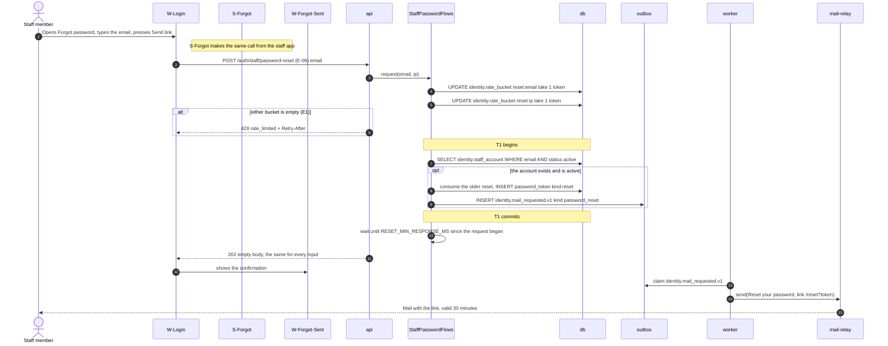

| Step | From → To | Call | Data | Rules and checks | Error → handling |
| --- | --- | --- | --- | --- | --- |
| 1 | Staff member → `W-Login` | Form | `minh.le@sunrise.example` | The web form is a state of `W-Login` (DOC-64 to confirm); `W-Profile` offers the same request to a signed-in member (UC-26 4a) | — |
| 2 | `W-Login` → `api` | `POST /auth/staff/password-reset` (E-06) | `{ "email": "minh.le@sunrise.example" }` | Public; no `Idempotency-Key` | 400 `validation_failed` for a malformed email |
| 3 | `api` → `StaffPasswordFlows` | `request(email, ip)` | — | — | — |
| 4 | `StaffPasswordFlows` → `db` | Bucket upsert | `reset:email:minh.le@sunrise.example`, capacity 3, refill 3 per hour | The bucket is keyed by the input, not by whether the account exists, so a 429 reveals nothing (FR-13.4) | Empty → E1 |
| 5 | `StaffPasswordFlows` → `db` | Bucket upsert | `reset:ip:203.0.113.7`, capacity 10, refill 10 per hour | As step 4 | Empty → E1 |
| 6 | → `W-Login` | Answer | `Retry-After: 1200` | — | 429 `rate_limited` → "Too many attempts. Try again later." |
| 7 | `StaffPasswordFlows` → `db` | `SELECT … FROM identity.staff_account WHERE email = :email AND status = 'active'` | — | An unknown, `locked`, `disabled` or `invited` account does nothing and still answers 202; an invited person asks for a resend, a locked person is helped by a Manager (DOC-26 §4.3) | — |
| 8 | `StaffPasswordFlows` → `db` | Consume the older `reset`, insert the new one | `expires_at = now() + 30 min` | One live reset per staff member | — |
| 9 | `StaffPasswordFlows` → `outbox` | `identity.mail_requested.v1` | `kind password_reset`, `secretEnc` the raw token | — | — |
| 10 | `StaffPasswordFlows` | Response floor | Waits until `RESET_MIN_RESPONSE_MS` (150 ms) have passed since the request began | The active path does two more writes than the others; the floor makes the time class equal (DR-150). The wait is after the commit, so no connection is held | — |
| 11 | `api` → `W-Login` | `202` | `{}` | Same status, body and headers for a known and an unknown email (FR-13.4) | — |
| 12 | `W-Login` → `W-Forgot-Sent` | Navigation | — | The screen says the link is valid 30 minutes and allows a new request after 45 s (client timer; the server limit is the bucket) | — |
| 13 to 15 | `worker` → `mail-relay` | `identity.send_mail` | Subject "Reset your password"; link `https://admin.<domain>/reset?token=…` | An expired command is skipped | Provider down → retried; the screen cannot know (the answer was 202) |

### FL-18.3 · Set the password from an invite or reset link

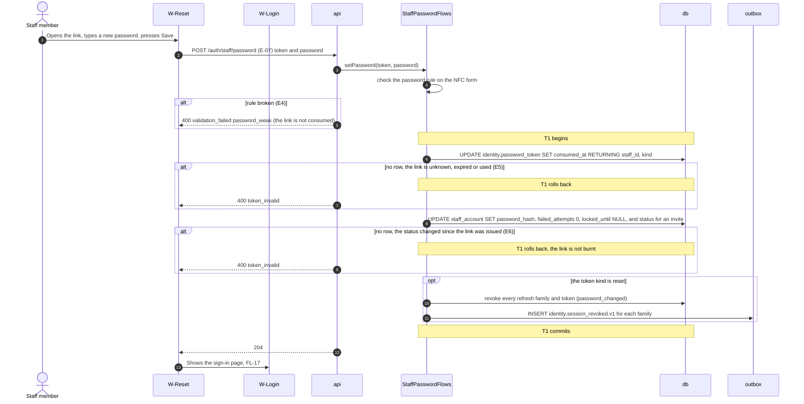

| Step | From → To | Call | Data | Rules and checks | Error → handling |
| --- | --- | --- | --- | --- | --- |
| 1 | Staff member → `W-Reset` | Opens `https://admin.<domain>/reset?token=…` | — | The page does not call the API on load, so a mail scanner that opens the link burns nothing | — |
| 2 | `W-Reset` → `api` | `POST /auth/staff/password` (E-07) | `{ "token": "kqJ5…", "password": "Sunrise2027!" }` | Public; the same endpoint serves invite and reset (the token carries the kind) | 400 `validation_failed` |
| 3 | `api` → `StaffPasswordFlows` | `setPassword(token, password)` | — | — | — |
| 4 | `StaffPasswordFlows` | Password rule (DOC-26 §4.2) | 8 to 128 characters after NFC, at least one letter and one digit, never trimmed | **Checked before the token is touched**, so a weak password does not burn the link (AU-07) | — |
| 5 | `api` → `W-Reset` | Answer | `details [{ "path": "password", "code": "password_weak", "message": "…" }]` | `abc12345` is accepted; `abcdefgh`, `12345678`, `abc1234` and 129 characters are refused | 400 → the password-rule message (copy owed to DOC-68) |
| 6 | `StaffPasswordFlows` → `db` | `UPDATE identity.password_token SET consumed_at = now() WHERE token_hash = :hash AND kind IN ('reset','invite') AND consumed_at IS NULL AND expires_at > now() RETURNING staff_id, kind` | — | **The arbiter**: single use and expiry in one statement (DOC-26 §4.3, AU-S05). Unknown, expired (23 h passes, 25 h does not) and used links answer alike | 0 rows → E5 |
| 7 | → `W-Reset` | Answer | — | — | 400 `token_invalid` → "This link is no longer valid. Ask for a new one." |
| 8 | `StaffPasswordFlows` → `db` | `UPDATE identity.staff_account SET password_hash = :hash, failed_attempts = 0, locked_until = NULL [, status = 'active'] WHERE id = :id AND status = :expected` | `:expected` is `invited` for an invite (and the status becomes `active`) and `active` for a reset | A reset clears a temporary lock but never a manual `locked` (FR-13.6, FR-14.3). The status condition is DR-150 | 0 rows → E6 |
| 9 | → `W-Reset` | Answer | — | The consume of step 6 is rolled back with the rest, so the Manager's decision to lock stays in force and the person is told the link is no longer valid | 400 `token_invalid` |
| 10 | `StaffPasswordFlows` → `db` | Revoke every family and token | reason `password_changed` | Reset only; an invite has no sessions (DOC-26 §3.8) | — |
| 11 | `StaffPasswordFlows` → `outbox` | `identity.session_revoked.v1` | one per family | Consumers close SSE streams and drop device tokens | — |
| 12 | `api` → `W-Reset` | `204` | — | No tokens are issued: the person signs in next | — |
| 13 | `W-Reset` → `W-Login` | Navigation | — | — | — |

### Transactions and concurrency

- **T1 of FL-18.1** holds the account, the older token consumed, the new token, the mail command, the audit row (and the step-up proof for an Admin); a failure of any of them leaves no account and no mail. The mail is sent by the worker after the commit, so a process that dies after the commit leaves an `invited` account and a command that the relay delivers on restart.
- **T1 of FL-18.2** holds the token swap and the command. The two bucket upserts are autocommit statements before it.
- **T1 of FL-18.3** holds the consume, the password, the status change and the revocation. **Arbiter of a double click** and of **two uses of one link**: the single-use `UPDATE` of step 6 (one wins, the other gets `token_invalid`). **Arbiter of a newer link:** the unique index `password_token_one_live` (a new token consumes the older before it is inserted); the older link answers `token_invalid`.
- **If the process dies** after T1 of FL-18.3 commits and before the answer, the password is set and every session revoked; the person sees a network error, tries the link again, gets `token_invalid`, and signs in with the new password or asks for another reset.

### Errors and handling

| Situation | Step | HTTP status / code | UI behavior and message |
| --- | --- | --- | --- |
| E1 Manager creates an Admin or a Manager (UC-17 E1) | 18.1 step 5 | 403 `forbidden` | `W-Staff-New`: "You do not have permission to do this." No account, no mail |
| E2 Email already used | 18.1 step 8 | 409 `email_in_use` | "This email is already used." |
| E3 Invite older than 24 h | 18.3 step 6 | 400 `token_invalid` | `W-Reset`: "This link is no longer valid. Ask for a new one." The account stays `invited`; the Admin presses Resend (FL-18.1) |
| E4 Weak password (UC-17 E4) | 18.3 step 5 | 400 `validation_failed` rule `password_weak` | The password-rule message; the link still works |
| E5 Reset or invite link unknown, expired or used | 18.3 step 7 | 400 `token_invalid` | As E3 |
| E6 Account locked, disabled or already active since the link was issued | 18.3 step 9 | 400 `token_invalid` | As E3; the account keeps its status |
| E7 Reset bucket empty (3 per hour per email, 10 per hour per IP) | 18.2 step 6 | 429 `rate_limited`, `Retry-After` | "Too many attempts. Try again later." The answer is the same for an unknown email |
| E8 Mail relay down | 18.1 steps 13 to 15, 18.2 | 201 / 202 as usual; the outbox retries | Admin: "The email may be delayed." (UC-17 E8). A reset requester sees the normal confirmation |
| E9 Step-up missing or failed for an Admin role | 18.1 step 6 | 403 `step_up_required`, `step_up_failed` | `W-Step-Up` opens (FL-45) |
| E10 Resend for an account that is not `invited` | 18.1 step 19 | 409 `invalid_transition` | "This can no longer be done in its current state." |

### Required tests

Lower layer: `AU-05`, `AU-06`, `AU-07`, `AU-08`, `AU-12`, `AU-13`, `AU-16`, `AU-19`, `AU-30`. These rows check the journey and what the person sees.

| ID | Scenario | Expected |
| --- | --- | --- |
| FI-11 | Admin creates Technician Phạm Hoàng; the invitee opens the link at 23 h and sets `Sunrise2027!`; then signs in | 201 `status: "invited"`; one `staff_invite` command whose payload has no token in clear; the set-password is 204 and the status is `active`; FL-17 sign-in succeeds; one `identity.staff.create` audit row |
| FI-12 | Manager creates a Technician, then an Admin, then a Manager | 201, 403, 403; the two refusals leave no row, no mail, and ask for no step-up (FR-14.1) |
| FI-13 | Admin creates an Admin without `stepUp`, then with a valid proof | 403 `step_up_required`, then 201; every active Admin gets a `step_up_notice` only for the second (FR-14.5) |
| FI-14 | The same create sent twice with one `Idempotency-Key`, then with another body, then with a used email | The second is the stored 201 with `Idempotent-Replayed: true` and one mail in total; the other body is 422 `idempotency_key_reuse`; the used email is 409 `email_in_use` |
| FI-15 | The invite link is used at 25 h; the Admin presses Resend; the old and the new link are used | `token_invalid` "This link is no longer valid. Ask for a new one."; the account is still `invited`; after the resend the new link works and the old one is refused (AU-13) |
| FI-16 | Reset requested for a known email and an unknown email; a fourth request in an hour; an eleventh from one IP | Identical `202` bodies and headers for the first two; only the known email has a command; the fourth for the email and the eleventh for the IP are 429; the median response time differs by under 20 ms over 50 runs of each (AU-06, FR-13.4) |
| FI-17 | A Manager signed in on the web and in the staff app resets the password | `204`; both families revoked (`password_changed`), two `session_revoked` events; the app's next refresh is 401 and it returns to `S-Login`; a temporary lock set earlier is cleared and the new password signs in at once (AU-08) |
| FI-18 | `abcdefgh` then `abc12345` with the same reset link | 400 `password_weak` with the token still live; then 204 (AU-07) |
| FI-19 | Two reset links requested; the first is used, then the second; the second is used again and at 30 min 01 s | The first is `token_invalid` (consumed by the second request); the second works once; a second use and a late use are `token_invalid` (AU-05) |
| FI-20 | The Admin locks the invitee's account (status `locked`) after the reset request; the link is then used | 400 `token_invalid`; the status stays `locked`; the token is not consumed (a later Manager unlock does not revive the link, a new request does) |

<a id="fl-19"></a>

## FL-19 · Resident signs in with an OTP and accepts the terms

- **UC / FR:** UC-14 (main flow 1 to 4, alternative flows 2a, 3a, 3b, error flows E1 to E4, E6), UC-27 (terms) · FR-15.1…15.7, FR-39.1, FR-41.1, FR-16.3 · **Screens:** `Login`, `Login-Error`, `OTP`, `Terms`, `Terms-Update` · **Endpoints:** E-09 `POST /auth/otp`, E-10 `POST /auth/otp/verify`, E-03 `GET /public/config`, E-16 `GET /me/terms`, E-17 `POST /me/terms`; the session then continues in FL-20 with E-13, E-15 and E-22 · **Events:** `identity.sms_requested.v1`, `identity.session_revoked.v1` (only when the 11th sign-in evicts a session)
- **Trigger:** The resident opens the resident app with no valid session and types a phone number; or, with a valid session, the Admin has published a new terms version.
- **Preconditions:** The phone is registered by the Manager (UC-13) or by an owner (UC-15) and its account is `active` or `deletion_requested`. The app is at or above `MIN_APP_VERSION[resident]`.

Sub-flows: **FL-19.1** request the code, **FL-19.2** verify and sign in, **FL-19.3** accept the terms and meet them again.

### Participants

| Participant | Kind | Code | Defined in |
| --- | --- | --- | --- |
| `Resident` | Actor | any member type | DOC-02 |
| `Login`, `Login-Error`, `OTP` | Screen | resident app sign-in screens (files owed) | DOC-57 |
| `Terms`, `Terms-Update` | Screen | first acceptance and re-acceptance (files owed) | DOC-60 |
| `apiClient` | Client | the Eden client of `@rms/mobile-core`; sets `X-App-Id: resident`, `X-App-Version`, `Accept-Language`, `X-Unit-Id` | DOC-55 |
| `api` | API | routes `/auth/otp*` (E-09, E-10), `/public/config` (E-03), `/me/terms` (E-16, E-17) | DOC-51 |
| `ResidentOtp` | Service | `ResidentOtp.request(i)`, `ResidentOtp.verify(i)` | DOC-26 §2.3, §5 |
| `TokenSigner` | Service | `TokenSigner.signAccess` | DOC-26 §3.1 |
| `ResidencyApi` | Contract | `ResidencyApi.listActiveMemberships(accountId)` | DOC-27 §2.1 |
| `UnitGuard` | Guard | `unit(capability)` with the terms gate | DOC-27 §3.1, DOC-35 §9.2 |
| `AcceptTerms` | Service | the building module's use case behind E-17 (class name owed to DOC-35 §9.3 / DOC-36) | DOC-35 §9.3 |
| `db` | Data store | `identity.resident_account`, `identity.otp_challenge`, `identity.rate_bucket`, `identity.outbox_messages`, `identity.refresh_family`, `identity.refresh_token`, `building.terms_version`, `building.terms_acceptance` | DOC-16 §4, DOC-17 §1.4 |
| `outbox` | Data store | `identity.outbox_messages` | DOC-09 §4 |
| `worker` | Worker | handler `identity.send_sms` | DOC-26 §5.4 |
| `sms-provider` | External | the provider behind `SmsSender` (DR-68) | DOC-26 §5.5 |

### FL-19.1 · Request the code

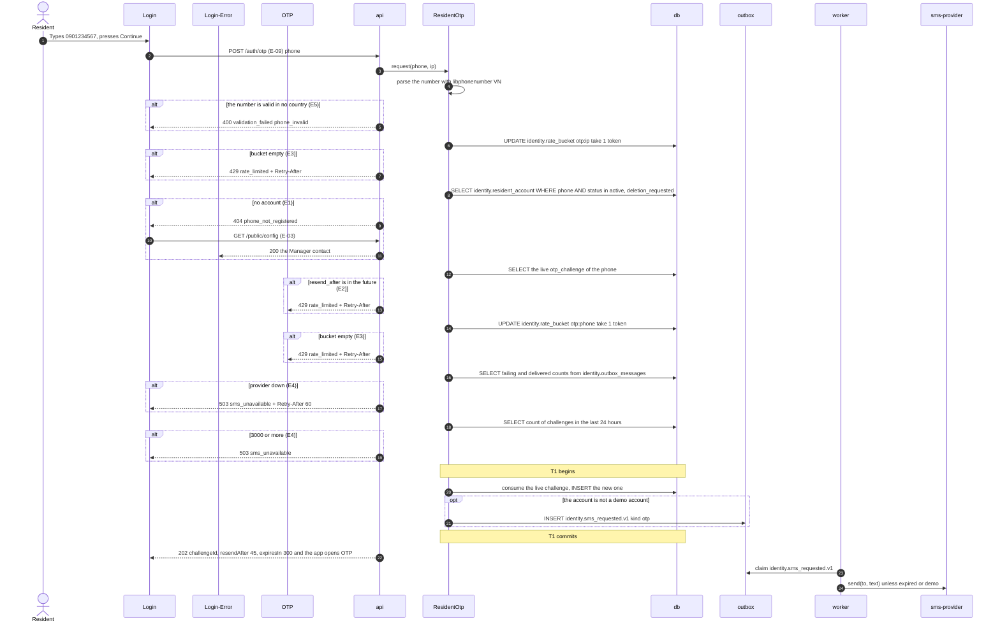

| Step | From → To | Call | Data | Rules and checks | Error → handling |
| --- | --- | --- | --- | --- | --- |
| 1 | Resident → `Login` | Form | `0901234567` | The app may format as typed; it sends what was typed | — |
| 2 | `Login` → `api` | `POST /auth/otp` (E-09) | `{ "phone": "0901234567" }`; headers `X-App-Id: resident`, `X-App-Version: 1.0.0` | Public. The version gate runs first (426) | 426 `upgrade_required` → "Update the app to continue." (UC-14 E6) |
| 3 | `api` → `ResidentOtp` | `request(phone, ip)` | — | The order of steps 4 to 19 is the order of DOC-26 §5.1: a refused request spends as little as possible | — |
| 4 | `ResidentOtp` | `libphonenumber-js/max`, region `VN` | `0901234567` → `+84901234567` | A number valid nowhere is refused before any bucket | — |
| 5 | → `Login` | Answer | `details [{ "path": "phone", "code": "phone_invalid" }]` | — | 400 `validation_failed` → field message (copy owed to DOC-68) |
| 6 | `ResidentOtp` → `db` | Bucket upsert | `otp:ip:203.0.113.7`, capacity 20 (`OTP_PER_IP_PER_HOUR`) | **Every** request spends a token, whatever its outcome, so enumerating phones is throttled (DR-134) | Empty → E3 |
| 7 | → `Login` | Answer | `Retry-After: 900` | — | 429 `rate_limited` → "Too many attempts. Try again later." |
| 8 | `ResidentOtp` → `db` | `SELECT … FROM identity.resident_account WHERE phone = :e164 AND status IN ('active','deletion_requested')` | — | A `deleted:<id>` phone never matches | None → E1 |
| 9 | → `Login` | Answer | — | No challenge and no SMS (FR-15.1). The enumeration trade-off is accepted (DR-37) | 404 `phone_not_registered` → `Login-Error` |
| 10 to 11 | `Login` → `api` → `Login-Error` | `GET /public/config` (E-03) | The Manager's contact, the app minimum, the languages | Public, no token; `Login-Error` shows how to contact the Manager (no self sign-up) | "This number is not registered." plus the contact |
| 12 | `ResidentOtp` → `db` | Resend gate | `resend_after` of the live challenge | A refused resend spends no token | Inside the 45 seconds → E2 |
| 13 | → `OTP` | Answer | `Retry-After: 15` | The screen disables "Resend" and counts down from `Retry-After` | 429 `rate_limited` → "Too many attempts. Try again later." |
| 14 | `ResidentOtp` → `db` | Bucket upsert | `otp:phone:+84901234567`, capacity 5 (`OTP_PER_PHONE_PER_HOUR`) | An issued OTP and an owner's member invitation draw from this bucket | Empty → E3 |
| 15 | → `OTP` | Answer | — | — | 429 `rate_limited` |
| 16 | `ResidentOtp` → `db` | SMS-down query over `identity.outbox_messages` of the last 10 minutes (DOC-26 §5.4) | `failing`, `delivered` | Down when `failing >= SMS_DOWN_FAILURES` (3) and `delivered = 0`; skipped for a demo account | Down → E4 |
| 17 | → `Login` | Answer | `Retry-After: 60` | — | 503 `sms_unavailable` → "Could not send the code. Try again later." |
| 18 | `ResidentOtp` → `db` | `SELECT count(*) FROM identity.otp_challenge WHERE created_at > now() - interval '24 hours'` | — | A rolling 24 hours; `OTP_DAILY_CAP` 3,000; at the cap the counter `otp_daily_cap_reached_total` rises and the alert fires (FR-15.5) | At the cap → E4 |
| 19 | → `Login` | Answer | — | — | 503 `sms_unavailable` |
| 20 | `ResidentOtp` → `db` | Consume and insert (DOC-16 §4.3) | `expires_at = now() + 5 min`, `resend_after = now() + 45 s`, `code_hmac = HMAC-SHA256(OTP_HMAC_KEY, "otp:" ‖ challenge_id ‖ ":" ‖ code)` | The partial unique index `otp_challenge_one_live_per_phone` lets one live challenge exist per phone. The code is 6 digits, uniform by rejection | — |
| 21 | `ResidentOtp` → `outbox` | `identity.sms_requested.v1` | `kind otp`, `accountId`, `secretEnc` (the code sealed), `expiresAt` +5 min | Not written for an `is_demo` account (the challenge row is real, its hash unknown to anyone: DOC-26 §5.3) | — |
| 22 | `api` → `Login` | `202` | `{ "challengeId": "0192f3c4-5a1e-7000-8000-000000000071", "resendAfter": 45, "expiresIn": 300 }` | The app opens `OTP` with the countdown | — |
| 23 to 24 | `worker` → `sms-provider` | `identity.send_sms` | Text `482913 la ma xac thuc dang nhap SUNRISE. Co hieu luc 5 phut. Khong chia se ma nay.` (84 characters) | A command past `expiresAt` returns normally and sends nothing; a provider failure retries (class `sms`, 3 attempts) | Dropped after 5 minutes; the resident presses Resend |

### FL-19.2 · Verify the code and sign in

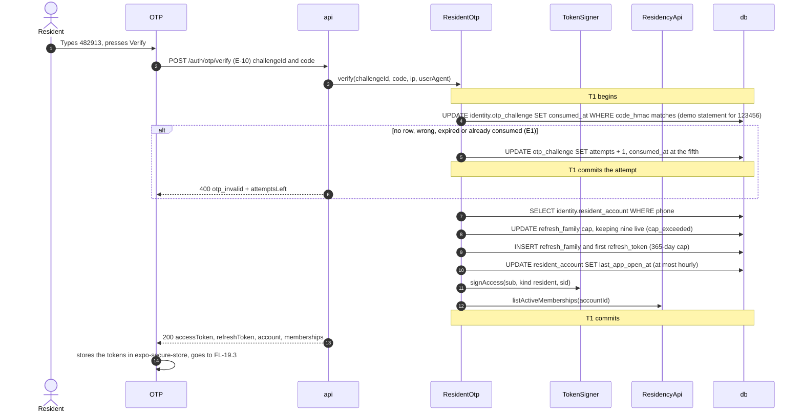

| Step | From → To | Call | Data | Rules and checks | Error → handling |
| --- | --- | --- | --- | --- | --- |
| 1 | Resident → `OTP` | Form | `482913` | — | — |
| 2 | `OTP` → `api` | `POST /auth/otp/verify` (E-10) | `{ "challengeId": "0192f3c4-5a1e-7000-8000-000000000071", "code": "482913" }` | Public | 400 `validation_failed` |
| 3 | `api` → `ResidentOtp` | `verify(i)` | — | — | — |
| 4 | `ResidentOtp` → `db` | Consume (DOC-16 §4.3): `code_hmac` equal, not consumed, not expired, `attempts < 5` | — | **The arbiter**: two taps on "Verify" cannot both sign in; the second finds `consumed_at` set (FR-15.4). For `code = DEMO_FIXED_OTP` the statement of DOC-26 §5.3 is used and accepts the fixed code only when the phone belongs to an `is_demo` account | 0 rows → E1 |
| 5 | `ResidentOtp` → `db` | Attempts statement (DOC-16 §4.3) | `attempts + 1`, consumed at the fifth | Committed **before** the exception is thrown, so the count survives (DOC-26 §5.2) | — |
| 6 | `api` → `OTP` | Answer | `{ "error": { "code": "otp_invalid", "details": { "attemptsLeft": 3 } } }` | `attemptsLeft` is 4, 3, 2, 1, 0; an unknown, expired or consumed challenge answers `attemptsLeft: 0` | 400 → "Wrong code. 3 tries left." |
| 7 | `ResidentOtp` → `db` | Load the account | `phone`, `status IN ('active','deletion_requested')` | An account deleted since the request has no row: answered as `otp_invalid` with `attemptsLeft: 0` | 400 `otp_invalid` |
| 8 | `ResidentOtp` → `db` | Cap statement (DOC-16 §4.5) | nine families stay | One `identity.session_revoked.v1` per evicted family | — |
| 9 | `ResidentOtp` → `db` | Insert the family and the first token | `user_agent`, absolute limit 365 days, sliding 180 days | — | — |
| 10 | `ResidentOtp` → `db` | `UPDATE … SET last_app_open_at = now() WHERE id = :id AND (last_app_open_at IS NULL OR last_app_open_at < now() - interval '1 hour')` | — | At most one write an hour (AU-S09) | — |
| 11 | `ResidentOtp` → `TokenSigner` | `signAccess` | `{ sub, kind: "resident", sid }` | No building and no unit in the token (ADR-0010) | — |
| 12 | `ResidentOtp` → `ResidencyApi` | `listActiveMemberships(accountId)` | — | Only `active` memberships, ordered by unit code | — |
| 13 | `api` → `OTP` | `200` | `{ "accessToken": "eyJ…", "expiresIn": 900, "refreshToken": "Zm9vYmFy…", "account": { "id": "0192f3c4-5a1e-7000-8000-000000000041", "phone": "+84901234567", "displayName": "Trần Thị Hoa", "language": "vi", "pushEnabled": true }, "memberships": [ { "membershipId": "…61", "unitId": "…21", "unitCode": "A-1508", "memberType": "owner", "canPay": true }, { "membershipId": "…62", "unitId": "…22", "unitCode": "A-0703", "memberType": "tenant", "canPay": false } ] }` | An empty `memberships` is not an error (UC-14 E7, FL-20.1) | — |
| 14 | `OTP` | Store the tokens | — | The refresh token goes to `expo-secure-store` only | — |

### FL-19.3 · Accept the terms, and meet a new version

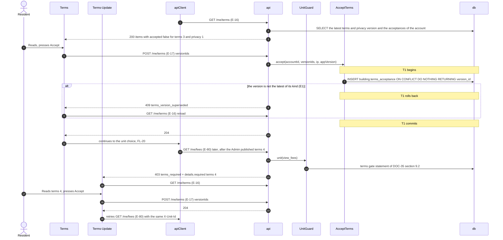

| Step | From → To | Call | Data | Rules and checks | Error → handling |
| --- | --- | --- | --- | --- | --- |
| 1 | `apiClient` → `api` | `GET /me/terms` (E-16) | token only, no `X-Unit-Id` | The app calls it after every sign-in and opens `Terms` when an item has `accepted: false`. The route is token-only, so it has no terms gate (DOC-51 §1.2) | 401 |
| 2 | `api` → `db` | Latest version of each kind for the building of the account's active memberships, left-joined to the account's acceptances (DOC-35 §9.3) | — | An account with no active membership has no building: `items` is empty and `Terms` is not shown (UC-14 E7) | — |
| 3 | `api` → `Terms` | `200` | One item per kind: `kind`, `version`, `versionId`, `accepted`, `text` in the caller's language (the exact shape is E-16) | The text is the restricted Markdown of DOC-36 §8 | — |
| 4 | Resident → `Terms` | Reads and accepts | — | The button accepts all unaccepted items in one call | — |
| 5 | `Terms` → `api` | `POST /me/terms` (E-17) | `{ "versionIds": ["018f…c4", "018f…c3"] }` | Several kinds in one call (DOC-35 §9.3) | — |
| 6 | `api` → `AcceptTerms` | `accept(…)` | `ip`, `appVersion` | — | — |
| 7 | `AcceptTerms` → `db` | `INSERT INTO building.terms_acceptance … SELECT … WHERE v.version = (SELECT max(version) …) ON CONFLICT (account_id, version_id) DO NOTHING RETURNING version_id` | — | A second acceptance of the same version keeps the first and answers 204 (UC-27 E3). An unknown or foreign id is 404 `not_found` | 404 `not_found` |
| 8 | `api` → `Terms` | Answer | `details.current [{ "kind": "terms", "version": 4, "versionId": "018f…c9" }]` | The Admin published a newer version between steps 1 and 5 | 409 `terms_version_superseded` → "The terms were updated. Please read the new version." |
| 9 | `Terms` → `api` | `GET /me/terms` (E-16) | — | The app reloads and shows the new text | — |
| 10 | `api` → `Terms` | `204` | — | — | — |
| 11 | `Terms` → `apiClient` | Navigation | — | `Unit-Pick` or the home screen, FL-20.1 | — |
| 12 | `apiClient` → `api` | Any unit route, here `GET /me/fees` (E-80) | `X-Unit-Id` | The route is built in P2; any `unit: <capability>` route behaves the same | — |
| 13 | `api` → `UnitGuard` | `unit('view_fees')` | — | The gate runs after the membership is known and before the capability (FL-20.2 step 8) | — |
| 14 | `UnitGuard` → `db` | The gate statement of DOC-35 §9.2 | no cache: two API containers cannot share an invalidation (DR-125) | One indexed read per resident request | — |
| 15 | `api` → `Terms-Update` | Answer | `{ "error": { "code": "terms_required", "details": { "required": [ { "kind": "terms", "version": 4, "versionId": "018f…c9" } ] } } }` | The very next request after the publish is refused (FR-41.1); only the kinds that changed are listed | 403 → `Terms-Update`: "Please accept the updated terms to continue." |
| 16 | `Terms-Update` → `api` | `GET /me/terms` (E-16) | as step 1 | — | — |
| 17 | Resident → `Terms-Update` | Reads and accepts | — | — | — |
| 18 | `Terms-Update` → `api` | `POST /me/terms` (E-17) | `{ "versionIds": ["018f…c9"] }` | As step 5 | As step 8 |
| 19 | `api` → `Terms-Update` | `204` | — | — | — |
| 20 | `Terms-Update` → `apiClient` | Retry | The original request, unchanged | The app keeps the request that was refused and repeats it once | — |

### Transactions and concurrency

- **FL-19.1 T1** (consume the older challenge, insert the new one, write the SMS command) is one transaction: no challenge without a command, and no command without a challenge, except for a demo account where there is deliberately no command. **Arbiter of two requests at once:** `otp_challenge_one_live_per_phone`; the later request finds the resend gate (step 12).
- **FL-19.2 T1** holds the consume, the family and the first token: the code is consumed only if the session exists. The attempts statement commits before the 400 is thrown (DOC-26 §5.2), so five parallel guesses are at most five attempts. **Arbiter of two parallel verifies:** `UPDATE … WHERE consumed_at IS NULL`; exactly one session is created (AU-23).
- **FL-19.3 T1** is one insert per version; the `ON CONFLICT` makes the call idempotent. **Arbiter of a publish racing an acceptance:** `v.version = max(version)` inside the insert statement.
- **If the process dies** after FL-19.1 T1 commits and before the answer: a live challenge and a command exist, the SMS arrives, the app shows a network error, and "Continue" again hits the resend gate (429 with `Retry-After`) while the code in the SMS is still valid. After FL-19.2 T1 commits and before the answer: the code is consumed and a session exists that the app never received; the resident requests a new code (429 until `resend_after`, then allowed).

### Errors and handling

| Situation | Step | HTTP status / code | UI behavior and message |
| --- | --- | --- | --- |
| E1 Unregistered phone (UC-14 2a) | 19.1 step 9 | 404 `phone_not_registered` | `Login-Error`: "This number is not registered." and the Manager's contact from E-03 |
| E2 Resend inside 45 seconds (UC-14 3a) | 19.1 step 13 | 429 `rate_limited`, `Retry-After` | `OTP`: "Resend" disabled with a countdown; the message "Too many attempts. Try again later." if tapped |
| E3 Phone bucket (5 per hour) or IP bucket (20 per hour) empty | 19.1 steps 7, 15 | 429 `rate_limited` | "Too many attempts. Try again later." |
| E4 SMS provider down, or 3,000 challenges in 24 hours (UC-14 E4) | 19.1 steps 17, 19 | 503 `sms_unavailable`, `Retry-After: 60` | "Could not send the code. Try again later." |
| E5 Number valid nowhere | 19.1 step 5 | 400 `validation_failed` `phone_invalid` | Field message under the phone input |
| E6 Wrong, expired or consumed code (UC-14 E1, E2) | 19.2 step 6 | 400 `otp_invalid`, `details.attemptsLeft` | "Wrong code. 3 tries left." After 0 tries the screen offers "Resend" |
| E7 App below `MIN_APP_VERSION[resident]` (UC-14 E6) | 19.1 step 2 | 426 `upgrade_required` | "Update the app to continue." with the store link |
| E8 Version superseded while accepting | 19.3 step 8 | 409 `terms_version_superseded` | "The terms were updated. Please read the new version." |
| E9 A new terms version after sign-in (UC-27 E1) | 19.3 step 15 | 403 `terms_required` | `Terms-Update`: "Please accept the updated terms to continue." |
| E10 Database down | any | 503 `service_unavailable` | "The service is busy. Try again in a moment." |

### Required tests

Lower layer: `AU-20…30`, `AU-51…54`, `BD-` terms tests. These rows check the journey and what the resident sees.

| ID | Scenario | Expected |
| --- | --- | --- |
| FI-21 | Registered owner `0901234567` requests a code, verifies it, accepts terms 3 and privacy 1 | 202 with `resendAfter: 45`; exactly one `sms_requested` command whose payload holds no code and no number (AU-30); verify is 200 with two memberships; `GET /me/terms` has two items `accepted: false`; `POST /me/terms` is 204; `GET /me/terms` now has `accepted: true` |
| FI-22 | An unregistered number `0900000999` | 404 `phone_not_registered`; zero outbox rows; the app calls `GET /public/config` and `Login-Error` shows the Manager contact (AU-20) |
| FI-23 | Five wrong codes, then the right one | The screen shows "Wrong code. 4 tries left." down to "Wrong code. 0 tries left."; the right code afterwards is `otp_invalid` with `attemptsLeft: 0`; a resend after 45 s issues a new challenge whose code works (AU-22) |
| FI-24 | Resend at 30 s and at 46 s; verify at 4 min 59 s and 5 min 01 s (fake clock) | 429 with `Retry-After: 15` and a disabled button; 202 at 46 s and the earlier code is refused; the code is accepted at 4:59 and refused at 5:01 (AU-21) |
| FI-25 | Demo account `0900000001` (`is_demo`) and a real account with the code `123456` | The demo request is 202 with a challenge row and no command; `123456` is 200 for the demo account; for the real account it is `otp_invalid` and the attempt is counted (AU-26) |
| FI-26 | Three SMS commands fail in 10 minutes with none delivered; then one is delivered | `Login` shows "Could not send the code. Try again later." with `Retry-After: 60`; after a delivery the next request is 202 (AU-29) |
| FI-27 | A sixth request in a row for one phone (the burst of 5 is used); a 21st challenge in a row from one IP across different phones | Both are 429 "Too many attempts. Try again later."; the IP limit applies to unregistered phones too (AU-24) |
| FI-28 | Double tap on "Verify" (two parallel `POST /auth/otp/verify`) | Exactly one 200 and one 400 `otp_invalid`; one family exists; the app ends signed in once (AU-23) |
| FI-29 | The Admin publishes terms 4 while a signed-in owner has the app open; the owner's next request | `GET /me/fees` is 403 `terms_required` with `required` naming terms 4 only; `Terms-Update` shows; accept is 204; the repeated `GET /me/fees` is 200 |
| FI-30 | Terms 5 is published between `GET /me/terms` and `POST /me/terms` | 409 `terms_version_superseded`; the app reloads the list, shows version 5, and accepting it is 204; no acceptance row exists for version 4 |

<a id="fl-20"></a>

## FL-20 · Resident picks a unit and every request is authorized against it

- **UC / FR:** UC-14 (main flow 5 and 6, alternative flow 5a, error flows E5, E6, E7), UC-15 (race "owner locks a member while the member uses the app") · FR-16.1, FR-16.2, FR-16.3, FR-16.4, FR-17.4 · **Screens:** `Unit-Pick`, `Main`, `Home-Member`, `Home-Tenant-Pay`, `Home-Tenant-NoPay`, `Home-Helper`, `Members` · **Endpoints:** E-11 `POST /auth/refresh`, E-13 `GET /me`, E-15 `GET /me/contact`, E-22 `POST /me/devices`, E-26 `GET /me/members` (the representative unit route) · **Events:** none
- **Trigger:** The resident opens the app with a stored session, or presses a unit in the app header, or the app sends any request that needs a unit.
- **Preconditions:** A refresh token is in the secure store (a fresh sign-in is FL-19). The terms are accepted (FL-19.3).

Sub-flows: **FL-20.1** start, memberships and the choice of a unit; **FL-20.2** one authorized request.

### Participants

| Participant | Kind | Code | Defined in |
| --- | --- | --- | --- |
| `Resident` | Actor | any member type | DOC-02 |
| `Unit-Pick` | Screen | list of the active units (file owed) | DOC-57 |
| `Home` | Screen | one of `Main` (owner), `Home-Member` (family member), `Home-Tenant-Pay` (tenant with `can_pay`), `Home-Tenant-NoPay`, `Home-Helper` | DOC-57 |
| `Members` | Screen | the owner's member list, calls E-26 | DOC-59 |
| `resident-app` | Client | the Expo app: holds the selected `unitId` and the unit-scoped query cache | DOC-55 |
| `apiClient` | Client | `@rms/mobile-core` client; adds `X-Unit-Id`, `X-App-Id`, `X-App-Version` | DOC-55 |
| `api` | API | routes E-11, E-13, E-15, E-22, E-26 | DOC-51 |
| `ResidentGuard` | Guard | `resident` | DOC-12 §5.3 |
| `UnitGuard` | Guard | `unit(capability)` built in `apps/api/src/bootstrap/guards.ts` | DOC-27 §3.1 |
| `ResidencyApi` | Contract | `getMembership`, `listActiveMemberships` | DOC-27 §2.1 |
| `BuildingApi` | Contract | `hasAcceptedLatestTerms` / `missingTerms` | DOC-36 §3 |
| `db` | Data store | `residency.membership`, `residency.unit`, `building.terms_*`, `notification.device_token` | DOC-16 §5, DOC-17 |

### FL-20.1 · Start, learn the memberships and pick a unit

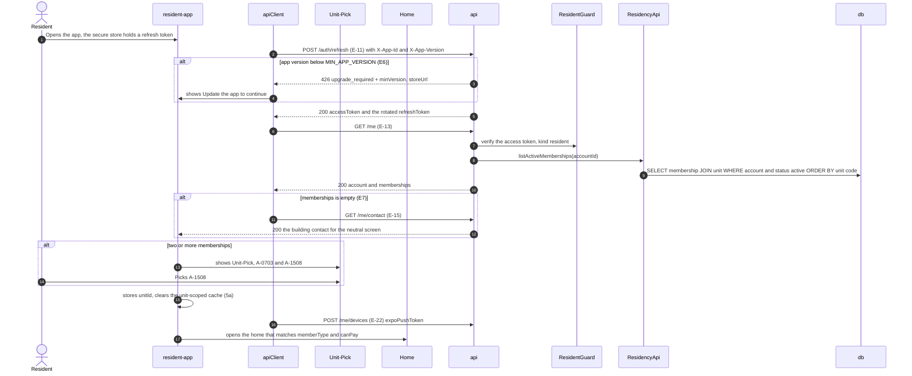

| Step | From → To | Call | Data | Rules and checks | Error → handling |
| --- | --- | --- | --- | --- | --- |
| 1 | Resident → `resident-app` | Opens the app | — | A stored refresh token starts the restore; none goes to `Login` (FL-19) | — |
| 2 | `apiClient` → `api` | `POST /auth/refresh` (E-11) | `{ "refreshToken": "Zm9vYmFy…" }`; `X-App-Id: resident`, `X-App-Version: 1.0.0` | The version gate runs **before** authentication, so the refresh token is not consumed by a refusal | 426 → E6 |
| 3 to 4 | `api` → `apiClient` → `resident-app` | Answer | `{ "error": { "code": "upgrade_required", "details": { "minVersion": "1.2.0", "storeUrl": "https://…" } } }` | The app shows a blocking screen with the store link | "Update the app to continue." |
| 5 | `api` → `apiClient` | `200` | `{ "accessToken": "eyJ…", "expiresIn": 900, "refreshToken": "bmV4dC10b2tlbg" }` | Rotation with the 10-second grace window and the account check are DOC-26 §3.5 | 401 → `Login` (FL-19) |
| 6 | `apiClient` → `api` | `GET /me` (E-13) | `Authorization: Bearer …` | Token only: no `X-Unit-Id`, no terms gate (exempt, DOC-35 §9.2) | 401 |
| 7 | `api` → `ResidentGuard` | Verify | `kind = resident` | A staff token is refused here (FR-16.4) | 401 `unauthenticated` |
| 8 | `api` → `ResidencyApi` | `listActiveMemberships(accountId)` | — | Active only; a locked membership is not offered in `Unit-Pick`; at most 500 rows (DOC-27 §2.1) | — |
| 9 | `ResidencyApi` → `db` | Statement S11 of DOC-27 §17.1 | — | Served by `membership_one_per_account_unit` and the unit primary key | — |
| 10 | `api` → `apiClient` | `200` | `{ "account": { "id": "…41", "displayName": "Trần Thị Hoa", "language": "vi", "pushEnabled": true }, "memberships": [ { "unitCode": "A-0703", "memberType": "tenant", "canPay": false, … }, { "unitCode": "A-1508", "memberType": "owner", "canPay": true, … } ] }` | Same `memberships` shape as the sign-in answer (DOC-26 §3.4) | — |
| 11 | `apiClient` → `api` | `GET /me/contact` (E-15) | — | UC-14 E7 | — |
| 12 | `api` → `resident-app` | `200` | The Manager's name, hotline, email, working hours | Settings of the building (DOC-36 §4) | "No unit is linked to this account. Contact the management office." |
| 13 | `resident-app` → `Unit-Pick` | Shows the list | Units ordered by code | One membership skips `Unit-Pick`; several show it | — |
| 14 | Resident → `Unit-Pick` | Picks `A-1508` | — | — | — |
| 15 | `resident-app` | Store the choice | `unitId` | **Switching unit (5a) drops every unit-scoped cache entry** (fees, tickets, vehicles, members, notices) before the first request for the new unit, so the previous unit's data never shows; the account-scoped data stays (P1-17 acceptance) | — |
| 16 | `apiClient` → `api` | `POST /me/devices` (E-22) | `{ "expoPushToken": "ExponentPushToken[xxxxxxxxxxxxxxxxxxxxxx]", "platform": "ios" }` | Token only; the token is reassigned if it was registered to another account (glossary "device token") | A failure does not block the home screen; the app retries at the next start |
| 17 | `resident-app` → `Home` | Navigation | — | `owner` → `Main`; `family` → `Home-Member`; `tenant` with `canPay` → `Home-Tenant-Pay`; `tenant` without → `Home-Tenant-NoPay`; `helper` → `Home-Helper` | — |

### FL-20.2 · One request, authorized against the selected unit

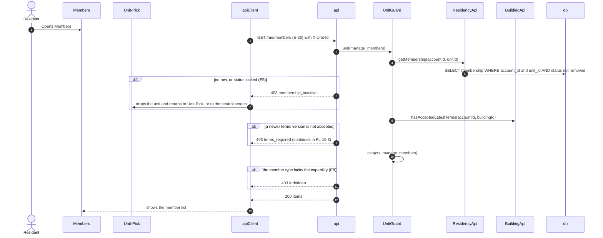

| Step | From → To | Call | Data | Rules and checks | Error → handling |
| --- | --- | --- | --- | --- | --- |
| 1 | Resident → `Members` | Opens the screen | — | The owner's home links here; other types do not show the link | — |
| 2 | `apiClient` → `api` | `GET /me/members` (E-26) | `X-Unit-Id: 0192f3c4-5a1e-7000-8000-000000000021` | The header is on **every** unit route. Missing or not a UUID: 400 `validation_failed` with `details [{ "path": "header.X-Unit-Id", "code": "required" }]` | 400 → client bug, logged through `POST /client-errors` (E-04) |
| 3 | `api` → `UnitGuard` | `unit('manage_members')` | — | Runs after `resident` | — |
| 4 | `UnitGuard` → `ResidencyApi` | `getMembership(accountId, unitId)` | — | **Never cached** (FR-16.3): a lock at 10:00:00.000 refuses the helper's next request | — |
| 5 | `ResidencyApi` → `db` | `SELECT id, building_id, member_type, can_pay, status, created_at AS started_at FROM residency.membership WHERE account_id = :a AND unit_id = :u AND status <> 'removed'` | — | Index scan on `membership_one_per_account_unit` (DOC-27 §3.1) | — |
| 6 | `api` → `apiClient` | Answer | `{ "error": { "code": "membership_inactive" } }` | The same answer for a unit that does not exist, a unit of someone else, a locked and a removed membership: a caller learns nothing about units they do not belong to (RM-05) | 403 → "You no longer have access to this home." |
| 7 | `apiClient` → `Unit-Pick` | Navigation | — | The app removes that unit from its list and drops that unit's cache; other units still work. With no unit left it shows the neutral screen of FL-20.1 step 12 | — |
| 8 | `UnitGuard` → `BuildingApi` | `hasAcceptedLatestTerms` | the building of the membership | Known only now, so the gate runs here and not before (DOC-35 §9.2) | — |
| 9 | `api` → `apiClient` | Answer | `terms_required` with `details.required` | — | 403 → FL-19.3 |
| 10 | `UnitGuard` | `can(ctx, 'manage_members')` | `UnitContext { buildingId, unitId, membershipId, accountId, memberType, canPay, startedAt, scope }` | The policy table of DOC-27 §3.2: only an owner may manage members | — |
| 11 | `api` → `apiClient` | Answer | `{ "error": { "code": "forbidden" } }` | A tenant or helper token reaching E-26 is a client bug or probing | 403 → "You do not have permission to do this." |
| 12 | `api` → `apiClient` | `200` | `{ "items": [ { "membershipId": "…62", "displayName": "Trần Thị Bình", "memberType": "tenant", "canPay": false, "status": "active", "lockedBy": null } ] }` | The handler runs with the `UnitContext` | — |
| 13 | `apiClient` → `Members` | Render | — | — | — |

### Transactions and concurrency

- Every step of FL-20 is a read; no transaction writes anything except the device token of E-22 (one upsert, idempotent by token). The guard reads the membership with one statement per request, so two replicas never disagree.
- **Arbiter of "owner locks a member while the member uses the app" (UC-15 race):** the membership row read at step 5 of FL-20.2. A lock that commits first makes the member's very next request 403; a request already past step 5 completes (ADR-0010). A QR code issued before the lock fails at the gate on `credential_version` (FL-35).
- **If the process dies** mid-request nothing is half-done; the app shows a network error and repeats the read.

### Errors and handling

| Situation | Step | HTTP status / code | UI behavior and message |
| --- | --- | --- | --- |
| E5 Membership locked or removed (UC-14 E5) | 20.2 step 6 | 403 `membership_inactive` | "You no longer have access to this home." Back to `Unit-Pick`; other units keep working |
| E6 App below `MIN_APP_VERSION[resident]` (UC-14 E6) | 20.1 step 3 | 426 `upgrade_required` | "Update the app to continue." Blocking screen with the store link; no token is consumed |
| E7 No active membership at all (UC-14 E7) | 20.1 step 12 | 200 with `memberships: []` | "No unit is linked to this account. Contact the management office." plus the contact from E-15 |
| E8 The member type lacks the capability | 20.2 step 11 | 403 `forbidden` | "You do not have permission to do this." |
| E9 `X-Unit-Id` missing or not a UUID | 20.2 step 2 | 400 `validation_failed` | A client bug: the app shows "Something went wrong. Try again later." and reports it through E-04 |
| E10 Terms not accepted | 20.2 step 9 | 403 `terms_required` | `Terms-Update` (FL-19.3) |
| E11 A staff token on a `/me/*` route | 20.1 step 7 | 401 `unauthenticated` | Never reached by the apps; asserted by AU-41 |
| E12 Refresh token expired, revoked or reused | 20.1 step 5 | 401 `unauthenticated` | The app returns to `Login` (FR-45.2) |

### Required tests

Lower layer: `RM-01…08`, `AU-35…42`. These rows check the journey and the visible state.

| ID | Scenario | Expected |
| --- | --- | --- |
| FI-33 | An account with one active membership (A-1508, owner) restarts the app | `POST /auth/refresh` 200, `GET /me` 200 with one membership, `Unit-Pick` is skipped, `Main` opens, `POST /me/devices` is called once, and the first unit request carries `X-Unit-Id` of A-1508 |
| FI-34 | Two memberships: A-0703 tenant without `can_pay`, A-1508 owner | `Unit-Pick` lists A-0703 before A-1508; choosing A-0703 opens `Home-Tenant-NoPay`; `GET /me/members` is 403 `forbidden`; switching to A-1508 clears the cache so no A-0703 row is visible before the first A-1508 response (Maestro, P1-17); `Main` opens |
| FI-35 | The owner locks a helper while the helper has the app open | The helper's next request is 403 `membership_inactive` and the screen shows "You no longer have access to this home."; with a second unit the app returns to `Unit-Pick`, with none it shows the neutral screen; a request that was past step 5 completes (RM-01, RM-04) |
| FI-36 | A tampered client sends the `X-Unit-Id` of a unit that exists but is not the caller's, and of one that does not exist | Both answers are identical 403 `membership_inactive` (RM-05) |
| FI-37 | The resident app 0.9.0 with `MIN_APP_VERSION[resident] = 1.0.0` restarts; the web CMS with `X-App-Id: web` | The app gets 426 with `storeUrl` before authentication (the refresh token is still valid afterwards, checked by calling E-11 with a current version) and shows "Update the app to continue."; the web CMS is never refused |
| FI-38 | An account whose only membership was removed signs in | Sign-in succeeds with `memberships: []`; the app shows "No unit is linked to this account. Contact the management office." and the contact of E-15; no unit route is called |
| FI-39 | A locked membership of an account that has not accepted terms 4; a request with no `X-Unit-Id` | The first is 403 `membership_inactive` (the building is unknown, so the gate does not run); the second is 400 `validation_failed` `header.X-Unit-Id` |
| FI-40 | A staff access token on `/me/members` and a resident access token on `/staff/units` | Both 401 `unauthenticated`, whatever the role (FR-16.4, AU-41, RM-03) |

<a id="fl-21"></a>

## FL-21 · Owner adds, locks or removes a member

- **UC / FR:** UC-15 (main flow, 2a, 4a, 4b, 4c, E1…E4 and the race table), UC-13 3a and 3d for the Manager's variants · FR-16.1, FR-16.2, FR-17.1…17.6
- **Screens:** `Members`, `Member-Add`, `Member-Actions` (resident app, DOC-59); `W-Resident-Add`, `W-Unit-Detail` (web CMS, DOC-65)
- **Endpoints:** E-26 `GET /me/members`, E-27 `POST /me/members`, E-28 `PATCH /me/members/{id}`, E-29 `DELETE /me/members/{id}`; Manager: E-64 `POST /staff/residents`, E-69 `PATCH /staff/memberships/{id}`
- **Events:** `residency.membership_changed.v1`, `identity.sms_requested.v1` (kind `member_invitation`); inbox template `member.added`
- **Trigger:** The owner presses "Add" on `Members` or opens `Member-Actions` on a row; or a Manager acts on `W-Unit-Detail` or `W-Resident-Add`.
- **Preconditions:** The caller holds the active owner membership of the unit in `X-Unit-Id` (owner path) or a staff token of role Manager or Admin (Manager path). The resident app is at or above `MIN_APP_VERSION`; the latest terms are accepted.

The flow has three sub-flows because each is longer than the 25 arrows a diagram can carry:

| Sub-flow | Covers | Endpoints |
| --- | --- | --- |
| FL-21.1 | The owner adds a member and the invitation SMS goes out | E-27 |
| FL-21.2 | The owner or the Manager changes the type, sets `can_pay`, locks, unlocks or removes; what the member sees next | E-28, E-29, E-69 |
| FL-21.3 | The Manager adds a person to a unit (no SMS) | E-64 |

### Participants

| Participant | Kind | Code | Defined in |
| --- | --- | --- | --- |
| `Owner`, `Manager`, `Member` | Actor | — | DOC-06 §1 |
| `Members`, `Member-Add`, `Member-Actions` | Screen | `apps/resident-app` (screen files owed) | DOC-59 |
| `W-Resident-Add`, `W-Unit-Detail` | Screen | `apps/cms-web` (screen files owed) | DOC-65 |
| `resident-app` | Client | `apps/resident-app`; calls go through the typed client `apiClient` (no logic) | DOC-55 |
| `api` | API | `modules/residency/src/presentation/resident-routes.ts`, `staff-routes.ts` | DOC-51 E-26…E-29, E-64, E-69 |
| `UnitGuard` | Guard | `apps/api/src/bootstrap/guards.ts`, `unit(capability)` | DOC-27 §3.1 |
| `StaffGuard` | Guard | the same file, `staff(...roles)` | DOC-12 §5.3 |
| `AddMember` | Use case | `modules/residency/src/application/commands/add-member.ts` | DOC-27 §6.2 |
| `ChangeMember` | Use case | `…/change-member.ts`, `…/remove-member.ts` (owner) | DOC-27 §6.3 |
| `ChangeMembership` | Use case | `…/change-membership.ts` (Manager) | DOC-27 §1 |
| `CreateResident` | Use case | `…/create-resident.ts` | DOC-27 §5.1 |
| `IdentityApi` | Contract | `findOrCreateResidentAccount`, `queueMemberInvitation` | DOC-26 §2.2 |
| `AuditApi` | Contract | `AuditApi.record` | DOC-35 §3 |
| `db` | Data store | `residency.membership`, `resident_profile`, `unit_history`, `identity.rate_bucket`, `platform.idempotency_key` | DOC-16 §5, DOC-17 |
| `outbox` | Data store | `residency.outbox_messages`, `identity.outbox_messages` | DOC-09 |
| `worker` | Worker | handler `identity.send_sms` | DOC-26 §5.4 |
| `sms-provider` | External | adapter chosen by DR-68 | DOC-26 §5.5 |

### FL-21.1 · The owner adds a member

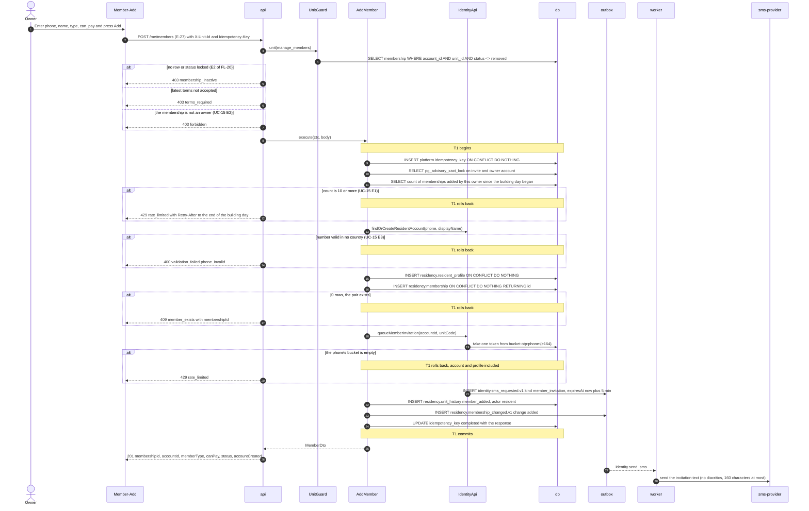

#### Step details

| Step | From → To | Call | Data | Rules and checks | Error → handling |
| --- | --- | --- | --- | --- | --- |
| 2 | `Member-Add` → `api` | `POST /me/members` (E-27) | `{"phone": "0912345678", "displayName": "Trần Thị Bình", "memberType": "tenant", "canPay": false}`; header `Idempotency-Key: 7f1c2b8e-1d2a-4c55-9a77-3b0c9e7d1f20` | `memberType` is `family`, `tenant` or `helper` (`owner` is 400); `canPay` only with `tenant` (DOC-27 §6.2 step 1) | Timeout → the app retries once with the same key (DOC-50 §7) |
| 3–7 | `api` → `UnitGuard` → `db` | `getMembership(sub, unitId)`, then the terms gate, then `can(ctx, 'manage_members')` | `X-Unit-Id` of the unit | Not cached; one indexed read (DOC-27 §3.1); the same 403 for an unknown unit, a foreign unit and a locked membership | 403 `membership_inactive` → the app goes to `Unit-Pick` (FL-20); 403 `terms_required` → `Terms-Update` (FL-19); 403 `forbidden` → "You do not have permission to do this." |
| 9–10 | `AddMember` → `db` | `INSERT platform.idempotency_key`, then `pg_advisory_xact_lock(hashtextextended('invite:' \|\| :owner_account_id, 0))` | key hash of method, route, `X-Unit-Id` and body | The lock serializes two adds of one owner; a replay returns the stored response with `Idempotent-Replayed: true` before the lock (DOC-50 §7) | Same key, other body → 422 `idempotency_key_reuse` |
| 11–12 | `AddMember` → `db` | `SELECT count(*) FROM residency.membership WHERE added_by_kind = 'resident' AND added_by = :owner AND invited_at >= <start of the building day>` | `:tz` is `building.time_zone` (DR-09) | 10 per owner per building day (`MEMBER_INVITES_PER_DAY`); removed memberships count (DOC-27 §6.2 step 2) | 429 `rate_limited`; `Retry-After` runs to the end of the day; UI "You can invite 10 people a day." |
| 13–14 | `AddMember` → `IdentityApi` | `findOrCreateResidentAccount('0912345678', 'Trần Thị Bình')` | parsed with `libphonenumber-js/max`, region `VN`, stored `+84912345678` | An existing account is returned unchanged (its name is never overwritten, FR-17.1, 2a of UC-15); a deleted account's phone never matches | 400 `phone_invalid` |
| 15–17 | `AddMember` → `db` | ensure the profile, then the conditional membership insert | `added_by_kind = 'resident'`, `added_by` the owner, `invited_at = now()` | The unique `(account_id, unit_id) WHERE status <> 'removed'` is the arbiter; no limit on the number of memberships or helpers (FR-17.5) | 0 rows → 409 `member_exists`, "This person is already a member of this home." |
| 18–20 | `AddMember` → `IdentityApi` → `db` | `queueMemberInvitation`; one token from `otp:phone:+84912345678` | `unitCode: "A-1508"` | The invitation is counted in the phone's bucket as an OTP (DOC-26 §2.2) | Empty bucket → `RateLimitedError`, 429, the whole add rolls back |
| 21–24 | `AddMember` → `outbox` | SMS command; `unit_history`; `membership_changed`; complete the key | `kind: "member_invitation"`, `secretEnc` absent (no secret), `expiresAt` +5 min | The three rows commit with the membership (DOC-12 §8.3) | A failure rolls back all of them |
| 27–28 | `outbox` → `worker` → `sms-provider` | `identity.send_sms` | text from DOC-26 §5.4: `Ban duoc moi vao can ho A-1508 tren ung dung SUNRISE. Tai ung dung va dang nhap bang so dien thoai nay: {appUrl}` | Skipped silently if `expiresAt` passed or the account is a demo account | Provider failure → 3 attempts, then dead (class `sms`) |

#### Transactions

T1 holds the idempotency row, the advisory lock, the account (inside `IdentityApi`), the profile, the membership, the bucket token, the SMS command, the history row and the event. If the process dies before the commit nothing exists and the app retries with the same key. If it dies after the commit and before the relay, the outbox row is the record: the SMS goes out after the restart (until `expiresAt`, 5 minutes) and the membership already works. The new person does not need the SMS to be a member (DOC-27 §6.2 last paragraph).

### FL-21.2 · Change, lock, unlock or remove a member

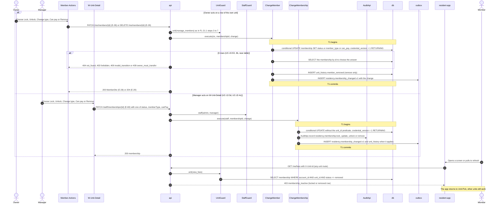

#### Step details

| Step | From → To | Call | Data | Rules and checks | Error → handling |
| --- | --- | --- | --- | --- | --- |
| 2 | `Member-Actions` → `api` | `PATCH /me/members/{id}` (E-28) | exactly one of `{"status": "locked"}`, `{"status": "active"}`, `{"memberType": "family"}`, `{"canPay": true}`; `DELETE /me/members/{id}` (E-29) removes | Two keys → 400 `validation_failed` (DR-139); `canPay` only for a tenant; no `If-Match` (a membership has no `version`, DOC-16 §5.3) | 422 `validation_failed` rule `can_pay_tenant_only`; 400 for two keys |
| 5–6 | `ChangeMember` → `db` | one of the statements of DOC-27 §6.3 | `:u` is the owner's unit from `UnitContext` | Lock: `member_type <> 'owner' AND status = 'active'`. Unlock: `locked_by = 'owner'` only. Retype: `member_type = :seen_type AND member_type IN ('family','tenant')`. `can_pay`: tenant only, no `credential_version` bump. Remove: `member_type <> 'owner'` | 0 rows → step 8 decides |
| 6–7 | `ChangeMember` → `db`, `api` → screen | `SELECT` by id | — | Unknown id or another unit → 404 `not_found`; own row, lock or unlock → 403 `forbidden` (FR-17.3); own row, remove or retype, or any owner row → 409 `owner_must_transfer`; the owner unlocks a Manager's lock, or the row changed under the owner → 409 `invalid_transition` with `details {entity: "membership", status, action}` | UI for `invalid_transition`: "This can no longer be done in its current state." |
| 8–9 | `ChangeMember` → `db`, `outbox` | `unit_history` for a removal; the event | `change` is `locked`, `unlocked`, `type_changed`, `can_pay_changed` or `removed` | A lock, unlock and retype write no history row (DOC-27 §10) | — |
| 12–15 | `W-Unit-Detail` → `api` → `ChangeMembership` | `PATCH /staff/memberships/{id}` (E-69) | same single-key body | The Manager's lock also applies to an owner-locked row and wins (`locked_by = 'manager'`); only the Manager unlocks it; removal of an owner row is 409 `owner_must_transfer` (FL-22) | 404 for a membership of another building |
| 15–17 | `ChangeMembership` → `AuditApi` → `db` | `residency.membership.lock`, `.unlock`, `.update`, `.remove` | `changes` `status`, `memberType`, `canPay` | The audit row is in T1 (FR-37.1); resident actions are not audited, `unit_history` records the owner's removal | A failed audit insert fails the change |
| 19–23 | `resident-app` → `api` → `db` | any `/me` unit route | `X-Unit-Id` of the changed unit | The membership is read on **every** request and not cached (FR-16.3): the lock at 10:00:00.000 refuses the helper's next request; a request already past step 4 completes (ADR-0010) | 403 `membership_inactive`: "You no longer have access to this home." |

A type change is seen on the next request too (a screen the new type does not allow answers 403 `forbidden`); `can_pay` appears or disappears on the next request (J-7). A QR code issued before a lock, an unlock, a retype or a removal fails at the gate because `credential_version` moved (DR-48; the scan side is FL-35); `can_pay` does not move it.

### FL-21.3 · The Manager adds a person to a unit

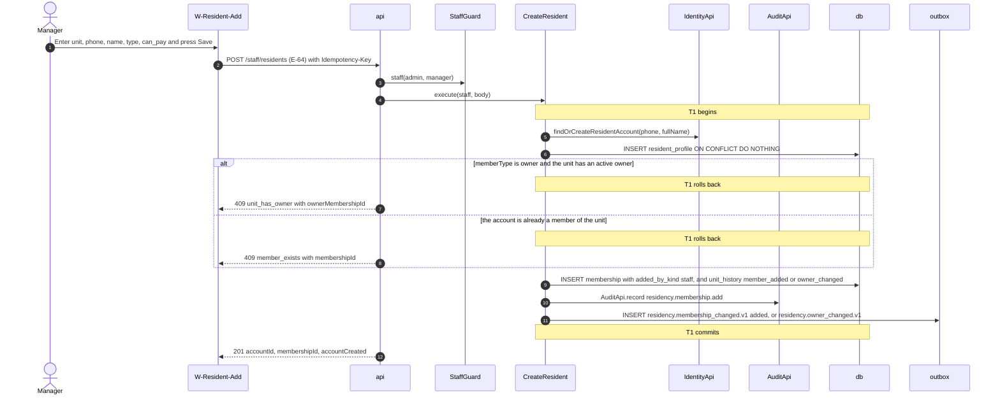

| Step | From → To | Call | Data | Rules and checks | Error → handling |
| --- | --- | --- | --- | --- | --- |
| 2 | `W-Resident-Add` → `api` | `POST /staff/residents` (E-64) | `{"unitId": "0192f3c4-5a1e-7000-8000-000000000021", "phone": "0912345678", "fullName": "Trần Thị Bình", "memberType": "tenant", "canPay": false}` | `owner` only for an ownerless unit (DOC-27 §5.1 step 3); no daily cap, no SMS (DR-137) | 400 `phone_invalid` |
| 7–8 | `CreateResident` → screen | the two conflicts | `{ownerMembershipId}` or `{membershipId}` | A replacement of an owner is a transfer (FL-22) | UI "This unit already has an owner. Transfer ownership instead."; "This person is already a member of this home." |
| 9–11 | `CreateResident` → `db`, `AuditApi`, `outbox` | insert and record | `added_by_kind = 'staff'`, `added_by` the Manager | An owner added to an ownerless unit writes `owner_changed` with `details {"from": null, "to": …, "source": "manager"}` | — |

### Transactions and concurrency

| Concurrent pair | Arbiter (step) | Loser sees |
| --- | --- | --- |
| Two adds by one owner at count 9 | `pg_advisory_xact_lock` then the count (FL-21.1 steps 10–11) | The second waits, counts 10, 429 `rate_limited` (RM-18) |
| Two adds of one phone to one unit, different keys | `INSERT … ON CONFLICT (account_id, unit_id) WHERE status <> 'removed'` (step 16) and the unique `phone` | 409 `member_exists`; one account (RM-19) |
| The same key twice | The `platform.idempotency_key` primary key (step 9) | The stored response with `Idempotent-Replayed: true`; no second SMS |
| Owner locks, Manager locks the same row | The `status` and `locked_by` predicates (FL-21.2 steps 5 and 15) | Whichever commits second finds a changed row: the owner's lock is 409 `invalid_transition`, the Manager's lock still applies (RM-10) |
| Owner retypes, Manager retypes | `member_type = :seen_type` | The second changes 0 rows: 409 `invalid_transition` |
| Owner locks while the member uses the app | The membership read on every request (FL-21.2 steps 19–23) | Requests after the commit are 403 `membership_inactive`; one in flight completes |
| Lock, unlock, then a scan of the old code | `credential_version` + 1 at each change | `invalid` at the gate (FL-35, EXP-05) |

Nothing calls the network inside T1: the SMS is a command in the outbox. If the process dies after any commit the screen shows the old list on the next load, and the change is already in force (a retry of a lock answers 409 `invalid_transition` the second time, which the app treats as done after a reload).

### Errors and handling

| Situation | Step | HTTP status / code | UI behavior and message |
| --- | --- | --- | --- |
| The 11th invitation of the day (UC-15 E1) | FL-21.1 11–12 | 429 `rate_limited`, `Retry-After` | "You can invite 10 people a day." |
| The phone's own bucket is empty | FL-21.1 18–20 | 429 `rate_limited`; nothing saved | "Too many attempts. Try again later." |
| A phone valid in no country (UC-15 E3) | FL-21.1 13–14 | 400 `validation_failed` rule `phone_invalid` | Field error under the phone (copy owed to DOC-68) |
| The same person added twice | FL-21.1 16–17, FL-21.3 8 | 409 `member_exists` | "This person is already a member of this home." |
| `canPay` on a family member or a helper | FL-21.2 2, 5 | 422 `validation_failed` rule `can_pay_tenant_only` | The toggle is not offered for those types; the code is the net |
| A member tries to manage members (UC-15 E2) | FL-21.1 7 | 403 `forbidden` | "You do not have permission to do this." |
| The owner locks or unlocks their own row | FL-21.2 6–7 | 403 `forbidden` | The row offers no actions |
| The owner removes or retypes their own row | FL-21.2 6–7 | 409 `owner_must_transfer` | "Transfer ownership of the unit first." |
| The owner unlocks a Manager's lock (UC-15 4b) | FL-21.2 6–7 | 409 `invalid_transition` | `Member-Actions` hides "Unlock" when `lockedBy` is `manager` (DOC-27 §6.5); the code is the net |
| A helper retyped | FL-21.2 6–7 | 409 `invalid_transition` | Remove and add again (the history window restarts) |
| The 26th membership or the 9th helper (UC-15 E4) | FL-21.1 | 201 | No limit (FR-17.5) |
| Membership locked or removed after sign-in | FL-21.2 23 | 403 `membership_inactive` | "You no longer have access to this home."; the app returns to `Unit-Pick` |
| Manager adds an owner to a unit with an owner | FL-21.3 7 | 409 `unit_has_owner` | "This unit already has an owner. Transfer ownership instead." |

### Required tests

Prefix `FI-` (this document, FI-51…FI-62). "Lower layer" names the unit test that already covers the statement; these rows test the flow end to end (API, guard, database, outbox).

| ID | Scenario | Expected |
| --- | --- | --- |
| FI-51 | The owner of `A-1508` adds `0912345678` "Trần Thị Bình" as tenant with `canPay` false (new phone) | 201 with `accountCreated` true; one account `+84912345678`, one profile named "Trần Thị Bình", one membership `tenant`, one `unit_history` `member_added` by `resident`, one `membership_changed` `added`, one SMS command with `expiresAt` 5 minutes after creation; after the relay one text of at most 160 characters. Lower layer RM-15, RM-16 |
| FI-52 | The same owner sends 10 invitations in one building day, then an 11th; then the clock passes local midnight | The 11th is 429 `rate_limited` with `Retry-After` to midnight and writes nothing; the next day it is 201. Lower layer RM-17 |
| FI-53 | The phone's bucket `otp:phone:+84912345678` is empty (5 OTPs spent) | 429 and **no** account, profile, membership or history row (the whole add rolled back). Lower layer RM-20 |
| FI-54 | The same phone and unit are added twice with different `Idempotency-Key`s; then the first request is repeated with its key | The second is 409 `member_exists` with the first `membershipId`; the repeat is 201 with `Idempotent-Replayed: true` and no second SMS command. Lower layer RM-19 |
| FI-55 | `PATCH` `{"canPay": true}` on a family member; `PATCH` `{"memberType": "tenant", "canPay": true}`; `PATCH` a helper to `family` | 422 `can_pay_tenant_only`; 400 (two keys); 409 `invalid_transition`; no row changed. Lower layer RM-21 |
| FI-56 | The owner locks a helper whose app is open; the helper pulls to refresh; the helper's other unit is still active | `PATCH` 200 with `credential_version` 1 → 2; the next request is 403 `membership_inactive` with the app on `Unit-Pick`; a request for the other unit is 200. Lower layer RM-01, RM-09 |
| FI-57 | The owner locks a tenant, the Manager locks the same row, the owner tries to unlock, then the Manager unlocks | Row `locked/manager`; the owner's unlock 409 `invalid_transition`; the Manager's unlock 200, `active`. Lower layer RM-10 |
| FI-58 | The owner locks, unlocks (own lock), retypes and removes their own membership row | Lock and unlock 403 `forbidden`; retype and remove 409 `owner_must_transfer`; nothing changed. Lower layer RM-13 |
| FI-59 | A unit with 25 memberships including 8 helpers receives one more of each type by the owner | Both 201; no limit. Lower layer RM-14 |
| FI-60 | The owner and the Manager both `PATCH` `{"memberType": "family"}` on a tenant at the same time (two sessions) | One 200; the other 409 `invalid_transition`; `credential_version` raised once. Lower layer RM-10 and the race table of DOC-27 §13 |
| FI-61 | A QR code is issued for a tenant (`cv` 4); the owner locks (5) and unlocks (6); `can_pay` is then set (stays 6) | The code of `cv` 4 fails at the scan gate (`invalid`); a code of `cv` 6 passes; `can_pay` leaves `cv` unchanged. Lower layer RM-09; scan side FL-35 |
| FI-62 | The Manager adds an owner to an ownerless unit, then another owner to the same unit, then a tenant | 201 with `owner_changed` `{"from": null, "source": "manager"}`; 409 `unit_has_owner`; 201 for the tenant; no SMS command in any case. Lower layer RM-22, RM-29 |

---

<a id="fl-22"></a>

## FL-22 · Manager transfers ownership or changes a login phone

- **UC / FR:** UC-13 (transfer and phone-change flows, E3, E5, E6, race table) · FR-18.3, FR-18.4, FR-16.5
- **Screens:** `W-Unit-Detail` (DOC-65)
- **Endpoints:** E-59 `GET /staff/units/{id}`, E-61 `POST /staff/units/{id}/owner`, E-65 `GET /staff/residents/{accountId}`, E-67 `PATCH /staff/residents/{accountId}/phone`; E-11 `POST /auth/refresh` (the old session)
- **Events:** `residency.owner_changed.v1`, `residency.membership_changed.v1` (`removed`), `identity.session_revoked.v1`; inbox template `member.added` for the new owner
- **Trigger:** On `W-Unit-Detail` of `A-1508` the Manager presses "Transfer ownership", or enters a new login number for a resident.
- **Preconditions:** A staff token of role Manager or Admin. For the transfer the Manager holds the unit's current `ETag` from E-59.

| Sub-flow | Covers | Endpoints |
| --- | --- | --- |
| FL-22.1 | Transfer ownership of a unit | E-59, E-61 |
| FL-22.2 | Change a resident's login phone; the old session dies | E-65, E-67, E-11 |

### Participants

| Participant | Kind | Code | Defined in |
| --- | --- | --- | --- |
| `Manager` | Actor | — | DOC-06 §1 |
| `W-Unit-Detail` | Screen | `apps/cms-web` (screen file owed) | DOC-65 |
| `resident-app` | Client | `apps/resident-app` (the old session, FL-22.2) | DOC-55 |
| `api` | API | `modules/residency/src/presentation/staff-routes.ts`, `modules/identity/src/presentation/auth-routes.ts` | DOC-51 E-59, E-61, E-65, E-67, E-11 |
| `StaffGuard` | Guard | `staff('admin','manager')` | DOC-12 §5.3 |
| `TransferOwnership` | Use case | `modules/residency/src/application/commands/transfer-ownership.ts` | DOC-27 §7 |
| `ChangeLoginPhone` | Use case | `…/change-login-phone.ts` | DOC-27 §8 |
| `SessionService` | Use case | `modules/identity/src/application/session-service.ts` | DOC-26 §3.5 |
| `IdentityApi` | Contract | `findOrCreateResidentAccount`, `changeResidentPhone` | DOC-26 §2.2 |
| `AuditApi` | Contract | `AuditApi.record` | DOC-35 §3 |
| `db` | Data store | `residency.unit`, `membership`, `resident_profile`, `unit_history`; `identity.resident_account`, `refresh_family`, `refresh_token`; `notification.device_token`; `audit.audit_log` | DOC-16, DOC-17 |
| `outbox` | Data store | `residency.outbox_messages`, `identity.outbox_messages` | DOC-09 |
| `worker` | Worker | handlers `notification.drop_device_token_on_identity_session_revoked`, `realtime.close_stream_on_identity_session_revoked`, notification inbox on `owner_changed` | DOC-09 §5 |

### FL-22.1 · Transfer ownership

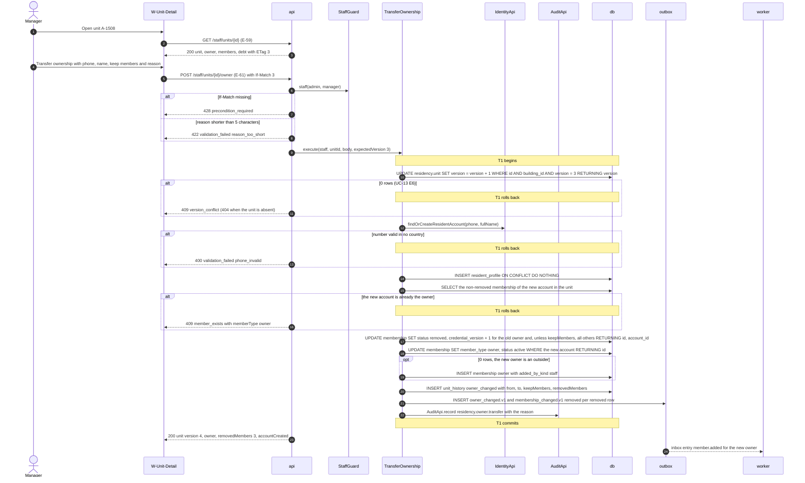

#### Step details

| Step | From → To | Call | Data | Rules and checks | Error → handling |
| --- | --- | --- | --- | --- | --- |
| 2–3 | `W-Unit-Detail` → `api` | `GET /staff/units/{id}` (E-59) | response `"version": 3`, header `ETag: "3"` | The ETag is the value the Manager sends back for an edit and for a transfer (DOC-27 §4.2) | 404 for a unit of another building |
| 5 | `W-Unit-Detail` → `api` | `POST /staff/units/{id}/owner` (E-61), header `If-Match: "3"` | `{"phone": "0912345678", "fullName": "Trần Thị Bình", "keepMembers": false, "reason": "Sold on 2026-10-15; contract 15/2026"}` | `reason` 5 to 500 characters (DOC-35 §3.5); `keepMembers` defaults to `false` (DR-40) | 428 and 422 are answered before any database work |
| 10 | `TransferOwnership` → `db` | the arbiter `UPDATE … version = :expected` | unit `A-1508`, version 3 → 4 | The statement also holds the unit row to commit, so a second transfer waits and then finds the version moved (DR-138) | 0 rows → 409 `version_conflict` with the fresh unit in `details.current`; UI "This was changed by someone else. Reload and try again." |
| 12–13 | `TransferOwnership` → `IdentityApi` | `findOrCreateResidentAccount` | `0912345678` → `+84912345678` | An existing account keeps its name (FR-18.1) | 400 `phone_invalid` |
| 15–16 | `TransferOwnership` → `db` | read the new account's membership | — | The new owner is already the owner → 409 `member_exists` with `details {membershipId, memberType: "owner"}` | "This person is already a member of this home." |
| 17 | `TransferOwnership` → `db` | remove the old owner and, unless `keepMembers`, every other member except the new owner's own account | statement of DOC-27 §7 step 3; `credential_version + 1` on each | Runs **before** the promotion so the unique index `membership_one_owner_per_unit` is never violated | — |
| 18–19 | `TransferOwnership` → `db` | promote or insert | a tenant of the unit becomes the owner **on the same row** and keeps `created_at`, so keeps `startedAt` and the history they could see (DR-138); an outsider gets a new row | A second owner would be `23505` on `membership_one_owner_per_unit` (RM-02) | — |
| 20–22 | `TransferOwnership` → `db`, `outbox`, `AuditApi` | history, events, audit | `owner_changed` `details {"from": "<old>", "to": "<new>", "keepMembers": false, "removedMembers": 3}` | Fees, receipts and tickets stay with the unit; a payment intent in flight is not cancelled (DOC-27 §7) | A failed audit insert fails the transfer (FR-37.1) |
| 23–24 | `api` → screen; `outbox` → `worker` | 200; the inbox handler | `{"unit": {"unitId": "…", "code": "A-1508", "version": 4}, "owner": {"membershipId": "…63", "accountId": "…42"}, "removedMembers": 3, "accountCreated": false}` | The new owner sees open charges of the unit and payments only from their own `startedAt` (DR-40) | — |

What each person sees next: the removed old owner and members get 403 `membership_inactive` on their next request (FL-21.2 steps 19–23) and their QR codes fail (`credential_version`); the new owner sees the unit in `GET /me` at the next sign-in or refresh of the unit list.

### FL-22.2 · Change a login phone

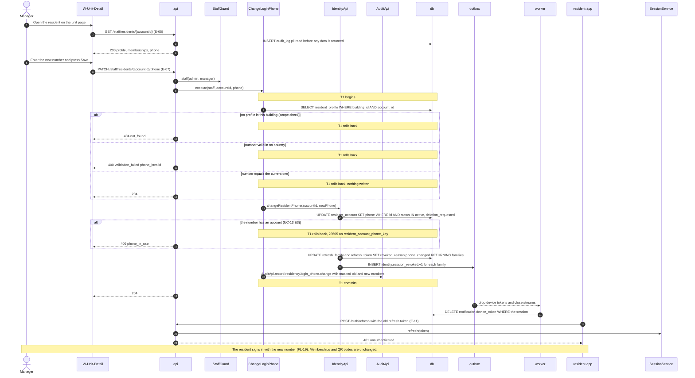

#### Step details

| Step | From → To | Call | Data | Rules and checks | Error → handling |
| --- | --- | --- | --- | --- | --- |
| 2–4 | `W-Unit-Detail` → `api` → `db` | `GET /staff/residents/{accountId}` (E-65) | full CCCD and date of birth in the response | A short transaction writes one `pii.read` row **before** the data leaves; a failed insert is 500 and no data (DOC-27 §5.3, DOC-35 §6) | 404 for an account with no profile in the building |
| 6 | `W-Unit-Detail` → `api` | `PATCH /staff/residents/{accountId}/phone` (E-67) | `{"phone": "0987654321"}`; **no** `If-Match` (the account row is identity's) | Success is 204 here; E-67 fixes the body if it carries one | — |
| 9–12 | `ChangeLoginPhone` → `db` | profile check, parse, compare | `libphonenumber-js/max`, region `VN`; `0987654321` → `+84987654321` | The profile row is the scope check: accounts are global (DR-136) | 404; 400 `phone_invalid`; equal → 204 with no write and no audit row |
| 13–15 | `ChangeLoginPhone` → `IdentityApi` → `db` | `changeResidentPhone` | one conditional `UPDATE … WHERE id = :id AND status IN ('active','deletion_requested')` | `23505` on `resident_account_phone_key` is 409 `phone_in_use` (DOC-26 §2.2) | UI "This number already belongs to another account." |
| 16–17 | `IdentityApi` → `db`, `outbox` | revoke every family with reason `phone_changed`; one event each | `identity.session_revoked.v1` `{accountKind, accountId, sessionId, reason}` | In the same transaction as the phone change (FR-18.4) | — |
| 18 | `ChangeLoginPhone` → `AuditApi` | `residency.login_phone.change` | `changes` `phone` masked `+84•••••567`, new `+84•••••321` | Memberships and `credential_version` do not change; no `unit_history` row (DOC-27 §8) | — |
| 20–21 | `outbox` → `worker` | `notification.drop_device_token_on_identity_session_revoked`; `realtime.close_stream_on_identity_session_revoked` | `DELETE` by session | A second run deletes nothing (DOC-09 §5.2) | Handler failure → outbox retry |
| 22–24 | `resident-app` → `api` → `SessionService` | `POST /auth/refresh` (E-11) with the old token | body `{"refreshToken": "…"}` | The family is revoked, so the classification query finds no live family (DOC-26 §3.5 step 3) | 401 `unauthenticated`; the app returns to `Login` |

A challenge already sent to the old number dies by expiry (5 minutes); a challenge for the new number needs the new number registered, which now is.

### Transactions and concurrency

| Concurrent pair | Arbiter (step) | Loser sees |
| --- | --- | --- |
| Two transfers of one unit with `If-Match: "3"` (UC-13 race) | FL-22.1 step 10: `UPDATE unit … WHERE version = :expected`; the second waits on the unit row, then finds version 4 | 409 `version_conflict`; one owner exists (RM-25) |
| A transfer and the owner locking a member (UC-13 race) | Row locks in one order, unit then memberships, and `credential_version` in one transaction | Whichever commits second sees the new state; a locked member is removed by the transfer anyway |
| A transfer while the old owner has requested deletion (UC-13 E5) | `ResidencyApi.ownedUnitIds` at the approval and at the execution (FL-24) | Before the transfer the approval is 409 `owner_must_transfer`; after it the approval is accepted |
| A phone change and a sign-in with the old number (UC-13 race) | The families are revoked in the phone change's transaction | The next refresh with an old token is 401; a verify of an old challenge fails by expiry |
| Two phone changes to the same free number for two accounts | The unique `resident_account_phone_key` | One succeeds, the other 409 `phone_in_use` |

If the process dies before T1 commits nothing changes and the Manager presses Save again (a transfer repeats with the same `If-Match`, which is still valid). If it dies after the commit and before the response, the Manager sees the old screen; a retry of the transfer is 409 `version_conflict` (the version moved), after which a reload shows the new owner. The device-token deletion and the stream closure are after-commit work: until the worker runs, a push to the old device is still possible for a few seconds, and the next request with the old token is 401 anyway.

### Errors and handling

| Situation | Step | HTTP status / code | UI behavior and message |
| --- | --- | --- | --- |
| Missing `If-Match` on the transfer | FL-22.1 7 | 428 `precondition_required` | "Reload and try again." |
| Stale `If-Match` (UC-13 E6) | FL-22.1 11 | 409 `version_conflict` | "This was changed by someone else. Reload and try again."; the screen reloads with `details.current` |
| `reason` under 5 characters | FL-22.1 8 | 422 `validation_failed` rule `reason_too_short` | "Write at least 5 characters." |
| Transfer to the current owner | FL-22.1 16 | 409 `member_exists` | "This person is already a member of this home." |
| Phone valid in no country | FL-22.1 13, FL-22.2 11 | 400 `validation_failed` rule `phone_invalid` | Field error under the phone (copy owed to DOC-68) |
| The old owner has asked for deletion (UC-13 E5) | FL-24.2 | 409 `owner_must_transfer` until the transfer commits | Manager: "Transfer ownership of the unit first." |
| New login number has an account (UC-13 E3) | FL-22.2 15 | 409 `phone_in_use`, nothing changes | "This number already belongs to another account." |
| Account of another building or no profile | FL-22.2 10 | 404 `not_found` | "We could not find this." |
| A Technician or a Guard calls E-61 or E-67 | guard | 403 `forbidden` | "You do not have permission to do this." |

### Required tests

Prefix `FI-` (FI-63…FI-74).

| ID | Scenario | Expected |
| --- | --- | --- |
| FI-63 | Unit `A-1508` (version 3, owner An, tenant Bình, family Chi, helper Dũng) is transferred to a new phone `0912000111` "Lê Văn Em", `keepMembers` false, reason "Sold on 2026-10-15" | 200, `unit.version` 4, `removedMembers` 3, `accountCreated` true; An and the three members `removed`; one `owner_changed` and three `membership_changed` `removed` events; one `unit_history` `owner_changed`; one audit row with the reason; fees and tickets untouched. Lower layer RM-23 |
| FI-64 | The same transfer with `keepMembers` true | Only An removed; the three members keep status and `created_at`; `removedMembers` 1. Lower layer RM-24 |
| FI-65 | Transfer to the tenant Bình's own phone | 200; Bình's row becomes `owner` with the original `created_at` and `credential_version` + 1; no new membership row; her history window is unchanged. Lower layer RM-26 |
| FI-66 | Two transfers of `A-1508` with `If-Match: "3"` from two sessions at once | One 200; the other 409 `version_conflict`; the unit has exactly one active owner. Lower layer RM-25 |
| FI-67 | No `If-Match`; reason "abcd" (4 characters); reason of 501 characters | 428; 422 `reason_too_short`; 400 `max_length`; the unit version stays 3 and no row is written. Lower layer RM-27 |
| FI-68 | Transfer to the current owner's phone | 409 `member_exists`; the unit version is still 3 (T1 rolled back). Lower layer RM-28 |
| FI-69 | An (owner) requests deletion; the Manager approves (409 `owner_must_transfer`); the Manager transfers `A-1508`; approves again | 409 with `details.unitIds` of `A-1508`; after the transfer the approval is 200 with the execution date. Lower layer AD-41, AD-42 |
| FI-70 | A resident with two sessions has the login number changed to a free number | 204; both families `revoked` with `phone_changed`; two `session_revoked` events; the device tokens of both sessions deleted after the relay; `POST /auth/refresh` with either old token is 401; memberships and `credential_version` unchanged; a QR code issued before still passes the gate. Lower layer RM-31, AU-52 |
| FI-71 | Change the login number to the number of another account | 409 `phone_in_use`; the phone, the families and the audit log are unchanged. Lower layer RM-30, AU-52 |
| FI-72 | Change the number of an account with no profile in the building | 404 `not_found`. Lower layer RM-32 |
| FI-73 | Change the number to the same number the account has | 204; no audit row, no event, no family revoked |
| FI-74 | The audit row and the logs of FI-70 | The audit `changes` hold `+84•••••567` style masked numbers; no log line of the request holds a full phone. Lower layer AD- (masking, DOC-35 §3.4) |

---

<a id="fl-23"></a>

## FL-23 · Import units and owners

- **UC / FR:** UC-13 (import flow, E1, E2, E4, race table) · FR-18.1, FR-18.2, FR-40.2, NFR-12
- **Screens:** `W-Import` (DOC-65)
- **Endpoints:** E-71 `GET /staff/imports/templates/{kind}`, E-36 `POST /staff/uploads`, E-37 `POST /staff/uploads/{id}/verify`, E-72 `POST /staff/imports`, E-73 `GET /staff/imports/{id}`, E-74 `POST /staff/imports/{id}/commit`
- **Events:** `residency.owner_changed.v1` (one per owner added), `building.file_delete_requested.v1`; inbox template `member.added`
- **Trigger:** The Manager opens `W-Import` during the setup of the building or when a batch of owners changes.
- **Preconditions:** A staff token of role Manager or Admin. The template `unit_owner` (unit code, floor, bedrooms, area, occupancy, owner name, phone, optional email, ID number, date of birth).

| Sub-flow | Covers | Endpoints |
| --- | --- | --- |
| FL-23.1 | Download the template, upload the file, validate synchronously, show the preview | E-71, E-36, E-37, E-72, E-73 |
| FL-23.2 | Commit the validated rows | E-74 |

The validation is synchronous inside E-72 (DR-21, option B): no worker, no `validating` state, no progress event. The preview is stored in `residency.import_job` and never holds an ID number or a date of birth (DOC-18 §1.4).

### Participants

| Participant | Kind | Code | Defined in |
| --- | --- | --- | --- |
| `Manager` | Actor | — | DOC-06 §1 |
| `W-Import` | Screen | `apps/cms-web` (screen file owed) | DOC-65 |
| `api` | API | `modules/residency/src/presentation/staff-routes.ts`; the upload routes of `building` | DOC-51 E-36, E-37, E-71…E-74 |
| `StaffGuard` | Guard | `staff('admin','manager')` | DOC-12 §5.3 |
| `FilesApi` | Contract | `register`, `verify`, `remove` | DOC-37 §3 |
| `ValidateUnitOwnerImport` | Use case | `modules/residency/src/application/commands/validate-unit-owner-import.ts` | DOC-27 §9, DOC-18 §1 |
| `CommitUnitOwnerImport` | Use case | `…/commit-unit-owner-import.ts` | DOC-27 §9.2 |
| `IdentityApi` | Contract | `findResidentAccountsByPhones`, `findOrCreateResidentAccount` | DOC-26 §2.2, DOC-18 §1.5 |
| `AuditApi` | Contract | `AuditApi.record` | DOC-35 §3 |
| `db` | Data store | `residency.import_job`, `unit`, `membership`, `resident_profile`, `unit_history`; `building.file_object` | DOC-16 §5.5 |
| `outbox` | Data store | `residency.outbox_messages`, `building.outbox_messages` | DOC-09 |
| `s3` | Data store | the files bucket, purpose `import` | DOC-37 |
| `worker` | Worker | handler of `building.file_delete_requested.v1`; job `import_expire` (hourly :25) | DOC-37 §14, DOC-38 §4 |

### FL-23.1 · Upload and validate

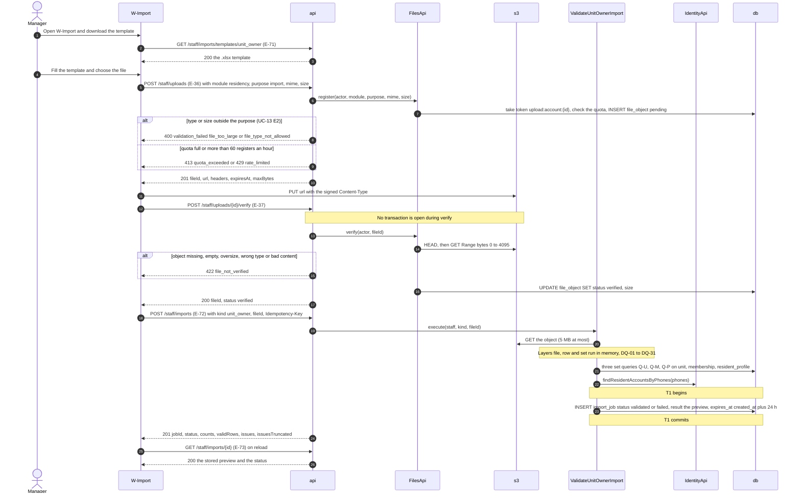

#### Step details

| Step | From → To | Call | Data | Rules and checks | Error → handling |
| --- | --- | --- | --- | --- | --- |
| 2–3 | `W-Import` → `api` | `GET /staff/imports/templates/unit_owner` (E-71) | the workbook | The `kind` is `unit_owner` in the API and in the database (DR-22, DR-141) | 404 for an unknown `kind` |
| 5 | `W-Import` → `api` | `POST /staff/uploads` (E-36), `Idempotency-Key` | `{"module": "residency", "purpose": "import", "mime": "application/vnd.openxmlformats-officedocument.spreadsheetml.sheet", "size": 412345}` | The purpose `import` allows `.xlsx` only, 5 MB; Manager or Admin (DOC-37 §4) | A file of 5.2 MB → 400 `validation_failed` rule `file_too_large`, no row, no object |
| 6–10 | `FilesApi` → `db`; `api` → screen | register | the key `production/<building>/residency/2026/10/<uuid>.xlsx` | Rate bucket 60 an hour, quota check (DOC-37 §6.1) | 413 `quota_exceeded`: "Storage is full. Contact the administrator."; 429 |
| 11 | `W-Import` → `s3` | `PUT url` | the bytes, `Content-Type` as registered | The store refuses a different type with 403 (not the API's shape; the screen shows "upload failed") | Registers again |
| 12–17 | `W-Import` → `api` → `FilesApi` → `s3` | `POST /staff/uploads/{id}/verify` (E-37) | — | `HEAD` for size and type, a ranged `GET` for the zip signature (DOC-37 §7) | 422 `file_not_verified` (`missing`, `too_large`, `empty`, `wrong_type`, `bad_content`) |
| 18 | `W-Import` → `api` | `POST /staff/imports` (E-72) | `{"kind": "unit_owner", "fileId": "0192f3c4-9d02-7000-8000-00000000f001"}` (see DR-149) | The request is served by `residency` by `kind`; the fee import is `finance`'s (DOC-27 §9.1) | 400 for an unknown kind |
| 20–22 | `ValidateUnitOwnerImport` → `s3`, `db`, `IdentityApi` | read the file; validate | file layer (`.xlsx`, header, no repeated column, ≥ 1 and ≤ 5,000 rows), row layer (DQ-10…23), set layer (DQ-30, 31), db layer by three set queries and one contract call (DOC-18 §1.5) | `fail` severity (DQ-01…05) makes the job `failed`; `error` rejects the row; `warning` and `info` keep it | 5,001 rows → job `failed` with `import_too_many_rows` (DQ-05), see the finding on UC-13 E2 |
| 23 | `ValidateUnitOwnerImport` → `db` | `INSERT residency.import_job` | `result` = counts, first 50 valid rows (ID number shown as `•••• 2345`), up to 500 issues, `issuesTruncated` | One short transaction; no ID number or date of birth in `result` (DR-58) | — |
| 24 | `api` → `W-Import` | 201 | `{"jobId": "…", "status": "validated", "counts": {"rows": 7, "valid": 3, "errors": 4, "unitsToCreate": 1, "unitsToUpdate": 2, "accountsToCreate": 1, "accountsLinked": 2, "ownersToAdd": 2, "ownersUnchanged": 1}, "validRows": […], "issues": […], "issuesTruncated": false}` | A 2,000-row file with 40 errors answers within 10 s of the accepted request (NFR-12, IM-30) | — |
| 25–26 | `W-Import` → `api` | `GET /staff/imports/{id}` (E-73) | the same preview and the `status` (`validated`, `failed`, `committed`, `expired`) | Used after a page reload and by the commit screen | 404 for a job of another building |

The preview shows, for each row, a note (`unit_will_update`, `unit_will_create`, `account_linked`, `account_will_be_created`) and, for each rejected row, the issue with its column and the message in the Manager's language ("12 units exist, will be updated" is the summary line of `counts.unitsToUpdate`). A job with `status: "failed"` has no commit button (DQ-52).

### FL-23.2 · Commit

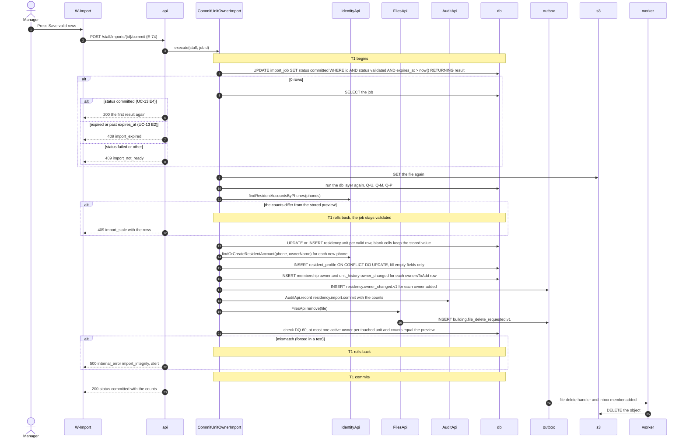

#### Step details

| Step | From → To | Call | Data | Rules and checks | Error → handling |
| --- | --- | --- | --- | --- | --- |
| 2 | `W-Import` → `api` | `POST /staff/imports/{id}/commit` (E-74) | no body | Manager or Admin; one transaction (DR-21) | — |
| 4 | `CommitUnitOwnerImport` → `db` | the claim `UPDATE` | the job row of the preview | The claim is the arbiter of two commits (DOC-27 §13): the second waits on the row, then updates 0 rows | — |
| 5–8 | `CommitUnitOwnerImport` → `db`, `api` → screen | read the job, decide the answer | — | `committed` → the **first** result, no write (DQ-51 note, IM-33); `expires_at` passed or `expired` → 409 `import_expired` ("This preview has expired. Upload the file again."); `failed` → 409 `import_not_ready` ("This import is not ready to commit.") | The job stays as it was |
| 9–12 | `CommitUnitOwnerImport` → `s3`, `db`, `IdentityApi` | read the file again; run layers DQ-01…46 | `counts` compared with the stored `result.counts` | The ID number and the date of birth come from the file here and nowhere else (DOC-18 §1.4) | Difference → 409 `import_stale` with `details {rows}`: "The data changed since the preview. Upload the file again." |
| 13 | `CommitUnitOwnerImport` → `db` | unit upsert | statements S8 of DOC-27 §9.2 step 3 | A blank cell keeps the stored value; a new unit with a blank occupancy is `vacant`; an occupancy change across the vacancy boundary writes `moved_in` or `moved_out` | — |
| 14 | `CommitUnitOwnerImport` → `IdentityApi` | `findOrCreateResidentAccount` per new phone | up to 2,000 sequential calls | An existing account keeps its name (DQ-44) | — |
| 15–17 | `CommitUnitOwnerImport` → `db`, `outbox` | profile fill-empty-only; owner membership; history; event | `unit_history` `details {"from": null, "to": "<account>", "source": "import"}`; `added_by_kind = 'staff'` | A stored value is never replaced; a different file value was only a warning (DR-114 (8)); no SMS and no `membership_changed` (DOC-27 §9.2) | — |
| 18–20 | `CommitUnitOwnerImport` → `AuditApi`, `FilesApi`, `outbox` | audit; remove the file | `residency.import.commit` with the counts in `details` (bulk form); `file_object` → `deleted` | The file holds national ID numbers and goes at commit (DR-22) | — |
| 21–22 | `CommitUnitOwnerImport` → `db` | DQ-60 | per touched unit at most one active owner; written rows equal the preview | Unreachable in practice (the unique index) | 500 `internal_error`, an alert |
| 23–25 | `api` → screen; `outbox` → `worker` → `s3` | 200; the delete command | `{"status": "committed", "counts": {…}}` | `import_expire` and `import_purge` find nothing left for this job | A failed object delete is retried by the outbox; the row is already `deleted` |

### Transactions and concurrency

| Concurrent pair | Arbiter (step) | Loser sees |
| --- | --- | --- |
| Two commits of one job (UC-13 race) | FL-23.2 step 4: `UPDATE … WHERE status = 'validated'` | The second waits, updates 0 rows, finds `committed` and answers **200 with the first result** (IM-33) |
| An owner set elsewhere between the preview and the commit | The commit re-runs the layers and compares counts (steps 9–12) | 409 `import_stale`; nothing written; the job stays `validated`; the file stays (IM-34) |
| A commit at 24 h 1 min | `expires_at > now()` in the claim | 409 `import_expired`; the `import_expire` job marks the job `expired` and removes the file within the hour (DQ-61) |
| Two imports of the same file by two Managers | Each has its own job; each commit re-validates | The second sees the first's owners as `owner_conflict` or `owner_unchanged`; its stored counts differ, so `import_stale` |

The whole commit is one transaction: a crash before T1 commits leaves no unit, account, profile or membership, and the job `validated` (the Manager presses Save again). A crash after the commit leaves everything written; the screen shows the old preview until reload, where E-73 returns `committed`. The file delete is an outbox command, so a crash after the commit still deletes the object. The planned server cost of the 2,000-owner commit is 217 ms measured server side plus about 3 s of round trips (DOC-27 §9.3).

### Errors and handling

| Situation | Step | HTTP status / code | UI behavior and message |
| --- | --- | --- | --- |
| A file over 5 MB (UC-13 E2) | FL-23.1 8 | 400 `validation_failed` `file_too_large` | Field error on the file chooser (copy owed to DOC-68) |
| 5,001 rows (UC-13 E2) | FL-23.1 23–24 | 400 `validation_failed`, rule `too_many_rows`; no job is stored (DR-149) | "The file has more than 5,000 rows. Split it." |
| Not an `.xlsx`, no unit-code header, repeated column, empty | FL-23.1 23–24 | 201 with job `failed` and the matching DQ code | The catalog text of DOC-18 §1.2 |
| Object not uploaded or wrong content | FL-23.1 15 | 422 `file_not_verified` | "The file could not be used. Choose it again." |
| One phone on two different people; a unit that has another owner (UC-13 E1) | FL-23.1 23–24 | row errors `phone_conflict`, `owner_conflict` in the preview | "Unit {code} already has another owner. Use ownership transfer." |
| Two commits (UC-13 E4) | FL-23.2 5–6 | 200, the first result | The same summary |
| Job older than 24 h | FL-23.2 7 | 409 `import_expired` | "This preview has expired. Upload the file again." |
| Job `failed` | FL-23.2 8 | 409 `import_not_ready` | "This import is not ready to commit." |
| Data changed since the preview | FL-23.2 12 | 409 `import_stale` | "The data changed since the preview. Upload the file again." |
| Integrity check fails | FL-23.2 22 | 500 `internal_error` (`import_integrity`) | "Something went wrong. Try again later."; an alert fires |
| A Technician or a Guard calls any of E-71…E-74 | guard | 403 `forbidden` | "You do not have permission to do this." |

### Required tests

Prefix `FI-` (FI-75…FI-86).

| ID | Scenario | Expected |
| --- | --- | --- |
| FI-75 | The sample file of DOC-18 §1.6 (7 rows) goes through E-36, E-37, E-72 and E-74 | Preview counts 7 rows, 3 valid, 4 errors, 1 unit to create, 2 to update, 1 account to create, 2 linked, 2 owners to add, 1 unchanged; after the commit 3 units written, 2 owner memberships, 2 `unit_history` `owner_changed` rows, 1 audit row `residency.import.commit`, no SMS command, the file `deleted`. Lower layer IM-29, IM-38, RM-42 |
| FI-76 | A 2,000-row file with 40 errors, from the accepted E-72 to the response | 1,960 valid rows, 40 issues, response within 10 s (NFR-12). Lower layer IM-30 |
| FI-77 | A file of 5.2 MB; a file of 5,001 rows; a `.xls` renamed `.xlsx` | 400 `file_too_large` at E-36 with no row; 400 `too_many_rows` at E-72 with no job (DR-149); job `failed` `import_file_type`; a commit of either failed job is 409 `import_not_ready`. Lower layer IM-01, IM-05, IM-36 |
| FI-78 | A registered file whose object was never uploaded; then upload and verify again | First verify 422 `file_not_verified` (`missing`), row `pending`; second 200. Lower layer FS-07 |
| FI-79 | "Save" pressed twice one after the other | Both 200; the second equals the first; one set of units, owners and history rows. Lower layer IM-33 |
| FI-80 | Two commits of one job at the same instant (two sessions) | One writes; the other waits and returns the first result; exactly one `residency.import.commit` audit row |
| FI-81 | After the preview, another Manager transfers an owner of a listed unit; then the first commits | 409 `import_stale`; nothing written; the job still `validated`; the file still present. Lower layer IM-34, RM-44 |
| FI-82 | Commit at 24 h 1 min (fake clock); then `import_expire` runs | 409 `import_expired`; the job `expired`; the file `deleted` within one hour of `expires_at`. Lower layer IM-35, IM-39 |
| FI-83 | The preview of a file with ID numbers and birth dates, read through E-72 and E-73 | `result` holds `•••• 2345` and no date of birth or full number in either response or in the stored `jsonb`; the commit stores the ID number sealed with `cccd_last4`. Lower layer IM-32 |
| FI-84 | A commit whose write would leave two owners (forced) | Rollback; 500; no row written; an alert. Lower layer IM-37 |
| FI-85 | A row for a phone that already has an account with another name; a stored profile with another email | The account's name is not changed (`account_linked`); the stored email stays and the empty fields are filled. Lower layer IM-26, IM-27, RM-45 |
| FI-86 | A Technician and a Guard call E-72 and E-74; a Manager of another deployment's token | 403 `forbidden`; 401. Lower layer IM-41 |

---

<a id="fl-24"></a>

## FL-24 · Account deletion

- **UC / FR:** UC-27 (deletion flow, 1a, 2a, E2 and the race rows) · FR-39.2, FR-39.3, FR-39.4
- **Screens:** `Account-Deletion` (resident app, DOC-60); `W-Residents` (web CMS, DOC-65)
- **Endpoints:** E-18 `POST /me/account/deletion`, E-19 `DELETE /me/account/deletion`, E-63 `GET /staff/residents`, E-68 `POST /staff/residents/{accountId}/deletion/approve`; the job `account_deletion` (daily 03:45)
- **Events:** `identity.session_revoked.v1`, `identity.account_deletion_executed.v1`, `residency.membership_changed.v1` (`removed`), `building.file_delete_requested.v1` (the avatar)
- **Trigger:** The resident chooses "Delete my account" on `Account-Deletion`.
- **Preconditions:** The resident is signed in. The terms gate does not apply: E-18 and E-19 are exempt so a person who refuses the new terms can still leave (DOC-35 §9.2, DR-125). An account that is the active owner of a unit may *request*, but the Manager cannot approve until ownership is transferred.

| Sub-flow | Covers | Endpoints |
| --- | --- | --- |
| FL-24.1 | The resident requests and cancels | E-18, E-19 |
| FL-24.2 | The Manager approves | E-63, E-68 |
| FL-24.3 | The job executes after `accountDeletionDays` | job `account_deletion`, handlers |

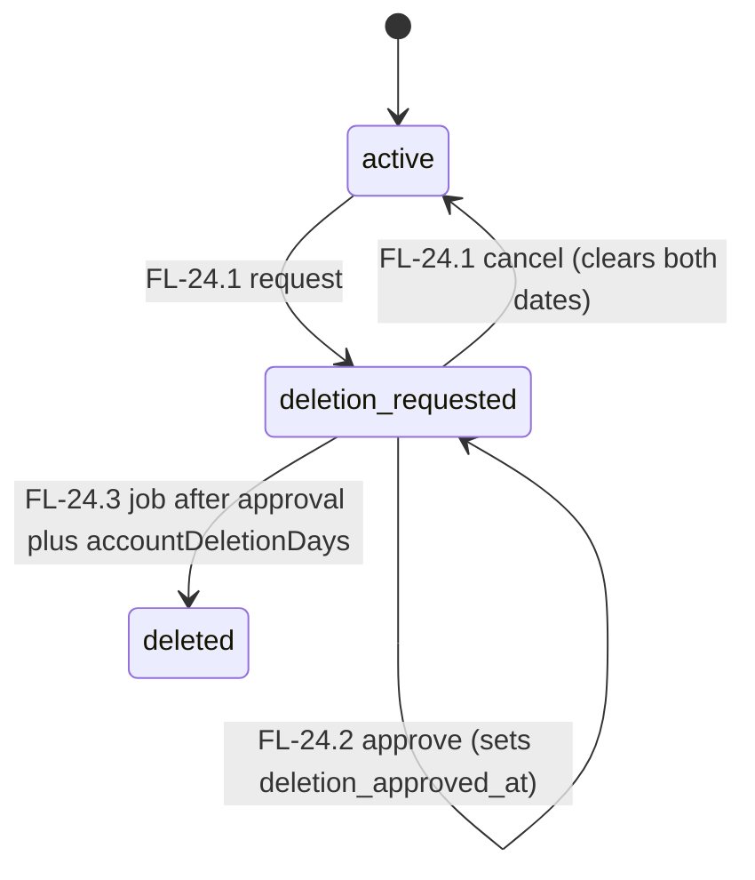

### Participants

| Participant | Kind | Code | Defined in |
| --- | --- | --- | --- |
| `Resident`, `Manager` | Actor | — | DOC-06 §1 |
| `Account-Deletion` | Screen | `apps/resident-app` (screen file owed) | DOC-60 |
| `W-Residents` | Screen | `apps/cms-web` (screen file owed) | DOC-65 |
| `api` | API | `modules/identity/src/presentation/resident-routes.ts`, `modules/residency/src/presentation/staff-routes.ts` | DOC-51 E-18, E-19, E-63, E-68 |
| `ResidentGuard` | Guard | `resident` (token only: no `X-Unit-Id`, no terms gate) | DOC-12 §5.3 |
| `StaffGuard` | Guard | `staff('admin','manager')` | DOC-12 §5.3 |
| `AccountDeletion` | Use case | `modules/identity/src/application/account-deletion.ts` with `request`, `cancel`, `approve` (the class name is given here; DOC-26 and DOC-35 name none) | DOC-35 §10.1 |
| `IdentityApi` | Contract | `listDeletionRequests` | DOC-35 §10.2 |
| `ResidencyApi` | Contract | `ownedUnitIds` | DOC-35 §10.2 |
| `BuildingApi` | Contract | `getSettings` (`accountDeletionDays`) | DOC-36 §3 |
| `FilesApi` | Contract | `remove` (the avatar) | DOC-37 §3 |
| `AuditApi` | Contract | `AuditApi.record` | DOC-35 §3 |
| `db` | Data store | `identity.resident_account`, `refresh_family`; `residency.membership`, `resident_profile`, `unit_history`; `notification.device_token`; `building.terms_acceptance` | DOC-16, DOC-17 |
| `outbox` | Data store | `identity.outbox_messages`, `residency.outbox_messages` | DOC-09 |
| `worker` | Worker | job `account_deletion`; handlers `notification.drop_tokens_on_identity_account_deletion_executed`, `residency.clear_profile_on_identity_account_deletion_executed`, `building.null_terms_ip_on_identity_account_deletion_executed` | DOC-38 §4, DOC-09 §5.2 |
| `s3` | Data store | the avatar object | DOC-37 §14 |

### FL-24.1 · Request and cancel

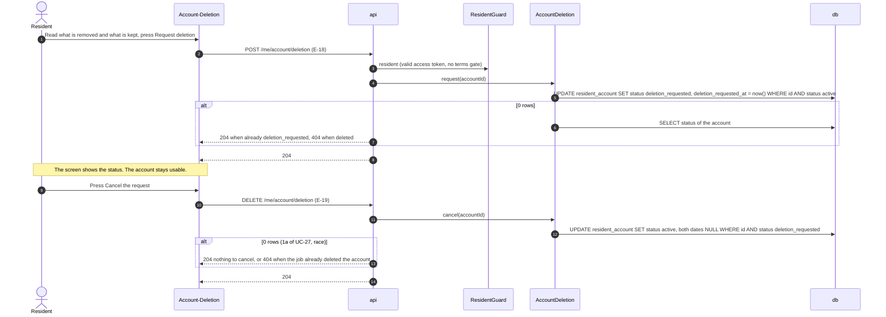

| Step | From → To | Call | Data | Rules and checks | Error → handling |
| --- | --- | --- | --- | --- | --- |
| 2 | `Account-Deletion` → `api` | `POST /me/account/deletion` (E-18) | no body | Exempt from the terms gate; the request is not audited (a resident action, DOC-35 §10.3) | — |
| 5–7 | `AccountDeletion` → `db` | the conditional `UPDATE` of DOC-35 §10.1 | `status`, `deletion_requested_at`, `version + 1` | The status decides a race (DOC-12 §9.1); an owner may request (approval is the gate) | Already requested → 204 (idempotent); `deleted` → 404 |
| 9–13 | `Account-Deletion` → `api` → `db` | `DELETE /me/account/deletion` (E-19) | — | A cancel clears **both** dates, also after the approval; a cancelled request can be made again | Nothing to cancel → 204; `deleted` → 404 (UC-27 race) |

### FL-24.2 · Approve

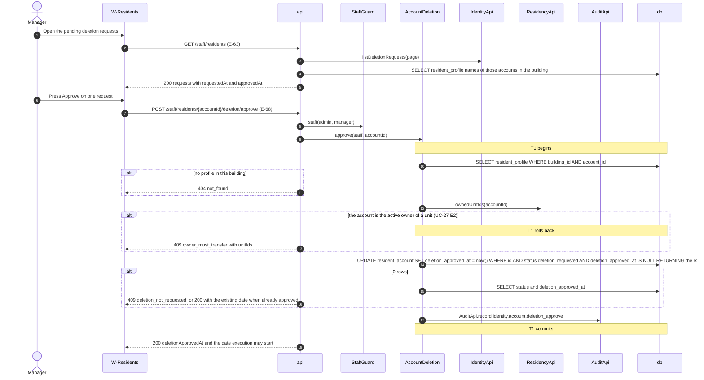

| Step | From → To | Call | Data | Rules and checks | Error → handling |
| --- | --- | --- | --- | --- | --- |
| 2–5 | `W-Residents` → `api` | `GET /staff/residents` (E-63) | the list carries the pending requests joined with profile names (DOC-27 §5.3; the parameter is fixed by E-63) | `identity` owns the status, so `residency` cannot filter on it; the list shows masked CCCD only and writes no `pii.read` row | — |
| 7 | `W-Residents` → `api` | `POST /staff/residents/{accountId}/deletion/approve` (E-68) | no body | Manager or Admin; the profile is the scope check (DR-136) | 404 |
| 12–13 | `AccountDeletion` → `ResidencyApi` | `ownedUnitIds(accountId)` | `[]` when none | Checked at the approval **and** again at the execution (DOC-35 §10.1 property 3) | 409 `owner_must_transfer`: "Transfer ownership of the unit first." |
| 14–16 | `AccountDeletion` → `db` | the approval `UPDATE`; the date is `deletion_approved_at + make_interval(days => accountDeletionDays)` | e.g. approved 2026-10-20, setting 30 → from 2026-11-19 | Zero rows: read once to choose the answer | 409 `deletion_not_requested`: "This account has not asked to be deleted."; already approved → 200 with the same date |
| 17 | `AccountDeletion` → `AuditApi` | `identity.account.deletion_approve` | `changes [{"field": "deletionApprovedAt", …}]` | Staff actor; in T1 (FR-37.1) | — |

There is no "reject": a Manager who does not approve leaves the account `deletion_requested` and usable (2a of UC-27). No notification is sent to the resident in phase 1; `Account-Deletion` shows the status (DOC-35 §10.3).

### FL-24.3 · Execute

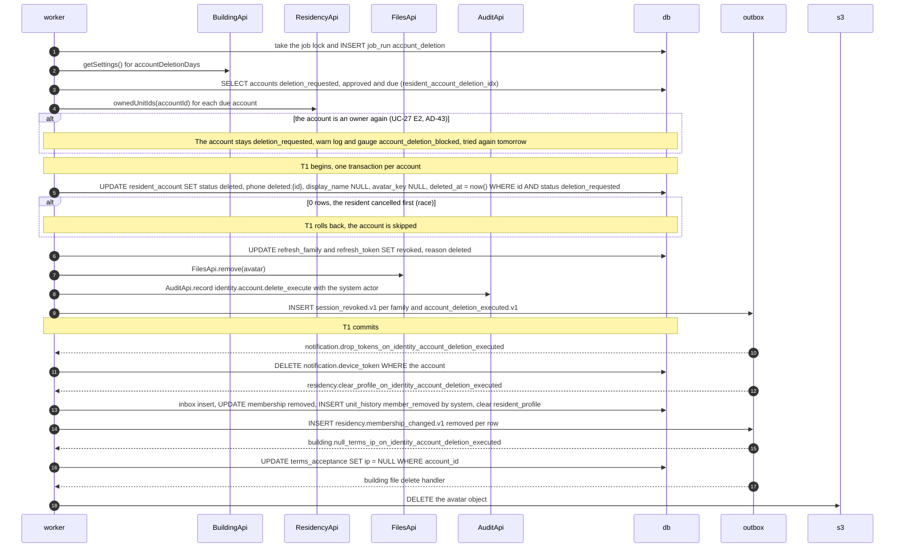

| Step | From → To | Call | Data | Rules and checks | Error → handling |
| --- | --- | --- | --- | --- | --- |
| 1–3 | `worker` → `db`, `BuildingApi` | the job `account_deletion`, daily 03:45, mode `lock` (DOC-38 §4) | `accountDeletionDays` (default 30, 1…365) | The setting is read at run time, so a change applies to approvals already given; the job runs once a day, so execution is within 24 hours after the cooling-off ends | A failed job is retried at the next slot; the alert is `job_last_success_timestamp` |
| 4 | `worker` → `ResidencyApi` | `ownedUnitIds` | — | An owner is left `deletion_requested`, counted in `account_deletion_blocked`, and tried again the next day | — |
| 5–9 | `worker` → `db`, `FilesApi`, `AuditApi`, `outbox` | step 1 of DOC-20 §8 in one transaction | families `revoked_reason = 'deleted'`; the avatar through `FilesApi.remove`; audit `{"source": "job", "blocked": false}` | The `status = 'deletion_requested'` predicate is the arbiter against a cancel; the number is free from here (IDM-14) | 0 rows → skip |
| 10–11 | `worker` → `db` | device tokens | `DELETE` by account | A second run deletes nothing | Outbox retry |
| 12–14 | `worker` → `db`, `outbox` | the `residency` handler (DOC-27 §12) | each membership `removed`, `credential_version + 1`; one `unit_history` row per membership with `actor_kind = 'system'` and `details {"source": "account_deletion", "memberType": …}`; the profile cleared (`cleared_at` set once) | Idempotent (RM-47); an account that became an owner in between is still removed, with the `warn` `deleted_owner_membership` | Handler failure → retry by the outbox rules; dead letter alerts |
| 15–16 | `worker` → `db` | terms IP | `ip = NULL` | The acceptance (account, version, time) stays | — |
| 17–18 | `worker` → `s3` | delete the avatar | — | A 404 from the store counts as success | — |

What stays: the account row and its id, removed memberships and `unit_history`, payer-name snapshots on payments and receipts, ticket and vehicle rows (account id), audit rows (ids only), and backups for about 5 weeks (DOC-35 §10.1 property 6). An account marked `deleted` whose handler steps are still pending is a normal, brief state; the resident cannot sign in or refresh (families revoked).

### Transactions and concurrency

| Concurrent pair | Arbiter (step) | Outcome |
| --- | --- | --- |
| The resident cancels while the job executes (UC-27 race) | FL-24.3 step 5: `… WHERE status = 'deletion_requested'` against FL-24.1's cancel `UPDATE … WHERE status = 'deletion_requested'` | Cancel first: the job updates 0 rows and skips. Job first: the cancel finds `deleted` and answers 404 |
| An ownership transfer and an approval (UC-27 race) | `ownedUnitIds` at the approval (FL-24.2 step 12) and at the execution (FL-24.3 step 4) | If the account is still an owner at execution the job refuses and the request stays pending |
| Two approvals | `deletion_approved_at IS NULL` in the approval `UPDATE` | The second changes 0 rows and answers 200 with the existing date |
| The job and a restore | Every step is a conditional update or a clear of null fields | A second run changes nothing (AD-44, DOC-20 §8) |
| A handler and an add of the same person as a member | The account is `deleted`; `findOrCreateResidentAccount` never matches `deleted:<id>` | A new account is created for the freed number |

If the worker dies after T1 commits and before a handler runs, the handlers run after the restart (outbox); in the meantime the account is `deleted`, its sessions are revoked and its memberships are still listed to the Manager as `active` for a short time. If it dies inside T1 nothing changed and the next day's run repeats the account.

### Errors and handling

| Situation | Step | HTTP status / code | UI behavior and message |
| --- | --- | --- | --- |
| A second request while one is open | FL-24.1 7 | 204 | The same status screen |
| Cancel with nothing to cancel | FL-24.1 | 204 | The same status screen |
| Cancel after the job deleted the account | FL-24.1 | 404 `not_found` | "We could not find this." The session is already dead (401 on the next call) |
| Approve for the active owner of a unit (UC-27 E2) | FL-24.2 12–13 | 409 `owner_must_transfer` with `unitIds` | Manager: "Transfer ownership of the unit first." |
| Approve an account nobody asked to delete | FL-24.2 16 | 409 `deletion_not_requested` | "This account has not asked to be deleted." |
| Approve an account with no profile in the building | FL-24.2 11 | 404 `not_found` | "We could not find this." |
| The resident did not accept the new terms | FL-24.1 | 204 (exempt from the gate) | The deletion screen still works |
| The Manager never approves (2a of UC-27) | — | none | The account stays `deletion_requested` and usable |
| The account is an owner at execution | FL-24.3 4 | no HTTP; `warn` log and `account_deletion_blocked` | Tried again the next day; the Manager sees the request still pending |

### Required tests

Prefix `FI-` (FI-87…FI-96).

| ID | Scenario | Expected |
| --- | --- | --- |
| FI-87 | A tenant requests deletion, uses `GET /me`, requests again, cancels, requests again | 204 each; status `deletion_requested` and the app works; the second request 204 (idempotent); after the cancel `active` with both dates null; the new request works; no audit row for these resident actions. Lower layer AD-38 |
| FI-88 | A request, an approval, then a cancel | `active` with `deletion_requested_at` and `deletion_approved_at` both null; the job skips the account on the due day. Lower layer AD-40 |
| FI-89 | The active owner of `A-1508` is approved before any transfer | 409 `owner_must_transfer` with `unitIds ["…21"]`, request still pending; after FL-22 transfers the unit the approval is 200. Lower layer AD-41 |
| FI-90 | Approve an `active` account; approve twice | 409 `deletion_not_requested`; 200 both times with the same date. Lower layer AD-39 |
| FI-91 | Approved 2026-10-20, `accountDeletionDays` 30; the job runs on 2026-11-18 and on 2026-11-20 (fake clock) | Nothing on the 18th; on the 20th the account is `deleted`, phone `deleted:<id>`, name and avatar cleared, every family `revoked` with `deleted`, one `session_revoked` per family, one `identity.account.delete_execute` audit row by the system, and after the relay: device tokens gone, memberships `removed` with `unit_history` rows by `system`, profile cleared, terms IP null, payer names on receipts unchanged. Lower layer AD-42, AD-45, RM-46 |
| FI-92 | The job runs twice; a crash is forced after the identity transaction and before the handlers | The second run changes nothing; the handlers complete after the restart; a deleted account's `GET /me` and refresh are 401. Lower layer AD-44, RM-47 |
| FI-93 | The resident cancels and the job executes at the same instant (two sessions) | Exactly one wins: cancel first → account `active`, the job skipped; job first → the cancel is 404 and the account `deleted` |
| FI-94 | The account is approved, then becomes an owner by an import or a Manager's add, then the job runs | The account stays `deletion_requested`, `account_deletion_blocked` 1, a `warn` log; after a transfer the next day's run executes it. Lower layer AD-43 |
| FI-95 | After the execution a Manager adds the freed number `0901234567` as a new member of another unit | 201; a **new** account is created; the deleted row keeps `deleted:<id>`. Lower layer AD-46, IDM-14 |
| FI-96 | The Manager never approves; 60 days pass | The account is still `deletion_requested`, usable, and the job reports `refused` 0 and `executed` 0 for it |

<a id="fl-45"></a>

## FL-45 · Admin confirms a sensitive action with step-up

- **UC / FR:** UC-17 (main flow "change the receiving account, with step-up", error flow E2) · FR-50.1, FR-50.2, FR-50.3, FR-50.4, FR-14.5, FR-38.3 · **Screens:** `W-Gateway`, `W-Step-Up` · **Endpoints:** E-38 `POST /staff/step-up`, E-50 `PUT /staff/gateway` (the worked example), E-40 `POST /staff/accounts` (action `admin_change`), E-42 `PATCH /staff/accounts/{id}` (actions `admin_change`, `staff_email`) · **Events:** `identity.mail_requested.v1` (kinds `step_up_code`, `step_up_notice`)
- **Trigger:** The Admin saves a change that needs step-up. The three actions (DOC-26 §4.5, DR-39):

  | Action | Request that carries the proof | When |
  | --- | --- | --- |
  | `gateway_config` | E-50 `PUT /staff/gateway` | Every change of this resource: secrets, receiving account, driver, status, even an unchanged re-save (DOC-36 §7.2) |
  | `admin_change` | E-40 `POST /staff/accounts` | `role` is `admin` |
  | `admin_change` | E-42 `PATCH /staff/accounts/{id}` | `role` becomes `admin` |
  | `staff_email` | E-42 `PATCH /staff/accounts/{id}` | `email` changes |

- **Preconditions:** The actor is a signed-in Admin. Step-up is an Admin-only capability: a Manager's request for a code is 403 `forbidden`, and a Manager attempting an action that needs it is refused for the role before any proof is asked (DR-147).

The proof is the Admin's password and a 6-digit code mailed to the Admin's own address, valid 10 minutes, single use. Sub-flows: **FL-45.1** request the code, **FL-45.2** prove and change.

### Participants

| Participant | Kind | Code | Defined in |
| --- | --- | --- | --- |
| `Admin` | Actor | role `admin` | DOC-26 §4.5 |
| `W-Gateway` | Screen | web CMS gateway form (file owed) | DOC-67 |
| `W-Step-Up` | Screen | the dialog that asks for the password and the code (file owed) | DOC-67 |
| `api` | API | routes E-38 and E-50 (E-40 and E-42 behave as E-50) | DOC-51 |
| `StaffGuard` | Guard | `staff('admin')` | DOC-12 §5.3 |
| `StepUp` | Service | `StepUp.request(staff, action)` | DOC-26 §1.1, §4.5 |
| `UpdateGateway` | Service | the `building` use case behind E-50 (class name owed to DOC-36 §7.3) | DOC-36 §7 |
| `IdentityApi` | Contract | `IdentityApi.verifyStepUp(staff, action, proof)` | DOC-09 §7.3 |
| `AuditApi` | Contract | `AuditApi.record` | DOC-35 §3 |
| `db` | Data store | `identity.password_token`, `identity.staff_account`, `identity.rate_bucket` (`platform.rate_bucket` for `stepup:staff:<id>`), `building.gateway_config` | DOC-16 §4.4, DOC-17 §3 |
| `outbox` | Data store | `identity.outbox_messages` | DOC-09 §4 |
| `worker` | Worker | handler `identity.send_mail` and the notification handler `notification.inbox_on_identity_mail_requested` | DOC-26 §5.4, DOC-09 §5 |
| `mail-relay` | External | SMTP relay | DOC-26 §2.1 |

### FL-45.1 · Request the code

```mermaid
sequenceDiagram
  autonumber
  actor A as Admin
  participant WG as W-Gateway
  participant WSU as W-Step-Up
  participant API as api
  participant SG as StaffGuard
  participant SU as StepUp
  participant DB as db
  participant OB as outbox
  participant WK as worker
  participant MR as mail-relay
  A->>WG: Edits the receiving account number, presses Save
  WG->>WSU: opens the dialog with the form held back
  WSU->>API: POST /staff/step-up (E-38) action gateway_config
  API->>SG: staff(admin)
  API->>SU: request(staff, gateway_config)
  Note over SU,DB: T1 begins
  SU->>DB: UPDATE rate_bucket stepup:staff take 1 token (5 per hour)
  alt bucket empty (E8)
    Note over SU,DB: T1 rolls back
    API-->>WSU: 429 rate_limited + Retry-After
  end
  SU->>DB: consume the live code of staff and action, INSERT the new password_token kind step_up
  SU->>OB: INSERT identity.mail_requested.v1 kind step_up_code
  Note over SU,DB: T1 commits
  API-->>WSU: 204
  WK->>OB: claim identity.mail_requested.v1
  WK->>MR: send(Your confirmation code)
  MR-->>A: Mail with the 6-digit code, valid 10 minutes
```

| Step | From → To | Call | Data | Rules and checks | Error → handling |
| --- | --- | --- | --- | --- | --- |
| 1 | Admin → `W-Gateway` | Save | New `accountNumber` `0011009999999` | The form keeps the values; the request is not sent yet | — |
| 2 | `W-Gateway` → `W-Step-Up` | Opens the dialog | — | The dialog asks for the password and, once the mail arrives, the code | — |
| 3 | `W-Step-Up` → `api` | `POST /staff/step-up` (E-38) | `{ "action": "gateway_config" }` | Admin only; `action` is one of the three stored names | 400 `validation_failed` for another name; 403 `forbidden` for a Manager |
| 4 | `api` → `StaffGuard` | `staff('admin')` | — | — | 401, 403 |
| 5 | `api` → `StepUp` | `request(staff, action)` | — | One `uow.run` | — |
| 6 | `StepUp` → `db` | Bucket upsert | `stepup:staff:0192f3c4-5a1e-7000-8000-000000000051`, capacity 5, refill 5 per hour (`STEPUP_REQUESTS_PER_HOUR`) | — | Empty → E8 |
| 7 | `api` → `W-Step-Up` | Answer | `Retry-After: 720` | — | 429 `rate_limited` → "Too many attempts. Try again later." |
| 8 | `StepUp` → `db` | Consume and insert (DOC-16 §4.4, AU-S01) | Code from the CSPRNG, uniform by rejection; stored value `HMAC-SHA256(OTP_HMAC_KEY, "stepup:" ‖ staff_id ‖ ":" ‖ action ‖ ":" ‖ code)`, `expires_at = now() + 10 min`, `attempts 0` | The code is bound to the person and the action (DR-132); the partial unique index `password_token_one_live` keeps one live code per staff member and action, so the newer request consumes the older | — |
| 9 | `StepUp` → `outbox` | `identity.mail_requested.v1` | `kind step_up_code`, `params { "action": "gateway_config" }`, `secretEnc` (the code sealed), `expiresAt` +10 min | — | — |
| 10 | `api` → `W-Step-Up` | `204` | — | — | — |
| 11 to 13 | `worker` → `mail-relay` | `identity.send_mail` | Subject "Your confirmation code" | The mail goes to the Admin's own address | Provider down → retried; the dialog shows "The email may be delayed." (UC-17 E8) |

### FL-45.2 · Prove and change

```mermaid
sequenceDiagram
  autonumber
  actor A as Admin
  participant WSU as W-Step-Up
  participant API as api
  participant SG as StaffGuard
  participant UW as UpdateGateway
  participant IA as IdentityApi
  participant AU as AuditApi
  participant DB as db
  participant OB as outbox
  participant WK as worker
  participant MR as mail-relay
  A->>WSU: Types the password and the code 482913, presses Confirm
  WSU->>API: PUT /staff/gateway (E-50) body with stepUp password and code, If-Match
  API->>SG: staff(admin)
  alt the body has no stepUp (E1)
    API-->>WSU: 403 step_up_required + details.action (no database work)
  end
  Note over API,DB: T2 begins
  API->>UW: put(staff, cmd)
  UW->>IA: verifyStepUp(staff, gateway_config, proof)
  IA->>DB: SELECT staff_account, Argon2id verify of the password
  alt wrong password, or the account is in a temporary lock (E2)
    IA->>DB: count the failure in database.autonomous, its own transaction, committed
    Note over API,DB: T2 rolls back
    API-->>WSU: 403 step_up_failed + attemptsLeft
  end
  IA->>DB: UPDATE password_token SET consumed_at for staff, action and code hmac
  alt no row, the code is wrong, expired, used or another Admin's (E3 to E6)
    IA->>DB: attempts + 1 in database.autonomous, committed
    Note over API,DB: T2 rolls back
    API-->>WSU: 403 step_up_failed + attemptsLeft
  end
  IA->>OB: INSERT identity.mail_requested.v1 kind step_up_notice for every active Admin
  UW->>DB: SELECT gateway_config FOR UPDATE, active intent probe, UPDATE secrets or account
  alt an intent is active, or the version is stale (E7)
    Note over API,DB: T2 rolls back, the code stays live, no notice is written
    API-->>WSU: 409 gateway_in_use or version_conflict
  end
  UW->>AU: record building.gateway.update with stepUp true
  Note over API,DB: T2 commits
  API-->>WSU: 200 + ETag
  WK->>OB: claim each step_up_notice
  WK->>MR: send(A sensitive change was made) and the inbox entry staff.step_up_done
```

| Step | From → To | Call | Data | Rules and checks | Error → handling |
| --- | --- | --- | --- | --- | --- |
| 1 | Admin → `W-Step-Up` | Confirm | password, `482913` | The dialog holds the form values of FL-45.1 step 1 | — |
| 2 | `W-Step-Up` → `api` | `PUT /staff/gateway` (E-50) | `{ "provider": "payos", "driver": "payos", "status": "active", "receivingAccount": { "bankBin": "970422", "accountNumber": "0011009999999", "accountName": "CONG TY QUAN LY SUNRISE" }, "stepUp": { "password": "…", "code": "482913" } }`, `If-Match: "3"` | The route declares `stepUp: 'gateway_config'` in its metadata (DOC-50 §3; the authorization matrix of P1-15 reads it) | 400 `validation_failed`; 428 `precondition_required` |
| 3 | `api` → `StaffGuard` | `staff('admin')` | — | For E-40 and E-42 the guard admits a Manager too, and the route first refuses a Manager for a step-up action with 403 `forbidden` (FR-14.1; DR-147) | 401, 403 `forbidden` |
| 4 | `api` → `W-Step-Up` | Route precheck and answer | `{ "error": { "code": "step_up_required", "details": { "action": "gateway_config" } } }` | A request without `stepUp` is refused **before any database work** (FR-50.2) | 403 `step_up_required` → "Confirm with your password and the code we emailed you."; the dialog asks for a code (FL-45.1) |
| 5 | `api` → `UpdateGateway` | `put(staff, cmd)` | — | T2 begins here: the proof and the action share one transaction (DR-132) | — |
| 6 | `UpdateGateway` → `IdentityApi` | `verifyStepUp(staff, 'gateway_config', proof)` | — | Runs inside the action's transaction | — |
| 7 | `IdentityApi` → `db` | Read the staff row, verify the password | Argon2id | A wrong password or a temporary lock is a failure; its answer is the same as for a wrong code (FR-50.2) | Failure → step 8 |
| 8 | `IdentityApi` → `db` | `database.autonomous(fn)`: the lockout statement of DOC-26 §4.1 step 6 on a **second connection** | `failed_attempts + 1` | **Survives the rollback** of T2: otherwise an attacker holding a stolen session could try passwords for ever (DR-132). The only place identity opens a second transaction inside a request. Five wrong passwords lock sign-in (FL-17) | — |
| 9 | `api` → `W-Step-Up` | Answer | `{ "error": { "code": "step_up_failed", "details": { "attemptsLeft": 5 } } }` | The same answer for a wrong password, a wrong code, an expired code, a used code and another Admin's code | 403 `step_up_failed` → "The password or code is not correct." (E2) |
| 10 | `IdentityApi` → `db` | `UPDATE identity.password_token SET consumed_at = now() WHERE staff_id = :s AND kind = 'step_up' AND action = :a AND token_hash = :code_hmac AND consumed_at IS NULL AND expires_at > now() AND attempts < 5 RETURNING id` | — | **The arbiter**: single use, expiry, action and person in one statement (DOC-16 §4.4). A code requested for `staff_email` does not open `gateway_config` (AU-45); another Admin's code hashes differently (AU-44) | 0 rows → step 11 |
| 11 | `IdentityApi` → `db` | `database.autonomous`: `attempts + 1`, consumed at the fifth | — | Committed although T2 rolls back; the fifth wrong code consumes the live code and the next proof fails with `attemptsLeft: 0` until the Admin asks for a new code (AU-46) | — |
| 12 | `api` → `W-Step-Up` | Answer | as step 9 with `attemptsLeft` 4…0 | — | 403 `step_up_failed` (E3 to E6) |
| 13 | `IdentityApi` → `outbox` | One `identity.mail_requested.v1` per active Admin of the building, **the actor included** | `kind step_up_notice`, `params { "action": "gateway_config", "actorName": "Lê Minh" }` | Written inside T2, so a notice exists only if the change commits (FR-50.4, DOC-36 §7.3) | — |
| 14 | `UpdateGateway` → `db` | The change of DOC-36 §7.3 steps 3 to 6 | `SELECT … FROM building.gateway_config WHERE id = :id AND version = :expected FOR UPDATE`; `ActiveIntentProbe.hasActive` when the account, driver or status changes; merge the secrets; `UPDATE … version + 1` | A secrets-only change does not ask the probe | A zero-row update or an active intent → step 15 |
| 15 | `api` → `W-Step-Up` | Answer | `{ "error": { "code": "gateway_in_use" } }` or `version_conflict` | T2 rolls back: **the code is still live** and no notice exists, so the Admin can retry with the same code when no intent is open (AU-49) | 409 `gateway_in_use` → "Online payments are in progress. Try again when none is open."; 409 `version_conflict` → "This was changed by someone else. Reload and try again." (E7) |
| 16 | `UpdateGateway` → `AuditApi` | `record` | `building.gateway.update`, `changes` list the fields (`secrets` as `[masked]`, the account number masked to its last four digits), `details.stepUp = true` | A failed audit insert fails the change (DOC-35 §3.7). T2 commits after this step | 500 `internal_error` |
| 17 | `api` → `W-Step-Up` | `200` | The new configuration with masked secrets, `ETag: "4"` | `W-Gateway` shows the saved state; the Admin may press "Check connection" (E-51) | — |
| 18 | `worker` → `outbox` | Claim each `step_up_notice` | — | One per Admin | — |
| 19 | `worker` → `mail-relay` | `identity.send_mail` and `notification.inbox_on_identity_mail_requested` | Subject "A sensitive change was made"; inbox entry `staff.step_up_done` | Every Admin is told, the actor too | A failed mail is retried; the inbox entry is independent |

The other two actions use the same request (FL-45.1 with `action` set to `admin_change` or `staff_email`) and the same proof (FL-45.2 steps 6 to 13 inside the transaction of E-40 or E-42). Only the business statement of step 14 changes: for `admin_change` the insert of an Admin or the promotion (and, for a promotion, the revocation of every family with reason `role_changed`); for `staff_email` the email change, after which sessions stay (DR-133) and the invite or reset goes to the new address.

### Transactions and concurrency

- **FL-45.1 T1** holds the throttle token, the consumed older code, the new code and the mail command: no code without a mail and no mail without a code. **Arbiter of two requests at once** (two Admins, or one Admin in two tabs): `password_token_one_live`; the newer consumes the older (UC-17 race).
- **FL-45.2 T2** holds the proof, the notices, the business change and the audit row. The consume of the code (step 10) and the business arbiter (the `FOR UPDATE` and `version` of step 14) decide a race; the code can be used by only one request.
- **Failure counting is outside T2** (`database.autonomous`, steps 8 and 11). The success path writes only in T2.
- **If the process dies** before T2 commits, nothing happens: the code is live and no notice exists, and the Admin retries. After T2 commits and before the answer: the change is in force, the notices are queued, and the Admin's retry with the same code fails with `step_up_failed` (the code is used); the Admin reloads `W-Gateway` and sees the saved configuration.

### Errors and handling

| Situation | Step | HTTP status / code | UI behavior and message |
| --- | --- | --- | --- |
| E1 The request has no `stepUp` (UC-17 E2) | 45.2 step 4 | 403 `step_up_required`, `details.action` | "Confirm with your password and the code we emailed you." `W-Step-Up` opens and asks for a code |
| E2 Wrong password, or the account is in a temporary lock | 45.2 step 9 | 403 `step_up_failed`, `details.attemptsLeft` | "The password or code is not correct." The Admin's sign-in lockout counter rose (five wrong passwords lock sign-in, FR-50.3) |
| E3 Wrong code | 45.2 step 12 | 403 `step_up_failed` | As E2; `attemptsLeft` counts down from 5 |
| E4 Expired code (after 10 minutes) | 45.2 step 12 | 403 `step_up_failed` | As E2; the dialog offers "Send a new code" |
| E5 Used code (already consumed by a success) | 45.2 step 12 | 403 `step_up_failed` | As E2 |
| E6 Another Admin's code, or a code requested for another action | 45.2 step 12 | 403 `step_up_failed` | As E2 |
| E7 An intent is active, or the configuration version is stale | 45.2 step 15 | 409 `gateway_in_use`, 409 `version_conflict` | Messages in step 15; the code stays live |
| E8 More than 5 code requests in an hour | 45.1 step 7 | 429 `rate_limited`, `Retry-After` | "Too many attempts. Try again later." |
| E9 A Manager requests a code, or attempts an Admin-only action | 45.1 step 3 | 403 `forbidden` | "You do not have permission to do this." |
| E10 The mail relay is down | 45.1 steps 11 to 13 | 204 as usual; the outbox retries | "The email may be delayed." (UC-17 E8) |

### Required tests

Lower layer: `AU-43…50`, `AU-12`, `AU-16`. These rows check the journey, the dialog and the notices.

| ID | Scenario | Expected |
| --- | --- | --- |
| FI-41 | Admin Lê Minh changes the receiving account of the payOS configuration (two Admins exist) | `POST /staff/step-up` 204; one `step_up_code` command with the code only in `secretEnc`; `PUT /staff/gateway` with the right password and code is 200; the code is consumed; two `step_up_notice` commands (the actor included) and, after the relay, two inbox entries `staff.step_up_done`; the audit row `building.gateway.update` has `details.stepUp = true`, the secrets as `[masked]` and the account number masked (AU-48) |
| FI-42 | `PUT /staff/gateway` with no `stepUp` | 403 `step_up_required` with `details.action: "gateway_config"`; a query spy sees no statement after the guard; `W-Step-Up` opens and shows "Confirm with your password and the code we emailed you." (AU-44) |
| FI-43 | A wrong password with the right code, five times | Each is 403 `step_up_failed`; `failed_attempts` of the Admin rises 1…5 and the sixth sign-in is 423; the code's `attempts` stays 0; the gateway configuration is unchanged (AU-47) |
| FI-44 | Five wrong codes, then the right code, then a new request and its code | `attemptsLeft` 4, 3, 2, 1, 0; the right code afterwards is 403 with `attemptsLeft: 0`; the counts were committed although each action rolled back; a new code works (AU-46) |
| FI-45 | The code at 10 min 1 s (fake clock); the same code used twice | Both 403 `step_up_failed` with the same body as a wrong code (AU-44) |
| FI-46 | Admin B uses the code mailed to Admin A; a `staff_email` code used for `gateway_config` | Both 403 `step_up_failed`; no state changed (AU-44, AU-45) |
| FI-47 | A valid proof, then an active intent exists (`gateway_in_use`); then the intent ends and the Admin retries with the same code | First: 409 `gateway_in_use`, no `step_up_notice`, no audit row, the code live; second: 200 and the notices are written (AU-49) |
| FI-48 | Admin creates an Admin with step-up `admin_change`; a Manager attempts the same without a proof | 201 and a notice to every active Admin; the Manager gets 403 `forbidden` and is not asked for a code (FR-14.1, AU-12, AU-16) |
| FI-49 | Admin changes a Technician's email (`staff_email`) with and without a proof | Without: 403 `step_up_required`; with: 200, the person's sessions stay, the new address receives the reset link; a Manager changing the email is 403 `forbidden` (AU-16) |
| FI-50 | Six code requests in an hour; two requests at the same instant for one action | The sixth is 429 "Too many attempts. Try again later."; after the parallel pair exactly one live code exists and the older mail's code is refused (AU-43, AU-50) |

## Decisions made while writing

| ID | Decision | Where used |
| --- | --- | --- |
| DR-147 | Staff accounts: a Manager reads the whole list; source states of lock, unlock, disable and enable; a forced `reassignTo` needs a reason; a Manager asking for a step-up action is refused with `forbidden` before any proof is asked | FL-17, FL-45 |
| DR-149 | Imports: one route dispatched by `kind`; the body carries the `fileId` of a verified upload, not an object key; more than 5,000 rows is a 400 and stores no job; the `deletion=requested` filter of E-63 | FL-23, FL-24 |
| DR-150 | A reset request answers no earlier than `RESET_MIN_RESPONSE_MS` (150 ms); the set-password statement checks the status the link was issued for | FL-18 |

## Not in this document

| Topic | Lives in |
| --- | --- |
| The statements, buckets and state machines | DOC-26, DOC-27, DOC-16, DOC-35 |
| Request and response schemas | DOC-51 |
| Screen layouts and the exact UI strings | DOC-57, DOC-60, DOC-61, DOC-64, DOC-65, DOC-67, DOC-68 |
| The QR scan after a lock (FL-35), push after a member is added (FL-32) | DOC-48 |
| The settings and gateway flow around step-up (FL-41), sessions and account settings (FL-43) | DOC-49 |

## Traceability

| UC | Flows | Requirements | Tests |
| --- | --- | --- | --- |
| UC-17 (sign-in, invite, reset, step-up) | FL-17, FL-18, FL-45 | FR-13, FR-14, FR-50 | FI-01…20, FI-41…50 |
| UC-14, UC-27 (terms) | FL-19, FL-20 | FR-15, FR-16, FR-39, FR-41 | FI-21…40 |
| UC-15 | FL-21 | FR-16, FR-17 | FI-51…62 |
| UC-13 | FL-22, FL-23 | FR-18, NFR-12 | FI-63…86 |
| UC-27 (deletion) | FL-24 | FR-39 | FI-87…96 |

## Open questions

None. Both earlier questions are answered: DOC-64 §1 carries the web forgot-password form as a dialog of `W-Login`, as FL-18.2 writes it; the messages marked `(copy owed to DOC-68)` are in DOC-68 (`password_weak`, `phone_invalid`; DR-220, DR-223) and the step-up dialog's resend button in DOC-67 (`web.step-up.cta.resend`). Numbers 31 and 32 of the `FI-` block were reserved for FL-19 and never used; they stay unused (a number is never reused).
