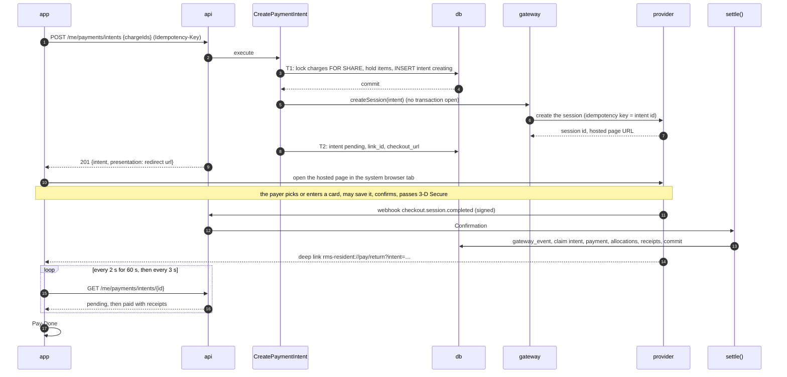
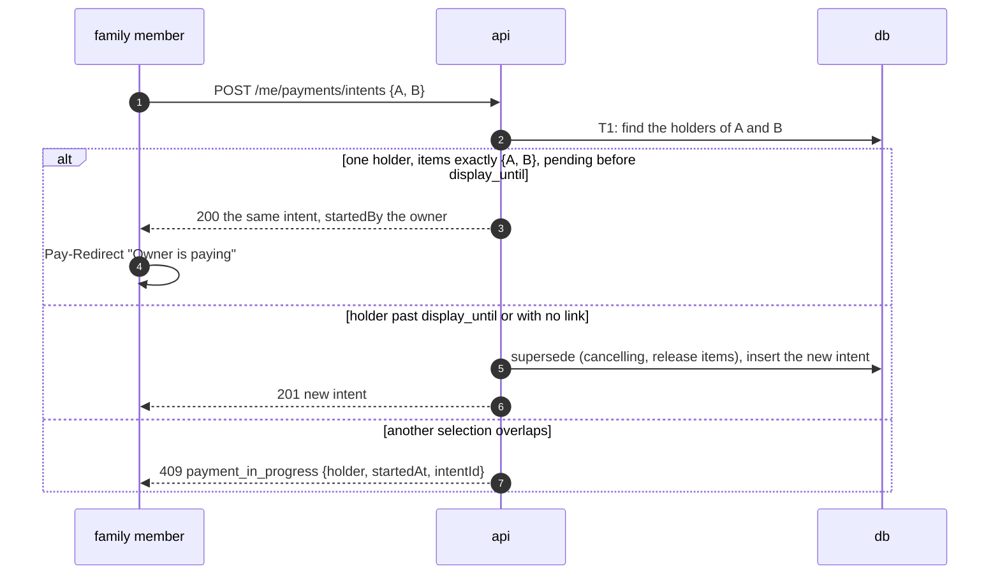
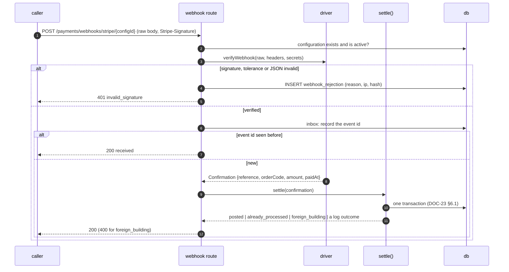
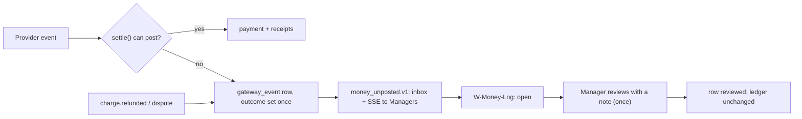

# Online payment flows

> Status: **Draft** · Updated: 2026-11-01 (P2-20: first version; Stripe first, DR-325, DR-326, DR-327) · DOC-45
> Depends on: [DOC-43](README.md), [DOC-04](../../01-product/use-cases.md) (UC-03, UC-18, UC-21), [DOC-03](../../01-product/requirements.md) (FR-07…10, FR-46, FR-47, NFR-01, NFR-02), [DR](../../00-decision-register.md) (DR-14, 16, 28, 29, 30, 31, 32, 84, 96, 280, 281, 282, 325, 326, 327), [DOC-23](../payment-intents-and-settlement.md), [DOC-24](../payment-gateway-drivers.md), [DOC-22](../ledger-and-allocation.md), [DOC-52](../../07-api/sse-and-webhooks.md) §12, [DOC-58](../../08-ux-ui/screens/resident-fees-payment.md), [DOC-66](../../08-ux-ui/screens/web-finance.md)
> Main readers: P2-22 (intent creation), P2-23 (webhook), P2-24 (re-query, expiry, cancel), P2-25 (resident screens), P2-26 (staff screens), P2-27 (EXP-01, EXP-02), the reviewer of any change to the payment path

This document holds the flows of an online payment from the resident's tap to the receipt, and what happens when it goes wrong. It is provider-neutral where it can be; where a step is different for a card, it says so, and the Stripe names are DOC-24's. The ledger side of a posted payment is FL-09 of DOC-44; the screens are DOC-58 and DOC-66; the rules are DOC-23. The flow of a bank-statement upload (FL-15) belongs to P3 and is not written here.

The document makes no decision of its own; where it had to choose, it follows DR-326 and DOC-23. It stays **Draft** while DOC-23 and DOC-24 are Draft.

## Flows in this file

| ID | Flow | UC | Screens | Endpoints |
| --- | --- | --- | --- | --- |
| FL-10 | A member pays batches online | UC-03 | `Pay-Select`, `Pay-Redirect`, `Pay-Done` | E-80, E-85, E-86, E-117 |
| FL-11 | A second member meets an open payment | UC-03 | `Pay-Select` | E-85, E-86 |
| FL-12 | The webhook settles the payment, with duplicates and a forged call | UC-18 | none | E-117 |
| FL-13 | A lost webhook is settled by the re-query; an unpaid intent expires | UC-18 | none | E-88 (hint), the jobs |
| FL-14 | A member or the Manager cancels a payment and pays again | UC-03 | `Pay-Redirect`, `Pay-Failed`, `W-Transactions` | E-87, E-175, E-85 |
| FL-15 | *Reserved: reconcile a bank statement (P3)* | UC-06 | `W-Statement` | E-111…E-116 |
| FL-16 | Money that is not a clean payment: late, duplicate, already paid, recalled, refunded, disputed | UC-18, UC-21 | `W-Money-Log`, `W-Transactions` | E-108, E-109 |

---

## FL-10 · A member pays batches online

- **UC / FR:** UC-03, FR-07.1…07.7, FR-08.4, FR-08.7 · **Screens:** `Pay-Select`, `Pay-Redirect`, `Pay-Done` · **Endpoints:** E-80, E-85, E-86 · **Events:** `finance.payment_posted.v1`, `receipt_issued`
- **Trigger:** the member taps "Thanh toán đợt này" or "Thanh toán nhiều đợt cùng lúc"
- **Preconditions:** a member with `pay`; open charges; an active gateway

### Participants

| Participant | Kind | Defined in |
| --- | --- | --- |
| `app` | resident app | DOC-58 |
| `api` | API | DOC-51 |
| `CreatePaymentIntent` | use case | DOC-23 §4 |
| `gateway` | the driver behind the port | DOC-24 |
| `provider` | Stripe (or `fake`) | DOC-24 §4 |
| `settle()` | use case | DOC-23 §6 |
| `db` | PostgreSQL | DOC-15 |

### Sequence diagram



### Step details

| Step | From → To | Call | Data | Rules and checks | Error → handling |
| --- | --- | --- | --- | --- | --- |
| 1 | `app` → `api` | E-85, marked `R` | `{ "chargeIds": ["…c1", "…c2"] }` | whole charges, 1 to 50, all `open`, of the member's unit; a tenant needs `can_pay`; amount between the driver's `limits` | 400 `amount_below_minimum` / `amount_above_maximum`; 403 `forbidden`; 409 `charge_changed`; 429 `rate_limited` (11th in a minute, FR-07.7) |
| 3 | `CreatePaymentIntent` → `db` | T1 | `FOR SHARE` on the charges in id order; items inserted under the hold index; intent `creating`, `code TT-yymmdd-nnnn`, `order_code` from the sequence | the holder rule (FL-11) | 409 `payment_in_progress`; 409 `charge_changed` |
| 5 | `CreatePaymentIntent` → `gateway` | `createSession` | amount, description, `expiresAt = display_until`, return URLs, the member's Customer | **no network call inside a transaction**; idempotency key is the intent id | timeout → the intent stays `creating`; the next `getStatus` decides (DOC-23 §4.5); `GatewayRejected` → intent `failed`, 502 `gateway_unavailable` |
| 8 | `CreatePaymentIntent` → `db` | T2 | `status pending`, `link_id`, `checkout_url`, `next_check_at = now + 5 min` | a webhook that already settled the intent (`creating → paid`) makes T2 update 0 rows and the answer is the paid intent (IN-33) | — |
| 9 | `api` → `app` | 201 | `{ "id": "…e1", "code": "TT-261019-0001", "amount": 2838000, "status": "pending", "displayUntil": "…", "presentation": { "type": "redirect", "url": "https://checkout.stripe.com/c/pay/cs_…" } }` | the provider name is not exposed | — |
| 10 | `app` → `provider` | open the URL | — | once per intent | the tab fails to open → the screen offers "Mở lại trang thanh toán" |
| 12–14 | `provider` → `api` → `settle()` | FL-12 | | | |
| 15 | `provider` → `app` | the deep link | `result=success` or `cancel` | never trusted | lost link → polling covers it |
| 16–17 | `app` → `api` | E-86 | `status`, `receipts[]` when paid | polling stops on a terminal status | `404` → generic error with the intent id kept in the URL |

### Alternatives

- **E1 The payer abandons the page.** The session stays open until `display_until`; the intent stays `pending`; the app shows `unfinished` and the actions; at `display_until` the provider expires the session and the job moves the intent to `expired` at its window (FL-13).
- **E2 The card is declined.** It happens on the provider's page; the session stays open and the payer retries there; the app sees nothing until the end.
- **E3 Saved card.** The payer picks a saved card on the page; for the system nothing differs (DOC-24 §4.7).

---

## FL-11 · A second member meets an open payment

- **UC / FR:** UC-03, FR-07.4 · **Screens:** `Pay-Select` · **Endpoints:** E-85, E-86 · **Rules:** DOC-23 §4.4
- **Trigger:** a family member selects charges that another member already holds in an active intent
- **Preconditions:** the owner started a payment for A and B at 09:12

### Sequence diagram



| Step | Rule | Outcome |
| --- | --- | --- |
| Same set, live | The intent is returned, not recreated (FR-07.4) | 200 with `startedBy {name}` and `startedAt` |
| Same set, stale | The old intent is superseded and its session expired (`checkout.sessions.expire`, FL-14) | 201, the old intent `cancelling` |
| Different overlapping set | Refused; nothing changes | 409 `payment_in_progress`; the app shows who and when and "Tiếp tục thanh toán" |
| Two creations at the same instant | The hold index arbitrates; the loser runs the decision once more | One intent; the other returns it or 409 (DOC-23 §7.2) |

The second member may pay the held intent too: both phones poll the same intent; whichever phone's payer completes the page pays it once, and both see `Pay-Done`.

---

## FL-12 · The webhook settles the payment, with duplicates and a forged call

- **UC / FR:** UC-18, FR-08.1…08.8 · **Endpoints:** E-117 · **Rules:** DOC-23 §6, DOC-24 §4.4, DOC-52 §12
- **Trigger:** the provider POSTs `checkout.session.completed` (or `async_payment_succeeded`)
- **Preconditions:** the endpoint is registered; the signing secret is configured

### Sequence diagram



| Step | Rule | Outcome |
| --- | --- | --- |
| Verify before anything else | A forged call writes one rejection row and nothing else, so it cannot occupy a real reference (FR-08.5) | 401 |
| Inbox first | A repeated event id is a 200 before any work | `already_processed` at the route level |
| `settle()` | `gateway_event` insert `ON CONFLICT DO NOTHING`; the intent claim; the payment, allocations, receipts, outbox, audit in one transaction | `posted` |
| A second genuine delivery of the same reference | The insert returns no row | `already_processed`, 200 |
| Different references for one intent | The claim lets one through | the other `duplicate_transfer` (FL-16) |
| After commit | The answer is sent after the commit (FR-08.6) | a lost answer is a provider retry that ends `already_processed` |
| Database failure | `40001`/`40P01` retried up to 3 times (FR-08.8); then 503 | the provider retries later |

The push "Payment received" (`payment.received`) and the SSE event are written in the same transaction through the outbox and are delivered by the worker (DOC-31); they are not part of the webhook's answer.

---

## FL-13 · A lost webhook is settled by the re-query; an unpaid intent expires

- **UC / FR:** UC-18, FR-10.1, FR-10.2, FR-10.4 · **Job:** `intent_requery` (it also expires, DOC-38 §4.1) · **Rules:** DOC-23 §8
- **Trigger:** `next_check_at` of a `pending` intent has passed, or the member presses "Tôi đã thanh toán xong" (E-88)

```mermaid
sequenceDiagram
  autonumber
  participant J as intent_requery (worker)
  participant DB as db
  participant GW as gateway
  participant ST as settle()
  J->>DB: claim due intents (FOR UPDATE SKIP LOCKED, lease)
  J->>GW: getStatus(session) per intent (no transaction open)
  alt paid
    GW-->>J: confirmation (source requery)
    J->>ST: settle(confirmation)
  else open
    J->>DB: next_check_at = now + 5 min (+ jitter 0–20 s), check_count + 1
  else expired or cancelled at the provider
    J->>DB: intent expired (or cancelled) when its window ends
  else provider error
    J->>DB: backoff 30 s, 60 s, 2 min, 5 min; check_failures + 1
  end
```

| Step | Rule | Outcome |
| --- | --- | --- |
| Schedule | every 5 minutes plus 0 to 20 s of jitter, until `expires_at` (60 minutes) | a lost webhook is settled within 6 minutes (FR-10.1) |
| "I have paid" | E-88 sets `next_check_at = now` at most once per 10 s per intent; the check runs on the next tick | the status answer says `checkScheduled` |
| Expiry | at `expires_at` an unpaid intent becomes `expired`, the session is expired at the provider (best effort), items are released | the charges are payable again (FR-10.2) |
| `creating` too long | after 2 minutes a `getStatus` decides: found → `pending`; absent → `failed`, items released (FR-10.4) | — |
| Late payment on an expired intent | A confirmation after expiry with the charges still open is posted (DR-281) | FL-16 |
| Provider outage | calls back off; at most 5 provider calls at once; the alert `GatewayErrors` | RB-02 |

---

## FL-14 · A member or the Manager cancels a payment and pays again

- **UC / FR:** UC-03, FR-07.4, FR-10.6, DR-28 rule 4 · **Screens:** `Pay-Redirect`, `Pay-Failed`, `W-Transactions` · **Endpoints:** E-87 (member), E-175 (staff), E-85
- **Trigger:** "Hủy thanh toán" (member), "Hủy lượt thanh toán" (Manager), a recall or a void of a held charge, or a new creation superseding a stale intent

```mermaid
sequenceDiagram
  autonumber
  participant U as member or Manager
  participant API as api
  participant DB as db
  participant GW as gateway
  U->>API: POST …/cancel {reason?}
  API->>DB: intent pending → cancelling (conditional), release items
  alt intent already paid
    API-->>U: 409 intent_not_cancellable
  else
    API-->>U: 200 cancelling
    API->>DB: outbox: cancel command
    Note over GW: the worker calls cancel(session) after commit
    GW->>GW: expire the session; if the provider says it is complete, getStatus → settle()
    GW->>DB: intent cancelled
  end
  U->>API: POST /me/payments/intents {same charges}
  API-->>U: 201 a new intent (the old session cannot be paid)
```

| Step | Rule | Outcome |
| --- | --- | --- |
| Who | the member who started it, the owner, or staff; others get 403 | — |
| The cancel is best effort | correctness never depends on it: a late confirmation is posted or logged (DR-31) | — |
| Cancel racing a payment | the intent row arbitrates; a payment that won makes the cancel 409 and the app moves to `Pay-Done` (UIRF-40) | — |
| Recall or void of a held charge | `cancelHolding` cancels the intent as a whole, other charges included (FR-04.1); the household starts again | — |
| Pay again | a new selection creates a new intent and a new session; the saved card is offered on the new page | — |

---

## FL-16 · Money that is not a clean payment

- **UC / FR:** UC-18, UC-21, FR-09.1…09.8, FR-46, FR-47 · **Screens:** `W-Money-Log`, `W-Transactions` · **Endpoints:** E-108, E-109, E-110 · **Events:** `finance.money_unposted.v1`
- **Trigger:** `settle()` or a provider event that cannot post

| Case | Cause | Outcome in the log | Resident sees | Manager does |
| --- | --- | --- | --- | --- |
| Late exact payment, charges open | the intent expired or was cancelled | **posted** (DR-281) | `Pay-Done` or the paid charge | nothing |
| Late payment, a charge paid in cash meanwhile | FR-09.1 | `charge_already_paid` | nothing (card: the payer is charged and sees no receipt: the message of `Pay-Failed`) | refunds in the provider's dashboard; marks reviewed |
| Late payment, the batch was recalled | FR-09.5 | `charge_recalled` | as above | as above |
| Two payments for one intent | two paid sessions (a second tab) | `duplicate_transfer` | the receipts of the first | refunds the second |
| Unknown order code | a confirmation matching no intent | `unknown_order` | nothing | checks in the dashboard |
| Amount differs from the intent | a bug or an edited session | `amount_short` / `amount_over` (and a bank-transfer driver's normal case) | `unmatchedTransfer` only for bank-transfer drivers | refunds; marks reviewed |
| Refund at the provider | the Manager refunds in the dashboard | **`refunded`**, attached to the payment (DR-327) | nothing | cross-checks the payment and receipts; the ledger is unchanged |
| Dispute at the provider | the payer disputes with the bank | **`disputed`**, attached to the payment | nothing | works it out with the provider |



Every authenticated confirmation is a payment or a row, never nothing (NFR-01). A row never links to a charge, a period or a payment, except `refunded` and `disputed`, whose read-only `related_payment_id` exists for cross-checking (DR-327). Review changes nothing in the ledger (FR-46.3). The system never refunds through the API.

---

## Required tests

The flows are covered by `IN-` (DOC-23 §16), `PX-` (DOC-24 §9), `UIRF-` (DOC-58), `UIWF-` (DOC-66) and the experiments EXP-01 and EXP-02. This document owns no test prefix; each flow names the tests that prove it:

| Flow | Tests |
| --- | --- |
| FL-10 | `IN-01…17`, `UIRF-27…43`, `PX-08`, `PX-09`, `PX-10` |
| FL-11 | `IN-` hold tests of §16.1, `UIRF-30`, `UIRF-31` |
| FL-12 | `IN-24…35`, `PX-01…05`, `PX-13`, EXP-01 |
| FL-13 | `IN-40…49` (DOC-23 §16.4), `PX-06`, EXP-02 |
| FL-14 | `IN-18…23`, `IN-40…49`, `PX-07`, `UIRF-39`, `UIRF-40`, `UIWF-69`, `UIWF-70` |
| FL-16 | `IN-26…32`, `PX-11`, `PX-12`, `UIWF-73…78` |

## Not in this document

| Topic | Lives in |
| --- | --- |
| The ledger once a payment is posted | DOC-44 FL-09, DOC-22 |
| The statement flow | DOC-25 and FL-15 (P3) |
| The provider mapping | DOC-24 |
| The runbooks | RB-02, RB-03, RB-11, RB-13 |

## Open questions

None.
