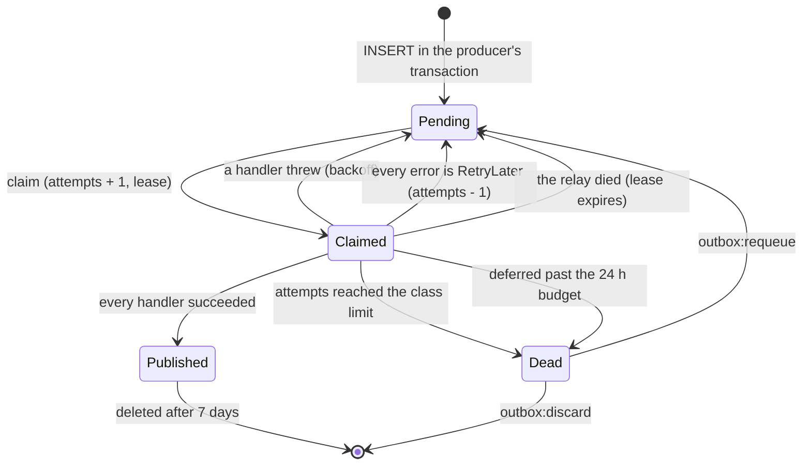

# Jobs and outbox runtime

> Status: **Review** · Updated: 2026-10-20 (DR-161: database absent at start; earlier: DR-154: label `job_name`) · DOC-38
> Depends on: original SDD §4.1, §4.2, §5.10, §10.2, §15, §19.4, [DR](../00-decision-register.md) (DR-05, 06, 30, 31, 51, 52, 55, 56, 60, 61, 62, 63, 67, 98, 101, 112, 114, 115, 118, 120, 121), [ADR-0009](../04-adr/0009-transactional-outbox-inbox-and-contracts.md), [ADR-0013](../04-adr/0013-time-zones-and-calendar-day-semantics.md), [ADR-0015](../04-adr/0015-jobs-and-worker-topology.md), [DOC-07](../03-architecture/system-context-and-containers.md) §4.3, [DOC-09](../03-architecture/messaging-contracts.md), [DOC-10](../03-architecture/quality-attributes.md) §6, [DOC-12](../03-architecture/code-architecture.md) §4.2, §8, [DOC-17](../05-data/operations-model.md) §3, [DOC-20](../05-data/data-lifecycle.md) §5
> Main readers: P1-05 (messaging and job runtime), P1-07, P1-20 (the VPS), every task that adds a job or an event handler, DOC-40, DOC-41, DOC-70, RB-04, RB-05

This document says how the `worker` role runs: the outbox relay that delivers messages to handlers, the timers that start jobs, the locks that keep a job from running twice at once, the `job_run` record, the catalog of every job with its schedule and what happens when a run is missed, and how the process starts, pauses and stops. It does not hold the event catalog and the retry classes (DOC-09), the tables (DOC-17 §3), the statements of the purge jobs (DOC-20 §5), the semantics of each job's work (the design document of its module) or the alerts on these jobs (DOC-40).

**Tested on PostgreSQL 18.6 (`postgres:18.6`, aarch64) on 2026-10-19.** Every statement of §2 and §3 was run on a database built from the DDL of DOC-17 §3.2 and §3.3 (the `finance` schema stands for any module), and the tests marked "run" in §9 passed; the slot arithmetic of §3.3 was run under Bun with the cases of its table. The runtime itself does not exist yet; the tests marked "P1-05" are the acceptance of that task.

Every new decision in this document is recorded as DR-120 or DR-121 and summarized in §10. The command messages that the jobs write for the files (`building.file_delete_requested.v1`, `building.thumbnail_requested.v1`) are DR-122 (DOC-37) and appear in the catalog of DOC-09.

## 1. Scope and reading guide

| Question | Answer lives in |
| --- | --- |
| How does the relay claim, deliver, retry and clean? | §2 |
| How many attempts does a message of type X get? | DOC-09 §4.2; the keys are §2.6 |
| How does a job start, and what stops two copies running at once? | §3 |
| Which jobs exist, when do they run, and what do they do? | §4 |
| What happens if the worker is down at 03:00? | §3.3 and §7 |
| How does the worker start, pause for a deploy and stop? | §5 |
| Which connections does it use? | §6 |
| What does it measure? | §8 |

## 2. The relay

One `OutboxRelay` instance runs in the `worker` role (reference `kit-messaging`, vendored as `@core/messaging`, DR-98). It serves every module that publishes, in the order of the module catalog. It polls; it holds no `LISTEN` connection (DOC-10 §6.3 reserves one that this design does not use). The `realtime` handlers that run in the worker wake the SSE streams of the `api` instances with `pg_notify` on an ordinary pooled connection (DR-75).

Sources are the schemas that publish: `finance`, `residency`, `identity`, `tickets`, `vehicles`, `notices`, `notification`, `reporting` and `building` (since DR-122). The helper creates both tables in every schema that publishes or consumes (DOC-17 §3.3); `realtime` has neither, because its handlers keep no inbox row. `apps/api/scripts/outbox.ts` keeps its own list of sources, which must equal the relay's (JB-24).

### 2.1 Claiming

One statement claims a batch. It locks the candidate rows with `SKIP LOCKED`, counts the attempt and sets a lease; the statement commits at once, so it is `locked_until` that hides a claimed row from the next claim. Both comparisons use the database's `now()`, so clock skew between hosts cannot move a lease.

```sql
UPDATE finance.outbox_messages m
   SET locked_until = now() + make_interval(secs => :lease_seconds),
       attempts     = m.attempts + 1
 WHERE m.id IN (SELECT o.id FROM finance.outbox_messages o
                 WHERE o.published_at IS NULL AND o.dead_at IS NULL
                   AND o.next_attempt_at <= now()
                   AND (o.locked_until IS NULL OR o.locked_until < now())
                 ORDER BY o.id
                 LIMIT :batch_size
                   FOR UPDATE SKIP LOCKED)
RETURNING m.*;
```

- Attempts are counted **at claim time**: a crash during delivery also uses one, so a message that kills the process cannot loop forever.
- A relay that dies mid-batch loses nothing: its lease expires after `OUTBOX_LEASE_SECONDS` and the rows are claimed again, with `attempts` one higher.
- The partial index `outbox_pending_idx (next_attempt_at)` holds only undelivered rows, so the subquery reads a few rows however many published rows wait for the cleanup.

Tested: 120 pending rows claimed by three passes of 50 gave 50, 50 and 20 distinct rows and a fourth pass returned none (JB-01); after the lease of the last 20 was set in the past they were claimed again with `attempts` 2 (JB-02); two sessions claiming at the same moment, each holding its claim transaction open for 2 seconds, got 50 and 50 rows with no overlap (JB-07).

### 2.2 Concurrency per aggregate

`RETURNING` has no defined order. The batch is sorted by id, grouped by `aggregate_id`, and up to `OUTBOX_CONCURRENCY` workers each take a whole group. Messages of one aggregate never run at the same time and start in id order; different aggregates run in parallel. Each message is marked published right after its own delivery, so concurrency does not widen the window in which a crash causes a repeat.

`OUTBOX_CONCURRENCY` is 4 and is capped at `DB_POOL_MAX − 4`: each message in flight holds a connection, and the jobs need theirs (§6). Ordering is best effort per aggregate, not FIFO: if an earlier message fails, later ones of the same aggregate still run and the failed one returns after its backoff. A handler never depends on order (DOC-09 §2).

### 2.3 What happens to a message



The three statements that end a claim (`:id` is the row; `:max` is the class limit of DOC-09 §4.2):

```sql
-- success
UPDATE finance.outbox_messages SET published_at = now(), locked_until = NULL, last_error = NULL WHERE id = :id;

-- failure: back off, or die at the limit
UPDATE finance.outbox_messages
   SET next_attempt_at = now() + make_interval(secs => least(:base * power(2, attempts - 1), :cap)),
       dead_at         = CASE WHEN attempts >= :max THEN now() END,
       locked_until    = NULL,
       last_error      = left(:error, 2000)
 WHERE id = :id;

-- RetryLater: give the attempt back, wait the hint plus 0-10 % jitter, die only after the budget
UPDATE finance.outbox_messages
   SET attempts        = greatest(attempts - 1, 0),
       next_attempt_at = now() + make_interval(secs => :delay_seconds * (1 + 0.1 * random())),
       dead_at         = CASE WHEN occurred_at < now() - make_interval(hours => :budget_hours) THEN now() END,
       locked_until    = NULL,
       last_error      = left(:error, 2000)
 WHERE id = :id;
```

With `:base` 5 and `:cap` 900 the waits after attempts 1 to 8 were 5, 10, 20, 40, 80, 160, 320 and (on the eighth, which dies) 640 seconds (JB-03). A dead row is not claimed; `outbox:requeue` makes it claimable again (JB-04). A deferred row returned with `attempts` unchanged and a wait of 60 to 66 seconds, and the one older than 24 hours died (JB-05). A mix of a deferral and a real error counts as a real failure.

**Bus.** `InProcessMessageBus.publish` runs every handler of the type with `Promise.allSettled`; if any failed it throws an `AggregateError` and the relay retries the whole message. Handlers that already succeeded are skipped by their inbox row. A handler sets its own client timeout (Expo, SMS, SMTP, payOS, R2: 10 to 30 seconds, in the driver documents) so that a pass stays well under the 60-second lease.

### 2.4 Settings per event type

A type belongs to one retry class; the class gives the number of attempts. DOC-09 §4.2 owns the numbers; this table says which key carries each.

| Class | Types | Attempts (key) | Notes |
| --- | --- | --- | --- |
| `default` | every type not named below (25 of 28) | `OUTBOX_MAX_ATTEMPTS` = 8 | Waits 5 s doubling, cap 900 s; dead after about 10 min 35 s |
| `sms` | `identity.sms_requested.v1` | `OUTBOX_SMS_MAX_ATTEMPTS` = 3 | The handler also skips the command after `expiresAt` (5 min) |
| `push` | `notification.push_requested.v1` | `OUTBOX_PUSH_MAX_ATTEMPTS` = 3 | The Expo client retries 3 times inside one attempt (DR-52) |
| `intent_cancel` | `finance.intent_cancel_requested.v1` | `OUTBOX_INTENT_CANCEL_MAX_ATTEMPTS` = 8 | DR-31 |

The class of a type is read from `outboxPolicies` in the module manifest (DOC-09 §4.2). A type missing from a producer's catalog row cannot be written: the writer wrapper refuses an unknown type (JB-23).

### 2.5 Cleanup

At most every `OUTBOX_CLEANUP_INTERVAL_MINUTES` (10), one pass per source, under `withAdvisoryXactLock(database, 'outbox-cleanup:<schema>')` so that only one relay does it and the others skip without waiting:

```sql
DELETE FROM finance.outbox_messages WHERE published_at < now() - make_interval(days => :retention_days);
DELETE FROM finance.inbox           WHERE processed_at < now() - make_interval(days => :retention_days);
```

`:retention_days` is `OUTBOX_RETENTION_DAYS` = 7 (DR-101). Run on four rows (published 8 and 2 days ago, pending 9 days old, dead 9 days old) it deleted the first only; the inbox statement deleted the 8-day-old row and kept the 1-day-old one (JB-06). **Dead letters are never cleaned**: they stay until an operator requeues or discards them (DOC-20 §2.2). The payloads that held a one-time code are encrypted (DR-117), so the 7 days leave nothing usable.

### 2.6 Configuration keys

DOC-41 lists them with the other keys of the worker; the defaults are these (DR-62, DR-101, DR-118).

| Key | Default | Meaning |
| --- | --- | --- |
| `OUTBOX_POLL_INTERVAL_MS` | 500 | Sleep when a pass found nothing; while busy the loop does not sleep |
| `OUTBOX_BATCH_SIZE` | 50 | Rows claimed per source per pass |
| `OUTBOX_CONCURRENCY` | 4 | Aggregate groups processed in parallel (capped, §2.2) |
| `OUTBOX_LEASE_SECONDS` | 60 | Lease of a claim |
| `OUTBOX_MAX_ATTEMPTS`, `OUTBOX_SMS_MAX_ATTEMPTS`, `OUTBOX_PUSH_MAX_ATTEMPTS`, `OUTBOX_INTENT_CANCEL_MAX_ATTEMPTS` | 8, 3, 3, 8 | Attempts per class |
| `OUTBOX_BACKOFF_BASE_SECONDS`, `OUTBOX_BACKOFF_MAX_SECONDS` | 5, 900 | Backoff `min(base × 2^(attempts − 1), max)` |
| `OUTBOX_DEFER_BUDGET_HOURS` | 24 | How long a `RetryLaterError` may keep deferring a message |
| `OUTBOX_RETENTION_DAYS` | 7 | Published outbox rows and delivered inbox rows |
| `OUTBOX_CLEANUP_INTERVAL_MINUTES` | 10 | Cleanup pass |
| `OUTBOX_MAX_PAYLOAD_BYTES` | 65536 | Writer wrapper limit (DOC-09 §3.4) |

### 2.7 Pausing and operating

`pause()` sets a flag and waits for the batch in flight; the loop stays alive and only sleeps. It is safe before `start()`, so a worker that boots during maintenance never claims a first batch (§5.3). `stop()` ends the loop and waits for it.

Dead letters are handled with three scripts of `@app/api` (the reference's `outbox.ts`, extended):

```bash
bun run --filter @app/api outbox:list                          # dead rows: id, type, attempts, last_error, age
bun run --filter @app/api outbox:requeue -- --id <uuid>        # or --type finance.receipt_render_requested.v1
bun run --filter @app/api outbox:discard -- --id <uuid>        # delete a dead row after reading it
```

`requeue` sets `dead_at = NULL, attempts = 0, locked_until = NULL, last_error = NULL, next_attempt_at = now()`. It is safe because the inbox blocks every handler that already finished, so only the unfinished handlers run again. The scripts connect as `rms_app` and write an audit row with `actor_kind = 'system'` and `details {"operator": "<OS user>"}` (RB-05).

## 3. The job runtime

A job is a function with a name, a module, a schedule and a mode. It is declared in its module's `jobs: JobDefinition[]` (DOC-12 §4.2) and started and stopped as a group by the runtime.

```ts
interface JobDefinition {
  readonly name: string                       // ^[a-z][a-z0-9_]{2,40}$, unique; also the lock key and job_run.name
  readonly schedule:
    | { kind: 'every'; seconds: number }      // sub-hourly ticks
    | { kind: 'hourly'; minute: number }
    | { kind: 'daily'; at: 'HH:MM' }
    | { kind: 'weekly'; day: 'mon' | …; at: 'HH:MM' }
    | { kind: 'monthly'; day: number; at: 'HH:MM' }
  readonly mode: 'claim' | 'lock' | 'snapshot'      // §3.2
  readonly graceMinutes: number               // §3.3; 0 = no catch-up
  run(ctx: JobContext): Promise<JobResult>    // ctx: clock, signal (aborted at shutdown), paused() (maintenance), buildings, logger
}
type JobResult = { did: number; details: Record<string, unknown> }   // did = rows or objects worked on; 0 = idle
```

### 3.1 Interval jobs

`every` jobs use the reference pattern: one timer per job, and a run that is still going when the timer fires is not overlapped.

```ts
let running: Promise<void> | undefined
const tick = () => { running ??= runOnce(job).finally(() => { running = undefined }) }
```

The first tick fires after a random delay between 0 and the interval, so a restart does not start every job in the same second. `stopJobs()` clears the timers and awaits `running`. A tick whose previous pass is still running is dropped, not queued.

### 3.2 Modes and the lock

| Mode | Use | How it stays safe when two workers run it |
| --- | --- | --- |
| `claim` | The work is rows in a queue: notices to send, intents to re-query, push tickets, export and PDF requests | Each claim is `UPDATE … WHERE id IN (… FOR UPDATE SKIP LOCKED)`; two workers take disjoint rows. No advisory lock |
| `lock` | A sweep or purge: the work is a series of short transactions | **Every transaction of the job** starts with `pg_try_advisory_xact_lock(hashtext('job:<name>'))`; if it returns `false` another worker is inside one of this job's transactions, and this worker skips the rest of the run and writes nothing |
| `snapshot` | A check that must read one consistent state: `invariant_check`, `integrity_weekly`, `integrity_notices` | One `REPEATABLE READ READ ONLY` transaction that takes the lock first, sets `statement_timeout` for itself, runs every query and commits |

```sql
-- lock mode: the first statement of every transaction of the job
BEGIN;
SELECT pg_try_advisory_xact_lock(hashtext('job:orphan_uploads'));   -- false: stop, another worker is working
-- … one batch of at most 1,000 rows …
COMMIT;                                                              -- the lock goes with the transaction

-- snapshot mode
BEGIN ISOLATION LEVEL REPEATABLE READ READ ONLY;
SET LOCAL statement_timeout = '300s';
SELECT pg_try_advisory_xact_lock(hashtext('job:invariant_check'));
-- … the 20 queries of DR-78 …
COMMIT;
```

Why per transaction (ADR-0015, DR-121): a transaction-level lock disappears at commit, so it cannot leak when a process dies and it works behind a pooler in transaction mode. It guarantees that **two workers are never inside the same job's transactions at the same time**; it does not make a whole run exclusive, because between two batches the other worker may take a batch. That is safe because every job is idempotent (the statements are conditional updates and deletes by age, each tested for a second run, JB-17) and because no second worker runs in phase 1. A `snapshot` job holds its lock for its one transaction, bounded by `statement_timeout` (300 s, NFR-09), which is the only long transaction of the worker.

Tested as a non-superuser role: while one session held `job:invariant_check`, a second got `false` and a lock on another job name got `true`; after the first committed the second got `true` (JB-08); a session killed while holding `job:orphan_uploads` released it at once (JB-09); the `snapshot` transaction ran with `repeatable read`, read-only, and its own 300-second timeout (JB-13). The 23 job names and the 9 cleanup locks hash to 32 different values (JB-10); the catalog test repeats that check for every name added later.

### 3.3 Clock jobs: slots, grace and a missed run

`hourly`, `daily`, `weekly` and `monthly` jobs run at a fixed local time of the building (ADR-0013, DR-62). A single scheduler loop wakes every 15 seconds (`JOBS_SCHEDULER_TICK_SECONDS`), and for each clock job computes the **last slot** at or before now in `JOBS_TIME_ZONE` (default `Asia/Ho_Chi_Minh`, checked at boot against `building.time_zone` of the non-demo building: on a mismatch the worker logs an error and uses the building's value).

```ts
function decide(now: Date, schedule: Schedule, tz: string, graceMs: number,
                lastSuccess: Date | null, startedSlot: Date | null) {
  const slot = lastSlot(now, schedule, tz)                // pure; the table below
  const age = now.getTime() - slot.getTime()
  if (startedSlot && startedSlot >= slot) return 'skip: this process already tried the slot'
  if (lastSuccess && lastSuccess >= slot) return 'skip: already succeeded for the slot'
  if (age > Math.max(graceMs, 30_000)) return 'skip: beyond the grace window'    // 30 s = two ticks: "on time"
  return 'run'
}
```

- `lastSuccess` is the latest `finished_at` of a `succeeded` row of the job (the restart query of DOC-17 §3.2, JB-11), read once at boot; afterwards the process remembers `startedSlot`. A clock job always writes a `job_run` row (§3.5), so a restart can find it.
- A **missed run** is a slot that passed while the worker was down. At start-up (and on every tick) it runs once if the slot is no older than the job's grace window, and is skipped if older; the next slot runs normally. A run that **failed** is not retried before its next slot (DR-121); the alert on `job_last_success_timestamp` and `scripts jobs:run` are the remedy.
- Slots are computed on the wall clock of the zone and converted to an instant, so a zone with daylight saving still runs at 03:00 local (checked with `America/New_York` across the change of March 2026).

Worked cases (Bun, 2026-10-19; the zone is `Asia/Ho_Chi_Minh`; "no success" means the job has not succeeded since the slot):

| Job and situation | Now (local) | Last slot (local) | Age | Grace | Decision |
| --- | --- | --- | --- | --- | --- |
| `invariant_check`, on time | 2026-10-19 03:00 | 2026-10-19 03:00 | 1 min | 12 h | run (on time) |
| `invariant_check`, worker back at 15:00 | 2026-10-19 15:00 | 2026-10-19 03:00 | 12 h | 12 h | run (catch-up) |
| `invariant_check`, worker back at 16:30 | 2026-10-19 16:30 | 2026-10-19 03:00 | 13.5 h | 12 h | skip (beyond the grace window) |
| `invariant_check`, already succeeded at 03:00:40 | 2026-10-19 15:00 | 2026-10-19 03:00 | 12 h | 12 h | skip (already succeeded for this slot) |
| `inbox_purge`, Monday 00:30 | 2026-10-19 00:30 | 2026-10-18 04:00 (Sunday) | 20.5 h | 24 h | run (catch-up) |
| `inbox_purge`, Monday 10:00 | 2026-10-19 10:00 | 2026-10-18 04:00 | 30 h | 24 h | skip (beyond the grace window) |
| `audit_purge`, the 19th | 2026-10-19 10:00 | 2026-10-01 04:30 | 437.5 h | 168 h | skip (beyond the grace window) |
| `audit_purge`, 1 November 05:00 | 2026-11-01 05:00 | 2026-11-01 04:30 | 30 min | 168 h | run (catch-up) |
| `audit_purge`, 1 January 04:00 (slot of 1 Jan not yet reached) | 2027-01-01 04:00 | 2026-12-01 04:30 | 743.5 h | 168 h | skip (beyond the grace window) |
| `storage_quota`, hourly :05, at 10:03 | 2026-10-19 10:03 | 2026-10-19 09:05 | 58 min | none | skip (beyond the grace window) |
| `storage_quota`, at 10:05:20 | 2026-10-19 10:05 | 2026-10-19 10:05 | 0 min | none | run (on time) |
| `demo_reset`, worker back at 06:30 | 2026-10-19 06:30 | 2026-10-19 04:00 | 2.5 h | 2 h | skip (beyond the grace window) |

Nine further assertions ran with it: the daily slot before and after the clock time, the weekly slot is always the Sunday (before and after 04:00), the monthly slot and the monthly slot across a year end, the hourly slot, and two daylight-saving cases (JB-14).

### 3.4 Where a job runs

A job body opens its own short transactions (claim, then work; DOC-12 §8.2) and makes every call to the outside world (R2, payOS, Expo, SMTP) **between** transactions, never inside one. A job that loops over buildings reads the `building` rows (the one building of the deployment and, where present, the demo building) and passes each `BuildingScope` to its repositories; the scope lint applies (DOC-14 §5.2). `ctx.signal` is aborted at shutdown: a batch job checks it between batches and returns, a `snapshot` job finishes or is cancelled by its timeout.

### 3.5 `job_run` and the gauge

`building.job_run` (DOC-17 §3.2) is written once, at the end of a run, through the `JobRunStore` port, with status `succeeded` or `failed`. Whether a run writes a row follows DR-101:

| Run | Row | Gauge `job_last_success_timestamp{job_name}` |
| --- | --- | --- |
| Schedule of one hour or longer (`hourly`, `daily`, `weekly`, `monthly`) | Always | Updated on success |
| Sub-hourly (`every`) that did work (`did > 0`) or failed | Written | Updated on success |
| Sub-hourly that found nothing | None | Updated on success |
| A run that did not get its lock | None | Not updated |
| A run skipped because of maintenance (§5.3) | None | Not updated |

`details` is the counts of the run (`{"deleted": 1204}`, the column of §4.2) and, for `failed`, `{"error": "<≤ 500 characters, never a payload>"}`. A worker that dies mid-run leaves no row; the gauge then stops moving and the alert of DOC-40 is what notices. After a restart the gauge is restored from the restart query, so for a sub-hourly job it shows a value again only after its next tick (60 s at most for the 30-second jobs; 5 minutes for `push_receipts`).

### 3.6 Configuration keys of the job runtime

| Key | Default | Meaning |
| --- | --- | --- |
| `JOBS_TIME_ZONE` | `Asia/Ho_Chi_Minh` | Zone of the clock jobs (§3.3) |
| `JOBS_SCHEDULER_TICK_SECONDS` | 15 | Wake-up of the scheduler loop; "on time" is two ticks |
| `JOB_<NAME>_GRACE_MINUTES` | the column "Grace" of §4.1 | Catch-up window of one clock job, `<NAME>` upper case; 0 = none |
| `JOB_RUN_RETENTION_DAYS` | 30 | Age at which `token_purge` deletes `job_run` rows (DR-101) |
| `WORKER_STOP_TIMEOUT_SECONDS` | 40 | Wait for running jobs at shutdown (§5.4) |

The keys of a job's own work (`PDF_CONCURRENCY`, `EXPORT_CONCURRENCY`, the re-query batch of 20, the 15-minute receipt delay) are listed by DOC-41 with the document that specifies the work.

### 3.7 Timers that are not jobs

| Timer | Where | Interval | Why it is not a job |
| --- | --- | --- | --- |
| Relay poll and cleanup | worker | 500 ms; 10 min | Part of the relay (§2) |
| Maintenance poll | every process | 1 s | Core runtime; a failed read keeps the last state (§5.3) |
| Idempotency sweep | `api` | 1 h | Core HTTP plugin; `token_purge` is the second net (DOC-17 §3.4) |
| SSE heartbeat | `api` | ≤ 30 s | `realtime` module (DR-75) |
| Gauges that read the database | worker and `api` | each scrape (15 s) | Cheap indexed queries (§8) |
| Backup | host cron | 02:00 | Not application code (DR-62, DR-66) |

## 4. The catalog

23 jobs. Schedules are in building time (`JOBS_TIME_ZONE`). The hourly jobs are staggered by the minute so that they do not start together. **Mode** is §3.2; **Row** is §3.5 ("always" or "on work").

### 4.1 Schedules

| Job | Module | Schedule | Mode | Grace | Row | Source |
| --- | --- | --- | --- | --- | --- | --- |
| `notice_scheduler` | notices | every 30 s | claim | — | on work | DR-51, DR-62 |
| `notice_reclaim` | notices | every 60 s | claim | — | on work | DR-51, DR-62 |
| `intent_requery` | finance | every 30 s | claim | — | on work | DR-30, DR-62 |
| `push_receipts` | notification | every 5 min | claim | — | on work | DR-52, DR-62 |
| `export_run` | reporting | every 5 s | claim | — | on work | DR-55, DR-120 |
| `fee_notice_run` | finance | every 5 s | claim | — | on work | DR-56, DR-120 |
| `storage_quota` | building | hourly at :05 | lock | none | always | DR-61, DR-62 |
| `orphan_uploads` | building | hourly at :15 | lock | none | always | DR-61, DR-112, DR-115 |
| `import_expire` | residency | hourly at :25 | lock | none | always | DR-114 |
| `export_purge` | reporting | hourly at :35 | lock | none | always | DR-55, DR-62 |
| `realtime_purge` | realtime | hourly at :45 | lock | none | always | DR-75, DR-115, DR-120 |
| `invariant_check` | finance | daily 03:00 | snapshot | 12 h | always | DR-62, DR-78, NFR-09 |
| `qr_scan_purge` | access | daily 03:45 | lock | 12 h | always | DR-48, DR-62 |
| `otp_purge` | identity | daily 03:45 | lock | 12 h | always | DR-62 |
| `token_purge` | identity | daily 03:45 | lock | 12 h | always | DR-62, DR-101 |
| `account_deletion` | identity | daily 03:45 | lock | 12 h | always | DR-115 |
| `demo_reset` | building | daily 04:00, demo buildings only | lock | 2 h | always | DR-60 |
| `integrity_weekly` | residency | Monday 03:30 | snapshot | 24 h | always | DR-62, DR-120 |
| `integrity_notices` | notices | Monday 03:30 | snapshot | 24 h | always | DR-62, DR-120 |
| `inbox_purge` | notification | Sunday 04:00 | lock | 24 h | always | DR-53, DR-62 |
| `import_purge` | residency | Sunday 04:00 | lock | 24 h | always | DR-21, DR-62, DR-120 |
| `finance_purge` | finance | Sunday 04:00 | lock | 24 h | always | DR-32, DR-87, DR-115, DR-120 |
| `audit_purge` | audit | monthly, day 1, 04:30 | lock | 168 h | always | DR-57, DR-62, DR-110 |

The backup at 02:00 is a host cron job outside the application. The relay cleanup is part of the relay (§2.5).

### 4.2 Work

| Job | What one run does | `details` | Specified in |
| --- | --- | --- | --- |
| `notice_scheduler` | Claims scheduled notices whose time has come, marks them `sending`, and fans out in batches of 500 (one transaction and one `notices.notice_sent_batch.v1` per batch), updating `sending_heartbeat_at` after each | `{"notices": n, "batches": n}` | DOC-31 |
| `notice_reclaim` | Re-claims a `sending` notice whose heartbeat is older than 5 minutes and finishes it from its last cursor | `{"reclaimed": n}` | DOC-31 |
| `intent_requery` | Claims up to 20 intents (`creating`, `pending`, `cancelling`) with `next_check_at <= now()` by `SKIP LOCKED`, extends `next_check_at` as the lease, commits, then asks the gateway outside any transaction; `PAID` runs `settle`; at 60 minutes expires and queues the cancel; cleans a `creating` intent older than 2 minutes; backs off 30 s, 60 s, 2 min, 5 min on errors; at most 5 gateway calls in flight | `{"checked": n, "settled": n, "expired": n, "failed": n}` | DOC-23 (DR-30) |
| `push_receipts` | Fetches Expo receipts for tickets older than 15 minutes, deletes the token on `DeviceNotRegistered`, deletes push tickets older than 3 days | `{"receipts": n, "tokensDeleted": n}` | DOC-31 (DR-52) |
| `export_run` | Claims queued exports (at most `EXPORT_CONCURRENCY` at once), streams the file to R2, writes the `file_object`, marks the export ready and writes `reporting.export_ready.v1` | `{"exports": n}` | DOC-33 |
| `fee_notice_run` | Claims queued bulk fee-notice requests, renders per-unit PDFs with `PDF_CONCURRENCY` (1 on staging, 2 on production), then the ZIP by streaming | `{"documents": n}` | DOC-34 (DR-56) |
| `storage_quota` | Per building: the sum of `size` of non-deleted `file_object` rows; sets `storage_usage_ratio` | `{"buildings": n, "maxRatio": 0.37}` | DOC-37 |
| `orphan_uploads` | Per building: marks `pending` and `verified` files older than 24 h `deleted` and writes `building.file_delete_requested.v1` for each, in batches of 1,000; deletes `deleted` rows older than 90 days | `{"orphaned": n, "purged": n}` | DOC-37, DOC-20 §5 |
| `import_expire` | Turns `validated` import jobs past `expires_at` into `expired` and removes their file through `FilesApi.remove` | `{"expired": n}` | DOC-18, DOC-20 §5 |
| `export_purge` | Deletes export rows and files older than 7 days | `{"deleted": n}` | DOC-33, DOC-20 §2.5 |
| `realtime_purge` | Deletes `realtime.events` older than 24 hours | `{"deleted": n}` | DOC-17 §9, DOC-20 |
| `invariant_check` | The 20 queries of DR-78 in one snapshot; any row sets `ledger_invariant_violations`; the job itself succeeds, and the alert is Critical (it reports, never repairs) | `{"queries": 20, "violations": n}` | DOC-22 (EXP-11) |
| `qr_scan_purge` | Deletes `qr_scan` and `lookup_log` rows older than 90 days | `{"deleted": n}` | DOC-20 §5 |
| `otp_purge` | Deletes OTP challenges older than 24 hours | `{"deleted": n}` | DOC-20 §5 |
| `token_purge` | Deletes consumed or expired tokens, expired or revoked families, idle buckets (identity and platform), expired idempotency keys, `job_run` rows older than 30 days | `{"deleted": {"password_token": n, …}}` | DOC-20 §5 |
| `account_deletion` | Executes approved deletions after `accountDeletionDays`; refuses an owner of a unit; idempotent; writes `identity.account_deletion_executed.v1` | `{"executed": n, "refused": n}` | DOC-20 §8 |
| `demo_reset` | For each building with `is_demo`: asserts the flag, calls every module's `resetDemo(buildingId)` in dependency order, reseeds | `{"buildings": n}` | DOC-36 (DR-60) |
| `integrity_weekly` | Looks for the memberships that break their rules (two owners, a member of a removed or deleted account, a membership of a missing unit) and uuid columns that point at nothing it can check | `{"findings": n}` | DOC-27 (EXP-11) |
| `integrity_notices` | Notices stuck in `sending` for more than 1 hour, `scheduled` past their time by more than 1 hour, or with a recipient count that differs from the rows | `{"findings": n}` | DOC-31 (EXP-11) |
| `inbox_purge` | Deletes `inbox_entry` rows older than 180 days in batches of 1,000 | `{"deleted": n}` | DOC-20 §5 |
| `import_purge` | Deletes `residency.import_job` rows older than 30 days (and their files) | `{"deleted": n}` | DOC-20 §5 |
| `finance_purge` | Deletes fee-batch `import_job` rows, `webhook_rejection` and `debt_reminder` rows older than 30 days, statement files older than 1 year (the lines stay) and `bulk_zip` files older than 7 days (through `FilesApi.remove`) | `{"deleted": {…}}` | DOC-20 §2.4, DOC-25, DOC-37 §14 |
| `audit_purge` | `audit.purge(now(), 'finance')` and `(now(), 'standard')`; the function raises the cut-off to the floor itself | `{"deleted": {"finance": n, "standard": n}}` | DOC-17 §2, DOC-35 |

`integrity_weekly` and `integrity_notices` report findings by a Warning alert and never repair.

## 5. The process

### 5.1 Boot

1. Load and validate the configuration (the worker slice: §2.6, §3, the pool).
2. Build the container: repositories, handlers, job definitions (DOC-12 §4.3).
3. `maintenance.refresh()`; it throws at boot rather than guess. If the flag is on, the relay starts paused and the scheduler starts in the "maintenance" state of §5.3.
4. Start the ops server (`/health/*`, `/metrics`) and then the relay.
5. Read the restart query once (§3.3), start the interval timers, and start the scheduler loop; the first tick performs the catch-up of any missed clock job.

**Database absent at start (DR-161).** After a host reboot Docker restarts the containers before PostgreSQL, which waits for Docker's bridge (DOC-70 §6.2, §8.2). Step 1 and step 3 therefore retry the first connection for 30 seconds; if it still fails the process exits with code 1 (not 78: the configuration is valid) and Docker restarts it. `/health/ready` is 503 while the database is unreachable. `api` does the same at its own boot.

### 5.2 Health

| Endpoint (ops port) | Meaning |
| --- | --- |
| `GET /health/live` | The process is up and its event loop answers |
| `GET /health/ready` (*noted 2026-10-20, DR-145:* the `api` role checks the database only; the public `/api/v1/health/ready` answers `{status, maintenance}` without naming a dependency) | A database ping within 2 s, **and** the relay has finished a pass within the last `max(10 × OUTBOX_POLL_INTERVAL_MS, 10 s)`. It reports `maintenance: true/false` and stays 200 during maintenance. 503 `degraded` otherwise |

### 5.3 Maintenance

`platform.maintenance` is polled every second by every process (DOC-17 §3.4). In the worker, `onChange(active)` runs through a promise chain so that on → off → on cannot interleave:

- **On:** `relay.pause()` (finishes the batch in flight, claims nothing), the scheduler loop and the interval timers stop **starting** runs (a run in progress finishes its batch, then sees `ctx.paused()` and returns), and no `job_run` row is written for a skipped tick. Messages written by requests still in flight stay in the outbox for after the pause.
- **Off:** `relay.resume()`, timers resume, and the scheduler's next tick applies the catch-up of §3.3, so a clock job whose slot passed during maintenance runs if it is still in grace.
- A maintenance window is short (a contract migration, DR-05); the grace windows are longer than any planned one.

### 5.4 Graceful shutdown

On `SIGTERM` (a deploy restarts `api-1`, then `api-2`, then `worker`, DOC-07 §4.3):

1. Mark the worker stopping; `/health/ready` answers 503 `stopping`.
2. Stop the scheduler loop and clear every interval timer: no run starts.
3. `relay.pause()`: finish the batch in flight; nothing new is claimed.
4. Abort `ctx.signal` and wait for the runs in progress, at most `WORKER_STOP_TIMEOUT_SECONDS` (40). A batch job returns after its current batch; a `snapshot` job that cannot finish in time is cancelled by closing its connection.
5. `relay.stop()`, close the pool, exit 0. If step 4 timed out, log which jobs were running and exit 1.

The container's `stop_grace_period` is 60 s, longer than 40 s plus the close. A hard kill (out of memory at 1.5 GB, DR-06; a crash) leaves no `job_run` row, releases the lock because the connection closes (JB-09), lets the claimed outbox rows return after the lease, and lets `intent_requery` claims return after their 60-second lease. Every one of those is the normal recovery path, not a special case.

## 6. Connections

The relay and the jobs use the worker's pool (10 on staging, 15 on production, DOC-10 §6.3). In use at once: `OUTBOX_CONCURRENCY` (4) for messages being handled, one per running job, and at most one for the maintenance poll. The busiest minute is 03:45, when four daily jobs start together: 4 + 4 = 8 of 10 on staging, which is why the concurrency is 4 and capped at `DB_POOL_MAX − 4`. The relay claims and the jobs run directly against PostgreSQL; there is no pooler in phase 1 and none of the statements in this document depends on session state, so a pooler in transaction mode would work (DR-62).

## 7. When something fails

| Failure | What happens | Remedy |
| --- | --- | --- |
| The worker is down for minutes | Outbox rows wait (the oldest-unpublished alert at 2 minutes, DOC-10 §8); notices, re-query and PDFs wait; clock jobs catch up on start within their grace | Restart it; nothing is lost |
| The worker is down across 03:00 and 15:00 | `invariant_check` runs on start if the slot is under 12 h old, otherwise waits for the next night | The alert on the gauge; `jobs:run` |
| A job throws | One `failed` row with the error (a sub-hourly job: also a row); the next tick or slot runs it again; no automatic retry inside the slot | The alert at twice the interval; RB for the job |
| A message always fails | Backoff, then dead at the class limit; `outbox_dead_letters` rises | RB-05: read `last_error`, fix, `outbox:requeue` |
| Two workers (a mistake, or a future second one) | `claim` jobs split rows; `lock` and `snapshot` jobs skip when the lock is busy; the relay claims disjoint rows | None needed |
| The database is unavailable | The relay logs and sleeps; jobs fail; readiness is 503 | Restore; everything resumes |
| PostgreSQL restore to an earlier point (RB-10) | Outbox rows and job rows return as they were; handlers' inbox rows too | Run the purge and deletion jobs again (DOC-20 §4); `jobs:run account_deletion` |

`jobs:run` is `bun run --filter @app/api jobs:run -- --name <job>`: it runs one job once, under the same lock, and writes its `job_run` row with `details.manual = true`. It is how an operator repeats a failed clock job (RB-05) and how the Admin of the demo building resets the demo through the API (`POST /staff/demo/reset`, DOC-36 §10.4, DR-60).

## 8. What it measures

The names are those DR-63 and DOC-10 already use; DOC-40 defines them with the alerts.

| Metric | Source | Used for |
| --- | --- | --- |
| `outbox_oldest_unpublished_age_seconds{schema}` | `SELECT extract(epoch FROM now() - min(occurred_at)) FROM <schema>.outbox_messages WHERE published_at IS NULL AND dead_at IS NULL` per scrape (JB-12: 180 s on a table with a 3-minute-old and a 20-second-old pending row) | Warning at 2 minutes |
| `outbox_dead_letters{schema}` | `SELECT count(*) … WHERE dead_at IS NOT NULL` (JB-12: 1) | Alert at 1, RB-05 |
| `job_last_success_timestamp{job_name}` | Set by the runtime on success; restored at boot (§3.5) | Alert at twice the interval, per job |
| `job_runs_total{job_name,status}`, `job_duration_seconds{job_name}` | The runtime | Dashboards |
| `worker_relay_last_pass_timestamp` | The relay loop | Readiness (§5.2) |

## 9. Required tests

Prefix `JB-` (jobs and outbox runtime). Tests marked **run** were executed on 2026-10-19 on PostgreSQL 18.6 against the DDL of DOC-17 §3 (statements) or under Bun (slot arithmetic); the rest are the acceptance of P1-05 and run against the worker with a fake clock. DOC-88 indexes the prefix.

| ID | Given | When | Then | Status |
| --- | --- | --- | --- | --- |
| JB-01 | 120 pending rows, batch 50, lease 60 s | Three claims run one after another | 50, 50 and 20 distinct rows; a fourth claim returns none | run |
| JB-02 | The lease of 20 claimed rows is set in the past | A claim runs | The 20 rows come back with `attempts` 2 | run |
| JB-03 | One message that fails every time, base 5, cap 900, limit 8 | It fails 8 times | Waits 5, 10, 20, 40, 80, 160, 320 s; the eighth failure sets `dead_at` | run |
| JB-04 | A dead message | A claim runs; then `requeue` | Not claimed while dead; claimed after requeue | run |
| JB-05 | A message from 1 hour ago and one from 25 hours ago, both deferred 60 s | The RetryLater statement runs | `attempts` back to 0; wait 60–66 s; the older one is dead | run |
| JB-06 | Published 8 d and 2 d ago, pending 9 d, dead 9 d; inbox 8 d and 1 d | The cleanup runs | Only the 8-day published row and the 8-day inbox row are deleted | run |
| JB-07 | 100 pending rows, two sessions claim 50 each at once | Both run | 50 and 50 rows, no overlap | run |
| JB-08 | Session A holds `job:invariant_check` | Session B tries it, then another job name, then after A commits | `false`, `true`, `true` | run |
| JB-09 | A session holds `job:orphan_uploads` and is killed | Another session tries | `true` after the kill | run |
| JB-10 | The 23 job names and the 9 cleanup-lock names | `hashtext` is computed | 32 distinct values (a catalog test repeats it) | run |
| JB-11 | `job_run` rows: three for `invariant_check` (two succeeded, one failed), one for `audit_purge` | The restart query runs | The latest `succeeded` time of each job; plan: bitmap scan of `ix_job_run_name_success` | run |
| JB-12 | Two pending rows (3 min, 20 s), one dead, one published | The gauge queries run | Oldest unpublished 180 s; dead letters 1 | run |
| JB-13 | A role without superuser | A `snapshot` transaction runs | `repeatable read`, read-only, `statement_timeout` 5 min, lock taken | run |
| JB-14 | The cases of §3.3 | `decide` and `lastSlot` run | The decisions of the table; 9 assertions pass, including two daylight-saving cases | run |
| JB-15 | A message with three handlers, the relay killed after the first | The relay restarts after the lease | The message is delivered again; the first handler's inbox row blocks a repeat; no lost and no duplicated effect | P1-05 |
| JB-16 | Two workers on one database | Both run for 60 s with 10,000 messages | Disjoint claims, every message published once, no handler effect twice | P1-05 |
| JB-17 | Every job of §4 | It is run twice in a row on the same data | The second run changes nothing | P1-05 |
| JB-18 | Two workers start `orphan_uploads` at the same moment | Both run | One skips on `false` and writes no row; the other finishes | P1-05 |
| JB-19 | A fake clock at 03:00 with the worker stopped, then started at 15:00 and 16:30 | The scheduler ticks | `invariant_check` runs at 15:00, not at 16:30 (grace 12 h) | P1-05 |
| JB-20 | A job that throws | Its slot arrives | One `failed` row with ≤ 500 characters; no retry before the next slot; the gauge unchanged | P1-05 |
| JB-21 | `SIGTERM` during a batch job of 10 batches | The worker stops | It finishes the current batch, runs no more, exits 0 within 40 s; the next run completes the work | P1-05 |
| JB-22 | `platform.maintenance` set on, then off | The worker is running | The relay claims nothing and no job starts while on; after off, a clock job whose slot passed in the window runs if in grace | P1-05 |
| JB-23 | A producer writes a type that is not in `outboxPolicies` | It calls `OutboxWriter.add` | The wrapper throws; nothing is written | P1-05 |
| JB-24 | The relay's sources and the sources in `outbox.ts` | The test lists them | They are equal | P1-05 |
| JB-25 | A sub-hourly job that finds nothing, then one that works, then one that fails | Each runs | No row, one row, one `failed` row; the gauge moves on the first two | P1-05 |
| JB-26 | `/health/ready` with the relay stalled for 30 s | It is called | 503 `degraded`; 200 again after a pass | P1-05 |

## 10. Decisions made while writing

| ID | Decision | Where used |
| --- | --- | --- |
| DR-120 | The job catalog: `export_run` and `fee_notice_run` (claim loops every 5 s), `realtime_purge` (hourly), the unique names `import_purge` (residency), `finance_purge` (finance), `integrity_weekly` (residency) and `integrity_notices` (notices); hourly jobs at :05, :15, :25, :35, :45; grace windows (hourly none, daily 12 h, weekly 24 h, monthly 7 days, `demo_reset` 2 h) | §4 |
| DR-121 | Runtime rules: the singleton lock is taken at the start of every transaction of a job and a `snapshot` job holds it for its one transaction; a failed run is not retried before its next slot; a 15-second scheduler tick; `JOBS_TIME_ZONE`; the shutdown order and its 40 s limit; `outbox:discard` and `jobs:run` | §2.7, §3, §5, §7 |
| DR-122 | Deleting a file from R2 and making a thumbnail are outbox commands of `building` (DOC-37); `building` becomes a publishing module | §2, §4.2 |

## 11. Not in this document

| Topic | Lives in |
| --- | --- |
| Event catalog, payloads, retry class numbers | DOC-09 |
| `outbox_messages`, `inbox`, `job_run`, `platform.maintenance` DDL | DOC-17 §3 |
| The purge statements and periods | DOC-20 §5 |
| What each job's work means (settlement, fan-out, PDFs, exports, demo reset, checks) | DOC-23, DOC-31, DOC-33, DOC-34, DOC-36, DOC-22 |
| Configuration reference of the other worker keys (`PDF_CONCURRENCY`, `EXPORT_CONCURRENCY`, the pool) | DOC-41 |
| Metrics and alerts | DOC-40; RB-04, RB-05 |
| The deploy script and the stop grace period in Compose | DOC-70 |
| The business-time helpers | DOC-14 §time, ADR-0013 |

## 12. Traceability

| Section | Decisions | Requirements and tests |
| --- | --- | --- |
| §2 relay | DR-42, DR-62, DR-98, DR-101, DR-118 | NFR-01, NFR-04; JB-01…07, JB-15, JB-16 |
| §3 job runtime | DR-62, DR-121, ADR-0015 | NFR-09; JB-08…14, JB-17…20 |
| §4 catalog | DR-30, 51, 52, 55, 56, 60, 61, 62, 78, 101, 112, 114, 115, 120 | FR-10, FR-29.2, FR-40.1, FR-40.3, FR-48.1, FR-39; JB-17, JB-25 |
| §5 process | DR-05, DR-06, DR-121 | NFR-10; JB-21, JB-22, JB-26 |
| §7 failures | DR-62, DR-66 | NFR-11 |

## Open questions

None. The decisions made while writing (DR-120 to DR-122) are decided and do not block Phase 1. The grace windows and the 15-second tick are defaults for P1-05 to confirm under the fake clock (JB-19). The command messages of DR-122 are added to the catalog of DOC-09 in the change that writes DOC-37.
