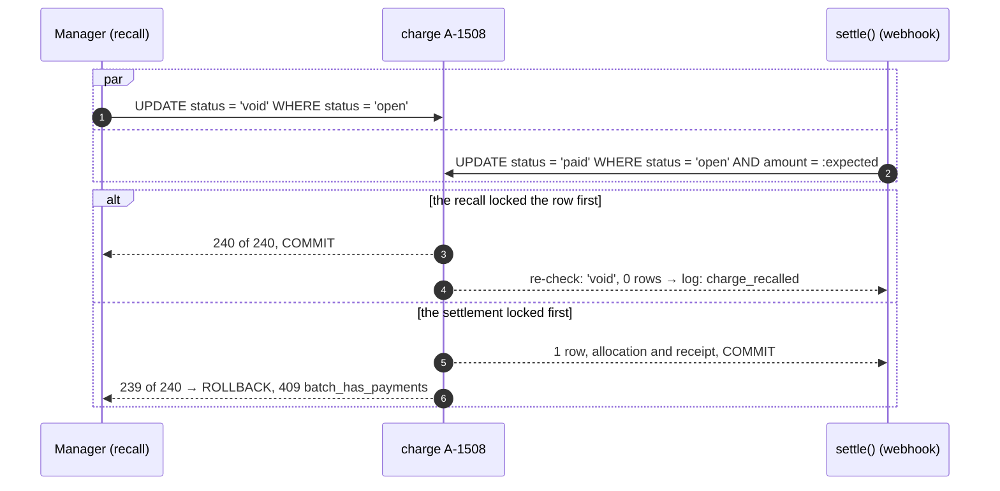

# Ledger, allocation and the money log

> Status: **Draft** · Updated: 2026-10-26 (P1-24: first version, DR-266, DR-267) · DOC-22
> Depends on: original SDD §5.1, §5.4…5.10, §16.2, [DR](../00-decision-register.md) (DR-09, 10, 11, 14, 15, 16, 17, 18, 19, 20, 23, 24, 29, 40, 74, 78, 84, 97, 105, 243, 244, DR-266, DR-267), [ADR-0005](../04-adr/0005-ledger-charges-and-allocations-paid-in-full.md), [ADR-0006](../04-adr/0006-allocation-write-path-all-or-nothing.md), [ADR-0008](../04-adr/0008-settlement-idempotency.md), [DOC-03](../01-product/requirements.md) (FR-05, FR-06, FR-09, FR-12, FR-46, FR-47, NFR-01, NFR-09), [DOC-04](../01-product/use-cases.md) (UC-02, UC-03, UC-05, UC-21), [DOC-09](../03-architecture/messaging-contracts.md) §6, [DOC-12](../03-architecture/code-architecture.md) §4.5, §8, §9.5, [DOC-14](../05-data/data-conventions.md) §6, §10, [DOC-15](../05-data/finance-model.md) §5…§12, [DOC-21](fee-batches-and-import.md), [DOC-35](audit-privacy-and-terms.md) §3.5, §4, [DOC-38](jobs-and-outbox-runtime.md) §4, [DOC-42](error-handling.md) §5, [DOC-06](../02-glossary.md)
> Main readers: P2-02 (counters), P2-03 (allocation), P2-06 (`settle()`), P2-07 (recall, single void), P2-08 (manual payment, receipts), P2-09 (void, money log), P2-10 (debt, aging, reminders), P2-11 (nightly check), P2-14 (EXP-03, EXP-04), DOC-23, DOC-25, DOC-33, DOC-34, DOC-44, DOC-51, DOC-66, DOC-100 (EXP-11), DOC-75 (RB-01), RB-11

This document says how money enters the ledger and how the ledger is read and checked: the one statement that pays a charge, the manual payment, the void of a payment, receipts and their numbers, the money log, debt and aging, the races between a payment, a recall and a void, and the nightly check with its 19 queries. It does not hold the tables (DOC-15), the batch lifecycle and the fee import (DOC-21), the online intent and `settle()` that call the allocation of §4 (DOC-23), the gateway (DOC-24), the statement parser and matching (DOC-25) or the receipt PDF (DOC-34).

**Statements run on 2026-10-26** on `postgres:18.6` (x86_64, 8 cores, Docker) on a database built from the DDL of DOC-15 §3.1 and §4…§11. §17 lists what ran. The **race evidence** of P2-03 is DOC-15 §13.3 (FNM-S12, measured on 2026-10-22) until the `LG-` tests run in P2-03; this document does not repeat it as its own. Numbers marked *planned* have not been measured.

Every new decision in this document is recorded as DR-266 and DR-267 and summarized in §18.

## 1. Purpose and scope

| Component | Main class or file | Runs in | Trigger | Reads | Writes | Task |
| --- | --- | --- | --- | --- | --- | --- |
| Pay whole charges | `ChargeAllocator` (a collaborator of the use cases, not a use case) | `api` | the two writers below and `settle()` (DOC-23) | `charge` | `charge`, `allocation`, `receipt`, `document_counter` | P2-03 |
| Manual payment | `RecordManualPayment` | `api` | `POST /staff/payments` (E-104) | `charge`, `payment`, `payment_intent_item` | `payment`, `allocation`, `charge`, `receipt`, outbox | P2-08 |
| Void a payment | `VoidPayment` | `api` | `POST /staff/payments/{id}/void` (E-105) | `payment`, `allocation` | `payment`, `allocation`, `charge`, `receipt`, `statement_line`, outbox | P2-09 |
| Review a log row | `ReviewMoneyLogRow` | `api` | `POST /staff/money-log/{kind}/{id}/review` (E-109) | `gateway_event`, `statement_line` | the same row | P2-09 |
| Send debt reminders | `SendDebtReminders` | `api` | `POST /staff/debts/reminders` (E-103) | `charge`, `fee_batch` | `debt_reminder`, outbox | P2-10 |
| Reads | `LedgerQueries`, `DebtQueries`, `MoneyLogQueries` | `api` | E-80…E-84, E-101, E-102, E-108, E-110 | `charge`, `charge_line`, `payment`, `allocation`, `receipt`, `gateway_event`, `statement_line` | none | P2-08…P2-10 |
| Receipt PDF | `finance.render_receipt_pdf` | `worker` | `finance.receipt_render_requested.v1` | `receipt.snapshot` | `receipt.pdf_file` | DOC-34 |
| Nightly check | `invariant_check` | `worker` | daily 03:00 building time | all ledger tables | metric, log | P2-11 |

`settle()` (the online path), the intent states and the cancel of a link are DOC-23. The manual payment and `settle()` end in the same allocation (§4), so there is **one write path** that sets `charge.status = 'paid'` (ADR-0005, ADR-0006). Staff operations export their `<OPERATION>_ROLES = ['admin', 'manager']` and call `requireRole` (DOC-12 §4.5); `SendDebtReminders` and `LedgerQueries` for staff do the same.

## 2. Components and interfaces

### 2.1 The collaborator `ChargeAllocator`

```ts
// modules/finance/src/application/allocation/charge-allocator.ts
interface ChargeToPay { chargeId: Uuid; expectedAmount: Money }       // what the caller saw
type AllocationResult =
  | { ok: true; allocations: Array<{ allocationId: Uuid; chargeId: Uuid; amount: Money; receiptId: Uuid; receiptNo: string }> }
  | { ok: false; failed: { chargeId: Uuid; reason: 'not_open' | 'amount_changed' } }   // the first charge that gave 0 rows

class ChargeAllocator {
  /**
   * In the caller's transaction, after the payment row exists. Sorts the charges by id ascending, runs the
   * conditional UPDATE of §4.1 for each, and for each success inserts the allocation, takes a receipt number
   * and inserts the receipt. Stops at the first 0 rows and returns it; the caller decides what to roll back.
   */
  allocate(tx: Tx, scope: BuildingScope, payment: PaymentRow, charges: ChargeToPay[], receiptContext: ReceiptContext): Promise<AllocationResult>
}
```

The caller owns what a failure means: the manual payment rolls the whole transaction back and answers 409 `charge_changed` (§5); `settle()` rolls back to a savepoint and writes a log row (DOC-23). The allocator never catches a database error: `40001` and `40P01` are retried by the transaction wrapper (DOC-12 §8.1, at most 3 times, DOC-23). It takes the time from `Clock` and ids from `IdGenerator`; it has no `new Date()` (domain rule, CLAUDE.md).

### 2.2 What `finance` calls here

| Contract | Used for | Why through a contract |
| --- | --- | --- |
| `GaplessCounter.next(scope, 'receipt', yymm)` | The receipt number (§7) | One helper for every series (DOC-12 §9.5) |
| `BuildingApi.getSettings` | The time zone for `buildingToday` and the period of a receipt; the company profile and building names of the snapshot | Settings are `building`'s |
| `ResidencyApi.getMembership(accountId, unitId)` | `startedAt` for the history filter (§8.4); the member type of an online payer in the snapshot | Memberships are `residency`'s |
| `ResidencyApi.getUnits(ids)` | Unit code and floor on the debt list and the money log, for the page of ids only | Units are `residency`'s |
| `IdentityApi.getStaffAccounts(ids)` | The name of the Manager who recorded, voided or reviewed | Accounts are `identity`'s |
| `AuditApi.record` | §2.4 | Audit is `audit`'s |

`FinanceApi` (DOC-09 §7.2) is read by other modules: `getOutstandingByUnit(unitIds)` is `DebtQueries.byUnits` of §8.2, and `reportQueries` (`collectionByFeeItem`, `debtAging`, `collectionByMonth`, `onlineTransactions`) is built on the queries of §8.

### 2.3 Events

All are written in the use case's transaction (DOC-12 §8.3), payloads in DOC-09 §6.

| Event or command | Written by | Count | Consumers |
| --- | --- | --- | --- |
| `finance.payment_posted.v1` | `RecordManualPayment`, `settle()` | one per payment | `notification.inbox_on_finance_payment_posted` |
| `finance.receipt_issued.v1` | the same | one per receipt | none in phase 1 (the e-invoice seam, DR-17) |
| `finance.receipt_render_requested.v1` (`variant: issued`) | the same | one per receipt | `finance.render_receipt_pdf` |
| `finance.payment_voided.v1` | `VoidPayment` | one per payment | `notification.inbox_on_finance_payment_voided` |
| `finance.receipt_render_requested.v1` (`variant: void`) | `VoidPayment` | one per voided receipt | `finance.render_receipt_pdf` (watermarked copy) |
| `finance.money_unposted.v1` | `settle()`, statement matching (DOC-23, DOC-25) | one per new open log row | inbox for every active Manager and Admin; SSE `money_log.opened` |
| `finance.debt_reminder_sent.v1` | `SendDebtReminders` | parts of at most 500 | `notification.inbox_on_finance_debt_reminder_sent` |

A short, over, duplicate or unknown transfer sends **no** message to a resident (FR-09.2, DOC-09 §7.3).

### 2.4 Audit actions

Declared in the manifest; all are class `finance` (five-year retention, DR-57). Reason `R` means 5 to 500 characters (DOC-35 §3.5).

| Action | Written by | `changes` | R |
| --- | --- | --- | --- |
| `finance.payment.post` | `RecordManualPayment`; `settle()` with actor `system` and `source` `webhook`, `requery` or `statement` | — (`source`, `amount`, `chargeCount` in `details`) | |
| `finance.payment.void` | `VoidPayment` | `status` (`posted` → `void`) | R |
| `finance.money_log.review` | `ReviewMoneyLogRow` | `reviewed` (the note) | R |

Sending a reminder is not audited: `finance.debt_reminder` rows are its trace (DOC-15 §10.3).

## 3. What the ledger is

A **charge** says what a unit owes; a **payment** says what money came in and was posted; an **allocation** connects them; a **receipt** is the immutable document. Money that reached the bank and cannot be posted is a row of the **money log** and is part of no ledger total (DR-84, original SDD §5.1). There is no partial payment, no advance, no credit.

| # | Invariant | Enforced by | Checked by |
| --- | --- | --- | --- |
| I-1 | A charge is `paid` exactly when one live allocation of its full amount exists | `uq_allocation_charge_live`, the conditional update of §4.1, the triggers of DOC-15 §11 | Q01, Q04, Q14 |
| I-2 | A live allocation sits on a `paid` charge, on a posted payment, in the same unit | the single write path | Q02, Q03, Q10, Q15 |
| I-3 | A posted payment equals the sum of its live allocations | one transaction per payment | Q08 |
| I-4 | Every live allocation has an issued receipt; one receipt per allocation; none for a void allocation | `uq_receipt_building_allocation` | Q06, Q07, Q17 |
| I-5 | Receipt numbers are unique and gapless per building and issue month | the counter row (§7) | Q05, Q16 |
| I-6 | A `posted` log row has a posted payment; an online payment has a paid intent; a paid intent has a payment | `ck_gateway_event_posted`, `ck_payment_online` | Q09, Q11, Q12 |
| I-7 | One active payment link per charge | `uq_payment_intent_item_charge_active` | Q13 |
| I-8 | An open or paid charge equals the sum of its lines; no committed log row is `pending` | the sum trigger; DR-244 item 11 | Q18, Q19 |

The invariants say what must always be true; §12 gives the nineteen queries that report a violation. A violation means a **bug**, never a business situation: the business situation of "money that does not match" is the money log (§9).

## 4. The all-or-nothing allocation

### 4.1 The statement

Every way of paying a charge ends in this statement, one per charge, in **ascending `charge.id` order**, inside the transaction that inserted the payment (DR-14, ADR-0006):

```sql
UPDATE finance.charge
   SET status = 'paid', version = version + 1, updated_at = now()
 WHERE id = :charge_id AND building_id = :building_id AND status = 'open' AND amount = :expected_amount
RETURNING id;
-- 1 row : INSERT the allocation (amount = :expected_amount), take a receipt number (§7), INSERT the receipt
-- 0 rows: the charge is no longer open, or its amount differs
```

The row lock of the `UPDATE` serializes every payment of one charge. At READ COMMITTED, a transaction that waited for the lock re-evaluates `WHERE` against the committed row, so the second of two payments of the same charge sees `paid` and updates zero rows: exactly one wins. `amount = :expected_amount` keeps the statement honest if a charge's amount were ever changed behind a screen (a published charge cannot change, so the predicate is the second net, DR-243). `uq_allocation_charge_live` is the last net: a path that skipped the predicate cannot commit a second live allocation (run: 23505 on a second live row for `A-1508`'s charge).

**Ascending id order** is what keeps two payments that cover the same charges in different orders from deadlocking: A,B against B,A both lock the lower id first. It is the allocator's job, not the caller's: `allocate` sorts its input.

### 4.2 The algorithm

```text
allocate(tx, scope, payment, charges, ctx):
  1. sort charges by chargeId ascending; reject duplicates (programming error)
  2. for each (chargeId, expected) in order:
       row = UPDATE charge ... WHERE id AND building_id AND status='open' AND amount=expected RETURNING id
       if no row: return { ok:false, failed:{chargeId, reason} }      -- reason from a read of the fresh row, after the failure
       INSERT allocation (id, building_id, payment_id, charge_id, amount=expected, status='live')
       n = GaplessCounter.next(scope, 'receipt', yymm(clock.now(), tz))
       INSERT receipt (number = 'BL-' + yymm + '-' + String(n).padStart(4,'0'), snapshot = build(ctx, charge, lines, payment), ...)
       outbox: receipt_issued, receipt_render_requested(issued)
  3. return { ok:true, allocations }
```

The counter increment is taken **after** the charge update and **right before** the receipt insert, so the counter row lock is held for the shortest time and a failed charge never takes a number (DOC-12 §9.5). The format pads in the application: **SQL `lpad('10000', 4, '0')` returns `1000`** (it truncates), so a number is never padded in SQL (run on 2026-10-26: the 10,000th receipt of a month, `BL-2610-10000`, passes `ck_receipt_number`, and `BL-2610-999` is refused).

### 4.3 What the two callers do with 0 rows

| Caller | On `ok: false` | Result |
| --- | --- | --- |
| `RecordManualPayment` | `ROLLBACK` the whole transaction (payment, earlier allocations, receipts, counter increments), read the fresh state of the selected charges, answer 409 `charge_changed` with `{charges: [{chargeId, status, version}]}` | Nothing changed; no gap in receipt numbers (run: FNM-S02) |
| `settle()` (DOC-23) | `ROLLBACK TO SAVEPOINT` taken after the `gateway_event` claim, set the event's `outcome` to `charge_already_paid` (the charge is `paid`) or `charge_recalled` (it is `void`), commit, and the intent keeps its status | One log row; no payment (DR-29 step 4) |

The distinction comes from the fresh read after the failure: `paid` → `charge_already_paid`, `void` → `charge_recalled`. An `open` charge whose amount differs cannot occur, because a published charge is frozen (DOC-15 §11); if it does it is a bug: a staff caller gets 409 `charge_changed`, `settle()` writes `charge_already_paid`, and both log an error.

### 4.4 Evidence and baseline

| Evidence | Where | Status |
| --- | --- | --- |
| 8 sessions, 300 pairs of charges (A, B) and (B, A), 2,400 attempts: 300 won, 2,100 refused, 0 deadlocks, 0 charges with two live allocations, 600 receipts, the counter at 600 | DOC-15 §13.3 FNM-S12, 2026-10-22, `postgres:18.6` | **Measured** (statement level) |
| The same through `RecordManualPayment` and `settle()`: 500 charges, 2…8 racing sessions, 10,000 attempts at READ COMMITTED | LG-14…LG-17 (P2-03) | *Planned* |
| The naive baseline: read the charge, decide in code, write without the predicate, on a copy without `uq_allocation_charge_live` | EXP-03 (P2-14, `apps/api/test/exp/baseline.ts`, DR-78) | *Planned*: the experiment must show at least one charge with two live allocations in the baseline and none in the real path, 5 runs |

The decision (option C, charges with allocations and a guarded status) and the three rejected options are in original SDD §5.9 and ADR-0005; they are not repeated here.

## 5. Manual payment

`POST /staff/payments` (E-104, Manager or Admin; DR-23). The staff chooses **whole charges**; the system computes the amount.

### 5.1 The request

```json
POST /api/v1/staff/payments
Idempotency-Key: 0192f3c4-b101-7000-8000-000000000a01

{ "unitId": "0192f3c4-5a1e-7000-8000-000000000021",
  "chargeIds": ["0192f3c4-5a1e-7000-8000-0000000000c1", "0192f3c4-5a1e-7000-8000-0000000000c2"],
  "method": "cash", "payerName": "Trần Minh Anh", "receivedOn": "2026-10-19",
  "bankReference": null, "statementLineId": null, "note": null, "dryRun": false }
```

| Field | Rule | Error |
| --- | --- | --- |
| `Idempotency-Key` | Mandatory (the route is marked `R`, DR-74, DOC-50 §8.1) | 400 `validation_failed` on `header.Idempotency-Key` |
| `unitId`, `chargeIds` | 1 to 50 distinct ids (DR-267); every charge belongs to the unit and the building (a charge of another unit is 404 `not_found`: the building scope hides it) | 400 `too_many_charges`, `too_few_charges`; 404 |
| `amount` | **Absent.** If present and not equal to the sum, 422 `allocation_mismatch` with `{expected, got}` (FR-05.2) | 422 |
| `method` | `cash` or `bank_transfer` | 400 |
| `payerName` | 1 to 120 characters after trimming, required | 400 |
| `receivedOn` | A building day: not after `buildingToday`; not before `buildingToday − 90` days unless the caller is an Admin (FR-05.5); a constant `MANUAL_PAYMENT_BACKDATE_DAYS = 90`, not a setting | 400 `received_on_future`, `received_on_too_old` |
| `bankReference` | Optional, up to 100 characters; used by reconciliation (DR-35) | 400 |
| `statementLineId` | Optional: the `unmatched` line the entry settles; `method` must be `bank_transfer` (`ck_payment_statement_line`) | 400; 409 `invalid_transition` if the line is not `unmatched` |
| `dryRun` | `true` returns the plan and writes nothing (§5.3) | — |

`received_at` is `now()` when `receivedOn` is today in building time, and 12:00 local of that day otherwise (DOC-15 §7.1, DR-09).

### 5.2 The algorithm

1. `requireRole`; validate the body; read `buildingToday` from the clock and the building's time zone.
2. Open the transaction. The `idempotent` wrapper of P1-28 has already looked the key up: a repeat with the same body returns the first response, HTTP 200 with `Idempotent-Replayed: true` (FR-05.4); the same key with another body is 422 `idempotency_key_reuse`.
3. Read the selected charges (`SELECT … WHERE id = ANY(:ids) AND building_id AND unit_id`), without a lock: the amount is `Σ amount` of these rows, and any charge that is not `open` is refused now with 409 `charge_changed` (a fast answer; the statement below is still the arbiter). A mismatch with a request `amount` is 422.
4. `INSERT payment (id, building_id, unit_id, source = method, amount = Σ, received_at, payer_name, client_key, recorded_by, bank_reference, statement_line_id, note)`. A concurrent duplicate that slipped past the wrapper fails here on `uq_payment_building_client_key` (run: 23505) and the use case answers with the stored payment.
5. `ChargeAllocator.allocate` (§4). `ok: false` → rollback and 409 `charge_changed`.
6. If `statementLineId`: `UPDATE statement_line SET match_status = 'matched', payment_id = :id WHERE id AND match_status = 'unmatched'`; zero rows rolls everything back (409 `invalid_transition`).
7. Outbox: `payment_posted`, and per receipt `receipt_issued` and `receipt_render_requested`; the audit row `finance.payment.post`; commit.
8. After commit the worker renders the PDFs; if the staff ticked "send receipt" the resident also gets the push of `payment_posted` (the handler decides from the unit's recipients, DOC-09 §7.3).

**A warning, not a block** (FR-05.6): when a selected charge is held by an active intent, the **form** (`GET /staff/units/{id}/debt`, §8.2) shows "online payment open since 09:12" from `payment_intent_item` and `payment_intent.created_at`; the entry is still allowed, because the cash is already in the Manager's hands. If that transfer then arrives, `settle()` finds the charge `paid` and writes `charge_already_paid`; the Manager refunds it outside the system (§9, DR-84 item 5).

**The response**, 201 (200 on a replay):

```json
{ "paymentId": "0192f3c4-5a1e-7000-8000-000000000030", "unitId": "0192f3c4-5a1e-7000-8000-000000000021",
  "source": "cash", "amount": 2838000, "receivedAt": "2026-10-19T03:21:44.512Z", "payerName": "Trần Minh Anh",
  "receipts": [ { "receiptId": "…0031", "number": "BL-2610-0153", "chargeId": "…00c1", "amount": 2488000 },
                { "receiptId": "…0033", "number": "BL-2610-0154", "chargeId": "…00c2", "amount": 350000 } ] }
```

### 5.3 The dry run

`dryRun: true` runs steps 1 and 3 and returns the sum and what would be issued, without a payment row, a counter increment or an outbox row:

```json
{ "dryRun": true, "amount": 2838000,
  "lines": [ { "chargeId": "…00c1", "batchCode": "PH-2610-01", "amount": 2488000 }, { "chargeId": "…00c2", "batchCode": "PH-2611-01", "amount": 350000 } ],
  "receiptCount": 2, "warnings": [ { "chargeId": "…00c2", "code": "active_intent", "since": "2026-10-19T02:12:00Z" } ] }
```

The dry run returns the **count** of receipts, never their numbers: a number is reserved only by the counter increment inside the payment transaction, and reserving it earlier would hold the counter row (DR-267). A charge that is not `open` in a dry run is the same 409 `charge_changed`.

### 5.4 Run results

On 2026-10-26, on the fixture of §17 (charges A 2,488,000 and B 350,000 of one unit, a third charge of another unit):

| Step | Result |
| --- | --- |
| Entry of A and B with key `K1` | 1 payment of 2,838,000, 2 live allocations (2,488,000 and 350,000), receipts `BL-2610-0001` and `BL-2610-0002`, both charges `paid` |
| The same key again (insert) | 23505 on `uq_payment_building_client_key`; the stored payment is read back |
| A new entry for charge B (already `paid`) with key `K2` | 0 rows; `ROLLBACK`; 1 payment in total |
| A second live allocation on `paid` B, by a path that skipped the predicate | 23505 on `uq_allocation_charge_live` |

## 6. Voiding a payment

`POST /staff/payments/{id}/void { reason }` (E-105, Manager or Admin; DR-24, FR-06). **Only `cash` and `bank_transfer` payments** can be voided: money confirmed by the bank is undone only by a refund outside the system (409 `payment_not_voidable`, FR-06.3; `ck_payment_void_source` is the database's second net). There is **no time limit**: the audit row is the control.

| Rule | Value |
| --- | --- |
| Reason | 5 to 500 characters after trimming (422 `reason_too_short`, FR-06.2) |
| Already void | 409 `invalid_transition` |
| Effect on charges | Every charge of the payment returns to `open` and is payable at once (FR-06.5) |
| Effect on receipts | `issued → void`, the number is kept, a watermarked PDF replaces the cached one (DR-17) |
| Effect on a statement line | A line linked to the payment returns to `unmatched` (FR-06.4) |
| Editing an entry | Is a void plus a new entry; receipts already handed out stay valid documents with a visible void status |

One transaction (DOC-15 §7.1, tested):

```sql
UPDATE finance.payment SET status = 'void', void_reason = :reason, voided_at = now(), voided_by = :staff_id, updated_at = now()
 WHERE id = :payment_id AND building_id = :building_id AND status = 'posted' AND source IN ('cash', 'bank_transfer')
RETURNING id;                                                         -- 0 rows → 409 (already void) or payment_not_voidable (online)
UPDATE finance.allocation SET status = 'void', voided_at = now(), updated_at = now()
 WHERE building_id = :building_id AND payment_id = :payment_id AND status = 'live' RETURNING charge_id;
UPDATE finance.charge SET status = 'open', version = version + 1, updated_at = now()
 WHERE building_id = :building_id AND id = ANY (:charge_ids) AND status = 'paid';     -- the count must equal the allocations voided
UPDATE finance.receipt SET status = 'void', voided_at = now(), updated_at = now()
 WHERE building_id = :building_id AND payment_id = :payment_id AND status = 'issued' RETURNING id;
UPDATE finance.statement_line SET match_status = 'unmatched', payment_id = NULL, updated_at = now()
 WHERE building_id = :building_id AND payment_id = :payment_id;
```

If the charge count differs from the allocation count, a charge was not `paid`: that is a broken invariant, so the use case rolls back and answers 500 with an alert; it never "repairs" (the nightly check would report it, §12). The audit row stores the before and after values (`status`, and the charges and receipt numbers in `details`). The outbox gets `finance.payment_voided.v1` and one `receipt_render_requested` with `variant: void` per receipt.

**Void, then pay again** (run on 2026-10-26): after the void of the payment of A and B, a new entry for B created payment `fa02`, a new live allocation and receipt `BL-2610-0003`; B has two allocation rows, one `void` and one `live`, and the old receipts stay `void` with their numbers (FNM-67…69).

**Void and the log are independent.** Voiding a payment never creates, changes or reviews a log row, and the other way round (DR-16).

## 7. Receipts and numbering

One receipt per allocation (DR-17): a payment of two charges makes two receipts, each meaningful on its own (FR-05.1: `BL-2610-0153` and `BL-2610-0154`).

**Number.** `BL-<yymm>-<n padded to at least 4>` from the `receipt` series, `yymm` = the **issue month in building time**, not the fee month and not `received_at` (DR-10). A receipt issued at 23:59 on 31 October local time is `BL-2610-…`; one at 00:01 on 1 November local time is `BL-2611-…` although the UTC clock still says October (run: `2026-11-01 00:01 +07` → `2611`, UTC `2610`; `2027-01-01 00:30 +07` → `2701`). The counter row is `(building_id, 'receipt', yymm)`; a rolled-back transaction rolls back its increment, so there is no gap (FNM-S02: `BL-2610-0001` both times). The 10,000th receipt of a month prints `BL-2610-10000` (the width is a minimum). A void receipt **keeps its number**.

**Snapshot.** Frozen when the receipt is inserted and the **only** input of the PDF (DR-17, DOC-34). The allocator builds it from rows it already holds plus the context the caller passes:

| Snapshot field | Source |
| --- | --- |
| `company`, `building` | `BuildingApi.getSettings` at issue time |
| `unitCode` | `charge.unit_code` |
| `payer.name`, `payer.memberType` | Manual: `payment.payer_name` and `null`. Online: the creator's name and `ResidencyApi.getMembership(createdBy, unitId).memberType` (DOC-23) |
| `batch` | `fee_batch.code`, `name`, `fee_month` |
| `lines[]` | The charge's `charge_line` rows in position order: `kind`, bilingual `name`, `quantity` as a decimal string, `unitPrice`, `amount`, `note` (an adjustment's reason is printed) |
| `amount`, `method` | The allocation's amount; `payment.source` |
| `reference` | Online: the gateway reference. Manual: `bank_reference` or `null` |
| `paidAt`, `issuedAt` | `payment.received_at`; the clock now |

The sum of the snapshot's `lines[].amount` equals `amount` (the sum trigger guarantees it for `open` and `paid` charges, I-8); LG-27 asserts it on every receipt of a payment. The sample is DOC-15 §7.3. No `outstandingAfter` and no `source` (DR-84).

**The PDF** is rendered by the worker after commit from the snapshot alone (DOC-34, DR-56): the title "Biên lai thu tiền / Payment receipt", the statement that it is not a tax invoice, in the language(s) of `building.fee_notice_language`. A missing PDF is rendered on demand by `GET …/pdf`. A void receipt gets a second PDF with a diagonal "VOID" watermark that replaces the cached one.

**Not a tax invoice.** The company issues an e-invoice only when a resident asks, outside the system (DR-17). `receipt.external_invoice` is reserved and nothing writes it in phase 1; `finance.receipt_issued.v1` is the integration seam. No invoice table, no VAT field, no buyer tax details.

**Who reads what.** A resident reads open charges of the unit always, and paid charges and receipts only for payments with `received_at >= startedAt` of their own membership (DR-40, §8.4). A staff member reads everything.

## 8. Debt, aging and reminders

### 8.1 Definitions (DR-18)

| Term | Definition |
| --- | --- |
| Outstanding | The sum of `amount` of `open` charges in `published` or `closed` batches. A draft, paid or void charge does not count (FR-12.3). There is no credit to net against it |
| Days past due | `buildingToday − fee_batch.due_date` in days, with `buildingToday = (now() AT TIME ZONE building.time_zone)::date`, computed **once per request** (DR-09) |
| Bucket | **Not yet due** (≤ 0), **1–30**, **31–60**, **61–90**, **over 90**. The first bucket is shown apart; FR-12's "0–30" is read as "1–30" (DR-18) |
| Collection rate of a fee month | `Σ amount` of `paid` charges ÷ `Σ amount` of charges that are neither `void` nor `draft`, in `published` or `closed` batches of that fee month; a month with no such charge is skipped; a month with none paid is 0.0% (`coalesce`). **DR-267 reads "non-recalled batches" of DR-18 as "published or closed", because a draft is not yet billed** |

### 8.2 The queries

Debt is computed, never stored. The same join serves every reader.

```sql
-- E-101: the debt list, one row per unit, keyset on (outstanding, unit_id); :today is computed once
SELECT c.unit_id, sum(c.amount) AS outstanding, count(*) AS open_charges, min(b.due_date) AS oldest_due,
       max(:today - b.due_date) AS max_days_past_due,
       sum(c.amount) FILTER (WHERE :today - b.due_date > 30) AS overdue_30
  FROM finance.charge c JOIN finance.fee_batch b ON b.id = c.batch_id
 WHERE c.building_id = :building_id AND c.status = 'open' AND b.status IN ('published', 'closed')
 GROUP BY c.unit_id
HAVING (sum(c.amount), c.unit_id) < (:after_outstanding, :after_unit_id)
 ORDER BY outstanding DESC, c.unit_id DESC LIMIT 51;

-- E-102 and the manual-payment form: the open charges of one unit, with the active intent when there is one
SELECT c.id, c.amount, c.version, b.code, b.name, b.fee_month, b.due_date, (:today - b.due_date) AS days_past_due
  FROM finance.charge c JOIN finance.fee_batch b ON b.id = c.batch_id
 WHERE c.building_id = :building_id AND c.unit_id = :unit_id AND c.status = 'open' AND b.status IN ('published', 'closed')
 ORDER BY b.fee_month, c.id;

-- aging of the whole building (W-Reports, FinanceApi.reportQueries.debtAging)
SELECT CASE WHEN d <= 0 THEN 'not_yet_due' WHEN d <= 30 THEN '1-30' WHEN d <= 60 THEN '31-60' WHEN d <= 90 THEN '61-90' ELSE 'over_90' END AS bucket,
       count(DISTINCT unit_id) AS units, count(*) AS charges, sum(amount) AS amount
  FROM (SELECT c.unit_id, c.amount, (:today - b.due_date) AS d
          FROM finance.charge c JOIN finance.fee_batch b ON b.id = c.batch_id
         WHERE c.building_id = :building_id AND c.status = 'open' AND b.status IN ('published', 'closed')) x
 GROUP BY 1 ORDER BY 1;

-- FinanceApi.getOutstandingByUnit(unitIds): the same as E-101 with c.unit_id = ANY (:unit_ids); units with nothing open are absent
```

The unit code, floor and owner name of a debt-list page are added by `ResidencyApi.getUnits(ids)` for the page's ids only (finance has no unit table). The SQL differs from original SDD §5.10 in the date expression (the building day, not `current_date`) and in the fifth bucket (DR-18).

### 8.3 The boundary table

The due date is 2026-10-15; the building zone is `Asia/Ho_Chi_Minh`. Run on 2026-10-26 with `(at AT TIME ZONE 'Asia/Ho_Chi_Minh')::date − due_date`:

| The moment | Days past due | Bucket | The UTC date would give |
| --- | --- | --- | --- |
| 2026-10-14 12:00 local | −1 | not yet due | −1 |
| 2026-10-15 00:00 local | 0 | not yet due | **−1** |
| 2026-10-15 23:30 local | 0 | not yet due | 0 |
| 2026-10-16 00:30 local | 1 | 1–30 | **0** |
| 2026-10-16 06:59 local | 1 | 1–30 | **0** |
| 2026-11-14 | 30 | 1–30 | 30 |
| 2026-11-15 | 31 | 31–60 | 31 |
| 2026-12-14 | 60 | 31–60 | 60 |
| 2026-12-15 | 61 | 61–90 | 61 |
| 2027-01-13 | 90 | 61–90 | 90 |
| 2027-01-14 | 91 | over 90 | 91 |

The bold cells are the defect of a UTC date (a charge due on the 15th shows overdue 7 hours late, FR-12.2). Extending the due date (DOC-21 §3.4) needs no write here: the next read follows the new date (FR-44.3).

### 8.4 What a resident sees

| Endpoint | Returns | Filter |
| --- | --- | --- |
| `GET /me/fees` (E-80) | The `open` charges of the selected unit (header `X-Unit-Id`), with batch code and name, `amount`, `dueDate`, `daysPastDue`, `overdue`, and the total | None: debt follows the unit |
| `GET /me/fees/{chargeId}` (E-81) | One charge with its lines (adjustment lines show their note) | An `open` charge always; a `paid` or `void` one only if its payment's `received_at >= startedAt`; otherwise 404 |
| `GET /me/fees/history` (E-82) | Paid charges with the payment date and the receipt, newest first, keyset `(received_at, id)` | `payment.received_at >= startedAt` (DR-40) |
| `GET /me/receipts` (E-83) and `…/{id}/pdf` (E-84) | Receipts of the unit, newest first | The same filter, applied through the payment's `received_at` |

All need the capability `view_fees` (the owner, family members and tenants; a helper gets 403). `startedAt` is `membership.created_at` from the guard (DOC-27 §6.6). It is **one** filter on the payment date, applied in the repository (run: with `startedAt` 2026-10-01 the history of a unit lists the two charges paid on 2026-10-26 and the open charges are listed whatever the date). A staff member is never filtered. The resident never sees the money log (§9); the only trace is `unmatchedTransfer` of the intent status (DOC-23).

### 8.5 Reminders (FR-12.4)

`POST /staff/debts/reminders { unitIds }` (E-103, Manager or Admin; `Idempotency-Key`; at most 10 calls per hour per account by the bucket `DEBT_REMINDER_PER_HOUR`, 429 beyond).

1. `unitIds` has 1 to 500 distinct ids (400 `no_unit_selected` for none; `too_many_units` beyond, DR-267).
2. One transaction: compute each unit's outstanding (the E-101 query with `unit_id = ANY`); a unit with nothing open is **skipped** (reported as `noDebt`).
3. Insert one `debt_reminder` row per unit with `ON CONFLICT (building_id, unit_id, reminder_day) DO NOTHING RETURNING unit_id`: a returned row means "send", no row means "reminded today already" (DOC-15 §10.3). The row stores `charge_count` and `amount` at sending.
4. Write `finance.debt_reminder_sent.v1` in parts of at most 500 reminders, and commit.

The response is `{ sent: 20, alreadyRemindedToday: 0, noDebt: 0 }`. Run: with one unit that owes and one that does not, the first insert returned one row (the unit that owes; the other is `noDebt`), and the second insert 5 hours later on the same building day returned none (FR-12.4: 20 pushes, then 0). The day is the **building** day, so a reminder at 23:30 and one at 00:30 local are two reminders.

### 8.6 Speed

Measured on 2026-10-26 (`postgres:18.6`, Docker, Intel i7-4790, 8 cores, 3 runs, seeded with 5,000 units × 24 published batches = 120,000 charges, after `ANALYZE`):

| Query | 15% of charges `open` (18,122) | All 120,000 `open` (worst case) | Target |
| --- | --- | --- | --- |
| Debt of all units (E-101 without the keyset) | 17–22 ms | 59–70 ms | FR-12.5: ≤ 50 ms (planned) |
| Aging of the building | 25–29 ms | 156–172 ms | P2-10: ≤ 200 ms (planned) |
| Debt of one unit | 0.07–0.13 ms | 0.10–1.5 ms | ≤ 50 ms |

The planner used `ix_charge_building_batch` (a bitmap scan over `building_id` and `status`) for the whole-building queries and `ix_charge_building_unit_open` for one unit. The worst case, with every charge open, is not a real building; it passes the aging target and is 9 to 20 ms over the all-units target, which P2-10 re-measures on the staging host before it is a finding (the figures are a developer machine, not the staging host of DR-06). The seed used `session_replication_role = replica` to skip the guard triggers.

## 9. The money log

Money that is not posted is a row of `gateway_event` (outcome) or `statement_line` (match status) and nothing else. There is **no** anomaly table, no credit and no link from a log row to any charge, period or payment (DR-84, DR-16).

### 9.1 What is in it

| `gateway_event.outcome` | When | Written by |
| --- | --- | --- |
| `posted` | Exact amount, every charge `open`: a payment exists | `settle()` |
| `amount_short`, `amount_over` | The amount is below or above the intent's | `settle()` |
| `duplicate_transfer` | A second transfer for an intent already `paid` | `settle()` |
| `charge_already_paid` | Exact amount, a charge of the intent is no longer `open` (paid by cash or another link) | `settle()` |
| `charge_recalled` | Exact amount, a charge of the intent is `void` (recalled or voided alone) | `settle()` |
| `unknown_order` | No intent for the order code in this building | `settle()` |

A statement line is reviewable when `match_status` is `unmatched` or `statement_only`; `matched` and `proposed` need no review (DR-16; `already_recorded` is an upload count, DR-244). `pending` exists only inside the `settle()` transaction.

**Open** means not posted and not reviewed: `gateway_event.outcome NOT IN ('pending', 'posted') AND reviewed_at IS NULL`, or a reviewable statement line with `reviewed_at IS NULL`. It is the predicate of `ix_gateway_event_building_open`, of the gauge `money_log_open` (DOC-25) and of the dashboard counter "money to check" (FR-47).

### 9.2 Review

`POST /staff/money-log/{kind}/{id}/review { note }` (E-109, Manager or Admin; `kind` = `gateway_event` or `statement_line`). The note is 5 to 1,000 characters. A row is reviewed **once** and the review never changes the ledger (FR-46).

```sql
UPDATE finance.gateway_event
   SET reviewed_by = :staff_id, reviewed_at = now(), review_note = :note
 WHERE id = :id AND building_id = :building_id AND outcome NOT IN ('pending', 'posted') AND reviewed_at IS NULL
RETURNING id;
-- the statement_line form: ... SET reviewed_by, reviewed_at, review_note, updated_at = now()
--   WHERE id AND building_id AND match_status IN ('unmatched', 'statement_only') AND reviewed_at IS NULL
-- 0 rows: read the row. posted or matched → 409 invalid_transition; already reviewed → 409 money_log_already_reviewed {reviewedAt}; missing → 404
```

Run on 2026-10-26: the first review succeeded; a second review, a review of a `posted` row and the statement-line form all returned 0 rows, and a direct `UPDATE` of a reviewed note was refused by `trg_gateway_event_guard` ("the outcome is set once, the review once"). The payments, allocations and paid charges were the same before and after (FR-46.3).

### 9.3 The alert

A new open row writes `finance.money_unposted.v1` in its transaction: an inbox entry for every active Manager and Admin (no amount in the push) and the SSE event `money_log.opened`; the counter rises by 1 (FR-46.4). The resident gets nothing (FR-09.2); an intent in `pending` whose transfer did not match shows the one message of DR-84 item 8 through `unmatchedTransfer {amount, receivedAt}` (DOC-23).

### 9.4 The viewer

`W-Money-Log` (a tab of `W-Transactions`) lists the `gateway_event` rows of every outcome and the reviewable statement lines, newest first, keyset `(at, id)`, with filters `outcome`, `unit`, a date range and `open` / `reviewed` (E-108, FR-47.1). One query, two halves:

```sql
SELECT * FROM (
  SELECT 'gateway_event' AS kind, g.id, g.received_at AS at, g.amount, g.outcome AS status, g.unit_id, g.reviewed_at
    FROM finance.gateway_event g
   WHERE g.building_id = :building_id AND g.outcome <> 'pending' AND (g.outcome <> 'posted' OR :include_posted)
  UNION ALL
  SELECT 'statement_line', l.id, l.booked_on::timestamptz, l.amount, l.match_status, NULL, l.reviewed_at
    FROM finance.statement_line l
   WHERE l.building_id = :building_id AND l.match_status IN ('unmatched', 'statement_only')
) x
WHERE (:open_only IS FALSE OR x.reviewed_at IS NULL) AND (x.at, x.id) < (:after_at, :after_id)
ORDER BY x.at DESC, x.id DESC LIMIT 51;
```

The `outcome` and `unit` filters are added inside each half, so each half uses its own index (`ix_gateway_event_building_open` with `open_only`, `ix_gateway_event_building_received` otherwise). Run on 2026-10-26: with two open `gateway_event` rows, one `matched` and one `unmatched` statement line, the open list returned the two events and the unmatched line, and not the matched one. `UnitMoneyPanel` (E-110) is `WHERE building_id AND unit_id = :u ORDER BY received_at DESC` on `ix_gateway_event_building_unit` (statement lines have no unit). A row opens a drawer with the amount, time, reference, order code, intent, an excerpt of the payload (never the payer's account number), the payment and receipt link when posted and the review note (FR-47.2). The viewer is staff only; EXP-10 asserts every other audience gets 403 (FR-47.3).

### 9.5 Clearing a debt is another action

A wrong, short, over or duplicate transfer is refunded **outside the system**. To clear the debt, the resident pays the exact amount (a posted payment) or the Manager records a manual payment for whole charges (§5). The system never matches a log row to a charge, never pre-fills a payment, an adjustment line or a void from it (DR-84 item 5, DR-19).

## 10. Races

The arbiter is always **the charge row**: each actor changes it with a conditional `UPDATE … WHERE status = 'open'`, and the loser reads zero rows. The same arbiter covers the four races, so no new mechanism exists.

| Race | Statements that meet on the charge | Winner | Loser sees |
| --- | --- | --- | --- |
| Manual cash vs online transfer | `UPDATE … 'open' → 'paid'` (§4.1) twice | The first to commit | Manual: 409 `charge_changed`. Online: a log row `charge_already_paid` (FR-05.8) |
| Two manual entries (a double click with two keys, two Managers) | The same | The first | 409 `charge_changed` |
| Recall vs online settlement | Recall's `open → void` (DOC-21 §3.5) vs the settlement's `open → paid` | The first | Recall: 409 `batch_has_payments` (the count differs). Settlement: log row `charge_recalled` (FR-04.3) |
| Single void vs settlement | The void's `open → void` (DOC-21 §3.9) vs `open → paid` | The first | Void: 409 `charge_not_voidable` or `version_conflict`. Settlement: log row `charge_recalled` (FR-49.5) |
| Void of a payment vs a new payment of the same charge | `paid → open`, then `open → paid` | The void: a new payment needs the charge `open`, which exists only after the void commits | The new payment: 0 rows and 409 `charge_changed` if it ran first; it succeeds if it waited for the void's lock |



Both orders end consistent: the batch is recalled and the transfer waits in the log as `charge_recalled` for the Manager to refund outside the system, or the batch stays `published` with one paid charge and the Manager learns a recall is no longer possible; a single wrong open charge is then voided alone (DOC-21 §3.9), and a wrong **paid** charge is offset by a negative adjustment line in a later batch (DR-19). No order lets a recalled charge carry a payment or lets a payment vanish; the nightly check (§12) is the last net. The tests are LG-14…LG-19 (payments) and LG-81, LG-79 (DOC-21); the experiments are EXP-03 and EXP-04.

## 11. Transactions and concurrency

| Operation | Isolation | One transaction holds | Locks, in order | Retry |
| --- | --- | --- | --- | --- |
| `RecordManualPayment` | READ COMMITTED | payment, charge updates, allocations, receipts, counter, statement link, outbox, audit | `payment` insert (key), charges by id ascending, the receipt counter row | `40001`/`40P01` up to 3 times with 20–60 ms jitter (DOC-12 §8.1); a unique-key conflict on `client_key` is an idempotent replay, never retried |
| `VoidPayment` | READ COMMITTED | payment, allocations, charges, receipts, statement line, outbox, audit | the payment row, then allocations and charges by id | the same |
| `ReviewMoneyLogRow` | READ COMMITTED | one conditional update, audit | the log row | none |
| `SendDebtReminders` | READ COMMITTED | the reminder inserts and the outbox rows | the `debt_reminder` unique key | none; a conflict means "reminded" |
| `invariant_check` | `REPEATABLE READ READ ONLY` (the `snapshot` job class, DOC-38 §4) | the 19 reads | an advisory lock for the job name | none: the next night repeats it |

No network call runs inside any of these transactions: a receipt's PDF, a push and a gateway cancel are outbox messages (CLAUDE.md, DOC-12 §8). A transaction that takes the counter row holds it from the receipt number to the commit; the number is taken **after** the charge update and **right before** the receipt insert, so with 1.5 charges per payment (DOC-10 §5.1) it is held for a few milliseconds, and receipts of one building and month are issued one at a time; the P2-03 race tests measure whether that serializes more than it should (DR-14).

## 12. The nightly check

`invariant_check` runs daily at 03:00 building time in one `REPEATABLE READ READ ONLY` transaction (DOC-38 §4, NFR-09). It runs the 19 queries below, per building, with `building_id = :b` on every table (the job loops over `BuildingApi.listBuildings()`, DR-244), sets the gauge `ledger_invariant_violations` to the number of violating rows (demo buildings excluded, DOC-40), logs the first 50 rows of each non-empty query, and succeeds. It **reports and never repairs**; the alert `LedgerInvariantViolation` is Critical and links RB-01 (DOC-75), whose rule is that `charge.status` is never edited by hand: a wrong state is repaired by voiding the payment (§6), and any other repair is a reviewed change by an engineer, never an edit made to hide the row.

**Which twenty.** DR-78's list of twenty corruptions spans three modules. The 17 that concern the ledger are Q01…Q15, Q16 and Q17 below; DOC-15 §12.2 adds two table-level checks (Q18, Q19). The other three (a membership with two owners, a member of a removed account, a notice stuck `sending`) are queries of `integrity_weekly` and `integrity_notices` (DOC-27, DOC-31): `finance` may not read those tables (ADR-0014). EXP-11 injects all twenty and reads the three jobs (DR-266). Each query returns the offending rows; the job counts them.

| Q | Violation | DR-78 | Query (`:b` = the building) |
| --- | --- | --- | --- |
| Q01 | A `paid` charge with a live allocation of another amount | 1 | `charge c … status = 'paid' AND EXISTS (live allocation a WHERE a.amount <> c.amount)` |
| Q02 | A live allocation whose payment is not posted | 2 | `allocation a … status = 'live' AND NOT EXISTS (payment p WHERE p.id = a.payment_id AND p.status = 'posted')` |
| Q03 | A live allocation on a `void` charge | 3 | `allocation a JOIN charge c … a.status = 'live' AND c.status = 'void'` |
| Q04 | A charge with two live allocations | 4 | `allocation … status = 'live' GROUP BY charge_id HAVING count(*) > 1` |
| Q05 | Receipts do not match the counter (a gap, or a receipt missing) | 5 | `document_counter d … series = 'receipt' AND d.last <> (count of receipts of d.period)` |
| Q06 | Two receipts for one allocation | 6 | `receipt GROUP BY allocation_id HAVING count(*) > 1` |
| Q07 | An issued receipt of a void allocation | 7 | `receipt r JOIN allocation a … r.status = 'issued' AND a.status = 'void'` |
| Q08 | A posted payment that differs from the sum of its live allocations | 8 | `payment p … status = 'posted' AND p.amount <> coalesce(Σ live allocation.amount, 0)` |
| Q09 | A `posted` log row without a posted payment | 9 | `gateway_event g … outcome = 'posted' AND NOT EXISTS (posted payment g.payment_id)` |
| Q10 | An allocation whose charge is of another unit than its payment | 10 | `allocation a JOIN payment p JOIN charge c … p.unit_id <> c.unit_id` |
| Q11 | A `paid` intent without a posted payment | 11 | `payment_intent i … status = 'paid' AND NOT EXISTS (posted payment with intent_id = i.id)` |
| Q12 | An online payment without a paid intent | 12 | `payment p … source = 'online' AND NOT EXISTS (paid intent p.intent_id)` |
| Q13 | Two active intents on one charge | 13 | `payment_intent_item … released_at IS NULL GROUP BY charge_id HAVING count(*) > 1` |
| Q14 | A `paid` charge without a live allocation | 14 | `charge c … status = 'paid' AND NOT EXISTS (live allocation)` |
| Q15 | A live allocation on an `open` (or draft) charge | 15 | `allocation a JOIN charge c … a.status = 'live' AND c.status IN ('draft', 'open')` |
| Q16 | The counter is below the highest issued number | 19 | `document_counter d … d.last < max(substr(number, 9)::int)` |
| Q17 | A live allocation without an issued receipt | 20 | `allocation a … status = 'live' AND NOT EXISTS (issued receipt)` |
| Q18 | An `open` or `paid` charge that differs from the sum of its lines | — (DOC-15 I7) | `charge c … status IN ('open', 'paid') AND c.amount <> coalesce(Σ line.amount, 0)` |
| Q19 | A committed log row that is still `pending` | — (DOC-15 I8) | `gateway_event … outcome = 'pending'` |

The job is **one statement**, the union below, run in one snapshot. Each branch returns the offending id (or `NULL` for a counter row) and the query's tag; the job groups by tag, so the result is at most 19 lines. This is the text that ran on 2026-10-26; P2-11 moves it unchanged into `modules/finance/src/queries/invariants.ts`, and the job adds `LIMIT 50` per branch when it logs the rows.

```sql
SELECT q, count(*) AS rows FROM (
SELECT 'Q01' q, c.id FROM finance.charge c WHERE c.building_id = :b AND c.status = 'paid'
   AND EXISTS (SELECT 1 FROM finance.allocation a WHERE a.building_id = c.building_id AND a.charge_id = c.id AND a.status = 'live' AND a.amount <> c.amount)
UNION ALL SELECT 'Q02', a.id FROM finance.allocation a WHERE a.building_id = :b AND a.status = 'live'
   AND NOT EXISTS (SELECT 1 FROM finance.payment p WHERE p.id = a.payment_id AND p.status = 'posted')
UNION ALL SELECT 'Q03', a.id FROM finance.allocation a JOIN finance.charge c ON c.id = a.charge_id
   WHERE a.building_id = :b AND a.status = 'live' AND c.status = 'void'
UNION ALL SELECT 'Q04', a.charge_id FROM finance.allocation a WHERE a.building_id = :b AND a.status = 'live' GROUP BY a.charge_id HAVING count(*) > 1
UNION ALL SELECT 'Q05', NULL FROM finance.document_counter d WHERE d.building_id = :b AND d.series = 'receipt'
   AND d.last <> (SELECT count(*) FROM finance.receipt r WHERE r.building_id = d.building_id AND substr(r.number, 4, 4) = d.period)
UNION ALL SELECT 'Q06', r.allocation_id FROM finance.receipt r WHERE r.building_id = :b GROUP BY r.allocation_id HAVING count(*) > 1
UNION ALL SELECT 'Q07', r.id FROM finance.receipt r JOIN finance.allocation a ON a.id = r.allocation_id
   WHERE r.building_id = :b AND r.status = 'issued' AND a.status = 'void'
UNION ALL SELECT 'Q08', p.id FROM finance.payment p WHERE p.building_id = :b AND p.status = 'posted'
   AND p.amount <> coalesce((SELECT sum(a.amount) FROM finance.allocation a WHERE a.building_id = p.building_id AND a.payment_id = p.id AND a.status = 'live'), 0)
UNION ALL SELECT 'Q09', g.id FROM finance.gateway_event g WHERE g.building_id = :b AND g.outcome = 'posted'
   AND NOT EXISTS (SELECT 1 FROM finance.payment p WHERE p.id = g.payment_id AND p.status = 'posted')
UNION ALL SELECT 'Q10', a.id FROM finance.allocation a JOIN finance.payment p ON p.id = a.payment_id JOIN finance.charge c ON c.id = a.charge_id
   WHERE a.building_id = :b AND p.unit_id <> c.unit_id
UNION ALL SELECT 'Q11', i.id FROM finance.payment_intent i WHERE i.building_id = :b AND i.status = 'paid'
   AND NOT EXISTS (SELECT 1 FROM finance.payment p WHERE p.building_id = i.building_id AND p.intent_id = i.id AND p.status = 'posted')
UNION ALL SELECT 'Q12', p.id FROM finance.payment p WHERE p.building_id = :b AND p.source = 'online'
   AND NOT EXISTS (SELECT 1 FROM finance.payment_intent i WHERE i.id = p.intent_id AND i.status = 'paid')
UNION ALL SELECT 'Q13', it.charge_id FROM finance.payment_intent_item it WHERE it.building_id = :b AND it.released_at IS NULL GROUP BY it.charge_id HAVING count(*) > 1
UNION ALL SELECT 'Q14', c.id FROM finance.charge c WHERE c.building_id = :b AND c.status = 'paid'
   AND NOT EXISTS (SELECT 1 FROM finance.allocation a WHERE a.building_id = c.building_id AND a.charge_id = c.id AND a.status = 'live')
UNION ALL SELECT 'Q15', a.id FROM finance.allocation a JOIN finance.charge c ON c.id = a.charge_id
   WHERE a.building_id = :b AND a.status = 'live' AND c.status IN ('draft', 'open')
UNION ALL SELECT 'Q16', NULL FROM finance.document_counter d WHERE d.building_id = :b AND d.series = 'receipt'
   AND d.last < (SELECT coalesce(max(substr(r.number, 9)::int), 0) FROM finance.receipt r WHERE r.building_id = d.building_id AND substr(r.number, 4, 4) = d.period)
UNION ALL SELECT 'Q17', a.id FROM finance.allocation a WHERE a.building_id = :b AND a.status = 'live'
   AND NOT EXISTS (SELECT 1 FROM finance.receipt r WHERE r.building_id = a.building_id AND r.allocation_id = a.id AND r.status = 'issued')
UNION ALL SELECT 'Q18', c.id FROM finance.charge c WHERE c.building_id = :b AND c.status IN ('open', 'paid')
   AND c.amount <> coalesce((SELECT sum(l.amount) FROM finance.charge_line l WHERE l.building_id = c.building_id AND l.charge_id = c.id), 0)
UNION ALL SELECT 'Q19', g.id FROM finance.gateway_event g WHERE g.building_id = :b AND g.outcome = 'pending'
) x GROUP BY q ORDER BY q;
```

**Run on 2026-10-26.** On a clean fixture (4 charges, 2 payments of which one online with its intent and log row, 3 receipts, counter at 3) the 19 queries returned **0 rows**. Then each of the 19 corruptions below was injected in its own transaction (triggers off with `session_replication_role = replica`, a constraint or index dropped first where the database would have refused the row, as the harness of EXP-11 does) and the queries run; each query fired for its own corruption, and the other queries that fired are the ones the corruption also breaks:

| Injected corruption | Queries that returned rows |
| --- | --- |
| C01 allocation 1 đ below the charge | Q01, Q08 |
| C02 payment voided, its allocation left live | Q02 (2 rows) |
| C03 charge voided, its allocation left live | Q03 |
| C04 a second live allocation on one charge (index dropped) | Q04, Q08, Q10, Q17 |
| C05 a receipt deleted | Q05, Q17 |
| C06 two receipts for one allocation (constraint dropped) | Q06 |
| C07 an allocation voided, its receipt left issued | Q07, Q08, Q14 |
| C08 payment 1 đ above its allocations | Q08 |
| C09 a `posted` log row with no payment (check dropped) | Q09 |
| C10 payment moved to another unit | Q10 (2 rows) |
| C11 an intent `paid` with no payment | Q11 |
| C12 an online payment without its intent (check dropped) | Q11, Q12 |
| C13 two active intents on one charge (index dropped) | Q13 |
| C14 a charge set `paid` with no allocation | Q14 |
| C15 a charge reopened with its allocation live | Q15 |
| C16 the counter set below the highest number | Q05, Q16 |
| C17 a receipt deleted with the counter lowered to match | Q17 |
| C18 a line deleted from a paid charge | Q18 |
| C19 a committed `pending` log row | Q19 |

The three DR-78 corruptions outside `finance` are not injected here (DOC-27 and DOC-31 test them). EXP-11 (DOC-100, P1-27) repeats the 19 above on the staging host with the 0-false-positive run on clean data; the figures here are a developer machine. Cost: on the seeded 120,000-charge building the join-heavy queries Q01, Q10 and Q18 are the slowest; **P2-11 measures** the whole job against its `statement_timeout` before the alert is switched on (planned: well under a minute at 5,000 units).

## 13. Configuration

No new key. Existing: `DEBT_REMINDER_PER_HOUR` (10, DOC-41), the building's time zone and `fee_notice_language` (DOC-17), and the idempotency retention of DR-74. The constants of this document are code, not settings, and changing one is a DR: `MANUAL_PAYMENT_BACKDATE_DAYS = 90`, `MANUAL_PAYMENT_MAX_CHARGES = 50`, `DEBT_REMINDER_MAX_UNITS = 500`, `MONEY_LOG_REVIEW_NOTE = 5…1000`, the five aging buckets.

## 14. Metrics and logs

| Metric | Type | Source of the definition |
| --- | --- | --- |
| `ledger_invariant_violations` | gauge, rows over the 19 queries, demo excluded | DOC-40 (the text "20 queries of DR-78" is revised to 19, DR-266) |
| `money_log_open` | gauge | DOC-25 |
| `job_last_success_timestamp{job_name="invariant_check"}` | gauge | DOC-38 |

Log lines (structured; no amount of a resident's debt in an info line, no payer name): `payment.posted` (`paymentId`, `source`, `chargeCount`, `ms`), `payment.void`, `payment.conflict` (a 409 `charge_changed` with the charge ids), `money_log.reviewed`, `reminders.sent` (`sent`, `skipped`), `invariant_check.done` (`violations`, per query counts) and, for each non-empty query, `invariant_check.violation` (`query`, `rows`, the first 50 ids). The audit rows of §2.4 are the business trace.

## 15. Errors and handling

Codes and wording are DOC-42 §5.

| Code | Status | When | Section |
| --- | --- | --- | --- |
| `charge_changed` | 409 | A selected charge is not `open` (paid, recalled, voided) | §4.3, §5 |
| `allocation_mismatch` | 422 | A request `amount` that differs from the sum | §5.1 |
| `too_many_charges`, `too_few_charges` | 400 | Outside 1…50 charges | §5.1 |
| `received_on_future`, `received_on_too_old` | 400 | The date window | §5.1 |
| `validation_failed` | 400 | The `Idempotency-Key` header is missing (E-103, E-104) | §5.1 |
| `idempotency_key_reuse` | 422 | The same key with another body | §5.2 |
| `payment_not_voidable` | 409 | A void of an online payment | §6 |
| `reason_too_short` | 422 | A void or review reason under 5 characters | §6, §9.2 |
| `money_log_already_reviewed` | 409 | A second review | §9.2 |
| `invalid_transition` | 409 | A void of a void payment; a review of a posted row; a statement line that is not `unmatched` | §5, §6, §9.2 |
| `no_unit_selected`, `too_many_units` | 400 | A reminder with none or more than 500 units | §8.5 |
| `rate_limited` | 429 | The reminder bucket is empty (`Retry-After`) | §8.5 |

A 5xx from this module is a bug or a database failure, never a business answer: a broken invariant found by a use case rolls back and returns 500 (§6). A serialization or deadlock error is retried by the wrapper before it reaches the caller.

## 16. Required tests

Prefix `LG-` (master plan §0.2, DOC-88): DOC-22 owns **LG-01…LG-60**; DOC-21 takes LG-61…LG-81 (DOC-21 §9). Every conditional update has a barrier race test and every money mutation a run-twice test (CLAUDE.md). "Barrier" means the sessions are released together after both have taken their snapshot.

### 16.1 Allocation and manual payment

| ID | Scenario | Expected |
| --- | --- | --- |
| LG-01 | Open charges A 2,488,000 and B 350,000 of one unit; cash, payer "Trần Minh Anh" | One payment of 2,838,000; two live allocations; receipts `BL-2610-0001` and `-0002`; both charges `paid`; one `payment_posted`, two `receipt_issued`, two `receipt_render_requested` (FR-05.1) |
| LG-02 | The same with `amount` 2,000,000 | 422 `allocation_mismatch {expected: 2838000, got: 2000000}`; nothing saved (FR-05.2) |
| LG-03 | B was paid online one instant earlier | 409 `charge_changed` with B's fresh state; A is not paid; 1 payment in total; the counter did not move (FR-05.3) |
| LG-04 | The same `Idempotency-Key` sent twice, in sequence and in parallel; the same key with another body; no key | One payment; the second response equals the first with `Idempotent-Replayed: true` (FR-05.4); 422 `idempotency_key_reuse`; 400 `validation_failed` |
| LG-05 | `receivedOn` tomorrow; 91 days back as a Manager; 91 days back as an Admin; 90 days back as a Manager | 400 `received_on_future`; 400 `received_on_too_old`; accepted; accepted (FR-05.5) |
| LG-06 | A selected charge held by an active intent | The debt read shows `activeIntent {since}`; the entry is allowed; the later transfer is `charge_already_paid` (FR-05.6) |
| LG-07 | `dryRun: true` for A and B | `amount` 2,838,000, `receiptCount` 2, no number; 0 rows written, the counter unchanged (FR-05.7) |
| LG-08 | 51 charge ids; 0 charge ids; a duplicate id; a charge of another unit | 400 `too_many_charges`; 400 `too_few_charges`; the duplicate counts once; 404 |
| LG-09 | A Technician; a Guard | 403 |
| LG-10 | The request has `statementLineId` of an `unmatched` line; of a `matched` line | The line becomes `matched` with the payment; 409 `invalid_transition` and nothing saved |
| LG-11 | A manual payment failing at its last statement (a forced error after the allocations) | Everything rolls back: no payment, allocation, receipt or counter change; no gap in receipt numbers (FNM-S02) |
| LG-12 | Payment of A, B; void; payment of B again | Receipts `0001`, `0002` void, `0003` issued; B has one `void` and one `live` allocation (FNM-67…69) |
| LG-13 | A payment of 50 charges | 50 allocations and receipts in ascending charge id; numbers consecutive |

### 16.2 Races and idempotency

| ID | Scenario | Expected |
| --- | --- | --- |
| LG-14 | 500 charges; each has a manual entry and an exact online `settle()` released together (barrier) | Exactly one payment wins per charge; 0 charges with two live allocations; each loser is a 409 or a log row `charge_already_paid` (FR-05.8, EXP-03) |
| LG-15 | A payment of (A, B) and one of (B, A), 8 sessions, 10,000 attempts at READ COMMITTED | 0 deadlocks; the lower id is locked first; exactly one payment per pair; I-1…I-8 clean (DR-14, formerly spike S-04) |
| LG-16 | 2…8 sessions pay the same open charge | Exactly one wins; the others 0 rows |
| LG-17 | 100 concurrent receipts in one building and month | 100 unique numbers `0001…0100` with no gap; the counter at 100; elapsed time recorded |
| LG-18 | A manual payment run twice with one key after a crash between commit and response | One payment; the replay returns it |
| LG-19 | A void of a payment and a new entry for one of its charges at the same instant (barrier) | The new entry succeeds only after the void commits, or gets 409 `charge_changed`; never two live allocations |
| LG-20 | A forced `40001` on the first attempt of a manual payment | Retried; one payment; the counter advanced once |

### 16.3 Void

| ID | Scenario | Expected |
| --- | --- | --- |
| LG-21 | Void a `cash` payment of two charges, reason "recorded on the wrong unit" | In one transaction: payment `void`, both allocations `void`, both charges `open`, both receipts `void` with their numbers kept, one audit row with before and after, `payment_voided` and two `receipt_render_requested(void)` (FR-06.1) |
| LG-22 | A reason of 4 characters; a 501-character reason | 422 `reason_too_short`; 422 `reason_too_long`; nothing changes (FR-06.2) |
| LG-23 | Void an `online` payment | 409 `payment_not_voidable`; `ck_payment_void_source` also refuses a direct update (FR-06.3, FNM-71) |
| LG-24 | Void a payment linked to a statement line | The line returns to `unmatched` with `payment_id` null (FR-06.4) |
| LG-25 | A resident opens Fees after a void | Both charges are `open` and payable (FR-06.5) |
| LG-26 | Void twice | The second is 409 `invalid_transition`; nothing changes |
| LG-27 | The snapshot of each receipt | `lines[].amount` sums to `amount`; an adjustment line carries its note; `quantity` is a decimal string |

### 16.4 Receipts and numbering

| ID | Scenario | Expected |
| --- | --- | --- |
| LG-28 | Receipts at 2026-10-31 23:59 +07, 2026-11-01 00:01 +07, 2026-12-31 23:30 +07, 2027-01-01 00:30 +07 (FakeClock) | `BL-2610-…`, `BL-2611-…`, `BL-2612-…`, `BL-2701-…`; the counter rows are separate per month |
| LG-29 | The 10,000th receipt of a month; the 999th | `BL-2610-10000` (accepted by the check); `BL-2610-0999`; a number `BL-2610-999` is refused by `ck_receipt_number` |
| LG-30 | A rolled-back payment, then a new one | The same number is issued the second time (FNM-S02) |
| LG-31 | Two payments in two months, interleaved | Each month's numbers are gapless on their own |
| LG-32 | `UNIQUE (building_id, number)` | A hand-inserted duplicate number: 23505 (FNM-52) |
| LG-33 | Void then re-pay | The voided receipt keeps its number; the new one takes the next |

### 16.5 Debt, aging and reminders

The bucket test is a table test over `buildingToday` and `bucketOf` with a `FakeClock`; the SQL is run against the seeded database.

| ID | Scenario | Expected |
| --- | --- | --- |
| LG-34 | Due 2026-10-15; building dates 10-15, 10-16, 11-14, 11-15, 12-14, 12-15, 2027-01-13, 2027-01-14 | not yet due (0), 1–30 (1), 1–30 (30), 31–60 (31), 31–60 (60), 61–90 (61), 61–90 (90), over 90 (91) (FR-12.1, §8.3) |
| LG-35 | The same due date at 23:30, 00:30 and 06:59 local | Days past due 0, 1, 1; a UTC date would give 0 at 06:59 (FR-12.2) |
| LG-36 | Unit A-1508 with 3 `open`, 1 `paid`, 1 `void` charge and a charge in a draft batch | Debt counts only the 3 open charges of published or closed batches (FR-12.3) |
| LG-37 | A charge 3 days past due; the batch's due date is extended past today | It moves to not yet due on the next read (FR-44.3) |
| LG-38 | 20 selected units reminded, then again 2 hours later; once more at 00:30 the next local day | 20 pushes and inbox entries; 0; 20 again (FR-12.4) |
| LG-39 | A unit with no open charge in a reminder request | Skipped, counted as `noDebt`; no row |
| LG-40 | The eleventh reminder request within an hour for one account | 429 with `Retry-After` |
| LG-41 | 5,000 units × 24 batches seeded | Debt of all units ≤ 50 ms; aging ≤ 200 ms; debt of one unit ≤ 50 ms (FR-12.5, §8.6; **timed**) |
| LG-42 | Collection rate for fee months with all paid, none paid, a recalled batch, a draft batch | 100.0%; 0.0%; the recalled batch is ignored; the draft is ignored |
| LG-43 | A member since 2026-10-01 reads history, receipts and a fee detail of a payment from 2026-09-10 | Open charges listed; the September payment, its receipt and its detail are absent (404 for the detail); a member since January sees all (DR-40) |
| LG-44 | A helper reads Fees | 403 |

### 16.6 The money log

| ID | Scenario | Expected |
| --- | --- | --- |
| LG-45 | An open row (`amount_short`) reviewed with "refunded by bank transfer 10/19", then again | The first succeeds (`open → reviewed`, audited); the second 409 `money_log_already_reviewed`; a 4-character note 422 `reason_too_short` (FR-46.1) |
| LG-46 | A `posted` row; a `matched` statement line | 409 `invalid_transition` (FR-46.2) |
| LG-47 | The ledger before and after a review | Payments, allocations and charges identical (FR-46.3) |
| LG-48 | A new open row | Every active Manager and Admin gets `finance.money_unposted` and the counter rises by 1; the resident gets nothing (FR-46.4) |
| LG-49 | 1,000 events of every outcome; filters outcome `charge_already_paid`, unit A-1508, a date range, `open` | Only matching rows, newest first, keyset pages of 50 (FR-47.1) |
| LG-50 | The detail of a row | Amount, time, reference, order code, intent, a payload excerpt without the payer's account number, the payment and receipt links when posted, the note (FR-47.2) |
| LG-51 | A resident, a Guard, a Technician call E-108 and E-110 | 403 (FR-47.3, EXP-10) |
| LG-52 | A manual payment, an adjustment line and a void of a charge made while a log row is open | None creates, changes or pre-fills a log row, and the log row is unchanged (DR-84 item 5) |
| LG-53 | A short, an over, a duplicate and an unknown transfer | One log row each with the outcome of §9.1; no payment; the intent stays `pending` (DOC-23 repeats this with `settle()`) |

### 16.7 The nightly check

| ID | Scenario | Expected |
| --- | --- | --- |
| LG-54 | The 19 queries on the clean fixture and on a building seeded by the usual use cases | 0 rows each; 0 false positives |
| LG-55 | Each of the 19 corruptions of §12, one per transaction | The query named for it returns rows (the table of §12); EXP-11 (DOC-100) repeats it with the three outside queries |
| LG-56 | The job at 03:00 on a clean building, then on a corrupted one | The gauge is 0, then the row count; the job `succeeded` both times; the alert only the second time |
| LG-57 | A demo building with a corruption | Excluded from the gauge (DOC-40) |
| LG-58 | The job while a payment commits | One consistent snapshot: no phantom violation (`REPEATABLE READ`) |
| LG-59 | An allocation inserted by a path that skips the predicate | `uq_allocation_charge_live` refuses it; with the index dropped Q04 reports it |
| LG-60 | A direct `UPDATE payment SET amount`, `DELETE` of a receipt, `UPDATE allocation SET amount` | Refused by the guard triggers (`23000`, DR-243, FNM-117…120) |

## 17. Statements run

Run on 2026-10-26 as `psql` scripts that are **not committed**; P2-03, P2-08…P2-11 turn the tables of §16 into `bun test` cases against a template database built from the blocks of DOC-15, as DOC-15 §13 does. The database was built by applying the DDL blocks of DOC-15 §3.1 and §4…§11 in order with `ON_ERROR_STOP`; they applied cleanly.

| Check | Result |
| --- | --- |
| Manual payment of A and B (ascending), receipts, counter | §5.4 |
| A repeated key; a paid charge; a second live allocation | §5.4 |
| Void cascade and re-pay | §6: payment `void`, 2 allocations `void`, 2 charges `open`, 2 receipts `void`; then `BL-2610-0003` |
| Receipt period in building time; the 10,000th number; the `lpad` truncation | §7, §4.2 |
| Bucket table | §8.3 (11 rows, with the UTC comparison) |
| Debt list with the keyset, reminders twice, collection rate | §8.2, §8.5; the list returned the one unit with debt and the second reminder insert returned 0 rows (the first returned the one unit that owed); the collection rate returned 100.0, 100.0 and no rate for the unpaid month (`coalesce` makes it 0.0) |
| Debt and aging at 120,000 charges | §8.6 |
| Review of a log row, twice, of a posted row, of a statement line | §9.2 |
| The viewer union | §9.4 |
| The history filter | §8.4 |
| The 19 queries clean and each of the 19 corruptions | §12 |

The seed of §8.6 and the injections of §12 used `session_replication_role = replica` (superuser) to skip the guard triggers of DOC-15 §11; the harness of EXP-11 uses the same switch in a scratch database and never in a real one.

## 18. Decisions made while writing

| ID | Decision | Where used |
| --- | --- | --- |
| DR-266 | `invariant_check` runs 19 queries (the 17 ledger corruptions of DR-78 and DOC-15's I7 and I8); the three corruptions of other modules are checked by `integrity_weekly` and `integrity_notices`; DOC-38's "20 queries" and DOC-40's gauge description are revised to 19 | §12, §14 |
| DR-267 | Details of the write paths the register leaves open: (1) one `ChargeAllocator` collaborator serves the manual payment and `settle()`; (2) a manual payment covers 1 to 50 charges (`too_many_charges`); (3) a dry run returns the receipt count, never numbers; (4) a collection rate counts charges of `published` and `closed` batches, so a draft is not in the denominator (DR-18 said "non-recalled"); (5) a reminder request carries 1 to 500 units, skips units with no debt and answers `{sent, alreadyRemindedToday, noDebt}`; (6) receipt numbers are padded in the application, never with SQL `lpad`; (7) the money-log drawer shows only the whitelisted payload fields (`reference`, `description`, `transactionDateTime`, `counterAccountBankName`) and never the payer's account name or number | §4.2, §5, §8, §9.4 |

Both are recorded in the decision register (section C, after DR-265) as proposed by Claude under delegation and approved by the Owner on 2026-10-26.

## 19. Not in this document

| Topic | Lives in |
| --- | --- |
| Tables, constraints, triggers, indexes | DOC-15 |
| Batches, import, publish, recall, close, re-issue, void of one charge | DOC-21 |
| Intent creation, supersede, `settle()`, the re-query, the cancel of a link, `unmatchedTransfer` | DOC-23 |
| The gateway port and payOS | DOC-24 |
| Statement upload, matching, the statement half of the money log | DOC-25 |
| Receipt and bill PDFs | DOC-34 |
| Reports and exports built on the queries of §8 | DOC-33 |
| Notification texts | DOC-31 |
| Endpoint samples and numbering | DOC-51 |
| Screens `W-Fee-Record`, `W-Debts`, `W-Money-Log`, `W-Transactions`, `Fees`, `Pay-Done` | DOC-58, DOC-66 |
| The runbooks RB-01 (ledger invariant) and RB-11 (money to check) | DOC-75, DOC-85 |
| The experiments EXP-03, EXP-04, EXP-11 | DOC-92, DOC-93, DOC-100 |

## 20. Traceability

| Item here | Decision | Requirements and tests |
| --- | --- | --- |
| §3 invariants | DR-15 (superseded), DR-84, DR-243 | NFR-01, NFR-09; LG-54…LG-60 |
| §4 allocation | DR-14, ADR-0005, ADR-0006 | FR-05.3, FR-05.8, NFR-01; LG-14…LG-20, EXP-03 |
| §5 manual payment | DR-23, DR-74, DR-267 | FR-05; LG-01…LG-13 |
| §6 void | DR-24, DR-17 | FR-06; LG-21…LG-27 |
| §7 receipts | DR-10, DR-17 | FR-05.1, FR-36; LG-28…LG-33 |
| §8 debt and aging | DR-09, DR-18, DR-40, DR-267 | FR-12, FR-44.3; LG-34…LG-44 |
| §9 money log | DR-16, DR-84, DR-244 | FR-09, FR-46, FR-47; LG-45…LG-53 |
| §10 races | DR-14, DR-19, DR-20, DR-97 | FR-04.3, FR-05.8, FR-49.5; LG-14…LG-19, LG-79, LG-81, EXP-04 |
| §12 nightly check | DR-78, DR-266 | NFR-09; LG-54…LG-59, EXP-11 |

## Open questions

None of substance. DR-266 and DR-267 are approved by the Owner (2026-10-26). The document stays **Draft** because the race and timing figures that §4.4, §8.6 and §12 call *planned* are measured by P2-03, P2-10, P2-11, P2-14 and EXP-11, and because DOC-23 (the online half of §4.3 and §9) and DOC-25 (the statement half of §9) are not written yet.
