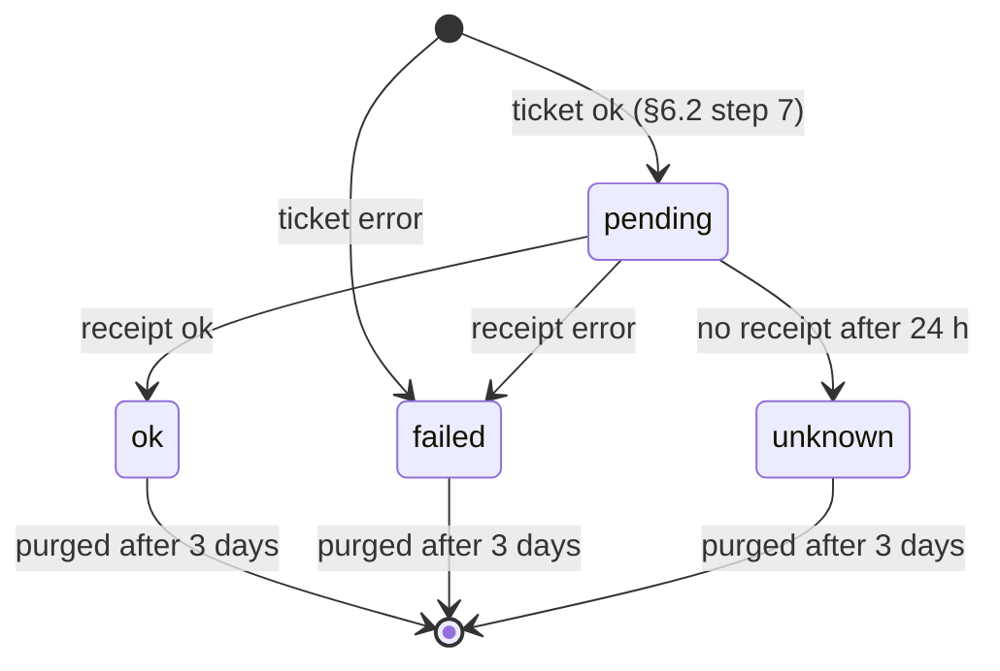

# Notices and notifications

> Status: **Approved** (Claude, delegated by the Owner for technical documents, 2026-11-02, for the notification core; the notices part (§13) is owed to P4) · Updated: 2026-11-03 (P2-12 as built: the notes after §19) · 2026-10-28 (P1-26: the notification core, DR-299…303; the notices part is owed to P4) · DOC-31
> Depends on: original SDD §10.4, §16.2, §19.1, [DR](../00-decision-register.md) (DR-03, 16, 17, 19, 20, 39, 42, 50, 51, 52, 53, 62, 71, 75, 76, 84, 87, 96, 101, 115, 116, 117, 118, 146, 177, 193, 264, 265, 286), [ADR-0009](../04-adr/0009-transactional-outbox-inbox-and-contracts.md), [ADR-0014](../04-adr/0014-schema-per-module-no-cross-module-foreign-keys.md), [ADR-0022](../04-adr/0022-personal-data-protection.md), [DOC-03](../01-product/requirements.md) (FR-03, FR-12.4, FR-29, FR-50.4, NFR-04), [DOC-04](../01-product/use-cases.md) (UC-19), [DOC-09](../03-architecture/messaging-contracts.md) §3.4, §4, §5.2…§5.4, §6.7, §7, [DOC-12](../03-architecture/code-architecture.md) §4.4, §8.4, [DOC-14](../05-data/data-conventions.md) §5.3, §8, [DOC-17](../05-data/operations-model.md) §6, [DOC-19](../05-data/db-roles-and-grants.md) §5, [DOC-20](../05-data/data-lifecycle.md) §2, [DOC-26](identity-and-sessions.md) §3, [DOC-27](residency-and-memberships.md) §3, [DOC-35](audit-privacy-and-terms.md), [DOC-38](jobs-and-outbox-runtime.md) §3, §4, [DOC-40](observability.md) §4, [DOC-41](configuration-reference.md), [DOC-42](error-handling.md) §7, [DOC-50](../07-api/api-guidelines.md) §10, §11, [DOC-51](../07-api/api-endpoints.md) E-22, E-23, E-34, E-35, E-76…E-79, [DOC-53](../08-ux-ui/ux-principles-and-ia.md) §5, [DOC-55](../08-ux-ui/client-architecture.md) §10, §13, [DOC-68](../08-ux-ui/ui-states-and-copy.md) §1, [DOC-06](../02-glossary.md)
> Main readers: P2-12 (the notification core), P2-15 and P2-17 (the fee screens that show the entries), P4-04 (ticket notifications), P4-05 (notices), P4-06 (EXP-06), DOC-52 (`inbox.created`), DOC-55, DOC-58, DOC-60, DOC-61, DOC-64, DOC-68, every task that adds an event that tells a person something

This document says how the `notification` module tells people what happened: the inbox entry and its template catalog, the unit visibility of an entry, the device tokens, the push to Expo and its payload privacy rule, the push receipts, and the closed list of places a tap opens. It also numbers and specifies the inbox endpoints E-76…E-79. **The notices part (the notice lifecycle, the rich-text subset, the scheduler and its heartbeat, the fan-out, the read state and the statistics) is owed to P4** and has only a stub (§13). It does not hold the tables (DOC-17 §6), the event payloads (DOC-09 §6), the SSE stream that carries `inbox.created` to the web CMS (DOC-52), the screens `Inbox` and `S-Inbox` (DOC-60, DOC-61) or the mails and SMS (DOC-26 §5.4).

**Draft.** Five decisions made while writing are recorded as DR-299…303 (§16). The DDL and the statements of this document were **run on PostgreSQL 18.6** (`postgres:18.6`, x86_64, Docker) on 2026-10-28: 41 constraint tests and 12 statement tests, listed in DOC-17 §13 (`OPM-100…152`, `OPM-S13…S24`) and summarized in §15. The Expo API facts were read on 2026-10-28 from the Expo documentation (§6.3); the timings of a send are *planned*, measured by P2-12 against a fake endpoint and by EXP-06 (P4-06).

## Sections owed

| § | Part | Gate | State |
| --- | --- | --- | --- |
| 1…12, 14…19 | Notification core: inbox, templates, device tokens, push, receipts, routing; E-76…E-79 | P2 (P2-00) | Written (this version) |
| 13 | Notices: lifecycle, rich text (DR-50), scheduler, heartbeat, fan-out (DR-51, DR-286), read state, statistics; E-143…E-149; the job `integrity_notices` | P4 (P4-00) | Owed |

## 1. Purpose and scope

| Component | Main class or file | Runs in | Trigger | Reads | Writes | Task |
| --- | --- | --- | --- | --- | --- | --- |
| Create inbox entries | `CreateInboxEntries` (one instance per rule of a producer's `integrations/notification.ts`, DOC-12 §4.4) | `worker` | the events of §3.2 | `ResidencyApi`, `IdentityApi` (recipients) | `inbox_entry`, outbox (`notification.push_requested.v1`, `notification.staff_inbox_created.v1`) | P2-12 (fees, payments, money log, step-up, members), P4-04, P4-05, P5, P6 |
| Mark a notice entry read | handler `notification.mark_read_on_notices_notice_read` | `worker` | `notices.notice_read.v1` | `inbox_entry` | `inbox_entry.read_at` | P4-05 |
| Send a push | handler `notification.send_expo_push` (`SendExpoPush`) | `worker` | `notification.push_requested.v1` | `device_token`, `push_ticket`, `IdentityApi` | `push_ticket`, `device_token` (deletes) | P2-12 |
| Read the receipts | job `push_receipts` | `worker` | every 5 min | `push_ticket` | `push_ticket`, `device_token` (deletes) | P2-12 |
| Purge the inbox | job `inbox_purge` | `worker` | Sunday 04:00 | `inbox_entry` | `inbox_entry` (deletes) | P2-12 |
| Read the inbox | `InboxQueries` | `api` | E-76, E-78 | `inbox_entry`, `ResidencyApi.activeUnitIds` | none | P2-12 |
| Mark read | `MarkInboxEntryRead`, `ReadAllInbox` | `api` | E-77, E-79, E-178, E-179 | `inbox_entry` | `inbox_entry.read_at` | P2-12 |
| Register or remove a device | `RegisterDevice`, `RemoveDevice` | `api` | E-22, E-23, E-34, E-35 | `device_token` | `device_token` | P2-12 |
| Drop tokens | handlers `notification.drop_device_token_on_identity_session_revoked`, `notification.drop_tokens_on_identity_account_deletion_executed` | `worker` | the two identity events | `device_token` | `device_token` (deletes) | P2-12 |
| Demo reset | `NotificationDemo.resetDemo`, `seedDemo` (DOC-36 §10.2) | `worker` | `demo_reset` | `inbox_entry` | `inbox_entry` | P2-12 |

The module is the reference's `notification`, forked: Web Push, its VAPID keys and its subscriptions are deleted; Expo push, device tokens and push tickets are added (DR-03, DR-52). Folding of repeats and the alert throttle of the reference are not used in phase 1. Mail stays in `identity` (DOC-26 §5.4).

## 2. Components and interfaces

### 2.1 Layout

```
modules/notification/src/
├── contracts/
│   ├── notification-integration.ts   # NotificationIntegration, InboxRule, TemplateDef (§2.2): what a producer ships
│   └── events.ts                     # NotificationEvents: notification.push_requested.v1, notification.staff_inbox_created.v1
├── domain/
│   ├── inbox-entry.ts  inbox-entry-repository.ts
│   ├── device-token.ts  device-token-repository.ts
│   └── push-ticket.ts  push-ticket-repository.ts
├── application/
│   ├── use-cases/      register-device.ts  remove-device.ts  mark-inbox-entry-read.ts  read-all-inbox.ts
│   ├── queries/        inbox-queries.ts
│   ├── handlers/       create-inbox-entries.ts  send-expo-push.ts  mark-read-on-notice-read.ts
│   │                   drop-device-token-on-session-revoked.ts  drop-tokens-on-account-deletion.ts
│   ├── push-renderer.ts                # template key + params + language → title and body (§3.4)
│   └── ports.ts                        # PushSender
├── infrastructure/
│   ├── persistence/    schema.ts  drizzle-*-repository.ts
│   ├── push/           expo-push-sender.ts  console-push-sender.ts
│   └── jobs/           push-receipts.ts  inbox-purge.ts
└── presentation/       resident-routes.ts  staff-routes.ts
```

`notification` has no `integrations/` of its own: it is the consumer. It calls `ResidencyApi` and `IdentityApi` (DOC-12 §4.4, last rule). It never imports a producer: `apps/api` hands it the producers' `integrations/notification` objects through `installNotification` (DOC-12 §4.4).

### 2.2 Types

```ts
// modules/notification/src/contracts/notification-integration.ts
import type { Capability, StaffRole, Uuid } from '@rms/shared-types'

export type TemplateKey =                                  // the closed catalog of §3.2, also in @rms/shared-types
  | 'fee.batch_published' | 'fee.batch_recalled' | 'fee.batch_due_extended' | 'fee.charge_voided' | 'fee.reminder'
  | 'payment.received' | 'payment.voided' | 'finance.money_unposted'
  | 'ticket.new_unassigned' | 'ticket.assigned' | 'ticket.status_changed' | 'ticket.commented' | 'ticket.rejected' | 'ticket.awaiting_close'
  | 'vehicle.pending_review' | 'vehicle.approved' | 'vehicle.rejected'
  | 'notice.published' | 'member.added' | 'report.export_ready' | 'staff.step_up_done'

export type SourceKind = 'batch' | 'charge' | 'debt_reminder' | 'payment' | 'gateway_event' | 'statement_line'
  | 'ticket' | 'vehicle' | 'notice' | 'membership' | 'unit' | 'export' | 'step_up'

export type ParamValue = string | { vi: string; en?: string }      // a bilingual value only for noticeTitle
export type Params = Readonly<Record<string, ParamValue>>

export type Recipients =
  | { kind: 'unit_members'; unitId: Uuid; capability: Capability }      // ResidencyApi.listRecipients, all pages
  | { kind: 'staff_roles'; roles: StaffRole[] }                          // IdentityApi.listActiveStaff, all pages
  | { kind: 'resident'; accountId: Uuid; unitId: Uuid | null }           // one resident; with a unit, only if the membership is active
  | { kind: 'staff'; staffId: Uuid }                                     // one staff member, only if active
  | { kind: 'accounts'; accounts: Array<{ accountKind: 'resident' | 'staff'; accountId: Uuid }> }   // a notice batch

export interface InboxPlan {
  templateKey: TemplateKey
  recipients: Recipients
  source: { kind: SourceKind; id: Uuid }   // the object the entry is about; the tap target
  dedupe: 'source' | 'event'               // §4.1: 'event' for a template that can repeat on one object
  params: Params                           // only the params the template declares (§3.3)
  urgent?: boolean                         // notice.published: Android channel `urgent`
}

export interface InboxRule<P = unknown> {
  readonly event: string                   // 'finance.batch_published.v1'
  readonly handler: string                 // 'notification.inbox_on_finance_batch_published' (DOC-09 §3.3)
  plan(payload: P, meta: { eventId: Uuid; buildingId: Uuid }): InboxPlan[]   // pure; [] = nothing to tell
}

export interface NotificationIntegration {
  readonly producer: string                // 'finance'
  readonly rules: readonly InboxRule[]
}
```

A producer's `integrations/notification.ts` exports one `NotificationIntegration`. The template definitions (§3.2: recipients side, push, channel, target) are **not** the producer's: they live once in `@rms/shared-types` (`NOTIFICATION_TEMPLATES`), because the server, the two apps and the web read the same table (the push sender, the inbox list, the route map). `installNotification` fails the boot when a rule names a key that is not in the table, when two rules name the same `handler`, or when a template has no `vi` and `en` text (DOC-12 §4.4, NT-03).

```ts
// packages/shared-types/src/notification.ts
export interface TemplateDef {
  key: TemplateKey
  audience: 'resident' | 'staff'
  params: readonly ParamName[]                         // declared params, each with a kind (§3.3)
  push: false | { channel: 'default' | 'urgent' | 'by_notice' }
  target: { route: PushRoute; entity: 'none' | 'source' }   // the tap (§6.5); `source` = the entry's source id
  webPath: string | null                               // staff entries in the web CMS bell, `{id}` = source id
  phase: 'P2' | 'P4' | 'P5' | 'P6'                     // the task that ships the producer's rule
}
```

### 2.3 Contracts it calls

| Call | Used for | Defined in |
| --- | --- | --- |
| `ResidencyApi.listRecipients(unitId, capability, page)` | Members of a unit who hold a capability (`view_fees`, `tickets`) | DOC-09 §7.2 |
| `ResidencyApi.getMembership(accountId, unitId)` | A single resident recipient with a unit: send only to an `active` membership | DOC-09 §7.2 |
| `ResidencyApi.activeUnitIds(accountId)` | The unit visibility filter of the inbox read (§4.2) | DOC-09 §7.2 |
| `IdentityApi.listActiveStaff(buildingId, roles, page)` | Staff recipients by role | DOC-09 §7.3 |
| `IdentityApi.getStaff(ids)` · `getResidentAccounts(ids)` | Status, `language` and `pushEnabled` at send time (§6.2) | DOC-09 §7.3 |
| `IdentityApi.liveSessionIds(sessionIds)` · *new (DR-300)* | The sessions of a set that are still live: `revoked_at IS NULL AND absolute_expires_at > now()`, the predicate of the session list (DOC-26 §3.7); at most 500 ids; an unknown id is absent | owed to DOC-09 §7.3 and DOC-26 |

### 2.4 Messages

| Message | Direction | Use here |
| --- | --- | --- |
| The events of §3.2 (column *Source*) | consumed | create entries (§4.1) |
| `notices.notice_read.v1` | consumed | mark the notice entry read (§4.3) |
| `identity.session_revoked.v1` · `identity.account_deletion_executed.v1` | consumed | delete tokens (§5.2) |
| `notification.push_requested.v1` | produced and consumed (command, retry class `push`) | §6. *Changed (DR-301):* each item of `recipients` carries its own `unitId` (`{accountKind, accountId, unitId}`), because the members of 500 units share one message; the top-level `unitId` is removed. The command has no producer yet, so the schema of DOC-09 §6.7 changes inside `v1` |
| `notification.staff_inbox_created.v1` | produced | one per staff entry, so `realtime` sends `inbox.created` (DOC-52) |

## 3. The template catalog

### 3.1 Rules

1. An inbox entry stores a **template key and parameters, never text** (DR-53, DOC-14 §8). The text is rendered per reader at read time, in the reader's language (DR-71, DOC-50 §11): by the client for the inbox list, by the push sender for a push.
2. The texts are the catalog family **`notify.*`**, owned by this document: `notify.<templateKey>.title` and `notify.<templateKey>.body`, in `@rms/i18n-catalog` (`src/notify/vi.ts`, `src/notify/en.ts`), spread into the apps' catalogs and, for the `staff` templates, into the web catalog (DOC-68 §1). A key exists in both languages or the build fails (NFR-13).
3. **Payload privacy (DR-52, FR-29.3).** A pushed text holds no amount, no person's name, no phone number, no ticket text and no unit code. Only the params of §3.3 marked *push-safe* may appear in a template that pushes; NT-02 renders every pushed template with fixture values and fails on a digit run of five or more, an `@`, a phone pattern, a fixture name or a unit code. A wording that would reveal money or health-related ticket content is a template defect (DR-52).
4. Every key has exactly **one source event** (DOC-09 §5.3, MC-09). A transfer of another amount has no key: the resident sees it only as `unmatchedTransfer` in the app (DR-84, DR-96, FR-29.7).
5. `staff.invited` is not a key (DR-116): the invitation is a mail.

### 3.2 The catalog

21 keys (DR-53, minus `staff.invited`, DR-116). *Recipients* are resolved by the handler; *unit* is what `inbox_entry.unit_id` holds; *dedupe* is §4.1; *push* names the Android channel or "no"; *target* is the app route of §6.5, with `+id` when the tap opens the source; *web* is the path the web CMS bell opens. *Phase* is when the producer's rule ships.

| Key | Source | Recipients | Unit | Source kind | Dedupe | Params | Push | Target (app) | Web | Phase |
| --- | --- | --- | --- | --- | --- | --- | --- | --- | --- | --- |
| `fee.batch_published` | `finance.batch_published.v1` | per unit of `unitIds`: members with `view_fees` (owner, family, tenant; not helpers, DR-20) | the unit | `batch` | source | `batchCode`, `feeMonth` | `default` | `/fees` | — | P2 |
| `fee.batch_recalled` | `finance.batch_recalled.v1` | the same | the unit | `batch` | source | `batchCode`, `feeMonth` | `default` | `/fees` | — | P2 |
| `fee.batch_due_extended` | `finance.batch_due_extended.v1` | the same (units with an open charge, DR-116) | the unit | `batch` | event | `batchCode`, `dueDate` | `default` | `/fees` | — | P2 |
| `fee.charge_voided` | `finance.charge_voided.v1` | members of `unitId` with `view_fees` | the unit | `charge` | source | `feeMonth` | `default` | `/fees` | — | P2 |
| `fee.reminder` | `finance.debt_reminder_sent.v1` | per reminder: members of its unit with `view_fees` | the unit | `debt_reminder` | source | — | `default` | `/fees` | — | P2 |
| `payment.received` | `finance.payment_posted.v1` | members of `unitId` with `view_fees`, the payer included | the unit | `payment` | source | — | `urgent` (DR-52) | `/fees/history` | — | P2 |
| `payment.voided` | `finance.payment_voided.v1` | the same | the unit | `payment` | source | — | `default` | `/fees/history` | — | P2 |
| `finance.money_unposted` | `finance.money_unposted.v1` | active Manager and Admin | — | `gateway_event` or `statement_line` | source | — | `default` | staff `/inbox` | `/transactions?tab=money-log` | P2 |
| `staff.step_up_done` | `identity.mail_requested.v1`, kind `step_up_notice` | `staffId` (one message per Admin, FR-50.4) | — | `step_up` (the event id) | event | `action`, `actorName` | no | — | `/building` | P2 |
| `member.added` | `residency.membership_changed.v1` (`added`); `residency.owner_changed.v1` | the added account; the new owner | the unit | `membership`; `unit` | source; event | — | `default` | `/` | — | P2 |
| `ticket.new_unassigned` | `tickets.ticket_changed.v1`, `change = created` | active Manager and Admin | — | `ticket` | source | `ticketCode` | `default` | staff `/tickets` +id | `/tickets/{id}` | P4 |
| `ticket.assigned` | `tickets.ticket_assigned.v1` | `assigneeId` | — | `ticket` | event | `ticketCode` | `default` | staff `/jobs` +id | — | P4 |
| `ticket.status_changed` | `tickets.ticket_changed.v1`, `status_changed` | members of `unitId` with `tickets` | the unit | `ticket` | event | `ticketCode`, `status` | `default` | `/requests` +id | — | P4 |
| `ticket.commented` | `tickets.ticket_changed.v1`, `message_added` with `messageVisibility = public` (internal: nothing, FR-24.2) | the same | the unit | `ticket` | event | `ticketCode` | `default` | `/requests` +id | — | P4 |
| `ticket.rejected` | `tickets.ticket_changed.v1`, `toStatus` the technician's rejection (literal: DOC-28) | active Manager and Admin | — | `ticket` | event | `ticketCode` | `default` | staff `/tickets` +id | `/tickets/{id}` | P4 |
| `ticket.awaiting_close` | `tickets.ticket_changed.v1`, `toStatus` `resolved` (literal: DOC-28) | active Manager and Admin | — | `ticket` | event | `ticketCode` | `default` | staff `/tickets` +id | `/tickets/{id}` | P4 |
| `notice.published` | `notices.notice_sent_batch.v1` | `recipients` of the message (DR-286: only the rows the batch inserted) | — | `notice` | source | `noticeTitle` | `default`, or `urgent` when `urgent` | resident `/notices` +id; staff `/inbox` | `/notices` | P4 |
| `vehicle.pending_review` | `vehicles.vehicle_submitted.v1` | active Manager and Admin (the reviewers, DOC-09 §5.3) | — | `vehicle` | event | — | `default` | staff `/vehicles` +id | `/vehicles` | P5 |
| `vehicle.approved` | `vehicles.vehicle_reviewed.v1`, `approved` | `submittedByAccountId` with an active membership of `unitId`; none when staff registered it | the unit | `vehicle` | event | — | `default` | `/unit/vehicles` | — | P5 |
| `vehicle.rejected` | `vehicles.vehicle_reviewed.v1`, `rejected` | the same | the unit | `vehicle` | event | — | `default` | `/unit/vehicles` | — | P5 |
| `report.export_ready` | `reporting.export_ready.v1` | `requestedBy` | — | `export` | source | — | no (the web CMS gets SSE `export.ready`) | — | `/exports` | P6 |

Notes:

- **Helpers** get only `notice.published` and `member.added` (FR-27.6). A helper has no `personal_notifications`, so cannot read the inbox (E-78 answers 403, UIRA-55); the push still reaches the phone and opens `Notices-Helper` or Home.
- **Staff notice recipients** (Manager, Technician, Guard of the audience, DR-50) have no notice screen in the staff app: their tap opens `S-Inbox`.
- **`payment.received` uses the channel `urgent`**, as DR-52 says ("urgent notices and payment received"). DOC-53 §5.3 rule 6, which keeps `urgent` for urgent notices only, is owed a correction (§19).
- **`staff.step_up_done` and `report.export_ready` do not push**: their readers are the Admin and the web CMS user, who have no app (the Admin is refused by the staff app, DOC-61). `staff.step_up_done` opens `W-Building` because the step-up actions are made there (DOC-67); `/audit` is P6.
- `actorName` is a staff member's name in a staff entry that never pushes; it is the only name a param may hold.

### 3.3 Params

| Param | Kind | Example stored | Rendered (vi · en) | Push-safe |
| --- | --- | --- | --- | --- |
| `batchCode` | code | `"PH-2610-01"` | as stored | yes |
| `feeMonth` | month `YYYY-MM` | `"2026-10"` | `tháng 10/2026` · `October 2026` (DOC-68 §7) | yes |
| `dueDate` | date `YYYY-MM-DD` (building day) | `"2026-11-20"` | `20/11/2026` · `20 Nov 2026` | yes |
| `ticketCode` | code | `"YC-261019-004"` | as stored | yes |
| `status` | ticket status literal | `"in_progress"` | `status.ticket-resident.<value>` (DOC-68 §5.7) | yes |
| `noticeTitle` | bilingual | `{"vi": "Cắt nước ngày 21/10", "en": "Water shut-off on 21 October"}` | the reader's language, else `vi`; cut to 100 characters with `…` | yes (DR-52) |
| `action` | `gateway_config` · `admin_change` · `staff_email` | `"gateway_config"` | an ICU `select` in the message | no (never pushed) |
| `actorName` | a staff name | `"Lê Minh"` | as stored | no (never pushed) |

A param is formatted **before** ICU interpolation, as DOC-68 §1 requires: the renderer formats `feeMonth`, `dueDate` and `status` with the shared formatters of `@rms/i18n-catalog` and passes strings. `params` hold no amount, no phone, no resident name and no text a resident wrote (DOC-09 §3.4 rule 2). `noticeTitle` needs `notices.notice_sent_batch.v1` to carry the bilingual title (owed to DOC-09 §6.6 by P4).

### 3.4 Texts

The texts below are the `vi` and `en` values of `notify.<key>.title` and `notify.<key>.body`. "Ban quản lý" is the management office (DOC-68 §1, terms); a resident says "Yêu cầu" and staff "Phiếu" for a ticket (DR-197).

| Key | Title (vi) | Body (vi) | Title (en) | Body (en) |
| --- | --- | --- | --- | --- |
| `fee.batch_published` | Phí {feeMonth} đã phát hành | Đợt phí {batchCode} đã có. Mở ứng dụng để xem chi tiết. | {feeMonth} fees published | Fee batch {batchCode} is ready. Open the app to see the details. |
| `fee.batch_recalled` | Đợt phí {batchCode} đã được thu hồi | Ban quản lý đã thu hồi đợt phí này. Các khoản phí của đợt không cần thanh toán nữa. | Fee batch {batchCode} withdrawn | The management office withdrew this batch. Its charges no longer need to be paid. |
| `fee.batch_due_extended` | Gia hạn đợt phí {batchCode} | Hạn thanh toán mới là {dueDate}. | Fee batch {batchCode} extended | The new due date is {dueDate}. |
| `fee.charge_voided` | Một khoản phí {feeMonth} đã được hủy | Ban quản lý đã hủy một khoản phí. Khoản phí đúng, nếu có, sẽ được phát hành lại. | A charge for {feeMonth} was cancelled | The management office cancelled a charge. A corrected one, if any, will be issued again. |
| `fee.reminder` | Nhắc thanh toán phí | Căn hộ còn khoản phí chưa thanh toán. Mở ứng dụng để xem. | Fee reminder | Your unit has unpaid fees. Open the app to see them. |
| `payment.received` | Đã nhận thanh toán | Ban quản lý đã ghi nhận một khoản thanh toán. Biên lai có trong ứng dụng. | Payment received | A payment was recorded. The receipt is in the app. |
| `payment.voided` | Một khoản thanh toán đã bị hủy | Ban quản lý đã hủy một khoản thanh toán đã ghi. Mở ứng dụng để xem. | A payment was voided | The management office voided a recorded payment. Open the app to see it. |
| `finance.money_unposted` | Có khoản tiền cần kiểm tra | Một khoản chuyển khoản chưa được ghi nhận. Xem nhật ký tiền. | Money to check | An incoming transfer was not posted. See the money log. |
| `staff.step_up_done` | Đã xác minh một thay đổi quan trọng | {actorName} đã {action, select, gateway_config {đổi cấu hình cổng thanh toán} admin_change {tạo hoặc nâng quyền một Quản trị} staff_email {đổi email của một nhân viên} other {thực hiện một thay đổi quan trọng}}. | Sensitive change confirmed | {actorName} {action, select, gateway_config {changed the payment gateway settings} admin_change {created or promoted an Admin} staff_email {changed a staff email} other {made a sensitive change}}. |
| `member.added` | Bạn đã được thêm vào một căn hộ | Mở ứng dụng để xem căn hộ. | You were added to a unit | Open the app to see the unit. |
| `ticket.new_unassigned` | Phiếu mới {ticketCode} | Có phiếu hỗ trợ mới chưa được giao. | New ticket {ticketCode} | A new ticket is waiting to be assigned. |
| `ticket.assigned` | Bạn được giao phiếu {ticketCode} | Mở ứng dụng để nhận hoặc từ chối. | Ticket {ticketCode} assigned to you | Open the app to accept or reject it. |
| `ticket.status_changed` | Yêu cầu {ticketCode} đã cập nhật | Trạng thái mới: {status}. | Request {ticketCode} updated | New status: {status}. |
| `ticket.commented` | Yêu cầu {ticketCode} có phản hồi mới | Mở ứng dụng để xem. | New reply on request {ticketCode} | Open the app to read it. |
| `ticket.rejected` | Phiếu {ticketCode} bị từ chối | Kỹ thuật viên đã từ chối phiếu. Hãy giao lại. | Ticket {ticketCode} rejected | The technician rejected the ticket. Assign it again. |
| `ticket.awaiting_close` | Phiếu {ticketCode} chờ đóng | Công việc đã xong. Hãy kiểm tra và đóng phiếu. | Ticket {ticketCode} awaits closing | The work is done. Check it and close the ticket. |
| `notice.published` | Thông báo mới: {noticeTitle} | Mở ứng dụng để đọc. | New notice: {noticeTitle} | Open the app to read it. |
| `vehicle.pending_review` | Có phương tiện chờ duyệt | Một đăng ký phương tiện đang chờ duyệt. | Vehicle awaiting review | A vehicle registration is waiting for review. |
| `vehicle.approved` | Phương tiện đã được duyệt | Đăng ký phương tiện của căn hộ đã được duyệt. | Vehicle approved | Your unit's vehicle registration was approved. |
| `vehicle.rejected` | Phương tiện chưa được duyệt | Mở ứng dụng để xem lý do và sửa đăng ký. | Vehicle not approved | Open the app to see why and fix the registration. |
| `report.export_ready` | Tệp xuất đã sẵn sàng | Tệp có trong Trung tâm xuất trong 7 ngày. | Your export is ready | The file is in the export center for 7 days. |

Rendered example: `fee.batch_published` with `{"batchCode": "PH-2610-01", "feeMonth": "2026-10"}` reads "Phí tháng 10/2026 đã phát hành" / "Đợt phí PH-2610-01 đã có. Mở ứng dụng để xem chi tiết." in Vietnamese and "October 2026 fees published" / "Fee batch PH-2610-01 is ready. Open the app to see the details." in English.

## 4. Inbox entries

### 4.1 Creating entries

The handler `CreateInboxEntries` runs one rule (DOC-12 §8.4), in the `transactional` inbox mode (DOC-09 §4.3):

1. In one transaction, `inbox.claim(env.id, rule.handler)`; a conflict means a duplicate delivery: return.
2. `plans = rule.plan(payload, { eventId: env.id, buildingId })`. An empty list returns (a ticket's internal note, a mail kind other than `step_up_notice`, a membership change other than `added`).
3. For each plan, resolve the recipients (§2.3) into rows `{accountKind, accountId, unitId}`:
   - `unit_members`: every page of `listRecipients(unitId, capability)`; `unitId` is the plan's unit.
   - `staff_roles`: every page of `listActiveStaff(buildingId, roles)`; `unitId` null.
   - `resident` with a unit: only when `getMembership(accountId, unitId)` is `active`; without a unit (a notice), as given.
   - `staff`: only when `getStaff([id])` is `active`.
4. Insert the rows in pages of 500 with `ON CONFLICT ON CONSTRAINT uq_inbox_entry_dedupe DO NOTHING RETURNING account_kind, account_id, unit_id, id` (OPM-S13). `dedupe_id` is the source id when the plan says `source`, and the event id (`env.id`) when it says `event`. **Only the rows returned go on**: a row that conflicted was told already.
5. For each returned staff row, write one `notification.staff_inbox_created.v1` (`staffId`, `entryId`, `templateKey`) for `realtime` (DR-116).
6. If the template pushes: group the returned rows by account. An account with rows for several units of one plan gets one push with `unitId` null (it opens the target in the unit already selected); otherwise the push carries its unit. Write `notification.push_requested.v1` messages of at most 100 recipients (`PUSH_CHUNK_SIZE`, DR-52) with the template key, the push-safe params, `sourceKind`, `sourceId`, the channel (`urgent` for `payment.received` and an urgent notice), `route`, `entityId` (the source id when the target is `+id`, else null) and the recipients.
7. Commit: the entries, the inbox row and the outbox rows commit together (ADR-0009). Nothing leaves the database in this transaction.

**Why `dedupe_id`, and why the unit is in the key (DR-299).** The natural key `(building_id, account_kind, account_id, source_kind, dedupe_id, template_key, unit_id)` with `NULLS NOT DISTINCT` is the second net under the inbox guard (DOC-09 §4.3): a repeat of the same event inserts nothing. DR-53's key had no `unit_id` and no event id, which loses two cases: an owner of two units charged in one batch would get one entry for the first unit only (and the entry would hide when that unit is left, though the other is still theirs); and a template that happens twice on one object (a second due-date extension, a second status change of a ticket) would be dropped as a duplicate. A template that happens once per object keeps the object as its dedupe id, so a notice batch that is run again after a crash (DR-51, DR-286) still finds its rows.

**Example.** `finance.batch_published.v1` for `PH-2610-01` with units `A-1508` (owner Nguyễn Văn An, tenant Trần Thị Bình without `can_pay`, a helper) and `A-1509` (owner Nguyễn Văn An again): four rows, An × A-1508, Bình × A-1508, An × A-1509, none for the helper; one `notification.push_requested.v1` with two recipients, An with `unitId` null and Bình with `A-1508`'s id. Delivered again: zero rows, zero messages (NT-10, NT-11, NT-12).

**Transaction size.** One `finance.batch_published.v1` part carries at most 500 units (DOC-09 §3.4): 500 calls of `listRecipients` (one indexed read each), about 1,500 entries in three statements and 15 push messages. Planned: under 2 s; measured by P2-12 on the 240-unit demo and a 5,000-unit fixture.

### 4.2 Unit visibility

An entry with a `unit_id` is shown only while the reader has an **active** membership of that unit (DR-53): a resident read filters on `unit_id IS NULL OR unit_id = ANY(:activeUnitIds)`, with `ResidencyApi.activeUnitIds(accountId)` called once per request. The entry is hidden, not deleted: it shows again if the membership becomes active again (an unlock). Staff entries have no unit (`ck_inbox_entry_staff_unit`), so a staff read has no such filter. The inbox shows the entries of every active unit of the account in the building, not only of the selected unit; a tap on an entry of another unit switches the unit first (FR-29.5, DR-193).

### 4.3 Read state

| Action | Effect | Statement |
| --- | --- | --- |
| Open one entry (E-178, E-179) | `read_at` set if null, for the caller's own visible entry. **A `notice` entry is not changed**: the client calls `POST /me/notices/{id}/read` (one of E-143…E-149, P4), whose event marks it (DR-51) | OPM-S16 |
| Read all (E-77, E-79) | `read_at` set on the caller's unread entries with `id ≤ upToId` (the newest entry the client has shown), notices included; a hidden entry is marked too | OPM-S17 |
| `notices.notice_read.v1` | `read_at = now()` on the `notice.published` entry of that account and notice, if null | OPM-S18 |

`notice_recipient.read_at` stays the one source of truth of a notice's read state (DR-51): a read-all marks the inbox entry, not the notice, so the notice statistics still count the recipient as unread until the notice is opened. The unread badge counts inbox entries (DR-51 item 4). `read_at` is set from the database clock, never from the event's `readAt`: the entry can be created after the reader opened the notice when the relay lags, and `ck_inbox_entry_read_at` refuses a read before the creation (found while running OPM-S18).

### 4.4 Endpoints

E-76…E-79 are numbered in DOC-51 §2.2 and specified here, as DOC-51 §11 says. E-178 and E-179 are new (DR-302) and take their numbers when DOC-51 is updated. The answers follow DOC-50: keyset pages `{items, nextCursor}`, no localized text (the client renders `templateKey` and `params`, DOC-50 §11).

#### E-78 `GET /me/inbox` · `listMyInbox`

- **Purpose / UC:** The resident's inbox and the bell's unread count (UC-19; screens `Inbox`, the bell of `Main` and `Home-*`, DOC-57).
- **Authorization:** `unit: personal_notifications`. A helper is refused with 403 `forbidden` (UIRA-55). The building comes from the membership of `X-Unit-Id`.
- **Parameters:**

  | Name | In | Type | Required | Default | Constraints |
  | --- | --- | --- | --- | --- | --- |
  | `cursor` | query | string | no | | opaque, from `nextCursor` |
  | `limit` | query | integer | no | 20 | 1…100; `limit=1` serves the bell |

- **Response 200:**

  ```json
  {
    "items": [
      {
        "id": "01a181d2-3bf2-78f1-8192-c8e9c735794b",
        "templateKey": "fee.batch_published",
        "params": { "batchCode": "PH-2610-01", "feeMonth": "2026-10" },
        "unitId": "0192f3c4-5a1e-7000-8000-000000000021",
        "source": { "kind": "batch", "id": "0192f3c4-5a1e-7000-8000-000000000010" },
        "target": { "route": "/fees", "unitId": "0192f3c4-5a1e-7000-8000-000000000021", "entityId": null },
        "createdAt": "2026-10-19T03:21:44.512Z",
        "readAt": null
      }
    ],
    "nextCursor": "eyJpZCI6IjAxYTE4MWQyLTNiZjItNzhmMS04MTkyLWM4ZTljNzM1Nzk0YiJ9",
    "unreadCount": 3
  }
  ```

  `target` is computed from the catalog (§3.2) so the client navigates exactly as a push tap does. `unreadCount` is the count of unread visible entries, **capped at 100** (the bell shows "99+"), on every page.
- **Errors:** 400 `invalid_cursor`, 400 `validation_failed` (`minimum`, `maximum`); 401; 403 `membership_inactive`, `terms_required`, `forbidden`.
- **Data source:** `notification.inbox_entry` by `(building_id, account_kind = 'resident', account_id)` with the unit filter of §4.2, `ORDER BY id DESC`, keyset `id < :cursor`, `LIMIT :limit + 1`, on `ix_inbox_entry_building_account` (OPM-S14); the count reads `ix_inbox_entry_building_account_unread` with `LIMIT 100` (OPM-S15).
- **Cache:** `no-store`.
- **Performance:** p95 under 100 ms (two index reads and one contract call).
- **Tests:** NT-30…NT-32, NT-35.

#### E-79 `POST /me/inbox/read-all` · `readAllMyInbox`

- **Purpose / UC:** Mark every shown entry read (UC-19; `Inbox` "Đánh dấu đã đọc").
- **Authorization:** `unit: personal_notifications`.
- **Parameters:** body `upToId` (UUID, required): the `id` of the newest entry the client shows. An entry created after it stays unread.
- **Request example:** `{ "upToId": "01a181d2-3bf2-78f1-8192-c8e9c735794b" }`
- **Response 200:** `{ "updated": 43, "unreadCount": 3 }`. A second call answers `updated: 0`; no `Idempotency-Key` is needed.
- **Errors:** 400 `validation_failed`; 401; 403 as E-78.
- **Data source:** `UPDATE notification.inbox_entry SET read_at = now() WHERE building_id = :b AND account_kind = 'resident' AND account_id = :me AND read_at IS NULL AND id <= :upToId` on `ix_inbox_entry_building_account_unread` (OPM-S17).
- **Performance:** p95 under 100 ms.
- **Tests:** NT-33.

#### E-178 `POST /me/inbox/{id}/read` · `readMyInboxEntry`

- **Purpose / UC:** Mark one entry read when the resident opens it (UC-19).
- **Authorization:** `unit: personal_notifications`.
- **Parameters:** `id` (path, UUID).
- **Response 204:** also when the entry was already read, and for a `notice` entry, which is left unchanged (§4.3).
- **Errors:** 404 `not_found` for an unknown id, another account's entry, or an entry hidden by the unit filter (never 403); 401; 403 as E-78.
- **Data source:** one conditional `UPDATE … SET read_at = now() WHERE id = :id AND building_id AND account_kind AND account_id AND read_at IS NULL AND source_kind <> 'notice'` (OPM-S16); zero rows is followed by an existence read to choose 204 or 404.
- **Tests:** NT-34.

#### E-76 `GET /staff/inbox` · `listStaffInbox`, E-77 `POST /staff/inbox/read-all` · `readAllStaffInbox`, E-179 `POST /staff/inbox/{id}/read` · `readStaffInboxEntry`

The same three operations for staff (`S-Inbox`, the web CMS bell, DOC-64): audience `staff: admin, manager, technician, guard`; the building is the token's; `account_kind = 'staff'`, no unit filter, no `X-Unit-Id`. The answer's `target` holds the staff app route and `webPath` (the web path of §3.2, `{id}` filled). Same errors without the 403 codes of a membership. Tests NT-36.

### 4.5 Retention

Entries are deleted 180 days after `created_at` (`INBOX_RETENTION_DAYS`, DR-53, DR-62), read or not, by the weekly `inbox_purge` (Sunday 04:00, `lock` mode, DOC-38 §4.1) in batches of 1,000 per transaction per building (OPM-S24, DOC-20 §2). The demo reset deletes the demo building's entries (DOC-36 §10.2). An account deletion does not delete entries: they hold no personal text and age out (DOC-20 §8).

## 5. Device tokens

### 5.1 Registration (E-22, E-34)

The app sends `{expoPushToken, platform, appVersion}` after sign-in, at every cold start, when the OS issues a new token and when the user turns push on (DOC-55 §10.1). `RegisterDevice` runs, in one transaction (OPM-S19):

```sql
DELETE FROM notification.device_token WHERE session_id = :sid AND expo_push_token <> :token;     -- one token per session
INSERT INTO notification.device_token AS t (id, account_kind, account_id, session_id, expo_push_token, platform, app_version)
VALUES (:newId, :kind, :accountId, :sid, :token, :platform, :appVersion)
ON CONFLICT ON CONSTRAINT uq_device_token_token DO UPDATE
   SET account_kind = excluded.account_kind, account_id = excluded.account_id, session_id = excluded.session_id,
       platform = excluded.platform, app_version = excluded.app_version, updated_at = now()
RETURNING t.id, (xmax = 0) AS inserted;
```

- The answer is `{id}`: the same `id` for the same token, also after a reassignment.
- **Reassignment.** A token registered by another account (a shared phone, a sign-in as someone else) moves to the caller and its session (glossary "device token"); the earlier account no longer reaches that phone. Logged `info` `device_token_reassigned` with the row id, never the token. The earlier account's `DELETE` of that id then deletes nothing (OPM-S20).
- **One token per session** (`uq_device_token_session`): a new OS token for the same session replaces the old row. Two registrations of one session racing with different tokens: the loser gets `23505` on the session key and is retried once by the use case.
- The token must match `^Expo(nent)?PushToken\[[A-Za-z0-9_-]{1,180}\]$`, at most 200 characters (`ck_device_token_token`); anything else is 400 `validation_failed` rule `pattern` before the statement. Expo's SDK accepts both prefixes and also a bare UUID form (`isExpoPushToken`, expo-server-sdk-node, read 2026-10-28); the apps get the bracket form from `getExpoPushTokenAsync`, so the bare form is refused. P2-12 checks a real token of each platform against the pattern.
- The language is **not** stored with the token (DR-300): the push sender reads the account's `language` at send time, so a language change applies to the next push.

### 5.2 Removal

| Path | Statement | Where |
| --- | --- | --- |
| E-23 / E-35: the app removes its token (push turned off in the OS, sign-out of this app) | `DELETE … WHERE id = :id AND account_kind = :kind AND account_id = :me`; **204** whether or not a row was deleted (DR-146 gives both endpoints this shape; DOC-51 E-35 says 404 and is owed a correction, §19) | OPM-S20 |
| `identity.session_revoked.v1` (sign-out, revocation, reuse, cap, lock, disable, role or phone change) | `DELETE … WHERE session_id = :sessionId AND account_kind AND account_id` | OPM-S20 |
| `identity.account_deletion_executed.v1` | `DELETE … WHERE account_kind = 'resident' AND account_id = :id` | |
| A ticket or receipt says `DeviceNotRegistered` | `DELETE … WHERE id = :deviceTokenId` | §6.2, §7 |
| The sender finds the session dead (expired, or revoked while an event was lost) | `DELETE … WHERE id = ANY(:ids)` | §6.2 step 4 |

A stale token is not purged by age (DR-115 item 6): a token lives as long as its session, and the last row above removes the token of a session that ended without an event (its absolute or sliding limit, DOC-26 §3.6). The table is denied to `rms_readonly` (DOC-19 §5).

## 6. Push delivery

### 6.1 From an entry to a push

An inbox entry is the record; a push is a hint (UX-19). The handler of §4.1 writes `notification.push_requested.v1` in its own transaction; `notification.send_expo_push` sends it later in the `afterSideEffect` mode (DOC-09 §4.3), retry class `push` (3 attempts).

```json
{
  "buildingId": "0192f3c4-5a1e-7000-8000-000000000001",
  "templateKey": "fee.batch_published",
  "sourceKind": "batch",
  "sourceId": "0192f3c4-5a1e-7000-8000-000000000010",
  "params": { "batchCode": "PH-2610-01", "feeMonth": "2026-10" },
  "channel": "default",
  "route": "/fees",
  "entityId": null,
  "recipients": [
    { "accountKind": "resident", "accountId": "0192f3c4-5a1e-7000-8000-000000000041", "unitId": null },
    { "accountKind": "resident", "accountId": "0192f3c4-5a1e-7000-8000-000000000042", "unitId": "0192f3c4-5a1e-7000-8000-000000000021" }
  ]
}
```

### 6.2 The sender

`SendExpoPush.handle(env)`:

1. **Too old.** If `now − env.occurredAt > PUSH_MAX_AGE_MINUTES` (60), return with `info` `skipped_expired`: the inbox has it, and a fee push an hour late after an Expo outage is noise.
2. **Accounts.** `getResidentAccounts` / `getStaff` for the recipients. Keep an account whose status is `active` (a resident in `deletion_requested` is kept) and whose `pushEnabled` is true (FR-29.5). Note each account's `language`.
3. **Tokens.** `SELECT … FROM device_token WHERE account_kind = :k AND account_id = ANY(:ids) AND NOT EXISTS (a push_ticket of this message for that device)` on `ix_device_token_account` and `uq_push_ticket_message_device` (OPM-S21). The anti-join is what makes a retried message skip the devices it already reached.
4. **Live sessions.** `IdentityApi.liveSessionIds(sessionIds)`; the tokens of a dead session are deleted (`info` `device_token_deleted`, reason `session_dead`) and skipped.
5. **Build** one message per token (§6.3): title and body from `notify.<key>.*` in the account's language (§3.4), `data = {route, unitId, entityId}` with the recipient's `unitId`. A message over 4,096 bytes is a defect: it throws (it cannot happen with the catalog's params and the 100-character title cut).
6. **Send** in requests of at most `PUSH_CHUNK_SIZE` (100) messages, one request at a time, each with a `PUSH_REQUEST_TIMEOUT_MS` (10 s) timeout. A network error, a 429 or a 5xx is retried **inside the attempt** after 1 s and after 5 s (DR-52's first two waits). If it still fails: a 429 throws `RetryLaterError` with `Retry-After` or 30 s (DR-52's third wait, now the relay's); a 5xx or a network error throws (one attempt of the class `push` spent, DOC-42 §7.1); a 401 (`UNAUTHORIZED`, a wrong `EXPO_ACCESS_TOKEN`) throws `RetryLaterError` of 300 s and logs `error` `provider_auth_failed` (`provider = push`); any other 4xx (`PUSH_TOO_MANY_NOTIFICATIONS`, a malformed body) is a defect and throws.
7. **Record** after each request, in a short transaction of its own (no network call inside a transaction, DOC-38 §3.4): for each ticket in order, `status: ok` inserts a `pending` `push_ticket` with `receipt_id` and `next_check_at = now() + PUSH_RECEIPT_DELAY_MINUTES` (15); `status: error` inserts a `failed` row with `details.error`, and a `DeviceNotRegistered` also deletes the token (ER-34). The insert is `ON CONFLICT ON CONSTRAINT uq_push_ticket_message_device DO NOTHING`.
8. Return; the bus writes the inbox row.

**Time budget.** The worst chunk is three tries of one request: 3 × 10 s + 1 s + 5 s = 36 s. A message of 100 recipients with 2 devices each is two chunks, so the handler keeps its run inside the 60 s lease (`OUTBOX_LEASE_SECONDS`, DOC-38 §2.3): it starts a chunk only while less than 20 s of the run have passed, and otherwise throws `RetryLaterError(0)` (no attempt spent); the next delivery resumes at step 3, whose anti-join skips the devices already sent. Planned: a chunk of 100 takes about 0.3 s against Expo; EXP-06 measures 5,000 recipients against a fake endpoint at 200 ms (FR-29.1, NFR-04).

**What a crash does.** A crash after Expo answered and before step 7 committed resends that chunk on the next attempt: one duplicate push per device, which DOC-09 §4.3 accepts (the inbox entry is the record; Expo has no idempotency key). A crash anywhere else repeats nothing.

### 6.3 The Expo request and its answers

The client is a small `fetch` client in `infrastructure/push/expo-push-sender.ts` (DR-301), not `expo-server-sdk`: the project needs two calls, one header and its own retry rule, and the SDK's latest version (8.0.0, 2026-10-22) is inside the 7-day release age of `bunfig.toml`. Facts read on 2026-10-28 at <https://docs.expo.dev/push-notifications/sending-notifications/>: at most 100 messages per send request, at most 1,000 ids per receipt request, 600 notifications per second per project, a payload of at most 4,096 bytes, receipts kept 24 hours and read about 15 minutes after sending, `Authorization: Bearer` when enhanced push security is on.

```http
POST {EXPO_PUSH_BASE_URL}/send                       # https://exp.host/--/api/v2/push/send
Content-Type: application/json
Accept: application/json
Authorization: Bearer <EXPO_ACCESS_TOKEN>            # required in staging and production (DOC-41 §6)

[
  {
    "to": "ExponentPushToken[xxxxxxxxxxxxxxxxxxxxxx]",
    "title": "Phí tháng 10/2026 đã phát hành",
    "body": "Đợt phí PH-2610-01 đã có. Mở ứng dụng để xem chi tiết.",
    "data": { "route": "/fees", "unitId": null, "entityId": null },
    "channelId": "default",
    "priority": "default",
    "sound": "default"
  }
]
```

| Field | Value | Why |
| --- | --- | --- |
| `title`, `body` | rendered in the recipient's language | DR-52 |
| `data` | exactly `{route, unitId, entityId}` | DR-52, FR-29.3; NT-59 |
| `channelId` | `default` or `urgent` | DR-52; the channels exist on the device before the first prompt (DOC-55 §10.1) |
| `priority` | `high` on `urgent`, `default` otherwise | an urgent notice and a payment wake the device |
| `sound` | `default` | iOS is silent without it; interruption level stays the default (DR-52) |
| `badge`, `collapseId`, `ttl` | not sent | no badge in phase 1 (the app sets none, DOC-55 §10.1); collapsing would replace the push of one unit by that of another for the same batch; Expo's default lifetime applies |

Answers:

```json
{ "data": [
  { "status": "ok", "id": "XXXXXXXX-XXXX-XXXX-XXXX-XXXXXXXXXXXX" },
  { "status": "error", "message": "\"ExponentPushToken[yyyy]\" is not a registered push notification recipient",
    "details": { "error": "DeviceNotRegistered" } }
] }
```

```http
POST {EXPO_PUSH_BASE_URL}/getReceipts
{ "ids": ["XXXXXXXX-XXXX-XXXX-XXXX-XXXXXXXXXXXX", "ZZZZZZZZ-ZZZZ-ZZZZ-ZZZZ-ZZZZZZZZZZZZ"] }

{ "data": {
  "XXXXXXXX-XXXX-XXXX-XXXX-XXXXXXXXXXXX": { "status": "ok" },
  "ZZZZZZZZ-ZZZZ-ZZZZ-ZZZZ-ZZZZZZZZZZZZ": { "status": "error", "message": "…", "details": { "error": "DeviceNotRegistered" } }
} }
```

The tickets come back in the order of the messages. A receipt id that has no receipt yet is absent from `data`.

**Drivers.** `PUSH_DRIVER = expo` sends as above; `console` (the default in `local` and `test`) logs the rendered message at `info` without the token and answers `ok` tickets with fake ids, so the receipt job reads `ok` receipts. Production refuses `console` at boot (DOC-41 §17). EXP-06 and the `NT-` tests point `EXPO_PUSH_BASE_URL` at a fake endpoint.

### 6.4 Payload privacy (DR-52)

The rule of §3.1 item 3 holds on four levels: (1) `params` carry no amount, name, phone, unit code or resident text (DOC-09 §3.4); (2) only push-safe params reach a pushed template (§3.3); (3) the catalog test NT-02 renders every pushed template in both languages and scans the output; (4) `data` has exactly three keys (NT-59). Expo, FCM and APNs are outside Vietnam (original SDD §19.1); what crosses the border is a template text, three ids and a token (DOC-35, ADR-0022).

### 6.5 Push routing: the closed list (DR-177, DR-193)

`route` is a path of the app route tables of DOC-53 §5.1 and §5.2, without parameters. `entityId` set means `route/entityId`. The list lives in `@rms/shared-types` (`PUSH_ROUTES`) and `mobile-core` maps it to expo-router paths; anything else opens Home (DOC-53 §5.3 rule 1). It replaces the provisional names of DOC-55 §10.2 (`fees`, `fee`, `receipt`, …).

| App | `route` | With `entityId` | Screen | Capability or role | Used by |
| --- | --- | --- | --- | --- | --- |
| resident | `/` | no | `Main` / `Home-*` | any | `member.added` |
| resident | `/fees` | no | `Fees` | `view_fees` | `fee.*` |
| resident | `/fees/history` | no | `Fee-History` | `view_fees` | `payment.*` |
| resident | `/requests` | yes: `/requests/{ticketId}` | `Request-Detail` | `tickets` | `ticket.status_changed`, `ticket.commented` |
| resident | `/notices` | yes: `/notices/{noticeId}` | `Notice-Detail` | `broadcast_notices` | `notice.published` |
| resident | `/unit/vehicles` | no | `Vehicles` | `vehicles` | `vehicle.approved`, `vehicle.rejected` |
| resident | `/inbox` | no | `Inbox` | `personal_notifications` | (deep links) |
| staff | `/inbox` | no | `S-Inbox` | all staff | `finance.money_unposted`, `notice.published` |
| staff | `/tickets` | yes: `/tickets/{ticketId}` | `B-Ticket-Detail` | Manager | `ticket.new_unassigned`, `ticket.rejected`, `ticket.awaiting_close` |
| staff | `/jobs` | yes: `/jobs/{ticketId}` | `K-Job-*`, `G-Jobs` | Technician, Guard | `ticket.assigned` |
| staff | `/vehicles` | yes: `/vehicles/{vehicleId}` | `B-Vehicle-Review` | Manager | `vehicle.pending_review` |

On a tap: a `unitId` that is an active membership and not the selected unit switches the unit first; one that is not active opens Home (DR-193); a missing capability (a helper tapping an old fee push) opens Home (DOC-53 §5.3 rule 3); a foreground push does not navigate (DR-177).

## 7. Receipts (`push_receipts`)

Every 5 minutes, `claim` mode (DOC-38 §3.2):

1. **Claim** at most 1,000 due tickets: `UPDATE push_ticket SET next_check_at = now() + interval '5 minutes' WHERE id IN (SELECT id … WHERE status = 'pending' AND next_check_at <= now() ORDER BY next_check_at LIMIT 1000 FOR UPDATE SKIP LOCKED) RETURNING id, receipt_id, device_token_id` on `ix_push_ticket_pending` (OPM-S22). The new `next_check_at` is the lease: a crash returns the rows 5 minutes later; a second worker takes other rows.
2. **Ask** Expo for the receipts of the claimed ids (one request of ≤ 1,000, outside any transaction), with the timeout and the in-run retries of §6.2 step 6; a failure ends the run (the rows come back after the lease).
3. **Write** each outcome with a conditional `UPDATE … WHERE id = :id AND status = 'pending'` (a second run changes nothing, OPM-S22):

   | Receipt | `status` | Also |
   | --- | --- | --- |
   | `ok` | `ok` | — |
   | `DeviceNotRegistered` | `failed` | delete the token (FR-29.6) |
   | `MessageTooBig`, `MessageRateExceeded` | `failed` | `warn` |
   | `InvalidCredentials`, `MismatchSenderId` | `failed` | `error` `provider_auth_failed` (`provider = push`): the FCM or APNs credentials of the EAS project are wrong (DOC-73) |
   | absent, ticket younger than 24 h | stays `pending` | checked again after the lease |
   | absent, ticket older than 24 h | `unknown` | Expo keeps receipts 24 h (OPM-S23) |

4. **Purge** tickets older than `PUSH_TICKET_RETENTION_DAYS` (3) in batches of 1,000 (OPM-S24, DR-52, DR-115).
5. `job_run` only when it did work (DOC-38 §3.5): `{"receipts": n, "tokensDeleted": n, "unknown": n, "purged": n}`.

The failure counts per notice (FR-28.1 "push failures") are read from `push_ticket` by P4 (§13).



## 8. Transactions and concurrency

| Step | Commits together | Outside any transaction |
| --- | --- | --- |
| A producer's state change | its rows, its event, its audit row (ADR-0009) | — |
| `CreateInboxEntries` | the inbox row, the entries, `staff_inbox_created` and `push_requested` messages | — |
| `SendExpoPush` | per chunk: its `push_ticket` rows and its token deletes | the Expo request; the identity reads |
| `push_receipts` | the claim; then the outcomes and token deletes | the receipt request |
| E-22 / E-34 | the delete of the session's other token and the upsert | — |
| E-77, E-79, E-178/E-179 | one `UPDATE` | — |

| Race | Arbiter | Outcome |
| --- | --- | --- |
| The same event delivered twice, or by two relays | the inbox row, then `uq_inbox_entry_dedupe` | one set of entries, one set of push requests (NT-11) |
| A notice batch run again after a crash | `uq_inbox_entry_dedupe` with the notice as dedupe id; DR-286 (only inserted recipients in the event) | no entry twice, no push twice |
| A membership removed while its entry is written | the read filter (§4.2) | the entry may exist, hidden; the push may still go (UC-19 race table) |
| A push request retried after a partial send | `uq_push_ticket_message_device` and the anti-join of §6.2 step 3 | each device once, except a crash between Expo's answer and the ticket commit |
| Two workers in `push_receipts` | `FOR UPDATE SKIP LOCKED` and the lease | disjoint tickets (NT-74) |
| A sign-out while a push is in flight | none needed | the push may reach the device once; the next one does not (the token is gone) |
| A token reassigned while a push to the old account is in flight | none needed | the old account's push may reach the phone once; no personal text is in it (§6.4) |
| Read-all while a new entry is written | `id <= upToId` | the new entry stays unread (NT-33) |

Several `worker` processes are not run in phase 1 (DOC-07 §4); every statement above is still safe with two.

## 9. Configuration

Keys of this document. DOC-41 §6 and §14 are the source; the five marked *new* were added there in P1-26 (DR-301), and the `PUSH_*` rows moved from P3 to P2 (DR-76).

| Key | Type | Default | Read by | Meaning |
| --- | --- | --- | --- | --- |
| `PUSH_DRIVER` *(new)* | enum `expo`, `console` | `console` in `local`, `test`; `expo` in `staging`, `production` | `worker` | §6.3; production refuses `console` |
| `EXPO_PUSH_BASE_URL` *(new)* | url | `https://exp.host/--/api/v2/push` | `worker` | `/send` and `/getReceipts` are appended; tests and EXP-06 point it at a fake |
| `EXPO_ACCESS_TOKEN` | secret | — (required in `staging`, `production`) | `worker` | Expo enhanced push security (DR-52) |
| `PUSH_CHUNK_SIZE` | int 1…100 | 100 | `worker` | messages per Expo request and recipients per `push_requested` message |
| `PUSH_REQUEST_TIMEOUT_MS` *(new)* | int | 10000 | `worker` | one Expo request (§6.2 step 6) |
| `PUSH_MAX_AGE_MINUTES` *(new)* | int 5…1440 | 60 | `worker` | a push request older than this is skipped |
| `PUSH_RECEIPT_DELAY_MINUTES` | int | 15 | `worker` | age of a ticket before its receipt is read |
| `PUSH_TICKET_RETENTION_DAYS` | int | 3 | `worker` | `push_receipts` deletes older tickets |
| `INBOX_RETENTION_DAYS` *(new)* | int 30…730 | 180 | `worker` | `inbox_purge` (DR-53) |
| `OUTBOX_PUSH_MAX_ATTEMPTS` | int | 3 | `worker` | retry class `push` (DOC-09 §4.2) |

Constants, not keys: the receipt batch of 1,000 and the 24-hour receipt life (Expo's limits), the cap of 100 on `unreadCount`, the 100-character cut of a notice title, the 20 s bound before a new chunk of §6.2.

## 10. Metrics and logs

DOC-40 §4.1 and §4.8 are the source; the three *new* rows were added there in P1-26. No label holds a person or a token.

| Metric | Type | Labels | Meaning |
| --- | --- | --- | --- |
| `inbox_entries_created_total` *(new)* | counter | `template_key` (the 21 keys) | rows inserted by §4.1 step 4 |
| `push_sent_total` *(new)* | counter | `outcome`: `accepted`, `ticket_error`, `skipped_off` (push turned off), `skipped_no_device`, `skipped_session_dead`, `skipped_expired` | one count per recipient device or account at §6.2 |
| `push_receipts_total` *(new)* | counter | `outcome`: `ok`, `failed`, `unknown` | §7 step 3 |
| `delivery_failed_total` | counter | `channel = push`, `reason`: `device_not_registered`, `message_too_big`, `message_rate_exceeded`, `mismatch_sender_id`, `invalid_credentials`, `other` | DOC-42 §8.5 |
| `provider_auth_failed_total` | counter | `provider = push` | a 401 from Expo, or `InvalidCredentials`/`MismatchSenderId` receipts; the alert of DOC-40 |
| `job_last_success_timestamp` | gauge | `job_name` = `push_receipts`, `inbox_purge` | staleness thresholds 600 s and 1,209,600 s (DOC-40 §5.4) |

No new alert: a credential failure raises the provider alert, a dead worker the job staleness alert, a dead-lettered push message `DeadLetters` (RB-05). A failure ratio alert waits for real volumes (P6).

| Log line | Level | Fields |
| --- | --- | --- |
| `push_sent` | `info` | `messageId`, `templateKey`, `devices`, `accepted`, `errors` |
| `device_token_reassigned` | `info` | `deviceTokenId`, `accountKind` |
| `device_token_deleted` | `info` | `deviceTokenId`, `reason` (`device_not_registered`, `session_dead`, `session_revoked`, `account_deleted`, `removed`) |
| `skipped_expired` | `info` | `messageId`, `ageMinutes` |
| `provider_auth_failed` | `error` | `provider = push`, `status` or `receiptError` |

A token, a title, a body or a param value is never logged (DOC-42 §8.4); the console driver logs the rendered title and body only in `local` and `test`.

## 11. Errors and handling

| Situation | Behavior |
| --- | --- |
| A rule names a key missing from the catalog, two rules share a handler name, a template lacks a language | Boot fails (NT-03) |
| `listRecipients` or `listActiveStaff` fails | The handler throws; the relay retries the whole message (`default`, 8 attempts) |
| A plan resolves to no recipient (a unit with no member) | No entry; the inbox row is written |
| The source entity is gone (a demo reset) | Return normally, `info` `entity_gone` (DOC-42 §7.1) |
| Expo 5xx, timeout, network error after the in-attempt retries | Throw; `push` class, 3 attempts, then dead letter (RB-05); the entries exist anyway (UC-19 E1) |
| Expo 429 | `RetryLaterError` (`Retry-After` or 30 s) |
| Expo 401 | `RetryLaterError` 300 s, `provider_auth_failed` |
| A ticket or receipt `DeviceNotRegistered` | Token deleted, ticket `failed`; the other devices proceed (ER-34) |
| Push turned off, no device, a dead session | Nothing sent for that account; counted in `push_sent_total` |
| A helper calls E-78 | 403 `forbidden` |
| Another account's entry id on E-178/E-179 | 404 `not_found` |
| A malformed push token on E-22/E-34 | 400 `validation_failed` rule `pattern` |

No new error code (DOC-42 §10).

## 12. Demo building

`resetDemo` deletes `inbox_entry` rows of the demo building; `device_token` and `push_ticket` have no building (DOC-14 §5.3): the demo's tokens die with the demo's sessions (the reset deletes them, DOC-36 §10.2) and are removed by the sender's live-session check (§6.2 step 4). `seedDemo` writes three entries per demo resident (`fee.batch_published`, `payment.received`, `notice.published`) and one `finance.money_unposted` for the demo Manager, from the demo plan (DOC-36 §8). A push from the demo may reach a real test device (DOC-36 §9.2); there is no demo skip.

## 13. Notices (owed to P4)

Not written; P4-00 gates it (master plan §3.2, P4-05, P4-06). It will hold: the notice lifecycle (`draft`, `scheduled`, `sending`, `sent`) and its edits (DR-51 item 6); the rich-text subset and its TypeBox schema (DR-50, ADR-0025); `notice_scheduler`, `notice_reclaim` and the heartbeat (DR-51); the fan-out in batches of 500 with `ResidencyApi.listNoticeRecipients` and `IdentityApi.listActiveStaff`, and the event of each batch carrying only the inserted recipients (DR-286); the read state (`POST /me/notices/{id}/read`, DR-51 item 4) and late joiners (FR-28.4); the statistics, including the push failures per notice read from `push_ticket` by `source_kind = 'notice'` (FR-28.1); `integrity_notices` (DR-266); E-143…E-149; the bilingual `title` of `notices.notice_sent_batch.v1`; the tests from number 100 of the prefix `NT-` onward. The tables `notice`, `notice_attachment` and `notice_recipient` are DOC-17 §6 (owed to P4).

## 14. Required tests

Prefix `NT-` (master plan §0.2, DOC-88). P2-12 builds `NT-01…74` and `NT-80…81`; the `ticket.*`, `vehicle.*`, `notice.*` and `report.*` rows of NT-03 run when their producers exist. Fixtures: unit `A-1508` (owner Nguyễn Văn An, family member, tenant Trần Thị Bình without `can_pay`, a helper), unit `A-1509` (owner An), Manager Lê Minh, a fake Expo endpoint, `FakeClock`. Every handler has a run-twice test (CLAUDE.md).

### 14.1 Catalog

| ID | Scenario | Expected |
| --- | --- | --- |
| NT-01 | The `notify.*` family of the catalog | 21 keys × title and body in `vi` and `en`; the same ICU arguments in both (DOC-68 parity) |
| NT-02 | Every template with `push` rendered in both languages with the fixture params (`PH-2610-01`, `2026-10`, `YC-261019-004`, a notice title) | No digit run of 5 or more, no `@`, no `+84`/`0xxx` phone pattern, no "Nguyễn Văn An", no "A-1508"; only push-safe params declared (FR-29.3) |
| NT-03 | `installNotification` with a rule naming `staff.invited`, two rules with one handler name, a template without `en` | Each fails the boot with the name |
| NT-04 | Every template's target | Its `route` is in `PUSH_ROUTES` of its audience's app; `+id` only on the routes of §6.5 that take one |

### 14.2 Creating entries

| ID | Scenario | Expected |
| --- | --- | --- |
| NT-10 | `finance.batch_published.v1` for `A-1508` | 3 entries (owner, family, tenant), 0 for the helper; one `push_requested` with 3 recipients and `route` `/fees` (P2-12, FR-03) |
| NT-11 | The same envelope delivered twice; then a new envelope with the same payload | Second delivery: no row, no message; new envelope: 0 rows inserted, 0 push messages |
| NT-12 | One batch charging `A-1508` and `A-1509` | An has 2 entries (one per unit); one push recipient An with `unitId` null |
| NT-13 | 1,201 charged units, three messages; each unit with 2 members | 2,402 entries; push messages of ≤ 100 recipients; union of recipients = the members |
| NT-14 | Two due-date extensions of one batch | 2 `fee.batch_due_extended` entries per member (dedupe by event) |
| NT-15 | `finance.charge_voided.v1` for `A-1508` | `fee.charge_voided` for owner, family, tenant |
| NT-16 | `finance.payment_posted.v1` online by the tenant | `payment.received` for the 3 members; push channel `urgent`, priority `high` |
| NT-17 | `finance.money_unposted.v1` | One `finance.money_unposted` per active Manager and Admin, none for a disabled Manager, none for residents; one `staff_inbox_created` per entry |
| NT-18 | `identity.mail_requested.v1` kind `step_up_notice` for two Admins; kind `password_reset` | One `staff.step_up_done` per Admin, no push request; nothing for `password_reset` |
| NT-19 | `residency.membership_changed.v1` `added` (tenant); `type_changed`; `residency.owner_changed.v1` twice for one unit | `member.added` for the tenant with the unit; nothing; two entries for the new owner (dedupe by event) |
| NT-20 | `settle()` logs `amount_short` for A-1508 | 0 resident entries, 0 push messages (FR-29.7) |
| NT-21 | The handler fails after inserting entries (an injected error in `listRecipients` of the second unit) | Nothing committed: no entry, no message, no inbox row; the retry writes them once |
| NT-22 | `vehicles.vehicle_reviewed.v1` for a submitter who has left the unit | No entry, no push |

### 14.3 Reading and read state

| ID | Scenario | Expected |
| --- | --- | --- |
| NT-30 | An has 30 entries for `A-1508`, 10 for `A-1509` (membership removed), 5 notices; E-78 `limit=20`, then the cursor | Page 1: the 20 newest visible, none of `A-1509`; page 2: 15 and `nextCursor` null; `unreadCount` 35 (OPM-S14) |
| NT-31 | An entry created while An's language was `vi`; An switches to `en` | E-78 returns the same `templateKey` and `params`; the app renders the `en` text (FR-29.4) |
| NT-32 | 150 unread visible entries | `unreadCount` 100 |
| NT-33 | E-79 with `upToId` the 4th newest entry; E-79 again | `updated` = the unread entries up to it, then 0; the 3 newer entries stay unread (OPM-S17) |
| NT-34 | E-178 on a `payment.received` entry twice; on another account's entry; on an entry of the removed unit; on a `notice.published` entry | 204 (read), 204 (no change); 404; 404; 204 and still unread |
| NT-35 | A helper calls E-78 | 403 `forbidden` |
| NT-36 | Manager calls E-76; Technician calls E-76 | Each sees only their own entries of their building; `target.webPath` set for the Manager's money-log entry |
| NT-37 | `notices.notice_read.v1` for An and a notice, twice | The entry is read; the second delivery changes no row (OPM-S18) |

### 14.4 Device tokens

| ID | Scenario | Expected |
| --- | --- | --- |
| NT-40 | E-22 with a valid token; again with the same token | 200 with an id; the same id; one row |
| NT-41 | An registers token T; Bình signs in on the same phone and registers T | One row, now Bình's session; a push to An does not reach T; An's E-23 with the id answers 204 and deletes nothing (OPM-S19, S20) |
| NT-42 | The same session registers T1, then T2 | One row with T2 |
| NT-43 | Tokens `fcm:abc`, `ExpoPushToken[a b]`, a 210-character token, a bare UUID | 400 `validation_failed` rule `pattern` |
| NT-44 | `identity.session_revoked.v1` for An's session, twice | The token is deleted; the second run deletes nothing |
| NT-45 | `identity.account_deletion_executed.v1` for An with two devices | Both rows deleted |
| NT-46 | E-35 with an unknown id; with another staff member's id | 204, nothing deleted (DR-146) |

### 14.5 Sending

| ID | Scenario | Expected |
| --- | --- | --- |
| NT-50 | An has `pushEnabled = false` | The entry exists; no Expo request; `push_sent_total{outcome="skipped_off"}` (FR-29.5) |
| NT-51 | Bình's token belongs to a revoked session whose event was lost | No message to it; the token is deleted (`session_dead`) |
| NT-52 | 100 recipients with 250 devices | Three requests of 100, 100, 50; 250 tickets |
| NT-53 | The fake answers 500, 500, 200 for one request; then 500 three times on another | The first is sent once in one attempt; the second throws; its retry sends only the devices without a ticket |
| NT-54 | The fake answers 429 three times with `Retry-After: 12` | `RetryLaterError` with 12 s; attempts unchanged |
| NT-55 | The fake answers 401 | `RetryLaterError` 300 s; `provider_auth_failed` `error` line |
| NT-56 | One ticket of 100 is `DeviceNotRegistered` | That token deleted, a `failed` ticket; 99 `pending` tickets (ER-34, FR-29.6) |
| NT-57 | A message whose `occurredAt` is 61 minutes old | No request; the inbox row written |
| NT-58 | An's language `en`, changed to `vi` before the message is sent | The title is Vietnamese |
| NT-59 | Every message the sender builds for the fixtures | `data` has exactly `route`, `unitId`, `entityId`; the JSON is ≤ 4,096 bytes |
| NT-60 | `PUSH_DRIVER=console` with `APP_ENV=production` | The boot refuses (CF-) |
| NT-61 | A 5,000-recipient run against the fake endpoint at 200 ms (P2-12 precursor of EXP-06) | All messages sent; the time from the first request to the last is recorded (planned ≤ 30 s for 5,000 devices) |

### 14.6 Receipts and purges

| ID | Scenario | Expected |
| --- | --- | --- |
| NT-70 | 1,500 tickets older than 15 min; receipts `ok` and one `DeviceNotRegistered` | Two runs: 1,000 then 500 claimed, one request each; statuses written; the token deleted (FR-29.6) |
| NT-71 | A receipt absent at 20 min and at 25 h | Stays `pending`; then `unknown` (OPM-S23) |
| NT-72 | A receipt `InvalidCredentials` | `failed`; `provider_auth_failed` counted and logged |
| NT-73 | Tickets of 4 days and 1 day; the job runs twice | The 4-day ones deleted; the second run deletes 0 |
| NT-74 | Two workers run `push_receipts` at the same moment with a barrier | Disjoint ticket sets; no ticket checked twice |
| NT-80 | 2,500 entries older than 180 days | `inbox_purge` deletes in batches 1,000, 1,000, 500; a second run deletes 0 (OPM-S24) |
| NT-81 | The demo reset | Demo entries deleted and re-seeded; the real building's entries untouched |

## 15. Statements run

Run on 2026-10-28, `postgres:18.6` (x86_64, Docker, throw-away container) on the DDL of DOC-17 §6 with 20,000 background entries and 20,200 device tokens. Full list and results: DOC-17 §13 (`OPM-100…152` all passed, `OPM-S13…S24`).

| Statement | Where used | Result |
| --- | --- | --- |
| Insert of a handler page, run twice (OPM-S13) | §4.1 step 4 | 2 rows (two units of one owner), then 0 |
| Inbox page and cursor with the unit filter (OPM-S14) | E-78 | 21 (20 + 1), 16 on page 2, none of the removed unit; `ix_inbox_entry_building_account` |
| Unread count capped (OPM-S15) | E-78 | 36; `ix_inbox_entry_building_account_unread` |
| Read one entry; a notice entry (OPM-S16) | E-178 | 1, then 0; notice 0 |
| Read-all up to an id (OPM-S17) | E-79 | 43, then 0; 3 newer stay unread |
| Mark the notice entry read (OPM-S18) | §4.3 | 1, then 0 (found the `read_at` check, §4.3) |
| Register, new token in a session, reassignment (OPM-S19) | §5.1 | inserted; old row replaced; same id with another account |
| Deletes by id and by session (OPM-S20) | §5.2 | 0 for the former owner of a reassigned token; 1, then 0 |
| Tokens of a push request minus ticketed devices (OPM-S21) | §6.2 step 3 | 148 of 150; anti-join on `uq_push_ticket_message_device` |
| Ticket claim and outcome (OPM-S22) | §7 | 1,000, then 500 inside the lease; outcome 1, then 0; `ix_push_ticket_pending` |
| Unknown after 24 h (OPM-S23) | §7 | 2 |
| Purges in batches (OPM-S24) | §4.5, §7 | 612 tickets; 1,000 entries per batch through `pk_inbox_entry` with `id = ANY(ARRAY(…))` |

Not run: `IdentityApi.liveSessionIds` (identity's statement, owed to DOC-26), the Expo calls (P2-12 against the fake), timings.

## 16. Decisions made while writing

| ID | Decision | Status | Where used |
| --- | --- | --- | --- |
| DR-299 | Inbox entry key and shape: a `dedupe_id` column (the source id for a template that happens once per object, the event id for one that repeats); `unit_id` joins the natural key with `NULLS NOT DISTINCT`, so a member of two charged units gets one entry per unit; a staff entry has no unit; `params` an object of at most 2 KB; a closed list of source kinds. Refines DR-53's key | Decided (Claude, delegated) | §4.1, DOC-17 §6.1 |
| DR-300 | Device tokens: no `locale` column (the language is read from the account at send time) and `updated_at` in place of `last_seen_at`; one token per session; the token pattern; a push goes only to a device whose session is live (new `IdentityApi.liveSessionIds`), and the sender deletes the token of a dead session; E-23 and E-35 both answer 204. Refines DR-52's column list | Decided (Claude, delegated) | §5, §6.2 |
| DR-301 | Push delivery: a `fetch` client instead of `expo-server-sdk`; a 10 s request timeout and in-attempt retries after 1 s and 5 s, the third wait of DR-52 becoming the relay's `RetryLaterError`; a run bounded under the 60 s lease; skip a push older than 60 min; one push ticket per (message, device) so a retry skips devices already reached; no `badge`, no `collapseId`, `sound` default, `high` priority on `urgent`; one push per account per plan (`unitId` null across units); `unitId` per recipient in `notification.push_requested.v1`; ticket statuses `pending`, `ok`, `failed`, `unknown` (24 h); `PUSH_DRIVER` and `EXPO_PUSH_BASE_URL`; three metrics | Decided (Claude, delegated) | §6, §7, §9, §10 |
| DR-302 | Inbox API: E-76…E-79 answer key, params and `target` (no rendered text, DOC-50 §11), `unreadCount` capped at 100 on every page; read-all takes `upToId`; two new endpoints mark one entry read (E-178 `POST /me/inbox/{id}/read`, E-179 `POST /staff/inbox/{id}/read`), which leave a notice entry to the notice's own read (DR-51) | Decided (Claude, delegated) | §4.3, §4.4 |
| DR-303 | Template catalog: the 21 keys with their recipients, unit, dedupe, params, push channel and targets (§3.2); the `notify.*` text family owned here; push-safe params, no unit code in any text; `payment.received` on `urgent` as DR-52 says; `staff.step_up_done` and `report.export_ready` do not push; `vehicle.pending_review` goes to Manager and Admin; the closed route list of §6.5 replaces DOC-55's provisional names | Decided (Claude, delegated) | §3, §6.5 |

## 17. Not in this document

| Topic | Lives in |
| --- | --- |
| DDL of `inbox_entry`, `device_token`, `push_ticket`; their constraint and statement tests | DOC-17 §6, §13 |
| Payload schemas of every event and of the two notification messages | DOC-09 §6 |
| The relay, retry classes, leases, `RetryLaterError` | DOC-09 §4, DOC-38 §2 |
| The SSE stream and `inbox.created` | DOC-52 |
| Push registration and routing in the apps, the permission prompt | DOC-55 §10, DOC-53 §5.3 |
| Screens `Inbox`, `S-Inbox`, the bells | DOC-60, DOC-61, DOC-57, DOC-64 |
| Mails and SMS | DOC-26 §5.4 |
| Retention periods and the deletion of an account | DOC-20 |
| Grants (`device_token` denied to `rms_readonly`) | DOC-19 §5 |
| The notices part | §13 (P4) |

## 18. Traceability

| Item here | Decision | Requirements and tests |
| --- | --- | --- |
| §3 catalog | DR-53, DR-116, DR-52, DR-71, DR-84, DR-96, DR-303 | FR-03, FR-12.4, FR-29.3, FR-29.4, FR-29.7, FR-50.4; NT-01…04, NT-20 |
| §4 entries, visibility, read | DR-51, DR-53, DR-286, DR-299, DR-302 | FR-29.5, FR-28.3; NT-10…22, NT-30…37 |
| §5 tokens | DR-52, DR-87, DR-115, DR-146, DR-300 | FR-29.6; NT-40…46 |
| §6 push | DR-52, DR-118, DR-177, DR-193, DR-301 | FR-29.1, FR-29.3, FR-29.5, NFR-04; NT-50…61 |
| §7 receipts | DR-52, DR-62, DR-115 | FR-29.6; NT-70…74 |
| §4.5 purge, §12 demo | DR-53, DR-60, DR-62 | NT-80, NT-81 |

## 19. Propagation

Applied in P1-26 (2026-10-28) together with the register entries DR-299…303: DOC-09 §4.3, §5.2, §5.3, §6.7, §7.3 (the inbox key, `unitId` per push recipient, `liveSessionIds`); DOC-14 §5.3 (the allow-list); DOC-26 §3.7; DOC-41 §14 and §17 (the keys, P2, rule 14); DOC-40 §4.1, §4.8; DOC-51 (E-22, E-23, E-34, E-35, E-76…E-79, E-178, E-179); DOC-53 §5.3 rule 6; DOC-55 §10.2; DOC-68 §1; DOC-20 §2, §8; DOC-88 (`NT-`); DOC-06 (*dedupe id*, *push route*). Still owed: the `notification` grants and their `GRT-` rows in DOC-19 when P2-12 writes the migration; `title` bilingual in DOC-09 §6.6 with the notices (P4).

**As built (P2-12, 2026-11-03).** These details fill what the text leaves to the code. None of them changes a rule.

- **Layout.** `modules/notification/src` follows §2.1 with these differences: `CreateInboxEntries` is one class constructed once per `InboxRule` (`application/handlers/create-inbox-entries.ts`) over a `RecipientResolver`; `application/install-rules.ts` holds the boot check of NT-03 (`assertIntegrations`: an empty event, two rules with one handler name, a catalog key without its four texts); `application/demo-notification.ts` is `NotificationDemo` (§12). A producer ships its rules as `modules/<producer>/src/integrations/notification/index.ts` (a directory with `index.ts`, like `integrations/building`), exported as `@mod/<producer>/integrations/notification`: finance (eight rules: `batch_published`, `batch_recalled`, `batch_due_extended`, `charge_voided`, `debt_reminder_sent`, `payment_posted`, `payment_voided`, `money_unposted`), identity (`mail_requested`, kind `step_up_notice` only; an `action` outside the three words becomes `other`) and residency (`membership_changed` `added`, `owner_changed`). The handler names are `notification.inbox_on_<producer>_<event>` (DOC-09 §3.3).
- **One class for both audiences.** `RegisterDevice`, `RemoveDevice`, `MarkInboxEntryRead` and `ReadAllInbox` take a `DeviceOwner` or an `InboxReader` (`scope`, `kind`, `accountId`), not a `StaffContext`; `residentReader(unit)` and `staffReader(staff)` build it, and `staffReader` calls `requireRole(staff, STAFF_ROLES)`. `RegisterDevice` has no retry of its own: the repository runs its two statements again once when the session key answers `23505` (§5.1). `SendExpoPush` takes a `UnitOfWork` for the short transaction of step 7.
- **Inbox paging.** `limit` arrives as a string and is checked by `inboxPage`: outside 1…100 it is 400 `validation_failed` with the rule `minimum` or `maximum`; a cursor that does not decode is 400 `invalid_cursor` (a `ValidationError` with that code). The cursor is the base64url of `{id}`. `unreadCount` is read in the same request as the page.
- **A failed ticket always has an error word.** `ck_push_ticket_shape` wants `error` on a `failed` row, so a ticket answer with no `details.error` is stored as `Unknown`.
- **Configuration.** `PUSH_DRIVER`, `EXPO_PUSH_BASE_URL`, `PUSH_CHUNK_SIZE`, `PUSH_REQUEST_TIMEOUT_MS`, `PUSH_MAX_AGE_MINUTES`, `PUSH_RECEIPT_DELAY_MINUTES`, `PUSH_TICKET_RETENTION_DAYS` and `INBOX_RETENTION_DAYS` are still declared in the `later` slice of the schema (`bootstrap/config/slices.ts`) and read from it by the container; `EXPO_ACCESS_TOKEN` is `null` in `local` and `test`. Rule 14 of DOC-41 §17 is code (`productionRules`): `production` with `PUSH_DRIVER=console` does not boot (NT-60, case of CF-08).
- **Metrics.** The three counters of §10 are registered with `delivery_failed_total` (channel `push` only) and `provider_auth_failed_total` (provider `push`); OB-01 now reads the rows of phase `P1`, `P1-22` and `P2-12`.
- **Demo (§12).** `NotificationDemo` deletes the building's entries and writes, for every demo resident, a `fee.batch_published` and a `payment.received` per unit where they are not a helper and one `notice.published` (a bilingual title), and a `finance.money_unposted` for the demo Manager. It is handed to `building` with the other two parts of the reset.
- **Tests.** Unit: the catalog and texts (`NT-01`, `NT-02`, `NT-04`), creating entries (`NT-10`…`NT-14`, `NT-16`, `NT-17`, `NT-21`, `NT-22`), the token and read handlers (`NT-37`, `NT-44`, `NT-45`), the Expo client (`NT-53`…`NT-55`), the sender (`NT-50`…`NT-52`, `NT-56`…`NT-59`, `NT-61` in shape), the jobs (`NT-70`…`NT-73`, `NT-80`), and `NT-60` in `config.test.ts`. Integration over the whole container (`apps/api/tests/integration/notification.integration.test.ts`): `NT-10`…`NT-12`, `NT-15`…`NT-19`, `NT-30`…`NT-37`, `NT-40`…`NT-46`, `NT-51`, `NT-73`, `NT-80` and the run-twice of every handler; `modules/notification/test/push-ticket.integration.test.ts`: the claim of two workers at once (`NT-70`, `NT-74`), the settle race, `NT-71`, `NT-73`, `NT-80`.
- **Open.** `NT-13` and `NT-61` run against fakes only (no timing measured on the host); `NT-81` needs the whole nightly reset (BD-) and runs with it; `NT-20` has no code to test (no rule maps the amount-short outcomes). The rules of `ticket.*` (P4), `vehicle.*` (P5), `notice.published` (P4) and `report.export_ready` (P6) come with their producers; the `GRT-` rows for `notification` come with P2-15's grants pass.

## Open questions

None for the notification core. `IdentityApi.liveSessionIds` (DR-300) is specified in DOC-09 §7.3 and DOC-26 §3.7 and built by P2-12 (until then a push goes to every token of the account). The notices part (§13) is owed to P4; it decides how push failures per notice are counted from `push_ticket`.
