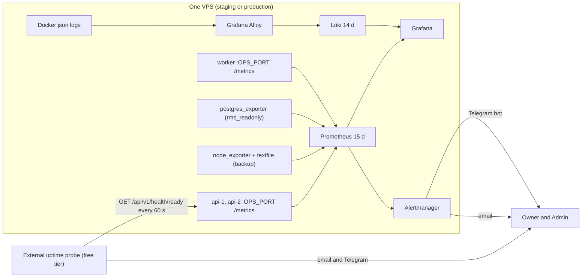

# Observability

> Status: **Approved** (Owner, 2026-10-21, as the skeleton (gate P1); alerts final in P3 and P6) · Updated: 2026-10-28 (P1-26: §4.8 notification and PDF metrics, DR-291, DR-301; two SSE counters and the phase of `sse_streams_open`, DR-287…289; the `push` reasons of `delivery_failed_total`) · 2026-10-28 (DR-282: two settlement metrics in §4.5, the alert `GatewayErrors` in §5.3; DR-279: §4.7 the usage metrics, the dashboard Usage, the job `usage_rollup` in §5.4) · 2026-10-27 (P1-20 without a host, DR-271: the host and database alerts live, `BackupMetricMissing`, the jobs `postgres` and `node`, the host panels, the exporters in the local stack; earlier: P1-18 built: the baseline runs, DR-269: `MetricsPort`, `prom-client` on Bun, the metrics re-phased, `service` label, `ReadinessFailing` inhibits; earlier: 2026-10-21 DR-228: alert addresses are placeholders; DR-161, DR-168: staging without Loki, `app_version_requests_total`; skeleton, P0-30; DR-154, DR-155) · DOC-40
> Depends on: original SDD §19.2, §19.3, [DR](../00-decision-register.md) (DR-62, 63, 83, 88, 101, 103, 154, 155, DR-228, DR-269), [ADR-0021](../04-adr/0021-observability-stack-and-alert-delivery.md), [DOC-06](../02-glossary.md), [DOC-10](../03-architecture/quality-attributes.md) §6, [DOC-11](../03-architecture/tech-stack-and-versions.md) §3, §7, [DOC-38](jobs-and-outbox-runtime.md) §3.5, §4, §8, [DOC-42](error-handling.md) §8, [DOC-50](../07-api/api-guidelines.md) §16, [DOC-41](configuration-reference.md) §13
> Main readers: P1-04 (request id, pino, `/metrics`), P1-18 (the baseline), P2-11 (invariant alert), P2-28 (payment alerts), P6-06 (all alerts), DOC-70, DOC-74…87 (runbooks), DOC-88, every task that adds a metric or a log line

This document says what the system reports about itself and who is told when it goes wrong: the logs and their fields, the metric catalog, the alert rules in PromQL linked to the runbooks, the dashboards, and how an alert reaches a person. It does not hold the install of the stack (DOC-70), the pins (DOC-11 §7), the budgets (DOC-10 §6), the runbook steps (DOC-74…87) or the configuration keys (DOC-41).

**State.** P1-18 built the baseline on 2026-10-27 (DR-269): `/metrics` on the ops port, the metrics of §4 marked `P1` (the others are re-phased in the tables), the nine alerts' PromQL that can be live (§5), Alertmanager, Loki, Alloy and the dashboards under `ops/` (§7). What waits for staging is said in §10 and in the open questions. The log fields (§3), the catalog (§4) with every metric the earlier documents promised, the alert rules (§5) with their PromQL, the delivery rules (§6) and the dashboards' panel list (§7) are written. The rules of the payment alerts are final only after P3-09 and all of them after the drills of P6-06; every rule has a row in §10 saying when it is proven. The thresholds are the originals of §19.2 of the SDD unless a decision says otherwise.

## 1. Purpose and scope

| Item | Where |
| --- | --- |
| Stack on each host and what it costs | §2 |
| Log fields, labels, retention, saved queries | §3 |
| Metric catalog (name, type, labels, owner, phase) | §4 |
| Alert rules in PromQL, linked to RB-01…13 | §5 |
| Delivery channels, repeat, acknowledgement | §6 |
| Dashboards and their panels | §7 |
| Metrics and logs that must not exist | §8 |
| Tests (`OB-`) and drills | §10 |

## 2. The stack



| Component | Version (DOC-11 §7) | Job | Budget |
| --- | --- | --- | --- |
| Prometheus | 3.15.1 | Scrape every 15 s, evaluate rules every 15 s, keep 15 days (about 2 GB reserved, DOC-10 §6.4) | inside the 1 GB monitoring ceiling of DR-06 with the others |
| Alertmanager | 0.34.1 | Group, route, repeat, silence | |
| Grafana | 13.3.0 | Dashboards from files in the repository (provisioned, not clicked together) | |
| Loki | 3.7.9 | Logs, 14 days (up to 3 GB reserved in production) | |
| Grafana Alloy | 1.21.2 (verified on 2026-10-27, P1-18) | Reads Docker container logs, ships to Loki | |
| `postgres_exporter` | 0.20.1 | PostgreSQL basics; connects as `rms_readonly` (DR-113) | |
| `node_exporter` | 1.12.1 | CPU, memory, disk of the host; the textfile collector carries the backup timestamp | |
| App metrics library | `prom-client` 15.1.3 (npm, Apache-2.0; in DOC-11 §3) | Counters, gauges, histograms on the ops port; `collectDefaultMetrics` is **not** called (below) | |

**Two things P1-18 verified** (2026-10-27). (1) `prom-client` 15.1.3 on Bun 1.4.3: counters, gauges and histograms work and the text format is right; `collectDefaultMetrics` does not throw but prints `Nan` and a minimum of 9.2e9 for the event-loop figures, and Prometheus rejects `Nan`, so it is not called. `Metrics.registerProcessMetrics` registers `process_cpu_seconds_total` and `process_resident_memory_bytes` from `process.cpuUsage()` and `process.memoryUsage.rss()`, the only two the catalog needs (`packages/core-telemetry/src/metrics.ts`; test in `metrics.test.ts`). (2) The keys of Alertmanager 0.34.1 `telegram_configs`: `bot_token_file` and `chat_id` (an integer) are accepted by `amtool check-config`, with `send_resolved`; the SMTP secret is `smtp_auth_password_file`.

**No traces and no third-party error tracker in phase 1** (DR-63, DR-103). The request id is the whole of request tracing (§3.4).

**Scrape jobs** (Prometheus `job` label): `rms-api` (targets `api-1`, `api-2` at `OPS_PORT`), `rms-worker`, and, since P1-20, `postgres` (`postgres-exporter:9187`) and `node` (`node-exporter:9100`); the local monitoring stack runs both exporters too, so the shared file has targets there. `api-2` is listed on staging too and shows `down` there: `ApiDown` takes `max(up)`, so a target that never existed raises nothing (P1-18 chose this over a template per environment). The label `job` belongs to Prometheus, which is why the application's per-job metrics use `job_name` (DR-154).

## 3. Logs

### 3.1 Fields

pino writes one JSON object per line to stdout; Docker keeps them with rotation (10 MB × 5, DOC-10 §6.4) and Alloy ships them. The request line and its rules are DOC-42 §8.1; this table is the common core every line has:

| Field | Type | Rule |
| --- | --- | --- |
| `level` | string | `fatal`, `error`, `warn`, `info`, `debug` (DOC-42 §8.2 says which case is which) |
| `time` | ISO 8601 UTC | |
| `msg` | string | A fixed snake_case event name (`request`, `auth.staff_login`, `outbox.dead_letter`). Never a sentence with values |
| `requestId` | uuid | **On every line.** In `api` the id of the request (`X-Request-Id`, generated when absent). In `worker` a handler line carries the `correlationId` of the message it handles, so a line of the worker joins the request that began the chain (DOC-09 §3.1); a job run line carries the run's own fresh id |
| `service` | string | `api` or `worker` (the `APP_ROLES` of the process) |
| `buildingId`, `accountKind`, `accountId`, `role`, `unitId` | uuid, enum | When known; ids only (DOC-42 §8.1) |

Other fields (`route`, `status`, `code`, `durationMs`, `err`, `sql`) follow DOC-42 §8. Never logged: DOC-42 §8.4 (the list is not repeated here).

### 3.2 Collection and retention

Alloy reads the Docker log files of the containers `api-1`, `api-2` and `worker` (and `caddy`), parses the JSON, and sends to Loki with **four labels only**: `env` (`staging`, `production`, `local`), `service`, `container`, `level`. `service` is the Compose service (`api-1`, `api-2`, `worker`, `caddy`), so the field `service` of the JSON line (`api`, `worker` or `api,worker`) is read as `service_extracted`. Everything else stays in the JSON and is read with `| json` at query time; a field is never promoted to a label (cardinality). The request lines of `/health/*` are dropped in Alloy. Loki keeps 14 days (DR-63). **Staging runs without Loki and Alloy** (the compose profile `logs`, DOC-70 §6.1, DR-161): there, logs are read with `docker logs`; production runs both. Alloy's `config.alloy` is a file of DOC-70; the file is `ops/alloy/config.alloy` and its stages are: docker source → relabel to `env`, `service`, `container` → `stage.json` (`level`, `msg`, `route`, `time`) → `stage.drop` on `msg="request"` with a route containing `/health/` → `stage.timestamp` from `time` → `stage.labels` for `level` → Loki write. Checked with Loki and Alloy running: a test container labelled as `api-1` shipped JSON lines with the four labels, `| json | requestId="…"` found the line, and the `/health/` request lines did not arrive (P1-18).

### 3.3 Levels and volume

At 50 requests per second one request line of about 400 bytes is 1.7 GB a day; the sample building is about 100 times smaller (DOC-10 §5.4, 1.1 GB for 14 days at ten times the design load). If the volume is too high the lever is `LOG_LEVEL`, never dropping the request line.

### 3.4 Following one request

There are no traces, so a request is followed by its id. These LogQL queries are the saved queries of the Grafana "Logs" dashboard and are quoted by the runbooks:

| Purpose | Query |
| --- | --- |
| Everything one request did, in `api` and in the worker | `{env="production"} \| json \| requestId="0192f3c4-9d02-7000-8000-00000000f001"` |
| Every 5xx in the last hour | `{service=~"api-.*", level="error"} \| json \| msg="request" \| status >= 500` |
| Sign-in failures from one address | `{service=~"api-.*"} \| json \| msg="auth.staff_login" \| outcome="invalid" \| ip="203.0.113.7"` |
| Why an outbox message died | `{service="worker", level=~"warn\|error"} \| json \| msg=~"outbox\\..*" \| requestId="<correlationId of the row>"` |
| A job that failed | `{service="worker"} \| json \| msg="job.failed" \| job_name="invariant_check"` |
| Unknown gateway callers | `{service=~"api-.*"} \| json \| msg="webhook.unknown_ip"` |

## 4. The metric catalog

Rules for every metric (DR-154):

1. **Names** are `snake_case`, base units in the name (`_seconds`, `_bytes`), `_total` for a counter, `_timestamp` for a Unix time in seconds. A gauge that is a time of last success is a **timestamp**, never an age (an age is stale the moment it is written; the alert computes `time() - …`).
2. **Labels** are a closed set of values listed here. `route` is always the route template. A label never holds an id of a person, an email, a phone, a name or a free text (OB-02). `job_name` is the name of the job (DOC-38 §4.1); the label `job` is not used, because Prometheus overwrites it.
3. **Where it is exported.** The ops port of every process serves `/metrics` (never routed, DR-07). HTTP and process metrics come from the process that did the work. **Database-derived gauges are exported by every process** (`api-1`, `api-2` and `worker`), so that they exist when the worker is down; the alerts take `max(...)`, so two copies are one value. A gauge reads the database at most once per `METRICS_CACHE_SECONDS` and gives up after `METRICS_QUERY_TIMEOUT_MS` (keeps the last value, raises `metrics_collection_errors_total{gauge}`; DOC-41 §13). A gauge that was never read has **no series**, not `0`; the readiness, pool and process gauges are read at every scrape. A module defines the gauges that read its own tables (`AppModule.gauges`: `otp_challenges_24h`, `sms_provider_down`, `units_without_owner`); the host registers them (P1-18, DR-269).
4. **Demo buildings are excluded** from the system-wide business gauges (`money_log_open`, `payment_intents_pending_overdue`, `payment_intents_creating_stale`, `ledger_invariant_violations`, `storage_usage_ratio`): every query has `WHERE NOT b.is_demo` (DOC-36 §11, BD-36). The operational gauges (outbox, jobs, backup) are system-wide.
5. **A metric is added here** in the same change as its code (DOC-12 §14 rule 13); OB-01 fails when the registry and this table differ: the registry holds exactly the rows whose phase is `P1`, so a row whose code does not exist yet carries the task that builds it.
6. **Modules report through `MetricsPort`** (`@rms/shared-types`): the names and the label values of the counters they increment are types, so a value this document does not list does not compile. The registry behind it is `apps/api/src/bootstrap/metrics.ts` (DR-269).

### 4.1 Platform and HTTP

| Metric | Type | Labels | Exported by | Defined in | Phase |
| --- | --- | --- | --- | --- | --- |
| `http_request_duration_seconds` | histogram, buckets 0.01, 0.025, 0.05, 0.1, 0.2, 0.3, 0.5, 0.8, 1.5, 3, 6, 12 (NFR-03: p95 ≤ 0.3, p99 ≤ 0.8) | `method`, `route`, `status` | `api` | DOC-50 §16 | P1 |
| `api_errors_total` | counter | `code`, `status` | `api` | DOC-42 §8.5 | P1 |
| `idempotency_total` | counter | `outcome` (`first`, `replay`, `reuse`, `in_progress`) | `api` | DOC-50 §16 | P1 |
| `upgrade_required_total` | counter | `app` (`resident`, `staff`) | `api` | DOC-50 §16 | the version gate (DOC-50 §7 gate 5), not built yet |
| `app_version_requests_total` | counter | `app` (`resident`, `staff`), `version` (the semantic version of `X-App-Version`, or `invalid`) | `api` | DOC-73 §9 (DR-168) | P1 |
| `rate_limited_total` | counter | `scope`: the `details.scope` of the 429 answer, so the label and the body agree (today `staff-login`, `otp`, `otp:resend`, `reset`, `stepup`, `client_errors`, `upload`; written with `_` for any non-alphanumeric; later `webhook`, `qr`, `intent`, `reminder`) | `api` | DOC-50 §16, DOC-39 §6 | P1 |
| `client_errors_total` | counter | `app` (`resident`, `staff`, `web`), `kind` (`crash`, `unhandled_rejection`, `render`, `network`) | `api` | DOC-42 §8.5 | P1 |
| `readiness_ok` | gauge (1 or 0) | none | `api`, `worker` | DOC-51 §3 | P1 |
| `db_pool_waiting` | gauge | none (top-level transactions in flight beyond `DB_POOL_MAX`: each holds a connection from `begin`, so the excess waits for one; a single statement outside a transaction is not counted, so it is a lower bound) | `api`, `worker` | DOC-10 §6.3 | P1 |
| `sse_streams_open` | gauge | none | `api` | DOC-52 §15 (DR-75) | P2-12 (the server side of the stream; P4 if the Owner rejects the proposed DR-287) |
| `sse_stream_opens_total` | counter | `outcome` (`resumed`, `fresh`, `limited`) | `api` | DOC-52 §15 (DR-289) | P2-12 (as above) |
| `sse_events_published_total` | counter | `type` (`inbox.created`, `ticket.created`, `ticket.changed`, `money_log.opened`, `export.ready`, `session.revoked`) | `worker` | DOC-52 §15 (DR-289) | P2-12 (as above) |
| `metrics_collection_errors_total` | counter | `gauge` (the metric that timed out or failed) | all | §4 rule 3 | P1 |
| `provider_auth_failed_total` | counter | `provider` (`sms`, `mail`, `push`, `stripe`, `storage`; a later payment driver adds its word) | `worker`, `api` | DOC-42 §7.1 | P1-22 (the provider adapters) |
| `handler_outcomes_total` | counter | `handler`, `outcome` (`ok`, `deferred`, `failed`; `skipped`, an inbox hit, is not seen by the bus) | `worker` | DOC-42 §8.5 | P1 |
| `delivery_failed_total` | counter | `channel` (`sms`, `mail`, `push`), `reason` (for `push`: `device_not_registered`, `message_too_big`, `message_rate_exceeded`, `mismatch_sender_id`, `invalid_credentials`, `other`, DOC-31 §10) | `worker` | DOC-42 §8.5 | P1-22 (the provider adapters) |
| `process_cpu_seconds_total`, `process_resident_memory_bytes` | counter, gauge | none | all | the library's default process metrics (§2, verified in P1-18) | P1 |

### 4.2 Outbox and jobs

| Metric | Type | Labels | Exported by | Defined in | Phase |
| --- | --- | --- | --- | --- | --- |
| `outbox_oldest_unpublished_age_seconds` | gauge | `schema` (the module schema) | `api`, `worker` | DOC-38 §8; the query is `SELECT extract(epoch FROM now() - min(occurred_at)) … WHERE published_at IS NULL AND dead_at IS NULL`, 0 when empty | P1 |
| `outbox_dead_letters` | gauge | `schema` | `api`, `worker` | DOC-38 §8 | P1 |
| `worker_relay_last_pass_timestamp` | gauge | none | `worker` | DOC-38 §5.2 | P1 |
| `job_last_success_timestamp` | gauge | `job_name` | `worker` | DOC-38 §3.5; restored at boot from `job_run` | P1 |
| `job_runs_total` | counter | `job_name`, `status` (`succeeded`, `failed`) | `worker` | DOC-38 §8 | P1 |
| `job_duration_seconds` | histogram, buckets 0.1, 0.5, 1, 5, 30, 120, 600 | `job_name` | `worker` | DOC-38 §8 | P1 |
| `integrity_findings` | gauge | `job_name` (`integrity_weekly`, `integrity_notices`) | `worker` | the job sets it to `details.findings` at the end of each run (DR-154) | P2-11 for `integrity_weekly` (DOC-38 §4.2); `integrity_notices` joins with P4-05 |

### 4.3 Identity and residency

| Metric | Type | Labels | Defined in | Phase |
| --- | --- | --- | --- | --- |
| `auth_staff_login_total` | counter | `outcome` (`ok`, `invalid`, `locked`, `rate_limited`) | DOC-26 §10 | P1 |
| `auth_lockouts_total` | counter | none | DOC-26 §10 | P1 |
| `auth_otp_requested_total` | counter | `outcome` (`issued`, `not_registered`, `resend_wait`, `phone_limited`, `ip_limited`, `daily_cap`, `sms_down`) | DOC-26 §10 | P1 |
| `auth_otp_verify_total` | counter | `outcome` (`ok`, `invalid`, `expired`, `exhausted`) | DOC-26 §10 | P1 |
| `otp_challenges_24h` | gauge | none | DOC-26 §5.1 step 6 | P1 |
| `otp_daily_cap_reached_total` | counter | none | DOC-26 §10 | P1 |
| `auth_refresh_total` | counter | `outcome` (`ok`, `grace`, `reuse`, `expired`, `account_inactive`) | DOC-26 §10 | P1 |
| `auth_sessions_revoked_total` | counter | `reason` (the ten of DOC-26 §3.8) | DOC-26 §10 | P1 |
| `auth_step_up_total` | counter | `action` (`gateway_config`, `admin_change`, `staff_email`), `outcome` (`requested`, `ok`, `failed`, `rate_limited`) | DOC-26 §10 | P1 |
| `sms_provider_down` | gauge | none | DOC-26 §5.4 | P1 |
| `sms_sent_total` | counter | `outcome` (`sent`, `expired`, `skipped_demo`, `skipped_unknown`, `not_allowlisted`, `failed`) | DOC-26 §10 | P1 |
| `mail_sent_total` | counter | `outcome` (`sent`, `expired`, `skipped_demo`, `skipped_unknown`, `failed`) | DOC-26 §10 | P1 |
| `membership_changes_total` | counter | `change`, `actor` | DOC-27 §15 | P1 |
| `membership_guard_refusals_total` | counter | `reason` (`missing`, `locked`) | DOC-27 §15 | P1 |
| `member_invitations_total` | counter | `outcome` (`queued`, `owner_cap`, `phone_bucket`) | DOC-27 §15 | P1 |
| `owner_transfers_total` | counter | `keep_members` (`true`, `false`) | DOC-27 §15 | P1 |
| `import_commits_total` | counter | `outcome` (`committed`, `expired`, `stale`, `not_ready`) | DOC-27 §15 | P1 |
| `import_validate_duration_seconds` | histogram, buckets 0.5, 1, 2, 5, 10, 20 (NFR-12: 2,000 rows ≤ 10 s); the whole call, the file read included | none | DOC-27 §15 | P1 |
| `units_without_owner` | gauge | none | DOC-27 §15 | P1 |

### 4.4 Building, audit, files

| Metric | Type | Labels | Defined in | Phase |
| --- | --- | --- | --- | --- |
| `gateway_check_ok` | gauge (1, 0) | `building` | DOC-36 §11; from `last_check_ok`, demo excluded | P3-01 (the gateway check) |
| `demo_reset_duration_seconds` | histogram, buckets 1, 2, 5, 10, 20, 60 (budget 10 s on the staging host, BD-40) | none | DOC-36 §11 | P1 |
| `boot_guard_failures_total` | counter, **not scrapeable** (the process exits); the log line `boot_guard_failed` is the signal | none | DOC-36 §11 | P1 |
| `audit_write_failures_total` | counter | none | DOC-35 §11 | P1 |
| `audit_purge_rows_total` | counter | `class` (`finance`, `standard`) | DOC-35 §11 | P1 |
| `account_deletion_blocked` | gauge | none | DOC-35 §11 | P6-04 (the deletion job) |
| `account_deletions_executed_total` | counter | none | DOC-35 §11 | P6-04 (the deletion job) |
| `storage_usage_ratio` | gauge | `building` (the building's id: one per deployment, a building is not a person) | DOC-37 §11; set by `storage_quota`, demo excluded | P1 |

### 4.5 Money (specified here, built in P2 and P3)

The names come from DR-63; the owning document confirms the labels.

| Metric | Type | Labels | Defined in | Phase |
| --- | --- | --- | --- | --- |
| `ledger_invariant_violations` | gauge | none (the count of violating rows over the 19 queries of DOC-22 §12, DR-266; demo excluded) | DOC-22 | P2-11 |
| `payment_intents_pending_overdue` | gauge | none (`pending` more than 2 minutes past its `expires_at`, the 60-minute hold of DR-28, without moving to `expired`; demo excluded; DOC-23 §14) | DOC-23 | P2 (*DR-325*) |
| `payment_intents_creating_stale` | gauge | none (`creating` older than 2 minutes; demo excluded) | DOC-23 | P2 (*DR-325*) |
| `money_log_open` | gauge | none (log rows without a review; demo excluded) | DOC-25 | P2 (*DR-325*) |
| `webhook_rejections_total` | counter | `reason` (the five of DR-32) | DOC-24 | P2 (*DR-325*) |
| `webhook_unknown_ip_total` | counter | none | DOC-39 §5.4 | P3 |
| `payment_gateway_requests_total` | counter | `provider` (`stripe`, `fake`, later `payos`), `op` (`create`, `status`, `cancel`, `list_methods`, `remove_method`), `outcome` (`ok`, `timeout`, `http_error`, `rejected`) | DOC-24 §8 | P2 (*DR-325; replaces `payment_gateway_requests_total`*) |
| `payment_webhook_received_total` | counter | `provider`, `outcome` (`verified`, `rejected`, `ignored`, `duplicate`) | DOC-24 §8 | P2 |
| `payment_amount_mismatch_total` | counter | `provider` | DOC-24 §4.8 | P2 |
| `payment_saved_methods_total` | counter | `op` (`list`, `remove`, `error`) | DOC-24 §4.7 | P2 |
| `payment_settlements_total` | counter | `source` (`webhook`, `requery`, `statement`), `outcome` (the nine of `SettleOutcome`: the seven `gateway_event` outcomes, `already_processed`, `foreign_building`) | DOC-23 §14 (DR-282) | P2 (`settle()`), P3 |
| `payment_settle_duration_seconds` | histogram | `source`; buckets 0.05, 0.1, 0.25, 0.5, 1, 2.5 (the server part of NFR-02, DR-80: p95 ≤ 1 s) | DOC-23 §14 (DR-282) | P2, P3 |

`push_failures_total` and `sms_failures_ratio` of DR-63 are not built: `delivery_failed_total{channel}` and `sms_sent_total{outcome}` carry the same information (DR-154).

### 4.6 Database, host, backup

| Metric | Source | Used for |
| --- | --- | --- |
| `pg_up`, `pg_stat_activity_count`, `pg_stat_database_*`, `pg_stat_archiver_failed_count`, `pg_stat_archiver_last_archive_age` | `postgres_exporter` | Database down, connection headroom (DOC-10 §6.3), WAL archive failing (DOC-10 §7) |
| `node_filesystem_avail_bytes`, `node_filesystem_size_bytes`, `node_memory_*`, `node_cpu_seconds_total` | `node_exporter` | Disk at 80% (DOC-10 §6.4), memory and CPU for EXP-07 |
| `backup_last_success_timestamp` | A file `backup.prom` in the textfile directory, written by the backup script **after** a successful `pgbackrest backup` (DR-154): `backup_last_success_timestamp 1.7917e+09` | The backup alert; `backup_last_success_age_seconds` of DR-63 is not used |

### 4.7 Usage

Added by DR-279 (DOC-104 §11). The labels hold no person: `name` is a screen id or a control id from the closed lists of DOC-104 §4, which are types in `@rms/shared-types`, so the set of values is closed (about 100 at the end of phase 6, plus `Launch`, `Resume` and `Background`).

| Metric | Type | Labels | Defined in | Phase |
| --- | --- | --- | --- | --- |
| `usage_events_total` | counter | `app` (`resident`, `staff`, `web`), `audience` (`resident`, `staff`), `event` (`screen_view`, `tap`, `app_open`, `app_close`), `name` | DOC-104 §11 | P1 |
| `usage_foreground_seconds` | histogram, buckets 10, 30, 60, 180, 600, 1800, 3600 | `app` (`resident`, `staff`, `web`), `audience` (`resident`, `staff`) | DOC-104 §11 | P1 |
| `usage_events_dropped_total` | counter | `reason` (`unknown_name`, `disabled`, `demo`) | DOC-104 §11 | P1 |

### 4.8 Notification and PDF (specified here, built in P2)

Added by P1-26 (DR-291, DR-301). No label holds a person or a token; `template_key` is the closed catalog of DOC-31 §3.2. No new alert: a credential failure raises the provider alert, a stopped job its staleness alert, a dead-lettered push or receipt render `OutboxDeadLetters` (RB-05).

| Metric | Type | Labels | Defined in | Phase |
| --- | --- | --- | --- | --- |
| `inbox_entries_created_total` | counter | `template_key` (the 21 keys of DOC-31 §3.2) | DOC-31 §10 | P2-12 |
| `push_sent_total` | counter | `outcome` (`accepted`, `ticket_error`, `skipped_off`, `skipped_no_device`, `skipped_session_dead`, `skipped_expired`) | DOC-31 §10 (DR-301) | P2-12 |
| `push_receipts_total` | counter | `outcome` (`ok`, `failed`, `unknown`) | DOC-31 §10 (DR-301) | P2-12 |
| `pdf_renders_total` | counter | `document` (`fee_notice`, `receipt`, `report`, `wiki_page`), `outcome` (`rendered`, `cached`, `failed`) | DOC-34 §14 (DR-291) | P2-13 |
| `pdf_render_duration_seconds` | histogram, buckets 0.1, 0.25, 0.5, 1, 2.5, 5, 10, 30 | `document` | DOC-34 §14 (DR-291) | P2-13 |
| `pdf_renderer_restarts_total` | counter | `reason` (`documents`, `rss`, `timeout`, `crash`) | DOC-34 §14 (DR-291) | P2-13 |

## 5. Alert rules

### 5.1 Rules for the rules

- Every rule has `severity` (`critical` or `warning`), `summary`, and `runbook` (a path in `09-operations/runbooks/`). A rule without a runbook points to the table "Alerts without a runbook" of DOC-74, which has one first step per alert (DR-155).
- Prometheus evaluates every 15 s (`evaluation_interval: 15s`, equal to the scrape interval). External label `env`.
- A `for` is the smallest that avoids a flap. The P1-18 acceptance (database stopped → alert on email and Telegram within 2 minutes) is the sum: scrape 15 s + evaluation 15 s + `for` 30 s + group wait 10 s + delivery ≈ 90 s at worst.
- Business gauges are demo-free (§4 rule 3); the expressions take `max(...)` over the copies of a database gauge.
- A rule is written against a metric of §4 and nothing else. Adding an alert adds a row to §10 (its `promtool` test).
- **As built (P1-18).** The files are `ops/prometheus/rules/rms-alerts.yml` and `rms-jobs.yml`, the tests `ops/prometheus/tests/rms-alerts.test.yml`, run by `bun run check:ops` (in `verify`) with `promtool` from the image that Compose pins. Live: `OutboxLag`, `DeadLetters`, `SmsFailures`, `StorageQuota`, `ApiErrors`, `ApiDown`, `ReadinessFailing`, `WorkerDown`, `JobStale`, `DbPoolWaiting`, `MetricsCollectionFailing`, `OtpDailyCapReached`, `SmsProviderDown`, `RefreshTokenReuse`, `LockoutSpike`; each has a positive and a negative case. The YAML below remains the specification of the rest; a rule joins the files with the metric it reads. `OtpDailyCapReached` sums the processes (`sum(increase(...))`), so two copies are one alert. **P1-20 added** `ops/prometheus/rules/rms-host.yml` and `tests/rms-host.test.yml` (also run by `check:ops`): `PostgresDown`, `PostgresArchiveFailing`, `BackupMissing`, `DiskUsage` (warning above 80%, critical above 90%, for `/` and `/srv/rms-data`) and **`BackupMetricMissing`**, each with a positive and a negative case; the scrape jobs `postgres` and `node` are in `prometheus.yml` (DR-271).

### 5.2 The nine alerts of the original SDD

Linked to the runbooks RB-01…09 (master plan §3.2). `Ready` is the task after which the rule is live.

| Alert | Level | Condition (original SDD §19.2) | Runbook | Ready |
| --- | --- | --- | --- | --- |
| `LedgerInvariantViolation` | Critical | The nightly check returns any row | RB-01 | live (P2-11) |
| `PaymentsStuck` | Critical | `pending` older than 60 min not moving to `expired`, or more than 5 `creating` older than 2 min | RB-02 | P2-28 (was P3-09) |
| `WebhookSignatures` | Warning | More than 3 rows in `webhook_rejection` in 10 min | RB-03 | P2-28 (was P3-09) |
| `OutboxLag` | Warning | The oldest unpublished message is older than 2 min | RB-04 | live (P1-18) |
| `DeadLetters` | Warning | Any message in the dead-letter state | RB-05 | live (P1-18) |
| `SmsFailures` | Warning | More than 10% failures over 15 min | RB-06 | live (P1-18); the provider adapter is P1-22 |
| `BackupMissing` | Critical | No successful backup in 26 h | RB-07 | live (P1-20) |
| `StorageQuota` | Warning | Bucket use above 80% of the quota | RB-08 | live (P1-18) |
| `ApiErrors` | Critical | 5xx above 2% over 5 min | RB-09 | live (P1-18) |

```yaml
# rules/rms-alerts.yml  (promtool check rules; one test per rule in rules/rms-alerts.test.yml)
groups:
  - name: rms-original-nine
    interval: 15s
    rules:
      - alert: LedgerInvariantViolation
        expr: max(ledger_invariant_violations) > 0
        labels: { severity: critical }
        annotations:
          summary: "The nightly ledger check found {{ $value }} violating rows"
          runbook: docs/09-operations/runbooks/RB-01-ledger-invariant.md

      - alert: PaymentsStuck
        expr: max(payment_intents_pending_overdue) > 0 or max(payment_intents_creating_stale) > 5
        for: 2m
        labels: { severity: critical }
        annotations:
          summary: "Payment intents are not moving (pending overdue or creating stale)"
          runbook: docs/09-operations/runbooks/RB-02-payments-stuck.md

      - alert: WebhookSignatures
        expr: sum(increase(webhook_rejections_total[10m])) > 3
        labels: { severity: warning }
        annotations:
          summary: "{{ $value }} rejected gateway calls in 10 minutes: misconfiguration or an attack"
          runbook: docs/09-operations/runbooks/RB-03-webhook-signatures.md

      - alert: OutboxLag
        expr: max by (schema) (outbox_oldest_unpublished_age_seconds) > 120
        for: 1m
        labels: { severity: warning }
        annotations:
          summary: "The oldest unpublished message of {{ $labels.schema }} is {{ $value }} s old"
          runbook: docs/09-operations/runbooks/RB-04-outbox-lag.md

      - alert: DeadLetters
        expr: max by (schema) (outbox_dead_letters) > 0
        labels: { severity: warning }
        annotations:
          summary: "{{ $value }} dead-letter messages in {{ $labels.schema }}"
          runbook: docs/09-operations/runbooks/RB-05-dead-letters.md

      - alert: SmsFailures
        expr: |
          sum(increase(sms_sent_total{outcome="failed"}[15m]))
            / sum(increase(sms_sent_total{outcome=~"sent|failed"}[15m])) > 0.10
          and sum(increase(sms_sent_total{outcome=~"sent|failed"}[15m])) >= 5
        labels: { severity: warning }
        annotations:
          summary: "More than 10% of SMS failed in 15 minutes"
          runbook: docs/09-operations/runbooks/RB-06-sms-failures.md

      - alert: BackupMissing
        expr: time() - max(backup_last_success_timestamp) > 26 * 3600
        labels: { severity: critical }
        annotations:
          summary: "No successful backup for {{ $value | humanizeDuration }}"
          runbook: docs/09-operations/runbooks/RB-07-backup-missing.md

      - alert: StorageQuota
        expr: max by (building) (storage_usage_ratio) > 0.8
        labels: { severity: warning }
        annotations:
          summary: "File storage is at {{ $value | humanizePercentage }} of the quota"
          runbook: docs/09-operations/runbooks/RB-08-storage-quota.md

      - alert: ApiErrors
        expr: |
          sum(rate(http_request_duration_seconds_count{job="rms-api", status=~"5.."}[5m]))
            / sum(rate(http_request_duration_seconds_count{job="rms-api"}[5m])) > 0.02
          and sum(increase(http_request_duration_seconds_count{job="rms-api"}[5m])) >= 20
        for: 5m
        labels: { severity: critical }
        annotations:
          summary: "{{ $value | humanizePercentage }} of API requests fail with 5xx"
          runbook: docs/09-operations/runbooks/RB-09-api-errors.md
```

`ApiErrors` and `SmsFailures` have a traffic floor (20 requests, 5 messages): one failure out of three requests at 03:00 must not page anyone (DR-155).

### 5.3 Alerts added by the design documents

| Alert | Level | Expression (shape) | `for` | Runbook | Source · ready |
| --- | --- | --- | --- | --- | --- |
| `ApiDown` | Critical | `up{job="rms-api"} == 0` for every target (`max(up{job="rms-api"}) == 0`) | 1m | RB-09 | DR-63 · live (P1-18) |
| `ReadinessFailing` | Critical | `max(readiness_ok{job="rms-api"}) == 0` | 30s | RB-09 | P1-18 acceptance · live |
| `PostgresDown` | Critical | `max(pg_up{job="postgres"}) == 0 or max(up{job="postgres"}) == 0` (the second term is the exporter being down: its series is gone) | 1m | RB-09 | DOC-10 §7 · live (P1-20) |
| `PostgresArchiveFailing` | Critical | `increase(pg_stat_archiver_failed_count{job="postgres"}[15m]) > 0` | none | RB-07 | DOC-10 §7 · live (P1-20) |
| `BackupMetricMissing` | Warning | `absent(backup_last_success_timestamp)`: `BackupMissing` is silent when its series does not exist (an unreadable textfile, a first backup that never ran) | 26h | RB-07 | DR-271 · live (P1-20) |
| `WorkerDown` | Warning | `up{job="rms-worker"} == 0` | 2m | RB-04 | SDD §19.3 · live (P1-18) |
| `JobStale` | Warning | §5.4 | none | RB-04 | DOC-38 §8 · live (P1-18) |
| `InvariantCheckStale` | Critical | `time() - max(job_last_success_timestamp{job_name="invariant_check"}) > 36 * 3600` | none | RB-01 | NFR-09 · live (P2-11) |
| `IntegrityFindings` | Warning | `max by (job_name) (integrity_findings) > 0` | none | RB-01 §3 | DOC-38 §4.2 · live for `integrity_weekly` (P2-11) |
| `MoneyLogOpen` | Warning | `max(money_log_open) > 0` | 24h | RB-11 | DR-84 · P2-28 (was P3-09) |
| `GatewayCheckFailing` | Warning | `min by (building) (gateway_check_ok) == 0` | 1h | RB-13 | DOC-36 §11 · P3-01 |
| `GatewayErrors` | Warning | `sum(increase(payment_gateway_requests_total{outcome=~"timeout\|http_error"}[10m])) > 0.5 * sum(increase(payment_gateway_requests_total[10m])) and sum(increase(payment_gateway_requests_total[10m])) >= 10` (DR-30's "more than half of the calls in 10 minutes failed") | 5m | RB-02 | DOC-23 §14, DR-282 · P2-28 (was P3-09) |
| `ProviderAuthFailed` | Warning | `sum by (provider) (increase(provider_auth_failed_total[10m])) > 0` | none | RB-12 | DOC-42 §8.5 · P1-22 |
| `OtpDailyCapReached` | Warning | `sum(increase(otp_daily_cap_reached_total[5m])) > 0` | none | RB-06 | DOC-26 §10 · live (P1-18) |
| `SmsProviderDown` | Warning | `max(sms_provider_down) == 1` | 5m | RB-06 | DOC-26 §10 · live (P1-18) |
| `RefreshTokenReuse` | Warning | `sum(increase(auth_refresh_total{outcome="reuse"}[10m])) > 5` | none | table of DOC-74 | DOC-26 §10 · live (P1-18) |
| `LockoutSpike` | Warning | `sum(increase(auth_lockouts_total[15m])) > 10` | none | table of DOC-74 | DOC-26 §10 · live (P1-18) |
| `AccountDeletionBlocked` | Warning | `max(account_deletion_blocked) > 0` | 7d | table of DOC-74 | DOC-35 §11 · P6-04 |
| `DbPoolWaiting` | Warning | `max by (instance) (db_pool_waiting) > 0` | 1m | RB-09 | DOC-10 §6.3 · live (P1-18) |
| `DiskUsage` | Warning from 80%, Critical above 90% (two rules, so a disk above 90% raises one alert) | `1 - node_filesystem_avail_bytes{mountpoint=~"/|/srv/rms-data", fstype!~"tmpfs|overlay|squashfs"} / node_filesystem_size_bytes{…} > 0.8` (the data volume of DOC-70 §5.5 holds the files **and** the backups) | 10m | RB-08 | DOC-10 §6.4 · live (P1-20) |
| `WorkerMemoryHigh` | Warning | `process_resident_memory_bytes{job="rms-worker"} > 1.2e9` | 10m | RB-09 | NFR-05 (≤ 1 GB), DR-06 (kill at 1.5 GB) · P2-13 |
| `MetricsCollectionFailing` | Warning | `sum(increase(metrics_collection_errors_total[15m])) > 5` | none | table of DOC-74 | §4 rule 3 · live (P1-18) |

### 5.4 A job that stopped

A job's gauge is a timestamp. The expected silence of each job is a recorded constant, one rule per job generated from the table below (a rule file with 23 `record` lines):

```yaml
  - name: rms-job-thresholds
    rules:
      - record: job_stale_after_seconds
        expr: vector(120)
        labels: { job_name: notice_scheduler }
      # … one per row of the table …
  - name: rms-jobs
    interval: 15s
    rules:
      - alert: JobStale
        expr: |
          (time() - max by (job_name) (job_last_success_timestamp{job_name!="invariant_check"}))
            > on (job_name) max by (job_name) (job_stale_after_seconds)
        labels: { severity: warning }
        annotations:
          summary: "Job {{ $labels.job_name }} has not succeeded for {{ $value | humanizeDuration }}"
          runbook: docs/09-operations/runbooks/RB-04-outbox-lag.md
```

"Twice the interval" (DOC-38 §8) with a floor of 120 s for jobs that tick faster than a minute, and 36 hours for the invariant check (24 h + the 12 h grace window of DOC-38 §4.1):

| `job_name` | Interval | Stale after (s) |
| --- | --- | --- |
| `notice_scheduler`, `intent_requery`, `export_run`, `fee_notice_run` | 30 s, 30 s, 5 s, 5 s | 120 |
| `notice_reclaim` | 60 s | 120 |
| `push_receipts` | 5 min | 600 |
| `storage_quota`, `orphan_uploads`, `import_expire`, `export_purge`, `realtime_purge` | 1 h | 7200 |
| `invariant_check` | daily 03:00 | 129600 (36 h), its own Critical rule |
| `qr_scan_purge`, `otp_purge`, `token_purge`, `account_deletion`, `demo_reset` | daily | 172800 |
| `integrity_weekly`, `integrity_notices`, `inbox_purge`, `import_purge`, `finance_purge` | weekly | 1209600 |
| `audit_purge` | monthly | 5356800 (62 d) |

`usage_rollup` (daily, 172800 s) is in the table, in the rule file (24 lines) and in `ops-rules.test.ts` since P1-29 built the job (DOC-38 §4.3).

A job that has never reported has no series, so it raises nothing; on a fresh database the first run of a weekly job is the proof (the scheduler's first tick catches a missed slot within its grace window, DOC-38 §3.3). This is a stated limit (DR-155).

## 6. Delivery

| Rule | Value |
| --- | --- |
| Channels | Email (SMTP relay, a different account than the application's) and a Telegram bot, to the Owner and the Admin (DR-63) |
| Critical | Route `severity="critical"`: both channels, `group_wait: 10s`, `repeat_interval: 30m`. It repeats until **acknowledged** |
| Warning | Route `severity="warning"`: both channels, `group_wait: 30s`, `group_interval: 5m`, `repeat_interval: 12h` |
| Acknowledge | Create a silence on the alert in Alertmanager for a stated time (`amtool silence add alertname=… --duration=4h --comment=…` or the Grafana UI). Alertmanager has no other acknowledgement (DR-155) |
| Inhibition | While `ApiDown`, `PostgresDown` or `ReadinessFailing` fires, Warning alerts of the same `env` are held (they are consequences). `ReadinessFailing` was added in P1-18: with the database down every pulled gauge fails, and `MetricsCollectionFailing` arrived before the Critical alert in the first local run |
| Resolved | `send_resolved: true` on both channels |
| The host is down | Alertmanager is down with it. The **external uptime probe** calls `GET /api/v1/health/ready` every 60 s and sends its own email and Telegram message after two failures (NFR-10 is measured from it). This is the only alert that survives the host (ADR-0021) |
| A test | On the first of each month the Owner or Admin runs `amtool alert add TestAlert severity=warning` on staging and confirms the email and the Telegram message (a manual routine, P6-06) |

```yaml
# alertmanager.yml (the keys are verified against Alertmanager 0.34.1; the files are ops/alertmanager/alertmanager.yml and alertmanager.local.yml)
route:
  receiver: owner
  group_by: [alertname, env]
  routes:
    - matchers: [severity="critical"]
      receiver: owner
      group_wait: 10s
      repeat_interval: 30m
    - matchers: [severity="warning"]
      receiver: owner
      group_wait: 30s
      group_interval: 5m
      repeat_interval: 12h
inhibit_rules:
  - source_matchers: [alertname=~"ApiDown|PostgresDown|ReadinessFailing"]
    target_matchers: [severity="warning"]
    equal: [env]
receivers:
  - name: owner
    email_configs:  [{ to: "owner@example.vn, admin@example.vn", send_resolved: true }]
    telegram_configs: [{ chat_id: -1001234567890, send_resolved: true }]   # the bot token is a secret file (DOC-70)
```

The Telegram token, the SMTP password and the Grafana admin password are infrastructure secrets listed in DOC-70 (DOC-07 §7.2).

**As built (P1-18).** `ops/alertmanager/alertmanager.yml` is the staging and production file: the secrets are read from `/run/secrets/telegram-bot-token` and `/run/secrets/alertmanager-smtp-password`, and the addresses (`owner@example.invalid`), the SMTP host and the chat id (`1`) are placeholders that deliver nothing until the Owner's input of DOC-70 §2 rows 11 and 12 replaces them (DR-228). `alertmanager.local.yml` has the same routes and inhibition and sends to Mailpit, so the routing is tried on a laptop: `bun run monitor:up`, then Mailpit at `localhost:8025`. Run on 2026-10-27 with the API on the host: the database stopped, `readiness_ok` fell to 0 at the next scrape, `ReadinessFailing` fired and its mail reached Mailpit **65 seconds** after the stop (budget 2 minutes), the warning `MetricsCollectionFailing` 55 seconds after; both `RESOLVED` messages followed once the database was back. The Telegram message and a real mailbox are proven on staging (OB-14).

## 7. Dashboards

Provisioned from JSON files in the repository (`ops/grafana/dashboards/`, path owned by DOC-70). Each panel names the alert it supports; a panel nobody reads is not added.

| Dashboard | Panels | Supports |
| --- | --- | --- |
| **Overview** | Request rate by route group; p50, p95, p99 of `http_request_duration_seconds` (lines at 0.3 and 0.8 s); 5xx ratio; `rate_limited_total` by scope; open alerts | `ApiErrors`, NFR-03 |
| **Worker and jobs** | Outbox oldest age by schema; dead letters; table of `time() - job_last_success_timestamp` per job beside `job_stale_after_seconds`; `job_runs_total{status="failed"}`; `job_duration_seconds` p95; `handler_outcomes_total` by outcome | `OutboxLag`, `DeadLetters`, `JobStale`, RB-04, RB-05 |
| **Identity** | Staff sign-in outcomes; OTP requested and verified by outcome; refresh by outcome (reuse line); lockouts; step-up outcomes; SMS and mail sent by outcome; `sms_provider_down`; `otp_challenges_24h` against 3000 | `OtpDailyCapReached`, `SmsProviderDown`, `RefreshTokenReuse`, `LockoutSpike`, EXP-09 |
| **Money** (P2, P3) | `ledger_invariant_violations`; pending overdue and creating stale; `money_log_open`; `webhook_rejections_total` by reason and `webhook_unknown_ip_total`; `payment_gateway_requests_total` by provider and outcome; `payment_settle_duration_seconds` p95 and `payment_settlements_total` by outcome (DOC-23 §14) | `LedgerInvariantViolation`, `PaymentsStuck`, `GatewayErrors`, `WebhookSignatures`, `MoneyLogOpen`, EXP-01, EXP-02 |
| **Storage and database** | `storage_usage_ratio`; disk used; `pg_stat_activity_count` against `max_connections`; `db_pool_waiting`; archive failures and age; WAL size | `StorageQuota`, `DiskUsage`, `DbPoolWaiting`, `PostgresArchiveFailing` |
| **Backup** | Time since `backup_last_success_timestamp`; last restore drill date (a Grafana annotation made by hand) | `BackupMissing`, NFR-11 |
| **Usage** (DR-279, built in P1-29: `ops/grafana/dashboards/usage.json`) | Top 10 screens and top 10 controls over 7 days; opens per day and the average and median time of a stretch; events per hour by app; residents against staff; dropped events by reason (the queries are DOC-104 §8.1). It supports no alert; Prometheus keeps 15 days, longer periods are SQL on `usage_daily` | DR-279 |
| **Logs** | The saved queries of §3.4 as panels with a `requestId` variable | RB-09 |

**As built (P1-18).** Five dashboards exist: Overview, Worker and jobs, Identity, Storage and database (with, since P1-20, PostgreSQL up, the time since the last backup, WAL archive failures, connections by state, disk used and host memory) and Logs. They are generated from `scripts/build-dashboards.ts` (`bun run ops:dashboards`; `check:ops` fails when a JSON file is stale), every panel names what it supports, and all 42 queries of the Prometheus panels and the four of Logs were run against the local stack without an error. Money (P2, P3) joins with its metrics. The new host panels were run against the local stack (both exporters up; their queries answer; the disk query is empty there because the Linux VM of Docker has no `/` file system under `--path.rootfs`, so its labels are checked on the host). Locally Grafana is at `localhost:3030` with no sign-in.

Dashboards are reached at `monitor.<domain>` (staging `monitor-staging.<domain>`), a Tunnel public hostname for the `grafana` container behind a Cloudflare Access application (DR-88). Prometheus, Loki and Alertmanager have no host; alerts are listed and silenced in Grafana through its Alertmanager data source.

## 8. What must not exist

- A metric or a log field that holds a person (§4 rule 2, DOC-42 §8.4). OB-02 and OB-10 are the checks.
- A metric labelled by `route` with a raw URL, by `accountId`, by `unitId` or by `requestId`.
- An alert on a dashboard-only metric that has no runbook and no row in DOC-74's table.
- An alert for something the Owner cannot act on.
- Traces and a hosted error tracker in phase 1 (DR-63, DR-103).
- A second place that defines a metric: the owning design document links here (DOC-12 §14 rule 13).

## 9. Metrics and logs of this document itself

| Metric | Type | Labels |
| --- | --- | --- |
| `metrics_collection_errors_total` | counter | `gauge` |

Logs: `config_invalid` (DOC-41 §17), `boot_guard_failed` (DOC-36 §10.1), `job.failed` with `job_name` and `error` (≤ 500 characters, DOC-38 §3.5), `webhook.unknown_ip` (DOC-39 §5.4).

## 10. Required tests

Prefix `OB-` (observability; unused before this document; master plan §0.2, DR-156; DOC-88 indexes it). Written in P1-18 unless the third column says another task. **Run on 2026-10-27 (P1-18):** OB-01 to OB-08, OB-12, OB-13 and the local run of OB-14, in `apps/api/src/bootstrap/metrics.test.ts`, `ops-rules.test.ts`, `packages/core-telemetry/src/metrics.test.ts`, the integration tests `apps/api/tests/integration/metrics.integration.test.ts` (the ops port after real requests, the outbox gauges with rows, a database that is gone), `modules/identity/test/metrics.integration.test.ts` and `modules/residency/test/metrics.integration.test.ts` (each counter of DOC-26 §10 and DOC-27 §15 where its use case reports it), `bun run check:ops` and the stack of `bun run monitor:up`. OB-06 checks the form of the annotation only (RB-01…13 or the table of DOC-74): the runbook files are written in P2-20 and P3-09. OB-08 was read from the local Prometheus. **Not run:** OB-09 (needs the finance gauges), OB-10 and OB-11 (a suite-wide scan of the log lines and the LogQL join need the API in a container with Alloy; the correlation id itself is tested by JB- in DOC-38), OB-14 on staging, OB-15 to OB-18 (P3-09, P1-21, P6-06).

| ID | Scenario | Expected |
| --- | --- | --- |
| OB-01 | Compare the metrics registered by `api` and `worker` with the first column of §4 | The sets are equal (except `boot_guard_failures_total`, the process metrics of the library and the `pg_*`/`node_*` families) |
| OB-02 | Scrape `/metrics` after the test suite ran | No label is named `id`, `accountId`, `unitId`, `requestId`, `email`, `phone`; every `route` value is a template listed in DOC-51 §2 (or `unmatched`); no label value looks like a phone number or an email (the `building` label holds a building's id, which is not a person) |
| OB-03 | `GET /metrics` on `PORT` and on `OPS_PORT` | 404 on `PORT`; 200 text format on `OPS_PORT` |
| OB-04 | `promtool check rules rules/*.yml` | Exit 0 |
| OB-05 | `promtool test rules` with a positive and a negative case for **each** alert of §5.2 and §5.3 (input series, `eval_time`, expected alerts) | Every case passes; example below |
| OB-06 | Every `runbook` annotation | Names an existing file under `09-operations/runbooks/`, or is `table of DOC-74` and DOC-74's table has the alert |
| OB-07 | The `job_name` values of §5.4 against DOC-38 §4.1 | The same 23 names, no extra, no missing |
| OB-08 | Scrape the worker, then a scrape of Prometheus targets | No series has `exported_job`; `job_last_success_timestamp` has `job_name` |
| OB-09 | A demo payment replayed five times (BD-36) | `money_log_open`, `payment_intents_pending_overdue`, `ledger_invariant_violations` and `storage_usage_ratio` do not move |
| OB-10 | Every log line of a suite run | Has `requestId`, `service`, `level`, `time`, `msg`; none holds a phone, an email, a token or a CCCD (AD-29, ER-30) |
| OB-11 | One request that writes an outbox row consumed by a handler | The handler's lines carry the request's `requestId`; the LogQL query of §3.4 returns lines from `api` and `worker` |
| OB-12 | A database gauge whose query is made to sleep 3 s with `METRICS_QUERY_TIMEOUT_MS` 1500 | The scrape answers in under 2 s with the last value; `metrics_collection_errors_total{gauge}` rises by 1 |
| OB-13 | Two scrapes within `METRICS_CACHE_SECONDS` | One database query per gauge |
| OB-14 | Staging: stop the database | `readiness_ok` is 0; `ReadinessFailing` fires; the email and the Telegram message arrive within 2 minutes (P1-18 acceptance) |
| OB-15 | Staging: stop the worker | `WorkerDown` after 2 minutes; `OutboxLag` after a message waits 2 minutes; after the start the alerts resolve (P3-09 drill) |
| OB-16 | A Critical alert left open | Repeats every 30 minutes; a silence stops the repeats; the alert stays visible (P6-06) |
| OB-17 | A backup that succeeded 27 hours ago (textfile edited) | `BackupMissing` fires; after a new `backup.prom` it resolves. **Run** as a `promtool` case (P1-20: fires at 27 h, quiet at 25 h and after a new file); `backup.sh` writing the file only after a success ran with a real pgBackRest (DOC-70 §8.4). The real Prometheus on the host is P1-20's last step |
| OB-18 | The monthly test alert (`TestAlert`) | Email and Telegram both arrive (P6-06) |

Example for OB-05, the case for `OutboxLag` (`rules/rms-alerts.test.yml`, run with `promtool test rules`; **not run**):

```yaml
rule_files: [rms-alerts.yml]
evaluation_interval: 15s
tests:
  - interval: 15s
    input_series:
      - series: 'outbox_oldest_unpublished_age_seconds{schema="finance", instance="worker"}'
        values: '0 0 150 150 150 150 150 150'
      - series: 'outbox_oldest_unpublished_age_seconds{schema="notices", instance="worker"}'
        values: '90x7'
    alert_rule_test:
      - eval_time: 2m
        alertname: OutboxLag
        exp_alerts:
          - exp_labels: { severity: warning, schema: finance }
            exp_annotations:
              summary: "The oldest unpublished message of finance is 150 s old"
              runbook: docs/09-operations/runbooks/RB-04-outbox-lag.md
      - eval_time: 30s
        alertname: OutboxLag
        exp_alerts: []
```

## 11. Decisions made while writing

| ID | Decision | Where used |
| --- | --- | --- |
| DR-154 | Metric naming: `job_name` instead of the reserved `job`; the backup gauge is a timestamp; DB gauges are exported by every process and alerted with `max`; the metrics that replace `push_failures_total` and `sms_failures_ratio`; the worker's `requestId` is the message's `correlationId`; four Loki labels | §3, §4 |
| DR-155 | Alert rules: stale thresholds per job, traffic floors, repeat and acknowledgement through silences, "alerts without a runbook" table in DOC-74, the extra alerts | §5, §6 |
| DR-269 | The baseline as built: `prom-client` without its default metrics, `MetricsPort` typed from §4, pulled gauges and module gauges, `db_pool_waiting` as a lower bound, `rate_limited_total` by the `scope` of the 429, the rows re-phased to the task that builds them, `ReadinessFailing` in the inhibition, the `service` label of Loki | §2, §4, §6 |

## 12. Not in this document

| Topic | Lives in |
| --- | --- |
| Installing and sizing the stack, the compose files, Alloy's file, Grafana provisioning path | DOC-70, DOC-10 §6 |
| Runbook steps | DOC-74…87 |
| The meaning of each metric's source (what a gauge's query selects) | The design document in the *Defined in* column |
| Pins | DOC-11 §7 |
| Configuration keys (`LOG_LEVEL`, `OPS_PORT`, `METRICS_*`) | DOC-41 |
| Measuring performance (EXP-07, EXP-08) | DOC-96, DOC-97 |

## 13. Traceability

| Section | Decisions | Requirements and checks |
| --- | --- | --- |
| §2 stack | DR-63, DR-83, DR-103, ADR-0021 | NFR-10; OB-14 |
| §3 logs | DR-58, DR-63 | NFR-14; OB-10, OB-11 |
| §4 metrics | DR-63, DR-101, DR-154 | NFR-09; OB-01, OB-02, OB-08, OB-09 |
| §5 alerts | DR-63, DR-155, original SDD §19.2 | NFR-01, NFR-09, NFR-11; OB-04…07 |
| §6 delivery | DR-63, DR-88 | NFR-10; OB-14, OB-16, OB-18 |

## Open questions

- **The Access policy of `monitor.<domain>`** (allowed emails, session length) is set in DOC-70 (DR-88, decided).
- **The metrics library on Bun** and **the Alertmanager Telegram keys** were verified in P1-18 (§2); the pins are in DOC-11 §3 and §7.
- **The addresses and chat id of §6** are Owner input, decided as placeholders until the acceptance of P1-18 on staging (P1-20); locally the alerts go to Mailpit (DR-228, Owner, 2026-10-21; DOC-70 §2 rows 11 and 12).
- **Left for the staging acceptance (P1-20)** because they need the host: the database stopped on staging with the email and the Telegram message arriving (OB-14), `monitor.<domain>` behind Access, Loki on production, and the first real `backup.prom` (OB-17 on the host); the labels of `DiskUsage` on the host's file systems.
