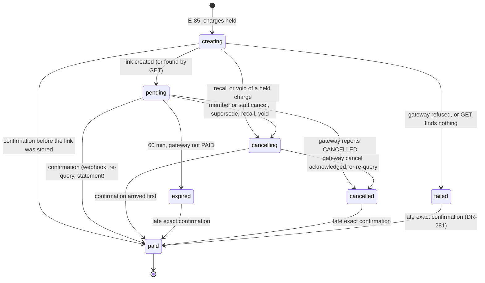
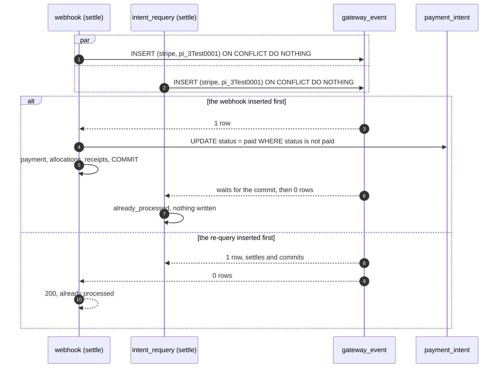

# Payment intents and settlement

> Status: **Approved** (Owner, 2026-11-02) · Updated: 2026-11-03 (P2-06 and P2-07 as built: the notes after §18) · 2026-11-02 (approved by the Owner) · 2026-11-02 (DR-27, 28, 30, 31, 280, 281, 283 decided; DR-283 applied) · 2026-11-01 (DR-325, DR-326: Stripe is the first gateway and payment moves to P2; §10.3, the provider note) · 2026-10-28 (P1-25: first version, DR-280…283) · DOC-23
> Depends on: [DOC-50](../07-api/api-guidelines.md) §8, original SDD §5.7, §5.8, §6.1…6.5, §16.2, §19.3, [DR](../00-decision-register.md) (DR-14, 16, 23, 25, 26, 27, 28, 29, 30, 31, 32, 33, 64, 74, 80, 84, 91, 96, 126, 244, 267, DR-280…283), [ADR-0007](../04-adr/0007-payment-gateway-port-and-payment-link.md), [ADR-0008](../04-adr/0008-settlement-idempotency.md), [DOC-03](../01-product/requirements.md) (FR-07…FR-10, NFR-01, NFR-02), [DOC-04](../01-product/use-cases.md) (UC-03, UC-18), [DOC-09](../03-architecture/messaging-contracts.md) §4.2, §6, [DOC-12](../03-architecture/code-architecture.md) §4, §8, §11, [DOC-15](../05-data/finance-model.md) §4, §6, §7, §8, [DOC-21](fee-batches-and-import.md) §2.1, §3.5, §3.9, [DOC-22](ledger-and-allocation.md) §2.1, §4, §9, §10, [DOC-27](residency-and-memberships.md) §4, [DOC-36](building-configuration-and-demo.md), [DOC-38](jobs-and-outbox-runtime.md) §3, §4, [DOC-40](observability.md) §4.5, §5, [DOC-41](configuration-reference.md), [DOC-42](error-handling.md) §5, §6, §7.3, [DOC-06](../02-glossary.md)
> Main readers: P2-06 (`settle()`), P2-07 (`IntentCancellation`), P2-22 (intent creation; was P3-02), P2-23 (the webhook route around `settle()`; was P3-03), P2-24 (re-query, expiry, cancel handler; was P3-04), P2-25, P2-26, P2-27 (EXP-01, EXP-02), P2-28, DOC-08, DOC-24, DOC-25, DOC-44 (FL-09), DOC-45, DOC-51, DOC-58, DOC-66, DOC-90, DOC-91, RB-02

This document says how an online payment works on the server: how a payment intent is created and holds its charges, how a household meets an open intent, how `settle()` turns one authenticated confirmation into a payment or a money-log row, how the re-query job and the cancel handler move intents that the webhook did not, and what each step writes to the outbox. It does not hold the tables (DOC-15), the allocation statement, receipts and the money log viewer (DOC-22), the batch recall and the void of one charge (DOC-21), the gateway port, the payOS driver and the webhook signature (DOC-24), the statement path (DOC-25) or the screens (DOC-58, DOC-66).

**Provider note (DR-325, DR-326).** The first gateway is **Stripe** (hosted Checkout, cards, saved cards), not payOS; the provider-neutral port and both drivers are DOC-24. Everything about the intent, the hold, `settle()`, the money log, the re-query and the cancel is unchanged and provider-neutral. Three things in this document were written for a **bank-transfer** gateway and apply to a bank-transfer driver only (`capabilities.exactAmountOnly = false`): the QR string and the transfer content (`qr_payload`, `receiving`, DR-27), the outcomes `amount_short` and `amount_over` with `unmatchedTransfer`, and the 9-character description limit. For Stripe the resident is sent to `checkout_url`, the amount is exact by construction, and §10.3 maps each step. Where the text says "link", read "session"; where it says "QR", read "the presentation of the driver".

**Approved; the gateway facts are still to be verified.** The intent lifecycle, the transfer content, the re-query and the cancel follow DR-27, DR-28, DR-30 and DR-31, decided by the Owner on 2026-11-02 as the defaults of the design (the Stripe driver of DR-326 revises them where a card differs). The payOS behaviour this document assumes is listed in §10.2 and the Stripe facts in DOC-24 §4.12; every such place is marked *unverified* until P2-21 and P3 check it. `settle()` follows DR-29 and DR-32, also decided.

**Statements run on 2026-10-28** on `postgres:18.6` (x86_64, Docker) on a database built from the DDL of DOC-15 §3.1 and §4…§11; §17 lists what ran. Race and timing figures are *planned*: they are measured by P2-06, P3-02, P3-04 and EXP-01, EXP-02.

Every new decision in this document is recorded as DR-280…DR-283 and summarized in §18.

## 1. Purpose and scope

| Component | Main class or file | Runs in | Trigger | Reads | Writes | Task |
| --- | --- | --- | --- | --- | --- | --- |
| Create an intent | `CreatePaymentIntent` | `api` | `POST /me/payments/intents` (E-85) | `charge`, `fee_batch`, `payment_intent`, `payment_intent_item`, `building.gateway_config` (contract) | `payment_intent`, `payment_intent_item`, `document_counter`, outbox | P3-02 |
| Read an intent | `PaymentIntentQueries` | `api` | E-86 (resident), E-107 (staff) | `payment_intent`, `payment_intent_item`, `gateway_event`, `receipt` | none | P3-02, P3-06 |
| "I have transferred" | `RequestIntentCheck` | `api` | `POST /me/payments/intents/{id}/check` (E-88) | `payment_intent` | `payment_intent.next_check_at` | P3-04 |
| Cancel (member) | `CancelPaymentIntent` | `api` | `POST /me/payments/intents/{id}/cancel` (E-87) | `payment_intent` | `payment_intent`, `payment_intent_item`, outbox | P3-02 |
| Cancel (staff) | `CancelPaymentIntentByStaff` | `api` | `POST /staff/payments/intents/{id}/cancel` (E-175, DR-282) | the same | the same, audit | P3-06 |
| Cancel the holders of charges | `IntentCancellation` (a port inside `finance`, DOC-21 §2.1) | `api` | recall (E-96), void of one charge (E-100) | `payment_intent_item` | `payment_intent`, `payment_intent_item`, outbox | P2-07 |
| Settle a confirmation | `settle()` in `application/settle.ts` (DOC-12 §4.1) | `api`, `worker` | the webhook route (E-117), `intent_requery`, `CancelIntentLink`, the statement path (DOC-25) | `payment_intent`, `payment_intent_item`, `charge` | `gateway_event`, `payment_intent`, `payment`, `allocation`, `charge`, `receipt`, `document_counter`, `payment_intent_item`, outbox, audit | P2-06 |
| Re-query and expiry | job `intent_requery` | `worker` | every 30 s | `payment_intent` | `payment_intent`, `payment_intent_item`, outbox; `settle()` | P3-04 |
| Cancel a link at the gateway | handler `finance.cancel_intent_link` (`CancelIntentLink`) | `worker` | `finance.intent_cancel_requested.v1` | `payment_intent` | `payment_intent`; `settle()` | P3-04 |
| Gauges | `pendingOverdue`, `creatingStale` (`AppModule.gauges`) | `api` (scrape) | `/metrics` | `payment_intent` | none | P3-09 |

The allocation inside `settle()` is DOC-22's `ChargeAllocator` (DR-267), so manual and online payments share one write path that sets `charge.status = 'paid'` (ADR-0005, ADR-0006). There is no Manager-created intent (DR-91): a Manager who wants money in sends a reminder or records a manual payment.

## 2. Components and interfaces

### 2.1 Types

```ts
// modules/finance/src/application/settle.ts
export interface Confirmation {
  buildingId: BuildingId            // from the gateway configuration (webhook), the intent (re-query, cancel) or the statement (DOC-25)
  gatewayConfigId: Uuid
  provider: string                  // the driver's word: 'stripe', 'fake'; later 'payos' (DOC-24 §2)
  reference: string                 // unique per provider transaction: Stripe's PaymentIntent id (DOC-24 §4.4); payOS data.reference (DR-25 item 2)
  orderCode: number | null          // null when the payload has none
  amount: Money                     // đồng, integer
  paidAt: Instant                   // Stripe: the charge's created (DOC-24 §4.4); payOS: transactionDateTime read as Asia/Ho_Chi_Minh local time (DR-29)
  source: 'webhook' | 'requery' | 'statement'
  payload: Record<string, unknown>  // the authenticated data object, stored as received
}

export type SettleOutcome =
  | 'posted' | 'amount_short' | 'amount_over' | 'duplicate_transfer'
  | 'charge_already_paid' | 'charge_recalled' | 'unknown_order'      // the gateway_event outcomes (DR-16)
  | 'already_processed'                                               // (provider, reference) existed: nothing written
  | 'foreign_building'                                                // the order code belongs to another building: nothing written (DR-282)

export interface SettleResult { outcome: SettleOutcome; gatewayEventId: Uuid | null; paymentId: Uuid | null; intentId: Uuid | null }

/** One transaction at READ COMMITTED, retried whole on 40001/40P01 up to 3 times (§6). Never throws for a business outcome (DOC-42 §7.3). */
export type Settle = (c: Confirmation) => Promise<SettleResult>
```

```ts
// modules/finance/src/application/use-cases/create-payment-intent.ts
export class CreatePaymentIntent {
  execute(resident: UnitContext, cmd: { chargeIds: ChargeId[] }): Promise<{ created: boolean; intent: PaymentIntentDto }>
}
// cancel-payment-intent.ts, cancel-payment-intent-by-staff.ts, request-intent-check.ts: one class, one execute each
export const CANCEL_PAYMENT_INTENT_BY_STAFF_ROLES = ['admin', 'manager'] as const    // DR-28 rule 4, DR-282

// modules/finance/src/application/intent-cancellation.ts (the port of DOC-21 §2.1)
export interface IntentCancellation {
  /** In the caller's transaction: the active intents of the building that hold any of the charges → cancelling, as a whole. */
  cancelHolding(tx: Tx, scope: BuildingScope, chargeIds: ChargeId[], reason: 'batch_recalled' | 'charge_voided' | 'charge_paid'): Promise<{ intentIds: Uuid[] }>
}
```

The gateway port is DOC-24's (original SDD §6.6, ADR-0007). This document uses four methods and the limits:

```ts
interface PaymentGateway {
  limits(): { minAmount: Money; maxAmount: Money }                     // payOS defaults 2,000 and 500,000,000 (DR-28 rule 1, unverified)
  createLink(input: { orderCode: number; amount: Money; description: string; expiredAt: Instant }):
    Promise<{ linkId: string; qrPayload: string; checkoutUrl: string }>
  getStatus(orderCode: number): Promise<
    | { kind: 'not_found' }
    | { kind: 'pending' | 'cancelled' | 'expired'; linkId: string; qrPayload: string | null; checkoutUrl: string | null }
    | { kind: 'paid'; linkId: string; transactions: GatewayTransaction[] }>   // one Confirmation per transaction
  cancel(orderCode: number, reason: string): Promise<{ kind: 'cancelled' | 'already_paid' | 'not_found' | 'rejected' }>
}
```

### 2.2 What `finance` calls here

| Contract or port | Used for | Why |
| --- | --- | --- |
| `BuildingApi.getActiveGatewayConfig(buildingId, { lock: 'share' })` | Intent creation reads the active configuration and its receiving account `FOR SHARE` in its transaction (DR-126 item 3), so a concurrent change of the receiving account is either refused (`gateway_in_use`) or seen | The configuration is `building`'s |
| `ActiveIntentProbe` (implemented by `finance` through `integrations/building`, DR-126) | `building` asks whether an intent is active before a configuration change | No module cycle |
| `BuildingApi.getSettings` | The time zone for the intent code's `YYMMDD` | Settings are `building`'s |
| `GaplessCounter.next(scope, 'intent', yymmdd)` | `TT-YYMMDD-NNNN` (DOC-15 §4); not gapless in meaning, the helper is shared | DOC-12 §9.5 |
| `ResidencyApi.getMembership(createdBy, unitId)` | The payer's member type in the receipt snapshot (DOC-22 §7) | Memberships are `residency`'s |
| `IdentityApi.getResidentAccounts([createdBy])` | The payer's name: "started by" on E-85 and E-86, `payment.payer_name` and the snapshot (DOC-15 §7.1). A deleted account gives `null` | Accounts are `identity`'s |
| `ChargeAllocator.allocate` | Steps 5–6 of `settle()` (DOC-22 §2.1) | One write path |
| `AuditApi.record` | `finance.payment.post` with actor `system`; `finance.intent.cancel` by staff | Audit is `audit`'s |
| `PaymentGateway` | Link creation (API), status and cancel (worker) | DOC-24 |

### 2.3 Events and commands

All are written in the transaction that makes the change (DOC-12 §8.3); payloads are DOC-09 §6.

| Message | Written by | When | Consumer |
| --- | --- | --- | --- |
| `finance.payment_posted.v1` (`source: online`, `payerAccountId` = the creator) | `settle()` | outcome `posted` | `notification.inbox_on_finance_payment_posted`: inbox `payment.received` and the push "Payment received" (title only) to the unit's recipients who can see fees |
| `finance.receipt_issued.v1`, `finance.receipt_render_requested.v1` (`issued`) | `settle()` through `ChargeAllocator` | one per receipt | the e-invoice seam; `finance.render_receipt_pdf` |
| `finance.money_unposted.v1` (`kind: gateway_event`) | `settle()` | every outcome that leaves an open log row: `amount_short`, `amount_over`, `duplicate_transfer`, `charge_already_paid`, `charge_recalled`, `unknown_order` | inbox for every active Manager and Admin; SSE `money_log.opened`. **Nothing to the resident** (FR-09.2) |
| `finance.intent_cancel_requested.v1` | `CancelPaymentIntent`, `CancelPaymentIntentByStaff`, the supersede of §4.4, `IntentCancellation`, the expiry of §8 | an intent enters `cancelling`, or expires | `finance.cancel_intent_link` (retry class `intent_cancel`, 8 attempts) |

The payload `reason` of the cancel command is for the log only; it is derived from the column `cancel_reason` (DOC-15 §6.1) and the expiry (DR-282 item 2):

| Event | `payment_intent.cancel_reason` | Command `reason` |
| --- | --- | --- |
| A member cancels (E-87) | `resident` | `resident_cancelled` |
| A Manager or Admin cancels (E-175) | `staff` | `resident_cancelled` (the actor is in the audit row) |
| Supersede (§4.4) | `superseded` | `replaced` |
| Batch recall | `batch_recalled` | `batch_recalled` |
| Void of one charge | `charge_voided` | `charge_voided` |
| A payment of a held charge: a manual payment, or a late confirmation (DR-283) | `charge_paid` | `charge_paid` |
| Expiry at 60 min (§8) | — (the intent is `expired`) | `expired` |

The command reason `charge_paid` of DOC-09 is produced by a payment of a held charge (DR-283, decided 2026-11-02): the other intent that holds the charge is cancelled in the payer's transaction (§5.4, §6.1 step 6). DR-28 rule 5 no longer applies.

An intent created, superseded, expired or cancelled sends **no** resident notification. The household learns about a recall or a voided charge from `fee.batch_recalled` and `fee.charge_voided` (DOC-09 §7.3), and the app learns the state of its own intent from E-86.

### 2.4 Audit actions

| Action | Written by | `changes` | R |
| --- | --- | --- | --- |
| `finance.payment.post` | `settle()` with actor `system` and `source` `webhook`, `requery` or `statement` (DOC-35 §3.6) | — (`source`, `amount`, `chargeCount`, `intentCode`, `reference` in `details`) | |
| `finance.intent.cancel` (**new**, DR-282) | `CancelPaymentIntentByStaff` | `status` (`pending` → `cancelling`) | R |

A member's cancel, a supersede, an expiry and the cascades of a recall or void are not audited on their own: the intent row keeps `cancel_reason` and `cancel_requested_at`, and a recall or void has its own audit row (DOC-21 §2.3). Only staff acting on a resident's payment is.

## 3. The intent and its states

An intent is the server's promise "if the bank confirms order `orderCode` for exactly `amount`, these whole charges are paid" (original SDD §6.2). It lists 1 to 10 whole charges of one unit with the amount of each at creation, owns one gateway link, and **holds** its charges while it is active: a `payment_intent_item` with `released_at IS NULL`, at most one per charge (`uq_payment_intent_item_charge_active`, DOC-15 §6.2). **Active** means `creating`, `pending` or `cancelling`; the items of a `cancelling` intent are already released (DR-28 rule 3), so only `creating` and `pending` intents hold charges.



| From → to | By | Statement (all scoped by `building_id`) | Also in the transaction |
| --- | --- | --- | --- |
| — → `creating` | `CreatePaymentIntent` | `INSERT payment_intent (status 'creating', next_check_at = created_at + 120 s)` and one item per charge | the counter; a supersede (§4.4) |
| `creating` → `pending` | `CreatePaymentIntent` after `createLink`; `intent_requery` after a `GET` | `UPDATE … SET status = 'pending', link_id, qr_payload, checkout_url, next_check_at = now() + 5 min + jitter WHERE id AND status = 'creating'` | — |
| `creating` → `failed` | `CreatePaymentIntent` (refused, or timeout and `GET` not found); `intent_requery` (`GET` not found after 120 s) | `UPDATE … SET status = 'failed', failed_at = now(), next_check_at = NULL WHERE id AND status = 'creating'` | release the items |
| `creating`, `pending` → `cancelling` | E-87, E-175 (`pending` only); supersede (`pending` only); `IntentCancellation` (both) | `UPDATE … SET status = 'cancelling', cancel_reason, cancel_requested_at = now(), next_check_at = now() + 15 min WHERE id AND status IN (…)` | release the items; the cancel command |
| `pending` → `expired` | `intent_requery` at `expires_at`, gateway not `PAID` | `UPDATE … SET status = 'expired', expired_at = now(), next_check_at = NULL WHERE id AND status = 'pending'` | release the items; the cancel command (`expired`) |
| `pending` → `cancelled` | `intent_requery`, gateway `CANCELLED` (someone cancelled at the gateway) | `UPDATE … SET status = 'cancelled', cancel_reason = 'staff', cancel_requested_at = now(), cancelled_at = now(), next_check_at = NULL WHERE id AND status = 'pending'` | release the items (DR-280 item 4) |
| `cancelling` → `cancelled` | `CancelIntentLink`; `intent_requery` (§8.3) | `UPDATE … SET status = 'cancelled', cancelled_at = now(), next_check_at = NULL WHERE id AND status = 'cancelling'` | — |
| any but `paid` → `paid` | `settle()` step 5 | the claim of §6.3 | payment, allocations, receipts, release, outbox, audit |

**Release** is one statement, run wherever an intent leaves `creating` or `pending`:

```sql
UPDATE finance.payment_intent_item SET released_at = now()
 WHERE building_id = :building_id AND intent_id = :intent_id AND released_at IS NULL;
```

`next_check_at` is the re-query schedule and the claim lease (DR-30): `created_at + 120 s` for a new `creating` intent (so a process that dies before the gateway answers leaves work for the job), `now() + 5 min + random(0…20 s)` for `pending`, `now() + 15 min` for `cancelling` (DR-31: an intent still `cancelling` after 15 minutes is re-queried), and `NULL` for the final states. A `paid`, `failed`, `expired` or `cancelled` intent is never claimed again; a late confirmation reaches it through the webhook or the statement path only.

**`failed` accepts a late confirmation.** DR-29 (decided) claims "any status that is not `paid`"; original SDD §6.4 and ADR-0008 list five statuses and leave out `failed`, and DOC-15 followed them. A `failed` intent is one whose `GET` found no link; a transfer for it means the `GET` was wrong (DR-25 item 3), and the money is exact for open charges, so it is posted like an expired one. This needs `ck_payment_intent_failed` to read `<=` like the `expired` and `cancelled` checks, so that `failed_at` survives the move to `paid` (DR-281, decided 2026-11-02; DOC-15 §6.1 is revised with it).

## 4. Creating an intent

`POST /me/payments/intents` (E-85; `unit: pay`, marked `R`: the `Idempotency-Key` is mandatory, DR-74). The guard has resolved the `UnitContext` from `X-Unit-Id` and the membership (DOC-27 §4): an owner, a family member or a tenant with `can_pay` passes; a tenant without it and a helper get 403 `forbidden`, a locked membership 403 `membership_inactive` (FR-07.1).

### 4.1 The request

```json
POST /api/v1/me/payments/intents
X-Unit-Id: 0192f3c4-5a1e-7000-8000-000000000021
Idempotency-Key: 0192f3c4-c001-7000-8000-000000000e01

{ "chargeIds": ["0192f3c4-5a1e-7000-8000-0000000000c1", "0192f3c4-5a1e-7000-8000-0000000000c2"] }
```

| Rule | Value | Error |
| --- | --- | --- |
| Rate | 10 creations per minute per account, bucket `intent:account:<id>` (`INTENT_CREATE_PER_MINUTE`, DR-64); counted before the body runs | 429 `rate_limited {scope: 'intent'}` with `Retry-After` (FR-07.7) |
| Count | 1 to 10 distinct charge ids; a duplicate id counts once | 400 `validation_failed` with rule code `too_few_charges` / `too_many_charges` |
| Ownership | Every charge belongs to the selected unit and the building; another unit's charge is invisible | 404 `not_found` |
| State | Every charge `open`, in a batch `published` or `closed` (DR-28 rule 2) | 409 `charge_changed {charges: [{chargeId, status, version}]}` |
| Amount | `amount = Σ charge.amount` (the outstanding is the whole amount: there is no partial payment, DR-84), between `limits().minAmount` and `maxAmount` | 400 `validation_failed` with rule code `amount_below_minimum` / `amount_above_maximum` (FR-07.6; the second code is new, DR-282) |
| Gateway | An active gateway configuration for the building | 502 `gateway_unavailable` (DOC-42 §5); no row written |
| Holders | No other active intent holds a selected charge, except as §4.4 allows | 200 with the existing intent, or 409 `payment_in_progress {holder, startedAt, intentId}` (DR-282 item 4) |

### 4.2 The algorithm

1. Take the rate bucket; validate the body; read the clock and the building time zone. The idempotency wrapper runs in its `external` mode (DOC-50 §8, DR-143), because the handler calls the gateway before it finishes: the key row is committed `in_progress` before T1; a duplicate while it is `in_progress` gets 409 `request_in_progress` with `Retry-After: 1`; a key left `in_progress` for more than 5 minutes is taken over by the next request with it.
2. **T1**, one transaction at READ COMMITTED:
   1. Read the active gateway configuration `FOR SHARE` (DR-126). None: roll back, 502 `gateway_unavailable`.
   2. Lock the charges `FOR SHARE` **in ascending id order** and check them (§4.3). This closes the gap between the check and the insert that UC-03 leaves to this document (DR-280 item 1): a recall, a void or a payment of a selected charge waits for T1 to commit, and T1 waits for any of them that locked first and then sees the new state.
   3. Read the holders of the selected charges (§4.4) and decide: return an existing intent, supersede, refuse, or go on.
   4. Take `order_code = nextval('finance.order_code_seq')` and the code `TT-<YYMMDD>-<NNNN>` from the `intent` counter (building time; DOC-15 §4).
   5. `INSERT payment_intent` (`status 'creating'`, `amount`, `gateway_config_id`, `receiving` snapshot, `created_by`, `display_until = now() + 30 min`, `expires_at = now() + 60 min`, `next_check_at = now() + 120 s`) and one `payment_intent_item` per charge with `amount = charge.amount`.
   6. A unique violation on `uq_payment_intent_item_charge_active` (another creation committed between steps 3 and 5): roll back and run T1 once more from step 1; the second pass returns that intent or answers 409. A second violation is 409 `payment_in_progress`.
   7. Commit.
3. **Outside any transaction**, call `createLink({orderCode, amount, description: transferContent(orderCode), expiredAt: display_until})` with a 10 s client timeout (DR-282 item 5).
4. **T2** records the answer (§4.5) and completes the key row with the response; the API answers 201 with the intent (§4.6). A 4xx or 5xx answer stores nothing, so a retry with the same key runs again (DOC-50 §8.3).

The gateway call stays outside the transaction so a slow gateway never holds a charge lock (original SDD §6.3); the cost is the `creating` state, which `intent_requery` resolves after 120 s if the process dies between T1 and T2.

### 4.3 The charge lock and check

```sql
SELECT c.id, c.amount, c.status, c.version, b.status AS batch_status
  FROM finance.charge c
  JOIN finance.fee_batch b ON b.id = c.batch_id AND b.building_id = c.building_id
 WHERE c.building_id = :building_id AND c.unit_id = :unit_id AND c.id = ANY (:charge_ids)
 ORDER BY c.id
   FOR SHARE OF c;
-- rows < ids: 404 (another unit's or unknown charge)
-- any status <> 'open' or batch_status NOT IN ('published', 'closed'): 409 charge_changed with the rows read
```

`FOR SHARE` conflicts with the `UPDATE` of a recall, a void and a payment, and not with another `FOR SHARE`: two creations for the same charges both pass this step and meet on the hold index, which is the arbiter between them (UC-03 race table). At READ COMMITTED a `FOR SHARE` that waited for an `UPDATE` returns the row only if it still matches `WHERE`; the status is then read from the returned row, so a charge recalled meanwhile comes back `void` and is refused.

### 4.4 Holders: return, supersede or refuse

```sql
SELECT i.id, i.status, i.created_by, i.created_at, i.display_until, i.qr_payload IS NOT NULL AS has_qr,
       array_agg(it.charge_id ORDER BY it.charge_id) AS held,
       (SELECT array_agg(a.charge_id ORDER BY a.charge_id) FROM finance.payment_intent_item a
         WHERE a.building_id = i.building_id AND a.intent_id = i.id) AS all_items
  FROM finance.payment_intent_item it
  JOIN finance.payment_intent i ON i.id = it.intent_id AND i.building_id = it.building_id
 WHERE it.building_id = :building_id AND it.charge_id = ANY (:charge_ids) AND it.released_at IS NULL
 GROUP BY i.id
 ORDER BY i.created_at;
```

| Holders found | Decision (DR-28 rule 3, DR-280 item 2) | Answer |
| --- | --- | --- |
| None | Create | 201 |
| One holder whose items are **exactly** the selection, `creating`, or `pending` with a QR before `display_until` | Return it; nothing is written (the bucket token is spent) | 200, `created: false`, "started by" the holder's creator (FR-07.4, UC-03 2a) |
| Every holder is `pending` and past `display_until`, or `pending` without a QR payload (§4.5) | **Supersede**: each holder → `cancelling` with `cancel_reason = 'superseded'`, items released, one cancel command each; then create | 201 |
| Anything else (an overlap with a live QR, a `creating` holder of another set) | Refuse | 409 `payment_in_progress {holder, startedAt, intentId}` for the oldest holder |

```sql
-- supersede, one per holder, in the same transaction as the new intent
UPDATE finance.payment_intent
   SET status = 'cancelling', cancel_reason = 'superseded', cancel_requested_at = now(),
       next_check_at = now() + interval '15 minutes', version = version + 1, updated_at = now()
 WHERE id = :holder_id AND building_id = :building_id AND status = 'pending'
   AND (display_until <= now() OR qr_payload IS NULL)
RETURNING id;
-- 0 rows: the holder was paid, cancelled or recalled meanwhile -> roll back and run T1 again (step 2.6)
```

The superseded intent still accepts a late exact confirmation (original SDD §6.2 note): a transfer started at minute 29 is posted if its charges are still open. Its charges are released in the same transaction, so the new intent can hold them at once; the new intent of the household is the one whose QR is shown. The payer's own expired QR takes the same branch when the payer presses "New code" (UC-03 7e).

`holder` is the creator's full name (DR-58: a household member may see who started the payment); `intentId` lets the app open the holder's intent (E-86) to continue it or cancel it (E-87), as UC-03 2b says.

### 4.5 Recording the gateway answer

| Gateway answer | T2 | Answer to the app |
| --- | --- | --- |
| A link `{linkId, qrPayload, checkoutUrl}` | `creating → pending` with the link fields, `next_check_at = now() + 5 min + jitter` | 201 with the QR |
| A refusal (4xx, a validation error of the gateway) | `creating → failed`, release | 502 `gateway_unavailable`; the app shows "Could not create the payment. Try again." (UC-03 5b) |
| A timeout or 5xx | One `getStatus(orderCode)`: `not_found` → `failed`, release, 502; a link → `pending`; an error → leave `creating` (the job decides after 120 s), 502 | 201 if `pending` with a QR (FR-07.5) |
| `getStatus` finds the link but carries **no QR payload** (unverified, DR-25 item 3) | `pending` with `qr_payload` null | 502 `gateway_unavailable`; the next creation supersedes this intent at once (§4.4, DR-280 item 3) |

```sql
UPDATE finance.payment_intent
   SET status = 'pending', link_id = :link_id, qr_payload = :qr_payload, checkout_url = :checkout_url,
       next_check_at = now() + interval '5 minutes' + random() * interval '20 seconds', version = version + 1, updated_at = now()
 WHERE id = :intent_id AND building_id = :building_id AND status = 'creating'
RETURNING id;
```

Zero rows means the intent left `creating` while the gateway answered: a confirmation already made it `paid` (original SDD §6.2, "confirmation before the link response was stored") and the API answers 201 with the paid intent; or a recall or void made it `cancelling`, and T2 writes the cancel command again (the first one may have run before the link existed and found nothing) and the API answers 409 `charge_changed` with the fresh charges.

### 4.6 The response

201 for a new intent, 200 for the existing one of §4.4 (E-85, sample owed to DOC-51):

```json
{ "created": true,
  "intent": {
    "id": "0192f3c4-5a1e-7000-8000-000000000033", "code": "TT-261019-0001", "status": "pending",
    "amount": 2838000, "transferContent": "TT2FMZ9",
    "qr": { "payload": "00020101021238570010A000000727012700069704360113007100123456702080QRIBFTTA53037045405283800062110807TT2FMZ96304AB12",
            "checkoutUrl": "https://pay.payos.vn/web/7f3a2c1d9e8b4a6f" },
    "receiving": { "bin": "970436", "bankName": "Vietcombank", "accountNumber": "0071001234567", "accountName": "CONG TY QUAN LY TOA NHA" },
    "charges": [ { "chargeId": "0192f3c4-5a1e-7000-8000-0000000000c1", "batchCode": "PH-2610-01", "name": "Phí tháng 10/2026", "amount": 2488000 },
                 { "chargeId": "0192f3c4-5a1e-7000-8000-0000000000c2", "batchCode": "PH-2610-02", "name": "Gửi xe tháng 10/2026", "amount": 350000 } ],
    "startedBy": { "name": "Trần Minh Anh", "isMe": true }, "createdAt": "2026-10-19T02:12:00.000Z",
    "displayUntil": "2026-10-19T02:42:00.000Z", "expiresAt": "2026-10-19T03:12:00.000Z",
    "paidAt": null, "receipts": [], "unmatchedTransfer": null } }
```

The QR string above is illustrative (its CRC is not computed); the real one is the gateway's `qrCode`, stored as received and rendered locally (DR-27). `transferContent` is derived from `order_code` and never stored (DOC-15 §4). `orderCode` is not returned: the app needs the content, not the number. A replay with the same `Idempotency-Key` after the first request completed returns the stored response with `Idempotent-Replayed: true`; a replay while it is still running gets 409 `request_in_progress` and retries after a second (DR-74, DOC-50 §8.3). A new key for the same charges returns the same intent through the "exact set" branch of §4.4 (UC-03 E7).

## 5. Reading, checking and cancelling

### 5.1 The status (E-86)

`GET /me/payments/intents/{id}` (`unit: view_fees`): any member of the unit who can see fees reads any intent of the unit (FL-11). The body is the `intent` object of §4.6. `Pay-VietQR` polls it every 2 s for the first minute and every 3 s after (DR-80); the server sets `Cache-Control: no-store`.

| Field | Source |
| --- | --- |
| `status` | `payment_intent.status` |
| `paidAt`, `receipts[]` | When `paid`: the payment's receipts `{receiptId, number, chargeId, amount}` in charge order (FR-08.7) |
| `unmatchedTransfer` | `{amount, receivedAt}` of the newest `gateway_event` of the intent whose outcome is `amount_short`, `amount_over`, `charge_already_paid` or `charge_recalled`, when the intent is not `paid`; otherwise `null` (DR-84 item 8, DR-96; index `ix_gateway_event_building_intent`) |
| `cancelReason` | `resident`, `staff`, `superseded`, `batch_recalled`, `charge_voided` when `cancelling` or `cancelled` |

```json
{ "id": "0192f3c4-5a1e-7000-8000-000000000033", "code": "TT-261019-0001", "status": "pending", "amount": 2838000,
  "transferContent": "TT2FMZ9", "displayUntil": "2026-10-19T02:42:00.000Z", "expiresAt": "2026-10-19T03:12:00.000Z",
  "startedBy": { "name": "Trần Minh Anh", "isMe": false }, "paidAt": null, "receipts": [],
  "unmatchedTransfer": { "amount": 2000000, "receivedAt": "2026-10-19T02:16:05.000Z" }, "cancelReason": null, "…": "the other fields of §4.6" }
```

The app shows `Pay-Mismatch` for a non-null `unmatchedTransfer` with the one neutral message of DR-84 item 8 (DOC-68) and nothing else. `duplicate_transfer` does not set the field (the intent shows its receipts) and `unknown_order` has no intent (DR-96).

The staff list `GET /staff/payments/intents` (E-107, Manager and Admin) shows every intent of the building newest first, keyset `(created_at, id)`, filters `status`, `unit`, date range, with the payer's name, the code, the order code, the events of the intent and the `cancel_reason`; it is `W-Transactions` (DOC-66).

### 5.2 "I have transferred" (E-88)

`POST /me/payments/intents/{id}/check` (`unit: pay`). It asks the job to look now; it never calls the gateway itself, so the API holds no gateway connection for a button (DR-30):

```sql
UPDATE finance.payment_intent SET next_check_at = now(), updated_at = now()
 WHERE id = :intent_id AND building_id = :building_id AND unit_id = :unit_id
   AND status IN ('creating', 'pending')
   AND (last_checked_at IS NULL OR last_checked_at < now() - interval '30 seconds')
   AND next_check_at > now()
RETURNING id;
```

The answer is 200 `{ "status": "pending", "checkScheduled": true }`, or `false` when the row did not change (checked less than 30 s ago, already due, or no longer pending; FR-10.3). The next tick of `intent_requery` (every 30 s) runs the check, so the result reaches the poll within about 30 s plus the gateway call. Nothing else changes, so the request needs no idempotency key.

### 5.3 Cancel by a member (E-87) or by staff (E-175)

`POST /me/payments/intents/{id}/cancel` (`unit: pay`): the creator or any other member of the unit who can pay (DR-28 rule 4). `POST /staff/payments/intents/{id}/cancel { reason }` (Manager, Admin; `CANCEL_PAYMENT_INTENT_BY_STAFF_ROLES`, reason 5 to 500 characters; DR-282 item 3). Both are allowed only in `pending`:

```sql
UPDATE finance.payment_intent
   SET status = 'cancelling', cancel_reason = :reason_kind, cancel_requested_at = now(),
       next_check_at = now() + interval '15 minutes', version = version + 1, updated_at = now()
 WHERE id = :intent_id AND building_id = :building_id AND (:unit_id IS NULL OR unit_id = :unit_id) AND status = 'pending'
RETURNING id;
-- 0 rows: read the row. Missing or another unit's → 404; any other status → 409 intent_not_cancellable {status}
```

Then release the items, write `finance.intent_cancel_requested.v1`, and for staff the audit row `finance.intent.cancel` with the reason; commit; 200 with the intent. A cancel that loses to a confirmation (the claim of §6.3 committed first) sees `paid` and answers 409 `intent_not_cancellable {status: "paid"}`; the app then shows the receipts. A cancel that wins leaves the intent `cancelling`, and an exact late confirmation is still posted (UC-03 race table).

### 5.4 Cancelling the holders of charges

`IntentCancellation.cancelHolding` runs in the transaction of a recall (DOC-21 §3.5 step 4), of a void of one charge (DOC-21 §3.9), or of a payment (§6.1 step 6, DOC-22 §5.2, DR-283), after the charges were made `void` or `paid`:

```sql
WITH holders AS (
  SELECT DISTINCT it.intent_id FROM finance.payment_intent_item it
   WHERE it.building_id = :building_id AND it.charge_id = ANY (:charge_ids) AND it.released_at IS NULL)
UPDATE finance.payment_intent i
   SET status = 'cancelling', cancel_reason = :reason, cancel_requested_at = now(),
       next_check_at = now() + interval '15 minutes', version = version + 1, updated_at = now()
  FROM holders h
 WHERE i.id = h.intent_id AND i.building_id = :building_id AND i.status IN ('creating', 'pending')
RETURNING i.id;
-- then release every item of each returned intent, and one cancel command per intent
```

The whole intent is cancelled, including a charge of another batch in it (FR-04.1, DR-31); the household starts again. A `creating` intent is cancelled too: its link may not exist yet, and §4.5 repeats the command if the link appears afterwards.

**A payment as the cause (DR-283).** `RecordManualPayment` calls it with `'charge_paid'` for the charges it just allocated (DOC-22 §5.2 step 5), and `settle()` calls it in step 6 for the charges of the paying intent. The paying intent's own items are released first, so it never cancels itself: only another intent can still hold the charges, which happens when the payer is a *superseded* intent that accepted a late confirmation, or when a Manager records cash while a member's link is open. The cancelled intent is told to the app by E-86 (`cancelled`), and the household sees the receipts of the payment that closed the charges; no extra notification is sent. A Manager who records cash still sees the warning of FR-05.6 before saving (DOC-22 §5.2).

## 6. `settle()` step by step

`settle(confirmation)` is the one function for the webhook, the re-query, the cancel handler and the statement path (DR-29, ADR-0008). Its input is already authenticated by its source: the webhook route has checked the size, the configuration, the HMAC, the receiving account and the paid code (DR-32, DOC-24); the re-query and the cancel handler read the gateway with the configuration's credentials; the statement path calls it only after the gateway reported `PAID` (DR-35). The function writes nothing for a business outcome other than the rows below, and never throws for one (DOC-42 §7.3).

### 6.1 The steps

One transaction at READ COMMITTED. The numbers are DR-29's.

1. **Building and intent.** The building is `confirmation.buildingId`. Read the intent `WHERE building_id = :b AND order_code = :order_code` (no lock). None and `orderCode` is not null: one unscoped existence read decides whether the order code is another building's (DR-282 item 1):

   ```sql
   -- scope-ok: foreign_building check of DR-29 step 1 reads one boolean across buildings (DR-282)
   SELECT EXISTS (SELECT 1 FROM finance.payment_intent WHERE order_code = :order_code) AS elsewhere;
   ```

   `elsewhere` → return `foreign_building` **without writing**: the check runs before the `gateway_event` insert, so a confirmation routed to the wrong configuration never occupies its `(provider, reference)`. The webhook route then writes `webhook_rejection` (`foreign_building`) and answers 400 (DOC-42 §6); the statement path treats it as no intent (DOC-25).
2. **Record once.**

   ```sql
   INSERT INTO finance.gateway_event
     (id, building_id, provider, reference, order_code, amount, paid_at, source, payload, intent_id, unit_id, outcome)
   VALUES (:id, :building_id, :provider, :reference, :order_code, :amount, :paid_at, :source, :payload, :intent_id, :unit_id, 'pending')
   ON CONFLICT (provider, reference) DO NOTHING
   RETURNING id;
   ```

   No row: commit, return `already_processed` (the webhook answers 200). A concurrent second insert of the same reference waits for the first to commit and then returns no row (FNM-S05). No intent: set the outcome `unknown_order`, write `money_unposted`, commit.
3. **Classify without writing money.** `SAVEPOINT settle_money`. Intent `paid` → `duplicate_transfer`; `amount < intent.amount` → `amount_short`; `amount > intent.amount` → `amount_over`. Any of these: `RELEASE SAVEPOINT`, set the outcome, write `money_unposted`, commit. The intent keeps its status.
4. **Claim the intent** (the second arbiter, ADR-0008):

   ```sql
   UPDATE finance.payment_intent
      SET status = 'paid', paid_at = :paid_at, gateway_reference = :reference, next_check_at = NULL,
          version = version + 1, updated_at = now()
    WHERE id = :intent_id AND building_id = :building_id AND status <> 'paid'
   RETURNING id, unit_id, amount, created_by, code;
   ```

   Zero rows: another reference claimed it between step 3 and now (the payer transferred twice). `ROLLBACK TO SAVEPOINT settle_money`, outcome `duplicate_transfer`, `money_unposted`, commit.
5. **Pay the charges.** Insert the payment (`source 'online'`, `provider`, `gateway_reference = :reference`, `intent_id`, `unit_id`, `amount = intent.amount`, `received_at = :paid_at`, `payer_name` = the creator's name or `null`), then `ChargeAllocator.allocate(tx, scope, payment, items as {chargeId, expectedAmount: item.amount})` (DOC-22 §4). `ok: false` on any charge → `ROLLBACK TO SAVEPOINT settle_money` (the claim, the payment and the earlier allocations, receipts and counter increments go with it), outcome `charge_already_paid` (the charge is `paid`) or `charge_recalled` (it is `void`), `money_unposted`, commit. No part of the intent is posted on its own (DR-84 item 2).
6. **Finish.** Release the intent's items (a late confirmation finds none to release), then `IntentCancellation.cancelHolding(tx, scope, chargeIds, 'charge_paid')` for the charges just paid: any other active intent that holds one of them becomes `cancelling` (§5.4, DR-283). Set `gateway_event.outcome = 'posted'` and `payment_id`, write `finance.payment_posted.v1` (the allocator wrote the receipt messages), the audit row `finance.payment.post` with actor `system`, commit. Return `posted`.

**Retry.** On SQLSTATE `40001` or `40P01` the transaction wrapper runs the whole function again, at most 3 times, with 20–60 ms jitter (DOC-12 §8.1, FR-08.8). A retry starts at step 1, so a confirmation that a concurrent call recorded meanwhile ends as `already_processed`. A fourth failure, or any other database error, throws; the webhook answers 503 and the gateway retries (DOC-42 §6); the re-query leaves `next_check_at` for the next tick.

**Registration test.** The payload the gateway sends when the webhook URL is registered is recognised by the route (DOC-24) and answered 200 without calling `settle()` (FR-09.6). *Revised 2026-11-02 (review of the P2-00 gate):* this applies to a driver whose provider sends such a payload (payOS). Stripe sends none: its test events are verified like any event (DOC-52 §12.4).

### 6.2 Outcomes

| Outcome | Rows written | Intent after | Resident sees | Manager gets |
| --- | --- | --- | --- | --- |
| `posted` | `gateway_event`, payment, allocations, charges `paid`, receipts, counter, released items, outbox, audit | `paid` | `Pay-Done` with the receipts; push "Payment received" | — |
| `already_processed` | none | unchanged | — | — |
| `foreign_building` | none (the route writes `webhook_rejection`) | — | — | the "signature errors" count of `W-Transactions` |
| `unknown_order` | `gateway_event`, outbox | — | — | an inbox entry; a money-log row |
| `duplicate_transfer` | `gateway_event`, outbox | `paid` (unchanged) | the receipts (unchanged) | an inbox entry; a money-log row |
| `amount_short`, `amount_over` | `gateway_event`, outbox | unchanged (`pending` stays `pending`) | `Pay-Mismatch` through `unmatchedTransfer` | an inbox entry; a money-log row |
| `charge_already_paid`, `charge_recalled` | `gateway_event`, outbox | unchanged | `Pay-Mismatch` through `unmatchedTransfer` | an inbox entry; a money-log row |

Every authenticated confirmation is a payment or a money-log row, never nothing (NFR-01); `already_processed` and `foreign_building` are not confirmations of a new transfer. A wrong transfer is never applied to another charge, period or payment (FR-09.8); the Manager refunds it outside the system and marks the row reviewed (DOC-22 §9).

### 6.3 A worked example

The owner Trần Minh Anh of `A-1508` pays charges A (2,488,000 đ) and B (350,000 đ). Intent `TT-261019-0001`, order code 2,610,153, transfer content `TT2FMZ9`.

| # | Input | Outcome | State after |
| --- | --- | --- | --- |
| 1 | Webhook, `FT2628273914`, 2,838,000 đ, 09:14:31 local | `posted` | Intent `paid`, `paid_at` 02:14:31Z; payment 2,838,000; receipts `BL-2610-0153`, `BL-2610-0154` |
| 2 | Re-query a second later, the same `FT2628273914` | `already_processed` | Unchanged; the job writes nothing |
| 3 | Webhook retry of 1 after a lost 200 | `already_processed` | 200 |
| 4 | Webhook, `FT2628273990`, 2,838,000 đ (the payer sent it twice) | `duplicate_transfer` | A money-log row; the Manager refunds outside |
| 5 | Another intent, 2,000,000 đ received | `amount_short` | That intent stays `pending`; E-86 shows `unmatchedTransfer {amount: 2000000}` |
| 6 | An `expired` intent, exact amount, both charges still `open` | `posted` | `expired → paid` (FR-09.7) |
| 7 | An exact transfer after A was paid in cash | `charge_already_paid` | B stays `open`; the intent keeps its status (FR-09.1) |
| 8 | Order code 9,999,999 known to no building | `unknown_order` | A money-log row with no intent |

## 7. Races

The arbiters are three rows, always in this order inside `settle()`: the `gateway_event` key, then the intent, then each charge in ascending id. Creation adds the hold index. No race needs a lock of its own.

### 7.1 Webhook and re-query confirm the same transfer

**The arbiter is the `gateway_event` row, then the intent row** (original SDD §6.5, ADR-0008).



Whichever path inserts first settles; the other becomes a no-op without an error (FR-08.3). Two **different** references for one intent both insert their event; both pass step 3 while the intent is `pending`; the claim of step 4 lets one through and the second waits for its commit, re-evaluates `status <> 'paid'`, updates zero rows and ends `duplicate_transfer`. `uq_payment_building_intent` and `uq_payment_gateway_reference` are the last net if a code change ever broke that order.

### 7.2 The other races

| Race | Arbiter | Outcomes |
| --- | --- | --- |
| Manual payment vs online settlement of one charge | The charge row (DOC-22 §10) | Cash first: the confirmation is `charge_already_paid`. Settlement first: the manual entry is 409 `charge_changed` (FR-05.8) |
| Recall or single void vs settlement | The charge row | Recall first: `charge_recalled`. Settlement first: the recall is 409 `batch_has_payments`, the void 409 `charge_not_voidable` (FR-04.3, FR-49.5) |
| Cancel (E-87, E-175, supersede) vs confirmation | The intent row | Confirmation first: the cancel is 409 `intent_not_cancellable` (supersede: the creation runs again and refuses). Cancel first: the intent is `cancelling`, the claim still accepts it, and the exact confirmation is posted |
| Expiry vs confirmation | The intent row | The expiry's `WHERE status = 'pending'` loses to a claim that committed first; a claim after the expiry takes `expired → paid` |
| Two creations for the same charges | The hold index | One inserts its items; the other's insert fails with 23505, T1 runs again and returns the winner (same set) or 409 (different set). 0 charges in two active intents |
| Creation vs recall, void or payment of a selected charge | `FOR SHARE` on the charge (§4.3) | The writer first: creation refuses with 409 `charge_changed`. Creation first: the writer waits for T1; a recall or void then cancels the new intent as a whole; a payment then pays the charge and the intent's later confirmation is `charge_already_paid` |
| Creation's supersede vs a late confirmation of the superseded intent | The superseded intent's row | Either order ends consistent: the supersede waits for the claim and then refuses (0 rows → T1 again → 409 `charge_changed`, the charges are paid), or the claim takes `cancelling → paid` and pays the charges, which the new intent then holds; see DR-283 |
| Two settlements over the same charges in different orders | Ascending charge id inside the allocator | No deadlock; one wins (DR-14) |

**Two lock orders meet in one place.** `settle()` locks the intent, then the charges; a recall or void locks the charges, then (through `cancelHolding`) the intents; creation locks the charges `FOR SHARE`, then a superseded intent. When a recall and a settlement touch the same intent and charge at the same instant, PostgreSQL detects the cycle after `deadlock_timeout` (1 s) and aborts one with `40P01`; the wrapper retries it, and the retry meets the committed state of the other: the settlement retried after a recall ends `charge_recalled`, the recall retried after a settlement ends 409 `batch_has_payments`. The pair is rare (it needs a recall during the second a transfer is posted) and harmless; reordering `settle()` to lock the charges first would contradict DR-29, so the retry is the answer. IN-36 measures it. DR-283 adds one more meeting of the same kind: `settle()` of a superseded intent A locks A, then the charges, then (through `cancelHolding('charge_paid')`) the intent N that holds those charges now, while the confirmation of N locks N, then the charges. The cycle is resolved the same way: one side gets `40P01`, is retried and meets the committed state (A retried after N paid ends `charge_already_paid`; N retried after A paid finds its intent `cancelling` and its charge `paid`, and ends `charge_already_paid` as well). IN-54 measures it.

### 7.3 What a crash leaves

| Process dies | State | Who finishes |
| --- | --- | --- |
| After T1, before `createLink` returns | `creating`, charges held, a link may exist at the gateway | `intent_requery` at `created_at + 120 s`: `GET` → `pending` or `failed` (FR-10.4) |
| After `createLink`, before T2 | the same | the same. The key row stays `in_progress`: the app's retry with the same key gets 409 `request_in_progress` until the key is taken over after 5 minutes, then runs again and returns the intent through §4.4 (by then `pending` or `failed`, so a `failed` one is replaced). The user pressing pay again makes a new key and gets the intent at once |
| Inside `settle()` before commit | Nothing written | The gateway retries the webhook; the re-query settles within one cycle (UC-18 E4) |
| After `settle()` commits, before the 200 | The payment exists | The retry finds the reference: `already_processed`, 200 (FR-08.6) |
| After the expiry or a cancel commits, before the cancel command is published | The command is in the outbox | The relay publishes it after restart (DOC-38 §2) |
| Inside `CancelIntentLink` after the gateway cancelled | `cancelling`, the message not acknowledged | The message is retried; `cancel` on a cancelled link is idempotent; the update is conditional |

## 8. The re-query and expiry job

`intent_requery` (DR-30, DOC-38 §4): mode `claim`, every 30 s, in the worker. It loops over `ctx.buildings()` and, per building, claims and handles due intents.

### 8.1 The claim

```sql
UPDATE finance.payment_intent i
   SET next_check_at = now() + interval '60 seconds', check_count = check_count + 1, updated_at = now()
 WHERE i.building_id = :building_id
   AND i.id IN (SELECT id FROM finance.payment_intent
                 WHERE building_id = :building_id AND status IN ('creating', 'pending', 'cancelling')
                   AND next_check_at <= now()
                 ORDER BY next_check_at
                 LIMIT :batch                       -- INTENT_REQUERY_BATCH = 20
                   FOR UPDATE SKIP LOCKED)
RETURNING i.id, i.status, i.order_code, i.created_at, i.expires_at, i.check_failures, i.gateway_config_id;
```

The claim commits at once; the 60 s lease is the new `next_check_at`, so two workers take disjoint rows and a worker that dies returns its rows after 60 s (index `ix_payment_intent_building_requery`). The gateway calls run **outside any transaction**, at most `GATEWAY_CALLS_IN_FLIGHT = 5` at once per worker; each call has a 10 s timeout so a pass stays inside the lease (DOC-42 §7.1).

### 8.2 What each answer does

| Intent | Gateway answer | Action (one short transaction, conditional on the claimed status) |
| --- | --- | --- |
| `creating` (older than 120 s) | link found | `→ pending` with the link fields (§4.5; a link without a QR payload is superseded by the next creation) |
| `creating` | `not_found` | `→ failed`, release |
| `pending` | `paid` with transactions | `settle()` for each transaction (`source 'requery'`); FR-10.1 |
| `pending` | `pending` or `expired`, `now() < expires_at` | `last_checked_at = now()`, `check_failures = 0`, `next_check_at = now() + 5 min + random(0…20 s)` |
| `pending` | `pending` or `expired`, `now() ≥ expires_at` | `→ expired`, release, cancel command `expired` (FR-10.2) |
| `pending` | `cancelled` | `→ cancelled` (`cancel_reason 'staff'`: someone cancelled at the gateway), release |
| `cancelling` (after 15 min) | `paid` | `settle()` (a late exact confirmation is posted) |
| `cancelling` | `cancelled`, `expired`, `not_found` | `→ cancelled` |
| `cancelling` | `pending`, `now() < expires_at` | `next_check_at = now() + 5 min + jitter`; the cancel command is still retrying |
| `cancelling` | `pending`, `now() ≥ expires_at` | `→ cancelled` locally with a `warn` log `intent.cancel_unconfirmed`: the link expired at the gateway at `display_until` |
| any | timeout, 5xx, network error | `check_failures + 1`, `next_check_at = now() + backoff` (30 s, 60 s, 2 min, 5 min for the 1st, 2nd, 3rd, 4th and later failure; FR-10.5) |

**A gateway `EXPIRED` before `expires_at` does not end the intent** (DR-280 item 4, refines DR-30). The link is created with `expiredAt = display_until`, so payOS reports `EXPIRED` from minute 30 by construction (unverified, DR-25 item 3), while the intent is meant to wait 60 minutes for a transfer started before minute 30 (DR-28). The intent stays `pending` and is asked again until `expires_at`. A `PAID` answer is always settled first, whatever the time.

**Expiry needs a gateway answer.** An intent is expired only after an answer that is not `PAID`; while the gateway fails, the intent stays `pending` past `expires_at`, counts in `payment_intents_pending_overdue` and raises `PaymentsStuck` after 2 minutes (DOC-40, RB-02). Expiring without asking would lose nothing (a late exact confirmation is posted), but a paid intent whose webhook was lost would then be found only by the statement path; asking first keeps the re-query the second path of FR-08.

**The load** with 150 intents and every webhook lost is at most 150 × 12 = 1,800 calls per hour (original SDD §6.5), about one every 2 seconds, spread by the 0–20 s jitter; the job's own pace is 20 claims per building per tick, 40 per minute.

The job's result is `{ "checked": n, "settled": n, "expired": n, "failed": n }` (DOC-38 §4).

## 9. The cancel handler

`finance.cancel_intent_link` handles `finance.intent_cancel_requested.v1` (DR-31; `afterSideEffect`, retry class `intent_cancel`: 8 attempts, 5 s doubling, dead after about 10 min 35 s; DOC-42 §7.1).

| Gateway answer to `cancel(orderCode)` | Action |
| --- | --- |
| `cancelled` | `cancelling → cancelled` (conditional); for an `expired` intent nothing changes |
| `already_paid` | `getStatus(orderCode)`, then `settle()` for each transaction (`source 'requery'`): exact and open → posted; otherwise a log row (FR-10.6) |
| `not_found` (a `creating` intent whose link never existed), `rejected` (another 4xx) | `cancelling → cancelled` locally with a `warn` log; a link we cannot cancel expires at `display_until` |
| timeout, 5xx | throw: the outbox retries; after the 8th failure the message is dead, `outbox_dead_letters` rises and RB-05 applies; `intent_requery` still sees the intent at `cancel_requested_at + 15 min` |

The handler's update is `UPDATE … SET status = 'cancelled', cancelled_at = now(), next_check_at = NULL WHERE id AND status = 'cancelling'`; zero rows means a confirmation already made it `paid`, and the handler succeeds without a change. Cancelling at the gateway is best effort: correctness never depends on it, because a late confirmation is either posted (exact amount, charges still open) or written to the money log (DR-31).

## 10. Parameters

### 10.1 The parameters of original SDD §6.5

| Parameter | Value | Where it lives |
| --- | --- | --- |
| `link_display_validity` | 30 min | `display_until = created_at + 30 min`; `expiredAt` sent to the gateway; the QR screen counts down to it. A code constant tied to DR-28 |
| `requery_interval` | 5 min + 0…20 s jitter | §8.2; a code constant |
| `requery_window` | 60 min | `INTENT_TTL_MINUTES` (DOC-41), `expires_at = created_at + INTENT_TTL_MINUTES` |
| `manual_requery_cooldown` | 30 s | §5.2; a code constant |
| `client_poll_interval` | 2 s for the first 60 s, then 3 s | the app (DR-80, DOC-55) |
| `creating` cleanup | 120 s | `INTENT_CREATING_STALE_SECONDS` |
| Claims per tick | 20 | `INTENT_REQUERY_BATCH` |
| Gateway calls in flight | 5 | `GATEWAY_CALLS_IN_FLIGHT` |
| Backoff on gateway errors | 30 s, 60 s, 2 min, 5 min | §8.2; a code constant |
| Gateway client timeout | 10 s | §4.2, §8.1; a code constant (DR-282 item 5) |
| Charges per intent | 1…10 | a code constant (FR-07.2) |
| Amount limits | 2,000…500,000,000 đ | the driver's `limits()` (DOC-24), payOS defaults until verified |
| Intents per account | 10 per minute | `INTENT_CREATE_PER_MINUTE` (DR-64) |
| Cancel attempts | 8 | `OUTBOX_INTENT_CANCEL_MAX_ATTEMPTS` |
| `cancelling` re-query | 15 min | §3; a code constant (DR-31) |
| Settlement retries | 3, 20–60 ms jitter | the transaction wrapper (DOC-12 §8.1) |

`INTENT_TTL_MINUTES` must be at least 30 (`ck_payment_intent_window`: `expires_at >= display_until`), so its schema in DOC-41 needs `minimum: 30` (owed to DOC-41, §18).

### 10.2 What this document assumes about the gateway (unverified, DR-25)

| Assumption | Used in | If it is wrong |
| --- | --- | --- |
| `data.reference` is unique per bank transaction | the `gateway_event` key | DOC-24 picks another field; the key stays `(provider, reference)` |
| `GET` by order code returns pending, paid (with transactions), cancelled, expired; a link may come back without its `qrCode` | §4.5, §8.2 | §4.5 already handles a link without a QR |
| The link reports `EXPIRED` at `expiredAt`, and a transfer started before it is still reported | §8.2 | If the gateway keeps the link `PENDING` until it is paid or cancelled, §8.2 is unchanged; if it never reports a transfer made after `expiredAt`, the statement path is the only way to see it (DR-35) |
| `cancel` on a paid link says so | §9 | `getStatus` runs anyway on any 4xx before the local cancel (a cheap extra call) |
| The payload's `transactionDateTime` is local time without a zone | `paid_at` (DR-29) | DOC-24's mapping changes; `settle()` does not |
| The description limit is 9 characters | transfer content (DR-27) | A longer content needs a linked account; matching never depends on it |

### 10.3 The Stripe driver in this document's terms (DR-326)

| This document | Stripe |
| --- | --- |
| Create the link (§4.5) | `checkout.sessions.create`, one session per intent, `client_reference_id` = `order_code`, `expires_at` = `display_until`; the answer's `url` goes to `checkout_url`, its `id` to `link_id`; no QR |
| `getStatus` by order code (§8) | `checkout.sessions.retrieve` by `link_id` (the order code is the `client_reference_id`) |
| A confirmation (§6) | `checkout.session.completed` / `async_payment_succeeded` with `payment_status = paid`; `reference` = the PaymentIntent id |
| Cancel (§9) | `checkout.sessions.expire`; a session already complete answers 400 and the handler runs `getStatus` and settles |
| The window (DR-28) | `display_until` is the session's `expires_at`; Stripe allows 30 minutes to 24 hours (to verify, DOC-24 §4.12), so the 60-minute re-query window of `expires_at` stays |
| `amount_short`, `amount_over` | Not produced by a card; `duplicate_transfer` still covers two paid sessions for one intent |
| `unmatchedTransfer` of E-86 | Always null for Stripe; the field stays for bank-transfer drivers |
| Money after posting | A refund or a dispute at Stripe is a log row (`refunded`, `disputed`) attached to the payment it concerns (`related_payment_id`), for cross-checking; it never changes the ledger (DR-327) |
| Saved cards | One Customer per resident account, `finance.payment_customer`; the intent's `created_by` is the account whose Customer is used |

## 11. Notifications

| Event | Resident | Manager and Admin |
| --- | --- | --- |
| Intent created, returned, superseded, expired, cancelled, failed | nothing (the app reads E-86) | nothing |
| `posted` | inbox `payment.received` and push "Payment received" (title only, no amount in the push) to the unit's members who can see fees, the payer included | nothing |
| `amount_short`, `amount_over`, `charge_already_paid`, `charge_recalled` | nothing pushed; the payer's open `Pay-VietQR` turns to `Pay-Mismatch` through `unmatchedTransfer` | inbox `finance.money_unposted`; SSE `money_log.opened`; the counter "money to check" |
| `duplicate_transfer`, `unknown_order` | nothing | the same as above |
| Batch recalled, charge voided (cancels intents) | `fee.batch_recalled`, `fee.charge_voided` (DOC-21) | — |

The texts are DOC-31's and DOC-68's; the payloads are DOC-09 §6.

## 12. Transactions and concurrency

| Operation | Isolation | One transaction holds | Locks, in order | Retry |
| --- | --- | --- | --- | --- |
| Creation T1 | READ COMMITTED | intent, items, counter, supersedes, their releases and cancel commands | the gateway configuration `FOR SHARE`; the charges `FOR SHARE` by id; superseded intents; the counter row | once on a hold-index conflict; `40001`/`40P01` up to 3 times |
| Creation T2 | READ COMMITTED | one conditional update (and a cancel command if the intent was cancelled meanwhile) | the intent | none |
| `settle()` | READ COMMITTED | event, claim, payment, allocations, charges, receipts, counter, release, outbox, audit | the event key; the intent; the charges by id; the receipt counter row | whole function, 3 times, 20–60 ms |
| Cancel (E-87, E-175) and `cancelHolding` | READ COMMITTED | intent, release, outbox (audit for staff) | the intent(s) | `40001`/`40P01` up to 3 times |
| Job claim | READ COMMITTED | the lease update | `SKIP LOCKED` rows | none: the next tick |
| Job and handler transitions | READ COMMITTED | one conditional update, release, outbox | the intent | none: the next tick or the outbox retry |

No network call runs inside any of these transactions (CLAUDE.md, DOC-12 §8): the gateway is called between T1 and T2, after the claim, and by the cancel handler before its update. With several `api` replicas the creations meet on the hold index; with several workers the claims are disjoint and the cancel handler is protected by the outbox claim and the conditional update.

## 13. Configuration

No new key. Used: `INTENT_TTL_MINUTES` (60), `INTENT_REQUERY_BATCH` (20), `INTENT_CREATING_STALE_SECONDS` (120), `GATEWAY_CALLS_IN_FLIGHT` (5), `INTENT_CREATE_PER_MINUTE` (10), `OUTBOX_INTENT_CANCEL_MAX_ATTEMPTS` (8), all in DOC-41; the active gateway configuration and its receiving account are rows of `building.gateway_config` (DOC-36, DR-33). The constants of §10.1 are code; changing one is a DR.

## 14. Metrics and logs

| Metric | Type | Labels | Note |
| --- | --- | --- | --- |
| `payment_intents_pending_overdue` | gauge | none | `count(*) WHERE status = 'pending' AND expires_at < now() - interval '2 minutes'` over the non-demo buildings of `BuildingApi.listBuildings()` (DR-282 item 8); DOC-40 §4.5 |
| `payment_intents_creating_stale` | gauge | none | `status = 'creating' AND created_at < now() - INTENT_CREATING_STALE_SECONDS`; the same buildings |
| `payment_settlements_total` (**new**) | counter | `source` (`webhook`, `requery`, `statement`), `outcome` (the nine of `SettleOutcome`) | one per `settle()` call that returned |
| `payment_settle_duration_seconds` (**new**) | histogram | `source` | from the start of `settle()` to its commit: the server part of NFR-02 (DR-80), p95 ≤ 1 s; buckets 0.05, 0.1, 0.25, 0.5, 1, 2.5 |
| `payment_gateway_requests_total` | counter | `provider`, `outcome` | DOC-24 §8, DOC-40 §4.5 (renamed from `payos_requests_total`, DR-326); the source of the alert below |

**Alert** `GatewayErrors` (**new**, Warning, DR-30's "more than half of the calls in 10 minutes failed"; RB-02):

```yaml
- alert: GatewayErrors
  expr: |
    sum(increase(payment_gateway_requests_total{outcome=~"timeout|http_error"}[10m]))
      > 0.5 * sum(increase(payment_gateway_requests_total[10m]))
    and sum(increase(payment_gateway_requests_total[10m])) >= 10
  for: 5m
  labels: { severity: warning }
```

The `>= 10` floor keeps one failed call out of ten minutes of silence from paging. `PaymentsStuck` (Critical) stays as DOC-40 defines it.

**Logs** (structured; never the payer's account number, the payload, the QR string or an amount owed by a resident at `info`): `intent.created` (`intentId`, `chargeCount`, `superseded` count, `ms`), `intent.returned_existing`, `intent.conflict` (`holderIntentId`), `intent.gateway_failed` (`kind`), `settle.done` (`outcome`, `source`, `intentId`, `ms`), `settle.retry` (`sqlstate`, `attempt`), `intent_requery.done` (the job result), `intent.cancel_unconfirmed` (`warn`), `intent.cancel_rejected` (`warn`, the gateway's code).

## 15. Errors and handling

Codes and messages are DOC-42 §5; the webhook's own statuses are DOC-42 §6.

| Code | Status | When | Section |
| --- | --- | --- | --- |
| `validation_failed` with `too_few_charges`, `too_many_charges`, `amount_below_minimum`, `amount_above_maximum` (**new**) | 400 | The selection breaks a limit | §4.1 |
| `forbidden`, `membership_inactive` | 403 | Not a payer; a locked membership | §4 |
| `not_found` | 404 | A charge or intent of another unit or building | §4.3, §5 |
| `charge_changed` | 409 | A selected charge is not `open` or its batch not `published`/`closed`; a recall or void cancelled the intent during creation | §4.3, §4.5 |
| `payment_in_progress` | 409 | Another member's intent holds part of the selection with a live QR; details `{holder, startedAt, intentId}` (`intentId` added by DR-282) | §4.4 |
| `intent_not_cancellable` | 409 | A cancel of an intent that is not `pending` | §5.3 |
| `reason_too_short`, `reason_too_long` | 422 | A staff cancel reason outside 5…500 | §5.3 |
| `gateway_unavailable` | 502 | No active configuration; the gateway refused; a timeout and the `GET` found nothing or failed; a link without a QR | §4.5 |
| `rate_limited` | 429 | The 11th creation in a minute (`scope: intent`) | §4.1 |
| `request_in_progress` | 409 | The same `Idempotency-Key` while the first creation is still running (`Retry-After: 1`) | §4.2 |
| Webhook: 200, 400 `malformed_request`, 400 `foreign_building`, 401 `invalid_signature`, 404, 503 | — | DOC-42 §6; `settle()` makes 503 only by throwing | §6 |

## 16. Required tests

Prefix `IN-` (master plan §0.2, DOC-88). Every conditional update has a barrier race test and every money mutation a run-twice test (CLAUDE.md). The fixture is unit `A-1508` with charges A 2,488,000 đ and B 350,000 đ in published batches, the `fake` gateway driver (DR-26) and a `FakeClock`. LG- tests of DOC-22 cover the allocator underneath; these tests go through the use cases and `settle()`.

### 16.1 Creation

| ID | Scenario | Expected |
| --- | --- | --- |
| IN-01 | The owner selects A and B | 201; intent `pending`, amount 2,838,000, two items, `display_until` +30 min, `expires_at` +60 min, transfer content of its order code (`TT2FMZ9` for 2,610,153) (FR-07.2, FR-07.3) |
| IN-02 | Owner, family member, tenant with `can_pay`, tenant without it, helper | 201, 201, 201, 403, 403 (FR-07.1) |
| IN-03 | 0 charges; 11 charges; a total of 1,500 đ; a total of 500,000,001 đ | 400 with `too_few_charges`, `too_many_charges`, `amount_below_minimum`, `amount_above_maximum`; no row (FR-07.6) |
| IN-04 | A charge `paid`; a charge `void`; a charge of a `draft` batch; a charge of another unit | 409 `charge_changed`; 409; 409; 404; no row |
| IN-05 | The family member selects exactly A and B while the owner's QR is live | 200, `created: false`, the same intent, `startedBy.name` "Trần Minh Anh", `isMe: false`; no new row; the bucket spent (FR-07.4) |
| IN-06 | The family member selects only B | 409 `payment_in_progress {holder: "Trần Minh Anh", startedAt, intentId}` |
| IN-07 | The same request 31 minutes later (QR past `display_until`) | The old intent `cancelling` (`superseded`), its items released, one cancel command; a new intent `pending` holds A and B (DR-28 rule 3) |
| IN-08 | 10 parallel creations for A and B by two accounts (barrier) | 1 intent; 9 answers return it; 0 charges in two active intents |
| IN-09 | Creation and a recall of A's batch released together (barrier), 100 rounds | Either 409 `charge_changed` and the batch recalled, or the intent created and then `cancelling` (`batch_recalled`); never an active intent holding a `void` charge |
| IN-10 | Creation and a manual payment of A (barrier) | Either 409 `charge_changed`, or the intent created and A paid by cash; the later exact transfer is `charge_already_paid` |
| IN-11 | The gateway refuses | 502 `gateway_unavailable`; intent `failed`, items released (UC-03 5b) |
| IN-12 | The gateway times out; `GET` finds nothing; `GET` finds the link with a QR; `GET` finds it without a QR | `failed` and 502; `pending` and 201; `pending`, 502, and the next creation supersedes it (FR-07.5, DR-280) |
| IN-13 | The process is killed between T1 and the gateway answer | `creating` with items held; after 120 s the job resolves it (`pending` or `failed`); a retry with the same key is 409 `request_in_progress` for 5 minutes, then returns the intent; a new key returns it at once |
| IN-14 | The same `Idempotency-Key` twice in sequence; in parallel; a new key for the same charges | One intent; the sequential replay carries `Idempotent-Replayed: true`; the parallel one is 409 `request_in_progress` with `Retry-After: 1`; the new key returns the existing intent (UC-03 E7) |
| IN-15 | 11 creations in one minute by one account | The 11th is 429 `rate_limited` with `Retry-After` (FR-07.7) |
| IN-16 | An Admin changes the receiving account while a creation holds the configuration `FOR SHARE` (barrier) | Either the change is 409 `gateway_in_use`, or the intent's `receiving` snapshot is the new account (DR-126) |
| IN-17 | A recall during the gateway call (after T1, before T2) | T2 updates 0 rows, writes the cancel command again, answers 409 `charge_changed`; the fake link is cancelled |

### 16.2 Status, check and cancel

| ID | Scenario | Expected |
| --- | --- | --- |
| IN-18 | E-86 after `amount_short`, `amount_over`, `charge_already_paid`, `charge_recalled`, `duplicate_transfer` | `unmatchedTransfer {amount, receivedAt}` for the first four; `null` for the last (the intent is `paid`) (DR-96) |
| IN-19 | E-88 with `last_checked_at` 45 s ago; 10 s ago | `checkScheduled: true` and the next tick calls the gateway; `false` and no call (FR-10.3) |
| IN-20 | A member cancels a `pending` intent; the creator; a Manager with a reason; a Technician | `cancelling` with `resident`, `resident`, `staff` (and an audit row `finance.intent.cancel`), 403 |
| IN-21 | Cancel a `paid`, `expired` or `cancelling` intent | 409 `intent_not_cancellable {status}` |
| IN-22 | A cancel and an exact confirmation released together (barrier) | Either `paid` and the cancel 409, or `cancelling` then `paid` by the claim; one payment in both orders |
| IN-23 | `cancelHolding` for a recall of a batch whose charge is in an intent with a charge of another batch | The whole intent `cancelling` (`batch_recalled`), every item released, one command (FR-04.1) |

### 16.3 `settle()`

| ID | Scenario | Expected |
| --- | --- | --- |
| IN-24 | An exact webhook for the `pending` intent | In one transaction: event `posted`, intent `paid`, payment `online` 2,838,000, two allocations, two receipts, items released, `payment_posted`, two `receipt_issued`, two `receipt_render_requested`, audit `finance.payment.post` with actor `system` (FR-08.1) |
| IN-25 | The same reference delivered 5 times in random order, sequential and parallel | 1 payment, 1 receipt set; the other calls `already_processed` and 200 (FR-08.2) |
| IN-26 | 2,000,000 đ; 3,000,000 đ | `amount_short`, `amount_over`; nothing posted; the intent `pending`; one `money_unposted` each; no resident message (FR-09.2, FR-09.3) |
| IN-27 | A second reference for a `paid` intent | `duplicate_transfer` (FR-09.4) |
| IN-28 | Two different references, exact, for one `pending` intent (barrier) | One `posted`, one `duplicate_transfer`; one payment |
| IN-29 | A paid in cash before the exact transfer | `charge_already_paid`; B `open`; no payment; the counter unchanged; the intent keeps its status (FR-09.1) |
| IN-30 | A recalled before the exact transfer | `charge_recalled`; nothing posted (FR-09.5) |
| IN-31 | An order code no intent has; an order code of another building | `unknown_order` with a log row; `foreign_building` with no `gateway_event` row (the route writes `webhook_rejection`) |
| IN-32 | An exact transfer for an intent `expired`, `cancelled`, `cancelling`, `failed`, with both charges open | Posted each time (FR-09.7, DR-281) |
| IN-33 | A confirmation while the intent is still `creating` | `creating → paid`; T2 then updates 0 rows and answers 201 with the paid intent |
| IN-34 | A forced `40001` on the first attempt; `40P01` three times then success; four times | Retried; one payment; the fourth failure throws and the webhook answers 503 (FR-08.8) |
| IN-35 | The process killed after commit and before the 200; the webhook retried | One payment; the retry `already_processed`, 200 (FR-08.6) |
| IN-36 | A recall and an exact settlement of the same charge (barrier), 200 batches × 50 charges | Every pair ends recalled with `charge_recalled`, or posted with 409 `batch_has_payments`; deadlocks counted and all retried; 0 recalled charges with a live allocation (EXP-04) |
| IN-37 | Webhook and re-query of the same transfer at the same instant (barrier), 1,000 intents × 10 rounds | 1 payment per intent, 0 deadlocks, 0 errors returned to the gateway (FR-08.3, EXP-02) |
| IN-38 | A statement-path confirmation, then the webhook of the same transfer | One payment; the webhook `already_processed` (UC-18 d) |
| IN-39 | `payer_name` and the receipt snapshot when the creator's account was deleted | `payer_name` null; the snapshot's `payer.name` null; posted |

### 16.4 Re-query, expiry and cancel

All with a `FakeClock` and the fake driver.

| ID | Scenario | Expected |
| --- | --- | --- |
| IN-40 | A `pending` intent whose webhook is lost; the fake link set `PAID` at minute 7 | Settled with `source 'requery'` at the next check, within 6 min of the payment (FR-10.1) |
| IN-41 | No payment for 60 min | `expired`, items released, one cancel command `expired` (FR-10.2) |
| IN-42 | The link reports `EXPIRED` at minute 31 | The intent stays `pending` until `expires_at`, then `expired` (DR-280) |
| IN-43 | The gateway returns 500 four times, then `PENDING` | `next_check_at` +30 s, +60 s, +2 min, +5 min; then the normal 5 min; `check_failures` back to 0 (FR-10.5) |
| IN-44 | 30 due intents, two workers | Each claimed once; at most 20 per claim; at most 5 gateway calls in flight per worker |
| IN-45 | A worker dies after the claim | The rows are claimed again after the 60 s lease |
| IN-46 | The gateway fails at `expires_at` | The intent stays `pending`; `payment_intents_pending_overdue` 1 after 2 min; expired at the first non-`PAID` answer |
| IN-47 | The cancel command: `cancelled`; `already_paid` with an exact open intent; `not_found`; five 500s then `cancelled`; eight 500s | `cancelled`; posted by `settle()`; `cancelled` locally with a warning; retried then `cancelled`; dead letter and the alert (FR-10.6) |
| IN-48 | A `cancelling` intent whose command is dead, 15 min later | The job asks the gateway; `CANCELLED` → `cancelled`; `PAID` → posted |
| IN-49 | 150 intents, every webhook lost, for one hour | At most 1,800 gateway calls; every paid one settled within 6 min |

### 16.5 Metrics and alerts

| ID | Scenario | Expected |
| --- | --- | --- |
| IN-50 | One settlement of each outcome | `payment_settlements_total` rises by one per `(source, outcome)`; `payment_settle_duration_seconds` has one sample per call |
| IN-51 | A demo building with an overdue intent | The gauges do not count it (OB-09) |
| IN-52 | `GatewayErrors` with `promtool`: 6 failed of 10 calls; 1 failed of 1 call | Fires after 5 min; does not fire (the floor of 10) |
| IN-53 | Cash recorded for a charge held by a `pending` intent N; then a late exact confirmation of a superseded intent A that holds nothing now but pays a charge N holds (two cases) | In both, N becomes `cancelling` with `cancel_reason 'charge_paid'` in the payer's transaction, its items are released and one `finance.intent_cancel_requested.v1` (`reason: charge_paid`) is written; a transfer for N later is `charge_already_paid` or, if N's charges are all still open, posted (DR-283, DR-29) |
| IN-54 | A barrier: `settle()` of the superseded A and the confirmation of N, 200 runs | No run ends with two live allocations of one charge; a `40P01` is retried; exactly one payment is `posted` per charge, the other a `charge_already_paid` row (DR-283) |

## 17. Statements run

Run on 2026-10-28 as a `psql` script that is **not committed**, on `postgres:18.6` (Docker) with the DDL blocks of DOC-15 §3.1 and §4…§11 applied in order with `ON_ERROR_STOP` (they applied cleanly) and the change of DR-281. P2-06, P3-02 and P3-04 turn §16 into `bun test` cases against a template database, as DOC-22 §17 says.

| Check | Result |
| --- | --- |
| Creation T1 for A and B: the charges `FOR SHARE` in id order, the holder query, the `intent` counter, the intent and two items; T2 to `pending` | Two rows `open`/`published`; 0 holders; counter 1; order code 1,000,000; `pending` |
| A second creation's item for B while the first intent holds it | 23505 on `uq_payment_intent_item_charge_active` |
| The holder query for B alone | One holder, `pending`, QR live, `held` = B, `all_items` = A and B: the 409 branch of §4.4 |
| The supersede update while the QR is live; again with the intent aged 31 minutes | 0 rows; then 1 row `cancelling` (`superseded`), items released, and a new intent held A and B in the same transaction |
| `settle()` exact (`FT2628273914`): event, claim, payment, two charge updates, allocations, receipts `BL-2610-0153`/`0154`, release, `posted` | Committed; `ck_gateway_event_posted` and `ck_payment_online` held |
| The same reference again | `ON CONFLICT DO NOTHING` returned 0 rows |
| A second reference for the paid intent | The claim returned 0 rows; rolled back to the savepoint; `duplicate_transfer` committed |
| A charge paid in cash, then the exact transfer of its intent | The claim and the payment ran, the charge update returned 0 rows, `ROLLBACK TO SAVEPOINT` removed both; `charge_already_paid` committed; the intent stayed `pending`; 0 online payments |
| The claim of `intent_requery`, two sessions 0.7 s apart over 30 due intents | 20 and 10 claimed, 0 overlap; a third claim found 0 due; the plan is an index scan on `ix_payment_intent_building_requery` under `LockRows` |
| `failed → paid` with DOC-15's `ck_payment_intent_failed` | 23514; with the `<=` form of DR-281: `paid`, `failed_at` kept; a `failed` row without `failed_at` is still refused |
| The creation's `FOR SHARE` against a recall's `UPDATE` of the charge (`lock_timeout = 1s`) | The update waited and timed out (55P03); a second `FOR SHARE` did not wait; with the recall first, the `FOR SHARE` returned the row as `void` |
| `cancelHolding` for one charge of an intent that holds two charges of two batches | The intent `cancelling` (`batch_recalled`), both items released |
| The E-88 update with `last_checked_at` 45 s ago, then again at once | 1 row, then 0 rows |

## 18. Decisions made while writing

| ID | Decision | Status | Where used |
| --- | --- | --- | --- |
| DR-280 | Intent creation details DR-28 leaves open: (1) the charges are locked `FOR SHARE` in ascending id order in the creation transaction; (2) the holder rule: the exact set with a live QR is returned, holders that are all `pending` past `display_until` or without a QR are superseded, anything else is 409, and a hold-index conflict runs the decision once more; (3) a link found only by `GET` without a QR payload leaves the intent `pending`, answers 502 and is superseded by the next creation; (4) a gateway `EXPIRED` before `expires_at` keeps the intent `pending` (refines DR-30), and a gateway `CANCELLED` of a `pending` intent makes it `cancelled` with `cancel_reason 'staff'` | Decided (Owner, 2026-11-02) | §4, §8.2 |
| DR-281 | A late exact confirmation of a `failed` intent is posted like that of an `expired` one, as DR-29's "any status that is not `paid`" says; `ck_payment_intent_failed` reads `<=` (DOC-15 §6.1 revised); ADR-0008 step 4 and original SDD §6.4 list five statuses ⚠ | Decided (Owner, 2026-11-02) | §3, §6.1 |
| DR-282 | Small details: (1) the `foreign_building` check runs before the `gateway_event` insert with one unscoped existence read marked `scope-ok`; (2) the mapping of `cancel_reason` to the command's `reason`, `charge_paid` unused; (3) staff cancel is E-175 `POST /staff/payments/intents/{id}/cancel`, Manager and Admin, reason 5…500, audited `finance.intent.cancel`; a member's cancel is not audited; (4) `payment_in_progress` details gain `intentId`, new rule code `amount_above_maximum`; (5) gateway client timeout 10 s and the initial `next_check_at` values; (6) metrics `payment_settlements_total`, `payment_settle_duration_seconds` and the alert `GatewayErrors`; (7) E-88 answers `{status, checkScheduled}`; (8) the intent gauges count non-demo buildings from `BuildingApi.listBuildings()` | Decided (Claude, delegated by Owner) | §2.3, §5, §6.1, §14 |
| DR-283 | A payment of a charge held by another active intent cancels that intent in the same transaction (`cancel_reason 'charge_paid'`, a new value), so a household is never shown a live QR for charges already paid | Decided (Owner, 2026-11-02): option 2; DR-28 rule 5 and DR-23 item 6 are replaced | §5.4, §6.1 |

**As built (P2-06 and P2-07, 2026-11-03).** These details fill what the text leaves to the code. None of them changes a rule.

- `settle()` is the method `Settlement.settle` in `application/settle.ts`. The layout rules keep `execute` for use cases (DOC-12 §4.5 rule 4). The module exposes it as `FinanceModule.settlement` for the webhook route (P2-23), the re-query and cancel handler (P2-24) and the statement path.
- Steps 4–6 run inside the savepoint of `Database.transaction` (DOC-12 §8.1 item 2). A typed `Unposted` throw rolls the claim, the payment, the allocations, the receipts and the counter back to it. Its outcome then goes on the `gateway_event` row with `finance.money_unposted.v1`. The audit row `finance.payment.post` is recorded by the `audited` wrapper with a `SystemActor` (`source` = the confirmation's source). Its `details` are `source`, `amount`, `chargeCount`, `intentCode` and `reference`.
- Step 5 pays the charges named by **every** item of the intent, released or not, so a late confirmation of an expired, cancelled or superseded intent pays what the intent promised (FR-09.7, DR-283). A failed allocation reads the charge: `void` gives `charge_recalled`, anything else `charge_already_paid`.
- The retry of §6.1 is `withSerializationRetry` (`application/serialization-retry.ts`). It reads the SQLSTATE through the error's `cause` chain, so the application layer needs no driver import. It runs the whole function again up to 3 more times after a 20–60 ms jitter and logs `settle.retry` each time. The recall and the single void of DOC-21 use it too.
- The receipt snapshot reads the payer through a `PayerDirectory` port (`IdentityApi.getResidentAccounts` for the name, `ResidencyApi.getMembership` for the member type) and the building through a `ReceiptBuildingSource` port. `apps/api` adapts both (`bootstrap/finance-ports.ts`). DOC-22 §7 takes the company block from the building settings, which have no company profile yet. Until DOC-36 adds one, the building's name and hotline stand in, with an empty address and no logo. This stays **open** with P2-13.
- The metrics `payment_settlements_total` and `payment_settle_duration_seconds` of §14 are not registered yet. Their DOC-40 rows are phase P2, and OB-01 registers the P1 rows only, so they join with the payment alerts of P2-28 (IN-50 runs there). The log lines `settle.done` and `settle.retry` are written.

## 19. Not in this document

| Topic | Lives in |
| --- | --- |
| Tables, constraints, indexes, the order-code sequence | DOC-15 |
| The allocation statement, receipts, the manual payment, the money-log viewer and review | DOC-22 |
| Recall, void of one charge, re-issue | DOC-21 |
| The gateway port, the Stripe and fake drivers (payOS described), the signature, the webhook route's checks, `pay:sim` | DOC-24 |
| The statement path and its matching | DOC-25 |
| The resident and staff flows step by step (FL-10…16), and FL-09 at ledger level | DOC-45, DOC-44 |
| Endpoint numbering and samples | DOC-51 |
| Screens `Pay-Select`, `Pay-VietQR`, `Pay-Done`, `Pay-Mismatch`, `W-Transactions`, `W-Gateway` | DOC-58, DOC-66, DOC-67 |
| Notification texts | DOC-31, DOC-68 |
| RB-02 (payments stuck), RB-03 (webhook signatures), RB-13 (gateway check) | DOC-74, DOC-76, DOC-87 |
| EXP-01, EXP-02 | DOC-90, DOC-91 |

## 20. Traceability

| Item here | Decision | Requirements and tests |
| --- | --- | --- |
| §3 states | DR-28, DR-29, DR-30, DR-31, DR-281 | FR-07, FR-09.7; IN-32, IN-41 |
| §4 creation | DR-27, DR-28, DR-64, DR-126, DR-280 | FR-07.1…7; IN-01…17 |
| §5 status, check, cancel | DR-28 rule 4, DR-30, DR-84, DR-96, DR-282 | FR-09, FR-10.3; IN-18…23 |
| §6 `settle()` | DR-14, DR-16, DR-29, DR-32, DR-84, DR-267, ADR-0008 | FR-08, FR-09; IN-24…39 |
| §7 races | DR-14, DR-28, DR-29 | FR-05.8, FR-08.3, NFR-01; IN-08…10, IN-22, IN-28, IN-36, IN-37 |
| §8 re-query | DR-30, DR-280 | FR-10; IN-40…49 |
| §9 cancel handler | DR-31 | FR-10.6; IN-47, IN-48 |
| §14 metrics | DR-80, DR-282 | NFR-02; IN-50…52 |

## Open questions

None. DR-27, 28, 30, 31, 280, 281 and 283 were decided by the Owner on 2026-11-02. The statements of §10.2 (payOS) and DOC-24 §4.12 (Stripe) that are marked *unverified* are facts to check in P2-21 and P3, not decisions. DR-281 changes `ck_payment_intent_failed` in DOC-15 §6.1 and ADR-0008 step 4 is not edited (this document records DR-29 as the source, §3).
