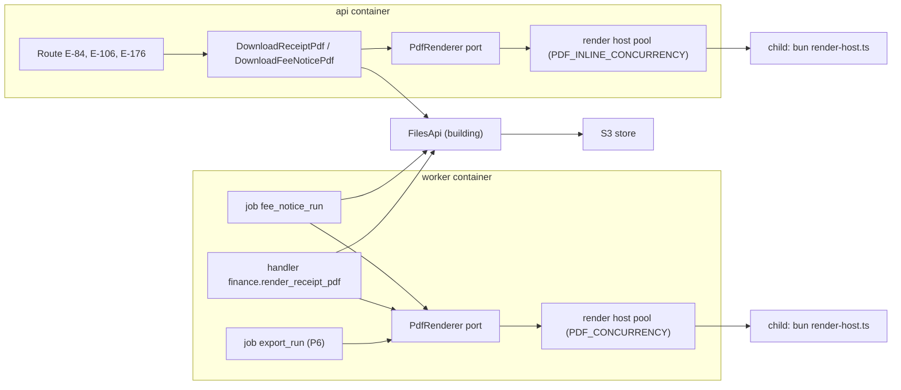

# PDF rendering

> Status: **Approved** (Claude, delegated by the Owner for technical documents, 2026-11-02, for the fee notice, the receipt and the render hosts (P2); §11 and §12, the report and library PDFs, follow DR-298, decided by the Owner 2026-11-02, and are built in P6) · Updated: 2026-11-02 (DR-292 confirmed) · 2026-11-01 (DR-328: E-183, the resident fee-notice PDF) · 2026-10-28 (P1-26: first version, DR-291…298) · DOC-34
> Depends on: original SDD §4.3, §5.6, §13, §14, [DR](../00-decision-register.md) (DR-06, 13, 17, 19, 40, 50, 54, 55, 56, 61, 71, 86, 115, 119, 120, 123, 180, 244, 245, 258), [DOC-03](../01-product/requirements.md) (FR-36, NFR-05), [DOC-04](../01-product/use-cases.md) (UC-01, UC-02, UC-03, UC-25), [DOC-09](../03-architecture/messaging-contracts.md) §4.3, §5, §7, [DOC-10](../03-architecture/quality-attributes.md) §6, [DOC-11](../03-architecture/tech-stack-and-versions.md) §3, §5, §7 (row 17), [DOC-12](../03-architecture/code-architecture.md) §4, [DOC-15](../05-data/finance-model.md) §5, §7.3, §10.2, [DOC-17](../05-data/operations-model.md) §1.1, §3.1, [DOC-21](fee-batches-and-import.md) §1, [DOC-22](ledger-and-allocation.md) §7, [DOC-36](building-configuration-and-demo.md) §4, §5, [DOC-37](files-and-uploads.md) §3, §4, §9, §10, [DOC-38](jobs-and-outbox-runtime.md) §3.2, §4, [DOC-40](observability.md) §4, [DOC-41](configuration-reference.md), [DOC-42](error-handling.md) §5, §7.2, [DOC-50](../07-api/api-guidelines.md) §12, [DOC-54](../08-ux-ui/design-system.md), [DOC-06](../02-glossary.md)
> Main readers: P2-13 (PDF rendering), P2-16 (`W-Fee-Notice`, `W-Fee-Record`), P2-17 (receipt view and PDF in the resident app), P5-04 (library PDF), P6-02 (report PDF), EXP-08 (DOC-97), DOC-33, DOC-32, DOC-44, DOC-51, DOC-58, DOC-66

This document says how the system makes its PDF documents: which documents exist, what each one shows and in which language, the fonts and the A4 layouts, where the renderer runs and how its memory is bounded, how a PDF is cached and found again, the bulk ZIP of fee notices, the void watermark of a receipt, and what EXP-08 measures. It does not hold the receipt snapshot or the receipt rules (DOC-15 §7.3, DOC-22 §7), the `fee_notice_job` table (DOC-15 §10.2), the file store, its purposes and `storeGenerated` (DOC-37), the job runtime (DOC-38), the report definitions (DOC-33) or the library pages (DOC-32).

Eight decisions taken while writing are marked `DR-291…298` (§17); DR-298 was decided by the Owner on 2026-11-02; DR-292 (the owner's name) was confirmed by the Owner on 2026-11-02; the others are delegated decisions. EXP-08 has not run (§15): every timing below is *planned* unless it says *measured*.

**Measured on 2026-10-28 (first step of P2-13, not EXP-08).** A scratch script (not committed) rendered a 3-page bilingual fee notice of 60 lines with Be Vietnam Pro under Bun 1.4.3 and `@react-pdf/renderer` 4.9.0 on a developer machine (Intel i7-4790, 8 threads, 15 GiB). Diacritics render and extract correctly (`pdftotext` gives back "Thông báo phí tháng 10/2026", "Nguyễn Thị Ánh Nguyệt"). The renderer **keeps about 1.2 MiB per document** that a forced GC does not free, so one long-lived process cannot render 5,000 documents within 1 GiB (§4.3, DR-291). The figures are in §15.2.

## 1. Purpose and scope

| Document | Module | Input | Language | Rendered by | Trigger | Cached as | Task |
| --- | --- | --- | --- | --- | --- | --- | --- |
| Fee notice (one unit, one batch) | `finance` | the charge, its lines, the batch, the building block, the unit's owner name (§6.1) | `vi`, `en` or `both`: the request, else `feeNoticeLanguage` | `api` (one) or `worker` (bulk) | E-176; the bulk job | `fee_notice_pdf`, published and closed batches only (§8.1) | P2-13 |
| Bulk fee notices (one batch) | `finance` | every `open` or `paid` charge of a published or closed batch | the request's | `worker`, job `fee_notice_run` | E-99 | per-unit `fee_notice_pdf` and one `bulk_zip` (7 days) | P2-13 |
| Receipt (one allocation) | `finance` | the frozen snapshot (DR-17) and, for the void copy, `voided_at` | `feeNoticeLanguage` at the first render; title and tax statement always both | `worker` (handler) or `api` (on demand) | `finance.receipt_render_requested.v1`; E-84, E-106 | `receipt_pdf`, `receipt.pdf_file` (§8.2) | P2-13 |
| Report (one export) | `reporting` | the rows of one report kind and its filters | the requester's account language | `worker`, job `export_run` | `POST /staff/exports` with `format: pdf` (DOC-33) | `export` (7 days) | P6-02 |
| Library page | `wiki` | one published page version (TipTap JSON, DR-50, DR-54) | the reader's account language, Vietnamese fallback | `api` | the page's PDF endpoint (DOC-32) | not cached (§8.3) | P5-04 |

Notices are not rendered as PDF; they are read in the apps (DOC-31). The web CMS has no print layout (DOC-53 §6): a printed document is one of these PDFs.

## 2. Components



| Piece | Where | What it does |
| --- | --- | --- |
| `PdfRenderer` (port) | `modules/<m>/src/application/ports/pdf-renderer.ts` | `render(doc: PdfInput): Promise<Uint8Array>`; `PdfInput` is a tagged union (`fee_notice`, `receipt`, `report`, `wiki_page`) of plain JSON. The application layer never imports React or the renderer (DOC-12 §4) |
| Templates | `modules/finance/src/infrastructure/pdf/fee-notice.tsx`, `receipt.tsx`; `modules/reporting/…/report.tsx`; `modules/wiki/…/wiki-page.tsx` | One React component per document, pure: input JSON in, `<Document>` out. No I/O, no clock |
| `@rms/pdf-assets` | `packages/pdf-assets` | The six font files and `OFL.txt` (§3), `registerFonts()`, the shared primitives (`PageFrame`, `CompanyHeader`, `LabelPair`, `MoneyTable`, `Watermark`, `PageFooter`), the style sheet built from `@rms/design-tokens`, and the render host (§4). A server-only package: no client may import it (a dependency-cruiser rule owed to P2-13) |
| Render host | `packages/pdf-assets/src/host/*` | A child process that renders; a pool in each container (§4) |
| Formatters | `@rms/shared-types` | `formatMoney`, `formatDate` of DR-71, and `amountInWords` (§6.2) |

The templates receive everything they print: the logo bytes, the formatted strings' inputs and the language. They read nothing themselves, so a test renders them with fixtures and no database.

## 3. Fonts

**Be Vietnam Pro** (SIL OFL 1.1) is the only typeface of the PDFs (DR-56). The apps and the web use Geologica and Big Shoulders (DR-180, DOC-54); a PDF and a screen differ in typeface, which is accepted.

| File in `packages/pdf-assets/fonts/` | Weight / style | Used for |
| --- | --- | --- |
| `BeVietnamPro-Regular.subset.ttf` | 400 | Body, table cells |
| `BeVietnamPro-Italic.subset.ttf` | 400 italic | English secondary lines in `both` mode, notes, rich-text italic |
| `BeVietnamPro-Medium.subset.ttf` | 500 | Labels, table headers |
| `BeVietnamPro-SemiBold.subset.ttf` | 600 | Titles, totals |
| `BeVietnamPro-Bold.subset.ttf` | 700 | Watermark, rich-text bold |
| `BeVietnamPro-BoldItalic.subset.ttf` | 700 italic | Rich-text bold and italic together (DR-297) |

- **Source.** The static TTFs of the Google Fonts release (`github.com/google/fonts`, `ofl/bevietnampro`), Copyright 2021 The Be Vietnam Pro Project Authors. DOC-11 §5 records the release and the date.
- **Subset.** `bun run fonts:pdf` (owed to P2-13) runs `uv run --with fontTools pyftsubset` like DS-05, keeping U+0020–007E, U+00A0–00FF (with `×` U+00D7, `²` `³`), U+0100–017F, U+01A0–01B0 (`Ơ ơ Ư ư`), U+0300–0323 (combining marks), U+1EA0–1EF9 (Vietnamese precomposed), U+2010–2027, U+2030, U+2039–203A, U+20AB (`₫`), U+2116, U+2122, U+2190–2193, U+2212, U+25CF (`●`; *found 2026-11-04 (DR-334):* the source font has no such glyph, so a `●` prints `.notdef` like any glyph outside the set and a bullet is drawn another way, P5-04). A test (PD-30) checks every code point of the `vi` and `en` PDF catalog and of a 4,000-word Vietnamese sample is covered. A glyph outside the set (an emoji in a library page) prints as the font's `.notdef` box; the PDF never falls back to another font.
- **Embedding.** `@react-pdf/renderer` embeds only the glyphs a document uses (the smoke document of §15.2 is 31 KB with three faces).
- **Hyphenation is off.** `Font.registerHyphenationCallback(word => [word])`: the default English hyphenator splits Vietnamese syllables wrongly. A word longer than the column breaks at the column edge.
- **Registration** happens once per render host process, before the first render.

## 4. Where rendering runs

### 4.1 The render host

A **render host** is a child process (`Bun.spawn([bun, 'packages/pdf-assets/src/host/main.ts', <templatesModule>], { ipc })`; *revised 2026-11-04 (DR-334):* the parent names the templates module of the document kinds it renders, because a package may not import a module; each rendering module owns one pool) that registers the fonts, waits for `PdfInput` messages, renders with `renderToBuffer` and answers the bytes. The parent keeps a pool of them (DR-291):

| Rule | Value | Why |
| --- | --- | --- |
| Hosts in the worker | `PDF_CONCURRENCY` (1 on staging, 2 on production, DOC-41) | Rendering is CPU-bound JavaScript: two renders in one process ran no faster than one (§15.2), so parallelism needs processes |
| Hosts in each api process | `PDF_INLINE_CONCURRENCY` (1) | On-demand downloads are rare; one host bounds the api's memory |
| Recycle after | `PDF_RENDERER_MAX_DOCUMENTS` (150) documents, or when the host's RSS after a render is above `PDF_RENDERER_MAX_RSS_MB` (400) | The renderer retains about 1.2 MiB per document (§15.2); recycling bounds it |
| One render's limit | 30 s (`PDF_RENDER_TIMEOUT_MS`, code constant) | A render that hangs kills the host (`SIGKILL`); the document is failed (§10) |
| Idle exit | an api host exits after 60 s with no work; a worker host stays | The api does not keep 150 MiB for a rare download |
| Start | lazy, on the first render; a start takes about 0.4 s (fonts and modules) | |
| Crash | the pending render is failed with `PdfRenderError('host_exited')`, the host is replaced | A crash of one document never takes down the worker |

The parent never renders in its own process. A message carries JSON plus the logo bytes (at most 1 MB, DR-61); the answer is the PDF bytes (at most 5 MB for a fee notice, DOC-37 §4).

### 4.2 Waiting for a host

The pool hands out a free host or queues the request. In the api a request waits at most 10 s for a host; past that it answers **503 `service_unavailable`** with `Retry-After: 5` (DOC-42 §5.1), and the route logs `pdf.busy`. In the worker the job and the handler wait without a limit: they are the only users of their pool.

### 4.3 Memory budget (planned, checked by EXP-08)

The rows refine DOC-10 §6.1, which gives the worker 1.0 GB during bulk PDF and the `api` 0.25 GB typical.

| Container | `mem_limit` (DR-06) | Parent | Hosts | Planned peak |
| --- | --- | --- | --- | --- |
| worker, staging | 1.5 GB | ≈ 200 MiB | 1 × ≤ 400 MiB | ≈ 0.6 GiB, within NFR-05's 1 GB |
| worker, production | 1.5 GB | ≈ 200 MiB | 2 × ≤ 400 MiB | ≈ 1.0 GiB |
| api | 1 GB | ≈ 250 MiB | 1 × ≤ 400 MiB, only while rendering | ≈ 0.65 GiB |

The host's RSS starts near 160 MiB and grows by about 1.2 MiB per document (§15.2), so 150 documents end near 340 MiB and the 400 MiB check is the safety net. NFR-05 measures the **worker container** (parent and hosts together), not one process.

## 5. Page and layout system

| Property | Value |
| --- | --- |
| Paper | A4 portrait, 595.28 × 841.89 pt; reports A4 landscape (DR-55) |
| Margins | 40 pt left and right, 36 pt top, 48 pt bottom (room for the footer) |
| Base text | 10 pt Regular, line height 1.4 |
| Secondary language line (`both`) | 8.5 pt Italic, colour `inkMuted`, directly under its Vietnamese line |
| Labels and table headers | 8.5 pt Medium, `inkMuted` |
| Title | 16 pt SemiBold; the English line of a bilingual title 11 pt Regular |
| Amounts | right-aligned; the total 12 pt SemiBold |
| Rules | 0.5 pt, colour `line`; the table header has a 1 pt rule below |
| Colours | from `@rms/design-tokens` only (the light theme: `ink`, `inkMuted`, `line`, `danger`), as everywhere (Biome rule); a PDF prints well in greyscale, so no meaning rests on colour |
| Footer (every page, `fixed`) | two `fixed` texts placed directly in the `Page`, anchored from the top (a page-count text inside a `View` is lost by 4.9.0; DR-334): left: the document number or code; right: "Trang 1/2" (`vi`), "Page 1 of 2" (`en`), "Trang 1/2 · Page 1 of 2" (`both`) |
| Splitting | a table row never splits (`wrap={false}`); the total block and the payment block each stay whole and keep the last table row with them (`minPresenceAhead`) |
| Metadata | `title` = document code (`PH-2610-01 · A-1508`, `BL-2610-0153`), `author` = the company name, `creator` and `producer` = `RMS`; `creationDate` and `modDate` are pinned to 2026-01-01T00:00:00Z by `PDF_DOCUMENT_INFO`, because `@react-pdf/renderer` 4.9.0 stamps the current time when none is given; so one input gives byte-identical output (PD-29; DR-334) |

**Language modes** (FR-36.1). `vi` is the fallback of every bilingual value (DR-71).

| | `vi` | `en` | `both` |
| --- | --- | --- | --- |
| Labels and headings | Vietnamese | English | Vietnamese, the English line below (smaller, italic) |
| Bilingual data (`{vi, en}`: batch name, item name, building name, working hours) | `vi` | `en`, else `vi` | `vi`, then `en` below when it exists and differs |
| Amounts | `2.488.000 đ` | `₫2,488,000` | `2.488.000 đ` once |
| Dates | `15/10/2026` | `Oct 15, 2026` | `15/10/2026` once |
| Times (building time zone, 24-hour) | `09:12` | `09:12` | `09:12` |
| Free text typed by staff (an adjustment's note, an address) | as typed | as typed | as typed |

The catalog keys of every printed label are `pdf.*` in `@rms/i18n-catalog` (DOC-68 owes the rows of §6–§7); the parity test covers them like any other key.

## 6. The fee notice

### 6.1 Content and sources

| Region | Field | Source |
| --- | --- | --- |
| Header | Logo | `building.logo_file`, its 512 px thumbnail (§8.4); none when unset |
| | Company name; address; "Hotline … · email" | `building.company.name` (`{vi, en?}`), `company.address` else `building.address`; `building.hotline`, `building.email` (DOC-17 §1.1) |
| | Building name | `building.name` |
| Title | "Thông báo phí tháng 10/2026" / "Fee notice for October 2026" | `fee_batch.fee_month` |
| Information block (2 × 2) | Unit · Owner · Batch · Issue date | `charge.unit_code`; the unit's active owner's name from `ResidencyApi.unitOwnerNames` (DR-292), "—" when there is none; `fee_batch.code` and `name`; `fee_batch.published_at` in building time (a draft prints today) |
| Table | Item · Basis · Amount | one row per `charge_line` in `position` order: `item_name`; "`quantity` × `unit_price`" (`14 × 12.000 đ`; `1 × …` is printed as the price alone); `amount`. An adjustment line (DR-19) prints its `note` in the Basis column and its negative amount as `−35.175 đ` |
| Total | "Tổng cộng / Total" | `charge.amount` (= Σ lines, DOC-15 §5.2) |
| Due date | "Hạn thanh toán / Due date" | `fee_batch.due_date` |
| How to pay | numbered lines | (1) "Thanh toán trên App cư dân bằng mã QR…" only when the building's gateway configuration is `active` (`BuildingApi.getGatewayConfig`); (2) "Nộp tại văn phòng Ban quản lý, {workingHours}." when `building.working_hours` is set. Neither: the block is omitted |
| Closing line | "Thắc mắc về phí, bạn gọi hotline {hotline} hoặc gửi yêu cầu trên App cư dân." | `building.hotline`; without a hotline the first clause is dropped |
| Draft mark | diagonal "BẢN NHÁP · DRAFT" on every page | only for a `draft` batch (DR-292), so a preview is never mistaken for a notice |

The unit of measure (m², m³, car) is not a column (DR-13); a Manager who wants it writes it in the item name. The canvas `W-Fee-Notice` (design artifact, DOC-66) shows the same regions; the web preview on that screen is HTML built from E-91 and E-93, and its "Tải PDF căn này" button calls E-176.

### 6.2 Wireframe (A4 portrait, `both`)

```text
┌──────────────────────────────────────────────────────────────────────┐
│ [LOGO]  Công ty TNHH Quản lý Tòa nhà Sunrise                          │
│         Sunrise Building Management Co., Ltd.                         │
│         12 Nguyễn Huệ, Quận 1, TP. Hồ Chí Minh                        │
│         Hotline 1900 1234 · bql@sunrise.vn        Chung cư Sunrise A  │
│ ──────────────────────────────────────────────────────────────────── │
│ THÔNG BÁO PHÍ THÁNG 10/2026                                           │
│ Fee notice for October 2026                                           │
│                                                                      │
│ Căn hộ / Unit        A-1508        Chủ hộ / Owner      Trần Minh Anh  │
│ Đợt phí / Batch      PH-2610-01    Ngày phát hành /    01/10/2026     │
│                      Phí tháng 10/2026    Issue date                  │
│ ──────────────────────────────────────────────────────────────────── │
│ Khoản phí / Item         Cách tính / Basis            Thành tiền /    │
│                                                        Amount         │
│ Phí quản lý              85 × 12.000 đ                 1.020.000 đ    │
│ Management fee                                                       │
│ Nước sinh hoạt           14 × 12.000 đ                   168.000 đ    │
│ Water                                                                │
│ Điều chỉnh               Trừ phí nước tính thừa T9        −35.175 đ   │
│ Adjustment                                                           │
│ ──────────────────────────────────────────────────────────────────── │
│                                  Tổng cộng / Total      1.152.825 đ   │
│                                  Hạn thanh toán /        15/10/2026   │
│                                  Due date                             │
│ Hướng dẫn nộp phí / How to pay                                        │
│ 1. Thanh toán trên App cư dân bằng mã QR, gạch nợ ngay khi thanh      │
│    toán thành công.                                                   │
│    Pay in the resident app by QR code. Your balance updates as soon  │
│    as the payment succeeds.                                           │
│ 2. Nộp tại văn phòng Ban quản lý, Thứ 2 – Thứ 6, 8:00 – 17:00.        │
│    Pay at the management office, Mon – Fri, 8:00 – 17:00.            │
│                                                                      │
│ Thắc mắc về phí, bạn gọi hotline 1900 1234 hoặc gửi yêu cầu trên App │
│ cư dân. / Questions about fees: call 1900 1234 or send a request in  │
│ the resident app.                                                     │
│ PH-2610-01 · A-1508                                Trang 1/1 · Page 1 of 1 │
└──────────────────────────────────────────────────────────────────────┘
```

In `vi` or `en` mode every second line disappears and the amounts and dates follow §5. A notice of up to about 25 lines fits one page; a longer one continues on page 2 with the rows unsplit.

### 6.3 Who may render which notice

| Batch status | Charge status | E-176 (one charge) | E-99 (bulk) |
| --- | --- | --- | --- |
| `draft` | `draft` | 200, rendered and not cached, with the draft mark | 409 `invalid_transition` |
| `published`, `closed` | `open`, `paid` | 200, cached | accepted; these charges are rendered |
| `published`, `closed` | `void` (one voided charge, DR-20) | 409 `invalid_transition` | skipped |
| `recalled` | `void` | 409 `invalid_transition` | 409 `invalid_transition` |

A notice prints what the unit owed at publish; it does not show whether the charge is paid. Residents read their fees in the app (`Fee-Detail`, DOC-58) and may also download the notice: `GET /me/fees/{chargeId}/pdf` (E-183, DR-328) renders the notice of an `open` or `paid` charge of the member's unit, in the language the member picks, through the same cache key as the staff PDF; a `void` charge and a charge outside the member's history window are 404. *Revised 2026-11-01 (DR-328):* this sentence said there was no resident endpoint.

## 7. The receipt

### 7.1 Content and sources

Everything comes from `receipt.snapshot` (DR-17, DOC-15 §7.3), so a later change of the company, logo or payer never alters an old receipt (FR-36.2). The only other inputs are the variant and, for the void copy, `receipt.voided_at`.

| Region | Field | Snapshot path |
| --- | --- | --- |
| Header | Logo; company name; address; hotline | `company.logoKey` (§8.4), `company.name`, `company.address`, `company.hotline`; `building.name` on the right |
| Title | "BIÊN LAI THU TIỀN / PAYMENT RECEIPT", **always both languages** (DR-17, DR-295) | — |
| Number and date | "Số / No. BL-2610-0153" · "Ngày / Date 09/10/2026 09:12" | the receipt number (not in the snapshot: `receipt.number`), `issuedAt` in building time |
| Payer block | Unit · Payer · Batch · Fee month | `unitCode`; `payer.name` and, when known, `payer.memberType` as "Chủ hộ", "Thành viên", "Người thuê"; `batch.code`, `batch.name`; `batch.feeMonth` as `10/2026` |
| Table | Item · Quantity × unit price · Amount | `lines[]` as in §6.1; an adjustment prints its `note` |
| Total | "Số tiền / Amount" and "Bằng chữ / In words" | `amount`; `amountInWords(amount, 'vi')` and, in `en` or `both`, `amountInWords(amount, 'en')` |
| Payment | Method · Reference · Paid at | `method` (`online` → "Thanh toán trực tuyến / Online", `cash` → "Tiền mặt / Cash", `bank_transfer` → "Chuyển khoản / Bank transfer"); `reference` or "—"; `paidAt` in building time |
| Statement | "Biên lai này xác nhận khoản đã thu, không phải hóa đơn giá trị gia tăng." / "This receipt confirms a payment received. It is not a VAT invoice." **always both** (DR-17) | — |
| Void copy | diagonal "VOID", 120 pt Bold, colour `danger` at 18% opacity, on every page; under the title "ĐÃ HỦY ngày 12/10/2026 · Voided on Oct 12, 2026" | `voided_at` |

`amountInWords` lives in `@rms/shared-types` beside the formatters of DR-71 (DR-295). Vietnamese reads groups of three with `nghìn`, `triệu`, `tỷ`, uses `mười`/`mươi`, `mốt` (21), `lăm` (15, 25), `linh` (105) and `không trăm` inside a group, starts with a capital and ends with "đồng"; English is lower-case words with hyphenated tens and "dong". Examples (PD-15): `2638000` → "Hai triệu sáu trăm ba mươi tám nghìn đồng" / "Two million six hundred thirty-eight thousand dong"; `1005000` → "Một triệu không trăm linh năm nghìn đồng"; `15000` → "Mười lăm nghìn đồng"; `21000` → "Hai mươi mốt nghìn đồng"; `1000000000` → "Một tỷ đồng".

### 7.2 Wireframe (A4 portrait, `vi`)

```text
┌──────────────────────────────────────────────────────────────────────┐
│ [LOGO]  Công ty Quản lý Vận hành An Phú              Chung cư Sunrise │
│         12 Nguyễn Văn Linh, Quận 7, TP. Hồ Chí Minh · 028 3775 1234   │
│ ──────────────────────────────────────────────────────────────────── │
│                  BIÊN LAI THU TIỀN / PAYMENT RECEIPT                  │
│              Số: BL-2610-0153 · Ngày: 09/10/2026 09:12                │
│ ──────────────────────────────────────────────────────────────────── │
│ Căn hộ     A-1508                  Người nộp   Trần Minh Anh (Chủ hộ) │
│ Đợt phí    PH-2610-01 Phí tháng 10/2026        Kỳ phí      10/2026    │
│ ──────────────────────────────────────────────────────────────────── │
│ Khoản phí                 Số lượng × Đơn giá                Thành tiền│
│ Phí quản lý               2.488.000 đ                      2.488.000 đ│
│ Nước                      12,345 × 15.000 đ                  185.175 đ│
│ Điều chỉnh                Trừ phí nước tính thừa tháng 9     −35.175 đ│
│ ──────────────────────────────────────────────────────────────────── │
│                                         Số tiền           2.638.000 đ │
│ Bằng chữ: Hai triệu sáu trăm ba mươi tám nghìn đồng                   │
│                                                                      │
│ Hình thức    Thanh toán trực tuyến     Mã giao dịch   FT2628273914    │
│ Thời điểm thanh toán   09/10/2026 09:12                               │
│                                                                      │
│ Biên lai này xác nhận khoản đã thu, không phải hóa đơn giá trị gia    │
│ tăng. / This receipt confirms a payment received. It is not a VAT     │
│ invoice.                                                              │
│ BL-2610-0153                                               Trang 1/1  │
└──────────────────────────────────────────────────────────────────────┘
```

A quantity is printed with the language's decimal separator (`12,345` in Vietnamese, `12.345` in English) and trailing zeros removed. One receipt covers one charge (DR-17), so a receipt is always one page in practice; a long adjustment note wraps.

### 7.3 Language of a receipt

A receipt is rendered in `feeNoticeLanguage` **as it is at its first render** and keeps that language: the cached PDF is served even if the setting changes later (DOC-36 §5.2, "a PDF already rendered keeps its language"). The void copy is rendered at the void with the setting of that moment. The title and the tax statement are bilingual in every mode, because they are the document's legal identity (DR-17).

### 7.4 The `pdf.*` copy

Owned here (DOC-68 §1); the catalog files are `packages/i18n-catalog/src/pdf/vi.ts` and `en.ts` and the parity test covers every row. A bilingual mode prints the Vietnamese line with the English one under it (§5), except where a row says otherwise. *Written 2026-11-04 (P2-13).*

| Key | `vi` | `en` |
| --- | --- | --- |
| `pdf.common.page` | Trang {page}/{total} | Page {page} of {total} |
| `pdf.common.unit` | Căn hộ | Unit |
| `pdf.common.batch` | Đợt phí | Batch |
| `pdf.common.item` | Khoản phí | Item |
| `pdf.common.amount` | Thành tiền | Amount |
| `pdf.common.hotline` | Hotline {hotline} | Hotline {hotline} |
| `pdf.common.quantity_price` | {quantity} × {unitPrice} | {quantity} × {unitPrice} |
| `pdf.common.adjustment` | Điều chỉnh | Adjustment |
| `pdf.fee_notice.title` | Thông báo phí tháng {month} | Fee notice for {month} |
| `pdf.fee_notice.owner` | Chủ hộ | Owner |
| `pdf.fee_notice.issue_date` | Ngày phát hành | Issue date |
| `pdf.fee_notice.basis` | Cách tính | Basis |
| `pdf.fee_notice.total` | Tổng cộng | Total |
| `pdf.fee_notice.due_date` | Hạn thanh toán | Due date |
| `pdf.fee_notice.how_to_pay` | Hướng dẫn nộp phí | How to pay |
| `pdf.fee_notice.pay_app` | Thanh toán trên App cư dân bằng mã QR, gạch nợ ngay khi thanh toán thành công. | Pay in the resident app by QR code. Your balance updates as soon as the payment succeeds. |
| `pdf.fee_notice.pay_office` | Nộp tại văn phòng Ban quản lý, {workingHours}. | Pay at the management office, {workingHours}. |
| `pdf.fee_notice.questions` | Thắc mắc về phí, bạn gọi hotline {hotline} hoặc gửi yêu cầu trên App cư dân. | Questions about fees: call {hotline} or send a request in the resident app. |
| `pdf.fee_notice.questions_no_hotline` | Thắc mắc về phí, bạn gửi yêu cầu trên App cư dân. | Questions about fees: send a request in the resident app. |
| `pdf.fee_notice.draft_mark` | BẢN NHÁP | DRAFT |
| `pdf.receipt.title` | BIÊN LAI THU TIỀN | PAYMENT RECEIPT |
| `pdf.receipt.number` | Số | No. |
| `pdf.receipt.date` | Ngày | Date |
| `pdf.receipt.payer` | Người nộp | Payer |
| `pdf.receipt.member_owner` | Chủ hộ | Owner |
| `pdf.receipt.member_member` | Thành viên | Member |
| `pdf.receipt.member_tenant` | Người thuê | Tenant |
| `pdf.receipt.fee_month` | Kỳ phí | Fee month |
| `pdf.receipt.quantity_price` | Số lượng × Đơn giá | Quantity × unit price |
| `pdf.receipt.total` | Số tiền | Amount |
| `pdf.receipt.in_words` | Bằng chữ | In words |
| `pdf.receipt.method` | Hình thức | Method |
| `pdf.receipt.method_online` | Thanh toán trực tuyến | Online |
| `pdf.receipt.method_cash` | Tiền mặt | Cash |
| `pdf.receipt.method_bank_transfer` | Chuyển khoản | Bank transfer |
| `pdf.receipt.method_other` | Khác | Other |
| `pdf.receipt.reference` | Mã giao dịch | Reference |
| `pdf.receipt.paid_at` | Thời điểm thanh toán | Paid at |
| `pdf.receipt.statement` | Biên lai này xác nhận khoản đã thu, không phải hóa đơn giá trị gia tăng. | This receipt confirms a payment received. It is not a VAT invoice. |
| `pdf.receipt.issued_by` | Người lập | Issued by |
| `pdf.receipt.signature_payer` | Người nộp tiền | Payer |
| `pdf.receipt.signature_collector` | Người thu tiền | Collector |
| `pdf.receipt.void_stamp` | ĐÃ HỦY | VOID |
| `pdf.receipt.voided_on` | ĐÃ HỦY ngày {date} | Voided on {date} |
| `pdf.receipt.void_reason` | Lý do hủy | Void reason |
| `pdf.receipt.void_date` | Ngày hủy | Void date |

## 8. Caching and files

Every PDF and ZIP is a `file_object` written by `FilesApi.storeGenerated` as the system account (DOC-37 §9, DR-119); the quota never refuses it (DR-123). The **logical key** goes in `owner_ref` (DR-86) and finds the file again through `ix_file_object_building_owner` with the new call `FilesApi.findByOwnerRef(buildingId, { module, purpose, ownerRef }) → FileDto | null` (DR-293; DOC-37 §3 owes the signature).

### 8.1 Fee notices

| | Value |
| --- | --- |
| Logical key | `batch/<batchId>/unit/<unitId>/<lang>/<hash>.pdf`, purpose `fee_notice_pdf` |
| `<hash>` | the first 16 hex characters of SHA-256 over the canonical JSON (sorted keys) of the render input: template version `FEE_NOTICE_TEMPLATE_VERSION`, language, the batch fields of §6.1, the charge's `unit_code`, `amount` and lines, the owner name, the building block, `logo_file`, and the two "how to pay" switches |
| Hit | `findByOwnerRef` returns an `attached` row: the bytes are read with `FilesApi.read` (E-176) or, in the bulk job, nothing is rendered |
| Miss | render, `storeGenerated`, then return the bytes |
| Drafts | never cached: a draft's lines change, and its notice carries the draft mark (DR-293) |
| Superseded variants | a new hash (a logo, company block, owner or template change) makes a new file; the old one stays `attached` and counts in the quota. About 60 KB × units × languages per change (the capacity model of DOC-10 §5 counts 60 KB per notice, `capacity/capacity.py`); not swept in phase 1 |
| Download name | `PH-2610-01-A-1508.pdf` (`Content-Disposition: attachment; filename*=UTF-8''…`, DOC-50 §12) |

The hash makes FR-36.1's language switch and a building change visible without a purge, and a re-request of unchanged data costs one indexed lookup.

### 8.2 Receipts

| | Value |
| --- | --- |
| Logical keys | `receipt/<receiptId>/issued.pdf` and `receipt/<receiptId>/void.pdf`, purpose `receipt_pdf` |
| Pointer | `finance.receipt.pdf_file` (DOC-15 §7.3): the issued copy while `issued`, the void copy once `void` |
| Download name | `BL-2610-0153.pdf` |

**Handler `finance.render_receipt_pdf`** (`afterSideEffect`, worker; command `finance.receipt_render_requested.v1`, DOC-09 §5):

1. Read the receipt (`building_id`, `id`): `status`, `snapshot`, `pdf_file`, `voided_at`.
2. `variant = issued` and (`status = 'void'` or `pdf_file IS NOT NULL`): done, nothing to render (a void came first, or the inline path won). `variant = void` and `status = 'issued'`: impossible by construction; log `warn` and stop.
3. `findByOwnerRef(…, receipt/<id>/<variant>.pdf)`: a row exists when an earlier attempt stored the file and died before step 5; use it.
4. Otherwise render (§7) and `storeGenerated`.
5. One transaction, conditional on the state the variant expects (DR-295: store first, then swap, so `pdf_file` never points at nothing):

```sql
WITH old AS (
  SELECT pdf_file FROM finance.receipt
   WHERE building_id = :building_id AND id = :receipt_id FOR UPDATE)
UPDATE finance.receipt r
   SET pdf_file = :new_file, updated_at = now()
  FROM old
 WHERE r.building_id = :building_id AND r.id = :receipt_id
   AND r.status = :expected_status                         -- 'issued' or 'void'
   AND r.pdf_file IS DISTINCT FROM :new_file
   AND (:expected_status = 'void' OR r.pdf_file IS NULL)   -- an issued copy never replaces anything
RETURNING old.pdf_file AS replaced;
```

   One row: `FilesApi.remove(replaced)` in the same transaction when `replaced` is not null (the issued copy of a voided receipt). Zero rows: another path already set a pointer; `FilesApi.remove(:new_file)` removes the file this attempt stored. `trg_receipt_guard` allows `pdf_file` to change (DOC-15 §11).

A redelivered command finds step 2 or step 3 true and renders nothing (PD-20). The ordering differs from DOC-37 §9's "remove, then store", which leaves a window with no file; DOC-37 §9 owes the change.

**On demand** (E-84 for a resident within the history filter of DR-40, E-106 for staff, DOC-22 §7): if `pdf_file` is set and `FilesApi.read` returns the bytes, stream them; if it is null, or the object is missing (`file_not_verified` with `missing`), render inline in the api with the variant of the current status and run steps 3–5, then stream. The response is `200 application/pdf`, `Cache-Control: private, no-store` (DOC-50 §12).

### 8.3 Reports and library pages

A report PDF is the export's file: purpose `export`, kept 7 days, delivered as a signed URL with `report.export_ready` (DR-55, DOC-33). A library page PDF is rendered and streamed by the api on every request and not stored (DR-298): it is rare, has no purpose in DOC-37 §4, and a stored copy would need its own cleanup.

### 8.4 The logo

The PDFs use the 512 px copy of the logo, the `thumbnail` row with `owner_ref = 'thumb:<logoFileId>'` (DOC-37 §10); when it does not exist yet, the original. Each render host's parent keeps the last 8 logos it read in memory (keyed by file id), so a bulk run reads the logo once.

A receipt's snapshot names the logo by file id (`company.logoKey`). For that id to stay readable when the Admin changes the logo, **a replaced logo is no longer removed**: the old `file_object` stays `attached` (DR-296, a change of DOC-36 §4 and of BD-10). A logo is at most 1 MB and changes a few times in a building's life. A receipt whose logo file is missing anyway (restored from an old backup) renders without a logo and logs `pdf.logo_missing`; it never fails.

## 9. The bulk fee notices

### 9.1 The request (E-99) and its status (E-177)

`POST /staff/fee-batches/{id}/pdf` (E-99, Manager and Admin, DR-293) with body `{ "language": "vi" | "en" | "both" }` (optional; default the building's `feeNoticeLanguage`):

1. The batch must be `published` or `closed`; otherwise 409 `invalid_transition`. A batch of another building is 404.
2. `INSERT INTO finance.fee_notice_job (id, building_id, batch_id, language, unit_total, requested_by) VALUES (…, (SELECT count(*) FROM finance.charge WHERE building_id = :b AND batch_id = :batch AND status IN ('open', 'paid')), :staff) ON CONFLICT DO NOTHING RETURNING *`. Zero rows means a request is already `queued` or `running` (`uq_fee_notice_job_batch_active`, FNM-111); the answer is that one.
3. Answer **202** with the job:

```json
{
  "id": "0192f3c4-5a1e-7000-8000-0000000000f7",
  "batchId": "0192f3c4-5a1e-7000-8000-0000000000b1",
  "status": "queued",
  "language": "both",
  "unitTotal": 240,
  "unitDone": 0,
  "zip": null,
  "error": null,
  "createdAt": "2026-10-01T03:15:00Z",
  "finishedAt": null
}
```

No audit row: a render is operational work, recorded in `job_run` and the logs (DOC-35 §3.6). No `Idempotency-Key`: a repeat returns the active job.

`GET /staff/fee-batches/{id}/pdf` (E-177) answers the **latest** job of the batch in the same shape, or 404 when there is none. When `status = 'ready'`, `zip` is `{ "url": "<signed GET, 15 minutes>", "expiresAt": "…", "fileName": "PH-2610-01-both.zip", "size": 7373121 }`; after the 7-day purge it is `{ "expired": true }` and the Manager makes a new request (the per-unit PDFs are still cached, so it is fast). `error` is the row's `error` (`{code, …}`) when `failed`, else `null`. `W-Fee-Notice` polls every 3 s while `queued` or `running` (DOC-66).

### 9.2 The job `fee_notice_run`

Mode `claim`, every 5 s (DOC-38 §4.1, DR-120). For each building of `BuildingApi.listBuildings()` (DR-244 item 10):

```sql
-- 1. give up on a job whose attempts are spent and whose lease ran out
UPDATE finance.fee_notice_job
   SET status = 'failed', finished_at = now(), locked_until = NULL, updated_at = now(),
       error = jsonb_build_object('code', 'attempts_exhausted', 'attempts', attempts, 'unitDone', unit_done)
 WHERE building_id = :b AND status = 'running' AND locked_until < now() AND attempts >= 3;

-- 2. claim one job: queued, or running with an expired lease (its worker died)
UPDATE finance.fee_notice_job
   SET status = 'running', attempts = attempts + 1, locked_until = now() + interval '120 seconds',
       started_at = coalesce(started_at, now()), updated_at = now()
 WHERE id = (SELECT id FROM finance.fee_notice_job
              WHERE building_id = :b
                AND (status = 'queued' OR (status = 'running' AND locked_until < now()))
                AND attempts < 3
              ORDER BY created_at
              LIMIT 1 FOR UPDATE SKIP LOCKED)
RETURNING id, batch_id, language, unit_total, unit_done, cursor_charge, attempts;
```

Both use `ix_fee_notice_job_building_claim`. The returned `attempts` is the **fence**: every later write of this run carries `AND attempts = :claimed_attempts AND status = 'running'`, so a worker that lost its lease (a pause longer than 120 s) finds 0 rows, stops and writes nothing more (PD-24). The lease is 120 s and the attempt limit 3 (DR-294; DOC-15 §10.2 leaves both to this document); both are code constants.

**Phase 1, render.** Loop until no charge is left:

1. Read the next 20 charges: `SELECT id, unit_id, unit_code, amount FROM finance.charge WHERE building_id = :b AND batch_id = :batch AND status IN ('open', 'paid') AND (:cursor IS NULL OR id > :cursor) ORDER BY id LIMIT 20` (`ix_charge_building_batch`; 5,000 rows sort in memory), their lines (`ix_charge_line_building_charge`), and the owners of the 20 units (`ResidencyApi.unitOwnerNames`).
2. For each charge compute the key (§8.1); on a hit go on; on a miss render through the pool (up to `PDF_CONCURRENCY` at once) and `storeGenerated`. A document that fails is tried once more at once; a second failure leaves that unit without a file and the loop goes on (DOC-42 §7.2).
3. Save the progress and renew the lease, fenced: `UPDATE finance.fee_notice_job SET unit_done = :n, cursor_charge = :last_id, locked_until = now() + interval '120 seconds', updated_at = now() WHERE id = :id AND status = 'running' AND attempts = :a`. Zero rows: stop.
4. Check `ctx.signal` (shutdown, DOC-38 §3.4) between chunks.

A worker killed in the middle resumes after `cursor_charge` on the next claim; the charges before it are cache hits.

**Phase 2, the ZIP.** Read the charges again in id order (from the start), compute each key, and stream a ZIP into `storeGenerated({ purpose: 'bulk_zip', ownerRef: 'batch/<batchId>/zip/<jobId>.zip', mime: 'application/zip', body })` (multipart, parts of 8 MB, DOC-37 §9):

- An entry per unit `PH-2610-01/A-1508.pdf`, **stored without compression** (`fflate` `ZipPassThrough`: a PDF's streams are already compressed), read with `FilesApi.read` one at a time.
- A unit with no cached file is rendered once more; if that fails it is left out.
- A last entry `PH-2610-01/manifest.csv`: `unit_code,file,status` with `status` `ok` or `failed`, in unit-code order, UTF-8 with a BOM so Excel shows the diacritics.

Memory stays flat: one PDF (≤ 5 MB) and one 8 MB part at a time. Then, fenced: `UPDATE finance.fee_notice_job SET status = 'ready', zip_file = :file, unit_done = unit_total, finished_at = now(), locked_until = NULL, updated_at = now() WHERE id = :id AND status = 'running' AND attempts = :a`.

The count of units that failed is in `manifest.csv` and in the log line `fee_notice.ready` (`failedUnits`), not in the row: `ck_fee_notice_job_failed` forbids an `error` on a `ready` row and the table has no counter (Open question 2). A crash in phase 2 repeats phase 2 only: every PDF is cached. The multipart parts of the dead upload are aborted by the store's lifecycle rule (DOC-37 §5).

If every unit failed, the job ends `failed` with `{"code": "all_units_failed"}` and no ZIP.

### 9.3 Timing (planned)

| Units | Hosts | Planned time | Limit (NFR-05) |
| --- | --- | --- | --- |
| 240 | 1 (staging) | ≈ 40 s (19 s measured on the developer machine, §15.2, doubled for a slower VPS core) | ≤ 2 min |
| 5,000 | 1 (staging) | ≈ 14 min | ≤ 30 min |
| 5,000 | 2 (production) | ≈ 7 min | ≤ 30 min |

The 5-second claim tick and the ZIP phase (reading cached files at the store's speed) add under a minute. EXP-08 replaces these figures.

## 10. Failures

| Failure | Where | Effect | Result |
| --- | --- | --- | --- |
| Render throws (bad input, a font missing a glyph does not throw) | any | `PdfRenderError('render_failed')` | api: 500 `internal_error`, an `error` log with the document kind and id; worker: §9.2 step 2 or the handler retries (`default` class, 8 attempts, DOC-09 §4.4) |
| Render passes 30 s | host | the host is killed and replaced | as above with `timeout` |
| Host exits (memory, crash) | host | the pending render fails, a new host starts | as above with `host_exited`; `pdf_renderer_restarts_total{reason="crash"}` |
| No host free within 10 s | api | — | 503 `service_unavailable`, `Retry-After: 5` |
| `storeGenerated` fails | any | the row stays `pending` (DOC-37 §9 step 4) | api: 503 `service_unavailable`; handler: retried; bulk: the unit is retried in phase 2 |
| The logo cannot be read | any | rendered without a logo | `warn` `pdf.logo_missing` |
| The worker dies during a bulk job | job | the lease expires after 120 s | the next claim resumes; after 3 claims the job is `failed` |
| The batch is recalled during a bulk job | job | phase 1 finds no `open`/`paid` charge left | the job ends `ready` with only the units rendered before; the Manager discards the ZIP. Recall is refused once a charge is paid (DR-20), so this is a rare case |

None of these touches the ledger: a receipt exists and is valid without its PDF (DOC-09 §2 rule 6).

## 11. Report PDFs (P6, DOC-33)

| Property | Value |
| --- | --- |
| Paper | A4 landscape, margins 32 pt |
| Header (first page) | logo, company name, building name; the report title in the requester's language; the filters as "Kỳ phí 07/2026 – 10/2026 · Đợt PH-2610-01"; "Lập lúc 28/10/2026 09:30" |
| Table | the columns of the report kind (DOC-33), the header row repeated on every page (`fixed`), money right-aligned in the language's format, a totals row when the report has one |
| Footer | report name and "Trang n/m" |
| Rows | at most **5,000 rows** in a PDF (DR-298); a larger result is refused at the request with 422 `validation_failed` (rule code `too_many_rows_for_pdf`, `{max}`) and the screen offers Excel (50,000 rows, DR-55) |
| Language | one language, the requester's; no `both` |

The renderer lays out the whole document in memory before writing, so a PDF of 50,000 rows (about 1,100 pages) would not fit a host's budget; 5,000 rows is about 110 pages. P6-02 measures the cap and DOC-33 owns the columns.

## 12. Library page PDFs (P5, DOC-32)

The TipTap JSON of one published version (`content.vi` or `content.en`, DR-54) maps node by node onto the renderer; the server already refused anything outside the subset of DR-50, so the mapping is total.

| Node or mark | PDF |
| --- | --- |
| `doc` | `PageFrame` with the page title (16 pt SemiBold) and "Cập nhật 12/09/2026" |
| `paragraph` | `<Text>` 10 pt, 6 pt below |
| `heading` level 2, 3 | 14 pt and 12 pt SemiBold, kept with the next block (`minPresenceAhead`) |
| `bulletList`, `orderedList`, `listItem` | rows of a bullet `●` or `1.` in a 14 pt column and the content; nesting indents 14 pt per level |
| `hardBreak` | a newline inside the `<Text>` |
| `image` (`file_id`) | the file's 480 px thumbnail, else the original, at most the text width, kept whole; a missing file prints "[Hình ảnh không còn]" |
| `bold`, `italic`, `underline` | nested `<Text>` with weight 700, italic, `textDecoration: underline`; bold and italic use the BoldItalic face |
| `link` (`https`, `tel`, `mailto`) | `<Link>` underlined; the URL printed in brackets after the text when it differs from it |
| YouTube video (DR-54) | the line "Video: https://www.youtube.com/watch?v=…" |
| Attachments | a closing list "Tệp đính kèm" with the names (no content) |

A page is exported in the reader's language (Vietnamese fallback, DR-71), rendered by the api's pool and streamed, not stored (§8.3). P5-04 tests the mapping with a page that holds every node and mark.

## 13. Configuration

| Key | Default | Meaning | Status |
| --- | --- | --- | --- |
| `PDF_CONCURRENCY` | 1 (`production` 2) | Render host processes in the worker (DOC-41 §12) | exists; meaning revised by DR-291 |
| `PDF_INLINE_CONCURRENCY` | 1 | Render hosts in each api process | DOC-41 §14 (P2) |
| `PDF_RENDERER_MAX_DOCUMENTS` | 150 | A host is replaced after this many documents | DOC-41 §14 (P2) |
| `PDF_RENDERER_MAX_RSS_MB` | 400 | A host whose RSS after a render is above this is replaced | DOC-41 §14 (P2) |

Code constants (a change is a DR): the render timeout 30 s, the api wait 10 s, the api host idle exit 60 s, the logo cache of 8, the bulk chunk of 20, the lease of 120 s, the 3 attempts, the 3-second poll of the screen, `FEE_NOTICE_TEMPLATE_VERSION` and `RECEIPT_TEMPLATE_VERSION` (raised when a template changes the output). Settings read: `feeNoticeLanguage` (DOC-17 §1.2).

## 14. Metrics and logs

DOC-40 §4.8 is the source of the three rows.

| Metric | Type | Labels | Note |
| --- | --- | --- | --- |
| `pdf_renders_total` | counter | `document` (`fee_notice`, `receipt`, `report`, `wiki_page`), `outcome` (`rendered`, `cached`, `failed`) | `cached` counts a cache hit that avoided a render |
| `pdf_render_duration_seconds` | histogram, buckets 0.1, 0.25, 0.5, 1, 2.5, 5, 10, 30 | `document` | from the message to the host to the bytes back |
| `pdf_renderer_restarts_total` | counter | `reason` (`documents`, `rss`, `timeout`, `crash`) | a rising `crash` or `timeout` is a defect |

Exported by the process that owns the pool (`api` or `worker`). The bulk job also reports through `job_runs_total` and `job_duration_seconds{job_name="fee_notice_run"}` (DOC-40 §4.2); its `job_run.details` is `{"documents": n, "cached": c, "failed": f}`. No new alert: a failing bulk job is visible on the screen and a failing receipt render is retried and then dead-lettered (`OutboxDeadLetters`, RB-05).

**Logs:** `pdf.rendered` (`debug`: `document`, `ms`, `bytes`), `pdf.failed` (`error`: `document`, `id`, `reason`), `pdf.busy` (`warn`), `pdf.logo_missing` (`warn`), `pdf.host_recycled` (`info`: `reason`, `documents`, `rssMb`), `fee_notice.ready` (`info`: `jobId`, `units`, `cached`, `failedUnits`, `ms`). No log line holds a payer's or owner's name or an amount.

## 15. EXP-08

### 15.1 Method (planned; DOC-97 holds the experiment and its cases: 240 in `vi`, `en` and `both`, 5,000 in `both` cold and warm, DR-320)

| | |
| --- | --- |
| Where | the staging VPS (2 vCPU, 4 GB; worker `mem_limit` 1.5 GB, `PDF_CONCURRENCY` 1), DR-06 |
| Data | a generated building with 240 units, then 5,000 units; one published batch, 6 lines per charge (two adjustments among them), `both` language, a 512 px logo, owner names with full diacritics |
| Steps | (1) empty the `fee_notice_pdf` cache; (2) `POST …/pdf` (E-99); (3) poll E-177 until `ready`; (4) repeat with the cache warm |
| Measured | wall time from the request to `ready`; peak memory of the worker container (`memory.peak` of its cgroup, every second); CPU; ZIP size; `pdf_renderer_restarts_total`; a `pdftotext` check of 10 random PDFs for the owner name and the total |
| Pass | 240 in ≤ 2 min, 5,000 in ≤ 30 min, worker container memory ≤ 1 GB (FR-36.4, NFR-05); every PDF opens; the manifest lists every unit `ok` |
| Output | `docs/10-testing/experiments/results/EXP-08-<date>.json` and the table below |
| Fallback | if a limit is missed: lower `PDF_RENDERER_MAX_DOCUMENTS`, then the same renderer under Node in the host (a new DR), then Typst (DR-56) |

### 15.2 Results

| Run | Date | Machine | Units | Hosts | Time | Peak memory | Status |
| --- | --- | --- | --- | --- | --- | --- | --- |
| EXP-08, cold cache | — | staging | 240 | 1 | — | — | planned (P2-13) |
| EXP-08, cold cache | — | staging | 5,000 | 1 | — | — | planned (P2-13) |
| EXP-08, warm cache | — | staging | 5,000 | 1 | — | — | planned (P2-13) |
| First-step smoke, one process | 2026-10-28 | i7-4790, 8 threads, 15 GiB; Bun 1.4.3; `@react-pdf/renderer` 4.9.0 | 240 | 1 in-process, 1 at a time | 19.1 s | 482 MiB RSS | measured; not EXP-08 |
| First-step smoke, one process | 2026-10-28 | the same | 240 | 1 in-process, 2 at a time | 22.3 s | 554 MiB | measured |
| First-step smoke, one process | 2026-10-28 | the same | 720 | 1 in-process, 2 at a time | 69.3 s | 1,012 MiB (990 MiB with `Bun.gc(true)` every 20 documents) | measured |
| P2-13 spike, render hosts | 2026-11-04 | Apple M2, 8 cores, 16 GiB; Bun 1.4.3; `@react-pdf/renderer` 4.9.0 | 240 | 1 host, 1 at a time; recycled every 150 documents | 14.4 s (60 ms per document) | 412 MiB (this process and its host); 1 recycle | measured with `scripts/pdf-spike.ts`; not EXP-08 |
| P2-13 spike, render hosts | 2026-11-04 | the same | 5,000 | 1 host, 1 at a time; recycled every 150 documents | 280.1 s (56 ms per document) | 439 MiB; 33 recycles; 0 failures | measured; not EXP-08 |

The smoke document: 3 pages, 60 bilingual lines, a fixed page footer and, in one variant, the VOID watermark; 31,396 bytes; the ZIP of 720 such PDFs, stored, was 22.2 MB. The script ran from the scratch directory and is not committed; P2-13 commits its own. What it shows: the renderer runs under Bun with Vietnamese text; one process renders about 12 three-page documents a second on this machine; two renders inside one process are not faster than one; and memory grows by about 1.2 MiB per document even under a forced GC, which is why §4 recycles render hosts (DR-291). DOC-11 §7 row 17 owes "partial: renders; memory grows; hosts recycled".

**P2-13 spike, 2026-11-04.** `bun scripts/pdf-spike.ts --units 5000` renders 5,000 notices of 60 lines in `both` through the real pool and the real template (no job, no store, no database). On the M2 the time is a fifth of the 30-minute limit and the peak memory of the process and its host is below half of the 1 GB limit, with the recycling of §4.1 doing what §4.3 planned (the host ends near 400 MiB at most). The staging VPS core is slower than an M2; EXP-08 on staging (DOC-97) gives the result that counts and stays open (it needs the staging host, the job and the Stripe-free seed). The spike averages 47 KB per PDF.

## 16. Required tests

Prefix `PD-` (master plan §0.2, DOC-88). Templates are tested with fixtures and no database (`bun test`); the job, the handler and the endpoints against a template database and the in-memory store (DOC-37), with a fake render host where the test is about the flow.

### 16.1 Templates and fonts

| ID | Scenario | Expected |
| --- | --- | --- |
| PD-01 | The fee notice of §6.2 in `vi`, `en`, `both` | Each PDF opens; the text reader (`pypdf` through `uv`, DR-334; `pdftotext` is not installed) finds "THÔNG BÁO PHÍ THÁNG 10/2026" (`vi`), "FEE NOTICE FOR OCTOBER 2026" (`en`), both titles (`both`); the total `1.152.825 đ` or `₫1,152,825`; the due date `15/10/2026` or `Oct 15, 2026` (FR-36.1) |
| PD-02 | A line name with every Vietnamese tone mark ("Nguyễn Thị Ánh Nguyệt, ỷ ỹ ự ữ") | The extracted text equals the input; the PDF embeds only Be Vietnam Pro faces |
| PD-03 | An item name with `en` missing, in `en` and `both` | `en` prints the `vi` name; `both` prints it once |
| PD-04 | An adjustment line −35,175 with the note "Trừ phí nước tính thừa tháng 9" | The Basis column shows the note; the amount `−35.175 đ` |
| PD-05 | 60 lines | Two or more pages; no row split across pages; the total block is on the last page with at least one row; footer "Trang 2/3 · Page 2 of 3" |
| PD-06 | A draft batch | The draft mark on every page; no `fee_notice_pdf` row is written |
| PD-07 | Gateway `active`, working hours set; then gateway `disabled`, no working hours | Two payment lines; then no "How to pay" block |
| PD-08 | A unit without an active owner | "Chủ hộ / Owner —" |
| PD-10 | The receipt of DOC-15 §7.3 in `vi` | "BIÊN LAI THU TIỀN / PAYMENT RECEIPT" and the bilingual VAT statement are present; number `BL-2610-0153`; `2.638.000 đ`; "Hai triệu sáu trăm ba mươi tám nghìn đồng" (FR-36.2) |
| PD-11 | The same receipt in `en` | Title and statement still bilingual; `₫2,638,000`; "Two million six hundred thirty-eight thousand dong" |
| PD-12 | The void copy | "VOID" on every page; "ĐÃ HỦY ngày 12/10/2026"; the number unchanged (FR-36.3) |
| PD-13 | A receipt rendered, then the building's company name and logo changed, then rendered again from the same snapshot | Byte-identical PDFs (FR-36.2) |
| PD-14 | Quantity `12.345` | `12,345` in `vi`, `12.345` in `en` |
| PD-15 | `amountInWords` for 2,638,000; 1,005,000; 15,000; 21,000; 105,000; 1,000,000,000; 2,488,000 | The strings of §7.1 and "Một trăm linh năm nghìn đồng", "Hai triệu bốn trăm tám mươi tám nghìn đồng"; English for the same |
| PD-16 | `pdf.*` catalog keys | Present in `vi` and `en` with the same ICU placeholders (parity test) |
| PD-29 | The same input rendered twice | Byte-identical output (no creation date) |
| PD-30 | Every code point of the `pdf.*` catalog and a 4,000-word Vietnamese sample | Covered by each of the six subset files |
| PD-31 | A library page holding every node and mark of DR-50 | Each maps as §12; links clickable; an emoji prints `.notdef` without an error (P5-04) |

### 16.2 Cache, receipts and endpoints

| ID | Scenario | Expected |
| --- | --- | --- |
| PD-17 | E-176 for A-1508 of a published batch, twice | First: rendered, one `fee_notice_pdf` row with the key of §8.1; second: `cached`, no render; both `200 application/pdf`, file name `PH-2610-01-A-1508.pdf` |
| PD-18 | The same with `language=en`, then after a logo change | A second and a third row (new hashes); the first row stays |
| PD-19 | E-176 on a voided charge, on a recalled batch, on another building's charge | 409, 409, 404 |
| PD-20 | `receipt_render_requested(issued)` delivered twice | One render, one `receipt_pdf` row, `pdf_file` set once |
| PD-21 | Issued render pending; the payment is voided; `void` handled before `issued` | `pdf_file` = the void copy; the late `issued` command renders nothing |
| PD-22 | The handler dies after `storeGenerated` and before the swap; redelivered | No second render: the stored row is found by its key and swapped in |
| PD-23 | E-84 for a receipt with `pdf_file` null, while the handler also runs (barrier) | Both answer or finish; exactly one `receipt_pdf` row stays attached; the other is `deleted` |
| PD-25 | E-84 by a member whose membership started after the payment | 404 (DR-40, DOC-22 §8.4) |
| PD-26 | Three E-176 requests at once with `PDF_INLINE_CONCURRENCY` 1 and a host that takes 12 s | The third waits 10 s and gets 503 `service_unavailable` with `Retry-After: 5` |
| PD-32 | A host past `PDF_RENDERER_MAX_DOCUMENTS` | Replaced before the next render; `pdf_renderer_restarts_total{reason="documents"}` + 1 |
| PD-33 | A host that hangs past 30 s | Killed; the document `failed`; the next render succeeds on a new host |

### 16.3 Bulk

| ID | Scenario | Expected |
| --- | --- | --- |
| PD-09 | E-99 on a draft and on a recalled batch | 409 `invalid_transition`; no job row |
| PD-24 | Two workers; the first pauses past the 120 s lease; the second claims the job | The first's next progress update changes 0 rows and it stops; the job finishes once (barrier race test) |
| PD-27 | E-99 twice at once (barrier) | One job; both answers carry its id (FNM-111) |
| PD-28 | 240 units; the worker is killed after 100 | The next claim resumes after `cursor_charge`; the 100 are cache hits; the ZIP holds 240 PDFs and a manifest of 240 `ok`; `attempts` = 2 |
| PD-34 | One unit's render fails twice | The ZIP holds 239 PDFs; `manifest.csv` lists that unit `failed`; the job is `ready` |
| PD-35 | Every render fails | The job `failed` with `all_units_failed`; no ZIP |
| PD-36 | A job claimed 3 times whose lease expires again | Step 1 marks it `failed` with `attempts_exhausted` |
| PD-37 | E-177 for a `ready` job, then after `finance_purge` removed the ZIP | `zip.url` signed for 15 minutes; then `{"expired": true}` (DR-123) |
| PD-38 | The ZIP of 240 PDFs | Entries `PH-2610-01/<unit>.pdf` stored (method 0), the manifest last, UTF-8 BOM; the ZIP opens with `unzip -t` |
| PD-39 | Run the job twice on a `ready` job | The second claim finds nothing; no second ZIP |

EXP-08 (§15) covers FR-36.4 and NFR-05.

## 17. Decisions made while writing

| ID | Decision | Status | Where used |
| --- | --- | --- | --- |
| DR-291 | PDFs render in **render host** child processes, never in the api or worker process: a pool per container (`PDF_CONCURRENCY` in the worker, `PDF_INLINE_CONCURRENCY` 1 in each api process), each host replaced after `PDF_RENDERER_MAX_DOCUMENTS` (150) documents or above `PDF_RENDERER_MAX_RSS_MB` (400), a 30 s render timeout, an api host exits after 60 s idle, the api waits 10 s for a host then answers 503. Measured reason: `@react-pdf/renderer` 4.9.0 under Bun 1.4.3 keeps about 1.2 MiB per document under a forced GC, and two renders in one process are not faster than one (§15.2) | Decided (Claude, delegated; confirm with EXP-08) | §4, §13, §14 |
| DR-292 | Fee-notice content: the unit's active owner's name is printed (as on the canvas `W-Fee-Notice`), read with a new `ResidencyApi.unitOwnerNames(buildingId, unitIds ≤ 500) → Array<{unitId, ownerName: string \| null}>` from `resident_profile.full_name`; the Basis column is "quantity × unit price" (no unit of measure exists, DR-13) or an adjustment's note; "how to pay" lines depend on an active gateway and on working hours; a draft carries "BẢN NHÁP · DRAFT" | Decided (Claude, delegated; confirm: a person's name on a printed notice, DOC-35 §7.1 inventory) | §6 |
| DR-293 | Fee-notice cache and endpoints: drafts are never cached; the key `batch/<b>/unit/<u>/<lang>/<hash16>.pdf` hashes the render input; superseded variants stay; new `FilesApi.findByOwnerRef`; **E-99 is the bulk request only** (published or closed batch, body `{language?}`, 202 with the job, a repeat returns the active job), **E-176** `GET /staff/charges/{id}/pdf?language=` downloads one notice synchronously, **E-177** `GET /staff/fee-batches/{id}/pdf` reads the latest bulk job | Decided (Claude, delegated) | §6.3, §8.1, §9.1 |
| DR-294 | The bulk job: lease 120 s renewed after every chunk of 20 charges, every write fenced by the claimed `attempts`, 3 attempts then `failed` (`attempts_exhausted`), a unit that fails twice is left out and listed `failed` in `manifest.csv`, entries stored uncompressed with `fflate` 0.8.3 (new dependency), ZIP named `<batch code>-<lang>.zip`, `all_units_failed` when nothing rendered | Decided (Claude, delegated) | §9 |
| DR-295 | Receipts: keys `receipt/<id>/issued.pdf` and `void.pdf`; the language is fixed at the first render; the handler stores first and swaps `pdf_file` in a conditional update (DOC-37 §9's "remove, then store" reversed); the title and the VAT statement are bilingual in every mode; the receipt prints the amount in words (`amountInWords` in `@rms/shared-types`) and the payer's member type | Decided (Claude, delegated) | §7, §8.2 |
| DR-296 | A replaced logo is not removed: its `file_object` stays `attached`, because receipt snapshots name it by id (DR-17's "a later logo change never alters an old receipt"). Changes DOC-36 §4 ("the old logo goes through `FilesApi.remove`") and BD-10 | Decided (Claude, delegated) | §8.4 |
| DR-297 | Fonts: a sixth file `BeVietnamPro-BoldItalic` (rich text uses bold and italic together; the renderer refuses an unregistered face), the subset ranges of §3, hyphenation off, colours from the design tokens | Decided (Claude, delegated) | §3, §5 |
| DR-334 | The host takes its templates module as an argument; `PDF_DOCUMENT_INFO` pins both dates; the footer is two `fixed` texts straight in the `Page`; tests read text with `pypdf` through `uv`; the spike script is committed | Decided (Claude, delegated, 2026-11-04) | §2, §4.1, §5, §15.2, §16.1 |
| DR-298 | Report PDFs are capped at 5,000 rows (Excel keeps 50,000, DR-55), refused with `validation_failed` / `too_many_rows_for_pdf`; library page PDFs are rendered on request and not stored | Decided by the Owner 2026-11-02 (narrows DR-55 for PDF; for the Owner, measured in P6-02) | §11, §12 |

## 18. Not in this document

| Topic | Lives in |
| --- | --- |
| The receipt snapshot, its fields and who may read a receipt | DOC-15 §7.3, DOC-22 §7 |
| `fee_notice_job` DDL, `receipt.pdf_file` | DOC-15 §7.3, §10.2 |
| `file_object`, purposes, limits, `storeGenerated`, `read`, `signedUrl`, thumbnails, the purge of `bulk_zip` | DOC-17 §3.1, DOC-37 |
| The job runtime, claim mode, shutdown | DOC-38 |
| Report kinds, columns, `export_job` | DOC-33 |
| Library pages, versions, the page PDF endpoint | DOC-32 |
| The screens `W-Fee-Notice`, `W-Fee-Record`, `Fee-History`, `Pay-Done` and their copy | DOC-66, DOC-58, DOC-68 |
| Endpoint samples and numbers | DOC-51 |
| Versions and licences | DOC-11 |

## 19. Traceability

| Item here | Decision | Requirements and tests |
| --- | --- | --- |
| §3 fonts | DR-56, DR-180, DR-297 | FR-36.1; PD-02, PD-30 |
| §4 render hosts | DR-06, DR-56, DR-291 | NFR-05; PD-26, PD-32, PD-33; EXP-08 |
| §5 layout and languages | DR-56, DR-71 | FR-36.1; PD-01, PD-03, PD-05, PD-14, PD-29 |
| §6 fee notice | DR-13, DR-19, DR-20, DR-56, DR-292 | FR-36.1; PD-01…09 |
| §7 receipt | DR-17, DR-24, DR-40, DR-295 | FR-36.2, FR-36.3; PD-10…15, PD-20…25 |
| §8 caching | DR-56, DR-86, DR-119, DR-123, DR-293, DR-296 | PD-17…23 |
| §9 bulk | DR-56, DR-120, DR-244, DR-245, DR-294 | FR-36.4, FR-36.5, NFR-05; PD-24, PD-27, PD-28, PD-34…39; EXP-08 |
| §11, §12 | DR-50, DR-54, DR-55, DR-298 | FR-34, FR-35; PD-31 |

## Open questions

1. **Closed by DR-298 (decided by the Owner, 2026-11-02):** a report PDF is capped at 5,000 rows while Excel keeps 50,000. It concerns only §11 and §12 (report and library PDFs), which P6-02 measures; DOC-33 plans with the cap until then. The fee notice and the receipt (the P2 part of this document) do not depend on it.
2. **Closed by DR-333 (2026-11-02):** `W-Fee-Notice` shows no count of failed units in P2; the count is in `manifest.csv` (a `failed_units` column follows only if EXP-08 finds failures).
3. **DR-292** prints the owner's name on a notice that may be left in a mailbox: confirmed by the Owner on 2026-11-02, kept; DOC-35 §7.1 lists it.
