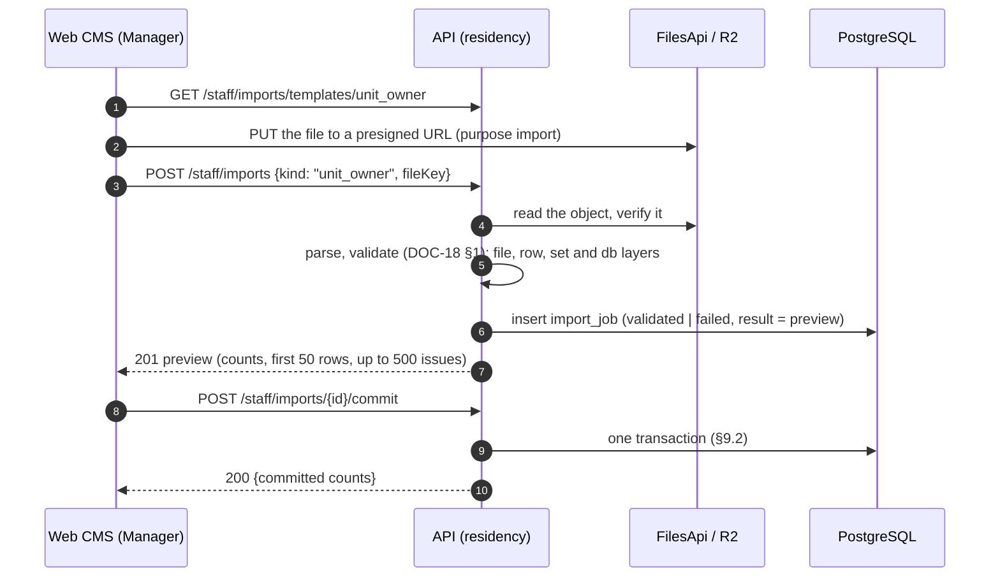

# Residency and memberships

> Status: **Review** · Updated: 2026-10-21 (DR-226: E-169 in the module table; earlier: DR-212, DR-214: list fields, the four member types in the add form; DR-149: `fileId`, deletion filter, retype race, 204) · DOC-27
> Depends on: original SDD §7.2, §7.4, §7.7, §11, [DR](../00-decision-register.md) (DR-09, 12, 21, 22, 36, 40, 41, 42, 48, 58, 59, 74, 87, 99, 106, 108, 109, 114, 124, 125, 126, 127, DR-226), [ADR-0010](../04-adr/0010-two-account-kinds-membership-scoped-authorization.md), [ADR-0014](../04-adr/0014-schema-per-module-no-cross-module-foreign-keys.md), [DOC-03](../01-product/requirements.md) (FR-16…18, FR-31.2, FR-39, NFR-08, NFR-12, NFR-14), [DOC-04](../01-product/use-cases.md) (UC-13, UC-14, UC-15, UC-27), [DOC-09](../03-architecture/messaging-contracts.md) §6.2, §7, [DOC-12](../03-architecture/code-architecture.md) §5.3, §7, §8, §11, [DOC-16](../05-data/identity-and-residency-model.md) §5, [DOC-18](../05-data/data-quality-rules.md) §1, [DOC-35](audit-privacy-and-terms.md) §3, §6, §10, [DOC-36](building-configuration-and-demo.md) §6, §10, [DOC-42](error-handling.md) §5, [DOC-06](../02-glossary.md)
> Main readers: P1-12 (`residency` module), P1-13 (units and owners import), P1-14 (staff, unit and resident API), P4-10 (household management), P5-05 (lookup API), DOC-26, DOC-29, DOC-30, DOC-46, DOC-48, DOC-51, DOC-59, DOC-65, EXP-10

This document says how the `residency` module behaves: the request guard and the policy table, units, resident profiles, memberships, household changes by the owner and by the Manager, ownership transfer, the login phone change, the units-and-owners import (its commit transaction, not its validation rules), the unit history, lookup and search, and the handler of an account deletion. It holds the contract `ResidencyApi` in full. It does not hold the tables (DOC-16 §5), the validation rules of the import (DOC-18 §1), sign-in, sessions and the identity side of every call below (DOC-26), the QR credential and the Guard's lookup view (DOC-29), plate search (DOC-30), the deletion workflow around the handler (DOC-35 §10, DOC-20 §8) or the endpoint list with `E-xx` numbers (DOC-51). Endpoints are written as method and path until DOC-51 exists.

**Statements tested on 2026-10-20** on `postgres:18.6` (aarch64, Docker) on a database built from the DDL of DOC-16 §3.1, §4 and §5, seeded with 6 accounts, 3 units and 5 memberships. §17.1 lists what was run. The seeded plans are for correctness, not for speed; only the import loop of §9.3 is a timing, and it is server side only.

Every new decision in this document is recorded as DR-136…DR-141 and summarized in §18.

## 1. Purpose and scope

| Component | Main class | Runs in | Trigger | Reads | Writes | Task |
| --- | --- | --- | --- | --- | --- | --- |
| Request guard `unit(capability)` | `UnitGuard` (built in `apps/api/src/bootstrap/guards.ts`, DR-99) | `api` | Every `/me/*` request | `residency.membership` through `ResidencyApi.getMembership`; `BuildingApi.hasAcceptedLatestTerms` | none | P1-12 |
| Unit use cases | `CreateUnit`, `UpdateUnit`, `GetUnit`, `ListUnits` | `api` | `/staff/units*` | `unit`, `membership`, `FinanceApi.getOutstandingByUnit` | `unit`, `unit_history` | P1-14 |
| Resident use cases | `CreateResident`, `UpdateProfile`, `GetResident`, `ListResidents`, `ChangeLoginPhone` | `api` | `/staff/residents*` | `resident_profile`, `membership`, `IdentityApi` | `resident_profile`, `membership`, `unit_history` | P1-14 |
| Membership use cases (staff) | `ChangeMembership` | `api` | `PATCH /staff/memberships/{id}` | `membership` | `membership`, `unit_history` | P1-14 |
| Household use cases (owner) | `AddMember`, `ChangeMember`, `RemoveMember`, `ListMembers` | `api` | `/me/members*` | `membership`, `IdentityApi.getResidentAccounts` | `membership`, `resident_profile`, `unit_history` | P4-10 |
| Ownership transfer | `TransferOwnership` | `api` | `POST /staff/units/{id}/owner` | `unit`, `membership` | `unit`, `membership`, `resident_profile`, `unit_history` | P1-14 |
| Import | `ValidateUnitOwnerImport`, `CommitUnitOwnerImport` | `api` | `POST /staff/imports`, `…/commit`, `GET /staff/imports` (E-169) | `import_job`, the file | `unit`, `resident_profile`, `membership`, `unit_history`, `import_job` | P1-13 |
| Lookup | `ResidencyApi.lookup`, `SearchResidents`, `SearchUnits` | `api` | `GET /staff/residents?q=`, `GET /staff/units?q=`, `GET /staff/lookup?q=` (hosted by `access`, §11) | `unit`, `resident_profile`, `membership`, `IdentityApi` | none | P1-14, P5-05 |
| Deletion handler | `residency.clear_profile_on_identity_account_deletion_executed` | `worker` | `identity.account_deletion_executed.v1` | `membership` | `membership`, `resident_profile`, `unit_history` | P1-12 |
| `import_expire`, `import_purge` | jobs of `residency` | `worker` | hourly :25, Sunday 04:00 | `import_job` | `import_job`, `FilesApi.remove` | P1-13 (DOC-38 §4) |

One building per deployment (DR-115); the code still takes the `BuildingScope` everywhere (DR-12). An account belongs to a building **when it has a `resident_profile` row there** (DR-136). Staff reach a resident's data only through that row.

## 2. Components and interfaces

### 2.1 The contract `ResidencyApi`

The rules of DOC-09 §7.1 apply (plain DTOs, no `Date`, the caller's transaction, keyset pages, `null` for a missing thing). The first seven calls are in DOC-09 §7.2; the last three are new and owed to it (DR-140).

```ts
interface ResidencyApi {
  getMembership(accountId: Uuid, unitId: Uuid): Promise<MembershipDto | null>
  listRecipients(unitId: Uuid, capability: Capability, page?: PageRequest): Promise<Page<RecipientDto>>
  listNoticeRecipients(buildingId: Uuid, cursor: string | null, limit: number): Promise<Page<NoticeRecipientDto>>
  activeUnitIds(accountId: Uuid): Promise<Uuid[]>
  getUnits(ids: Uuid[]): Promise<UnitDto[]>
  getMembershipForScan(membershipId: Uuid): Promise<ScanMembershipDto | null>
  ownedUnitIds(accountId: Uuid): Promise<Uuid[]>
  // new (DR-140)
  listActiveMemberships(accountId: Uuid): Promise<ActiveMembershipDto[]>
  buildingIdsOfAccounts(accountIds: Uuid[]): Promise<Array<{ accountId: Uuid; buildingId: Uuid }>>
  lookup(buildingId: Uuid, q: string, opts?: { limitPerKind?: number }): Promise<LookupDto>
}
interface ActiveMembershipDto {            // the sign-in answer and GET /me
  membershipId: Uuid; buildingId: Uuid; unitId: Uuid; unitCode: string
  memberType: MemberType; canPay: boolean
}
interface LookupDto { units: UnitHitDto[]; residents: ResidentHitDto[] }
interface UnitHitDto { unitId: Uuid; code: string; floor: number | null; occupancy: 'occupied' | 'rented' | 'vacant'
                       owner: { accountId: Uuid; fullName: string | null; phone: string } | null }
interface ResidentHitDto { accountId: Uuid; fullName: string | null; phone: string
                           memberships: Array<{ unitId: Uuid; unitCode: string; memberType: MemberType; status: 'active' | 'locked' }> }
```

| Call | Behavior |
| --- | --- |
| `listActiveMemberships` | The memberships of the account whose status is `active`, ordered by unit code. A `locked` one is not returned: a locked membership gives no access, and the app must not offer it in `Unit-Pick`. At most 500 rows; more is a data defect and the call throws (same rule as `activeUnitIds`). Statement: S11 of §17.1; served by `membership_one_per_account_unit` (prefix `account_id`) and the unit primary key. An empty answer is the neutral screen "No unit is linked to this account" (UC-14 E7). |
| `buildingIdsOfAccounts` | The distinct buildings in which each account has a **non-removed** membership, for up to 500 account ids; an account with none is absent. The boot guard of DOC-36 §10.1 check 1 calls it with the `is_demo` account ids and compares each building with `BuildingApi.isDemo`. |
| `lookup` | The union search of §11 for units and residents. `limitPerKind` 1…20, default 20. The DTO carries the **full** E.164 phone; the caller maps it to the audience (a Guard gets it masked, DOC-12 §10, DOC-29). The caller never logs the DTO. |

`MembershipDto.status` is `active` or `locked`; a `removed` row is never returned (DOC-09 §7.2). The calls `getUnits`, `listRecipients`, `listNoticeRecipients`, `getMembershipForScan` and `ownedUnitIds` behave as DOC-09 §7.2 says.

### 2.2 What `residency` calls

| Contract | Used for | Why through a contract |
| --- | --- | --- |
| `IdentityApi.findOrCreateResidentAccount(phone, displayName): Promise<{ accountId; created }>` | Creating the account of a new member, owner or import row (§6, §7, §9). Idempotent on the phone; an existing account keeps its name; an invalid number throws `ValidationError` with rule `phone_invalid`. Joins the caller's transaction | `identity` owns `resident_account` |
| `IdentityApi.changeResidentPhone(accountId, newPhone): Promise<void>` | §8. 404 for an unknown account, 409 `phone_in_use`; revokes every refresh family with reason `phone_changed` and emits `identity.session_revoked.v1` per family | The phone and the sessions are identity's |
| `IdentityApi.queueMemberInvitation(accountId, { unitCode }): Promise<void>` | §6.2. Writes `identity.sms_requested.v1` kind `member_invitation` with `expiresAt` = now + 5 min, draws one token from the phone's bucket `otp:phone:<e164>` and throws `RateLimitedError` (429) when it is empty, so the add rolls back | The command and the bucket are identity's |
| `IdentityApi.getResidentAccounts(ids)` | Display names, phones and language of the members listed to an owner or a Manager | `residency` has no names of its own besides the profile |
| `IdentityApi.findResidentAccountsByPhoneFragment(fragment, limit)` | Phone search (§11) | The phone is in `identity` |
| `IdentityApi.findResidentAccountsByPhones(phones)` | The import's `db` layer (DOC-18 §1.5) | Same |
| `FinanceApi.getOutstandingByUnit(unitIds)` | `open` charges and amount in the unit detail (UC-05 link) | Debt is finance's |
| `FilesApi.register/verify/remove` | The import file (DOC-37 §3) | Files are `building`'s |
| `AuditApi.record` | §2.4 | Audit is `audit`'s |
| `BuildingApi.getSettings` | Time zone for the building day (§6.2) | Settings are `building`'s |

`findOrCreateResidentAccount` for a number that belongs to a `deleted` account creates a new account: the deleted row's phone is `deleted:<id>` (DOC-16 §4.2).

### 2.3 Events

| Event | Written when | Payload fields | Consumers |
| --- | --- | --- | --- |
| `residency.membership_changed.v1` | Any membership change by a use case below (`added`, `removed`, `type_changed`, `can_pay_changed`, `locked`, `unlocked`) | DOC-09 §6.2 | notification (only `added`) |
| `residency.owner_changed.v1` | A transfer, an owner added to an ownerless unit by the Manager, an owner row of an import | DOC-09 §6.2 | notification (inbox `member.added` for the new owner) |

A transfer writes one `owner_changed` and one `membership_changed` `removed` for each removed membership. An import writes one `owner_changed` per owner added and no `membership_changed`. The outbox rows are written in the use case's transaction (DOC-12 §8.3). Revocation of a QR code needs no event: it is `credential_version` (DR-48).

### 2.4 Audit actions

Declared in the manifest (DOC-35 §3.3); the object and changes are DOC-35 §4.2. Resident actions are not audited; the owner's history is `unit_history` with `actor_kind = 'resident'` (DOC-35 §4.3).

| Action | Written by | `changes` |
| --- | --- | --- |
| `residency.unit.create`, `residency.unit.update` | `CreateUnit`, `UpdateUnit` | edited fields (`code`, `floor`, `bedrooms`, `areaM2`, `occupancy`, `note`) |
| `residency.profile.update` | `UpdateProfile`, `CreateResident` when it fills a profile | `fullName`, `email`, `cccd`, `dateOfBirth`, `note`: all `[masked]` (DOC-35 §3.4) |
| `residency.membership.add`, `.update`, `.lock`, `.unlock`, `.remove` | `CreateResident`, `ChangeMembership` (Manager or Admin) | `status`, `memberType`, `canPay` |
| `residency.owner.transfer` | `TransferOwnership` | `owner` (membership id before and after), `details {removedOthers, keepMembers}`; reason required |
| `residency.login_phone.change` | `ChangeLoginPhone` | `phone` masked `+84•••••567` |
| `residency.import.commit` | `CommitUnitOwnerImport` | none; `details` has the counts (bulk form, DOC-35 §3.4) |
| `pii.read` | `GetResident` when it returns the full CCCD or the date of birth (§5.3) | none; `details {"view": "detail", "fields": ["cccd", "dateOfBirth"]}` |

## 3. The request guard and the policy table

### 3.1 The guard, step by step

`unit(capability)` runs after the `resident` guard (a valid access token of `kind = resident`, DOC-26) and builds the `UnitContext` of DOC-12 §11.1.

1. Read the header `X-Unit-Id`. Missing or not a UUID: 400 `validation_failed` with `details [{path: "header.X-Unit-Id", code: "required"}]`.
2. `ResidencyApi.getMembership(sub, unitId)`: one statement through `membership_one_per_account_unit` (§17.1 S12, plan: index scan on `(account_id, unit_id)`):

   ```sql
   SELECT id, building_id, member_type, can_pay, status, created_at AS started_at
     FROM residency.membership
    WHERE account_id = :account_id AND unit_id = :unit_id AND status <> 'removed';
   ```

3. No row, or `status = 'locked'`: 403 `membership_inactive`. The answer is the same for a unit that does not exist, a unit of someone else and a locked membership, so a caller learns nothing about units they do not belong to.
4. Build `UnitContext { buildingId, unitId, membershipId, accountId, memberType, canPay, startedAt, scope }`. `scope` is the building of the row; the token has none (ADR-0011).
5. The terms gate (`BuildingApi.hasAcceptedLatestTerms(accountId, buildingId)`, DOC-35 §9.2) runs now, because the building is known. Exempt routes skip it.
6. `can(ctx, capability)` from DOC-12 §11.2. `false`: 403 `forbidden`.

The lookup is **not cached** (FR-16.3): a lock by the owner at 10:00:00.000 refuses the helper's next request. A request already past step 3 completes (ADR-0010).

### 3.2 The policy table

The table is the data of `RULES` in DOC-12 §11.2 (original SDD §7.4). `Y` means the capability is allowed. The `UnitContext` of a `locked` membership never reaches this table (step 3). `can_pay` matters only for a tenant: for the other types the value is ignored.

| Capability | Owner | Family member | Tenant, `can_pay` off | Tenant, `can_pay` on | Helper |
| --- | --- | --- | --- | --- | --- |
| `broadcast_notices` (also own QR code, contact the Manager) | Y | Y | Y | Y | Y |
| `personal_notifications` | Y | Y | Y | Y | |
| `view_fees` (fees, history, receipts) | Y | Y | Y | Y | |
| `pay` | Y | Y | | Y | |
| `tickets` | Y | Y | Y | Y | |
| `vehicles` | Y | Y | Y | Y | |
| `library` | Y | Y | Y | Y | |
| `manage_members` (add, edit, lock, remove, set `can_pay`) | Y | | | | |

The same table as the expected result of the generated test RM-06 has 4 types × 8 capabilities × `can_pay ∈ {false, true}` = 64 cells. The cells that differ from the table above for `can_pay = true` are none except `pay` of the tenant; the test asserts that `can_pay = true` changes nothing for owner, family member and helper.

Rules that sit beside the table (each is a named predicate of the use case that applies it, never an inline read of `memberType`):

| Rule | Where | Source |
| --- | --- | --- |
| A tenant cannot retire a vehicle; owner, family member and Manager can | DOC-30 | FR-43.1 |
| Debt follows the unit: open charges of the unit are always visible to a member with `view_fees` | DOC-22 | DR-40 |
| Paid charges, receipts and payer names only for payments on or after `startedAt` (§6.6) | finance reads `ctx.startedAt` | DR-40, FR-17.6 |
| A member sees phone numbers of the members of their own unit; a resident never sees another unit's members | `ListMembers` | NFR-14 |

### 3.3 Staff rules

Staff are not resident accounts. The `staff(...roles)` guard (DOC-12 §5.3) reads role and status from `IdentityApi.getStaff` on every request. A resident token on a `/staff/*` route and the reverse are refused whatever the role (FR-16.4, EXP-10).

| Capability | Admin | Manager | Technician | Guard |
| --- | --- | --- | --- | --- |
| Units, resident profiles, memberships, household changes, transfer, phone change, imports, unit history | Y | Y | | |
| Full CCCD and date of birth on the detail view (writes `pii.read`) | Y | Y | | |
| Union lookup `GET /staff/lookup` (phone masked for a Guard) | Y | Y | | Y |
| Approve an account deletion (DOC-35 §10) | Y | Y | | |

Every staff query takes the `BuildingScope` of the token's `bid` (DOC-12 §7). An id of another building answers 404 `not_found`, never 403.

## 4. Units

### 4.1 Rules

1. A unit is created by the Manager (`POST /staff/units`) or by an import. **A unit is never deleted** (DR-12); the end of an occupancy is `occupancy = 'vacant'`.
2. The code is normalised as in DR-114 (1): trimmed, `^[A-Za-z0-9][A-Za-z0-9._/-]{0,19}$`, **stored upper-case**, matched with `lower(code)`. The same function serves the form, the import and `lookup`. A duplicate is the unique index `unit_code_key`: 409 `unit_code_in_use`.
3. `floor`, `bedrooms`, `area_m2`, `occupancy` and `note` are edited by the Manager. `occupancy` is **set by the Manager, never derived** from memberships (DR-40).
4. The code can be edited (the typo case). The change is audited (`residency.unit.update` lists `code`). Other modules read the code through `getUnits` at read time, so a renamed unit shows the new code everywhere; documents that store a snapshot (a receipt) keep the code they had (DR-141).
5. Edits carry `If-Match: "<version>"` (DR-74, DR-12). A missing header is 428 `precondition_required`; a stale one 409 `version_conflict` with the fresh unit in `details`. The edit is `UPDATE … SET …, version = version + 1 WHERE id = :id AND building_id = :b AND version = :expected`.
6. A change of `occupancy` across the vacancy boundary writes a `unit_history` row: to `vacant` is `moved_out`, from `vacant` is `moved_in`, both with `details {"from": "occupied", "to": "vacant"}`. A change between `occupied` and `rented` writes none; the audit row is its record (DR-141).

### 4.2 Unit detail

`GET /staff/units/{id}` answers the unit, its members and the open debt in one response. `ETag: "<unit.version>"` is the value the Manager sends back in `If-Match` for an edit **and for a transfer** (§7).

```json
{
  "unitId": "0192f3c4-5a1e-7000-8000-000000000021", "code": "A-1508", "floor": 15, "bedrooms": 2, "areaM2": "68.50",
  "occupancy": "occupied", "note": null, "version": 3,
  "owner": { "membershipId": "0192f3c4-5a1e-7000-8000-000000000061", "accountId": "0192f3c4-5a1e-7000-8000-000000000041",
             "fullName": "Nguyễn Văn An", "phone": "+84901234567" },
  "members": [
    { "membershipId": "0192f3c4-5a1e-7000-8000-000000000062", "accountId": "0192f3c4-5a1e-7000-8000-000000000042",
      "fullName": "Trần Thị Bình", "phone": "+84912345678", "memberType": "tenant", "canPay": false,
      "status": "active", "lockedBy": null, "startedAt": "2026-10-01T03:00:00.000Z" } ],
  "debt": { "openChargeCount": 2, "openAmount": 1850000, "oldestDueDate": "2026-10-10" }
}
```

`areaM2` is a decimal string (DR-11 treatment of `numeric`); `openAmount` is integer đồng. The history list is `GET /staff/units/{id}/history` (§10).

`GET /staff/units?q=&occupancy=&floor=&cursor=&limit=` lists units in `code` order (the order of `unit_code_key`, so `A-100` sorts before `A-20`), keyset on `(code, id)`, 1…200 per page. A `q` makes it the search of §11 with the cap of 20 and no cursor.

## 5. Residents and profiles

### 5.1 What a Manager can create

`POST /staff/residents` (Manager, Admin) adds a person to a unit in one transaction:

```json
{ "unitId": "0192f3c4-5a1e-7000-8000-000000000021", "phone": "0912345678", "fullName": "Trần Thị Bình",
  "memberType": "tenant", "canPay": false, "email": "binh@example.com", "note": null }
```

1. `findOrCreateResidentAccount(phone, fullName)`; `phone_invalid` is 400.
2. Ensure the building's profile (§5.2).
3. `memberType = 'owner'` is allowed **only when the unit has no active owner**. Otherwise 409 `unit_has_owner` with `details {ownerMembershipId}`: replacing an owner is a transfer (§7). An owner added here writes `unit_history` `owner_changed` with `details {"from": null, "to": "<account>", "source": "manager"}` and the event `owner_changed`.
4. A member type other than owner inserts the membership as in §6.3 with `added_by_kind = 'staff'`, writes `unit_history` `member_added` and `membership_changed` `added`.
5. **No invitation SMS is sent** (DR-137): the Manager tells the person.
6. The same account and unit twice: 409 `member_exists` (§6.3).
7. *Revised 2026-10-20 (DR-214):* `W-Resident-Add` offers the four member types, not only the owner of UC-13 3a. "Chủ hộ" is selectable only for a unit without an active owner (the form disables it and points to ownership transfer; the 409 of step 3 stays the arbiter); a tenant gets the `canPay` box.

Response `201`: `{ "accountId": "…", "membershipId": "…", "accountCreated": true }`.

### 5.2 The profile: one row per person per building

Every first membership of an account in a building creates the profile in the same transaction (DR-136). The row is the building's record of the person; staff searches and lists read it, and "the person is in the building" means the row exists.

```sql
INSERT INTO residency.resident_profile (building_id, account_id, full_name)
VALUES (:b, :account_id, :full_name)
ON CONFLICT (building_id, account_id) DO NOTHING;     -- a second add keeps the first name (S2)
```

The name comes from the form that added the person (the owner's `displayName`, the Manager's `fullName`, the import's owner name). The Manager fills the rest (email, CCCD, date of birth, note). The account's `display_name` and the profile's `full_name` are **two fields with two owners**: the first is what the person and the household see in the app (set at creation, edited by the person in `Account`, DOC-26), the second is the Manager's record (edited only by `PATCH /staff/residents/{accountId}`). Neither edit changes the other. A person who wants the Manager's record corrected asks the Manager (DOC-35 §9.5).

### 5.3 Edit and detail

`PATCH /staff/residents/{accountId}` with `If-Match: "<profile.version>"` edits `fullName`, `email`, `cccd`, `dateOfBirth`, `note`. A field that is absent is kept; `null` clears it.

- **CCCD.** 12 digits (CCCD) or 9 (CMND), spaces removed (DR-114 (5)); anything else is 400 `validation_failed` with rule `format`. It is sealed with `SecretBox` and the PII key ring (`PII_ENCRYPTION_KEYS`, DR-65) with AAD `cccd|<building_id>|<account_id>` (DOC-36 §6.2), stored as `cccd_enc` with the last four digits in `cccd_last4`. The two columns change together (`resident_profile_cccd_pair`).
- **Date of birth.** `YYYY-MM-DD`, from 1900-01-01 to the building's today.
- The audit row lists the fields changed, all `[masked]`.
- An account of another building (no profile row in this one) is 404.

`GET /staff/residents/{accountId}` returns the profile, the person's memberships in the building (unit code, type, status, `startedAt`), the account's phone and status and the deletion dates. It returns the **full CCCD and the date of birth**, so it follows the rule of DOC-35 §6: a short transaction writes one `pii.read` row (`object` `resident_profile`, `details {"view": "detail", "fields": ["cccd", "dateOfBirth"]}`) **before** the data is returned, and a failed insert answers 500 with no data. Lists (`GET /staff/residents`) and search show `cccdMasked` (`•••• 1234`) and no date of birth, and write no row.

```json
{
  "accountId": "0192f3c4-5a1e-7000-8000-000000000041", "phone": "+84901234567", "accountStatus": "active",
  "profile": { "fullName": "Nguyễn Văn An", "email": "an@example.com", "cccd": "079085012345", "dateOfBirth": "1985-04-03",
               "note": null, "version": 2 },
  "memberships": [ { "membershipId": "0192f3c4-5a1e-7000-8000-000000000061", "unitId": "0192f3c4-5a1e-7000-8000-000000000021",
                    "unitCode": "A-1508", "memberType": "owner", "status": "active", "startedAt": "2026-01-05T00:00:00.000Z" } ],
  "deletion": { "requestedAt": null, "approvedAt": null }
}
```

*Revised 2026-10-20 (DR-149):* the list also takes `deletion=requested` (only accounts in `deletion_requested`) and each item carries `deletion {requestedAt, approvedAt}`, joined through `IdentityApi.listDeletionRequests`.

`GET /staff/residents?q=&unitId=&memberType=&status=&cursor=&limit=` lists profiles keyset-paginated on `account_id` (the primary key `(building_id, account_id)` serves it; UUIDv7 makes it creation order), 1…200 per page. The pending deletion requests come from `IdentityApi.listDeletionRequests` joined with the profile names (DOC-35 §10.2). `memberType` and `status` filter through `membership`; the personal data of a row is the masked set above.

## 6. Household: memberships

The table, indexes and status machine are DOC-16 §5.3. This section fixes who may do what and the statements. One change per request: the body of a membership `PATCH` has exactly one of `memberType`, `canPay`, `status` (DR-139); two keys is 400 `validation_failed`.

### 6.1 Who may change what

| Change | Owner (`/me/members`) | Manager, Admin (`/staff/memberships/{id}`) | Notes |
| --- | --- | --- | --- |
| Add a non-owner member | Y (§6.2) | Y (`POST /staff/residents`, §5.1) | An owner is added by transfer or to an ownerless unit |
| Change `family` ↔ `tenant` | Y | Y | A `helper` cannot be retyped: 409 `invalid_transition` (remove and add again, which restarts the history window). An `owner` row is never retyped: 409 `owner_must_transfer` |
| Set `can_pay` | Y, tenant only | Y, tenant only | On another type: 422 `validation_failed`, rule `can_pay_tenant_only` |
| Lock | Y, non-owner, never self | Y, any membership including the owner's | A Manager's lock on a row the owner locked sets `locked_by = 'manager'` |
| Unlock | Y, only when `locked_by = 'owner'` | Y, always | FR-17.4 |
| Remove | Y, non-owner, never self | Y, non-owner | An owner row is removed only by transfer: 409 `owner_must_transfer` |
| An owner acts on their own row | refused: 403 `forbidden` | — | FR-17.3 |

An unknown membership id, or one of another unit (owner) or another building (Manager), is 404 `not_found`. After an `UPDATE` that changed zero rows the use case runs one `SELECT` to choose between 404, the refusal above and 409 `invalid_transition` with `details {entity: "membership", status, action}` (DR-127).

### 6.2 Owner adds a member

```http
POST /api/v1/me/members
X-Unit-Id: 0192f3c4-5a1e-7000-8000-000000000021
Idempotency-Key: 7f1c…
{ "phone": "0912345678", "displayName": "Trần Thị Bình", "memberType": "tenant", "canPay": false }
```

```json
{ "membershipId": "0192f3c4-5a1e-7000-8000-000000000062", "accountId": "0192f3c4-5a1e-7000-8000-000000000042",
  "memberType": "tenant", "canPay": false, "status": "active", "lockedBy": null,
  "createdAt": "2026-10-20T03:10:00.000Z", "accountCreated": true }
```

One transaction:

1. Guard `unit('manage_members')`. `memberType` is `family`, `tenant` or `helper`; `owner` is 400. `canPay` only with `tenant`.
2. **Take the owner's lock and count the day.** The cap is 10 invitations per owner per building day (`MEMBER_INVITES_PER_DAY`, DR-40). The count is the memberships this owner added whose `invited_at` is in today; two parallel adds must not both pass at 9, so the count runs under a transaction-scoped advisory lock on the owner:

   ```sql
   SELECT pg_advisory_xact_lock(hashtextextended('invite:' || :owner_account_id, 0));
   SELECT count(*) FROM residency.membership
    WHERE building_id = :b AND added_by_kind = 'resident' AND added_by = :owner_account_id
      AND invited_at >= (date_trunc('day', now() AT TIME ZONE :tz) AT TIME ZONE :tz);
   ```

   `:tz` is `building.time_zone` (DR-09). A count of 10 or more: 429 `rate_limited` with `Retry-After` to the end of the building day, UI "You can invite 10 people a day." Removed memberships still count. No index is added: the count reads one building's memberships (14,000 rows at the design scale, planned) and runs only on an owner's add (S1).
3. `IdentityApi.findOrCreateResidentAccount(phone, displayName)`.
4. Ensure the profile (§5.2).
5. Insert the membership with `added_by_kind = 'resident'`, `added_by = <owner account>`, `invited_at = now()`:

   ```sql
   INSERT INTO residency.membership (id, building_id, account_id, unit_id, member_type, can_pay, added_by_kind, added_by, invited_at)
   VALUES (:id, :b, :account_id, :unit_id, :type, :can_pay, 'resident', :owner_account_id, now())
   ON CONFLICT (account_id, unit_id) WHERE status <> 'removed' DO NOTHING
   RETURNING id, created_at;           -- 0 rows -> 409 member_exists {membershipId}
   ```

6. `IdentityApi.queueMemberInvitation(accountId, { unitCode })`. It may throw 429 for the phone's own bucket; the whole add then rolls back, including the account and the profile.
7. `unit_history` `member_added` (`actor_kind = 'resident'`, `actor_id = <owner account>`), outbox `residency.membership_changed.v1` (`added`).

The same phone for the same unit twice, with different `Idempotency-Key`s, is `member_exists` (409), not a replay. A replay with the same key and body returns the stored response with `Idempotent-Replayed: true` (DR-74). **There is no limit on the number of memberships or helpers of a unit** (DR-40, FR-17.5): the test RM-14 adds the 26th membership and the 9th helper to a unit with 25 and 8.

The invitation SMS goes only for a member the **owner** adds (DR-137); the Manager's add, the transfer and the import send none. Whether the person ever installs the app does not matter to the membership: it exists from the insert.

### 6.3 Statements

All are conditional updates on the row's state; the database decides a race (DOC-12 §9.1). `:u` is the owner's unit from the `UnitContext`; the Manager's variants drop the `unit_id` predicate and carry the building. Every statement that changes status or type adds `credential_version + 1` in the same row update (DR-40, DR-48). Run on PostgreSQL 18.6 (S3 to S5).

```sql
-- owner locks a non-owner member (0 rows: already locked, an owner row, another unit)
UPDATE residency.membership
   SET status = 'locked', locked_by = 'owner', credential_version = credential_version + 1, updated_at = now()
 WHERE id = :id AND building_id = :b AND unit_id = :u AND member_type <> 'owner' AND status = 'active'
RETURNING status, locked_by, credential_version;

-- Manager locks: also on a row the owner locked, so the Manager's lock wins; a lock the Manager already holds changes nothing
UPDATE residency.membership
   SET status = 'locked', locked_by = 'manager', credential_version = credential_version + 1, updated_at = now()
 WHERE id = :id AND building_id = :b AND status IN ('active', 'locked') AND (status = 'active' OR locked_by <> 'manager')
RETURNING status, locked_by, credential_version;

-- owner unlocks only a lock of their own; the Manager's unlock omits the locked_by predicate
UPDATE residency.membership
   SET status = 'active', locked_by = NULL, credential_version = credential_version + 1, updated_at = now()
 WHERE id = :id AND building_id = :b AND unit_id = :u AND status = 'locked' AND locked_by = 'owner'
RETURNING status;

-- family <-> tenant (the predicate names the type the client saw)
UPDATE residency.membership
   SET member_type = :new_type, credential_version = credential_version + 1, updated_at = now()
 WHERE id = :id AND building_id = :b AND unit_id = :u AND member_type = :seen_type AND member_type IN ('family', 'tenant') AND status <> 'removed'
RETURNING member_type, credential_version;

-- can_pay: tenant only, and no credential_version bump (it does not change what a QR code means)
UPDATE residency.membership SET can_pay = :can_pay, updated_at = now()
 WHERE id = :id AND building_id = :b AND unit_id = :u AND member_type = 'tenant' AND status <> 'removed'
RETURNING can_pay, credential_version;

-- remove (a removed person added again is a new row with a new created_at, so the history window restarts)
UPDATE residency.membership
   SET status = 'removed', locked_by = NULL, removed_at = now(), credential_version = credential_version + 1, updated_at = now()
 WHERE id = :id AND building_id = :b AND unit_id = :u AND member_type <> 'owner' AND status <> 'removed'
RETURNING status, credential_version;
```

Results on PostgreSQL 18.6 (S3, S4, S5): the owner's lock returned `locked/owner/2`; the same statement again 0 rows; the Manager's lock returned `locked/manager/3`; the owner's unlock 0 rows; the Manager's unlock `active/4`; `tenant → family` 5, `family → tenant` 6; `can_pay = true` left the version at 6; the removal returned `removed/2` and the same account added again as a new row returned a `created_at` later than the old one, while a second add of the same pair returned 0 rows.

*Revised 2026-10-20 (DR-149):* the staff `PATCH /staff/memberships/{id}` carries no version, so the type the client saw is derived from the target: a change to `tenant` expects `family` and the reverse.

Each successful change writes the `unit_history` row (`member_added` for an add, `member_removed` for a removal, none for a lock, an unlock or a retype) and the event `membership_changed` with the matching `change`.

### 6.4 What the person sees after a change

| Change | Effect on the person's next request |
| --- | --- |
| Lock | 403 `membership_inactive`; the app returns to `Unit-Pick` (other units still work) |
| Remove | the same; the unit is gone from `GET /me` |
| Type change | the next request evaluates the new row; a screen the type no longer allows answers 403 `forbidden` |
| `can_pay` | the pay button appears or goes on the next request (J-7) |

A QR code issued before any of these changes fails at the gate: its `cv` differs from `credential_version` (DR-48, DOC-29). A payment intent created before the removal still settles the unit's charges (original SDD §7.7).

### 6.5 The owner's list

`GET /me/members` (guard `unit('manage_members')`) lists the unit's non-removed memberships with `displayName` and `phone` from `IdentityApi.getResidentAccounts`, `memberType`, `canPay`, `status`, `lockedBy` and `createdAt`. `lockedBy` lets the screen hide "Unlock" for a Manager's lock (`Member-Actions`). A member of the unit with another capability sees no member list (403 `forbidden`).

### 6.6 The history-visibility rule

A member always sees the **open** charges of the unit. Paid charges, receipts and payer names are shown only for payments dated on or after the start of the member's own membership (DR-40, FR-17.6); the Manager and Admin see everything.

- Residency's part is `startedAt` = `membership.created_at`, returned by the guard (§3.1) and by `getMembership`.
- Finance applies it in `GET /me/fees/history`, `GET /me/receipts` and the fee detail by passing `ctx.startedAt` to its repository as a filter on the payment date (DOC-12 §11.2). It does not apply it to staff. DOC-22 fixes the column and the comparison; the rule here is the value and that it is **one** filter.
- A removed member who is added again has a new `created_at`: they lose the history window they had. A tenant who becomes an owner by transfer keeps their row and so their `startedAt` (§7).

Example (RM-11): a payment dated 2026-09-10; owner An since 2026-01-05; tenant Bình added 2026-10-01. Bình's history shows the open charges and not the 2026-09-10 payment or its receipt; An's shows both; the Manager's shows both.

## 7. Ownership transfer

`POST /staff/units/{id}/owner` (Manager, Admin):

```http
POST /api/v1/staff/units/0192f3c4-5a1e-7000-8000-000000000021/owner
If-Match: "3"
{ "phone": "0912345678", "fullName": "Trần Thị Bình", "keepMembers": false,
  "reason": "Sold on 2026-10-15; contract 15/2026" }
```

```json
{ "unit": { "unitId": "…", "code": "A-1508", "version": 4 },
  "owner": { "membershipId": "0192f3c4-5a1e-7000-8000-000000000063", "accountId": "0192f3c4-5a1e-7000-8000-000000000042" },
  "removedMembers": 3, "accountCreated": false }
```

The `reason` (5 to 500 characters) is required by the audit rules (DOC-35 §3.5). `keepMembers` defaults to `false` (DR-40, SDD §22 answered). The one transaction:

1. **Arbiter.** `UPDATE residency.unit SET version = version + 1, updated_at = now() WHERE id = :u AND building_id = :b AND version = :expected RETURNING version`. Zero rows: 409 `version_conflict`. This statement also holds the unit row until commit, so a second transfer waits and then finds the version changed (S7b, and the two-session test RM-24). The unit's version is bumped by a transfer only because it is the arbiter (DR-138).
2. `IdentityApi.findOrCreateResidentAccount(phone, fullName)`; ensure the profile. If the account is already the unit's owner: 409 `member_exists` with `details {membershipId, memberType: "owner"}`.
3. **Remove** the old owner, and every other non-removed member unless `keepMembers`, except the new owner's own account:

   ```sql
   UPDATE residency.membership
      SET status = 'removed', locked_by = NULL, removed_at = now(), credential_version = credential_version + 1, updated_at = now()
    WHERE building_id = :b AND unit_id = :u AND status <> 'removed'
      AND account_id <> :new_account AND (member_type = 'owner' OR NOT :keep_members)
   RETURNING id, account_id;
   ```

4. **Promote or insert.** If the new owner already holds a non-removed membership of the unit, that row **becomes the owner row**: same row, same `created_at`, so the person keeps their `startedAt` and the history they could see (DR-138). Otherwise a new owner row is inserted.

   ```sql
   UPDATE residency.membership
      SET member_type = 'owner', status = 'active', locked_by = NULL, credential_version = credential_version + 1, updated_at = now()
    WHERE building_id = :b AND unit_id = :u AND account_id = :new_account AND status <> 'removed'
   RETURNING id;
   -- 0 rows:
   INSERT INTO residency.membership (id, building_id, account_id, unit_id, member_type, added_by_kind, added_by)
   VALUES (:id, :b, :new_account, :u, 'owner', 'staff', :manager_id) RETURNING id;
   ```

   The unique index `membership_one_owner_per_unit` is the second net: a promotion before the old owner is removed would violate it, which is why step 3 comes first.
5. `unit_history` `owner_changed` with `details {"from": "<old account or null>", "to": "<new account>", "keepMembers": false, "removedMembers": 3}`.
6. Outbox: `residency.owner_changed.v1`, and `residency.membership_changed.v1` `removed` for each removed row.
7. `AuditApi.record` `residency.owner.transfer` with the reason.

Fees, receipts and tickets stay with the unit (nothing in other modules is touched). The new owner sees the open charges and the payments from their own `startedAt` on (§6.6); the owner terms text says so (DOC-35 §9.4). A payment intent in flight is not cancelled. An old owner who asked for deletion can then be approved (`owner_must_transfer` no longer applies, DOC-35 §10.1).

Run on PostgreSQL 18.6 (S7): a unit with an owner, a tenant, a family member, a helper and 25 more members, transferred to the tenant with `keepMembers = false`: the old owner and 28 members changed to `removed`, the tenant's row became `owner` with `credential_version 7` and its original `created_at`. A second statement with the old version changed 0 rows. A transfer to an outsider with `keepMembers = true` removed only the old owner and inserted the new row with `credential_version 1` (S7c).

## 8. Changing a login phone

`PATCH /staff/residents/{accountId}/phone` (Manager, Admin) with `{ "phone": "0987654321" }` and no `If-Match` (the account row is identity's). The answer is 204 for a change and for the same number (*noted 2026-10-20, DR-149*).

1. The account must have a `resident_profile` in this building; otherwise 404. This is the scope check: accounts are global, so the profile row is what ties a Manager to a person (DR-136).
2. Parse the number (`libphonenumber-js/max`, region VN). Invalid: 400 `validation_failed`, rule `phone_invalid`. Equal to the current number: 204, nothing written.
3. `IdentityApi.changeResidentPhone(accountId, newPhone)` in the same transaction. A number that has an account: 409 `phone_in_use`. For a free number, identity changes the phone, revokes every refresh family (reason `phone_changed`) and emits `identity.session_revoked.v1` per family (FR-18.4); notification then drops the device tokens.
4. `AuditApi.record` `residency.login_phone.change` with the masked old and new numbers.

Memberships and `credential_version` do not change: the QR codes stay valid, and the person signs in again with the new number. A challenge already sent to the old number dies by expiry (DOC-26). The unit history has no row: a phone is not a fact about the unit.

## 9. Units and owners import

The rules that decide whether a row is valid are DOC-18 §1 (codes `DQ-xx`, results, preview). This section is the flow and the commit. The tables are DOC-16 §5.5; the state machine is there too.

### 9.1 The flow



*Revised 2026-10-20 (DR-149):* the request body is `{kind, fileId, params?}` where `fileId` is a verified upload of purpose `import` (DOC-37 registers and verifies a file id and keeps the object key private); the use case resolves the key through `FilesApi` and attaches the file as `import:<jobId>`. Wherever this document or the diagram says `fileKey`, read `fileId`. A file of more than 5,000 rows is 400 `validation_failed` rule `too_many_rows` and stores no job (DOC-18 DQ-05).

`POST /staff/imports` with `kind = unit_owner` is served by `residency`; the route is shared with the fee import, which is `finance`'s (DR-21), and DOC-51 fixes where the dispatch by `kind` lives. The database and the API both say `unit_owner` (DR-22); DOC-16 §5.5 said `units_owners` and was corrected with this document (DR-141).

### 9.2 The commit, in order

`POST /staff/imports/{id}/commit` (Manager, Admin) is one transaction (DR-21, DOC-18 §1.6). The Manager's `BuildingScope` applies to every statement.

1. Claim the job: `UPDATE residency.import_job SET status = 'committed', committed_at = now() WHERE id = :id AND status = 'validated' AND expires_at > now() RETURNING result`. Zero rows: read the job; `committed` answers the first result again (idempotent, DQ-51); `expired` or past `expires_at` is 409 `import_expired`; any other status is 409 `import_not_ready`.
2. Read the file again from `FilesApi` and run the layers of DOC-18 §1 on it. A difference from the stored counts: roll back and 409 `import_stale` with `details {rows}`; the job stays `validated`.
3. Units. For a unit that exists, update by id with blank cells keeping the stored value; for a new one insert with a blank occupancy as `vacant` (DR-114 (2)). Run S8:

   ```sql
   UPDATE residency.unit SET floor = COALESCE(:floor, floor), bedrooms = COALESCE(:bedrooms, bedrooms),
          area_m2 = COALESCE(:area_m2, area_m2), occupancy = COALESCE(:occupancy, occupancy), note = COALESCE(:note, note),
          updated_at = now(), version = version + 1
    WHERE id = :unit_id AND building_id = :b;
   INSERT INTO residency.unit (id, building_id, code, floor, bedrooms, area_m2, occupancy)
   VALUES (:id, :b, :code_upper, :floor, :bedrooms, :area_m2, COALESCE(:occupancy, 'vacant'));
   ```

   An occupancy change across the vacancy boundary writes `unit_history` as in §4.1.
4. For each owner row, `IdentityApi.findOrCreateResidentAccount(phone, ownerName)` (the existing account keeps its name, DQ-44). Up to 2,000 sequential calls, one statement each.
5. The profile, **fill-empty-only** (DR-114 (8)): a stored value is never replaced; a different file value was only a warning in the preview. The ID number is sealed (§5.3) when `cccd_enc` is empty. S9:

   ```sql
   INSERT INTO residency.resident_profile AS p (building_id, account_id, full_name, email, cccd_enc, cccd_last4, date_of_birth)
   VALUES (:b, :account_id, :full_name, :email, :cccd_enc, :cccd_last4, :dob)
   ON CONFLICT (building_id, account_id) DO UPDATE
      SET full_name = COALESCE(p.full_name, EXCLUDED.full_name), email = COALESCE(p.email, EXCLUDED.email),
          cccd_enc = COALESCE(p.cccd_enc, EXCLUDED.cccd_enc),
          cccd_last4 = CASE WHEN p.cccd_enc IS NULL THEN EXCLUDED.cccd_last4 ELSE p.cccd_last4 END,
          date_of_birth = COALESCE(p.date_of_birth, EXCLUDED.date_of_birth), updated_at = now(), version = p.version + 1
    WHERE p.full_name IS NULL OR p.email IS NULL OR p.cccd_enc IS NULL OR p.date_of_birth IS NULL;
   ```

6. The owner membership (`added_by_kind = 'staff'`, `added_by` = the Manager) for a row the classification marks `ownersToAdd`; `unit_history` `owner_changed` with `details {"from": null, "to": "<account>", "source": "import"}`; the outbox `residency.owner_changed.v1`.
7. One audit row `residency.import.commit` with the counts; `FilesApi.remove` on the file (the file holds ID numbers, DR-22).
8. DQ-60 (no unit with two active owners). A difference rolls back with 500 `internal_error` and an alert (the unique index makes it unreachable in practice).

No invitation SMS and no inbox flood from the account creation: the import writes `owner_changed` events whose only consumer is the inbox entry `member.added` (DOC-09 §6.2).

### 9.3 Cost

A loop of the statements of steps 3 to 6 for 2,000 new owners (an account, a unit, a profile, a membership and a history row each: 10,000 statements) ran in **217 ms** inside one transaction on `postgres:18.6` in Docker on a laptop, **server side only** and measured on 2026-10-20 (S14). Network round trips from `api` to PostgreSQL are not in it; at 0.3 ms each (planned, same host) they add about 3 s, so the commit of the NFR-12 file is planned at under 5 s. NFR-12 itself measures the preview, which is DOC-18's.

### 9.4 Jobs

`import_expire` (hourly at :25) turns `validated` jobs past `expires_at` into `expired` and removes their file through `FilesApi.remove`; `import_purge` (Sunday 04:00) deletes rows and files older than 30 days (DOC-38 §4, DOC-20 §5). The commit removes the file in its own transaction, so neither job finds it (DR-114 (13)).

## 10. Unit history

`GET /staff/units/{id}/history?cursor=&limit=` (Manager, Admin) lists `unit_history` newest first, keyset on `(at, id)` through `unit_history_unit_idx`, 1…100 per page.

| `kind` | Written by | `actor_kind` | `details` |
| --- | --- | --- | --- |
| `owner_changed` | transfer (§7), an owner added to an ownerless unit (§5.1), an import (§9.2) | `staff` | `{from, to, keepMembers?, removedMembers?, source?}` |
| `moved_in`, `moved_out` | an occupancy change across vacancy (§4.1) | `staff` | `{from, to}` |
| `member_added` | owner (§6.2) or Manager (§5.1) adds a non-owner member | `resident`, `staff` | `{accountId, memberType}` |
| `member_removed` | owner or Manager removes a member (§6.3); the deletion handler (§12) | `resident`, `staff`, `system` | `{accountId, memberType, source?}` |

A lock, an unlock and a retype are not history rows; the audit log holds the Manager's. The response shows the actor's display name (`IdentityApi.getStaff` or `getResidentAccounts`) and never a phone.

## 11. Lookup and search

### 11.1 Which strategies run

`ResidencyApi.lookup(buildingId, q)` normalises `q` once: Unicode NFC, trimmed, inner spaces collapsed. Then every strategy whose condition holds runs, and the results are returned by kind (DR-41, FR-31.2, FR-18.5). Plate search is DOC-30; the route that joins the three kinds is `GET /staff/lookup`, hosted by `access` because `residency` may not call `vehicles` (DR-140; DOC-29 confirms).

| Kind | Runs when | Query | Index |
| --- | --- | --- | --- |
| Unit code | `q` has at least 2 characters | `lower(code) LIKE lower(:q) \|\| '%'`, exact match first | `unit_code_prefix_idx` |
| Resident name | the folded `q` has at least 3 characters and is not only digits and separators | `lower(platform.immutable_unaccent(full_name)) LIKE '%' \|\| lower(platform.immutable_unaccent(:q)) \|\| '%'` | `resident_profile_name_trgm_idx` |
| Phone | `q` is only digits, spaces, `+`, `.` and `-`, with **at least 4 digits** after removing them and one leading `0` | `IdentityApi.findResidentAccountsByPhoneFragment(digits, 50)`, then the profiles and memberships of those ids | `resident_account_phone_suffix_idx` (identity) |

A fragment of 3 digits or fewer never searches by phone (FR-18.5). The phone strategy is a **suffix** match, as DR-41 says ("suffix match of ≥ 4 digits") and as the index of DOC-16 §4.2 serves; a number typed in full as `0901234567` is searched as `901234567`. Each kind is capped at 20 (`limitPerKind`).

```sql
-- units: exact match first, then prefix
SELECT id, code, floor, occupancy FROM residency.unit
 WHERE building_id = :b AND lower(code) LIKE lower(:q) || '%'
 ORDER BY (lower(code) = lower(:q)) DESC, code LIMIT 20;

-- residents by name, with or without diacritics
SELECT account_id, full_name FROM residency.resident_profile
 WHERE building_id = :b
   AND lower(platform.immutable_unaccent(full_name)) LIKE '%' || lower(platform.immutable_unaccent(:q)) || '%'
 LIMIT 20;

-- residents by phone: identity answers with at most 50 account ids, residency joins its own rows
SELECT p.account_id, p.full_name, u.code, m.member_type, m.status
  FROM residency.resident_profile p
  LEFT JOIN residency.membership m ON m.building_id = p.building_id AND m.account_id = p.account_id AND m.status <> 'removed'
  LEFT JOIN residency.unit u ON u.id = m.unit_id
 WHERE p.building_id = :b AND p.account_id = ANY (:account_ids) LIMIT 20;
```

Results on PostgreSQL 18.6 (S13), 5,000 accounts and profiles added to the seed: "nguyen" found "Nguyễn Văn An"; "van an" found it; "dang van" found "Đặng Văn Hùng" (`đ` folds to `d`); the phone fragment `4567` found `+84901234567` through the reversed-prefix pattern and the join returned the profile; `A-15` returned the four units whose code starts with it. With 5,000 profiles the name query used the trigram index (bitmap scan) for `nguyen van an 17` and for `nguyen van an`; with a `LIMIT` and a pattern that matches many rows the planner prefers the primary key and stops after 20 matches, which is also fast.

### 11.2 The shape

`GET /staff/residents?q=` and `GET /staff/units?q=` answer to the Manager with the full phone and the masked CCCD. `ResidencyApi.lookup` answers to `access`, which maps the audience:

```json
{
  "units": [ { "unitId": "0192f3c4-5a1e-7000-8000-000000000021", "code": "A-1508", "floor": 15, "occupancy": "occupied",
               "owner": { "accountId": "…41", "fullName": "Nguyễn Văn An", "phone": "+84901234567" } } ],
  "residents": [ { "accountId": "…41", "fullName": "Nguyễn Văn An", "phone": "+84901234567",
                   "memberships": [ { "unitId": "…21", "unitCode": "A-1508", "memberType": "owner", "status": "active" } ] } ]
}
```

A Guard receives `"phone": "090••••567"` and no `accountId`, and each view is logged in `access.lookup_log` (DR-48, FR-31.3). The mask and the log are DOC-29. A list or a search never returns a full CCCD or a date of birth and writes no `pii.read` row (DOC-35 §6).

*Revised 2026-10-20 (DR-212):* the two lists also answer what their screens draw. `GET /staff/units` takes `bedrooms`, returns `memberCount` (non-removed memberships, owner included) and a building-wide `summary {total, occupied, rented, vacant}`; `GET /staff/residents` takes `neverSignedIn`, returns `lastAppOpenAt` and `summary {total}`. The search stays what §11.1 runs: a unit-code prefix for units, a folded name or a phone suffix for residents; an email or a unit code in `q` finds no resident (the `unitId` filter covers the unit).

## 12. Account deletion: the handler

The workflow and the order of steps are DOC-35 §10 and DOC-20 §8. Identity commits first (the account is `deleted`, sessions revoked, phone `deleted:<id>`). Then this handler runs, one transaction in the inbox pattern (DOC-12 §8.4):

1. Inbox insert on `(consumer, message id)`; a duplicate returns.
2. Remove every non-removed membership of the account, in any building, and write a `unit_history` `member_removed` row for each with `actor_kind = 'system'`, `actor_id = NULL`, `details {"source": "account_deletion", "memberType": …}` (S10):

   ```sql
   WITH removed AS (
     UPDATE residency.membership
        SET status = 'removed', locked_by = NULL, removed_at = now(), credential_version = credential_version + 1, updated_at = now()
      WHERE account_id = :account_id AND status <> 'removed'
     RETURNING building_id, unit_id, member_type)
   INSERT INTO residency.unit_history (id, building_id, unit_id, kind, actor_kind, actor_id, details)
   SELECT :new_id, building_id, unit_id, 'member_removed', 'system', NULL,
          jsonb_build_object('source', 'account_deletion', 'memberType', member_type) FROM removed;
   ```

3. Clear the profile (the statement of DOC-16 §5.2, with `AND cleared_at IS NULL`, so a second run changes nothing).
4. Outbox `residency.membership_changed.v1` `removed` for each row.

The account was not an owner when the job ran (`ownedUnitIds` was empty, DOC-35 §10.1). If a transfer made it an owner between the job and this handler, the handler still removes the row, logs `warn deleted_owner_membership` with the unit id and leaves the unit without an owner; the Manager sees an ownerless unit and sets one. S10b showed the history row for such a removal. The financial rows keep the payer-name snapshot; the profile row stays, cleared (DOC-16 §5.2).

## 13. Transactions and concurrency

Every use case is one `uow.run` with its outbox rows and audit row (DOC-12 §8.3). Nothing calls the network inside it (SMS and mail are commands in the outbox). The arbiter of each race is a statement, not a lock held by code:

| Concurrent pair | Arbiter | Outcome |
| --- | --- | --- |
| Two transfers of one unit with the same `If-Match` | `UPDATE unit … WHERE version = :expected` (the second waits on the row, then finds the version moved) | One succeeds; the other 409 `version_conflict` (S7b; two sessions: B waited for A's commit and changed 0 rows) |
| Two owners' adds at 9 invitations | `pg_advisory_xact_lock` on the owner, then the count | The first passes; the second waits and counts 10: 429 (two sessions: B saw 4 with a cap of 4 and was refused) |
| Two adds of one phone to one unit | `INSERT … ON CONFLICT (account_id, unit_id) … DO NOTHING`; the account's unique `phone` | One membership; the second `member_exists`; one account |
| Owner locks, Manager locks | the `status` and `locked_by` predicates of §6.3 | Whichever commits second sees a changed row: the Manager's lock still applies; the owner's refused (409 `invalid_transition`) |
| Owner retypes, Manager retypes | `member_type = :seen_type` in the predicate | The second changes 0 rows: 409 `invalid_transition` |
| Owner locks a member, the Manager transfers | row locks in one order: unit row, then memberships | Whichever commits second sees the new state; a locked member is removed by the transfer anyway |
| Two commits of one import job | `UPDATE import_job … WHERE status = 'validated'` | One commit; the second answers the first result |
| An approval of a deletion and a transfer | `ownedUnitIds` at the approval and at the execution (DOC-35 §10.1) | A still-owner is refused and retried the next day |
| A phone change and a sign-in with the old number | families revoked in the change's transaction (DOC-26) | The next refresh with the old token is 401 |
| Two Managers edit one profile or unit | `version` and `If-Match` | The second 409 `version_conflict` |

A request that fails after its audit row rolls everything back, including the audit row (DOC-35 §3.7). A process that dies after the commit and before the outbox relay loses nothing: the event is a row.

## 14. Configuration

| Key | Type | Default | Description |
| --- | --- | --- | --- |
| `MEMBER_INVITES_PER_DAY` | integer, 1…100 | 10 | Invitations an owner may send per building day (DR-40). A deployment constant, not a building setting |

Building settings that matter here are in DOC-17 §1.2: `accountDeletionDays`, and the building time zone (DR-09). Constants in code, not configuration: the lookup cap of 20, the minimum of 3 characters for a name and 4 digits for a phone, `listActiveMemberships` ≤ 500, the page limits. The key is added to the configuration reference (DOC-41) when it is written.

## 15. Metrics and logs

| Metric | Type | Labels | Notes |
| --- | --- | --- | --- |
| `membership_changes_total` | counter | `change` (`added`, `removed`, `type_changed`, `can_pay_changed`, `locked`, `unlocked`), `actor` (`resident`, `staff`, `system`) | |
| `membership_guard_refusals_total` | counter | `reason` (`missing`, `locked`) | A spike after a lock is normal; a spike with no lock is a client bug or probing |
| `member_invitations_total` | counter | `outcome` (`queued`, `owner_cap`, `phone_bucket`) | |
| `owner_transfers_total` | counter | `keep_members` (`true`, `false`) | |
| `import_commits_total` | counter | `outcome` (`committed`, `expired`, `stale`, `not_ready`) | |
| `import_validate_duration_seconds` | histogram | none | NFR-12: 2,000 rows ≤ 10 s |
| `units_without_owner` | gauge | none | Informational; units that are not `vacant` and have no owner |

Logs carry ids only: `unitId`, `membershipId`, `accountId`, the route template. Never a phone, a name, a CCCD or a query string (DOC-35 §6 rule 6; DOC-42). A lookup logs the length of `q` and the kinds that ran, not `q`. The metrics and alerts go to DOC-40 with the others.

## 16. Errors and handling

Codes below exist in DOC-42 §5 unless marked **new**. Messages are English keys; the user text is the catalog's (DR-71).

| Situation | Behavior |
| --- | --- |
| No `X-Unit-Id`, or not a UUID | 400 `validation_failed`, `details [{path: "header.X-Unit-Id", code: "required"}]` |
| No membership, locked, or removed | 403 `membership_inactive` |
| A capability the type lacks | 403 `forbidden` |
| `terms_required` | 403, after the membership is known (DOC-35 §9.2) |
| Membership or unit of another unit or building | 404 `not_found` |
| The same account added twice to a unit | 409 `member_exists` **new** |
| An owner added to a unit that has one | 409 `unit_has_owner` **new** (reserved in DOC-42 §5.4) |
| Removing, retyping or transferring-by-edit an owner row | 409 `owner_must_transfer` |
| A state that does not allow the action (retyping a helper, an owner unlocking a Manager's lock, an edit after a race) | 409 `invalid_transition` |
| A unit code that exists | 409 `unit_code_in_use` **new** |
| Stale `If-Match`; missing header | 409 `version_conflict`; 428 `precondition_required` |
| New login phone has an account | 409 `phone_in_use` |
| Number valid in no country | 400 `validation_failed`, rule `phone_invalid` |
| `canPay` on a non-tenant | 422 `validation_failed`, rule `can_pay_tenant_only` **new rule code** |
| The 11th invitation of the day; the phone's own bucket | 429 `rate_limited` with `Retry-After` |
| Import: older than 24 h; not `validated`; data changed | 409 `import_expired`; `import_not_ready`; `import_stale` |
| A failed `pii.read` insert | 500 `internal_error`, no data returned |
| `IdentityApi` unavailable inside a use case | the use case rolls back; 503 `service_unavailable` as DOC-42 §4 |

## 17. Required tests

Prefix `RM-` (master plan §0.2, unused elsewhere: `grep -rn "| RM-" docs/` found only the reservation). The import tests keep their `IM-` numbers in DOC-18 §4 (IM-01…49, owned there) and DOC-21 (its numbers start at 50); the rows below add the residency side of the commit under `RM-`. `S` marks a test whose statement was run on PostgreSQL 18.6 (§17.1); the others are for P1-12, P1-13, P1-14 and P4-10.

| ID | Scenario | Expected |
| --- | --- | --- |
| RM-01 | The owner locks a helper; the helper sends a request with a valid token | 403 `membership_inactive` on the very next request; the app returns to `Unit-Pick` (FR-16.1) |
| RM-02 | A second active owner is inserted for a unit with an owner | `23505` on `membership_one_owner_per_unit` (FR-16.5; IDM-50 is the same constraint) |
| RM-03 | A resident token calls a `/staff/*` route; a staff token calls a `/me/*` route | Both refused, for every role (FR-16.4) |
| RM-04 | A token issued before a lock is used after it | The request fails; the token held no unit permission (FR-16.3) |
| RM-05 | `X-Unit-Id` of a unit the account is not a member of; of an unknown unit | The same 403 `membership_inactive` for both |
| RM-06 | Generated: 4 member types × 8 capabilities × `can_pay` off and on (64 cells) against the table of §3.2 | Every cell equals the table; `can_pay` changes only the tenant's `pay` (FR-16.2) |
| RM-07 | A helper calls fees, tickets, vehicles, library and member management | 403 `forbidden` on each; broadcast notices answer |
| RM-08 | A tenant without `can_pay` creates an intent; the owner then sets `can_pay`; the tenant retries | 403 `forbidden`; after the change the next request is allowed (J-7) |
| RM-09 | Lock, unlock, retype and remove each increment `credential_version` once; `can_pay` alone does not (S) | `2, 3, 4, 5, 6` and `6` after `can_pay` (S3, S4) |
| RM-10 | A membership locked by the owner is locked by the Manager; the owner tries to unlock (S) | The row is `locked/manager`; the owner's unlock changes 0 rows and answers 409; the Manager's unlock works (FR-17.4) |
| RM-11 | A payment dated 2026-09-10; a member whose membership began 2026-10-01 opens fee history and receipts | Open charges shown; the paid charge and its receipt not; the owner and the Manager see both (FR-17.6; finance side `LG-`) |
| RM-12 | A member is removed and added again | A new row with a new `created_at`; the history window restarts (S) |
| RM-13 | The owner acts on their own membership (lock, remove, retype) | 403 `forbidden` for lock; 409 `owner_must_transfer` for remove and retype |
| RM-14 | A unit with 25 memberships and 8 helpers receives one more of each (S) | Both succeed; no limit (FR-17.5) |
| RM-15 | The owner adds a phone that has an account, as a tenant with `can_pay` off | That account gets a membership; no second account; one SMS command; one profile exists (FR-17.1) |
| RM-16 | The owner adds a new phone | An account and a profile with the form's name; `accountCreated` true |
| RM-17 | The owner sends 10 invitations in a building day, then an 11th; then the day changes | 429 `rate_limited` with `Retry-After` to the end of the day; the next day it is accepted (FR-17.2) |
| RM-18 | Two invitations at count 9 in parallel (S, the two-session test) | One accepted, one 429 |
| RM-19 | The same phone and unit added twice with different keys | 409 `member_exists` with the first `membershipId`; one account |
| RM-20 | The identity bucket of the phone is empty | 429 and the add rolled back: no membership, no account, no profile |
| RM-21 | `PATCH` with two of `memberType`, `canPay`, `status`; `canPay` on a family member; a helper retyped | 400; 422 `can_pay_tenant_only`; 409 `invalid_transition` |
| RM-22 | A Manager adds a member | No SMS command; `added_by_kind = 'staff'`; `unit_history` `member_added` |
| RM-23 | Transfer of a unit with an owner and 3 members, default options (S) | Old owner and the 3 members `removed`, new owner `active`, `unit_history` `owner_changed`, `owner_changed` and 3 `membership_changed` events, fees and tickets untouched (FR-18.3) |
| RM-24 | The same transfer with `keepMembers = true` (S) | Only the old owner removed; members stay with their `created_at` |
| RM-25 | Two transfers with the same `If-Match` in two sessions (S) | One 200; the other 409 `version_conflict`; one owner (UC-13 race) |
| RM-26 | A transfer to a current tenant (S) | The tenant's row becomes the owner row; `created_at` unchanged; `credential_version` + 1 |
| RM-27 | A transfer without `reason`, with 4 characters, or without `If-Match` | 422 `reason_too_short`; 428 `precondition_required` |
| RM-28 | A transfer to the current owner's phone | 409 `member_exists` |
| RM-29 | A Manager adds an owner to a unit that has one | 409 `unit_has_owner`; to an ownerless unit: `owner_changed` with `from null` |
| RM-30 | Login phone changed to a number that has an account | 409 `phone_in_use`; nothing changed |
| RM-31 | Login phone changed to a free number | Sessions revoked with `phone_changed`, `identity.session_revoked.v1` per family, memberships and `credential_version` unchanged, one audit row with masked numbers (FR-18.4) |
| RM-32 | A phone change for an account with no profile in the building | 404 |
| RM-33 | Search "nguyen", "van an", "dang van" (S) | "Nguyễn Văn An" and "Đặng Văn Hùng" found without diacritics (FR-18.5) |
| RM-34 | Search "4567" and "456" (S) | The first finds `+84901234567`; the second does no phone search (FR-18.5) |
| RM-35 | Search "A-15" (S); `GET /staff/units?bedrooms=2` | The four units whose code starts with it, the exact one first; at most 20 per kind. `bedrooms=2` returns only 2-bedroom units; every item has `memberCount`; `summary` counts the whole building whatever the filters (DR-212) |
| RM-36 | `GET /staff/residents?q=` and `GET /staff/lookup` for a Guard; `GET /staff/residents?neverSignedIn=true` | Manager: full phone, masked CCCD; Guard: masked phone through the mapper; no date of birth in either. `neverSignedIn=true` returns only accounts with `last_app_open_at` NULL and every item carries `lastAppOpenAt`; a unit code or an email in `q` finds no resident (DR-212) |
| RM-37 | The profile detail view | One `pii.read` row before the data; a failed insert returns 500 and no data (AD-20, AD-22) |
| RM-38 | A CCCD `12a4`, 11 digits, 12 digits | 400 `format`; 400; stored sealed with `cccd_last4` |
| RM-39 | A profile edit with a stale `If-Match` | 409 `version_conflict` |
| RM-40 | A unit edit with a stale `If-Match`; a duplicate code in another case | 409 `version_conflict`; 409 `unit_code_in_use` |
| RM-41 | Occupancy `occupied → vacant`, `vacant → rented`, `occupied → rented` | `moved_out`, `moved_in`, no history row; each audited |
| RM-42 | Commit of the sample file of DOC-18 §1.6 (S for the statements) | The units, profiles and owner memberships of IM-38; one `owner_changed` event per owner; no SMS command; the file removed |
| RM-43 | A commit where an owner phone is new for 2,000 rows | 2,000 accounts created through the contract; one transaction; rollback leaves none (S14 server time) |
| RM-44 | Commit after another owner was set between preview and commit | 409 `import_stale`; nothing written; the job `validated` (IM-34) |
| RM-45 | A profile that exists, and an import row with other values | Stored values unchanged; empty fields filled; `version` + 1 only when something was filled (S9) |
| RM-46 | The `account_deletion` handler for an account with two memberships (S) | Both `removed`, two `member_removed` rows by `system`, profile cleared, two events |
| RM-47 | The handler runs twice (S) | The second run changes nothing |
| RM-48 | An account in `deletion_requested`: add it as a member; sign in; use the app | Works; the account stays usable until execution (FR-39.2) |
| RM-49 | `listActiveMemberships` for an account with one active and one locked membership (S) | One row, with the unit code |
| RM-50 | `buildingIdsOfAccounts` for a demo account with a membership in the real building (S) | The real building's id is returned; the boot guard of DOC-36 refuses to start (BD-30) |
| RM-51 | Guard lookup plan (S) | One index scan on `membership_one_per_account_unit` |

### 17.1 Statements run

| ID | Statement | Result |
| --- | --- | --- |
| S1 | Invitation count since the building day started, and with a 3-hour window | 0 with the day window (the seeded rows were earlier than local midnight); 3 with the window that covers the seed |
| S2 | Ensure profile, twice | First inserts, second 0 rows, the first name kept |
| S3 | Owner lock, repeat, Manager lock over an owner lock, owner unlock, Manager unlock | `locked/owner/2`, 0 rows, `locked/manager/3`, 0 rows, `active/4` |
| S4 | `tenant → family → tenant`, then `can_pay` | versions 5, 6; `can_pay` stayed 6 |
| S5 | Remove, add again, add a duplicate | `removed/2`; new row with a later `created_at`; 0 rows |
| S6 | 25 memberships, 8 helpers more | all inserted (29 and 9 counting the seed's rows) |
| S7 | Transfer with promotion and the stale second attempt; transfer to an outsider with `keepMembers` | §7 |
| S8 | Unit update with blank cells, insert with blank occupancy | floor and bedrooms kept, area updated, `vacant` |
| S9 | Profile fill-empty-only | account 1 untouched (no row returned), account 2 got its email and last four digits |
| S10, S10b | Deletion handler, twice; for an owner in a rolled-back transaction | removed with history rows by `system`; second run 0 rows; the owner case wrote the history row |
| S11 | `listActiveMemberships`, `buildingIdsOfAccounts`, `ownedUnitIds` | rows as expected |
| S12 | Guard lookup with `enable_seqscan = off` | Index scan on `membership_one_per_account_unit` |
| S13 | The searches of §11 | §11.1 |
| S14 | 2,000 owners × 5 statements in one transaction | 217 ms server side |
| S15 | Two sessions: two transfers with `version = 1`; two invitation counts under the advisory lock | A: 1 row; B: waited, 0 rows. A inserted, B counted 4 and was refused |

Not run: anything through `IdentityApi`, `FinanceApi`, the outbox, the HTTP guard, `SecretBox` and the application-level code; those are tested by the tasks above with the fakes of `./testing`. The two-session tests ran as two `psql` clients against one container, not as two API instances.

### 17.2 Where DOC-16 and DOC-27 differed

Two points of DOC-16 were corrected together with this document (DR-141): the import `kind` value (`unit_owner`, as DR-22 and the API) and the sentence "every change of owner or occupancy is a `unit_history` row" (occupancy rows are written only across vacancy, §4.1 rule 6). The statements above run on the corrected DDL.

## 18. Decisions made while writing

Every new decision is a DR (decided, Claude delegated by the Owner) and is summarized here.

### DR-136 · A profile is created with a person's first membership in a building; a person is "in the building" when the profile exists

- **Problem:** `resident_profile` is entered by the Manager (DR-40), yet name search, the resident list and the scope of a phone change read it, and an owner who adds a member provides only a display name. A person with no profile could not be found by name and a Manager could not be tied to an account, because `resident_account` has no building (DR-36).
- **Decision:** Every use case that creates a first membership of an account in a building (owner add, Manager add, transfer, import) inserts the profile with `ON CONFLICT DO NOTHING`, `full_name` from the form. Staff reach a resident account only through this row; an account without one in the caller's building is 404. The account's `display_name` and the profile's `full_name` are separate fields with separate editors.
- **Consequences:** A name entered by an owner is the first profile name until the Manager edits it. Cleared profiles (after deletion) keep the row.
- **Write to:** DOC-27 §5, DOC-16 §5.2.

### DR-137 · The invitation SMS goes only for members the owner adds; the cap counts `invited_at`; the count is serialised by an advisory lock

- **Problem:** DR-40 caps invitations at 10 per day per owner; FR-17.1 sends "one SMS invitation" when an owner adds a member; the Manager's add, a transfer and a 2,000-row import could also send, which would spend the SMS budget (about 650 at go-live, DR-37) and surprise people. Two parallel adds at count 9 would both pass.
- **Decision:** `queueMemberInvitation` is called only by the owner's add. A Manager's add, a transfer and an import send no SMS. The cap counts the memberships the owner added with `invited_at` in the building day, under `pg_advisory_xact_lock(hashtextextended('invite:' || owner, 0))`. The phone's own bucket is drawn inside identity's call.
- **Consequences:** A Manager tells people they were added. An owner who removes and re-adds still spends the count.
- **Write to:** DOC-27 §6.2, DOC-26, DOC-04 (UC-15), DOC-03 (FR-17.1).

### DR-138 · The unit's `version` arbitrates a transfer; a member promoted to owner keeps their row

- **Problem:** UC-13 says two transfers of one unit end with "one succeeds, the other fails" on the unique owner index, but under READ COMMITTED the second would simply transfer again, removing the first transfer's new owner. A tenant who becomes the owner would, with a new row, lose the paid history they could see.
- **Decision:** The transfer sends `If-Match` with the unit's `version`; the transaction's first statement bumps it. The reason is required (DOC-35 §3.5). When the new owner already has a non-removed membership of the unit, that row becomes the owner row (same `created_at`); otherwise a row is inserted.
- **Consequences:** A concurrent edit of the unit also conflicts with a transfer (accepted). A promoted tenant's `can_pay` is kept in the row and is ignored for an owner.
- **Write to:** DOC-27 §7, DOC-51, DOC-04 (UC-13 race table).

### DR-139 · Membership edits: one change per request; the owner row changes only by transfer; type changes only between family member and tenant; `can_pay` for tenants only

- **Problem:** FR-17.3 lists the edits but not combinations, who may touch the owner row, whether a helper can be retyped, or what `can_pay` means for other types. Without rules, the same request could bump `credential_version` or not depending on its body.
- **Decision:** A `PATCH` carries exactly one of `memberType`, `canPay`, `status`. The owner row is never retyped or removed by an edit (409 `owner_must_transfer`); the Manager may lock and unlock it. `memberType` moves only between `family` and `tenant`; a helper is removed and added again. `canPay` is accepted only on a tenant (422 rule `can_pay_tenant_only`). A Manager's lock on a membership the owner locked sets `locked_by = 'manager'`.
- **Consequences:** Retyping a helper restarts their history window. Every status or type change bumps `credential_version`; a `can_pay` change never does.
- **Write to:** DOC-27 §6, DOC-42 §5.3, DOC-51, DOC-59.

### DR-140 · Three `ResidencyApi` calls, and the union lookup is hosted by `access`

- **Problem:** The sign-in answer and `GET /me` need the memberships with unit codes (identity has no list of memberships); the boot guard of DOC-36 needs the buildings of the demo accounts; the union lookup needs units, residents and plates from three modules, and `residency` may not call `vehicles`.
- **Decision:** `ResidencyApi` gains `listActiveMemberships(accountId)`, `buildingIdsOfAccounts(accountIds)` and `lookup(buildingId, q, opts)`. `lookup` returns the full phone; the audience's mapper masks it (DOC-12 §10). `GET /staff/lookup` is a route of `access`, which joins `lookup` with the plate search of `vehicles`; DOC-29 confirms.
- **Consequences:** DOC-09 §7.2 grows by three calls; `access` depends on `residency` and `vehicles` contracts.
- **Write to:** DOC-09 §7.2, DOC-29, DOC-36 §10.1, DOC-26.

### DR-141 · Unit rules: editable code, history rows only across vacancy

- **Problem:** DR-40 says a unit is never deleted but does not say whether its code can be corrected, and DOC-16 says every change of occupancy is a history row while the kinds are only `moved_in` and `moved_out`.
- **Decision:** The code is editable by the Manager (normalised, unique, audited); other modules read it through `getUnits`, snapshots keep their own. An occupancy change writes `moved_out` when it becomes `vacant` and `moved_in` when it leaves `vacant`; `occupied ↔ rented` writes none.
- **Consequences:** A renamed unit's older PDFs show the old code.
- **Write to:** DOC-27 §4, DOC-16 §5.1, DOC-22 (snapshots).

## 19. Not in this document

| Topic | Lives in |
| --- | --- |
| Tables, DDL, indexes, status machines | DOC-16 §5 |
| Validation rules and the preview of the import; the fee import | DOC-18 §1; DOC-21 |
| Sign-in, OTP, sessions, `IdentityApi` implementation, the invitation SMS text | DOC-26 |
| The QR credential, the scan, the Guard's masked view and `lookup_log` | DOC-29 |
| Plate search | DOC-30 |
| Account deletion workflow and the terms gate | DOC-35 §9, §10; DOC-20 §8 |
| The policy function's code and the `UnitContext` type | DOC-12 §11 |
| Event payloads and the sync contract rules | DOC-09 §6.2, §7 |
| Error catalog | DOC-42 §5 |
| Endpoint numbers and role matrix | DOC-51, DOC-39 |
| Screens (`Members`, `Member-Add`, `W-Unit-Detail`, `W-Residents`, `W-Import`) | DOC-59, DOC-65 |
| Flows FL-21, FL-22, FL-23 | DOC-46 |

## 20. Traceability

| Requirement | Sections | Tests |
| --- | --- | --- |
| FR-16 | §3 | RM-01…08 |
| FR-17 | §5.1, §6 | RM-09…22 |
| FR-18 | §4, §5, §7, §8, §9, §10, §11 | RM-23…45 |
| FR-31.2 | §11 | RM-33…35 |
| FR-39 | §12 | RM-46…48 |
| NFR-08 | §3, §13 | RM-03, RM-05, EXP-10 |
| NFR-12 | §9 | RM-43, IM-30 |
| NFR-14 | §5.3, §11 | RM-36…38 |

## Open questions

None. The decisions made while writing (DR-136 to DR-141) are decided on delegation and do not block Phase 1. P1-13 confirms the cost of 2,000 sequential `findOrCreateResidentAccount` calls against §9.3; if a batch form is needed it is a new contract call and a DR.
