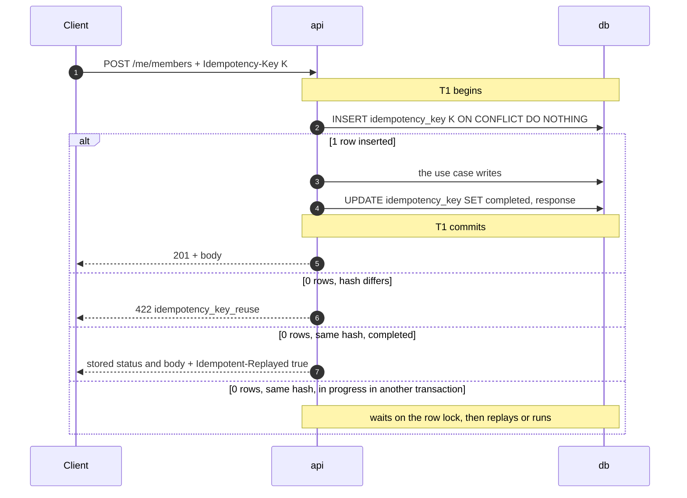

# API guidelines

> Status: **Approved** (Owner, 2026-10-21) · Updated: 2026-10-28 (P1-26: `Last-Event-ID` in the CORS allowed headers, DR-288) · 2026-10-22 (P1-04: the lifecycle check of §7, DR-247; DR-239: the trunk is `dev`; earlier 2026-10-21: DR-226: catalog count; earlier: DR-168: `app_version_requests_total`) · DOC-50
> Depends on: original SDD §17.2, §17.3, [DR](../00-decision-register.md) (DR-07, 36…39, 64, 71, 74, 75, 83, 84, 123, 127, DR-142…, DR-226, DR-288), [ADR-0023](../04-adr/0023-api-conventions.md), [ADR-0011](../04-adr/0011-tokens-refresh-families-and-cookies.md), [DOC-12](../03-architecture/code-architecture.md) §5.3, §8.3, §12, [DOC-17](../05-data/operations-model.md) §3 (`platform.idempotency_key`), [DOC-26](../06-design/identity-and-sessions.md), [DOC-27](../06-design/residency-and-memberships.md) §3, [DOC-35](../06-design/audit-privacy-and-terms.md) §9, [DOC-37](../06-design/files-and-uploads.md), [DOC-42](../06-design/error-handling.md), [DOC-06](../02-glossary.md)
> Main readers: P1-04 (`apps/api` composition root), P1-15 (route metadata and the authorization matrix), P1-16, P1-17 (the clients), every task that adds an endpoint, DOC-51, DOC-52, DOC-55, DOC-99, EXP-10

This document fixes the rules every endpoint follows: base path, audiences, naming, headers, formats of money, time and ids, the order of the gates, idempotency, optimistic concurrency, pagination, localization, caching and compatibility. It does not list endpoints (DOC-51), error codes and their messages (DOC-42 §5), the behavior of sign-in and sessions (DOC-26), the policy table (DOC-27 §3), the SSE stream and the webhook contract (DOC-52), or the CORS and security header configuration of the hosts (DOC-39, DOC-70).

Every new decision in this document is recorded as DR-143…DR-145 (the numbering of the catalog, DR-142, is in DOC-51) and summarized in §18.

## 1. Purpose and scope

| Question | Answer lives in |
| --- | --- |
| Where does a path start, who may call it? | §2, §3 |
| How are paths, fields and operations named? | §3, §4 |
| Which headers go in and out? | §5 |
| How are money, time, ids, phones and null written? | §6 |
| In what order does a request meet its checks? | §7 |
| How does a retried create stay single? | §8 |
| How does an edit avoid overwriting another? | §9 |
| How does a list page? | §10 |
| Which language does a message use? | §11 |
| What may be cached? | §12 |
| What limits apply, and how are they shown? | §13 |
| What may change without a new version? | §14 |
| How is it tested? | §17 |

## 2. Base path and audiences

One JSON-over-HTTPS API serves the three clients (original SDD §17). Every path is under `/api/v1`, grouped by audience:

| Prefix | Audience | Credential | Guard (DOC-12 §5.3) |
| --- | --- | --- | --- |
| `/api/v1/public/*`, `/api/v1/health/ready`, `/api/v1/client-errors` | Anyone | none | none |
| `/api/v1/auth/*` | Anyone, except two staff routes | none, or a refresh token (body or cookie) | none; the use case consumes the token |
| `/api/v1/me/*` | A resident | Bearer access token, `kind = resident`; `X-Unit-Id` on the routes that act for a unit | `resident`, `unit(capability)` |
| `/api/v1/staff/*` | A staff member | Bearer access token, `kind = staff` | `staff(...roles)` |
| `/api/v1/payments/webhooks/{provider}/{gatewayConfigId}` | The payment gateway | the provider's signature | the HMAC, no token |

`/health/live`, `/health/ready` and `/metrics` also exist on the ops port, unprefixed and never routed (DR-07, DOC-07 §3, §7); only `GET /api/v1/health/ready` is routed through Caddy and the Tunnel, for the uptime probe.

Every route declares its audience as route metadata; a route without it fails the build and there is no default-allow route (DOC-12 §5.3, original SDD §19.5). The metadata, read by the authorization-matrix generator (EXP-10, DOC-99):

```ts
audience: { kind: 'public' }
audience: { kind: 'resident' }                                    // a token, no unit
audience: { kind: 'resident', capability: 'manage_members' }     // a unit guard
audience: { kind: 'staff', roles: ['admin', 'manager'] }
audience: { kind: 'webhook', provider: 'payos' }
idempotent: true                                                  // the route requires Idempotency-Key (§8)
stepUp: 'gateway_config'                                          // the route needs a step-up proof (DOC-26 §4.5)
```

A resident token never passes a staff guard and the reverse, whatever the role (FR-16.4). An object outside the caller's building or unit is 404, never 403 (DOC-42 §2).

## 3. Names

| Thing | Rule | Example |
| --- | --- | --- |
| Path segments | kebab-case, plural nouns for collections, no verbs except an action below | `/staff/fee-batches`, `/me/members` |
| Path parameters | `{id}` for the resource of the path; `{accountId}` where the id is an account's; all UUIDv7 | `/staff/residents/{accountId}` |
| Action | A `POST` on a sub-path with a verb, when the action is not a state field to edit | `POST /staff/fee-batches/{id}/publish` |
| Singletons | The noun alone | `/staff/settings`, `/staff/gateway`, `/me` |
| JSON keys | camelCase | `chargeIds`, `dueDate` |
| Enum values | lower snake_case | `memberType: "family"`, `status: "deletion_requested"` |
| Query parameters | camelCase; `q` for a search text; `cursor`, `limit`, `page`, `pageSize` for paging | `?q=nguyen&limit=20` |
| `operationId` | lowerCamel verb and noun, unique, the one DOC-51 §2 lists | `createPaymentIntent` |
| `summary` | The name of the endpoint in the docs: one line, imperative, in English | `Create a payment intent` |
| `description` | What the endpoint does beyond its name: who calls it, what it changes, what it refuses (Markdown); written from the Purpose line of the endpoint in DOC-51 | |
| Enum in a schema | `describedEnum({ value: 'meaning' }, 'what the field is')` of `@core/http`, never a union of literals: the API reference lists the values to choose from with their meaning; a value outside it is 400 `validation_failed` rule `enum` | `describedEnum({ vi: 'Vietnamese', en: 'English' })` |
| Endpoint id | `E-xx`, the number in DOC-51 §2 | `E-85` |

The OpenAPI document carries `operationId`, `summary`, `description`, and the vendor extensions `x-endpoint-id: "E-85"` and `x-audience` (the metadata above) on every operation, so EXP-10 and the clients can join them. OpenAPI and the Scalar page are served only in `local` and `staging` at `/api/v1/openapi.json` and `/api/v1/docs` (DR-64); in `production` they answer 404.

## 4. Methods and status codes

| Method | Use | Success |
| --- | --- | --- |
| `GET` | Read; never changes state; no body | 200 (304 with `If-None-Match`, §12) |
| `POST` | Create, or an action | 201 with the new resource and `Location`; 200 with a result; 202 when the work is accepted and nothing was created (`POST /auth/otp`, `POST /auth/staff/password-reset`); 204 when there is nothing to return |
| `PUT` | Replace the whole resource or a whole list (`PUT /staff/gateway`, `PUT /staff/charges/{id}`, `PUT /staff/docs/order`) | 200 |
| `PATCH` | Change part of a resource; an absent key is untouched, `null` clears where the endpoint says so | 200 with the resource |
| `DELETE` | Remove or revoke | 204 |

A `POST` that creates and returns 201 sets `Location: /api/v1/<path of the resource>` when a `GET` for it exists. A repeated delete of a revoked thing is 204 where the endpoint says so (logout) and 404 otherwise. Statuses of failures are DOC-42 §5; a client branches on `error.code`, never on the status alone.

## 5. Headers

### 5.1 Request

| Header | Used on | Rule |
| --- | --- | --- |
| `Authorization: Bearer <jwt>` | `/me/*`, `/staff/*` | The 15-minute access token (DOC-26 §3.1). Missing, malformed or expired: 401 `unauthenticated` |
| `X-Unit-Id` | every `unit: <capability>` route | The unit the resident acts for. Missing or not a UUID: 400 `validation_failed` with `details [{path: "header.X-Unit-Id", code: "required"}]`; not an active membership of the caller: 403 `membership_inactive` (DOC-27 §3.1) |
| `X-App-Id`, `X-App-Version` | the apps | `X-App-Id` is `resident`, `staff` or `web`; `X-App-Version` is a semantic version (`1.4.2`). The API compares it with `MIN_APP_VERSION[app]` (§7 gate 5). The web CMS sends `X-App-Id: web` and no version and is never refused |
| `X-Request-Id` | any | Optional, 1…64 characters of `[A-Za-z0-9._-]`; a missing or invalid one is replaced by a generated UUIDv7. It is carried into logs and outbox headers (DOC-35 §3.2) |
| `Idempotency-Key` | the routes marked `R` in DOC-51 §2 | §8 |
| `If-Match` | edits of a versioned resource | §9 |
| `If-None-Match` | `GET` of a single resource that has an `ETag` | §12 |
| `Accept-Language` | any | `vi` or `en` (first match of the list); decides the language of an unauthenticated answer (§11) |
| `X-Requested-With: rms` | `POST /auth/refresh` and `POST /auth/logout` with the cookie | Forces a CORS preflight, the CSRF defense of DR-38; a cookie refresh without it is 403 `forbidden` (DOC-26 §3.3) |
| `Last-Event-ID` | `GET /staff/events` | The last SSE event id received (DOC-52) |
| `User-Agent` | the apps | `rms-resident/1.0.0 (iOS 19.1; iPhone17,1)`, `rms-staff/…` (DOC-26 §3.7); stored raw (300 characters) for the session list |
| `Content-Type` | requests with a body | `application/json` (also `; charset=utf-8`). Another type is 400 `malformed_request`. File bytes never come through the API (DOC-37) |

### 5.2 Response

| Header | When | Rule |
| --- | --- | --- |
| `X-Request-Id` | always | The request's id |
| `ETag: "<version>"` | a single resource that is edited with `If-Match` | §9 |
| `Location` | 201 | §4 |
| `Retry-After` | 429, 423 (`account_locked`), 503, and `Retry-After: 1` on 409 `request_in_progress` | Seconds, an integer |
| `Idempotent-Replayed: true` | a replayed answer | §8 |
| `Content-Language` | any JSON answer that has a `message` | `vi` or `en`, the language of the message (§11) |
| `Cache-Control` | always | §12 |
| `Set-Cookie` | web CMS staff sign-in and refresh | The `__Secure-rms_refresh` cookie of DOC-26 §3.3 |

### 5.3 CORS

Only the web CMS is cross-origin. The native apps send no `Origin`. The API allows one origin per environment (`https://admin.<domain>`; staging `https://admin-staging.<domain>`; local `http://localhost:5173`), `Access-Control-Allow-Credentials: true`, the request headers `Authorization, Content-Type, If-Match, Idempotency-Key, X-Unit-Id, X-App-Id, X-App-Version, X-Request-Id, X-Requested-With, Accept-Language, Last-Event-ID`, the methods `GET, POST, PUT, PATCH, DELETE, OPTIONS`, the exposed headers `X-Request-Id, ETag, Retry-After, Idempotent-Replayed, Location, Content-Disposition, X-Usage-Enabled` (the last tells the web CMS to stop sending usage events, DR-279, DOC-104 §5.4), and `Access-Control-Max-Age: 600` (DR-83 item 5, DR-74). *Revised 2026-10-28 (DR-288):* `Last-Event-ID` joins the allowed request headers: it is not CORS-safelisted, so the reconnect of the SSE stream (DOC-52 §8) would fail its preflight without it. Any other origin gets no CORS headers at all (the plugin is `corsPlugin` of `@core/http`: `@elysiajs/cors` answers `Allow-Credentials: true` to every origin, DR-247). The list of allowed origins is configuration (`CORS_ORIGINS`, DOC-41); DOC-39 owns the rest of the web security headers.

## 6. Formats

| Thing | Format | Example |
| --- | --- | --- |
| Id | UUIDv7, lowercase, hyphenated string | `"0192f3c4-5a1e-7000-8000-000000000021"` |
| Instant | ISO 8601 UTC with milliseconds and `Z` | `"2026-10-20T03:10:00.000Z"` |
| Building day | `YYYY-MM-DD`, the building's calendar day (ADR-0013); the field name ends in `Date` or `On` | `"dueDate": "2026-10-25"`, `"receivedOn": "2026-10-19"` |
| Duration | integer seconds | `"expiresIn": 900`, `"retryAfter": 120` |
| Server time | `serverTime` in any answer that drives a countdown (an intent) | `"serverTime": "2026-10-20T03:10:03.000Z"` |
| Money | integer number of đồng in `amount`, never a string and never a decimal; `"currency": "VND"` only where the answer needs it (an intent) | `"amount": 2838000` |
| Decimal measure | a string with fixed scale, because `numeric` must not become a float | `"areaM2": "68.50"` |
| Phone | E.164 in answers; requests accept national and international forms and are parsed with region `VN` (`libphonenumber-js/max`); a Guard sees `090••••567` | `"+84901234567"` |
| Boolean | `true`/`false`; never `0/1` | |
| Enum | the value set the endpoint lists; an unknown value from the server is a client bug, so a client treats an unknown enum value as "other" and does not crash | |
| Null and empty | Every field of an answer is present; "no value" is `null`, "no items" is `[]`. A request sends a field or omits it; `PATCH` `null` clears only where the endpoint says so | |
| Text | NFC, leading and trailing spaces trimmed on input; no HTML in any text field except the restricted Markdown of terms (DOC-36 §8) | |
| Search text `q` | at most 100 characters after trimming; matching rules are the endpoint's (DOC-27 §11) | |
| Language | `"vi"` or `"en"` | |
| Request body | JSON object; unknown keys are 400 `validation_failed` with rule `unknown_key` (route plugins are `routePlugin()`, bodies are `strictObject`: Elysia's default `normalize` would strip the key, DR-247); at most 2 MB (Caddy answers a bare 413 first, DOC-42 §3) | |

Clients format money and dates for display: `2.838.000 đ` in Vietnamese, `₫2,838,000` in English; the date `2026-10-09` is `09/10/2026` and `Oct 9, 2026` (P1-09 formatter table, original SDD §17.3). A client never parses a localized string.

## 7. The order of the gates

A request meets these checks in this order and stops at the first that refuses. The order is a contract: it decides what an attacker or a stale app learns.

| # | Gate | Refusal | Applies to |
| --- | --- | --- | --- |
| 1 | Request context: id, clock, logger | — | all |
| 2 | Maintenance flag (`platform.maintenance`, DOC-38 §5.3) | 503 `maintenance` with `Retry-After` | all but `/health/*` |
| 3 | CORS | no CORS headers; a preflight answers 204 | cross-origin |
| 4 | Media type and body size | 400 `malformed_request`; 413 from Caddy | requests with a body |
| 5 | App version | 426 `upgrade_required` with `details {minVersion, storeUrl}` | `X-App-Id` `resident` or `staff`; not `/health/*`, `/public/*`, `/client-errors` |
| 6 | IP bucket | 429 `rate_limited` | public routes that name one (DOC-26 §6) |
| 7 | Authentication | 401 `unauthenticated` | `/me/*` and `/staff/*` |
| 8 | Role or unit guard | 403 `forbidden`, 403 `membership_inactive` | by audience |
| 9 | Terms gate | 403 `terms_required` | `unit: <capability>` routes, once the building is known (DOC-35 §9.2) |
| 10 | Step-up declaration | 403 `step_up_required` | routes with `stepUp` metadata |
| 11 | Account buckets | 429 `rate_limited` | routes that name one |
| 12 | Schema validation | 400 `validation_failed` | all with parameters or a body |
| 13 | The use case: idempotency (§8), rules (422), existence (404), conflicts (409) | DOC-42 | all |

**A request without a valid credential never receives a validation answer.** Elysia 1.4.30 validates a body **before** `beforeHandle` and `resolve` and after `onTransform` (measured in P1-04: `onRequest` → `onParse` → `onTransform` → validation → `beforeHandle` → handler, DR-247). The guards of gates 7 to 10 are therefore installed as `transform` hooks (a route option or `onTransform`), never as `beforeHandle` or `resolve`, and test AG-04 proves the order on every route of `/me/*` and `/staff/*` with a missing token and an invalid body: the answer is 401. `apps/api/src/app.test.ts` already pins the lifecycle; AG-04 over the real routes is written with the first guard (P1-10) and run by the matrix of P1-15.

A request refused at a gate before 13 leaves no idempotency row (§8), no audit row and no outbox row.

## 8. Idempotency

The convention is ADR-0023 and DR-74; the table is DOC-17 §3 `platform.idempotency_key (account_kind, account_id, key, request_hash, status, response_status, response_body, created_at)`, 24-hour retention.

*As built (P1-28, 2026-10-23, DR-259):* the wrapper is `createIdempotent` of `@core/http` and the adapter `SqlIdempotencyStore` of `@core/db`. A route runs in the `transaction` mode of §8.3, or in the `external` mode when its handler reaches outside before it commits (E-72 reads the bucket): the key is committed `in_progress` first, a duplicate meanwhile is 409 `request_in_progress` with `Retry-After: 1`, and a key `in_progress` for more than five minutes is taken over. The stored response is an envelope `{headers: {location?}, body}`, so a replay carries `Location`. The hourly sweep of 24-hour keys runs in the `api` process. A missing key is 400 with `details [{path: "header.Idempotency-Key", code: "required"}]`, a malformed one the same with `format`.

### 8.1 Which requests

A route marked `R` in DOC-51 §2 (`idempotent: true` in the metadata) **requires** `Idempotency-Key`: the creates of tickets, ticket messages, vehicles, notices, members, residents, units, staff accounts, imports, uploads, payment intents, manual payments, reminders, statements, exports and fee batches. A missing key is 400 `validation_failed` with `details [{path: "header.Idempotency-Key", code: "required"}]`. An action that is already safe to repeat by its own arbiter (publish, recall, void, transition, approve) does not take a key: the second call finds the state changed and answers 409 as DOC-42 says. A key on a route that does not take one is ignored.

The key is 8…128 characters of `[A-Za-z0-9_-]` (the table's `CHECK`), generated by the client **once per user intent** (a UUIDv4 when the user presses the button) and sent again unchanged on every retry of that intent. A new key for the same intent defeats the mechanism: the clients keep the key with the pending action until it succeeds or the user cancels (P1-09, P1-17).

### 8.2 The request hash

`request_hash = SHA-256_hex(METHOD + " " + route template + "\n" + path parameters sorted by name as name=value + "\n" + X-Unit-Id (or empty) + "\n" + canonical JSON of the body)`. Canonical JSON: keys sorted at every level, no whitespace, numbers as written. The `Idempotency-Key` itself, the other headers and the query string of a `POST` are not part of it. Example: the same `POST /me/members` with the same key and `phone` `0912345678` versus `+84912345678` has two hashes (the body differs as text), so the second is 422; the client must resend the identical body.

### 8.3 What happens



| Case | Answer |
| --- | --- |
| First use | The use case runs in the same transaction as the key row; the stored response is the committed 2xx |
| Same key, same hash, after commit | The stored status and body, with `Idempotent-Replayed: true` and the original `X-Request-Id` in the body's context only (the replay gets its own `X-Request-Id` header) |
| Same key, other hash | 422 `idempotency_key_reuse` (code in DOC-42 §5.1); nothing runs |
| A duplicate while the first is still in its transaction | The second `INSERT … ON CONFLICT DO NOTHING` returns 0 rows and its `SELECT … FOR SHARE` waits on the first's row lock. If the first commits, it replays; if it rolls back, the key row vanishes and the second runs as a first use |
| The first request failed (4xx, 5xx, rollback) | **Nothing is stored**: the transaction rolled back, so the key row is gone and a retry runs again. Only a committed 2xx is ever replayed |
| A create that commits its key as `in_progress` before an outside call (the payment intent, DOC-23) and has not completed | 409 `request_in_progress` with `Retry-After: 1`; the client retries with the same key. Added to DOC-42 §5.1 (DR-143) |
| A key older than 24 hours | Purged by the job (DOC-38, DOC-20); the same key is a new request |
| A key used by another account | Keys are scoped by `(account_kind, account_id)`, so another account's key is unrelated |

The manual payment also keeps its own unique `client_key` as a second net (DR-14, original SDD §17.3). A replay never repeats a side effect: the outbox rows, the audit row and the notifications were committed with the first transaction.

## 9. Optimistic concurrency: `ETag` and `If-Match`

An aggregate that two people may edit carries an integer `version` (DOC-12 §9.2). The `ETag` and `If-Match` forms:

- `ETag: "<version>"` on the `GET` of a single resource and on the answer of a `PATCH`, `PUT` or action that changes it: a **strong** validator, the version in double quotes (`"3"`). The settings document, made of two rows, uses `"<building.version>.<setting.version>"` (`"3.8"`, DOC-36 §4).
- `If-Match: "3"` on every edit of such a resource. The server compares with the stored version in the `WHERE` of the `UPDATE` (`… WHERE id = :id AND version = :expected`). Only one value is accepted; `*` and lists are not supported (400 `validation_failed`).
- A missing header on a versioned edit: **428** `precondition_required`. A stale one: **409** `version_conflict` with `details.current` set to the fresh resource when the caller may see it, so the client can merge or reload.
- The version in the body (`"version": 3`) is informational; the header is authoritative. The body of a `PATCH` never carries `version`.
- A list row carries `version` so a client can edit without a second `GET`; it sends `If-Match: "<that version>"`.
- A resource without a version (a membership, DOC-16 §5.3) is edited by a conditional `UPDATE` on its state and answers 409 `invalid_transition` on a lost race; its section says so.

## 10. Pagination, filters and sorting

| Kind | Used for | Request | Answer |
| --- | --- | --- | --- |
| Keyset | lists that grow: inbox, money log, audit, unit history, units, residents, tickets, notices, debts | `?cursor=<opaque>&limit=<n>` | `{ "items": [...], "nextCursor": "…" \| null }` |
| Page number | small admin lists the design shows as "1–10 of 240" | `?page=1&pageSize=10` | `{ "items": [...], "page": 1, "pageSize": 10, "total": 240 }` |

- A **cursor** is the base64url of `(sortKey, id)` (DR-74). It is opaque and tied to the endpoint's sort; a client never builds or edits one. A cursor that cannot be decoded or does not match the sort is 400 `invalid_cursor`. `nextCursor` is `null` on the last page, and an empty page is `{ "items": [], "nextCursor": null }`.
- `limit` defaults to 20 and is 1…100 unless the endpoint states another range (units and residents allow 1…200, DOC-27). Out of range is 400 `validation_failed` rule `minimum` or `maximum`; the server does not clamp silently.
- Keyset lists are stable while rows are inserted and use indexes that start with `building_id` (ADR-0023). They cannot jump to page N.
- **Page-number** lists cap at 10,000 rows: `page * pageSize > 10000` is 400 `validation_failed` rule `maximum`. `pageSize` is 1…100, default 10. `total` is a count under the same filter and costs one more statement; an endpoint that cannot afford it uses a keyset list.
- **Filters** are query parameters named by the field (`status`, `unitId`, `memberType`, `occupancy`), repeated for several values (`?status=open&status=overdue`) and combined with AND. An unknown filter is 400 `validation_failed` rule `unknown_key`.
- **Sorting** is fixed per endpoint and documented in its section; phase 1 has no client-chosen sort. A list sorted by a text column (a unit code) says which order it uses (`A-100` before `A-20`, DOC-27 §4.2).
- A search (`q`) list is capped at 20 per kind and has no cursor when the endpoint says so (DOC-27 §4.2, §11).
- Exports and reports that need random access use their own mechanism (DOC-33).

## 11. Localization of messages

`error.message` is text for a person in the caller's language, looked up by the key `error.<code>` in `@rms/i18n-catalog` with ICU parameters from `details` (DOC-42 §3). The language is chosen in this order:

1. For an authenticated call: the account's `language` (`resident_account.language`, `staff_account.language`).
2. For an unauthenticated call: the first supported tag of `Accept-Language`.
3. The building default (`defaultLanguage`, DOC-36 §5.1).
4. `vi`.

The answer sets `Content-Language` to the language used. A client never branches on `message`; the apps show their own catalog string for a `code` (DOC-68) and use `message` as the fallback. Pushes, inbox entries and receipts store a template key and parameters and are rendered per reader at read time (DR-71), not by this rule. Response bodies other than errors contain no localized text except where an endpoint says so (terms text, library pages, notice bodies: bilingual objects `{ "vi": "…", "en": "…" }`, and the answer holds the reader's language and the `translations` flag is the endpoint's own).

## 12. Caching

| Response | `Cache-Control` | Notes |
| --- | --- | --- |
| Any authenticated JSON (`/me/*`, `/staff/*`) | `no-store` | The default. Nothing authenticated is stored by a browser, a proxy or Cloudflare |
| A single resource with an `ETag` (`GET /staff/units/{id}`) | `private, no-cache` | The client may keep it and must revalidate; `If-None-Match: "3"` that matches answers **304** with no body and the same `ETag` |
| `GET /public/config` | `public, max-age=60` | The only publicly cacheable JSON; contains no secret and no personal data |
| `/health/*`, `/auth/*`, `/client-errors` | `no-store` | |
| Signed URLs inside JSON (`url`, `thumbUrl`) | n/a | Valid 15 minutes (5 for a vehicle paper, DOC-37 §8); regenerated on every answer; never stored by the client |
| PDF and file downloads that the API streams | `private, no-store` | with `Content-Disposition: attachment; filename*=UTF-8''…` |

Cloudflare has a rule to bypass its cache for `/api/*` (DOC-70). There is no `Vary` beyond `Accept-Language, Origin` on `/public/config`. There is no server-side response cache in phase 1: every read is a database read, which NFR-03 budgets. A cache that a later section adds (a dashboard, a report) names its key, TTL and invalidation in its endpoint section.

## 13. Limits and rate-limit answers

| Limit | Value | Where defined |
| --- | --- | --- |
| Body size | 2 MB (Caddy); 8 KB for `POST /client-errors`; 16 KB for the webhook | DOC-42 §3, DOC-52 |
| Requests per account and endpoint | the buckets of DOC-26 §6 (OTP, sign-in, reset, step-up), DOC-37 §6.1 (uploads 60 per hour), and `POST /me/qr` 30/min, `POST /me/payments/intents` 10/min, `POST /staff/debts/reminders` 10/hour, exports 2 concurrent (DR-64) | the design documents |
| Cloudflare | one rule on `/api/v1/auth/*`, the outer net | DR-83 |
| SSE | 3 streams per account | DR-75 |
| Search | `q` ≤ 100 characters, 20 results per kind | §6, DOC-27 §11 |
| Lists | §10 | |

A refusal is 429 `rate_limited` with `Retry-After` (integer seconds, `ceil((1 − tokens) / rate)`) and `details {scope}`; the response carries **no** `X-RateLimit-*` headers, so a caller cannot read the bucket's state. A refusal at gate 6 or 11 spends nothing further. The client waits for `Retry-After` and does not retry in a loop (DOC-42 §9).

## 14. Compatibility and versioning

- The path version is `/api/v1`. A change that **breaks** a client (removing or renaming a field, changing a type or a unit, tightening validation, changing a status code or an error code, a new required request field) is a new version `/api/v2` served beside `v1` for the lifetime of the oldest supported app (`MIN_APP_VERSION`), and is a DR.
- A change that does **not** break needs no version: a new endpoint, a new optional request field, a new response field, a new enum value in a field the client treats as "other" (§6), a new error code of an existing status class, a looser validation. Clients ignore unknown response fields and unknown error `details` keys.
- The contract is the TypeBox schema: it generates OpenAPI and the Eden Treaty types the three clients import (type only, DR-04), so a breaking schema change fails the client build instead of production. A CI check (`check:openapi`, wired into `verify` by P1-19, written by P1-04 with the OpenAPI document) diffs the OpenAPI of the pull request against its base on `dev` and fails on a breaking change without a version bump.
- The apps are forced forward by `MIN_APP_VERSION[app]` (426 `upgrade_required`); EAS Update never carries a breaking API change to a binary that predates it (runtime version policy, DR-69).
- A deprecated endpoint answers with `Deprecation: true` and `Sunset: <HTTP date>` and is removed only after the minimum app version moved past it.

## 15. Mapping to RFC 9457 Problem Details

The error shape is the project's `{ "error": { "code", "message", "details" } }` (ADR-0023). Should a consumer ever need `application/problem+json`, the mapping is mechanical:

| Problem Details | From |
| --- | --- |
| `type` | `https://docs.<domain>/errors/<code>` (not served in phase 1) |
| `title` | the English message of DOC-42 §5 for the code |
| `status` | the HTTP status |
| `detail` | `error.message` |
| `instance` | `urn:request:<X-Request-Id>` |
| extension members | `code` = `error.code`; `errors` = `error.details` when it is an array; the other `details` keys by name |

No adapter is built now.

## 16. Configuration, metrics and logs

| Key | Type | Default | Description |
| --- | --- | --- | --- |
| `CORS_ORIGINS` | list | the web CMS origin of the environment | Origins allowed by §5.3 |
| `MIN_APP_VERSION_RESIDENT`, `MIN_APP_VERSION_STAFF` | semver | `1.0.0` | Minimum app versions (`MIN_APP_VERSION[app]`, DR-69); `GET /public/config` returns them |
| `STORE_URL_RESIDENT_IOS`, `STORE_URL_RESIDENT_ANDROID`, `STORE_URL_STAFF_IOS`, `STORE_URL_STAFF_ANDROID` | url | — | Store links: `details.storeUrl` of 426 (the caller's platform, from `User-Agent`) and `GET /public/config` (DR-145) |
| `IDEMPOTENCY_TTL_HOURS` | int | 24 | Retention of `platform.idempotency_key` (DR-74) |
| `API_BODY_LIMIT_BYTES` | int | 2097152 | Body limit the API enforces when Caddy is absent (local, tests) |
| `OPENAPI_ENABLED` | bool | `true` in `local`, `staging`; `false` in `production` | Serves OpenAPI and Scalar (§3); the boot guard refuses `true` in `production` |

DOC-41 lists these with the others. Metrics (names owed to DOC-40): `http_request_duration_seconds` (histogram, labels `method`, `route`, `status`), `api_errors_total{code,status}`, `idempotency_total{outcome}` (`first`, `replay`, `reuse`, `in_progress`), `upgrade_required_total{app}`, `app_version_requests_total{app,version}` (native apps only, DR-168), `rate_limited_total{scope}`. A route label is always the template. Log lines follow DOC-42 §8.1.

## 17. Required tests

Prefix `AG-` (master plan §0.2, DR-142; DOC-88 indexes it). They run against the mounted `App` with a real PostgreSQL (DR-77).

| ID | Scenario | Expected |
| --- | --- | --- |
| AG-01 | Every route of the mounted `App` | Has `audience` metadata and an `operationId` listed in DOC-51 §2; a route without either fails the build (DR-77) |
| AG-02 | The set of `x-endpoint-id` values of the OpenAPI document | Equals the E-xx set of DOC-51 §2 for the implemented groups: no extra, no duplicate |
| AG-02a | Every operation with an `x-endpoint-id` of the OpenAPI document | Has a non-empty `summary` and `description`, and every tag it uses is described by the `docs` of its module (`AppModule.docs`) |
| AG-02b | Every `enum` in the paths of the OpenAPI document | Has an `x-enumDescriptions` entry for each of its values (declared with `describedEnum`, `@core/http`), so the API reference says what each value means |
| AG-02c | Every parameter and every field of a request body in the OpenAPI document | Has a `description`: what it is, its unit or range where it has one, and what `null` does where it is allowed |
| AG-03 | `GET /api/v1/openapi.json` in `production` configuration | 404; the boot guard refuses `OPENAPI_ENABLED=true` |
| AG-04 | For every route of `/me/*` and `/staff/*`: a request with no token and an invalid body | 401 `unauthenticated`, never 400 |
| AG-05 | A `unit: <capability>` route with no `X-Unit-Id`; with a malformed one; with a unit of another account | 400 `validation_failed` (`header.X-Unit-Id`); 400; 403 `membership_inactive` |
| AG-06 | The same request in maintenance and out of it, for `/health/ready` and a business route | `/health/ready` 200; the business route 503 `maintenance` with `Retry-After` |
| AG-07 | `X-App-Id: resident`, `X-App-Version: 0.9.0` with `MIN_APP_VERSION_RESIDENT = 1.0.0`; the same with `X-App-Id: web` and no version | 426 `upgrade_required` with `details {minVersion: "1.0.0", storeUrl}`; the web request passes |
| AG-08 | `POST /me/members` without `Idempotency-Key`; with a 7-character key; with a 129-character key | 400 `validation_failed` (`header.Idempotency-Key`) for each |
| AG-09 | The same `POST /me/members` twice with one key | 201 then 201 with `Idempotent-Replayed: true` and the same body; one membership, one outbox row |
| AG-10 | The same key with another body (phone `0912345678` then `0912345679`) | 422 `idempotency_key_reuse`; nothing changed |
| AG-11 | Two parallel requests with one key | One 201, one 201 replayed; one row (race) |
| AG-12 | A first request that fails with 409 `member_exists`, then the same key again after the cause is gone | The second runs as a first use (no key row survived the rollback) |
| AG-13 | A key row `in_progress` committed, then a duplicate | 409 `request_in_progress` with `Retry-After: 1`; after completion the replay |
| AG-14 | A key of 25 hours | A new request (purged or ignored by the TTL) |
| AG-15 | `PATCH /staff/units/{id}` without `If-Match`; with `"2"` when the version is 3; with `W/"3"`; with `*` | 428; 409 `version_conflict` with `details.current`; 400; 400 |
| AG-16 | `GET /staff/units/{id}` with `If-None-Match: "3"` while the version is 3 | 304, no body, `ETag: "3"` |
| AG-17 | A keyset list: 45 rows, `limit=20`, follow `nextCursor` while 3 rows are inserted at the head | 20, 20, 5 rows; no row twice and none missed that existed at the start; the last `nextCursor` is `null` |
| AG-18 | A cursor edited by one character; a cursor of another endpoint | 400 `invalid_cursor` each |
| AG-19 | `limit=0`, `limit=101` (a 1…100 list), `page=1001&pageSize=10` | 400 `validation_failed` (`minimum`, `maximum`, `maximum`) |
| AG-20 | A body with an unknown key `foo` | 400 `validation_failed` rule `unknown_key`, `path` `foo` |
| AG-21 | A money field and a time field of a sample of 10 endpoints (the DOC-51 examples) | `amount` is an integer; every instant matches `^\d{4}-\d{2}-\d{2}T\d{2}:\d{2}:\d{2}\.\d{3}Z$`; every id is a lowercase UUID; no field is missing |
| AG-22 | An error with `Accept-Language: en` unauthenticated; the same authenticated as a `vi` account | `Content-Language` `en` and the English message; `vi` and the Vietnamese message |
| AG-23 | 31 failed sign-ins from one IP | The 31st is 429 with `Retry-After` and no `X-RateLimit-*` header |
| AG-24 | `GET /public/config` and `GET /me` | `Cache-Control: public, max-age=60`; `no-store` |
| AG-25 | CORS preflight from `https://admin.<domain>` and from `https://evil.example` | The first lists the headers of §5.3 and credentials true; the second has no CORS headers |
| AG-26 | The OpenAPI diff check on a PR that removes a response field | The CI check fails (P1-19) |

## 18. Decisions made while writing

Every new decision is a DR (decided by Claude, delegated by the Owner) and is summarized here.

| ID | Decision | Where used |
| --- | --- | --- |
| DR-142 | The numbered endpoint catalog: 168 `E-xx` in groups (169 with E-169, DR-226), `operationId` rule, the endpoints added to DR-73's list | DOC-51 §2, §3 |
| DR-143 | Wire formats and the gate order: millisecond instants, `items` envelope, the gate order of §7, `request_in_progress`, key and hash rules, who is exempt from the app-version gate | §5…§8 |
| DR-144 | Caching, rate-limit answers and compatibility rules | §12…§14 |
| DR-145 | The public readiness route names no dependency; the shape of `GET /public/config` and the store-link keys | §2, §16 |
| DR-147 | A Manager asking for a step-up action is refused with `forbidden` before any proof is asked | DOC-51 §7, §8 |

## 19. Not in this document

| Topic | Lives in |
| --- | --- |
| The endpoint list, request and response schemas | DOC-51 |
| Error codes, messages, the class and SQLSTATE mapping | DOC-42 |
| SSE events and replay; the payOS webhook contract | DOC-52 |
| Token lifetimes, cookie, refresh rotation, rate buckets of sign-in | DOC-26 |
| The policy table, the unit guard steps | DOC-27 §3 |
| Security headers of the hosts, trusted proxy, the endpoint × role matrix | DOC-39 |
| Client behavior on each answer (retry, refresh, sign-out) | DOC-42 §9, DOC-55 |
| Table `platform.idempotency_key` DDL | DOC-17 §3 |

## Open questions

None. Decisions made while writing are DR-142 to DR-145 and DR-147 (§18) and DR-247 (the lifecycle result of §7, `routePlugin`, the CORS plugin).
