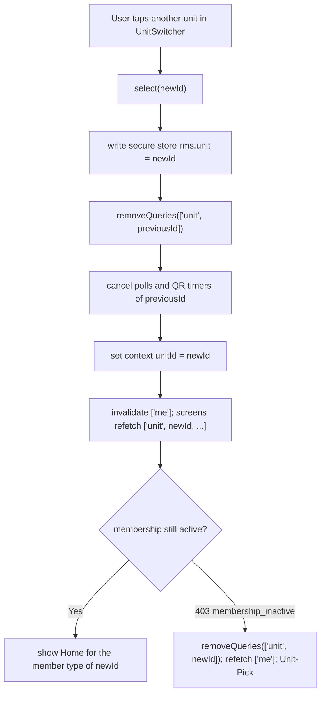
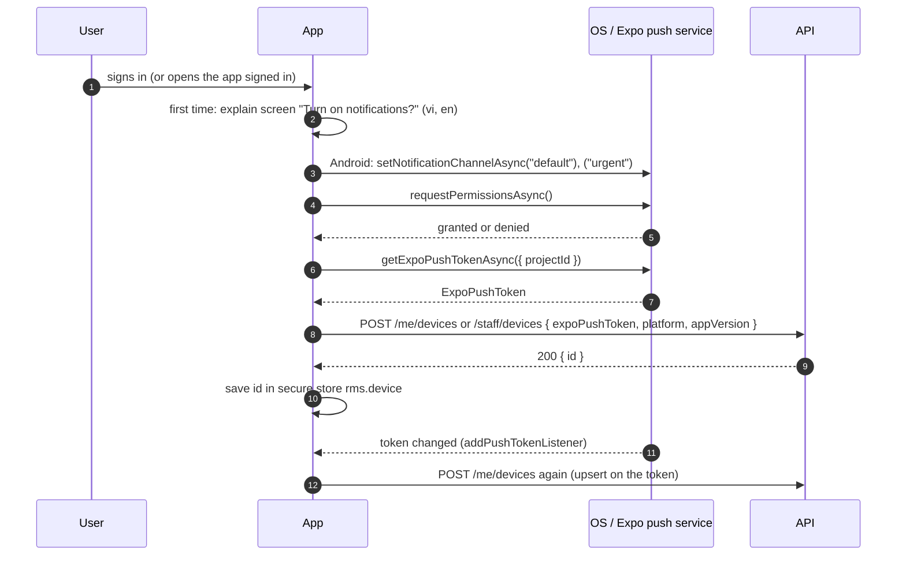

# Client architecture

> Status: **Approved** (Owner, 2026-10-21) · Updated: 2026-10-28 (P1-26: the push route list is DOC-31 §6.5, DR-303, §10.2; the SSE client, replay and limits, DR-288…290, §13) · 2026-10-28 (DR-279: §15A the usage record) · 2026-10-22 (P1-09: catalog and design-tokens rows, DR-235, DR-236; DR-226: query key and E-169; earlier: DR-180…182, 199, 205, 208, 216 pointers) · DOC-55
> Depends on: original SDD §4.3, §18.2, [DR](../00-decision-register.md) (DR-04, 38, 52, 61, 63, 64, 69, 70, 71, 74, 75, 82, 94, 127, DR-226), [ADR-0004](../04-adr/0004-repository-layout-scopes-and-boundaries.md), [ADR-0011](../04-adr/0011-tokens-refresh-families-and-cookies.md), [ADR-0019](../04-adr/0019-mobile-and-web-client-stacks.md), [ADR-0023](../04-adr/0023-api-conventions.md), [DOC-12](../03-architecture/code-architecture.md) §2, §5.4, §6.1, §13, [DOC-11](../03-architecture/tech-stack-and-versions.md) §4, §6, [DOC-26](../06-design/identity-and-sessions.md) §3, [DOC-27](../06-design/residency-and-memberships.md) §3, [DOC-37](../06-design/files-and-uploads.md) §6, [DOC-42](../06-design/error-handling.md) §9–10, [DOC-50](../07-api/api-guidelines.md) §5, §8–11, [DOC-51](../07-api/api-endpoints.md), [DOC-73](../09-operations/mobile-release.md), [DOC-41](../06-design/configuration-reference.md) §15
> Main readers: P1-09 (i18n, tokens), P1-16 (web shell), P1-17 (mobile shells), every later screen task, DOC-53, DOC-54, DOC-56…68, DOC-88

This document says how the three clients are built: the folder structure, the shared packages, the one API fetcher, sign-in and refresh on each platform, the unit context and the query keys, the rules for server state, what is kept offline, push registration, i18n, uploads, forms and error reporting. It does not say what a screen looks like (DOC-53…68), which tokens exist (DOC-54), or how the apps are built and shipped (DOC-73). Visuals come from the design canvas, whose design system is called *Hiên*; versions are in DOC-11.

Quick pass: the Owner has the design canvas, so this document fixes structure and behavior only. Decisions made while writing are DR-188…193 (§19).

## 1. Scope and reading guide

| Question | Section |
| --- | --- |
| Which apps and packages exist, and who may import what? | §2 |
| Which build keys does a client read? | §3 |
| How does a client call the API (headers, retries, idempotency keys)? | §4 |
| How do sign-in, refresh and sign-out work on web and mobile? | §5 |
| What does a client do with each error code? | §6 |
| How does the resident app hold the selected unit and its cache? | §7 |
| How is server state cached, refetched and retried (409 included)? | §8 |
| What survives offline and what never does? | §9 |
| Push token, permission, deep links | §10 |
| Language and formats | §11 |
| Uploads | §12 |
| Real-time on the web | §13 |
| Forms | §14 |
| Crashes and the error endpoint | §15 |
| Updates and the minimum version | §16 |
| Route guards | §17 |
| Tests | §18 |

## 2. Structure

### 2.1 Apps

| App | Directory, package | Audience | Runs on | Navigation |
| --- | --- | --- | --- | --- |
| Web CMS | `apps/cms-web`, `@app/cms-web` | Admin, Manager | Browser; static files on Cloudflare Pages (DR-83) | TanStack Router, file-based |
| Resident app | `apps/resident-app`, `@app/resident-app` | Owner, family, tenant, helper | Expo SDK 58, New Architecture, development builds (DR-82) | expo-router |
| Staff app | `apps/staff-app`, `@app/staff-app` | Manager, Technician, Guard | the same | expo-router |

The directory names are those of DOC-12 §2.1 (the plan's task text says `mobile-*`; DOC-12 wins).

```
apps/cms-web/
├── index.html  vite.config.ts  tailwind.config.ts   # the preset comes from @rms/design-tokens
├── e2e/                                             # Playwright (DOC-88)
└── src/
    ├── main.tsx  app.tsx                            # providers: QueryClient, Router, I18n, Auth, Sse
    ├── routes/                                      # file-based (§17): __root, _auth/login, _app/<area>/…
    ├── api/        client.ts  keys.ts  errors.ts    # §4, §8
    ├── auth/       token-store.ts  refresh.ts  session.tsx  step-up.tsx     # §5
    ├── components/ ui/ (shadcn source)  layout/  data-table/  forms/
    ├── features/   <area>/ (hooks, forms, columns)  # staff, building, units, residents, import, …
    ├── lib/        sse.ts  uploads.ts  i18n.ts  report-error.ts
    └── env.ts                                       # VITE_* validated at start

apps/resident-app/                                   # apps/staff-app/ has the same shape
├── app.config.ts  eas.json  babel.config.js  metro.config.js  tailwind.config.ts
├── .maestro/                                        # Maestro flows (DOC-88)
├── locales/                                         # OS permission strings only (DOC-73 §3.2)
└── src/
    ├── app/                                         # expo-router routes (§17)
    │   ├── _layout.tsx                              # providers, gates, error boundary
    │   ├── (auth)/ login  otp                       # staff app: login  forgot
    │   ├── (gates)/ terms  unit-pick                # resident only
    │   └── (app)/ (tabs)/ …                         # the tab bar of the member type or role
    ├── api/ keys.ts  hooks/                         # query and mutation hooks per area
    ├── features/ <area>/                            # screens' logic, not styling
    └── env.ts                                       # reads Constants.expoConfig.extra
```

### 2.2 Packages used by the clients

| Package | Directory | Holds | Imported by |
| --- | --- | --- | --- |
| `@rms/shared-types` | `packages/shared-types` | Language codes, roles, member types, capability names, status literals, error codes, `Money`, time helpers, **`formatMoney`/`formatDate`** (DR-71) | everything |
| `@rms/client-core` | `packages/client-core` | New (DR-188). Pure TypeScript, no DOM and no React Native: `createAuthenticatedFetch`, `parseApiError`, `classify`, `retryPlan`, `newIntent`, query-key helpers, `singleFlight`, the `TokenStore` and `Gates` interfaces | `@rms/mobile-core`, `@app/cms-web` |
| `@rms/i18n-catalog` | `packages/i18n-catalog` | `vi` and `en` catalogs for UI, API error messages, notification templates, emails, PDFs (DR-71): flat ICU maps, `createTranslator(lang)` with `t(key, params)` and `t.phrase()` (DR-235) | clients, API |
| `@rms/design-tokens` | `packages/design-tokens` | Token JSON from the canvas; generates `tokens.css`, `theme.css` and `fonts.css` for the web, the NativeWind preset and `native.ts` for the apps; `status.json`, `ICON_NAMES` and the native font files (P1-09, DOC-54 §2.1, DR-236) | web, both apps, `ui-native` |
| `@rms/ui-native` | `packages/ui-native` | The design-system components once for both Expo apps (DOC-54) | the two apps |
| `@rms/mobile-core` | `packages/mobile-core` | Mobile adapters over `client-core`: secure-store token store, refresh transport, the Eden factory, unit context, push registration, netinfo and AppState wiring, upload helper, i18n setup, error reporter | the two apps |
| `@core/i18n` | `packages/core-i18n` | ICU messages, typed catalogs, parity helpers (vendored, DR-02) | `i18n-catalog`, clients |
| `@core/web` | `packages/core-web` | The SSE client over `fetch` (web only, §13) | `@app/cms-web` |

Rules (DOC-12 §2.2, §6): clients import `import type { App } from '@app/api'` and nothing else from the API; a value import fails `check:arch` (DR-04). `@rms/client-core` and `@rms/shared-types` import neither React Native nor the DOM, so they run under Vitest on Bun. `apps/cms-web` does not import `@rms/mobile-core` or `@rms/ui-native`; the apps do not import `@core/web`. The shadcn component source lives in `apps/cms-web/src/components/ui`, not in a package (DR-188; DOC-11 §4 says `packages/ui-web` and is owed a correction).

**Visual layer (DOC-54).** Fonts: the web serves self-hosted `woff2` (Geologica, Big Shoulders); the apps load the static `ttf` instances with `expo-font` before the splash screen hides (DR-180). Theme: each client follows the operating system, `prefers-color-scheme` on the web and `useColorScheme()` on native, with `data-theme` set on the root; the apps have no toggle in phase 1 (DR-182); the web CMS adds a system / light / dark switch kept in `localStorage` and applied before the first paint by `public/boot.js` (DR-304). Icons: one typed registry of Phosphor names per platform, so an unknown name does not compile (DR-181, DOC-54 §7.3).

### 2.3 Expo and Metro in the Bun workspace

| Point | Rule | Checked by |
| --- | --- | --- |
| One React per workspace | Web on 19.3.1, the apps on the SDK's 19.3.0; Bun must not hoist one into the other (DOC-11 §10 row 9) | P1-01 |
| Workspace packages | `metro.config.js` adds the repository root `packages/*` to `watchFolders` and resolves `node_modules` from the app and the root; packages export TypeScript source, no build step | P1-01, P1-17 |
| Type-only API import | Metro strips `import type`; `verbatimModuleSyntax` keeps it from becoming a value import (DOC-12 §5.4) | P1-01 row 3 and row 8 |
| Styling | NativeWind 4.2.7 with the Tailwind preset of `design-tokens`; fallback: `StyleSheet` with token constants (ADR-0019) | P1-01 row 8 |
| No web target | `app.config.ts` sets `web.output` explicitly because SDK 58 defaults to server output (DOC-11 §6.4) | DOC-73 §3.1 |
| No deep imports | No import from `react-native/Libraries/*` (Strict TypeScript API, RN 0.87+) | review, DOC-11 §6.4 |
| Async file API | `File.write()` is asynchronous in SDK 58 | DOC-11 §6.4 |

*As built (P1-17, DR-265).* `@rms/mobile-core` and `@rms/ui-native` exist; the apps keep `app/` at their root (not `src/app/`) and their routes are flat: `(auth)/index` (sign-in), `(auth)/otp`, `terms`, `terms-full`, `unit-pick`, `contact`, `offline`, `(app)/…`; the staff app has `(auth)/index`, `forgot`, `forgot-sent`, `wrong-app`, `(app)/account/…`. There is one persisted query cache per install (`rms.query-cache`), cleared at every sign-out and before every sign-in, in place of one key per account (§9.2). `can` is the table of `@rms/shared-types` (`PolicySubject`), read through `useUnit`-style helpers (`capabilityOf`). The Eden answer helpers are in `@rms/client-core` and `errorText` in `@rms/i18n-catalog`.

If a check fails the fallback of DOC-11 §10 applies (Expo as a second workspace root installed with `--linker hoisted`, sharing `packages/*` by relative path).

## 3. Build keys

Read at build time, baked into the bundle, no secret (DOC-41 §15). Nothing here is new; the names are those of DOC-41 and DOC-73.

| Client | Key | Where it comes from | Used for |
| --- | --- | --- | --- |
| Web | `VITE_API_BASE_URL`, `VITE_APP_ENV`, `VITE_APP_VERSION` | Pages build variables; `apps/cms-web/.env.local` locally | API base (ends in `/api/v1`); footer badge on non-production builds; the `appVersion` of an error report (`x.y.z`, `0.0.0` when unset) |
| Apps | `API_BASE_URL`, `APP_ENV` | EAS profile `env` and EAS environment variables; read in `app.config.ts`, exposed as `extra` | the same |
| Apps | `version`, slug | `app.config.ts` | `X-App-Version`, `X-App-Id` (`resident` or `staff`); derived, never configured |

`APP_ENV`, never `NODE_ENV`, decides behavior (DOC-11 §6.4). `env.ts` of each client validates the keys at start and throws a readable error (a missing `API_BASE_URL` stops the app on the first screen, not on the first request). `MIN_APP_VERSION_*` is a server key; the client learns it from `GET /public/config` (E-03) or from a 426 (§16).

## 4. The API client

### 4.1 One factory, one fetcher

Eden Treaty is created once per client with a custom `fetcher`; everything cross-cutting happens in that fetcher so no screen repeats it (Eden Treaty options `fetcher`, `headers`, `onRequest`, `onResponse`; verified on 2026-10-20 at <https://elysiajs.com/eden/treaty/config.html>).

```ts
// @rms/client-core
export interface ClientEnv { app: 'web' | 'resident' | 'staff'; appVersion?: string; baseUrl: string }
export interface TokenStore {
  accessToken(): string | null                       // memory only (§5.1)
  accessExpiresAt(): number | null                   // ms since the epoch: the refresh runs 30 s before it (§5.2; P1-16)
  setAccessToken(t: { token: string; expiresAt: number } | null): void
  refreshCredential(): Promise<string | null>        // mobile: the token from secure store; web: null (cookie)
  saveRefreshCredential(t: string): Promise<void>    // mobile only
}
export interface Gates {                              // UI hooks the fetcher awaits
  termsRequired(details: { required: Array<{ kind: string; version: string; versionId: string }> }): Promise<void>
  upgradeRequired(details: { minVersion: string; storeUrl: string }): void
  signedOut(reason: 'refresh_failed' | 'revoked' | 'user'): void
  language(): 'vi' | 'en'
  unitId(): string | null
}
export function createAuthenticatedFetch(o: {
  env: ClientEnv; tokens: TokenStore; gates: Gates
  refresh: () => Promise<RefreshResult>              // platform transport (§5)
  randomId: () => string                              // UUIDv4; injected (no global crypto assumption)
  fetchImpl?: typeof fetch
}): typeof fetch
```

```ts
// @rms/mobile-core and apps/cms-web/src/api/client.ts
const origin = new URL(env.baseUrl).origin
export const api = treaty<App>(origin, { fetcher: createAuthenticatedFetch({ … }) }).api.v1
```

`API_BASE_URL` ends in `/api/v1` (DOC-41 §15). The factory derives the origin and mounts the `.api.v1` subtree of the Eden tree; P1-01 row 3 confirms the tree shape, and if the prefix is applied outside Elysia the factory passes the full base URL instead. A screen never builds a URL string.

### 4.2 Headers added by the fetcher

| Header | Value | When |
| --- | --- | --- |
| `Authorization: Bearer <access>` | the in-memory access token | every call except `/public/*`, `/auth/*` (the refresh token is the credential there) and `/client-errors` |
| `X-Unit-Id` | `gates.unitId()` | resident calls to `/me/*` that act for a unit (the route table of DOC-51 says which); omitted on E-13…E-25 |
| `Accept-Language` | `vi` or `en` (§11) | always |
| `X-App-Id`, `X-App-Version` | `resident`/`staff` and the semver; the web sends `X-App-Id: web` and no version | always |
| `X-Request-Id` | `randomId()`, new per attempt | always; the id is kept for the error screen "Reference: …" (DOC-42 §9) and for `POST /client-errors` |
| `Idempotency-Key` | the intent key (§4.3) | routes marked `R` in DOC-51 §2 |
| `If-Match: "<version>"` | the `version` of the row being edited | edits of a versioned resource (§8.4) |
| `X-Requested-With: rms`, `credentials: 'include'` | web only | `POST /auth/refresh`, `POST /auth/logout` with the cookie (§5.2) |
| `User-Agent` | `rms-resident/1.0.0 (iOS 19.1; iPhone17,1)` built from `expo-device` | mobile; React Native cannot always set it, so P1-17 checks the platform default and falls back to `X-App-Id` + `X-App-Version` only |

The fetcher reads `X-Request-Id`, `Retry-After` and `Idempotent-Replayed` from the answer. It never logs a header value or a body (§15). *Added 2026-10-25 (P1-16, DR-263):* the error body of the API has no request id (DR-247) and Eden hands a screen only the body, so the fetcher copies `X-Request-Id` into `error.requestId` of a non-2xx JSON answer; the screens read the "Reference: …" from there.

### 4.3 Idempotency keys and retries

A key is created **once per user intent** and reused on every retry of that intent (DOC-50 §8.1). A new key for the same intent defeats the mechanism; the same key with another body is 422 `idempotency_key_reuse`.

```ts
export interface Intent { key: string; bodyHash: string }
export function newIntent(randomId: () => string): Intent
// Returns the same Intent while the canonical body is unchanged; a changed body is a new intent.
export function useIntent<TBody>(body: TBody | undefined): { key: string; reset(): void }   // hook in each client
```

- The hook holds the intent in a ref: created when the form or sheet opens (or at the first press), kept across 429/503/network retries, reset on success, on cancel and when the user edits the body.
- The key is 8…128 characters of `[A-Za-z0-9_-]`; the generator returns a UUIDv4 (36 characters).
- Retry plan (mirrors DOC-42 §9; `retryPlan(request, answer)` is a pure function with a table test `CL-01…CL-06`):

| Request | Answer | Plan |
| --- | --- | --- |
| `GET` | network failure, 502, 503, 504 | retry up to 2 times after 1 s and 3 s (or `Retry-After`) |
| `GET` | 500 | retry once |
| `GET` | 429 | wait `Retry-After` (default 2 s), retry up to 2 times; the payment status poll keeps polling (§8.5) |
| write **with** `Idempotency-Key` | 429, 503, network failure, 409 `request_in_progress` | wait `Retry-After` (default 2 s, `Retry-After: 1` for `request_in_progress`), retry up to 3 times with the same key and body; then show the error |
| write **without** a key | 429 | wait and retry once (the bucket refused it before the use case ran) |
| write without a key | network failure, 5xx | no retry; shown as "not sent, try again" (the user decides) |
| any | 4xx other than the above | no retry |

A replayed answer (`Idempotent-Replayed: true`) is treated as the success it is.

## 5. Sign-in and refresh

Token facts (ADR-0011, DOC-26 §3): access token ES256, 15 minutes; refresh tokens rotate with reuse detection and a 10-second grace window; the web keeps the refresh token in a `__Secure-rms_refresh` cookie (`Path=/api/v1/auth`, `SameSite=Strict`, host-only on `api.<domain>`); the apps send it in the body.

### 5.1 Where tokens live

| | Web CMS | Resident app, staff app |
| --- | --- | --- |
| Access token | memory (a module variable inside `TokenStore`); lost on reload | memory; lost when the process dies |
| Refresh token | cookie, unreadable by script | `expo-secure-store` key `rms.refresh`, option `keychainAccessible: WHEN_UNLOCKED_THIS_DEVICE_ONLY` (iOS), so a backup does not carry the token to another device |
| Other persisted auth state | `localStorage` `rms.lang` only | secure-store `rms.unit` (selected unit id), `rms.lang`; `rms.device` (push device id) |
| On start | `POST /auth/refresh` (cookie) before the router renders | `GET /public/config` (E-03), then `POST /auth/refresh` with the stored token, then `GET /me` (E-13) or `GET /staff/me` (E-30) |

Notes on the store (verified on 2026-10-20 at <https://docs.expo.dev/versions/latest/sdk/securestore/>): keys may contain only letters, digits, `.`, `-` and `_`; iOS Keychain data may survive an uninstall and reinstall with the same bundle id, so a reinstall can keep the session on iOS and the app never relies on either outcome; on Android data is removed on uninstall. Every call is wrapped in `try`/`catch`: a read failure is treated as "no token" and goes to sign-in.

### 5.2 Single-flight refresh

Rules, the same on every platform:

1. A call that gets 401 `unauthenticated` (or finds the access token expired within 30 s of its `exp`) triggers `refresh()` **once**, whatever the number of calls waiting; the others wait on the same promise (`singleFlight`).
2. On success the new access token is stored in memory, the **new refresh token is written to secure-store before any waiting call is replayed** (mobile), and each waiting call is replayed **once** with the same `Idempotency-Key` and a new `X-Request-Id`.
3. A refresh answered **401 `unauthenticated`** or **403 `forbidden`** ends the session: `gates.signedOut('refresh_failed')`, clear tokens and caches (§5.4). This is also what a reuse of a rotated token looks like (the family is revoked, FR-45.2) and what a locked or disabled account gets (DOC-26 §3.8).
4. A refresh that gets **no answer** (network failure, timeout, 502/503/429) is **not** a sign-out. The client keeps the token, retries the same token after 1 s and 3 s (inside the 10-second grace window a repeated token is accepted once more, DOC-26 §3.5), then reports the state `unknown`: the offline banner shows, reads fall back to the cache, and the next foreground or reconnect tries again. A cold start with an unreachable server therefore shows cached screens, not the sign-in screen.
5. A replayed call that is 401 again is not refreshed a second time: it is a sign-out.

Web adds one rule for several tabs (cookie rotation is shared, the access token is not): `refresh()` runs inside `navigator.locks.request('rms-refresh', …)` (Web Locks, baseline widely available since March 2022, verified on 2026-10-20 at <https://developer.mozilla.org/en-US/docs/Web/API/Web_Locks_API>); the tab that refreshes posts `{ accessToken, expiresAt }` on `BroadcastChannel('rms-auth')`, and a tab that gets the lock first checks whether such a message is newer than its token and uses it instead of refreshing again. A sign-out in one tab posts `signed_out` and the others follow.

```mermaid
sequenceDiagram
  autonumber
  participant S1 as Screen A (call 1)
  participant S2 as Screen B (call 2)
  participant F as Authenticated fetch (singleFlight)
  participant API as API
  participant ST as Token store
  S1->>F: GET /me/notices
  S2->>F: GET /me/inbox
  F->>API: both with the access token
  API-->>F: 401 unauthenticated (token expired)
  API-->>F: 401 unauthenticated
  F->>F: first 401 starts refresh(); the second waits on the same promise
  F->>ST: read refresh credential (mobile: secure store; web: cookie, lock rms-refresh)
  F->>API: POST /auth/refresh
  alt 200
    API-->>F: accessToken (+ refreshToken for apps)
    F->>ST: save new refresh token FIRST, then the access token (memory)
    F->>API: replay call 1 (same key, new X-Request-Id)
    F->>API: replay call 2
    API-->>S1: 200
    API-->>S2: 200
  else 401 or 403 (reuse, revoked, locked)
    API-->>F: 401
    F->>ST: clear tokens
    F-->>S1: signedOut(refresh_failed)
    F-->>S2: signedOut(refresh_failed)
  else no answer (network, 429, 5xx)
    F->>F: retry same token after 1 s and 3 s
    F-->>S1: ApiError(network), session state unknown; offline banner
  end
```

### 5.3 Sign-in flows

| Client | Flow | Endpoints |
| --- | --- | --- |
| Resident | phone → OTP → (terms gate) → unit pick | E-09 `POST /auth/otp`, E-10 `POST /auth/otp/verify` (`client: "app"`), then E-13, E-16/E-17 if `terms_required`, E-22 push registration (§10) |
| Staff app | email + password; forgot opens the reset link in the browser (no password change inside the app) | E-05 `POST /auth/staff/login` (`client: "app"`), E-30, E-34 |
| Web CMS | email + password; `client: "web"` so the refresh token is a cookie | E-05, E-30; E-06/E-07 for reset |

**Resend delay (DR-208).** The OTP resend and the reset-link resend are enabled 45 seconds after each send, one constant `RESEND_AFTER_SECONDS = 45` in `@rms/client-core`. It is a client convenience; the server buckets (DOC-26 §6) are the real limit, and a 429 shows its `Retry-After` on the control (§6).

Wrong-credential answers (`invalid_credentials`, `account_locked` with `details.retryAfter`, `otp_invalid` with `attemptsLeft`) are shown on the form; the client keeps no counter of its own (DR-128).

### 5.4 Sign-out and forced sign-out

| Trigger | Client steps |
| --- | --- |
| User signs out | (resident, staff app) best-effort `DELETE /me/devices/{id}` or E-35; `POST /auth/logout` (E-12) with the refresh token (body or cookie); then the local steps below, **even if the call fails** |
| Refresh refused (§5.2 rule 3), `session.revoked` event (web), 401 after a replay | the local steps below at once, then the sign-in screen with the message `auth.signed_out` |
| Local steps | clear the access token; delete `rms.refresh`, `rms.unit`, `rms.device`; `queryClient.clear()`; remove the persisted cache of the account (§9); cancel timers and polls; close the SSE stream (web); navigate to sign-in. The language setting stays |

A failed `POST /auth/logout` leaves the family alive until it expires; the user can end it from the session list (`GET /me/sessions`, E-20, E-21) (DOC-26 §3.7).

## 6. Error mapping layer

`parseApiError(response)` turns every non-2xx answer into

```ts
export interface ApiError {
  status: number; code: string                       // 'unknown' if the body is not the project's shape
  message: string; details?: unknown                 // message is the server's, used only as a fallback
  requestId: string; retryAfter?: number; replayed: boolean
}
```

`classify(error): ClientAction` is a pure function over the table below (DOC-42 §9, §5), tested with every code of DOC-42 §5 (`CL-07…CL-12`). A code the table does not know falls back to its status class and shows `error.message` (ER-45). Screens never branch on `message` or on the status alone.

| Code (status) | Action | Where handled |
| --- | --- | --- |
| `unauthenticated` (401) | refresh once, replay, else sign-out (§5.2) | fetcher |
| `terms_required` (403) | `gates.termsRequired(details)` opens `Terms-Update` (resident) and the fetcher **awaits** acceptance (E-17), then replays the call once | fetcher + gate screen |
| `upgrade_required` (426) | `gates.upgradeRequired({minVersion, storeUrl})`: blocking update screen; no retry (§16) | fetcher |
| `membership_inactive` (403) | remove the unit's queries, refetch `GET /me`, navigate to `Unit-Pick` (§7.3) | resident `onError` |
| `step_up_required` (403), `step_up_failed` (403) | not in the fetcher: the mutation opens `W-Step-Up`, collects password and code, and sends `stepUp {password, code}` in its body (`useStepUpMutation`); `step_up_failed` shows `attemptsLeft`. *Revised 2026-10-20 (DR-216):* a form that knows its action in advance (`admin_change`, `staff_email`, `gateway_config`) opens the dialog on submit (`useStepUpMutation(action, buildRequest)`), and the 403 path covers the rest; **every proof attempt takes a new `Idempotency-Key`**, because the same key with a body that differs by `stepUp` is 422 `idempotency_key_reuse`; the held request, the password and the code stay in memory only | web mutation |
| `forbidden` (403) | message toast; no retry. A screen the user should not have reached is a bug reported by `CL-` route tests | caller |
| `validation_failed` (400, 422) | map `details[{path, code, message}]` to fields (§14); a `path` that matches no field becomes the form-level banner | forms |
| `version_conflict`, `invalid_transition`, `charge_changed`, `ticket_*` (409) | the 409 rules of §8.4 | mutation `onError` |
| `request_in_progress` (409) | retry with the same key after `Retry-After` (§4.3) | fetcher |
| other 409 (`phone_in_use`, `email_in_use`, `last_admin`, `staff_has_open_tickets`, …) | show the catalog message for the code; field-level where the form has the field; no retry | caller |
| `precondition_required` (428) | a client bug (missing `If-Match`): report `kind: 'network'` once and reload the resource | caller |
| `payload_too_large` (413), `quota_exceeded` (413) | show the message; no retry | caller |
| `rate_limited` (429) | wait `Retry-After`, show a countdown on the control that triggered it (`OTP resend`, `Pay`), retry per §4.3 only for idempotent requests | fetcher + control |
| `account_locked` (423) | countdown from `details.retryAfter` | sign-in form |
| `maintenance` (503) | full-width banner "The system is being updated", poll `GET /public/config` every 30 s until it answers | fetcher |
| `service_unavailable` (503), network failure | offline banner (§9.3) for reads; "not sent" for writes; retry per §4.3 | fetcher |
| `internal_error` (500), 502 | message with "Reference: {requestId}"; `GET` retried once | caller |
| `not_found` (404) | the screen's empty or "gone" state; for a detail screen opened from a push or a stale list, go back and refetch the list | screen |
| unknown code | `error.message`, status class | caller |

The text the user sees is the catalog string `error.<code>` with the parameters of `details` (`t('error.' + code, details)`), falling back to `message` when the catalog has no key (DOC-50 §11; the keys and both languages are DOC-68's).

## 7. Unit context (resident app)

The staff app and the web CMS have no unit context: the building is the deployment (DR-83) and the role comes from the token (DOC-27 §3).

### 7.1 State

```ts
// @rms/mobile-core
export interface UnitContextState {
  memberships: Membership[]                  // from GET /me (E-13), active only
  unitId: string | null                      // selected; persisted in secure store 'rms.unit'
  membership: Membership | null             // memberships.find(unitId): memberType, canPay
}
export function useUnit(): UnitContextState & { select(unitId: string): Promise<void>; can(c: Capability): boolean }
```

`can(capability)` is `@mod/residency`'s pure `can` function, shared through `@rms/shared-types` (DOC-12 §11.2); it only hides or disables controls. The server decides (the unit guard reads the membership on every request, FR-16.1).

### 7.2 Query keys

Every query that depends on the unit has the unit id in the second position, so data of unit A can never be read under unit B (original SDD §18.2). Keys come from a factory, never from literals in screens.

```ts
// @rms/client-core
export const unitKey = (unitId: string, ...parts: readonly unknown[]) => ['unit', unitId, ...parts] as const
export const staffKey = (...parts: readonly unknown[]) => ['staff', ...parts] as const
export const accountKey = (...parts: readonly unknown[]) => ['me', ...parts] as const   // not unit-specific
```

| Key | Content | Endpoint |
| --- | --- | --- |
| `['me']` | account and active memberships | E-13 |
| `['me', 'sessions']`, `['me', 'terms']`, `['config']`, `['me', 'contact']` | account-level lists | E-20, E-16, E-03, E-15 |
| `['unit', id, 'fees', filters]` | open charges of the unit | later phases |
| `['unit', id, 'notices', {cursor}]`, `['unit', id, 'inbox']`, `['unit', id, 'requests', …]` | lists and details | later phases |
| `['unit', id, 'members']` | household (owner only) | E-26 |
| `['staff', 'me']`, `['staff', 'accounts', filters]`, `['staff', 'units', filters]`, `['staff', 'residents', filters]`, `['staff', 'imports', id]`, `['staff', 'imports', 'list']` | web and staff app | E-30, E-39, E-57, E-63, E-73, E-169 |

### 7.3 Switching units and losing one

Rules (DR-191):

1. `select(newId)` writes `rms.unit`, then `queryClient.removeQueries({ queryKey: ['unit', previousId] })` (memory), then refetches `['me']`. Nothing of the previous unit is left to show for a moment under the new unit; the Maestro flow `CL-24` checks it.
2. At start, after `GET /me`: if the stored unit is not in `memberships`, the stored value is deleted. One membership is selected automatically. Two or more and no valid stored unit go to `Unit-Pick`. Zero memberships show the "no access" screen with the Manager's contact (E-15).
3. A 403 `membership_inactive` (a lock or removal, FR-16.1) removes that unit's queries, refetches `['me']`, and goes to `Unit-Pick` (the other units still work).
4. A change of the unit also stops any running payment poll and any open QR (§9.2).



## 8. Server state

TanStack Query 5 on all three clients (DOC-11 §4, §6.2). Mutations are never retried by the library (`retry: 0`); the fetcher owns retries (§4.3).

### 8.1 Defaults

| Option | Web CMS | Apps | Why |
| --- | --- | --- | --- |
| `staleTime` | 30 s | 30 s | a screen revisit within 30 s does not refetch |
| `gcTime` | 10 min | 24 h (= `maxAge` of the persister, which needs `gcTime >= maxAge`; <https://tanstack.com/query/latest/docs/framework/react/plugins/persistQueryClient>, verified 2026-10-20) | the apps keep non-money screens for offline reading |
| `retry` | 0 (the fetcher retries) | 0 | one retry policy |
| `refetchOnWindowFocus` | true | true, with `focusManager` set from `AppState` (`active`) | foreground refreshes the data (`GET /me` too) |
| `refetchOnReconnect` | true | true, with `onlineManager` set from NetInfo | |
| `networkMode` | `online` for queries; `always` for mutations | the same | a mutation is never queued silently (§9.3) |
| Money and QR queries | `staleTime: 0`, `gcTime: 0`, `refetchOnMount: 'always'` | the same | the payment and QR screens always need the network (DR-70) |

### 8.2 Hooks

One hook per endpoint in `src/api/hooks/<area>.ts`: `useX()` for queries and `useXMutation()` for writes. A mutation hook declares `invalidates: QueryKey[]`; they are invalidated on success **and** on a 409 (§8.4). Lists with cursors use `useInfiniteQuery`; the cursor is opaque and never built by the client (DOC-50 §10); page-number lists use `placeholderData: keepPreviousData`.

### 8.3 Optimistic updates

Allowed only for read marks that cannot be wrong in a harmful way: mark a notice or inbox entry read, read-all, the language and push toggles. Never for a status change, a payment, a vehicle, a member or a ticket: those wait for the server's answer.

### 8.4 409 and version rules

1. A mutation that gets a 409 is **never retried automatically** (the only exception is `request_in_progress` with the same key, §4.3).
2. On any 409 the client invalidates the keys the mutation declared and the key of the entity, so the screen shows the fresh state, then shows the catalog message of the code (never a silent overwrite).
3. `version_conflict` carries `details.current` when the caller may see it: the client writes it into the cache with `setQueryData` for that entity, keeps the user's unsaved form values visible next to the fresh ones, and offers **Reload** (replace the form with the fresh values) or **Keep editing** (resubmit with `If-Match` of the fresh version). It never resends on its own.
4. `invalid_transition` (`details {entity, status, action}`), `charge_changed` and `ticket_*`: refetch, show the message, close the dialog or sheet. On the payment screens `charge_changed` returns to `Pay-Select` with the fresh charges and the previous selection cleared.
5. Edits of a versioned resource send `If-Match: "<version>"` from the last list row or `ETag` of the entity; a missing version is a client bug (428). A `GET` of a single resource with an `ETag` sends `If-None-Match` through the browser or the fetcher cache and accepts 304.
6. Resources without a version (a membership, DOC-16 §5.3) answer 409 `invalid_transition` on a lost race and follow rule 4.

### 8.5 Polling

| Screen | Interval | Stops when |
| --- | --- | --- |
| Payment intent status (`Pay-VietQR`) | 2 s for the first 60 s, then 3 s | the screen is hidden (resumes on focus), the intent is terminal, the unit changes |
| Countdown (intent expiry, QR 15 minutes) | uses `serverTime` from the answer minus a measured offset, never the device clock | the screen unmounts |
| Everything else | none: refetch on focus, on push (invalidate the keys named by the push `route`), on pull-to-refresh | |

A 429 or 503 on the poll keeps polling after `Retry-After` (DOC-42 §9).

## 9. Offline

### 9.1 Principle

Offline is read-only (original SDD §18.2): the apps show an offline banner and the last data read; every control that writes is disabled with the reason. There is no queue of writes: a queued payment, vehicle or request that fires an hour later surprises the user more than "not sent" does.

### 9.2 What is persisted and what is never

Apps only. The web CMS keeps no persistent cache; a reload refetches.

Mechanism: `PersistQueryClientProvider` with `createAsyncStoragePersister` over `@react-native-async-storage/async-storage` 2.2.0, `maxAge` 24 h, `buster` = `appVersion`, and a `dehydrateOptions.shouldDehydrateQuery` that returns true only for `status === 'success'` **and** `query.meta?.persist === true` (opt-in per hook, DR-190). The storage key is `rms.query-cache.<accountId>`; other accounts' keys are removed at sign-in (§5.4 removes the current one at sign-out). Writes are throttled to once per second by default.

| Query | Persisted | Why |
| --- | --- | --- |
| `['me']` (account, memberships) | Yes | the app can open and show the unit list offline; `avatarUrl` expires in 15 minutes, so the avatar falls back to initials |
| `['config']`, `['me', 'contact']` | Yes | login screens and the Manager's phone must work offline |
| `['unit', id, 'notices' \| 'inbox' \| 'docs' \| 'requests']` and their details | Yes | non-money content (DR-70) |
| `['staff', 'inbox' \| 'docs' \| 'tickets' \| 'jobs']` (staff app) | Yes | the Technician reads a job in a basement without signal |
| `['unit', id, 'fees' \| 'fee-history' \| 'receipts' \| 'payment-intent']` | **No** | money (DR-70) |
| `['unit', id, 'qr']` | **No** | a QR must be fresh and revocable (15 minutes; EXP-05) |
| `['unit', id, 'members' \| 'vehicles']` | **No** | phones and plates of other people stay off the device (DR-190) |
| `['staff', 'lookup' \| 'units' \| 'vehicles']` (Guard, Manager) | **No** | access-control data would outlive a lock |
| `['me', 'sessions' \| 'terms']`, tokens, signed URLs | **No** | |

Persisted data is in the app sandbox, not in secure store; it holds no secret and no CCCD (DOC-35 §6). It is removed at sign-out, on `buster` change and when an entry is older than 24 hours.

### 9.3 Detecting and showing offline

`@react-native-community/netinfo` 12.0.1 feeds `onlineManager` and the offline banner (`isConnected === false` or `isInternetReachable === false`); the web uses `navigator.onLine` through the default `onlineManager`. The banner is a global strip under the top bar with the text `offline.banner` and the "last updated" time of the visible query. `useCanWrite()` returns false while offline; buttons that write use it, so a user sees a disabled button with the reason instead of a failed request. A server answer of 503 `service_unavailable` is treated like offline for reads only.

## 10. Push and deep links (apps)

### 10.1 Registration



| Rule | Detail |
| --- | --- |
| Endpoints (*not built yet, DR-265: the apps obtain the token and keep the permission and `pushEnabled`; the registration waits for the `notification` module*) | E-22 `POST /me/devices` (resident), E-34 `POST /staff/devices` (staff); body `{ expoPushToken, platform: 'ios' \| 'android', appVersion }`; an upsert on the token, so calling it again is safe |
| When | after a successful sign-in, at every cold start (cheap, and it re-binds the token to the session), when `addPushTokenListener` fires, and when the user turns push on in `Account` |
| Permission | never asked at first launch; an explanation first, then the OS prompt. The explanation is the `BottomSheet` of `Main` shown once, on the first home render after sign-in (DR-199, DOC-57); "Để sau" is not asked again until the user turns push on in `Account`. On Android 13+ the prompt appears only after at least one channel exists, so the channels `default` and `urgent` (DR-52) are created before `getExpoPushTokenAsync` (verified 2026-10-20 at <https://docs.expo.dev/versions/latest/sdk/notifications/>) |
| Denied | no token, no registration; `Account` shows the state with a link to the OS settings. The in-app inbox still works |
| Project id | `getExpoPushTokenAsync({ projectId })` with the id from `Constants.expoConfig.extra.eas.projectId` (DOC-73 §3) |
| Foreground | `setNotificationHandler` is set explicitly in code: the app decides per category whether to show a banner (SDK 58 shows foreground notifications by default; DOC-11 §6.4) |
| Toggle | `PATCH /me { pushEnabled }` (E-14) / `PATCH /staff/me` (E-31). The server respects it; the token stays registered |
| Sign-out | best-effort `DELETE /me/devices/{id}` / E-35 (§5.4); the server also drops the token with the session |
| Permission strings | the OS strings of DOC-73 §3.2; the explanation sheet is catalog text (DOC-68) |

### 10.2 Receiving and routing

The payload carries no personal text; `data` is `{ route, unitId, entityId }` (DR-52, FR-29.3).

1. A tap arrives through `addNotificationResponseReceivedListener`, or through `useLastNotificationResponse()` when the app was closed (a plain tap has `actionIdentifier === DEFAULT_ACTION_IDENTIFIER`); the stored response is cleared with `clearLastNotificationResponseAsync()` after handling.
2. If the app is signed out, the intent `{route, unitId, entityId}` is kept in memory and replayed after sign-in.
3. **Resident:** if `unitId` is one of the active memberships and differs from the selected unit, the app calls `select(unitId)` first (§7.3), then navigates; if it is not an active membership the tap opens Home (DR-193).
4. `route` is a name from a closed list mapped to an expo-router path by one table in `mobile-core`; an unknown name opens Home. The list is DOC-31's (not written); the provisional names are `fees`, `fee`, `receipt`, `request`, `notice`, `inbox`, `ticket`, `vehicle`. *Revised 2026-10-28 (DR-303):* the closed list is DOC-31 §6.5 (`PUSH_ROUTES` in `@rms/shared-types`): app paths without parameters such as `/fees`, `/requests`, `/notices`, `/jobs`, with `route/entityId` when `entityId` is set; the provisional names are dropped. Each recipient of a push carries its own `unitId` (DR-301).
5. Arriving data also invalidates the query keys of that area, so a screen opened from a push shows current data.

Deep link schemes are `rms-resident://` and `rms-staff://` (DR-69); the same router handles links opened from outside.

## 11. Language and formats

| Point | Rule |
| --- | --- |
| Catalog | `@rms/i18n-catalog` (`vi`, `en`): one flat map of ICU messages per language, the key type taken from `en`, formatted by `intl-messageformat` 12.1.4 (DR-71, DR-235; the i18next-style catalog of `@core/i18n` is not used). The apps bundle both languages. The web CMS bundles only the shared and `web.*` keys (`@rms/i18n-catalog/web`), and only in Vietnamese: English is a chunk that `loadWebLanguage('en')` fetches the first time it is asked for (DR-308). The language shown changes once its catalog is in memory, and the first page draws after the catalog of the starting language, behind the frame of `index.html`; a chunk that cannot be fetched leaves the page in the language it shows (Vietnamese at start). The API takes the whole catalog. `intl-messageformat` needs `Intl.PluralRules`: P1-17 checks it under Hermes on a device and adds `@formatjs/intl-pluralrules` only if it is missing |
| Parity | `bun run test` runs the catalog parity test: a key missing in one language or a different ICU argument (name or kind) fails the build (NFR-13, P1-09, DOC-68 §1) |
| Resolution on the client | signed in: `account.language` from E-13 / E-30. Before sign-in: the stored `rms.lang`, else the device language when it is `vi` or `en` (`expo-localization`, `navigator.language`), else `vi`. A change in `Account` calls E-14 / E-31 and switches the UI at once; the device language is only the first launch |
| Server text | the fetcher sends `Accept-Language`; error text is rendered from the catalog by code (§6); content with `vi` and `en` versions falls back to `vi` when `en` is `null` |
| Phone | `formatPhone(e164: string): string` in `@rms/shared-types` (DR-205): `+84912345678` → `0912 345 678` (spaces after the 4th and 7th digit), any other country code in international form. Display only: requests always carry E.164. A table test beside the money and date formatters |
| Money and dates | two formatters in `@rms/shared-types`: `formatMoney(amount: number, lang)` → `2.838.000 đ` / `₫2,838,000`; `formatDate(isoDay \| instant, lang, tz)` → `09/10/2026` / `Oct 9, 2026`; time 24-hour in the building zone. Never raw `Intl` currency output, never parsing a localized string (DOC-50 §6). A table test pins both languages (`CL-13`) |
| Building time | days come as `YYYY-MM-DD` building days (ADR-0013) and are formatted without a time zone shift; instants are converted with the building zone from the settings |
| Plurals and lists | ICU `plural`/`select` inside the catalog; no string concatenation in components |
| Missing key at run time | the key itself is shown in development builds and reported once as `kind: 'render'` in production |

## 12. Uploads

One helper per platform with the same steps (DOC-37 §6; E-24/E-25 resident, E-36/E-37 staff):

```ts
export interface UploadSource { uri?: string; file?: File; mime: string; size: number }
export function uploadFile(i: {
  purpose: 'avatar' | 'ticket_media' | 'vehicle_photo' | 'vehicle_paper' | 'attachment' | 'import' | /* DOC-37 §4 */ string
  source: UploadSource; signal?: AbortSignal; onProgress?(sent: number, total: number): void
}): Promise<{ fileId: string }>
```

| Step | Rule |
| --- | --- |
| 1. Prepare (apps) | `expo-image-manipulator`: resize the long edge to at most 1,920 px, JPEG quality 0.8, HEIC to JPEG (DR-61); video up to 60 s and 50 MB is sent as is. The web CMS sends the file as chosen (CSV registered as `text/csv` from the extension, DOC-37 §4) |
| 2. Register | `POST /me/uploads` or `/staff/uploads` `{ purpose, mime, size }` with its own `Idempotency-Key` (E-24/E-36 are routes marked `R`); answer `{ fileId, url, headers, expiresAt, maxBytes }` |
| 3. `PUT` | to `url` with exactly the returned `headers` (`Content-Type` is signed), **without** `Authorization` and without the other API headers, so it does not go through the authenticated fetcher. Apps: `file.upload(url, { httpMethod: 'PUT', … })` of `expo-file-system` (a `File` is a Blob; <https://docs.expo.dev/versions/latest/sdk/filesystem/>, verified 2026-10-20), or `fetch` from `expo/fetch` with `body: file`; P1-17 picks the one that keeps the signed `Content-Type` (DOC-37 §12 U1). Web: `fetch(url, { method: 'PUT', headers, body: file })` (CORS on the bucket, DOC-37 §5) |
| 4. Verify | `POST …/uploads/{id}/verify` right after the `PUT`, not at submit; a repeated verify answers the same 200 (DR-146) |
| 5. Use | the owning call carries `fileIds` (ticket, vehicle, notice…) |

Failures (DOC-37 §6.5): a `PUT` 403 or an expired URL (`expiresAt`, 15 minutes) re-registers with a **new** key and starts again; a network failure on the `PUT` retries twice on the same URL; 422 `file_not_verified` with `details[0].code` in `missing` (retry the `PUT`, once), `too_large`, `empty`, `wrong_type`, `bad_content` (shown, the file is gone server side, pick again); 413 `quota_exceeded` and 429 are shown. Several files upload in parallel, at most 3 at a time. Progress and cancel use the `UploadTask` of the file API on the apps and `AbortSignal` on the web.

## 13. Real-time (web)

Contract only; the event schema and the endpoint belong to DOC-52 (not written) and DR-75. *Revised 2026-10-28 (P1-26):* DOC-52 is written (Draft); under the proposed DR-287 the server side is built in P2-12 and the web side below in P4. **Not built in P1-16; it waits for P4 (DR-264).** The web is ready to take it without a redesign: the `_app` layout is the one place that would open the stream after `ensureSession` and close it in `endSessionLocally`; the event to cache map below is a plain table of query-key prefixes (`staffKey(...)`) to invalidate; `session.revoked` ends in `endSessionLocally(queryClient, 'revoked')`, the function another tab's sign-out already calls; and the top bar of the shell has room for the bell (DOC-64, DR-174). Until then a revoked session ends at the next refresh, at most 15 minutes later (the access token's life), and a list shows what changed at the next focus or navigation.

| Point | Rule |
| --- | --- |
| Client | the fetch-based SSE client of `@core/web` to `GET /staff/events` with the bearer token (an `EventSource` cannot send the header) |
| Auth | opens after sign-in; a token refresh does not close the stream (the next reconnect uses the new token); `session.revoked` closes it and signs the tab out. *Revised 2026-10-28 (DR-288):* the server also closes the stream when the access token it was opened with expires; the client reconnects with the current token |
| Reconnect | on close or error, backoff 1 s, 2 s, 5 s, 10 s (cap 30 s) with `Last-Event-ID`; a 401 goes through the refresh rule of §5.2; 429 (a fourth stream) stops and shows a banner. *Revised 2026-10-28 (DR-290):* the vendored `RealtimeClient` of `@core/web` is kept with its backoff of 1, 2, 4, 8 s, capped at 15 s and reset by the `ready` frame; the stop on 429 (`scope: "sse_streams"`) is a local change to `core-web` made in the P4 web task |
| Streams | at most 3 per account (DR-75; *revised 2026-10-28, DR-288:* counted per `api` process): one stream per tab would exceed it, so a tab holds the stream only while it is visible: `visibilitychange` hidden for 60 s closes it, visible reopens it and invalidates everything the events cover |
| Heartbeat | a silent stream for 45 s is closed and reopened (the server sends at least every 30 s). *Revised 2026-10-28 (DR-290):* the 45-second watchdog is the second local change to `core-web` in the P4 web task |
| Replay | *Added 2026-10-28 (DR-289).* A `ready` frame with `resumed: false` (no `Last-Event-ID`, a cursor older than 23 hours, or 200 events missed) invalidates every key of the map below; an event may arrive twice, which the map tolerates (DOC-52 §8) |
| Mobile | no SSE: refresh on focus and on push (DR-75) |

Event to cache map (the web owns it; DOC-52 owns the event names):

| Event | Invalidate |
| --- | --- |
| `inbox.created` | `['staff', 'inbox']` and the bell counter |
| `ticket.created`, `ticket.changed` | `['staff', 'tickets']`, `['staff', 'dashboard']` |
| `money_log.opened` | `['staff', 'money-log']`, `['staff', 'dashboard']` |
| `export.ready` | `['staff', 'exports']` and a toast with the download (*revised 2026-10-28, DR-289:* the toast is keyed by `exportId`, so a repeated event replaces it) |
| `session.revoked` | sign out (§5.4) |

## 14. Forms

- `react-hook-form` 7.90.0 with `typeboxResolver` from `@hookform/resolvers/typebox` (resolvers 6.0.1, TypeBox `@sinclair/typebox` 0.34.52; <https://github.com/react-hook-form/resolvers>, verified 2026-11-03: 6.0.0 changes only the `effect-ts` resolver, and 7.x moves the typebox resolver to TypeBox 1.x with keyword error types, which `ruleText` does not read, so 7.x stays out). The schemas are the **request schemas of the API**, taken from the Eden type through the shared schema exports of `@rms/shared-types` where the field rule is shared (phone format, lengths); a rule only the server knows (uniqueness) arrives as an error. P1-01 row 7 confirms the resolver on TypeBox 0.34.
- Server errors: `validation_failed` `details[{path, code, message}]` → `setError(path, { type: code, message: t('validation.' + code, …) })`; a `path` of the form `header.X-Unit-Id` or an unknown path becomes the form-level banner. Named 409 codes with a field (`phone_in_use`, `email_in_use`, `plate_in_use`) map to their field.
- Phone input is parsed with `libphonenumber-js/max`, region `VN`, and sent as typed or as E.164 (the server normalizes; a Guard sees a masked number only in answers). Names are trimmed and NFC-normalized before send (DOC-50 §6).
- A submit button is disabled while its mutation is pending and while offline (`useCanWrite`); the intent key (§4.3) is created when the form mounts.
- Dirty forms ask before leaving; a `version_conflict` follows §8.4 rule 3.

## 15. Errors and crashes

| Client | Hooks | `kind` sent |
| --- | --- | --- |
| Web | React error boundary per route (`render`); `window.onerror` (`crash`); `unhandledrejection` (`unhandled_rejection`) | |
| Apps | **EAS Observe** (DR-264, DR-265): JavaScript errors, render errors (through `ObserveErrorBoundary`) and the startup and screen metrics go to Expo; **native crashes too, with `expo-observe` 57.0.21 or later, on Android and iOS and not on a simulator** (checked 2026-10-26 at docs.expo.dev/eas/observe/errors; the 2026-10-25 note that Observe does not capture them was wrong). The apps do not post to `POST /client-errors`: P1-17 found no case Observe misses. Error reporting is a preview feature; source maps need `uploadSourceMaps: true` on the production EAS profile (DOC-73) | |

Reporting to `POST /client-errors` (E-04, DOC-42 §10): body `{ app, appVersion, platform, kind, screen, errorName, message, stack?, requestId? }`; `message` ≤ 500 characters, `stack` ≤ 4 KB, body ≤ 8 KB, unknown keys refused.

*As built for the web (P1-16, DR-264):* the throttle and the cleaning are `createErrorReporter` in `@rms/client-core` (no I/O: the client passes `send`), so the apps can use the same code. It strips the query and fragment of every URL (and of a path with a query) in `message`, `stack` and `screen`, redacts a bearer token, cuts the message at 500 characters and the stack at 4 KB of UTF-8, and names a thrown value that is not an `Error` `NonError` without its content. The web loads the reporter with a dynamic import (it is not in the first load of `/login`); `window.onerror` is a `crash`, `unhandledrejection` an `unhandled_rejection`, and the router's `defaultErrorComponent` (a lazy `RouteError`) a `render`, with `screen` the route template (`/units/$unitId`), a new reference shown as "Reference: {id}" and sent as `requestId`, and a Reload button. The access token goes with the report when there is one, so the line names the account. A development server reports nothing; the end-to-end run (`VITE_APP_ENV=e2e`) does. A chunk-load error reloads the page once.

Rules (DR-192):

- Never send user input, form values, tokens, URLs with a query string, response bodies or `details`; send the error class, the message of the error and the stack. `screen` is the route template (`/unit/[id]`), not the URL.
- At most 5 reports per minute per app and at most one report per `(kind, errorName, screen)` per 10 minutes; the server limits (10 per minute per IP, 30 per hour per account) then never trigger in normal use. A 429 or any failure to report is dropped silently and never retried.
- The reporter is fire-and-forget through the plain `fetch` (no authenticated fetcher, no refresh, no retry loops), so a failing API cannot start a report storm.
- After a `render` error the boundary shows "Something went wrong" with the "Reference: {requestId}" and a Reload button; a `crash` on mobile is reported on the next start from a small record in AsyncStorage (the JS handler may not finish a network call).
- Development builds log to the console and do not report.

*As built for the apps (P1-17, DR-265):* the root layout of each app is `ObserveRoot.wrap(RootLayout)`; `markInteractive()` runs when the first screen is decided (the boot and the first reads are done), and the route tree sits in an `ObserveErrorBoundary` whose fallback is the "Something went wrong" screen with a reload. `expo-observe` has no config plugin; it is a native module, so a development or production build is needed (it does not run in Expo Go) and the first JavaScript error reaches the dashboard only from a build with an EAS project id (`EAS_PROJECT_ID`, DOC-73 §3).

## 15A. Usage record

DR-279, DOC-104 §5. The apps and the web CMS record screen views, taps of listed controls, and when the app is opened and left (with the seconds of each stretch), with no account or device id, and send them in batches: the resident app to `POST /me/usage-events` (E-173), the staff app and the web CMS to `POST /staff/usage-events` (E-174). This section says only where the code sits; the rules (session, queue, switch, drops) are DOC-104 §5.

| Piece | Where | Notes |
| --- | --- | --- |
| `createUsageTracker` | `@rms/client-core` | Pure TypeScript: the queue (100), the session, the batching (one request when the app goes to the background, at 50 events or after 5 minutes), the merge of a repeated `screen_view`, the foreground timer (`app_open`, `app_close`, `durationSec`), the sender port; the clock, the id maker and the sender are injected, so the tests (UA-21…26, UA-31, UA-35) need no timers or network |
| Device binding | `@rms/mobile-core` | The switch in the device storage (`usage.enabled`); `AppState` for the flush on background, the 30-minute session renewal and the open and close of a stretch (`active`, `background`; `inactive` is ignored); the sender is the authenticated fetcher with `X-Unit-Id`, no `Idempotency-Key`, no retry |
| Screen hook | each app's route layout | `routeToScreen` maps an Expo Router route name to a DOC-56 section id; a route not in it is not tracked; parameters never reach the id |
| Web binding | `apps/cms-web` | TanStack Router `onResolved` calls `usage.screen`; `visibilitychange` and `pagehide` call `usage.foreground`; the switch in `localStorage` (`rms.usage.enabled`) in a `try/catch` |
| `trackTap(target)` | `@rms/client-core` | `target` is the type `UsageTarget` of `@rms/shared-types`; a handler calls it after it has started its action; it never throws and never awaits |
| Lists | `@rms/shared-types` | `USAGE_SCREENS`, `USAGE_EXCLUDED_SCREENS`, `USAGE_TARGETS`; the test UA-15 compares them with DOC-56 and DOC-104 §4.2 |

Both clients also stop when an answer carries `X-Usage-Enabled: false` (DOC-104 §5.4, UA-30). What the clients never do: read a device identifier, keep the session id outside memory, send anything before sign-in or before a unit is chosen, show an error, retry, or wait for the answer. The import rules of §2 hold: the tracker imports no server code.

## 16. Updates and the minimum version

| Point | Rule |
| --- | --- |
| Binary and OTA | EAS Update channels `staging` and `production`; runtime version policy `appVersion`, so an update reaches only a binary of the same `version`; `checkAutomatically: ON_LOAD`, `fallbackToCacheTimeout: 0`: the app starts with the bundle it has, downloads in the background, runs the new one at the next start (DOC-73 §7, §8) |
| What is allowed OTA | JavaScript only. A native module, a plugin option, a permission string or an SDK change bumps `version` and goes through the stores; the pull-request checklist enforces it (DOC-73 §7) |
| Compatibility | the API supports every app version at or above `MIN_APP_VERSION[app]` (DOC-50 §14); a breaking API change raises the minimum after a store release |
| Early check | at start, `GET /public/config` (E-03; not subject to the version gate) is compared with `X-App-Version`; below `apps.<app>.minVersion` shows the blocking update screen before sign-in. `public, max-age=60` caching applies |
| Late check | any call answered 426 `upgrade_required` with `details {minVersion, storeUrl}` shows the same screen (§6); the store link is the one for the platform |
| The update screen | cannot be dismissed; one button "Update" opens `storeUrl`; nothing else is reachable |
| Web | no version; the files are hashed and `index.html` is not cached long, so a reload is current. A chunk-load error after a deploy reloads the page once (DR-192) |
| Adoption | the apps send `X-App-Version` on every call; the server counts it (DOC-73 §9, DR-168) |

## 17. Route guards and shells

| Client | Mechanism | Groups |
| --- | --- | --- |
| Web | TanStack Router file routes; `_app` layout `beforeLoad` awaits the boot refresh (§5.1), redirects to `/login` without a session, and redirects to a "not allowed" page when the role is not in the route's `roles` context; the menu groups follow the role (Admin sees System; Manager does not) | `_auth/` (login, forgot, reset), `_app/dashboard`, `_app/operations`, `_app/residents`, `_app/finance`, `_app/system` |
| Resident app | expo-router `Stack.Protected` guards in the root layout: `guard={!session}` for `(auth)`, `guard={session && termsOk && !unit}` for `unit-pick`, `guard={session && termsOk && !!unit}` for `(app)`; the tab bar and the Home variant come from the member type (`Main`, `Home-Member`, `Home-Tenant-Pay`, `Home-Tenant-NoPay`, `Home-Helper`) | `(auth)`, `(gates)`, `(app)/(tabs)` |
| Staff app | the same, with the role from E-30: `(manager)`, `(technician)`, `(guard)` groups behind `guard={role === …}` | `(auth)`, `(manager)`, `(technician)`, `(guard)` |

`Stack.Protected` redirects client-side navigation only (expo-router authentication guide, verified 2026-10-20 at <https://docs.expo.dev/router/advanced/authentication/>); it is a convenience, not security: every endpoint is guarded on the server (DOC-12 §5.3). The terms gate is the `terms_required` answer of the server, handled by the fetcher (§6); the `termsOk` flag only avoids a first failing call.

## 18. Tests

Prefix `CL-` (clients; unused before this document; master plan §0.2; DOC-88 indexes it). Layers: Vitest for pure logic (`client-core`, `shared-types`, `mobile-core` units with fakes), Playwright for the web, Maestro for the apps (DOC-88 §3).

| ID | Test | Expected | Layer |
| --- | --- | --- | --- |
| CL-01 | `retryPlan`: `GET` + 503 with `Retry-After: 2` | retry after 2 s, at most 2 times | Vitest |
| CL-02 | `retryPlan`: `POST` with a key + 429 | wait `Retry-After`, same key, at most 3 tries | Vitest |
| CL-03 | `retryPlan`: `POST` without a key + network failure | no retry, "not sent" | Vitest |
| CL-04 | `retryPlan`: 409 `request_in_progress` with a key | retry after 1 s with the same key | Vitest |
| CL-05 | `retryPlan`: `PATCH` + 409 `version_conflict` | no retry | Vitest |
| CL-06 | `newIntent`: same body twice; a changed body | same key; new key | Vitest |
| CL-07 | `classify` for every code of DOC-42 §5 | an action for each; no throw | Vitest |
| CL-08 | `classify` with an unknown code and status 409, 500, 404 | the status-class action, `message` shown (ER-45) | Vitest |
| CL-09 | `parseApiError` on a body that is not the project's shape (HTML 502 from Caddy) | `code: 'unknown'`, status kept | Vitest |
| CL-10 | Five calls get 401 at once | one `POST /auth/refresh`; five replays with their own keys | Vitest |
| CL-11 | Refresh answers 401; refresh answers no answer ×3 | sign-out once; session `unknown`, token kept | Vitest |
| CL-12 | The replay after a refresh is 401 again | sign-out, no second refresh | Vitest |
| CL-13 | `formatMoney`/`formatDate` table: `2838000`, `0`, `1`; `2026-10-09` in `vi` and `en` | `2.838.000 đ`, `₫2,838,000`, `09/10/2026`, `Oct 9, 2026` | Vitest |
| CL-14 | Catalog parity (keys and ICU placeholders) | a missing key or a different placeholder fails | Vitest |
| CL-15 | `unitKey`: two units, same screen | different keys; `removeQueries(['unit', A])` leaves B | Vitest |
| CL-16 | `shouldDehydrateQuery` for each row of §9.2 | persisted only the Yes rows | Vitest |
| CL-17 | Token store (mobile): refresh token written before replay; a failed write | replay waits for the write; failure treated as no token | Vitest with a fake secure store |
| CL-18 | Reporter: 6 reports in a minute; the same error twice | 5 sent; one sent per 10 minutes | Vitest |
| CL-19 | Reporter body with a `message` carrying a query string | the body carries no URL query (stripped before send) | Vitest |
| CL-20 | Web: reload with a valid cookie | `/auth/refresh` before the router renders; no flash of the login page | Playwright |
| CL-21 | Web: two tabs, token expires | one refresh (lock), the other tab takes the broadcast token | Playwright |
| CL-22 | Web: sign out in one tab | the other tab goes to login | Playwright |
| CL-23 | App: OTP sign-in with the demo code, kill and reopen offline | cached Home opens; offline banner; no sign-in screen | Maestro |
| CL-24 | App: switch from A-1508 to A-0703 | no data of A-1508 on screen under A-0703 at any moment | Maestro |
| CL-25 | App: owner locks the member; the member opens a screen | `membership_inactive` → `Unit-Pick` | Maestro |
| CL-26 | App: push tap for another unit | the unit switches, the target screen opens | Maestro |
| CL-27 | App: airplane mode on Fees | offline banner; Pay disabled with the reason | Maestro |
| CL-28 | App below the minimum version (staging with a raised minimum) | blocking update screen with the right store link (DOC-73 §13 row 8) | Maestro |
| CL-29 | Upload: wrong `Content-Type` on the `PUT`; expired URL | 403 → re-register with a new key; message shown | Vitest with a fake bucket |
| CL-30 | SSE: close at 60 s hidden, reopen with `Last-Event-ID`, invalidate | no gap in the list after reopen | Vitest with a fake stream |

## 19. Decisions made while writing

Delegated design details (the Owner delegated documentation decisions that touch neither money nor access). They are recorded in the decision register as DR-188…193. None changes a decided DR.

| ID | Decision | Used in |
| --- | --- | --- |
| DR-188 | A new package `packages/client-core` (`@rms/client-core`, pure TypeScript) holds the fetcher, error classification, retry plan, intent keys, query-key helpers and single-flight, so the web and the two apps do not triple the logic. The shadcn component source lives in `apps/cms-web/src/components/ui` (no `packages/ui-web`). `@core/web` supplies only the SSE client; its `authFetch` is not used because the refresh rules here are project-specific | §2.2, §4 |
| DR-189 | Access token in memory only on every platform; mobile refresh token in secure-store with `WHEN_UNLOCKED_THIS_DEVICE_ONLY`, written before replay; a refresh with no answer is never a sign-out (retry inside the grace window, then state `unknown`); web tabs share the refresh through Web Locks and `BroadcastChannel` | §5 |
| DR-190 | Server-state defaults of §8.1; offline is read-only with no write queue; the persisted cache is opt-in per query (`meta.persist`), per account, with the allow-list of §9.2 that excludes money, QR, members, vehicles and access-control lookups | §8, §9 |
| DR-191 | Unit context rules: stored unit id, automatic selection with one membership, `removeQueries(['unit', previous])` on switch, lost membership returns to `Unit-Pick` | §7 |
| DR-192 | Client error reporting throttle (5 per minute per app, one per `(kind, errorName, screen)` per 10 minutes, fire-and-forget, no URLs); the web reloads once on a chunk-load error after a deploy | §15, §16 |
| DR-193 | A push tap for another unit switches to that unit when the membership is active, else opens Home; an unknown `route` opens Home | §10.2 |

## 20. Not in this document

| Topic | Where |
| --- | --- |
| Screen layouts, navigation by role, the performance budget | DOC-53, DOC-56…67 |
| Tokens, components, the Hiên design system | DOC-54 |
| Microcopy and all catalog keys | DOC-68 |
| SSE endpoint and event schemas | DOC-52 |
| Push templates, the closed list of `route` values, channels | DOC-31 |
| EAS profiles, credentials, store submission | DOC-73 |
| CORS, cookie attributes, CSP | DOC-39 |
| Endpoint shapes | DOC-51 |

## 21. Traceability

| Section | Decisions | Requirements and use cases | Tests |
| --- | --- | --- | --- |
| §4 | DR-74, ADR-0023 | UC-15 | CL-01…06 |
| §5 | DR-38, DR-130, ADR-0011 | FR-45, UC-14, UC-26 | CL-10…12, CL-17, CL-20…23 |
| §6 | DR-127 | FR-39.1, FR-50.2 | CL-07…09 |
| §7 | DR-40, DR-42 | FR-16.1, UC-14 | CL-15, CL-24, CL-25 |
| §8, §9 | DR-70 | NFR-03 | CL-16, CL-27 |
| §10 | DR-52, DR-69 | FR-29.3 | CL-26 |
| §11 | DR-71 | NFR-13 | CL-13, CL-14 |
| §12 | DR-61, DR-123 | UC-07, UC-12 | CL-29 |
| §13 | DR-75 | UC-08 | CL-30 |
| §15 | DR-63, DR-127 | | CL-18, CL-19 |
| §16 | DR-69, DR-145 | UC-14 | CL-28 |

## Open questions

- The closed list of push `route` values is owned by DOC-31 (not written); §10.2 holds a provisional list (DR-193).
- P1-01 confirmed the shape of the Eden tree (`.api.v1`). P1-17 did not set a `User-Agent` (React Native's default stays; the server reads `X-App-Id` and `X-App-Version`); `File.upload` and the signed `Content-Type` (§12) wait for the first upload screen (P4).
