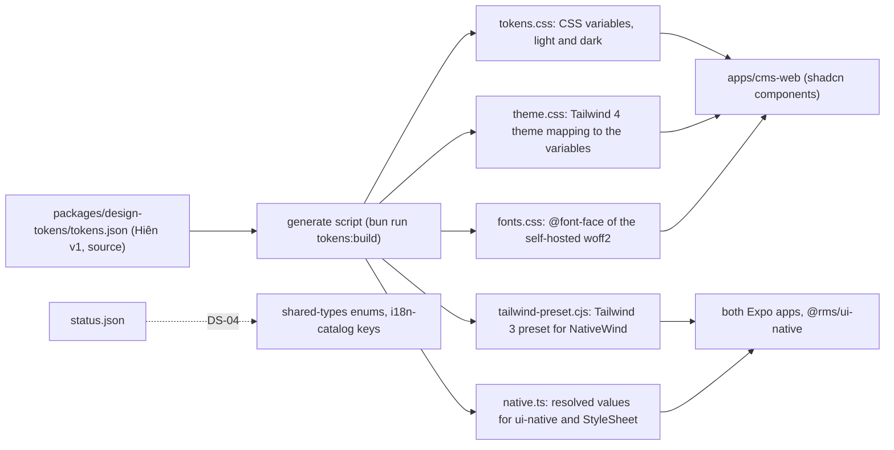

# Design system

> Status: **Approved** (Owner, 2026-10-21) · Updated: 2026-11-04 (DR-335: link to the canvas snapshot) · 2026-11-03 (§17 DS-09 checks each indicator against its own 150 ms, so a slow CI runner does not fail it) · 2026-10-30 (DR-312: the collapsible sidebar, §7.3, §8.1) · 2026-10-29 (DR-311: the web theme, §2.1, §3.2, §5.4, §5.5, §8.1) · 2026-10-28 (§17 the web interaction quality bar, DS-09, DS-10; DR-304, DR-306) · 2026-10-28 (DR-304: the web theme switch, §11, §7.3; overlay motion, §12 A6) · 2026-10-22 (P1-09: the outputs as built, §2.1; Big Shoulders 800 ships; the icon registry lives in `design-tokens`; DR-236, DR-237) · DOC-54
> Depends on: original SDD §18.2, [DR](../00-decision-register.md) (DR-10, 17, 20, 44, 45, 47, 49, 56, 70, 71, 72, 82, 84), [ADR-0019](../04-adr/0019-mobile-and-web-client-stacks.md), [ADR-0013](../04-adr/0013-time-zones-and-calendar-day-semantics.md), [DOC-03](../01-product/requirements.md) (NFR-13), [DOC-06](../02-glossary.md), [DOC-11](../03-architecture/tech-stack-and-versions.md) §4–6, [DOC-12](../03-architecture/code-architecture.md) §2, [design screens catalog](../references/design-screens.md), the design canvas (design system `Hien`)
> Main readers: P1-09 (design tokens), P1-16 (web CMS shell), P1-17 (mobile shells), DOC-53, DOC-55, DOC-56…68 (screen specifications), DOC-34 (PDF look)

This document fixes the visual language the three clients share: the design tokens, the fonts and icons, the status colors, the component catalog for the web CMS (shadcn) and the two Expo apps (`@rms/ui-native`), the layout rules, the formats of money, dates and codes, chart conventions and the accessibility floor. It does not describe screens (DOC-57…67), navigation and responsive behavior per screen (DOC-53), data fetching and client structure (DOC-55), or microcopy (DOC-68). Where this document and a screen specification disagree, this document wins for tokens, tones and components.

The reference for layout and UX is the design canvas <https://claude.ai/artifact/PLqx2HGSNuZFiVDaLhtgvj>, drawn with the design system **Hiên** <https://claude.ai/artifact/3EQA3jUWzDnLaUMgvJUekQ> (`tokens.json` version 1; how to read both is in [references](../references/README.md#design-artifacts)). A snapshot of the canvas files is in [`references/design-canvas/`](../references/design-canvas/README.md), and an artboard is a reference: components and visual styling follow this document (DR-335). This document does not redraw it: it records the values (§3–§5), fixes how they reach the code (§2), and settles the points the canvas leaves open (§15). Every new decision is recorded as DR-180…187 and summarized in §15.

## 1. Scope and reading guide

| You want | Read |
| --- | --- |
| A color, size or shadow value | §3, §4, §5 (tables copied from `tokens.json`) |
| To know whether a pair of colors is readable | §3.2 (computed ratios) |
| The tone and icon of a status | §6 |
| Which component to use, and where it comes from | §7 |
| Sizes of the web shell and the mobile shell | §8 |
| How to print money, dates, codes, phones | §9 |
| A chart | §10 |
| Accessibility rules and the tests that enforce them | §12, §14 |
| How a web screen moves and loads, what to build it from, and how to accept it | §17 |

What was checked of the canvas: all 33 web artboards, `tokens.json`, `tokens.css`, the component bundle and its stylesheet, and 30 mobile artboards (§7.4). The canvas file lists 110 artboards on 2026-10-20 (the catalog counts 115; DOC-56 reconciles the two); where this document says "not used", it says how many were read. Sample data in the canvas (names, amounts, codes such as `YC-1009-010`) is illustrative: the formats of the codes are those of DR-10.

## 2. How the tokens reach the code

### 2.1 The pipeline (P1-09)

| Output | Consumer | Rule |
| --- | --- | --- |
| `tokens.css` | web CMS | `:root` and `[data-theme="light"]` hold the light values, `[data-theme="dark"]` the dark ones, in the same variable names as the canvas (`--ground`, `--surface`, `--teal`, `--space-4`, `--radius-card`…). The web also sets `data-theme` from `prefers-color-scheme` (§11). Type, radius and sizes are the web density, and the colors and shadows the web theme of `web.json` (§5.5) |
| `theme.css` | web CMS | Tailwind 4 `@theme`: utilities (`bg-surface`, `text-ink-muted`, `rounded-card`, `shadow-card`, `text-title-1`, `h-control-lg`, `p-gutter`) read the variables, so a theme switch needs no class change. Colors map to the canvas variables; type, radius, fonts and sizes are literal (equal in both themes); shadows are `@utility` rules. Tailwind's default palette, shadows, radii, type sizes and fonts are removed: `bg-red-500` does not exist (DR-236) |
| `fonts.css` | web CMS | `@font-face` for the `woff2` files in `apps/cms-web/public/fonts`, `font-display: swap` |
| `tailwind-preset.cjs` | both apps (`tailwind.config.js` after `nativewind/preset`) | Tailwind 3 preset (DR-229): colors are CSS variables the preset declares for light and for `prefers-color-scheme: dark`, which NativeWind compiles to light and dark root variables; type sizes in px with letter spacing in dp; Tailwind's spacing steps in px (`p-4` is 16, as on the web); one family per static font file (`font-sans-semibold`). No shadows: NativeWind 4.2 drops `box-shadow: var(…)` (DR-236) |
| `native.ts` | `@rms/ui-native`, both apps | A flat `{ light: {…}, dark: {…} }` object of resolved values (`themes`), plus `space`, `radius`, `size`, `textStyles` (dp, with the font file of the weight) and `fontFiles`, for the `StyleSheet` fallback (ADR-0019). Shadows are the same CSS strings, applied with the `boxShadow` style (New Architecture only; outset shadows need Android 9 or later), and gradients (hero, gold button, `Glow`) with the `backgroundImage: 'linear-gradient(…)'` style (reactnative.dev, verified 2026-10-20); P1-17 confirms both on the pinned SDK |
| `status.json` | both | The status table of §6 as data (DR-183): one row per `entity`, `value`, optional `when` (a derived condition, such as an open charge's due date) and `audience`, with `tone`, `icon`, `label` and an optional `detail` key; `statusRow()` of `@rms/design-tokens` picks the row (DR-236) |

`generated/` is committed (the apps have no build step) and a test fails when it differs from what `tokens.json` renders. Only `packages/design-tokens` knows a hex value. A hex, a pixel size or a font name written inside a component is a review failure; the lint rule is "no color literal outside `design-tokens`": the Biome GritQL plugin `tools/biome/no-color-literal.grit` flags a hex color, `rgb(`, `rgba(`, `hsl(` or `hsla(` in a string, a JSX string or a template outside that package (DR-237). Tokens are per product, not per building: the building's name, logo and contact come from `building` settings (DOC-36), never from a token.

### 2.2 Design rules the tokens express

1. **Surfaces rise from the ground.** Every screen starts on `ground`; cards, lists, sheets and bars are `surface` with `shadow-card` (light) or a 1 px outline (dark).
2. **One primary action per screen.** One `primary` (or `gold` on a hero card) button; everything else is `tonal`, `outline` or `ghost`.
3. **Meaning is text first.** A status, an error or a count is always written. Color and icon reinforce it (§6, §12).
4. **Identifiers are plates.** Unit codes, ticket codes, batch codes and vehicle plates use the `Plate` component and the `plate-*` styles.
5. **Numbers align.** Amounts, counts, dates and times use tabular numerals (`font-variant-numeric: tabular-nums`; `fontVariant: ['tabular-nums']` on native).
6. **Shapes follow function.** Plates and checkboxes are near-square (8 px), controls 16 px, cards 24 px, sheets 32 px, buttons, chips, tags and badges fully round.
7. **Lamp yellow marks, never says.** `lamp` marks a count, a dot or a step; it never carries text or meaning alone (§3.3).

## 3. Color

### 3.1 Tokens

43 tokens, resolved per theme. `success*` tokens alias `teal*`: the green axis was moved toward blue so that done/paid is distinguishable from the danger red for people with red-green color blindness (`tokens.json`, usage note of `success`).

| Token | Light | Dark | Use |
| --- | --- | --- | --- |
| `ground` | `#EEF1EF` | `#0C1413` | Screen background; cards and lists rise from it on `surface` |
| `surface` | `#FFFFFF` | `#152120` | Cards, lists, sheets, navigation bars, the web sidebar and topbar |
| `fill` | `#E1E7E4` | `#1E2C2A` | Input background, unselected cells, skeletons, pressed list rows |
| `line` | `#D3DBD7` | `#293735` | Dividers and decorative card borders; never a control border |
| `line-strong` | `#72827E` | `#71837F` | Control borders (inputs, checkbox, radio, plate outline); 3:1 on `surface`, `ground`, `fill` |
| `ink` | `#0F2A2B` | `#EAF1EF` | Primary text and icons |
| `ink-muted` | `#48605D` | `#A6B7B3` | Secondary text, meta, placeholder |
| `ink-disabled` | `#8D9B97` | `#5C6C69` | Disabled text and icons only; fails 4.5:1 on purpose |
| `teal` | `#0A6B66` | `#5AD4C6` | Primary buttons, links, selected state; also text on `ground` and `surface` |
| `teal-pressed` | `#07534F` | `#8BE4D9` | Pressed state of `teal` |
| `on-teal` | `#FFFFFF` | `#06211F` | Text and icons on `teal` and `teal-pressed` |
| `teal-soft` | `#D5EBE7` | `#12332F` | Tonal button, selected chip, completed tag |
| `on-teal-soft` | `#07534F` | `#8BE4D9` | Text and icons on `teal-soft` |
| `lamp` | `#FFC53D` | `#FFC53D` | Count badge, unread dot, current step, rating stars; never text |
| `on-lamp` | `#2A1C00` | `#2A1C00` | Text and icons on `lamp` |
| `lamp-soft` | `#FFF0C7` | `#3A2C06` | Due-date reminder banner, "due soon" tag |
| `on-lamp-soft` | `#644400` | `#FFD874` | Text and icons on `lamp-soft` |
| `plate` | `#0F2A2B` | `#EAF1EF` | Plate background (unit code, floor, ticket code); inverts with the theme |
| `on-plate` | `#F4F7F5` | `#0F2A2B` | Text on `plate` |
| `danger` | `#B3261E` | `#FF9C91` | Destructive action, error, overdue; also text and danger button background |
| `on-danger` | `#FFFFFF` | `#3A0A06` | Text on `danger` |
| `danger-soft` | `#FBE2DF` | `#40140F` | Error banner, overdue tag |
| `on-danger-soft` | `#8F1B15` | `#FFB4AB` | Text and icons on `danger-soft` |
| `info` | `#2B4FCB` | `#A5B7FF` | In-progress state and neutral information; also text |
| `info-soft` | `#E0E7FC` | `#1B2652` | Info banner, in-progress tag |
| `on-info-soft` | `#1F3BA0` | `#BFCBFF` | Text and icons on `info-soft` |
| `success` | `{teal}` | `{teal}` | Done and paid; alias of `teal` |
| `success-soft` | `{teal-soft}` | `{teal-soft}` | Done tag, success banner; alias of `teal-soft` |
| `on-success-soft` | `{on-teal-soft}` | `{on-teal-soft}` | Text on `success-soft`; alias of `on-teal-soft` |
| `glow` | `#FFE9B0` | `#2E2609` | Porch-light wash from the screen top edge into `ground` (component `Glow`) |
| `hero-from` | `#0C7068` | `#1A6E67` | Gradient start of hero cards (bill slip due, sign-in panel, centre tab button, avatar) |
| `hero-to` | `#053634` | `#0A2E2C` | Gradient end of hero cards |
| `on-hero` | `#FFFFFF` | `#F2F8F6` | Primary text on the hero gradient |
| `on-hero-muted` | `#CFE9E5` | `#CFE6E2` | Secondary text on the hero gradient |
| `gold-from` | `#FFD86B` | `#FFD86B` | Gradient start of the `gold` button (primary action on a hero card) |
| `gold-to` | `#FFB22E` | `#FFB22E` | Gradient end of the `gold` button |
| `on-gold` | `#2A1C00` | `#2A1C00` | Text on the gold gradient |
| `coral-soft` | `#FFE4DA` | `#43201A` | Icon well, tone `coral` (guest services, community) |
| `on-coral-soft` | `#9A3412` | `#FFB59E` | Icon and text on `coral-soft` |
| `violet-soft` | `#EAE4FB` | `#2A2350` | Icon well, tone `violet` (amenities, events) |
| `on-violet-soft` | `#4B37A6` | `#C9BEFF` | Icon and text on `violet-soft` |
| `focus` | `#0F2A2B` | `#FFC53D` | Keyboard focus ring: 2 px solid, 2 px offset |
| `scrim` | `rgba(15, 42, 43, 0.5)` | `rgba(0, 0, 0, 0.62)` | Overlay behind sheets and dialogs |

### 3.2 Contrast, computed

Ratios are WCAG 2.x relative luminance contrasts computed from the hex values above (script kept in P1-09 as test DS-02, so a token edit that breaks a pair fails CI). Needs: 4.5:1 for text, 3:1 for borders, focus rings and other non-text marks that carry meaning.

| Foreground on background | Needs | Light | Dark | Verdict |
| --- | --- | --- | --- | --- |
| `ink` on `ground` | 4.5:1 | 13.32 | 16.29 | Pass |
| `ink` on `surface` | 4.5:1 | 15.15 | 14.43 | Pass |
| `ink` on `fill` | 4.5:1 | 12.08 | 12.65 | Pass |
| `ink-muted` on `ground` | 4.5:1 | 5.94 | 8.93 | Pass |
| `ink-muted` on `surface` | 4.5:1 | 6.76 | 7.91 | Pass |
| `ink-muted` on `fill` | 4.5:1 | 5.39 | 6.93 | Pass |
| `teal` on `ground` | 4.5:1 | 5.58 | 10.37 | Pass |
| `teal` on `surface` | 4.5:1 | 6.35 | 9.18 | Pass |
| `on-teal` on `teal` | 4.5:1 | 6.35 | 9.37 | Pass |
| `on-teal` on `teal-pressed` | 4.5:1 | 8.90 | 11.40 | Pass |
| `on-teal-soft` on `teal-soft` | 4.5:1 | 7.15 | 9.22 | Pass |
| `on-lamp` on `lamp` | 4.5:1 | 10.52 | 10.52 | Pass |
| `on-lamp-soft` on `lamp-soft` | 4.5:1 | 7.83 | 9.93 | Pass |
| `on-plate` on `plate` | 4.5:1 | 14.04 | 13.22 | Pass |
| `danger` on `ground` | 4.5:1 | 5.75 | 9.26 | Pass |
| `danger` on `surface` | 4.5:1 | 6.54 | 8.20 | Pass |
| `on-danger` on `danger` | 4.5:1 | 6.54 | 8.50 | Pass |
| `on-danger-soft` on `danger-soft` | 4.5:1 | 7.30 | 9.34 | Pass |
| `info` on `ground` | 4.5:1 | 5.99 | 9.61 | Pass |
| `info` on `surface` | 4.5:1 | 6.81 | 8.52 | Pass |
| `on-info-soft` on `info-soft` | 4.5:1 | 7.76 | 9.13 | Pass |
| `on-hero` on `hero-from` | 4.5:1 | 5.94 | 5.63 | Pass |
| `on-hero` on `hero-to` | 4.5:1 | 13.26 | 13.56 | Pass |
| `on-hero-muted` on `hero-from` | 4.5:1 | 4.65 | 4.63 | Pass |
| `on-hero-muted` on `hero-to` | 4.5:1 | 10.38 | 11.16 | Pass |
| `on-gold` on `gold-from` | 4.5:1 | 12.09 | 12.09 | Pass |
| `on-gold` on `gold-to` | 4.5:1 | 9.22 | 9.22 | Pass |
| `on-coral-soft` on `coral-soft` | 4.5:1 | 6.04 | 8.46 | Pass |
| `on-violet-soft` on `violet-soft` | 4.5:1 | 7.09 | 8.45 | Pass |
| `ink-disabled` on `surface` | 4.5:1 | 2.89 | 2.99 | Fails in light and dark (by design, see §4.3) |
| `line-strong` on `surface` | 3.0:1 | 4.03 | 4.14 | Pass |
| `line-strong` on `ground` | 3.0:1 | 3.54 | 4.67 | Pass |
| `line-strong` on `fill` | 3.0:1 | 3.22 | 3.63 | Pass |
| `focus` on `ground` | 3.0:1 | 13.32 | 11.83 | Pass |
| `focus` on `surface` | 3.0:1 | 15.15 | 10.47 | Pass |
| `focus` on `fill` | 3.0:1 | 12.08 | 9.18 | Pass |
| `lamp` on `surface` | 3.0:1 | 1.58 | 10.47 | Fails in light (by design, see §4.3) |
| `lamp` on `ground` | 3.0:1 | 1.39 | 11.83 | Fails in light (by design, see §4.3) |

Every pair the components use passes in both themes except the three marked rows, which are deliberate.

Two more pairs, on the web token `surface-muted` (§5.5): `ink` 14.49 light, 13.64 dark; `ink-muted` 6.46 light, 7.47 dark.

**On the web.** The web theme of §5.5 changes some light colors; these pairs have other ratios there (dark is unchanged). DS-02 checks both tables.

| Foreground on background (web, light) | Needs | Canvas | Web |
| --- | --- | --- | --- |
| `ink` on `ground` | 4.5:1 | 13.32 | 14.00 |
| `ink` on `fill` | 4.5:1 | 12.08 | 13.02 |
| `ink-muted` on `ground` | 4.5:1 | 5.94 | 6.25 |
| `ink-muted` on `fill` | 4.5:1 | 5.39 | 5.81 |
| `teal` on `ground` | 4.5:1 | 5.58 | 5.26 |
| `teal` on `surface` | 4.5:1 | 6.35 | 5.70 |
| `on-teal` on `teal` | 4.5:1 | 6.35 | 5.70 |
| `on-teal` on `teal-pressed` | 4.5:1 | 8.90 | 7.51 |
| `on-teal-soft` on `teal-soft` | 4.5:1 | 7.15 | 7.47 |
| `danger` on `ground` | 4.5:1 | 5.75 | 6.04 |
| `info` on `ground` | 4.5:1 | 5.99 | 6.29 |
| `line-strong` on `ground` | 3.0:1 | 3.54 | 3.73 |
| `line-strong` on `fill` | 3.0:1 | 3.22 | 3.47 |
| `line-control` on `ground` | 3.0:1 | 3.23 | 3.40 |
| `focus` on `ground` | 3.0:1 | 13.32 | 14.00 |
| `focus` on `fill` | 3.0:1 | 12.08 | 13.02 |
| `lamp` on `ground` | 3.0:1 | 1.39 | 1.46 (fails by design, §3.3) |

### 3.3 What the failing rows mean

| Row | Why it fails | Rule that contains it |
| --- | --- | --- |
| `ink-disabled` on `surface` | A disabled control is exempt from WCAG contrast; the token is the lowest-contrast gray that still reads as disabled | Used only for disabled controls. A disabled control that explains itself ("Hết lượt thử", a limit) puts the explanation in `ink-muted` |
| `lamp` on `surface` and `ground` (light) | 1.58:1 and 1.39:1: a yellow mark on white does not stand out | `lamp` is never the only carrier of meaning. Count badge: the number is text (`on-lamp` on `lamp`, 10.52:1). Unread dot: the row also has a bold title and the notice `is-unread` style, and the screen-reader label says "chưa đọc". Rating stars: the numeric value is printed next to the stars and the group has an `aria-label`. Current step: the step has its text and `aria-current="step"` |
| `line-input` on `surface` (web) | 1.38:1 light, 1.61:1 dark: the field border of the web follows shadcn's light `border-input` (DR-311) | A field is told by its visible label, its white fill on `ground` and its `shadow-field`, not by the border alone; focus turns the border `teal` with a 3 px ring, and an error is written under the field with a `danger` border and ring. `line-strong` and `line-control` keep 3:1 for the controls that use them |

## 4. Typography

### 4.1 Fonts

| Role | Family | Weights used | Licence | Verified on |
| --- | --- | --- | --- | --- |
| Text (every screen) | **Geologica** (Google Fonts, variable: `wght` 100–900 plus `CRSV`, `SHRP`, `slnt`) | 400, 500, 600, 700 | SIL OFL 1.1 | 2026-10-20 |
| Plates (`plate-*` styles) | **Big Shoulders** (Google Fonts, added 2025-02-06, variable: `wght`, `opsz`) | 700, and 800 for `plate-xl` (the design system ships `BigShoulders-ExtraBold`; added in P1-09, DR-236) | SIL OFL 1.1 | 2026-10-20 |
| PDF documents | Be Vietnam Pro (DR-56, unchanged) | Regular, Medium, SemiBold, Bold, Italic | SIL OFL 1.1 | 2026-10-19 (DOC-11 §5) |

Sources: [google/fonts `ofl/geologica` METADATA.pb](https://github.com/google/fonts/blob/main/ofl/geologica/METADATA.pb) (subsets: cyrillic, cyrillic-ext, greek, latin, latin-ext, **vietnamese**), [`ofl/bigshoulders` METADATA.pb](https://github.com/google/fonts/blob/main/ofl/bigshoulders/METADATA.pb) (latin, latin-ext, **vietnamese**), both read 2026-10-20.

**Vietnamese check (run 2026-10-20 with fontTools 4.60.2 on the upstream variable files).** All 147 characters tested are present in both fonts: every vowel `a ă â e ê i o ô ơ u ư y` with each of the five tone marks, in both cases, plus `đ`, `Đ` and the dong sign `₫`. Result: 0 missing. This is the check DS-05 repeats on the files that ship.

Hosting and format (DR-180):

| Platform | Files | Why |
| --- | --- | --- |
| Web CMS | Self-hosted `woff2` in `apps/cms-web/public/fonts` (Geologica 400/500/600/700 and Big Shoulders 700/800, copied from the design system), `font-display: swap`, `<link rel="preload">` for Geologica 400 and 600. The measured size of the static instances is about 41 KB per Geologica weight and 36 KB for Big Shoulders (≈ 200 KB in total, before subsetting) | The CSP has `font-src 'self'` (DOC-39 §5.1), so Google Fonts cannot be used; self-hosting also avoids a third-party call from the CMS |
| Expo apps | Static `ttf` instances in `packages/design-tokens/fonts`, loaded with `expo-font` before the splash screen hides | React Native does not use variable fonts or `woff2`. The instances were produced and checked on 2026-10-20: `fonttools varLib.instancer Geologica[...].ttf wght=400 CRSV=0 SHRP=0 slnt=0 -o Geologica-400.ttf` (also 500, 600, 700) and `wght=700 opsz=72` (also `wght=800`) for Big Shoulders; 139 KB per Geologica file, 94 KB for Big Shoulders; the weight class of each output matches. P1-09 made the shipped files with fontTools 4.67.0 (2026-10-22); the PostScript name equals the file name (`Geologica-SemiBold`), which is the family name the apps use |

`OFL.txt` of both families is copied beside the files. Be Vietnam Pro is no longer a UI font: DOC-11 §5 and §6 (the `expo-font` row) say "PDF and app typography" and need the word "app" removed (§16).

### 4.2 Type scale

Same 10 text styles as `tokens.json`; the four plate styles use the plate family. Native sizes are `dp`, equal to the px values. Line heights are fixed values.

| Style | Family | Size / line | Weight | Letter spacing | Use |
| --- | --- | --- | --- | --- | --- |
| `display` | sans | 34px / 40px | 700 | -0.02em | Total on a bill slip, greeting on Home; at most once per screen |
| `title-1` | sans | 26px / 32px | 600 | -0.015em | Large screen title (TopBar large); the web page `h1` |
| `title-2` | sans | 20px / 28px | 600 | -0.01em | Section title, sheet and dialog title |
| `title-3` | sans | 17px / 24px | 600 | 0 | Card title; compact TopBar title |
| `body` | sans | 16px / 24px | 400 | 0 | Reading text; the smallest size for long text |
| `body-strong` | sans | 16px / 24px | 600 | 0 | List row title, amount in a row |
| `label` | sans | 15px / 20px | 600 | 0 | Button, chip, tab, segmented-control text |
| `secondary` | sans | 14px / 20px | 400 | 0 | List row second line, short description, help text under an input |
| `caption` | sans | 13px / 18px | 500 | 0 | Input label, time meta, tag text; the smallest size for text that must be read |
| `micro` | sans | 12px / 16px | 600 | 0 | TabBar label and Badge number only |
| `plate-xl` | plate | 44px / 44px | 800 | 0.01em | Unit code on the pass card and the welcome screen |
| `plate-lg` | plate | 28px / 28px | 700 | 0.02em | Large plate: bill slip head, vehicle plate |
| `plate-md` | plate | 20px / 20px | 700 | 0.03em | Medium plate: UnitSwitcher, request card |
| `plate-sm` | plate | 15px / 16px | 700 | 0.04em | Small plate in rows and meta |

Rules: the smallest size for text a person must read is `caption` (13 px). `micro` (12 px) is for the TabBar label and the Badge number only. One `display` per screen. Text scales with the system font size; `micro` and every `plate-*` style cap at 1.3× (`maxFontSizeMultiplier` on native, `rem` clamp on the web), everything else must not clip at 1.5× (test DS-08).

## 5. Spacing, shape, size and shadow

### 5.1 Spacing

| Token | Value | Use |
| --- | --- | --- |
| `space-1` | 4px | Gap between an icon and text in a tag; the smallest gap |
| `space-2` | 8px | Gap between icon and text in a button; gap between chips |
| `space-3` | 12px | Gap between rows inside a card; service-tile grid gap |
| `space-4` | 16px | Inner padding of cards and list rows; gap between cards |
| `space-5` | 20px | Left and right screen margin (equals `gutter`) |
| `space-6` | 24px | Padding of sheets and dialogs; gap between a section title and its content |
| `space-8` | 32px | Gap between two content blocks on a screen |
| `space-10` | 40px | Space above and below an empty state |
| `space-14` | 56px | Bottom padding of a list so content clears the TabBar |

### 5.2 Radius

| Token | Value | Use |
| --- | --- | --- |
| `radius-plate` | 8px | Plates and checkboxes: the only near-square shape |
| `radius-control` | 16px | Inputs, pickers, attachment tiles, icon wells, toasts |
| `radius-card` | 24px | Cards, list groups, banners, dialogs, top corners of the TabBar |
| `radius-sheet` | 32px | Top corners of a bottom sheet |
| `radius-full` | 999px | Buttons, chips, tags, switches, avatars, badges, progress bars |

### 5.3 Sizes

| Token | Value | Use |
| --- | --- | --- |
| `tap-min` | 48px | Minimum height and width of a touch area (design target) |
| `control-lg` | 52px | Primary button at the bottom of a screen; text input height |
| `control-md` | 44px | Button in a card or a row |
| `control-sm` | 36px | Chip and small button in a banner; the touch area still grows to 44 px (DR-184) |
| `icon-sm` | 20px | Icon in tags, chips, meta lines |
| `icon-md` | 24px | Default icon: buttons, list rows, TabBar, TopBar |
| `icon-lg` | 32px | Icon in service tiles and empty states |
| `gutter` | 20px | Left and right screen margin |
| `topbar-height` | 56px | Compact TopBar height |
| `tabbar-height` | 64px | TabBar height, not counting the bottom safe area |

Controls: `lg` 52 px, `md` 44 px, `sm` 36 px, with the 20/24 px icon of the size. The `sm` control and the `sm` IconButton extend their touch area to 44 px (`hitSlop` on native, padding on the web); the design target is `tap-min` 48 px (DR-184). Avatar sizes: `sm` 32 px; the other sizes are in the component source.

### 5.4 Shadows

| Token | Light | Dark | Use |
| --- | --- | --- | --- |
| `shadow-card` | `0 1px 2px rgba(15, 42, 43, 0.05), 0 8px 24px rgba(15, 42, 43, 0.07)` | `0 0 0 1px rgba(234, 241, 239, 0.07)` | Cards on `ground` |
| `shadow-glow` | `0 10px 24px rgba(10, 107, 102, 0.34)` | `0 10px 28px rgba(90, 212, 198, 0.22)` | Glow under a primary hero button |
| `shadow-bar` | `0 -2px 20px rgba(15, 42, 43, 0.09)` | `0 -1px 0 rgba(234, 241, 239, 0.08)` | TabBar top edge |
| `shadow-float` | `0 8px 24px rgba(15, 42, 43, 0.14), 0 1px 2px rgba(15, 42, 43, 0.08)` | `0 8px 24px rgba(0, 0, 0, 0.5), 0 0 0 1px rgba(234, 241, 239, 0.08)` | Floating card, toast, bulk-action bar |
| `shadow-sheet` | `0 -6px 32px rgba(15, 42, 43, 0.16)` | `0 -6px 32px rgba(0, 0, 0, 0.55), 0 -1px 0 rgba(234, 241, 239, 0.08)` | Bottom sheet |

In dark mode shadows give way to hairlines: a surface is told from the ground by a 1 px `rgba(234, 241, 239, 0.07)` ring, not by blur. The web draws its own shadows under a 1 px `line` border (§5.5).

### 5.5 The web density and the web theme (DR-307, DR-311)

The web CMS is used with a mouse on a wide screen for long sessions; `packages/design-tokens/web.json` adapts the canvas to it, in `tokens.css` and `theme.css` only. The apps keep the canvas values.

- **Density (DR-307).** Smaller type (body 14/20), radii (`plate` 4, `control` 8, `card` 12, `sheet` 16) and sizes (`control-md` 36 px), listed in `web.json`.
- **Theme (DR-311).** Light colors written over the canvas: `ground` `#F5F6F7`, `fill` `#ECEEF0`, `line` `#E3E5E8` (neutral greys, without the canvas's green tint), `teal` `#0B736D`, `teal-pressed` `#085F5A`, `teal-soft` `#D9F0EB` (`success*` follow); `scrim` `rgba(15, 42, 43, 0.38)` light, `rgba(0, 0, 0, 0.55)` dark; `shadow-float` layered. Their contrast is the second table of §3.2.
- **Web tokens.** `line-control` (`#80868D` / `#667773`: a dashed drop zone; 3:1), `line-input` (`#D9DCE0` / `#344440`: the border of every field and the track of an unchecked switch, after shadcn; §3.3), `surface-muted` (`#F9FAFA` / `#192624`: the band of a table header, a hovered row, a dialog footer), and six shadows. A field's label is `label` (14/20, weight 500) 8 px above it, as shadcn's `Label`:

| Token | Use on the web |
| --- | --- |
| `shadow-raised` | An outline button, a chip, a chosen segment, a radio card: a hairline lift under a 1 px border |
| `shadow-field` | Every field (text input, select, text area, OTP cell, checkbox, radio), after shadcn's `Input`: white, a 1 px `line-input` border and shadcn's `shadow-xs`; a select is drawn like a text field, its chosen option marked by a check at the right |
| `shadow-panel` | A card, a table card, the active sidebar entry, the user block: layered blur under a 1 px `line` border |
| `shadow-primary` | The `primary` button and the brand mark: a light top edge and a teal glow |
| `shadow-focus` | The focus of a field or an open select: the border turns `teal` with a 3 px `teal` ring outside it (shadcn's `ring-[3px]`; §12 A4) |
| `shadow-invalid` | A field in error, at rest and focused: the `danger` border with a 3 px `danger` ring (shadcn's `aria-invalid`) |

## 6. Status presentation

### 6.1 The Tag rules (DR-183)

1. A status is shown with the `Tag` component: the **text label always**, plus a leading icon by default for the tones `info`, `success`, `warning` and `danger` (icons `info`, `check-circle`, `warning`, `x-circle`; `neutral` has none unless the row below names one). Dense web table rows may hide the icon (`icon={false}`, as drawn on `W-Tickets` and `W-Staff`) because the text is still there; cards and every mobile screen keep it.
2. Tone means *what the viewer should do*: `warning` = needs the viewer's attention or action now; `info` = in progress, nothing to do; `success` = done or paid; `danger` = failed, overdue or locked; `neutral` = waiting on someone else, or inactive. The same domain status can therefore have a different tone for a different audience (a pending vehicle is `warning` for the Manager who must review it and `neutral` for the resident who waits).
3. The statuses come from the enumerations of the data documents (`CHECK` lists, DOC-14 §9). Test DS-04 fails when a value has no row in `status.json`, a label key is missing from the `vi` or `en` catalog (NFR-13), or an icon is not in the icon registry (§7.3).
4. Labels below are the ones drawn in the canvas. "Proposed" labels are not drawn; DOC-68 owns the final text and the `en` side.

### 6.2 Charge, batch and payment

Charge `open` is shown by its due date (ADR-0013: calendar days in the building time zone); `DUE_SOON_DAYS` is a constant of `@rms/shared-types` equal to **7** (6 days left is "due", 16 is "upcoming" in `Fees`).

| Domain value | Condition | Tone | Icon | Label (`vi`) | Source |
| --- | --- | --- | --- | --- | --- |
| charge `open` | due date more than 7 days away | neutral | — | "Chưa đến hạn" (bill slip `upcoming`), staff "Chưa nộp" | `Fees`, `W-Fee-Record` |
| charge `open` | due within 7 days | warning | `warning` | "Đến hạn" with "Còn N ngày"; staff "Sắp hạn" | `Fees`, `W-Fee-Record` |
| charge `open` | due date passed | danger | `x-circle` | "Quá hạn"; staff "Quá hạn N ngày" | `BillSlip`, `W-Debts` |
| charge `paid` | | success | `check-circle` | "Đã thanh toán" | `BillSlip` |
| charge `void` | recalled or voided (DR-19, DR-20) | neutral | `x-circle` | proposed "Đã hủy" | to design |
| charge `draft` | staff only | neutral | — | "Nháp" | `W-Fee-Batch` |
| batch `draft` | | neutral | — | "Nháp" | `W-Fees` |
| batch `published` | | info | `info` | "Đã phát hành" | `W-Fees` |
| batch `recalled` | DR-72 adds it | warning | `warning` | proposed "Đã thu hồi" | to design (`W-Fee-Recall`, P2) |
| batch `closed` | | success | `check-circle` | "Đã đóng" | `W-Fees` |
| payment intent `creating`, `pending` | staff web | warning | `warning` | "Đang treo" (pending, no confirmation yet) | `W-Transactions` |
| payment intent `paid` | | success | `check-circle` | proposed "Thành công" | `W-Transactions` |
| payment intent `failed` | | danger | `x-circle` | proposed "Thất bại" | to design |
| payment intent `expired`, `cancelling`, `cancelled` | still accept a late exact confirmation (DR-29) | neutral | `x-circle` | proposed "Hết hạn" / "Đã hủy" | to design |
| money log row to review | DR-16, DR-84 | warning | `warning` | proposed "Cần kiểm tra" | to design (`W-Money-Log`) |
| money log row reviewed | | success | `check-circle` | proposed "Đã kiểm tra" | to design |

The resident payment screens show a transfer that does not match the amount (`unmatchedTransfer`, DR-84 item 8) as a `Banner` with tone `warning`, not as a Tag; the text is DOC-68's.

### 6.3 Tickets

| Domain value | Audience | Tone | Icon | Label (`vi`) | Source |
| --- | --- | --- | --- | --- | --- |
| `submitted` | staff | warning | `warning` | "Chưa phân công" | `W-Tickets` |
| `assigned` | staff | neutral | — | proposed "Đã giao" | to design |
| `accepted` | staff | neutral | — | "Đã tiếp nhận" | `W-Tickets` |
| `in_progress` | staff | info | `info` | "Đang xử lý" | `W-Tickets` |
| `on_hold` | staff | warning | `warning` | proposed "Tạm dừng" | to design |
| `resolved` | staff | success | `check-circle` | "Chờ đóng phiếu" | `W-Tickets` |
| `closed` | staff | success | `check-circle` | "Đã đóng" | `W-Tickets` tab |
| `cancelled` | staff | neutral | `x-circle` | proposed "Đã hủy" | to design |
| urgent flag | staff | warning | `warning` | "Khẩn" (a second Tag beside the status) | `W-Tickets` |
| `submitted` | resident (`sent`) | neutral | `clock` | "Chờ tiếp nhận" | `TicketCard` |
| `assigned`, `accepted` | resident (`received`) | info | `info` | "Đã tiếp nhận" | `TicketCard` |
| `in_progress`, `on_hold`, `resolved` | resident (`processing`) | info | `wrench` | "Đang xử lý" | `TicketCard` |
| `closed` | resident (`done`) | success | `check-circle` | "Hoàn thành" | `TicketCard` |
| `cancelled` | resident (`cancelled`) | neutral | `x-circle` | proposed "Đã hủy" | replaces the drawn `rejected` |

The resident sees five states (DR-45, glossary "ticket status"): `resolved` still reads "Đang xử lý" because the Manager checks the result first. The `TicketCard` progress bar has 4 steps ("Đã gửi", "BQL đã tiếp nhận", "Đang xử lý", "Hoàn thành"); a cancelled card has no bar. The canvas component maps a fifth state `rejected` to a red "Từ chối": a technician's rejection returns the ticket to `submitted` and is invisible to the resident (DR-44), so the only fifth state is `cancelled`, drawn neutral (DR-183).

### 6.4 People, vehicles, notices and imports

| Domain value | Tone | Icon | Label (`vi`) | Source |
| --- | --- | --- | --- | --- |
| membership `active` | success | `check-circle` | "Đang dùng" | `W-Unit-Detail` |
| membership `locked` | danger | `x-circle` | "Đã khóa" | `W-Residents` |
| membership `removed` | neutral | — | proposed "Đã gỡ" | to design (unit history) |
| resident account `active`, has signed in | success | `check-circle` | "Đang dùng" | `W-Residents` |
| resident account `active`, never signed in | neutral | — | "Chưa đăng nhập" | `W-Residents` |
| resident account `deletion_requested` | warning | `warning` | "Yêu cầu xóa tài khoản" | `W-Residents` |
| resident account `deleted` | neutral | — | proposed "Đã xóa" | to design |
| staff account `invited` | warning | `warning` | "Chờ đặt mật khẩu" | `W-Staff` |
| staff account `active` | success | `check-circle` | "Đang hoạt động" | `W-Staff` |
| staff account `locked` | danger | `x-circle` | "Đã khóa" | `W-Staff` |
| staff account `disabled` | neutral | — | proposed "Đã vô hiệu hóa" | to design |
| vehicle `pending` | warning (Manager) / neutral with `clock` (resident) | `clock` | "Chờ duyệt" / "Chờ BQL duyệt" | `W-Vehicles`, `VehicleCard` |
| vehicle `approved` | success | `check-circle` | "Đã duyệt" (resident card: "Thẻ đang hoạt động") | `W-Vehicles`, `VehicleCard` |
| vehicle `rejected` | danger | `x-circle` | proposed "Bị từ chối" | to design (`B-Vehicle-Reject`) |
| vehicle `retired` | neutral | — | proposed "Đã gỡ" | to design |
| notice `draft` | neutral | — | "Nháp" | `W-Notices` |
| notice `scheduled` | info | `info` | "Hẹn giờ" | `W-Notices` |
| notice `sending` | info | `info` | proposed "Đang gửi" | to design |
| notice `sent` | success | `check-circle` | proposed "Đã gửi" (drawn as a time line, not a Tag) | `W-Notices` |
| notice category urgent | danger | (category icon) | "Khẩn cấp" | `W-Notice-Stats` |
| import row error | danger | — | "N dòng lỗi" | `W-Fee-Import` |
| unit `occupied` | success | `check-circle` | "Đang ở" | `W-Units` |
| unit `rented` | info | `info` | "Cho thuê" | `W-Units` |
| unit `vacant` | neutral | — | "Trống" | `W-Units` |
| gateway or setting in effect | success | `check-circle` | "Đang áp dụng" / "Đang dùng" | `W-Building`, `W-Gateway` |

The canvas `VehicleCard` has a third state `expired` ("Thẻ hết hạn"); the vehicle model has no expiry (DR-49), so the state is dropped and replaced by `rejected` and `retired`.

### 6.5 Icon wells

`ServiceTile`, `NoticeCard`, `ListItem` and `EmptyState` put an icon on a round or squared "well" with a **tone**: `teal`, `gold`, `coral`, `sky`, `violet` (`bundle.css`: `teal-soft`, `lamp-soft`, `coral-soft`, `info-soft`, `violet-soft`). A well tone is decoration: it groups a kind of thing (payments gold, requests teal, notices sky or coral, people violet) and carries no state. State is always a Tag.

## 7. Components

### 7.1 Rules

- One component set, two implementations: the web CMS uses shadcn/ui on Radix (source copied into `apps/cms-web/src/components/ui`, restyled by the tokens, no runtime UI dependency); the Expo apps use `@rms/ui-native`, which re-implements the same component names with React Native primitives, NativeWind classes and the same props. A screen specification names the Hiên component; both platforms resolve it.
- Props follow the canvas bundle: `variant` (`primary`, `outline`, `ghost`, `tonal`, `gold`, `danger`), `size` (`sm`, `md`, `lg`), `tone`, `icon`, `block`, `loading`. A new variant needs a change to this document.
- No component calls the API or reads the unit context; they receive data and handlers (DOC-55 owns the containers).
- `@rms/ui-native` depends only on `design-tokens`, `shared-types` and `core-i18n` (DOC-12 §2.2). The sheet and the dialog use the React Native `Modal` and Reanimated (already pinned, DOC-11 §6); no extra bottom-sheet library is added. The `Modal` `animated` prop is deprecated in React Native 0.87+ (DOC-11 §6), so animation is done in the component.
- `lucide-react`, which shadcn components import by default, is replaced by Phosphor through `components.json` (`"iconLibrary": "phosphor"`; verified 2026-10-20 in the shadcn registry `icons/index.json`, which maps every icon to a `phosphor` name, and `shadcn` 4.22.1).

### 7.2 Catalog

"Used in" lists artboards of the canvas that use the component, from the 63 artboards read (§7.4); "—" means none of those 49 use it. Phase is the first phase whose task builds a screen that needs it.

| Hiên component | Web (shadcn / Radix base) | Native (`ui-native`) | Used in (examples) | Phase |
| --- | --- | --- | --- | --- |
| `Plate` | custom `` with the `plate-*` styles | `Text` in a `View` | every list and header (48 uses) | P1 |
| `Icon` | `@phosphor-icons/react` through the registry (§7.3) | `phosphor-react-native` through the registry | 444 uses | P1 |
| `Avatar` | `avatar` | `View` + `Image` (`expo-image`) | `W-Tickets`, `K-Jobs` | P1 |
| `Glow` | CSS gradient on the page root | `View` with the style `backgroundImage: 'linear-gradient(…)'` built from the tokens (documented React Native style, reactnative.dev 2026-10-20); fallback `expo-linear-gradient` (in the SDK 58 bundle, `~58.0.3`, not yet pinned in DOC-11) | `Main`, `Fees`, `G-Lookup` | P1 |
| `Button` | `button` | `Pressable` | 160 uses; `primary`, `outline`, `ghost` most | P1 |
| `IconButton` | `button` (size `icon`) with an `aria-label` | `Pressable` with `accessibilityLabel` | 119 uses | P1 |
| `Chip` | `toggle` (`aria-pressed`) | `Pressable` | `K-Jobs`, `W-Fee-Batch` | P1 |
| `SegmentedControl` | `toggle-group` (single, `role="radiogroup"`) | `View` of `Pressable` | `Fees`, `W-Debts`, `G-Lookup` | P1 |
| `Tabs` | `tabs` | — (mobile uses `SegmentedControl` and `Chip`) | `W-Tickets`, `W-Fees` | P1 |
| `TextField`, `SearchField` | `input` + `label` + help/error text (`form` with react-hook-form) | `TextInput` | `W-Login`, `W-Fee-Batch` | P1 |
| `SelectField` | `select` (Radix) | opens a `BottomSheet` of `Radio` rows | 23 uses on the web | P1 |
| `Checkbox`, `Radio`, `Switch` | `checkbox`, `radio-group`, `switch` | `Pressable` rows | `W-Debts`, `Pay-Select`, `Account` | P1 |
| `OtpInput` | `input-otp` is not used: one visible-cells component over a single `input` with `autocomplete="one-time-code"`, `inputmode="numeric"` | one hidden `TextInput` (`textContentType="oneTimeCode"`, `autoComplete="sms-otp"`) with six cell views | `OTP` | P1 |
| `TopBar` | not used (the web has the page header, §8.1) | compact (56 px) and large title variants | `Fees` | P1 |
| `TabBar` | not used (the web has the sidebar) | bottom bar, 4 or 5 items, optional centre action (QR) | 13 mobile artboards | P1 |
| `UnitSwitcher` | not used | `Pressable` showing the unit plate; opens the unit-pick sheet | `Main` | P1 |
| `GreetingBar` | not used | avatar, greeting, actions slot | `Main`, `B-Home`, `G-Lookup`, `K-Jobs` | P1 |
| `List`, `ListItem` | `<ul>` / row component | `FlashList` rows | 58 uses | P1 |
| `Card` | `card` | `View` | 14 uses | P1 |
| `Tag` | `badge` restyled by tone | `View` + `Text` + icon | 46 uses | P1 |
| `Badge` | custom (count or dot) | custom | 61 uses (sidebar counts, TabBar, bell) | P1 |
| `Banner` | `alert` | `View` | 16 uses (tones `info`, `neutral`, `warning`, `danger`) | P1 |
| `Toast` | `sonner` (shadcn `sonner` component; `sonner` 2.0.8, MIT, published 2026-08-09, npm, verified 2026-10-20) | `View` at the top, auto-dismiss | — | P1 |
| `BottomSheet` | `dialog` (a centered panel; a sheet is not a web pattern here) | `Modal` + Reanimated, 32 px top radius, grip | `Account-Phone` | P1 |
| `Dialog` | `alert-dialog` (`role="alertdialog"`) | `Modal` | `W-Step-Up`, confirmations | P1 |
| `EmptyState` | custom | custom | `Pay-Done` | P1 |
| `Skeleton` | `skeleton` | `Animated.View` | — | P1 |
| `ServiceTile`, `TileGrid` | not used | grid of `Pressable` tiles with a well | `Main`, `B-Home` (36 uses) | P1 |
| `BillSlip` | not used (the web shows a table) | card with rows and total | `Fees`, `Fee-Detail`, `Main` | P2 |
| `Timeline` | custom `<ol>` | `View` list | `W-Ticket-Detail`, `W-Transactions` | P4 |
| `TicketCard` | not used | `Pressable` card with the 4-step bar | `Main`, `B-Home`, `K-Jobs` | P4 |
| `NoticeCard` | custom | `Pressable` card | `Main`, `Home-Helper`, `W-Notice-Edit` | P4 |
| `AttachmentPicker` | custom dropzone | `expo-image-picker`, `expo-document-picker` (DOC-11 §6) | `W-Notice-Edit`, `W-Ticket-Detail` | P4 |
| `Rating` | custom (read only on the web) | `Pressable` stars with a numeric label | `W-Reports` | P4 |
| `VehicleCard` | not used (the web has a table) | card with plate, model and Tag | `Unit-Owner` | P5 |
| `UsageBars` | custom (§10) | custom | `W-Dashboard` | P6 |

### 7.3 Icons (DR-181)

The canvas draws every icon from **Phosphor** (regular and `fill` weights, `check-bold`; the bundle inlines 51 of them). DR-70 listed `lucide-react`. Phosphor replaces it:

| Platform | Package | Version | Licence | Published | Note |
| --- | --- | --- | --- | --- | --- |
| Web | `@phosphor-icons/react` | 2.1.10 | MIT | 2025-05-22 | Named imports tree-shake. The package has not been published for 17 months at the verification date; it is a mature icon set, and the fallback is `@phosphor-icons/core` (SVG files, 2.1.1) |
| Native | `phosphor-react-native` | 3.0.6 | MIT | 2026-04-23 | Pure JavaScript over `react-native-svg` 15.16.0 (the version bundled by Expo SDK 58, no native module of its own); react-native-svg supports Fabric since 13.0.0, so the New Architecture requirement holds (sources: npm registry, Expo `bundledNativeModules.json` for SDK 58, react-native-svg README; 2026-10-20) |
| shadcn | `components.json` → `"iconLibrary": "phosphor"` | CLI 4.22.1 | | | Generated components import Phosphor names |

Both packages expose an `Icon` component fed by a **registry**: `ICON_NAMES` of `@rms/design-tokens` (`src/icons.ts`, P1-09) is the typed list of the Phosphor names in use (the 50 of the canvas bundle without the three amenity icons of §7.4, plus `desktop`, `sun` and `moon` for the web theme switch, DR-304, and `sidebar-simple` for the sidebar toggle, DR-312), and each platform maps exactly those names (the canvas names: `house`, `receipt`, `bell`, `qr-code`, `chat-circle-dots`, `buildings`, `car`, `motorcycle`, `wallet`, `megaphone`, `warning`, `check-circle`, `x-circle`, `info`, `clock`, `wrench`, `sign-out`, …). A name outside the registry does not compile; a screen that needs a new icon adds it to the registry in both packages (test DS-06). Icons are 20 (`icon-sm`), 24 (`icon-md`) or 32 px (`icon-lg`). An icon that conveys meaning has an accessible name; a decorative one is hidden from assistive technology.

### 7.4 Components not needed in the first release

| Component | Reads | Finding | Decision |
| --- | --- | --- | --- |
| `AmenityCard`, `DateStrip`, `TimeSlots`, `QuantityStepper`, `VisitorPass` | 63 of 110 artboards (all 33 web ones and 30 mobile ones: `Account`, `Account-Helper`, `Account-Phone`, `B-Home`, `Contact`, `Fee-Detail`, `Fee-History`, `Fees`, `G-Lookup`, `G-Scan`, `Home-Helper`, `Home-Member`, `Home-Tenant-NoPay`, `Home-Tenant-Pay`, `K-Jobs`, `Login`, `Login-Error`, `Main`, `OTP`, `Pay-Done`, `Pay-Select`, `Pay-VietQR`, `S-Account`, `S-Forgot`, `S-Forgot-Sent`, `S-Login`, `S-Login-Error`, `Terms`, `Unit-Owner`, `Unit-Pick`) | None of the artboards read uses them; their icons (`swimming-pool`, `barbell`, `cooking-pot`) and the "Khách của căn hộ" pass belong to amenity booking and guest passes, which the product does not have (DOC-01 scope) | Not built. The names stay reserved; the remaining mobile artboards (47) are checked when their screen document is written, and a hit is added to the catalog then |
| `Skeleton`, `Toast`, `Dialog` | not seen in the artboards read | They are drawn in no artboard read but the states of DOC-68 (loading, confirmation, feedback) and `W-Step-Up` need them | Built in P1 |

### 7.5 Web parts the canvas draws without a component

The web artboards are built from plain markup around the Hiên parts. These are made into reusable web components in `apps/cms-web/src/components`, not into Hiên components:

| Part | Drawn on | Built from |
| --- | --- | --- |
| Shell: sidebar, topbar with breadcrumb, language switch, bell | every `W-` artboard | §8.1 |
| Data table card (header row, rows, footer with "1–9 trên 18 phiếu" and prev/next) | `W-Tickets`, `W-Debts`, `W-Fee-Batch`… | TanStack Table 9 with the shadcn `table` (DOC-11 §4); `min-width` 880–960 px inside a scroll box |
| Stat tile (28/34 semibold number, 14 px label) | `W-Debts`, `W-Dashboard` | `card` |
| Bulk-action bar | `W-Debts` | `teal-soft` bar with `shadow-float` |
| Page header (title `title-1`, one-line subtitle, actions) | every `W-` artboard | |
| File drop zone, rich-text toolbar (TipTap), drag-ordered tree (`@dnd-kit`) | `W-Import`, `W-Notice-Edit`, `W-Docs` | specified in DOC-64…67 |
| Date input | `W-Fee-Import`, `W-Notice-Edit` | not drawn as a control (a `SelectField` with a calendar icon); built as DR-187 says |

## 8. Layout

### 8.1 Web CMS

| Element | Rule (from the canvas) |
| --- | --- |
| Shell | Sidebar 248 px and topbar 56 px both on `ground`, without a border (DR-311): the cards of the page are the white that rises from it. The topbar's bottom edge (`line`) fades in over the first 16 px the page scrolls under it. Breadcrumb on the left, theme and `VI`/`EN` switches and the bell on the right |
| Sidebar | Brand mark (the `buildings` icon on the hero gradient, `shadow-primary`), product name (`title-3`) and "Web quản lý"; nav groups with a 13 px `ink-muted` heading; items 36 px high, 10 px gap icon-text, radius `control`; the active item is `surface` with `shadow-panel`, `ink` text, weight 600 and the **fill** icon in `teal` (DR-311); a count `Badge` on the right; user card at the bottom (`surface`, `shadow-panel`, avatar, name, role, sign-out icon button) |
| Page | Padding 28 px top, 32 px sides, 40 px bottom; blocks 24 px apart; `h1` is `title-1` |
| Table card | `surface`, radius `card`, `shadow-panel` on the web; header row on `surface-muted`, 13 px `ink-muted` weight 500; row padding 12 × 24 px; columns by CSS grid with a fixed `min-width` (880–960 px) inside `overflow-x: auto`; amounts right-aligned with tabular numerals |
| Forms | Fields stack 16 px apart; the page's primary button is the right-most of the header actions |
| Sign-in | Two panels: hero gradient on the left (company, building, three points), form on the right with the language switch above; the panels wrap under 960 px |

Breakpoints (DR-186). The CMS is designed at 1440 px and works from 1024 px: Tailwind default breakpoints (`md` 768, `lg` 1024, `xl` 1280). At `lg` and above the sidebar is 248 px, and a toggle at the left of the top bar collapses it to the 72 px icon rail and back; the choice stays in this browser (`localStorage` `rms.sidebar`, set before the first paint by `public/boot.js`, DR-312). Between 768 and 1023 px it is always the rail. Tooltips carry the labels in the rail only: the full sidebar writes them. Below 768 px the CMS shows the not-supported notice of DOC-53 §6 and no data screen (DR-178), so no drawer is built; tables keep their `min-width` and scroll sideways inside their card. The CMS is not designed for phone width; the staff use the Staff app on a phone (DOC-53 §4 states the per-screen behavior).

### 8.2 Mobile apps

| Element | Rule |
| --- | --- |
| Frame | 390 × 844 reference; `ground` with the `Glow` wash at the top; side margin `gutter` 20 px; blocks 32 px apart (`space-8`); bottom padding 56 px (`space-14`) so content clears the TabBar |
| TopBar | Compact 56 px with a title (`title-3`) and back button, or large (`title-1` 26/32 with a subtitle, e.g. "Căn hộ A-1508") for tab roots; action slot on the right |
| TabBar | 64 px plus the bottom safe area, `surface`, `shadow-bar`, top corners 24 px; labels `micro`; 4 items, or 5 with the **centre action**: a round `hero` gradient button that opens the QR (resident) or the scanner (guard). Tabs are resident: Trang chủ, Phí, [QR], Yêu cầu, Căn hộ; Manager: Trang chủ, Phiếu, Phương tiện, Căn hộ, Tài khoản; Technician: Công việc, Lịch sử, Tài liệu, Tài khoản; Guard: Tra cứu, Phiếu, Tài liệu, Tài khoản (as drawn; DOC-53 owns the final navigation) |
| Hero card | Gradient `hero-from` → `hero-to`, radius `card`, text `on-hero` / `on-hero-muted`; the action on it is `gold` |
| Sheet and dialog | Bottom sheet: scrim, 32 px top radius, grip, title `title-2`, close icon button, 24 px padding, actions in the foot. Dialog: centered, radius `card`, `role="alertdialog"`, the destructive action `danger`, large buttons stacked |
| Lists | `FlashList` (DR-70); a row is 16 px padded, min 48 px high; swipe actions are not used |
| Feedback | Toast near the top, 4 s, with an optional action; a full-width `Banner` for state that stays (offline, mismatch) |
| Keyboard | Primary action stays above the keyboard; fields scroll into view |

## 9. Formats and content

| Item | Rule | Source |
| --- | --- | --- |
| Money | `vi`: `2.838.000 đ`; `en`: `₫2,838,000`. One formatter in `@rms/shared-types`, not `Intl` currency output; always integer đồng, `tabular-nums`, never wrapped across lines (`white-space: nowrap`). A negative adjustment shows a minus sign and the `danger` color only on a staff table, never alone | DR-71, DR-11, DR-19 |
| Dates and times | `vi`: `09/10/2026`; `en`: `Oct 9, 2026`; times 24-hour in the building time zone (`15:30`); "hôm nay" and "hôm qua" are allowed for the last two days; a deadline shows the date and "Còn N ngày" | DR-71, ADR-0013 |
| Codes on plates | Unit `A-1508`; batch `PH-YYMM-NN`; ticket `YC-YYMMDD-NNN`; receipt `BL-YYMM-NNNN`; payment intent `TT-YYMMDD-NNNN`. A plate is never translated and never wraps; the bank transfer content is shown in `plate-lg` with a Copy button | DR-10, DR-27 |
| Vehicle plate | Shown as typed (`30H-112.05`) on an outline plate; search uses the normalized key | DR-49 |
| Phone | Residents and staff see national format grouped as drawn (`0904 218 337`); a Guard sees the masked form `090••••123` with a Call button (`tel:`) | FR-26.1, DR-48 |
| Percent | `90,7%` in `vi`, `90.7%` in `en`, one decimal | DR-71 |
| Empty values | An en dash `–` in a table cell; a sentence in an empty state | |
| Language | `VI`/`EN` switch in the topbar (web) and in the account screen (apps); the account language is saved (`PATCH /me`, `PATCH /staff/me`); every string through the catalog, none in a component | NFR-13, DR-71 |

## 10. Charts and maps

**Charts.** The dashboard and reports draw three things in the canvas: a month column chart (`UsageBars`: one `button` per column, the selected column shows its value, a `figure` with a caption), a stacked proportion bar with a legend (aging buckets on `W-Reports`, a `role="img"` with the full numbers in its `aria-label`), and horizontal progress bars for read rates. DR-185:

- They are built from the tokens as plain components in `apps/cms-web/src/components/charts`, not with Recharts. Recharts (3.10.1, DOC-11 §4) stays pinned but unused until a chart needs axes, a line or a tooltip; P6 (DOC-66, DOC-64 dashboard) decides that case.
- Colors come from the tokens only: `teal` for the main series, `info` for a second one, `lamp` never for data (§3.3), and the four aging buckets use `teal`, `info`, `lamp-soft` with an `on-lamp-soft` outline and `danger`, always with a legend that has text. Two series are never told apart by hue alone: each also differs in lightness or in a pattern.
- Every chart has a text alternative: the figure caption and either a data table (web, collapsible "Xem số liệu") or an `aria-label` that lists the values. Values print with the money and percent formats of §9.
- Interactions: select a column by click or Enter; no hover-only information.

**Maps.** The product has no maps (no geolocation, no map view in the 115 artboards or in the SDD scope); no map library is pinned. Location in a ticket is free text and a unit code. If the building floor/unit picture is wanted later (a floor grid of the 240 units), it is a grid of `Plate`s colored by the status tones of §6, not a map, and needs a new DR.

## 11. Themes (DR-182, DR-304)

Both themes ship: `light` and `dark` are in `tokens.json` and the canvas offers both for every artboard (`data-theme`). Decision for phase 1:

- Each client **follows the operating system** by default (`prefers-color-scheme` on the web, `useColorScheme()` on native). The mobile apps have no manual toggle in phase 1.
- The web CMS has a three-way switch, "Theo hệ thống" / "Sáng" / "Tối" (icons `desktop`, `sun`, `moon`), in the top bar and on the public pages beside the language switch (DR-304). The choice lives in this browser only (`localStorage` `rms.theme`; following the system removes the key), so the account settings of DOC-26 do not change; `public/boot.js` sets `data-theme` before the first paint and `color-scheme` follows it. A theme stored per account is a later change to `PATCH /staff/me`.
- Surfaces that must stay light in both themes use fixed tokens added next to the Hiên ones in `design-tokens`: `paper` `#FFFFFF` and `paper-ink` `#000000` for the resident QR and the VietQR image (a scanner reads dark modules on a light field with a 4-module quiet zone; the black-on-white ratio is 21:1) and for any receipt or PDF preview. The PDFs themselves are always light (DR-56).
- Dark contrast was computed in §3.2: every text pair is at least 4.63:1 (`on-hero-muted` on `hero-from`), and `lamp`, which fails 3:1 on light surfaces, passes on dark ones (10.47:1 on `surface`).
- Images and photos are not inverted. The status bar style follows the theme.
- The splash screen and the app icon are light-only in phase 1 (store assets, DOC-73).

## 12. Accessibility

The floor, in the order a reviewer checks it (DR-184):

| # | Rule | How it is met | Test |
| --- | --- | --- | --- |
| A1 | Touch and click targets are at least **44 × 44 px** (SDD §18.2). The design target is `tap-min` 48 px | `Button` `md`/`lg`, list rows and the TabBar meet it by size; `sm` controls, `sm` IconButtons, checkboxes and chips extend the hit area with `hitSlop` or padding | DS-07 |
| A2 | Text contrast at least 4.5:1, borders and focus rings at least 3:1, in both themes; the web field border `line-input` is the exception of §3.3 | §3.2 | DS-02 |
| A3 | Color is never the only carrier of meaning | Tags carry text; counts carry numbers; `lamp` marks follow §3.3; charts follow §10 | DS-04, review |
| A4 | Keyboard focus is visible | 2 px `focus` ring, 2 px offset (`:focus-visible`), inset for list rows; a field on the web (text input, select, text area, checkbox, radio) turns its border `teal` with a 3 px `teal` ring (`shadow-focus`, DR-311) | DS-08 |
| A5 | Every icon-only button has an accessible name | `IconButton` requires a `label` prop (type error without it), used as `aria-label` / `accessibilityLabel`, e.g. "Thông báo, 4 mục chưa đọc", "Đăng xuất", "Trang trước" | type check |
| A6 | Reduced motion | `prefers-reduced-motion: reduce` stops skeleton and sheet animation, the overlay enter and exit motion of DR-304, the page fade and the table loading bar of DR-306 and transitions (as in the canvas CSS); on native `useReducedMotion()` from Reanimated and `AccessibilityInfo`. No information moves in only | DS-08 |
| A7 | One-time code input | Six cells over one real input: `autocomplete="one-time-code"` (web), `textContentType="oneTimeCode"` and `autoComplete="sms-otp"` (native), numeric keyboard; the group is announced once ("Mã xác thực, 6 chữ số") and a wrong code is announced as an alert | Maestro, DS-08 |
| A8 | Forms | Every field has a visible label (13 px caption; 14 px `label` on the web, DR-311) and help/error text tied by `aria-describedby`; an error is text plus the `danger` ring, never the ring alone; the first invalid field takes focus on submit | DS-08 |
| A9 | Dialogs and sheets | `role="dialog"` / `alertdialog`, `aria-modal`, a name, focus trapped and returned, Escape closes (web), the hardware back button closes (Android) | DS-08 |
| A10 | The QR | The QR image has an `accessibilityLabel` ("Mã QR ra vào của căn A-1508, còn 14 phút"), the countdown is text, and the brightness is raised while visible (`expo-brightness`); the fixed `paper` surface of §11 | QC- tests |
| A11 | Text size | Respect the system font scale up to 1.5× without clipping; `micro` and plates cap at 1.3× (§4.2) | DS-08 |
| A12 | Language | The document language attribute follows the UI language (`<html lang>`); mixed-language names (a person's name) are left as typed | DS-08 |

Web audits use `@axe-core/playwright` (4.14.0, MPL-2.0, npm, published 2026-10-15; to be added to DOC-11 §8 and pinned in P1-16) on the sign-in, profile, staff, units and import pages in both themes: 0 serious or critical violations.

## 13. Open questions

None.

## 14. Required tests

Prefix `DS-` (design system; unused before this document; master plan §0.2; DOC-88 indexes it). They run in the `unit` and `integration` stages of CI (DOC-71), except DS-07…DS-10, which run in the web Playwright job (P1-16) and the Maestro flows (P1-17).

| ID | Given | When | Then |
| --- | --- | --- | --- |
| DS-01 | `tokens.json` and the generated `tokens.css` | Every token is compared for both themes | Each of the 43 colors, the type, spacing, radius, size and shadow tokens has the same value in `tokens.css`; an edit of one side only fails |
| DS-02 | The color tokens | The contrast script computes the pairs of §3.2 | Every pair listed `Pass` meets its ratio in both themes; a changed token that drops a pair below 4.5:1 (text) or 3:1 (non-text) fails; the three rows of §3.3 are the only allowed failures (an allow-list in the test) |
| DS-03 | `native.ts` and `tokens.css` | Both are loaded | Same keys and resolved values per theme; the NativeWind theme object has no key the CSS lacks |
| DS-04 | The enumerations of the data documents (`fee_batch`, `charge`, `payment_intent`, `ticket`, `vehicle`, `membership`, `resident_account`, `staff_account`, `notice`, `unit`) and `status.json` | The check walks every value | Each value has a row (tone, icon, label key, per audience); tone is one of the five; the icon is in the registry; the label key exists in `vi` and `en` with the same placeholders; a value added to a `CHECK` without a row fails |
| DS-05 | The shipped font files (web `woff2`, native `ttf`) | `cmap` is read with fontTools (CI helper) | All 147 Vietnamese letters, `đ`, `Đ` and `₫` are present in Geologica (400, 500, 600, 700) and Big Shoulders (700); a missing glyph fails |
| DS-06 | The icon registries of `apps/cms-web` and `ui-native` | The names are compared and the source is scanned | Same names on both; no `Icon name` outside the registry; no `lucide-react` import remains |
| DS-07 | Every interactive component at its smallest size | Rendered (web in Playwright, native in the test renderer) | The hit area is at least 44 × 44 px, including `hitSlop` or padding |
| DS-08 | The web sign-in, profile, staff list, units and import pages, in light and dark, at 200% zoom and with reduced motion | Playwright with axe, after every finite animation has ended | 0 serious or critical axe violations; focus ring visible; no clipped text; no running animation under `reduce`; `<html lang>` equals the chosen language |
| DS-09 | The web CMS with an API that answers in a few milliseconds (`DEV_LATENCY_MS=0`; the watched pass is served answers recorded by a first pass, so the runner's API speed does not count) | A page change and a filter, watched every frame (Playwright, `e2e/motion.spec.ts`) | No skeleton reaches any opacity and no table loading bar is drawn before its 150 ms (a skeleton from its insertion, a bar from its table turning busy), and no button spinner is drawn (§17.3). On a machine that renders in time this is nothing drawn at all; a runner slower than 150 ms to render a page may show an indicator that waited its 150 ms |
| DS-10 | The side panel of `/staff/new` | Cancel is clicked | Within 100 ms the panel is still drawn with `data-state=closed` and the address is unchanged; then the address is `/staff` and the panel is gone (§17.4) |

## 15. Decisions made in this document

Each is recorded in the decision register (DR-180…187), decided by Claude under the Owner's delegation of design details.

- **DR-180 · The UI typeface is Geologica with Big Shoulders for plates, self-hosted; Be Vietnam Pro stays for PDFs.**
  - *Problem:* DOC-11 §5 names Be Vietnam Pro as the app typography (SDD §4.3), but the canvas, and the tokens extracted from it (DR-70), use Geologica and Big Shoulders. The CSP allows `font-src 'self'` only, and React Native cannot load variable or `woff2` fonts.
  - *Decision:* Geologica 400/500/600/700 and Big Shoulders 700 are the UI fonts (§4). The web serves `woff2` from its own origin; the apps load static `ttf` instances made with `fonttools` and kept in `packages/design-tokens/fonts`. Vietnamese coverage is tested (DS-05). The PDF font is unchanged (DR-56).
  - *Consequences:* The rendering of a PDF and of the app differ in typeface; acceptable (a PDF is a document). DOC-11 §5/§6 lose "app typography"; DOC-54 is the font source of truth.
  - *Write to:* DOC-54, DOC-11, DOC-55, DOC-34 (note only).
- **DR-181 · Icons are Phosphor, not Lucide — deviates from DR-70.**
  - *Problem:* DR-70 lists `lucide-react`, but every artboard is drawn with Phosphor icons; the two sets differ in shape and names.
  - *Decision:* `@phosphor-icons/react` 2.1.10 (web) and `phosphor-react-native` 3.0.6 (native), shadcn `iconLibrary: "phosphor"`, one typed registry of names on both platforms (§7.3); `lucide-react` is removed.
  - *Consequences:* The web package is 17 months old; fallback `@phosphor-icons/core` SVGs. DOC-11 §4 swaps the row; DR-70's icon clause is revised.
  - *Write to:* DOC-54, DOC-11, ADR-0019 (note), DOC-55.
- **DR-182 · Both themes ship and follow the operating system; no manual toggle in phase 1; QR and receipts stay on a fixed light surface.**
  - *Problem:* The plan's DOC-54 content says "dark mode if any"; the canvas has both themes.
  - *Decision:* §11.
  - *Consequences:* Two theme passes in QA (DS-08); a user-selectable theme is a later change.
  - *Write to:* DOC-54, DOC-55, DOC-29 (QR surface).
- **DR-183 · Status presentation is one data table with fixed rules.**
  - *Problem:* The canvas colors statuses per screen, its `TicketCard` has a state `rejected` the model does not have, `VehicleCard` has `expired`, and nothing says which tone a `recalled` batch or a `resolved` ticket has.
  - *Decision:* §6: `status.json` in `design-tokens`, tone by "what the viewer should do", text always, `DUE_SOON_DAYS = 7`, resident ticket `cancelled` neutral instead of `rejected` red, vehicle `expired` dropped for `rejected`/`retired`.
  - *Consequences:* Proposed labels (marked) go to DOC-68; the canvas `TicketCard` and `VehicleCard` are changed by the design owner or in `ui-native`.
  - *Write to:* DOC-54, DOC-68, DOC-33.
- **DR-184 · The accessibility floor.**
  - *Problem:* The plan says 44 px targets and 4.5:1, the tokens say `tap-min` 48 px and several `sm` controls are 36 px; `lamp` fails 3:1 on light surfaces.
  - *Decision:* 44 × 44 px is the enforced minimum, 48 the target, `sm` controls extend their hit area; `lamp` never carries meaning alone; font scale 1.5× without clipping, 1.3× cap on `micro` and plates; rules A1–A12 (§12).
  - *Consequences:* Tests DS-02, DS-07, DS-08; `@axe-core/playwright` joins the dev dependencies.
  - *Write to:* DOC-54, DOC-71 (job), DOC-11.
- **DR-185 · Charts are token-styled components; Recharts is not adopted yet — deviates from DR-70.**
  - *Problem:* DR-70 and ADR-0019 pick Recharts, but the canvas charts are three simple shapes already built as accessible components.
  - *Decision:* §10: build them as plain components; Recharts stays a pinned, unused dependency until P6 decides.
  - *Consequences:* Less code and bundle in P1…P5; the dashboard (P6) may add Recharts for a line chart with its own DR.
  - *Write to:* DOC-54, DOC-64, DOC-66, DOC-11.
- **DR-186 · Web CMS breakpoints.**
  - *Problem:* The canvas wraps the sidebar above the content under about 810 px, which is not a navigation pattern.
  - *Decision:* §8.1: designed at 1440 px, full layout from 1024 px, icon rail from 768 px, the CMS not supported below (DOC-53 §6); tables scroll inside their card.
  - *Consequences:* DOC-53 repeats the per-screen behavior.
  - *Write to:* DOC-54, DOC-53.
- **DR-187 · The date input is the shadcn calendar in a popover with a typed field.**
  - *Problem:* The canvas draws date fields (fee month, due date, notice schedule) as a `SelectField` with a calendar icon and no picker; the native `input type="date"` shows the browser's format, not the `dd/mm/yyyy` of DR-71, and differs per browser.
  - *Decision:* The shadcn `calendar` (built on `react-day-picker`) opens in a popover from a text field; the field accepts typing in the UI-language format (`dd/mm/yyyy`, `MMM d, yyyy`), stores a date-only value (ADR-0013) and shows the format as its placeholder. On mobile, date choices are a `BottomSheet` list or the system picker where a screen needs one (DOC-55).
  - *Consequences:* `react-day-picker` joins DOC-11 §4 (version verified when added, P1-16); DOC-64 and DOC-66 use it.
  - *Write to:* DOC-54, DOC-64, DOC-66, DOC-11.

## 16. Propagation owed

| Document | Change |
| --- | --- |
| Decision register | Done: DR-180…187 are in the register with their decision-log line |
| Glossary (DOC-06) | New terms: **Hiên** (the design system), **design token**, **plate** (UI: the component that shows a code or a plate; not the vehicle plate), **tone** (neutral, info, success, warning, danger), **well** (the icon tile behind a service or notice icon), **Tag** (status label), **hero card** |
| DOC-11 | §4 add `react-day-picker` (when verified) and replace the `lucide-react` row with the two Phosphor packages and `sonner`; §4 note that shadcn components go to `apps/cms-web/src/components/ui` (the row says `packages/ui-web`, which DOC-12 §2.1 does not have); §5 add Geologica and Big Shoulders (OFL) and keep Be Vietnam Pro for PDFs; §6 the `expo-font` row says "Geologica and Big Shoulders loading"; add `phosphor-react-native` 3.0.6 and `react-native-svg` as an explicit dependency; §8 add `@axe-core/playwright` |
| Master plan §0.2 | Add test prefix `DS-` (design system, DOC-54) |
| DOC-88 | Prefix index row for `DS-` |
| DOC-68 | The proposed labels of §6 and the `en` side; the `IconButton` label keys |
| DOC-55 | Font loading, theme following the OS, the icon registry, `ui-native` dependencies |
| P1-09 | Done 2026-10-22: the outputs of §2.1, the fonts, DS-01…05; DS-06 compares the platform registries with `ICON_NAMES` in P1-16 and P1-17 |
| Configuration reference, observability | None |

## 17. Web interaction quality bar (DR-304, DR-306)

The Owner reviewed the first web CMS build on 2026-10-28 and found it unfinished in ways no test caught: no theme switch, breadcrumbs that did not click, dialogs and side panels that appeared and vanished without motion, filter rows out of line, an info banner whose text sat off its icon, a white page on arrival, tables that collapsed and regrew on every filter, icons that appeared after the page, and, once the API was fast, skeletons and spinners that flashed. This section turns that review into rules for every web screen: how a screen moves and loads, what to build it from, and how to accept it. A screen document (DOC-64…67) may tighten a rule, never loosen it.

### 17.1 Principles

1. **Nothing jumps.** Content that arrives fills a place already shaped for it; nothing already on screen moves because data, a font, an icon or a name arrived.
2. **Nothing flashes, nothing blinks, at any API speed.** An indicator shows only when a wait is long enough to notice (over 150 ms) and, once shown, stays long enough to read. A fast API shows no indicator at all; a slow one shows a calm one.
3. **Everything that appears also leaves.** An overlay animates in and out, whatever closes it: Esc, the scrim, a button, a saved form, a route or a search param.
4. **The first paint is the page.** The arrival shows the page's frame from the first frame, never a white or empty screen.
5. **Motion is short and quiet.** It helps the eye follow a change; it never delays the user or carries information alone (A6). Reduced motion turns it off.
6. **Lines line up.** Controls in a row share a baseline; an icon sits on the centre line of the first line of its text.

### 17.2 Motion values

The keyframes and classes live in `apps/cms-web/src/styles.css` (`motion-*`); they are the only motion of the web CMS. A new motion is added there, with its values here.

| What | Class | In | Out | Easing |
| --- | --- | --- | --- | --- |
| Scrim | `motion-overlay` | fade 200 ms | fade 150 ms | ease-out / ease-in |
| Centred dialog, confirmation | `motion-dialog` | fade and grow from 96%, 200 ms | fade and shrink, 150 ms | `cubic-bezier(0.16, 1, 0.3, 1)` / ease-in |
| Side panel | `motion-sheet` | slide from the right, 300 ms | slide out, 200 ms | `cubic-bezier(0.32, 0.72, 0, 1)` / ease-in |
| Menu, select, tooltip, picker list | `motion-pop` with `origin-(--radix-…-transform-origin)` | grow from the trigger, 150 ms | 100 ms | ease-out / ease-in |
| A page arriving (keyed by its route, not its search or dialog route) | `motion-page` | fade and rise 4 px, 180 ms | — | ease-out |
| Content replacing a skeleton, new rows, a chosen tab | `motion-fade` | fade 180 ms | — | ease-out |
| Skeleton | `motion-skeleton` | fade in after 150 ms (200 ms), then pulse 2 s | replaced | ease-out |
| Skeleton continuing a frame already drawn | `motion-skeleton-now` | pulse at once | replaced | — |
| Table loading bar | `motion-progress` | 1 s loop | — | ease-in-out |

`prefers-reduced-motion: reduce` sets every animation and transition to 0.01 ms (the rule outside every layer in `styles.css`), so Radix still receives `animationend` and exits complete at once.

### 17.3 Loading at any API speed

| Situation | Rule | Built with |
| --- | --- | --- |
| First load of a list | The table and its real header are drawn at once; skeleton bars fill rows of the data's height under fixed column widths | `DataTable` + `SkeletonRows` (`rowClassName` = the row height), `Th` widths |
| First load of a page header line that comes from data | The line keeps its height | `PageHeader subtitleLoading` |
| First load of a detail page or a form | A skeleton of the page's own layout: the same columns, cards and fields | `FieldSkeleton`, page skeletons (`DetailSkeleton` of `W-Unit-Detail`, `W-Building`) |
| A dialog whose data loads | The body shows the form's shape, so the dialog keeps its size; the title has a loading form without the missing name | `FieldSkeleton`, a `.title.loading` key |
| A new filter, search or page | The previous rows stay; after 150 ms they dim to 60% under a 2 px bar for at least 300 ms; the new rows fade in | `placeholderData: keepPreviousData`, `DataTable busy`, `TBody key={useIdentityKey(data)}` |
| A refetch that brings equal data (focus, reconnect) | Nothing moves and nothing refades | Structural sharing + `useIdentityKey` |
| A button that sends | Disabled at once; its spinner shows after 150 ms and stays at least 400 ms, over the centre of the button with the label transparent beneath it, so the button keeps its width; a row action without a dialog (unlock, enable, resend) is busy on its own row only; a confirmation that the answer closes keeps its button busy while it leaves | `Button loading` (`useDelayedFlag`), `ConfirmDialog loading` (`useHeld`) |
| Any skeleton | Invisible for its first 150 ms, so an answer under 150 ms replaces it unseen | `Skeleton` (`motion-skeleton`) |
| The arrival (boot) | The first paint is the page's frame: the stylesheet is a `<link>` in the head; `#boot` in `index.html` draws the shell (signed-in paths) or the sign-in hero (`/login`), chosen by `public/boot.js` with the theme; `main.tsx` removes it once a `main` is in `#root`; `ShellSkeleton` (the same frame, `immediate`) holds while the session is restored | `index.html`, `boot.js`, `ShellSkeleton`; a change to the shell's frame is made in both |
| Data every page needs | Asked for at start, beside the session refresh, not after the first draw | `queryClient.prefetchQuery(publicConfigQuery())` in `main.tsx` |
| Icons | The icon chunk starts at start and renders from a store the moment it arrives; before that the icon keeps its box | `Icon` (never `React.lazy`: React holds a revealed Suspense boundary ~300 ms) |

### 17.4 Overlays

- Every dialog, panel, menu, select and tooltip uses the `motion-*` class of §17.2; a Radix content without one is a defect.
- A dialog its parent unmounts to close (a route such as `/staff/new`, a search param such as `?dialog=profile`) closes through `useExit(onClose)`: every close path (Esc, scrim, Cancel, after a save, after a conflict) calls the returned `close`, which plays the exit and then navigates. A parent that renders the dialog only while a value exists keeps that value with `useLastDefined` while it closes.
- A dialog opened over another takes the next layer (`useDialogLayer` in `dialog.tsx`): its scrim and panel sit above the panel of the one below, so the scrim dims that dialog too, also where it is larger. The layer is kept while the dialog leaves. Popovers (select list, menu, tooltip) sit above every layer.
- Browser history (Owner, 2026-10-29): an address a person would return to is a new entry (a dialog, a panel, a detail page); a refinement of the page they are on replaces its entry (a tab, a filter, a page of a list, the search text, the redirect after a save), so Back is never a step through the filters. A dialog kept in the URL is opened with `state: OPENED_HERE` (a `navigate` or a `<Link>`) and closed through `useCloseOverlay` (`lib/history.ts`): Back one entry when this tab opened it, a `replace` navigation to the page behind it when the address was typed or shared. Back and the X therefore end in the same place and no entry is left that reopens the dialog.
- `Dialog` and `ConfirmDialog` keep the content of their last open render while they leave (`useHeld`), so a caller may clear its state on close.
- The side panel runs the full height of the window; a centred dialog stops at 90%.

### 17.5 Layout and alignment

- Controls in one row are all labelled or all unlabelled. `SearchField` shows its label like every field; a row of chips beside a labelled field takes the field's height (`ChipGroup className="min-h-control-lg"`) and the row aligns to the end.
- An icon beside text sits in a box as tall as the first line (`h-5` for `secondary`, `h-6` for `body-strong`), so it stays on that line whatever the number of lines (`Banner`).
- Table headers do not wrap (`Th` is `whitespace-nowrap`); columns whose content varies have widths, so paging does not move them.
- A list screen (`W-Units`, `W-Residents`, `W-Staff`) is a `ListPage`: its table card is as tall as its rows but stops at the bottom of the window, the rows scroll inside it under a sticky header, and the pager stays in view. Another page, filter or search starts at the first row the moment it is asked for (the router's `scrollToTopSelectors` name `#main` and `[data-table-scroll]`; without them it carries the old place to the new address); a refetch keeps the place, and Back returns to it. The page area (`main`), not the window, scrolls, so the top bar stays.
- Scrollbars are thin: a rounded `line-strong` thumb on a clear track, full strength on hover (`styles.css`), in both themes.
- A scroll box keeps its scrollbar's room whether the scrollbar shows or not (`gutter-stable`, `scrollbar-gutter: stable`): the page area, a table's rows and a panel's body. Content arriving does not narrow the box, so nothing shifts sideways when a page loads. The loading frames (`index.html`, `ShellSkeleton`) keep the same room, and a sibling that lines up with a scroll box (the top bar, a table's pager, a panel's header and footer) takes `gutter-stable overflow-hidden`, so the right edges stay aligned with or without a scrollbar. The shell is clipped (`overflow-clip`), so the 4 px rise of an arriving page (`motion-page`) never overflows the window into a window scrollbar.
- A skeleton row does not set its columns: its bars are `w-full` up to a cap (`max-w-*`), so the header's widths hold while loading and the skeleton table is no wider than its card. A column whose content is wider than its header width (a status tag, a row's buttons) gets a header width that fits the content, so the columns do not move when the rows arrive.
- A placeholder has the height of what replaces it: a brand line keeps the line's height, a skeleton bar the height of its text line.
- Every page has one `main` (the boot frame is removed when it appears).
- Whatever acts on a click shows the hand cursor, and a disabled control shows `not-allowed`: a base rule in `styles.css` covers buttons (so the Radix checkbox, switch, radio card, select trigger and tab), menu and list items, `summary` and native checkboxes and radios, since Tailwind 4 gives a button the arrow; a clickable table row is `Tr interactive`, and the label of a `Checkbox` takes the hand too.

### 17.6 Shell

- The top bar holds the breadcrumb (crumbs before the current page are links: a group opens its first page), the theme switch (system, light, dark; DR-304), the language switch, and later the bell. The public pages show the theme and language switches.
- An icon-only control carries its name on the control itself (`aria-label`, and `title` for a hover hint), not on a lazily drawn icon.

### 17.7 Acceptance

A pull request that adds or changes a web screen is accepted when the author has checked, and a reviewer can repeat:

| # | Check | How |
| --- | --- | --- |
| Q1 | Slow API: run with `DEV_LATENCY_MS=400` (the `.env.local` default, DR-305); reload the screen, navigate to it, change every filter, search and page, switch every tab, open and close every dialog and panel, submit every form | No white frame; skeletons have the final layout; nothing already on screen moves when data arrives; rows stay dimmed while a filter loads |
| Q2 | Fast API: the same with `DEV_LATENCY_MS=0` | No skeleton, bar or spinner is seen; content fades in; nothing flashes. DS-09 automates a page change and a filter |
| Q3 | Every overlay opens and closes with its motion, by every close path, including after a save | DS-10 automates a route-driven panel |
| Q4 | Rows of controls share a baseline; icons sit on their text's first line; nothing wraps that should not, at 1024, 1280 and 1440 px | Look at the screen at the three widths |
| Q5 | Light, dark and reduced motion | The theme switch; the OS setting or DevTools "Emulate CSS prefers-reduced-motion" |
| Q6 | Accessibility | DS-08 (axe in both themes) passes; icon-only controls are named |
| Q7 | Budget | `bun run check:bundle`: `/login` stays under 180 KB in both languages (DOC-53 §8, DR-308); on 2026-10-29 it stood at 161.0 KB in Vietnamese and 172.7 KB in English, once English became a chunk of its own |
| Q8 | Recording | For a change to loading or motion, a frame-by-frame look (Playwright with the CDP screencast, or DevTools Performance with screenshots) at both speeds, attached to the pull request |

### 17.8 Lessons from the 2026-10-28 review

| Seen | Cause | Rule now |
| --- | --- | --- |
| No theme switch | DR-182 had ruled one out for phase 1 | DR-304: a three-way switch on the web |
| Breadcrumbs did not click | Crumbs were catalog keys without a target | A crumb carries `{ label, to }` (§17.6) |
| Dialogs and panels without motion; "is this shadcn?" | The components are hand-written over Radix without the shadcn animation classes | §17.2; any Radix content takes a `motion-*` class |
| No exit motion on many dialogs | They were unmounted by a route or a search param, so Radix had nothing to animate | `useExit`, `useLastDefined`, `useHeld` (§17.4) |
| Search field higher than the selects beside it | It had no visible label; the others had one | §17.5, one row is all labelled |
| Info banner text off its icon | A 24 px icon with a top margin beside a 20 px line | §17.5, the icon box is the line's height |
| Table collapsed and regrew on every filter; header gone; subtitle gone | A new query key cleared the data and the skeleton had no header; columns sized by content | `keepPreviousData`, `DataTable busy`, `SkeletonRows` under the real header, column widths, `subtitleLoading` |
| White page for about a second on arrival | The stylesheet was imported by the script and nothing was drawn before the session refresh answered | §17.3 boot row |
| Sign-in hero jumped | The hotline line appeared under the name after E-03 answered, pushing the title down | The brand block keeps its height; E-03 is asked for at start |
| Icons appeared after the page | `React.lazy` suspends even with its chunk loaded, and React holds a Suspense reveal ~300 ms | Icons render from a store (§17.3) |
| Skeletons and spinners flashed once the API was fast | Indicators showed the instant a request started | §17.3: 150 ms before any indicator, 300–400 ms minimum once shown |
| The axe check failed after the motion was added | It measured contrast in the middle of a fade | DS-08 waits for finite animations before measuring |
| A text area one line high whatever its `rows`; the terms editor too | `cn` (tailwind-merge) did not know the token sizes, so `h-auto` did not replace the `h-control-md` of the field style and the stylesheet order kept the fixed height | `cn` knows the token sizes, radii and shadows (`lib/utils.ts`, tested against `theme.css`); §17.9 |
| Form dialogs looked empty; a dark ring sat on the close button of a dialog opened with the mouse; every client-side error read "Một số thông tin chưa hợp lệ" | No placeholders or units; Radix focuses the first focusable element; the resolver mapped every rule to `error.validation_failed` | §17.9 |

### 17.9 Forms

Reviewed by the Owner on 2026-10-29 ("the form inputs look empty, the text area is too low"). A form on the web follows these rules; `TextField`, `TextAreaField`, `SelectField`, `SearchField` and `Dialog` carry them, so a screen gets them by passing props.

| Rule | Built with |
| --- | --- |
| A field shows what to type: a placeholder of the form "VD: …" / "e.g. …" with a real example (a unit code, a phone, a name), from the catalog; it never replaces the label or the hint. A shared shape uses `common.field.*.placeholder` (DOC-68 §4.4) | `placeholder={t(…)}` |
| A unit stays in the field, not in the label: "Diện tích" with `m²` at the end of the field. The value stops before the suffix whatever the suffix's length or language | `TextField suffix` (measured width) |
| In a form that has optional fields, a required field has a `danger` asterisk after its label (hidden from screen readers; the control carries `required`). A form whose fields are all required (sign-in) marks none | `required` on the field |
| Short fields that belong together share a row: a 480 px dialog puts a code beside its status, and floor, bedrooms and area three to a row | `grid grid-cols-2` / `grid-cols-3` |
| A text area is `rows` lines high at rest (4 by default), grows with its text up to `maxRows` (12) and then scrolls; the user can drag it taller. Text areas side by side keep one height (`maxRows={rows}`) | `TextAreaField rows maxRows` (`field-sizing: content`) |
| A field in focus has the 2 px `teal` inner ring of A4, `danger` when it is in error; no ring sits outside the field | `controlStyles` |
| A form dialog opens with the caret in its first writable field; a dialog without one focuses itself, so no ring shows on its close button | `Dialog` (`onOpenAutoFocus`) |
| A client-side error is the sentence of its rule code (DOC-68 §3.7): an empty required field reads `error.required`, a length `error.min_length` / `error.max_length` with the limit from the schema, a pattern `error.format`, a choice `error.enum`; the first field in error takes focus (A8) | `formResolver` (`lib/forms.ts`) |
| A field picked from a list (a unit) is a `SearchField` while typing and, once picked, a plate in a box of the field's height | `UnitPicker` |
