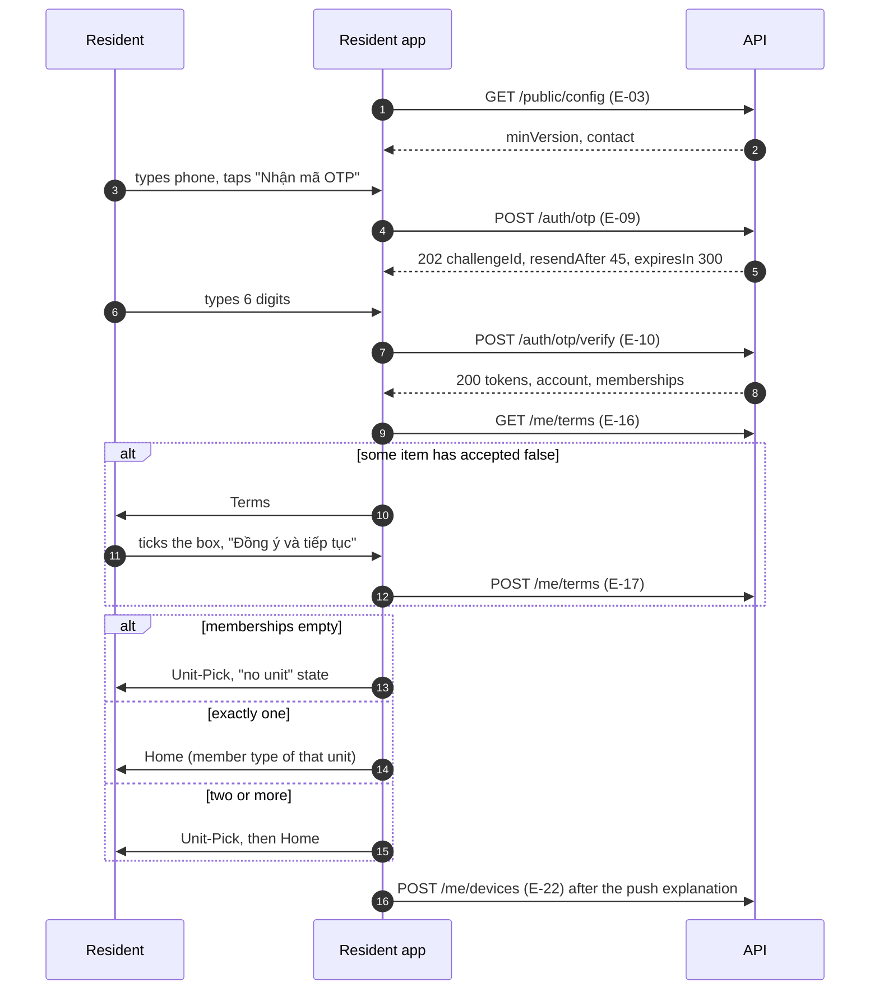

# Resident app: sign-in and home

> Status: **Approved** (Owner, 2026-10-21) · Updated: 2026-11-04 (DR-335: links to the artboards) · 2026-11-01 (DR-325: the "Thanh toán" tile and the fee card button are P2, not P3) · 2026-10-20 · DOC-57
> Depends on: original SDD §7.3, §7.4, §18, [DR](../../00-decision-register.md) (DR-37, 38, 40, 41…47, 59, 60, 69…72, 74, 128), [DOC-56](README.md) (convention, notes N1…N12), [DOC-53](../ux-principles-and-ia.md) §3.4, §5, [DOC-55](../client-architecture.md) §5…§7, §10, §11, [DOC-54](../design-system.md) (components), [DOC-26](../../06-design/identity-and-sessions.md) §5, [DOC-27](../../06-design/residency-and-memberships.md) §3.2, [DOC-35](../../06-design/audit-privacy-and-terms.md) §9, [DOC-51](../../07-api/api-endpoints.md) (E-03, E-09, E-10, E-13, E-15…E-17, E-22), [DOC-42](../../06-design/error-handling.md) §5
> Main readers: P1-11 (OTP), P1-17 (resident app shell, Maestro), P1-09 (catalog keys), the writers of DOC-58…60 and DOC-68, whoever builds a home card in P2…P5

This document specifies the eleven screens a resident passes before and on the home: phone, code, terms, unit choice, and the five homes by member type. The reference for layout and UX is the canvas (<https://claude.ai/artifact/PLqx2HGSNuZFiVDaLhtgvj>, design system "Hiên"); this file adds data, interactions, states, copy keys and acceptance criteria (DR-194). Fees, requests, notices, QR and account screens that the home links to are DOC-58…60.

**The design is a reference (DR-335).** The artboard of a screen, linked from the table below and from its "Prototype" part, is the reference for its layout and UX. Components and visual styling follow the project's design system ([DOC-54](../design-system.md)), not the artboard. See the artboards rendered on the [canvas](https://claude.ai/artifact/PLqx2HGSNuZFiVDaLhtgvj); the files and their index are in [`references/design-canvas/`](../../references/design-canvas/README.md). A "Do not copy" note and [DOC-56 §5](README.md#5-prototype-deviations-what-a-screen-document-must-not-copy) say what not to take from one.

## Screens in this file

| Section | Screen | Role or member type | Phase | Prototype |
| --- | --- | --- | --- | --- |
| [`Login`](../../references/design-canvas/Login.dc.html) | Phone number sign-in | Any resident (signed out) | P1 | designed |
| [`Login-Error`](../../references/design-canvas/Login-Error.dc.html) | Phone not registered: how to reach the Manager | Any resident (signed out) | P1 | designed |
| [`OTP`](../../references/design-canvas/OTP.dc.html) | Six-digit code, 5-minute lifetime, resend | Any resident (signed out) | P1 | designed |
| [`Terms`](../../references/design-canvas/Terms.dc.html) | Terms and privacy consent | Owner, Family member, Tenant, Helper | P1 | designed |
| `Terms-Update` | Re-consent after a new terms version | Owner, Family member, Tenant, Helper | P1 | to design |
| [`Unit-Pick`](../../references/design-canvas/Unit-Pick.dc.html) | Pick a unit | Owner, Family member, Tenant, Helper | P1 | designed |
| [`Main`](../../references/design-canvas/Main.dc.html) | Home of an owner | Owner | P1 (cards P2…P5) | designed |
| [`Home-Member`](../../references/design-canvas/Home-Member.dc.html) | Home of a family member | Family member | P1 (cards P2…P5) | designed |
| [`Home-Tenant-Pay`](../../references/design-canvas/Home-Tenant-Pay.dc.html) | Home of a tenant allowed to pay | Tenant with `can_pay` | P1 (cards P2…P5) | designed |
| [`Home-Tenant-NoPay`](../../references/design-canvas/Home-Tenant-NoPay.dc.html) | Home of a tenant not allowed to pay | Tenant without `can_pay` | P1 (cards P2…P5) | designed |
| [`Home-Helper`](../../references/design-canvas/Home-Helper.dc.html) | Home of a helper | Helper | P1 (cards P4, P5) | designed |

Test prefix: `UIRA-` (DOC-56 §6.3). Copy keys are `res.<screen>.<element>`; shared keys are listed at the end of this document for DOC-68.

## The sign-in sequence

One sequence serves the five screens before the home (UC-14, UC-27, FL-19). The client reads each step from the answers, not from local flags (DOC-55 §5, §7.3).



Cold start with a stored session skips the first part: E-03, then `POST /auth/refresh` (E-11), then E-13 and E-16 (DOC-55 §5.1).

## Login

> Status: Review · Prototype: designed · Phase: P1 · DOC-57

### 1. Persona, use cases, permissions

Any resident with a phone registered by the Manager or an owner (PS-resident, UC-14 steps 1–2, FR-15.1). No account, no self sign-up. The screen has no permission; it is reached with no session.

### 2. URL and search params

expo-router `/login` in the `(auth)` group, no params. Not deep-linkable: a link that needs a session is kept in memory and followed after sign-in (DOC-53 §5.3).

### 3. Prototype

Canvas artboard [`Login`](../../references/design-canvas/Login.dc.html) (title "Đăng nhập", 390 × 844). Regions: wordmark row with a ghost language button "English"; building name caption; title; helper paragraph; `TextField` with phone icon; bottom block with primary `Button` "Nhận mã OTP" and a help paragraph.

Do not copy: N8 (the wordmark "Hiên", the building name "Mộc Miên Residence" and the placeholder `[HOTLINE]` are drawn text: the wordmark is `common.app.name`, the building name and the hotline come from E-03); the field is drawn pre-filled with "0912 345 678".

### 4. Regions and components

DOC-54 components: `Glow`, `Button` (ghost, primary), `TextField` (`input-mode="tel"`, icon `phone`), `Banner` (errors that are not field errors). The phone is shown grouped as typed (`0912 345 678`); the client strips spaces before sending.

### 5. Data

| Read | E-xx | Notes |
| --- | --- | --- |
| Building name, hotline, working hours, minimum app version | E-03 `GET /public/config` | Read at app start, key `['config']`, cached 60 s; the contact block feeds the help paragraph. If the call fails the paragraph shows the generic sentence without a number |
| Language of the screen | none | `rms.lang`, else the device language when `vi` or `en`, else `vi` (DOC-55 §11) |

### 6. Interactions

| Action | E-xx | Success | Failure |
| --- | --- | --- | --- |
| "Nhận mã OTP" | E-09 `POST /auth/otp {phone}` (no idempotency key: public, the challenge is consume-then-insert) | 202: keep `challengeId`, `resendAfter`, `expiresIn` in memory, go to `OTP` | 400 `validation_failed` rule `phone_invalid` → field error; 404 `phone_not_registered` → state `Login-Error`; 429 `rate_limited` → countdown from `Retry-After` on the button; 503 `sms_unavailable` → banner and `Retry-After`; 426 `upgrade_required` → blocking update screen; 503 `maintenance` → banner; offline → button disabled |
| Empty or too short field (fewer than 9 digits after removing spaces) | none | n/a | Field error without a request (the server is still the judge) |
| "English" / "Tiếng Việt" | none | Switches the UI at once and writes `rms.lang`; the next request carries `Accept-Language` | n/a |

The button is disabled while the call is in flight (UX-01 style: one request per tap).

### 7. States

Loading: the button shows its spinner and stays disabled. Error: field error or banner as above, text from `error.<code>` unless the screen branches (below). Offline: the shared banner of DOC-68, the button disabled. Forbidden, stale, empty: not applicable. Demo and review accounts look like any account; the review notes carry phone and fixed code `123456` (DR-60, FR-15.6, DOC-73), and nothing on the screen mentions the code.

### 8. Microcopy

| Key | vi | en |
| --- | --- | --- |
| `res.login.title` | Đăng nhập | Sign in |
| `res.login.subtitle` | Dùng số điện thoại Ban quản lý đã đăng ký cho bạn. Chúng tôi gửi mã OTP qua tin nhắn. | Use the phone number the management office registered for you. We send an OTP by text message. |
| `res.login.field.phone.label` | Số điện thoại | Phone number |
| `res.login.field.phone.placeholder` | 0912 345 678 | 0912 345 678 |
| `res.login.field.phone.error.required` | Nhập số điện thoại của bạn. | Enter your phone number. |
| `res.login.field.phone.error.invalid` | Số điện thoại chưa đúng. Kiểm tra lại số bạn nhập. | This phone number is not valid. Check the number you entered. |
| `res.login.cta` | Nhận mã OTP | Get OTP |
| `res.login.help` | Chưa có tài khoản? Tài khoản do Ban quản lý tạo theo số điện thoại. Gọi hotline BQL {hotline} để được hỗ trợ. | No account yet? The management office creates accounts by phone number. Call the management hotline {hotline} for help. |
| `res.login.help-no-hotline` | Chưa có tài khoản? Tài khoản do Ban quản lý tạo theo số điện thoại. Hãy liên hệ Ban quản lý để được hỗ trợ. | No account yet? The management office creates accounts by phone number. Contact the management office for help. |
| `res.login.retry-in` | Thử lại sau {seconds} giây | Try again in {seconds} s |

### 9. Acceptance criteria

| ID | Given / When / Then | Level |
| --- | --- | --- |
| UIRA-01 | **G** the field is empty or has "12" **W** "Nhận mã OTP" is tapped **T** no request is sent and the field shows `res.login.field.phone.error.required` | maestro |
| UIRA-02 | **G** a registered phone `0901 234 567` **W** the button is tapped **T** one `POST /auth/otp` is sent with `0901234567` and the app shows `OTP` with the phone as typed | maestro |
| UIRA-03 | **G** an unregistered phone **W** E-09 answers 404 `phone_not_registered` **T** the screen shows the `Login-Error` state (see that section) and no SMS is claimed | maestro |
| UIRA-04 | **G** E-09 answers 429 with `Retry-After: 15` **W** the screen is shown **T** the button is disabled and reads "Thử lại sau 15 giây", counting down, and is enabled at 0 | unit |
| UIRA-05 | **G** E-09 answers 503 `sms_unavailable` **W** shown **T** a banner with `error.sms_unavailable`, the contact row, and the button enabled after `Retry-After` | unit |
| UIRA-06 | **G** the device language is English and the user taps "Tiếng Việt" **W** tapped **T** all text is Vietnamese at once, `rms.lang = vi`, and the next request has `Accept-Language: vi` | maestro |
| UIRA-07 | **G** E-03 returns `apps.resident.minVersion` above the installed version **W** the app starts **T** the blocking update screen shows before `Login` (426 flow of DOC-55 §16) | unit |
| UIRA-08 | **G** the device is offline **W** `Login` is shown **T** the offline banner shows and the button is disabled | maestro |
| UIRA-09 | **G** the server answers 400 `phone_invalid` for "0000000000" **W** shown **T** the error appears under the field, not as a toast | unit |

### 10. E2E cases

Maestro `signin-registered.yaml` (UIRA-02, then the OTP flow), `signin-unregistered.yaml` (UIRA-01, UIRA-03), `language-switch.yaml` (UIRA-06). UIRA-04, 05, 07 and 09 are component or client-core unit tests.

### 11. Open questions

None. The app display name is an Owner input already tracked in P0-03 and DR-69; the screen reads it from `common.app.name`.

## Login-Error

> Status: Review · Prototype: designed · Phase: P1 · DOC-57

### 1. Persona, use cases, permissions

A resident whose phone is not registered (UC-14 alternative 2a, FR-15.1). Same audience as `Login`. A locked resident account does not exist: a resident account is `active` or `deletion_requested` (DOC-16 §4), a lock is on a membership, and its screen is `Unit-Pick` (see there).

### 2. URL and search params

Not a route: it is `Login` in the state "last answer was 404". The state is cleared by typing in the field or by a new request.

### 3. Prototype

Canvas artboard [`Login-Error`](../../references/design-canvas/Login-Error.dc.html) (title "Đăng nhập, số chưa đăng ký", 390 × 844). Regions: as `Login`; the `TextField` carries an error message; below it a `List` with one `ListItem` (phone icon, tone teal) "Gọi Ban quản lý"; the primary button "Nhận mã OTP" stays.

Do not copy: N8 (the hotline `[HOTLINE]` and the hours "08:00–17:30 thứ Hai đến thứ Bảy" are drawn text; they come from `contact.hotline` and `contact.workingHours` of E-03, with `en` falling back to `vi`).

### 4. Regions and components

`TextField` (error state), `List` + `ListItem`, `Banner` for the 429 and 503 variants. The same state shows for a 503 `sms_unavailable` (contact row under the banner), so a resident who cannot get a code still has a number to call.

### 5. Data

| Read | E-xx | Notes |
| --- | --- | --- |
| Hotline, working hours, building name | E-03 | Already in the `['config']` cache from `Login`; if absent the row is hidden and the error sentence stays |

### 6. Interactions

| Action | E-xx | Success | Failure |
| --- | --- | --- | --- |
| Tap "Gọi Ban quản lý" | none | Opens the dialer with `tel:<hotline>` | No hotline in E-03: the row is not rendered |
| Edit the phone, then "Nhận mã OTP" | E-09 | As `Login` | As `Login` |

### 7. States

| State | Behavior |
| --- | --- |
| 404 `phone_not_registered` | Field error `res.login-error.field.phone.error`, contact row, button enabled |
| 429 `rate_limited` | Banner `error.rate_limited` with the wait; the button counts down; no contact row (the number is not wrong) |
| 503 `sms_unavailable` or `maintenance` | Banner with `error.sms_unavailable` or `error.maintenance`; the contact row shows |

The 404 answer reveals that a number is unknown; this is the accepted trade-off of SDD §7.3 and DR-37, limited by the IP bucket of E-09.

### 8. Microcopy

| Key | vi | en |
| --- | --- | --- |
| `res.login-error.field.phone.error` | Số này chưa có trong hệ thống. Bạn cần Ban quản lý tạo tài khoản trước khi dùng ứng dụng. | This number is not in the system. The management office has to create your account before you can use the app. |
| `res.login-error.contact.title` | Gọi Ban quản lý | Call the management office |
| `res.login-error.contact.subtitle` | Hotline {hotline}, {hours} | Hotline {hotline}, {hours} |

### 9. Acceptance criteria

| ID | Given / When / Then | Level |
| --- | --- | --- |
| UIRA-10 | **G** E-03 returns hotline `1900 1234` and hours "Thứ 2 – Thứ 6, 8:00 – 17:00" **W** E-09 answers 404 **T** the contact row reads "Hotline 1900 1234, Thứ 2 – Thứ 6, 8:00 – 17:00" and tapping it opens `tel:1900 1234` | maestro |
| UIRA-11 | **G** E-03 failed **W** E-09 answers 404 **T** the field error shows and no contact row is rendered | unit |
| UIRA-12 | **G** the 404 state **W** the user edits the number **T** the error clears and the button submits E-09 again | maestro |

### 10. E2E cases

`signin-unregistered.yaml` covers UIRA-10 and UIRA-12. UIRA-11 is a unit test.

### 11. Open questions

None.

## OTP

> Status: Review · Prototype: designed · Phase: P1 · DOC-57

### 1. Persona, use cases, permissions

Any resident after E-09 (UC-14 steps 2–3, FR-15.1…15.5). Reached only with a challenge in memory; without one the route redirects to `Login`.

### 2. URL and search params

`/otp` in `(auth)`. The challenge (`challengeId`, `resendAfter`, `expiresIn`, the phone, the monotonic time of the answer) lives in memory, not in the URL. Backgrounding keeps it; killing the app drops it (the user asks again).

### 3. Prototype

Canvas artboard [`OTP`](../../references/design-canvas/OTP.dc.html) (title "Nhập mã OTP", 390 × 844). Regions: `TopBar` with a back button; title; paragraph with the phone; `OtpInput` of 6 cells; two ghost `Button`s ("Gửi lại mã sau 45 giây" disabled, "Đổi số điện thoại"); footer note.

Do not copy: the artboard shows 4 of 6 digits typed and a fixed "45 giây"; the countdown is live from `resendAfter` of the answer. The phone in the paragraph is the number as typed.

### 4. Regions and components

`OtpInput` (`length=6`, numeric, one logical field; iOS `textContentType="oneTimeCode"`, Android `autoComplete="sms-otp"` so the SMS code can be filled), `Button` ghost (resend, change phone), `Banner`.

### 5. Data

| Read | E-xx | Notes |
| --- | --- | --- |
| Challenge | E-09 (from `Login`) | `resendAfter` 45 s and `expiresIn` 300 s are counted with `serverTime` plus the monotonic clock (UX-03) |
| After success: terms state | E-16 | Read once after E-10 to decide `Terms` |

### 6. Interactions

| Action | E-xx | Success | Failure |
| --- | --- | --- | --- |
| Sixth digit entered (auto-submit) | E-10 `POST /auth/otp/verify {challengeId, code}` | 200: store `accessToken` in memory and `refreshToken` in secure store, then E-16 and the routing of the sequence above | 400 `otp_invalid`: clear the input, show `attemptsLeft`; at `attemptsLeft: 0` the challenge is gone: show the expired text and enable resend at once; 426, 503 as the fetcher table; offline: input kept, message "no network" |
| "Gửi lại mã" (enabled when the countdown is 0) | E-09 with the same phone | New challenge replaces the old one; countdown restarts at `resendAfter`; input cleared | 429 `rate_limited` → countdown from `Retry-After`; 404 cannot happen; 503 `sms_unavailable` → banner |
| "Đổi số điện thoại" | none | Drops the challenge from memory and returns to `Login` with the phone kept | n/a |

The input is disabled while E-10 is in flight, so a second tap or a repeated digit cannot send a second verify (the server also allows one winner, FR-15.4). A wrong code spends one of five attempts; the screen never shows a count before the first error.

### 7. States

Loading: spinner in the input, input disabled. Error: inline message under the input in the danger tone, announced to screen readers (live region). Expired (the countdown of `expiresIn` reached 0): the input clears and the text changes to `res.otp.expired`; the next verify would answer `otp_invalid`, but the client does not send it. Offline: banner, input kept. Stale, empty, forbidden: not applicable.

### 8. Microcopy

| Key | vi | en |
| --- | --- | --- |
| `res.otp.title` | Nhập mã OTP | Enter the OTP |
| `res.otp.subtitle` | Mã 6 số vừa gửi tới {phone}. Mã có hiệu lực trong 5 phút. | A 6-digit code was sent to {phone}. It is valid for 5 minutes. |
| `res.otp.field.code.label` | Mã OTP | OTP |
| `res.otp.field.code.error` | Mã chưa đúng. Còn {attemptsLeft} lần thử. | Wrong code. {attemptsLeft} tries left. |
| `res.otp.locked` | Mã đã hết hạn hoặc đã dùng hết lượt thử. Hãy gửi lại mã. | The code has expired or its tries are used up. Send a new code. |
| `res.otp.expired` | Mã đã hết hạn. Hãy gửi lại mã. | The code has expired. Send a new code. |
| `res.otp.action.resend` | Gửi lại mã | Resend code |
| `res.otp.action.resend-in` | Gửi lại mã sau {seconds} giây | Resend code in {seconds} s |
| `res.otp.action.change-phone` | Đổi số điện thoại | Change phone number |
| `res.otp.footer` | Ứng dụng tự đăng nhập khi bạn nhập đủ 6 số. | The app signs you in when you enter all 6 digits. |

### 9. Acceptance criteria

| ID | Given / When / Then | Level |
| --- | --- | --- |
| UIRA-13 | **G** a live challenge **W** the user types 6 digits **T** exactly one `POST /auth/otp/verify` is sent, even when the sixth digit is delivered twice (autofill plus typing) | unit |
| UIRA-14 | **G** a wrong code, E-10 answers `attemptsLeft: 3` **W** shown **T** the input is cleared and focused and the message reads "Mã chưa đúng. Còn 3 lần thử." | maestro |
| UIRA-15 | **G** E-10 answers `otp_invalid` with `attemptsLeft: 0` **W** shown **T** the text is `res.otp.locked` and "Gửi lại mã" is enabled immediately | maestro |
| UIRA-16 | **G** E-09 answered `resendAfter: 45` **W** 44 s pass, then 46 s **T** at 44 s the button reads "Gửi lại mã sau 1 giây" and is disabled; at 46 s it is enabled | unit |
| UIRA-17 | **G** the resend button is enabled **W** tapped **T** one E-09 call; the countdown restarts at 45; the old code is no longer accepted by the server (AU-23 pairs) | maestro |
| UIRA-18 | **G** E-09 answers 429 `Retry-After: 12` on resend **W** shown **T** the button reads "Gửi lại mã sau 12 giây" | unit |
| UIRA-19 | **G** 300 s pass without a verify **W** the screen is open **T** the input clears and `res.otp.expired` shows | unit |
| UIRA-20 | **G** "Đổi số điện thoại" is tapped **W** `Login` is shown **T** the phone is kept and the challenge is gone from memory | maestro |
| UIRA-21 | **G** a demo account (`is_demo`) **W** the code `123456` is entered **T** the user is signed in; for a non-demo account the same code gives `attemptsLeft: 4` | maestro |
| UIRA-22 | **G** a correct code, memberships `[A-1508 owner]`, terms accepted **W** E-10 and E-16 answer **T** the app opens the owner home with no `Unit-Pick` | maestro |

### 10. E2E cases

`signin-registered.yaml` (UIRA-02, 13, 22), `otp-errors.yaml` (UIRA-14, 15, 17, 20), `signin-demo.yaml` (UIRA-21). Unit tests: UIRA-16, 18, 19.

### 11. Open questions

None.

## Terms

> Status: Review · Prototype: designed · Phase: P1 · DOC-57

### 1. Persona, use cases, permissions

Any resident whose latest terms or privacy version is not accepted, reached right after sign-in (UC-27 main flow of terms, FR-39.1, FR-41). Nothing else in the app is reachable until the call to E-17 succeeds; E-13 and E-16 and E-17 are exempt from the terms gate (DOC-35 §9.2).

### 2. URL and search params

`/terms?mode=first` in `(gates)`. `mode` is `first` (reached from sign-in) or `update` (reached from the gate, see `Terms-Update`). The text reader is a stacked screen `/terms/full`, no params.

### 3. Prototype

Canvas artboard [`Terms`](../../references/design-canvas/Terms.dc.html) (title "Đồng ý điều khoản", 390 × 844). Regions: large `TopBar` "Trước khi bắt đầu" with a subtitle; intro sentence; `List` of four `ListItem`s (personal data, push notifications, photos, account deletion); ghost `Button` "Đọc toàn văn điều khoản"; bottom block with a `Checkbox` and the primary `Button` "Đồng ý và tiếp tục".

Do not copy: the checkbox is drawn **ticked**: consent must start unticked and the button disabled until the user ticks it (FR-39.1 stores an acceptance as evidence). The subtitle "Bước này chỉ hiện ở lần đăng nhập đầu tiên" is false for a returning resident on a new device after a new version: use `res.terms.subtitle`.

### 4. Regions and components

`TopBar` large, `List`/`ListItem` (summary), `Checkbox`, `Button`. The four summary rows are catalog copy written to match the published text; the **binding text** is `items[].text` of E-16, shown by "Đọc toàn văn điều khoản" in a full-screen reader that renders the restricted Markdown with `parseTermsMarkdown` (DOC-36 §8). One checkbox accepts every listed unaccepted version (terms and privacy together, DR-201).

### 5. Data

| Read | E-xx | Notes |
| --- | --- | --- |
| Latest terms and privacy versions with `accepted` | E-16 `GET /me/terms` | Key `['me','terms']`, `ETag` revalidation; items with `accepted: false` are the ones to accept; language follows the account (DR-71) |

### 6. Interactions

| Action | E-xx | Success | Failure |
| --- | --- | --- | --- |
| Tick the box | none | Enables the button | n/a |
| "Đồng ý và tiếp tục" | E-17 `POST /me/terms {versionIds}` with the `versionId` of every item having `accepted: false` (idempotent by `(account, version)`, no `Idempotency-Key`) | 204: continue the sequence (unit choice, then home); in `update` mode replay the call that was interrupted | 409 `terms_version_superseded`: reload E-16, show the new text, untick the box, show `res.terms.superseded`; 404 `not_found`: reload `['me']` and E-16; 403 `membership_inactive` cannot happen here; offline: button disabled |
| "Đọc toàn văn điều khoản" | none (E-16 data) | Opens the reader; Back returns with the box state kept | n/a |

### 7. States

Loading E-16: skeleton list, button disabled. No item to accept (nothing published, or all accepted): the screen is skipped and the sequence continues (AD-37). Error on E-16: message with a retry button; sign-out stays available. Offline: banner, button disabled. Forbidden: not applicable.

### 8. Microcopy

| Key | vi | en |
| --- | --- | --- |
| `res.terms.title` | Trước khi bắt đầu | Before you start |
| `res.terms.subtitle` | Bạn cần đồng ý các điều khoản dưới đây để tiếp tục. | You need to accept the terms below to continue. |
| `res.terms.intro` | Ứng dụng dùng thông tin dưới đây để Ban quản lý phục vụ căn hộ của bạn. | The app uses the information below so the management office can serve your home. |
| `res.terms.item.personal.title` | Thông tin cá nhân | Personal information |
| `res.terms.item.personal.body` | Họ tên, số điện thoại, căn hộ và vai trò của bạn trong căn | Your name, phone number, home and your role in it |
| `res.terms.item.push.title` | Thông báo đẩy | Push notifications |
| `res.terms.item.push.body` | Bản tin, phí, yêu cầu hỗ trợ, phương tiện. Bạn tắt được trong Cài đặt | Notices, fees, support requests, vehicles. You can turn them off in Settings |
| `res.terms.item.photos.title` | Ảnh bạn gửi | Photos you send |
| `res.terms.item.photos.body` | Ảnh yêu cầu hỗ trợ, ảnh xe và giấy đăng ký xe | Support request photos, vehicle photos and registration papers |
| `res.terms.item.deletion.title` | Xóa tài khoản | Delete your account |
| `res.terms.item.deletion.body` | Bạn gửi yêu cầu xóa bất cứ lúc nào trong Cài đặt | You can ask for deletion at any time in Settings |
| `res.terms.action.read-full` | Đọc toàn văn điều khoản | Read the full terms |
| `res.terms.consent` | Tôi đồng ý Điều khoản sử dụng và Chính sách quyền riêng tư | I accept the Terms of Use and the Privacy Policy |
| `res.terms.cta` | Đồng ý và tiếp tục | Accept and continue |
| `res.terms.superseded` | Điều khoản vừa được cập nhật. Hãy đọc bản mới trước khi đồng ý. | The terms were just updated. Please read the new version before accepting. |

### 9. Acceptance criteria

| ID | Given / When / Then | Level |
| --- | --- | --- |
| UIRA-23 | **G** E-16 has two items with `accepted: false` **W** `Terms` opens **T** the box is unticked and "Đồng ý và tiếp tục" is disabled | maestro |
| UIRA-24 | **G** the box is ticked **W** the button is tapped **T** one `POST /me/terms` with both `versionIds` and the app continues to the unit step | maestro |
| UIRA-25 | **G** E-17 answers 409 `terms_version_superseded` **W** shown **T** E-16 is read again, the new text replaces the old, the box is unticked and `res.terms.superseded` shows | unit |
| UIRA-26 | **G** E-16 returns no item (or all accepted) **W** sign-in finishes **T** `Terms` is not shown | unit |
| UIRA-27 | **G** "Đọc toàn văn điều khoản" was opened **W** Back is pressed **T** the box state is unchanged | maestro |

### 10. E2E cases

`terms-gate.yaml` (UIRA-23, 24, 27); UIRA-25 and 26 are client-core unit tests.

### 11. Open questions

None.

## Terms-Update

> Status: Review · Prototype: to design · Phase: P1 · DOC-57

### 1. Persona, use cases, permissions

A signed-in resident whose next request is refused with 403 `terms_required` because the Admin published a new version (UC-27 step 3, FR-41.1). Design owner: client or Owner (DR-72), needed before the P1 gate closes.

### 2. URL and search params

`/terms?mode=update` (the same route and component as `Terms`). The fetcher opens it through `gates.termsRequired(details)` and **awaits** the acceptance, then replays the interrupted call once (DOC-55 §6). Reading E-16 happens on the screen, not from `details.required`, which only names the versions.

### 3. Prototype

No artboard. Wireframe (390 wide, same components as `Terms`):

```
+--------------------------------------+
| Điều khoản đã được cập nhật          |
| Phiên bản {version}, cập nhật {date} |
|                                      |
| Chúng tôi đã sửa:                    |
|  [i] Điều khoản sử dụng     v4       |
|  [i] Chính sách quyền riêng tư  v1   |
|                                      |
| [ Đọc toàn văn điều khoản ]          |
|                                      |
| [ ] Tôi đồng ý bản cập nhật          |
| [      Đồng ý và tiếp tục        ]   |
| Đăng xuất                            |
+--------------------------------------+
```

Regions: large `TopBar`; `List` with one row per item of E-16 having `accepted: false` (kind, version); ghost `Button` to the reader; `Checkbox`; primary `Button`; ghost "Đăng xuất" so the screen is not a dead end (UX-11).

### 4. Regions and components

As `Terms`. Rows come from E-16, so a building that changes only the privacy notice lists only that row.

### 5. Data

| Read | E-xx | Notes |
| --- | --- | --- |
| Versions to accept | E-16 | Same query and key as `Terms` |

### 6. Interactions

| Action | E-xx | Success | Failure |
| --- | --- | --- | --- |
| "Đồng ý và tiếp tục" | E-17 | 204: the gate resolves and the fetcher replays the interrupted call once | As `Terms` (409 `terms_version_superseded` reloads) |
| "Đăng xuất" | E-12 `POST /auth/logout` | Session revoked, local state cleared (DOC-55 §5.4), `Login` shown | Network error: local sign-out anyway, the server session expires on its own |

### 7. States

As `Terms`. While the screen is open every other call of the app waits on the gate or fails with the same 403 and is queued behind it; no second `Terms-Update` is stacked.

### 8. Microcopy

| Key | vi | en |
| --- | --- | --- |
| `res.terms-update.title` | Điều khoản đã được cập nhật | The terms were updated |
| `res.terms-update.subtitle` | Phiên bản {version}, cập nhật {date} | Version {version}, updated {date} |
| `res.terms-update.changed` | Chúng tôi đã sửa các mục sau | These documents changed |
| `res.terms-update.item.terms` | Điều khoản sử dụng, phiên bản {version} | Terms of Use, version {version} |
| `res.terms-update.item.privacy` | Chính sách quyền riêng tư, phiên bản {version} | Privacy Policy, version {version} |
| `res.terms-update.consent` | Tôi đồng ý bản cập nhật | I accept the update |
| `res.terms-update.cta` | Đồng ý và tiếp tục | Accept and continue |
| `res.terms-update.sign-out` | Đăng xuất | Sign out |

The reader and `res.terms.action.read-full` are shared with `Terms`.

*As built (P1-17, DR-265):* the screen has no subtitle line: E-16 returns no publication date, so `res.terms-update.subtitle` is in the catalog and unused until it does. The routes are `terms` and `terms-full` at the top of the app (not a `(gates)` group). `Main` shows the greeting, the unit switcher and the "Liên hệ BQL" shortcut with no tab bar (UIRA-38 forbids a placeholder tab; the "Căn hộ" tab has no content before P4); the push sheet is shown once per device (`rms.push-asked`) and obtains the OS permission and the Expo token; the registration with E-22 waits for the `notification` module.

### 9. Acceptance criteria

| ID | Given / When / Then | Level |
| --- | --- | --- |
| UIRA-28 | **G** a signed-in resident on `Fees` **W** the Admin publishes version 4 and the next request answers 403 `terms_required` **T** `Terms-Update` opens, and after "Đồng ý và tiếp tục" the interrupted request is replayed once and succeeds | maestro |
| UIRA-29 | **G** `Terms-Update` is open **W** two requests fail with `terms_required` **T** one screen is shown, not two | unit |
| UIRA-30 | **G** `Terms-Update` is open **W** "Đăng xuất" is tapped **T** E-12 is called and `Login` shows | maestro |
| UIRA-31 | **G** only the privacy notice changed **W** `Terms-Update` opens **T** one row is listed and E-17 carries one `versionId` | unit |

### 10. E2E cases

`terms-gate.yaml` (UIRA-28, 30); UIRA-29 and 31 are client-core unit tests.

### 11. Open questions

None. Once an artboard exists, this section's status becomes `designed` and the wireframe is replaced by the artboard's region list (DOC-56 §6.6).

## Unit-Pick

> Status: Review · Prototype: designed · Phase: P1 · DOC-57

### 1. Persona, use cases, permissions

A resident with two or more active memberships after sign-in, or any resident who switches unit or loses one (UC-14 step 5, 5a, E5, E7; FR-16.1). The data of the units is separate: fees, requests, vehicles and notices belong to the selected unit (SDD §18.2).

### 2. URL and search params

`/unit-pick` in `(gates)`, param `reason` ∈ `inactive` (a 403 `membership_inactive` sent the user here). Also presented as a bottom sheet from the unit switcher on the home (same component, `presentation: modal`).

### 3. Prototype

Canvas artboard [`Unit-Pick`](../../references/design-canvas/Unit-Pick.dc.html) (title "Chọn căn hộ", 390 × 844). Regions: `Glow`; large `TopBar` "Chọn căn hộ" with a subtitle naming the phone; a column of `Card`s, each with a `Plate` (unit code), a title (member type) and a subtitle, and a caret; an explanatory paragraph.

Do not copy: the subtitles "Tầng 15, 85 m², 3 thành viên" and "Tầng 7, 62 m², …": E-13 returns no floor, area or member count (DR-198); the order (A-1508 first) is sample data, the app lists the units in the order of E-13 (by unit code).

### 4. Regions and components

`TopBar` large, `Card` + `Plate` (size lg) + `Icon` caret-right, `Banner` (reason `inactive`), `EmptyState` for the no-unit case. A card has the label of the member type; for a tenant the subtitle says whether paying is allowed.

### 5. Data

| Read | E-xx | Notes |
| --- | --- | --- |
| Active memberships | E-13 `GET /me` | Key `['me']`; ordered by unit code, active only, `[]` when none; refetched on focus and after a 403 `membership_inactive` |
| Manager's contact (no-unit state) | E-15 `GET /me/contact` | Key `['me','contact']` |

### 6. Interactions

| Action | E-xx | Success | Failure |
| --- | --- | --- | --- |
| Tap a card | none (local `select(unitId)`, DOC-55 §7.3) | Writes `rms.unit`, removes the previous unit's queries, opens the home of that member type | If the next request answers 403 `membership_inactive`, the unit is removed and this screen shows again with `reason=inactive` |
| Single membership at sign-in | none | The screen is **not** shown: the unit is selected automatically | n/a |
| "Liên hệ Ban quản lý" (no-unit state) | E-15 | Opens `Contact` (DOC-60) | n/a |
| "Đăng xuất" (no-unit state) | E-12 | Signed out | As `Terms-Update` |

### 7. States

| State | Behavior |
| --- | --- |
| Two or more units | The list |
| One unit | Never shown at sign-in; from the switcher on the home the sheet is not offered (the switcher is not tappable) |
| `reason=inactive` | Banner `error.membership_inactive` ("You no longer have access to this home"), then the units left; if none are left, the no-unit state |
| No unit (`[]`) | `EmptyState` `res.unit-pick.empty.*`, buttons "Liên hệ Ban quản lý" and "Đăng xuất" (UC-14 E7); the account may still have been given a unit later: pulling down refetches E-13 |
| Loading | Skeleton cards |
| Offline | Cached `['me']` list may be shown (account data is persisted, UX-05); selecting works offline for the screen but the home needs the network for the first read |

### 8. Microcopy

| Key | vi | en |
| --- | --- | --- |
| `res.unit-pick.title` | Chọn căn hộ | Choose a home |
| `res.unit-pick.subtitle` | Số {phone} thuộc {count, plural, one {# căn hộ} other {# căn hộ}} | {phone} belongs to {count, plural, one {# home} other {# homes}} |
| `res.unit-pick.card.tenant-can-pay` | Được thanh toán phí | Allowed to pay fees |
| `res.unit-pick.card.tenant-no-pay` | Không được thanh toán phí | Not allowed to pay fees |
| `res.unit-pick.note` | Phí, yêu cầu, phương tiện và thông báo được tách riêng theo từng căn. Bạn đổi căn bất cứ lúc nào bằng thẻ căn hộ ở đầu Trang chủ. | Fees, requests, vehicles and notices are kept apart for each home. You can switch homes at any time with the home card at the top of Home. |
| `res.unit-pick.empty.title` | Chưa có căn hộ nào gắn với tài khoản này | No home is linked to this account |
| `res.unit-pick.empty.body` | Hãy liên hệ Ban quản lý để được thêm vào căn hộ của bạn. | Contact the management office to be added to your home. |
| `res.unit-pick.action.contact` | Liên hệ Ban quản lý | Contact the management office |

Member type titles are `common.member-type.<type>`; "Đăng xuất" is `common.action.sign-out`.

### 9. Acceptance criteria

| ID | Given / When / Then | Level |
| --- | --- | --- |
| UIRA-32 | **G** E-13 returns one membership **W** sign-in ends **T** `Unit-Pick` is not shown and the home of that unit opens | maestro |
| UIRA-33 | **G** two memberships A-0703 (tenant, `canPay` false) and A-1508 (owner) **W** `Unit-Pick` opens **T** the cards are in the order A-0703, A-1508, titled "Người thuê" with "Không được thanh toán phí" and "Chủ hộ" with no subtitle | maestro |
| UIRA-34 | **G** the list **W** A-1508 is tapped **T** `rms.unit` is the unit id and the owner home (`Main`) opens | maestro |
| UIRA-35 | **G** the stored unit is no longer in E-13 and two units remain **W** the app starts **T** the stored value is deleted and `Unit-Pick` shows | unit |
| UIRA-36 | **G** E-13 returns `[]` **W** sign-in ends **T** the no-unit state shows with "Liên hệ Ban quản lý" and "Đăng xuất" and nothing else is reachable | maestro |
| UIRA-37 | **G** the owner locks the resident's membership while Home is open **W** the next request answers 403 `membership_inactive` **T** `Unit-Pick` shows with the banner and the other units | maestro |

### 10. E2E cases

`signin-single-unit.yaml` (UIRA-32), `signin-two-units.yaml` (UIRA-33, 34), `membership-lock.yaml` (UIRA-37, with the Manager lock through the API). UIRA-35 is a mobile-core unit test; UIRA-36 uses an account whose memberships were removed (`signin-no-unit.yaml`).

### 11. Open questions

None.

## Main

> Status: Review · Prototype: designed · Phase: P1 (cards P2…P5) · DOC-57

### 1. Persona, use cases, permissions

The owner's home after unit choice (UC-14 step 6, UC-26; FR-16, FR-17; PS-owner). Capabilities: all eight of the policy table (DOC-27 §3.2). The other four homes are variants of this one; the card matrix below is the only place that says which card each member type sees.

### 2. URL and search params

`/` (the first tab of `(app)/(tabs)`), no params. Deep links of cards go to their own routes (DOC-53 §5.1).

### 3. Prototype

Canvas artboard [`Main`](../../references/design-canvas/Main.dc.html) (title "Cư dân: Trang chủ", 390 × 1680, scrolls). Regions top to bottom: `Glow`; `GreetingBar` (avatar, greeting, name) with a bell `IconButton`; `UnitSwitcher` (plate, building, role line); `BillSlip` (hero card, due fees and "Thanh toán N đợt"); "Lối tắt" `TileGrid` of eight `ServiceTile`s; "Bản tin ghim" with two `NoticeCard`s; "Yêu cầu đang xử lý" with a `TicketCard`; `TabBar` with a center QR action.

Do not copy: N10 (every card is drawn; each is built in its own phase, below); N8 (the building name); the floor in the role line (DR-198).

### 4. Regions and components

The card matrix. A card exists when its **capability** is held and its **phase** has shipped (DR-200). Phases are build constants, not server flags (DR-174).

| Region | Component | Capability | Phase | Source |
| --- | --- | --- | --- | --- |
| Greeting, avatar to `Account` | `GreetingBar` | any | P1 | E-13 |
| Bell with unread count to `Inbox` | `IconButton` + `Badge` | `personal_notifications` | P4 | E-78 |
| Unit switcher (opens `Unit-Pick` as a sheet; not tappable with one unit) | `UnitSwitcher` | any | P1 | E-13, E-15 |
| Fee card | `BillSlip` | `view_fees` | P2 | E-80 |
| Tile "Thanh toán" (owner, family, tenant with `can_pay`) or "Phí của căn" (tenant without `can_pay`) | `ServiceTile` | `pay`, else `view_fees` | P2 (*revised 2026-11-01, DR-325: was P3 for "Thanh toán"*) | local |
| Tile "Tạo yêu cầu" | `ServiceTile` | `tickets` | P4 | local |
| Tile "Tài liệu" | `ServiceTile` | `library` | P5 | local |
| Tile "Bản tin" with a badge | `ServiceTile` | `broadcast_notices` | P4 | E-143 |
| Tile "Phương tiện" | `ServiceTile` | `vehicles` | P5 | local |
| Tile "Thành viên" (owner) or "Lịch sử phí" (everyone else with `view_fees`) | `ServiceTile` | `manage_members`, else `view_fees` | P4, else P2 | local |
| Tile "Liên hệ BQL" | `ServiceTile` | `broadcast_notices` | P1 | local |
| Tile "Mã QR của tôi" and the center tab action | `ServiceTile`, `TabBar` center | `broadcast_notices` | P5 | local |
| Pinned notices | `NoticeCard` | `broadcast_notices` | P4 | E-143 |
| Requests in progress | `TicketCard` | `tickets` | P4 | E-119 |
| Tab "Phí" | `TabBar` | `view_fees` | P2 | local |
| Tab "Yêu cầu" | `TabBar` | `tickets` | P4 | local |
| Tab "Căn hộ" | `TabBar` | any but helper | P1 | local |

What a P1 build shows for an owner: the greeting, the unit switcher, the tile "Liên hệ BQL" and a two-tab bar (Trang chủ, Căn hộ); no bell, no empty placeholders and no "coming soon" text. The tile order follows the canvas: Thanh toán / Phí của căn, Tạo yêu cầu, Tài liệu, Bản tin, Phương tiện, Thành viên / Lịch sử phí, Liên hệ BQL, Mã QR của tôi; a hidden tile closes the gap.

Greeting by building-local hour (DR-200): 05:00–10:59 "Chào buổi sáng", 11:00–12:59 "Chào buổi trưa", 13:00–17:59 "Chào buổi chiều", 18:00–04:59 "Chào buổi tối". A null `displayName` shows the greeting without a name and the avatar shows the generic user icon.

### 5. Data

| Read | E-xx | Phase | Refetch |
| --- | --- | --- | --- |
| Account, memberships, `canPay`, `displayName`, `avatarUrl` | E-13 | P1 | Start, foreground, after a unit switch; `avatarUrl` is never stored |
| Building name and contact | E-15 (E-03 before sign-in) | P1 | `private, max-age=60` |
| Open charges of the unit for the fee card | E-80 `GET /me/fees` | P2 | `['unit', id, 'fees']`, never persisted (UX-05), refetch on focus and after returning from payment |
| Unread count for the bell | E-78 `GET /me/inbox` | P4 | Foreground push, focus |
| Pinned notices and the count of new ones | E-143 `GET /me/notices` (parameters fixed in DOC-31) | P4 | Focus, push |
| Requests in progress | E-119 `GET /me/tickets` | P4 | Focus, push |

Query keys start with `['unit', unitId, …]` (DOC-55 §7.2); `staleTime` 30 s; pull-to-refresh invalidates all keys of the unit. The home, notices and requests are persisted at most 24 h and show their age; the fee card is replaced offline by the text `res.main.fee.offline`, never old numbers.

### 6. Interactions

| Action | E-xx | Success | Failure |
| --- | --- | --- | --- |
| Tap the unit switcher | none | `Unit-Pick` sheet; selecting runs `select()` | n/a |
| Tap the bell, the avatar, a tile, a card | none | Navigates to the route of DOC-53 §5.1 | The target's capability is checked again by the server |
| Tap the fee card button ("Thanh toán N đợt") | none (opens `Pay-Select` with the charge ids, DOC-58) | P2 (*DR-325, was P3*) | n/a |
| First home after sign-in: push explanation | E-22 `POST /me/devices` after the OS permission | Token registered, id stored in `rms.device` | Permission denied: nothing is sent; the toggle in `Account` offers it again |
| Pull to refresh | the reads above | Updated cards | Error toast `error.<code>`, old data kept |

The push explanation is a `BottomSheet` shown once, on the first home render after sign-in (DR-199): title `res.main.push.title`, body, "Bật thông báo" (asks the OS, then E-22) and "Để sau" (does not ask again until the user turns push on in `Account`). It is not a separate artboard.

### 7. States

| State | Behavior |
| --- | --- |
| Loading | Skeletons for the fee card and lists after 150 ms (UX-10); the greeting and switcher render from E-13 |
| Empty fee card (no open charge, P2) | A `Card` with a check icon and `res.main.fee.none`; no pay button |
| Overdue fee card | `BillSlip` status "Quá hạn" in the danger tone, text and icon, not colour alone (DOC-54) |
| Offline | Banner; cached home shows with age; fee card replaced by `res.main.fee.offline` |
| Error on one card | That card shows a retry row; the others stay |
| Forbidden | A tile for a capability the member lacks is never rendered; a stale deep link opens Home (DR-177) |
| Stale | After 24 h offline the persisted home is dropped |

### 8. Microcopy

| Key | vi | en |
| --- | --- | --- |
| `res.main.title` | Trang chủ | Home |
| `res.main.section.shortcuts` | Lối tắt | Shortcuts |
| `res.main.section.pinned` | Bản tin ghim | Pinned notices |
| `res.main.section.requests` | Yêu cầu đang xử lý | Requests in progress |
| `res.main.action.all-notices` | Tất cả bản tin | All notices |
| `res.main.action.all` | Tất cả | All |
| `res.main.fee.title` | Phí cần thanh toán | Fees to pay |
| `res.main.fee.summary` | {count, plural, one {# đợt phí} other {# đợt phí}}, hạn gần nhất {dueDate} | {count, plural, one {# fee batch} other {# fee batches}}, nearest due date {dueDate} |
| `res.main.fee.due-in` | Còn {days, plural, one {# ngày} other {# ngày}} | {days, plural, one {# day left} other {# days left}} |
| `res.main.fee.overdue` | Quá hạn | Overdue |
| `res.main.fee.total` | Tổng {count} đợt | Total of {count} |
| `res.main.fee.cta` | Thanh toán {count} đợt | Pay {count} |
| `res.main.fee.none` | Bạn không còn khoản phí nào cần thanh toán. | You have no fees to pay. |
| `res.main.fee.offline` | Cần có mạng để xem phí. Hãy kết nối mạng rồi thử lại. | You need a network connection to see fees. Connect and try again. |
| `res.main.tile.pay` | Thanh toán | Pay |
| `res.main.tile.fees` | Phí của căn | Home fees |
| `res.main.tile.request-new` | Tạo yêu cầu | New request |
| `res.main.tile.docs` | Tài liệu | Documents |
| `res.main.tile.notices` | Bản tin | Notices |
| `res.main.tile.vehicles` | Phương tiện | Vehicles |
| `res.main.tile.members` | Thành viên | Members |
| `res.main.tile.fee-history` | Lịch sử phí | Fee history |
| `res.main.tile.contact` | Liên hệ BQL | Contact the office |
| `res.main.tile.qr` | Mã QR của tôi | My QR code |
| `res.main.push.title` | Bật thông báo? | Turn on notifications? |
| `res.main.push.body` | Bạn sẽ nhận bản tin, nhắc phí và cập nhật yêu cầu trên điện thoại. Bạn tắt được trong Cài đặt. | You will get notices, fee reminders and request updates on your phone. You can turn them off in Settings. |
| `res.main.push.enable` | Bật thông báo | Turn on |
| `res.main.push.later` | Để sau | Not now |
| `res.main.tab.fees` | Phí | Fees |
| `res.main.tab.requests` | Yêu cầu | Requests |
| `res.main.tab.unit` | Căn hộ | Home |
| `res.main.tab.qr` | Mã QR ra vào của tôi | My entry QR code |

The greeting keys (`common.greeting.morning|noon|afternoon|evening`) and the role line `common.unit.role-line` are shared (end of file).

### 9. Acceptance criteria

| ID | Given / When / Then | Level |
| --- | --- | --- |
| UIRA-38 | **G** the P1 build and an owner **W** the home opens **T** greeting, unit switcher and "Liên hệ BQL" show, the tab bar has Trang chủ and Căn hộ, and there is no bell, fee card or placeholder text | maestro |
| UIRA-39 | **G** a function `homeLayout(memberType, canPay, shippedPhase)` **W** called for the 5 variants × phases P1…P5 **T** the cards, tiles and tabs equal the matrix of §4 (generated from the policy table, as RM-06) | unit |
| UIRA-40 | **G** building time 08:00, 12:30, 15:00, 21:00 **W** the greeting is built **T** sáng, trưa, chiều, tối respectively | unit |
| UIRA-41 | **G** `displayName` is null **W** the home renders **T** the greeting has no name and the avatar shows the generic icon | unit |
| UIRA-42 | **G** the first home after sign-in **W** it renders **T** the push sheet shows once; "Để sau" never shows it again; "Bật thông báo" asks the OS and, if granted, calls E-22 once | maestro |
| UIRA-43 | **G** two units, the owner of A-1508 and the tenant (no pay) of A-0703 **W** the user switches units **T** the queries of the previous unit are removed, the home is the tenant-no-pay variant, and no A-1508 amount appears even for a moment (CL-24) | maestro |
| UIRA-44 | **G** (P2 build) the unit has two open charges of 2,488,000 and 350,000 **W** the home opens **T** the fee card says "2 đợt phí, hạn gần nhất 15/10/2026", "Còn 6 ngày" on 2026-10-09 and the total `2.838.000 đ` | maestro |
| UIRA-45 | **G** (P2 build) the device goes offline **W** the home is relaunched **T** the cached home shows its age and the fee card shows `res.main.fee.offline`, no amount | maestro |
| UIRA-46 | **G** an overdue charge **W** the fee card renders **T** the status reads "Quá hạn" with an icon, in the danger tone | unit |

### 10. E2E cases

`home-variants.yaml` (UIRA-38, 43), `push-sheet.yaml` (UIRA-42), `fee-card.yaml` (UIRA-44, 45, from P2). UIRA-39…41 and 46 are table-driven unit tests in `@rms/mobile-core` and `ui-native`.

### 11. Open questions

None. The tab and shortcut destinations are specified in DOC-58…60 when those phases are gated.

## Home-Member

> Status: Review · Prototype: designed · Phase: P1 (cards P2…P5) · DOC-57

### 1. Persona, use cases, permissions

A family member (UC-14 step 6; FR-16.2; DR-81: separate from the tenant). Every capability except `manage_members`. May pay.

### 2. URL and search params

As `Main`: `/`, chosen when the selected membership has `memberType = family`.

### 3. Prototype

Canvas artboard [`Home-Member`](../../references/design-canvas/Home-Member.dc.html) (title "Thành viên gia đình: Trang chủ", 390 × 1680). Same regions as `Main`; the role line reads "Tầng 15, bạn là thành viên gia đình"; the sixth tile is "Lịch sử phí" instead of "Thành viên".

Do not copy: N10; the floor in the role line (DR-198).

### 4. Regions and components

As `Main` with the matrix of `Main` §4: the fee card has the pay button (`pay` is allowed), the sixth tile is "Lịch sử phí", there is no "Thành viên".

### 5. Data

As `Main`.

### 6. Interactions

As `Main`.

### 7. States

As `Main`.

### 8. Microcopy

Keys of `Main`; the role line is `common.unit.role-line` with `memberType = family`.

### 9. Acceptance criteria

| ID | Given / When / Then | Level |
| --- | --- | --- |
| UIRA-47 | **G** (P4 build) a family member **W** the home opens **T** the tiles include "Thanh toán" and "Lịch sử phí", and do not include "Thành viên" | maestro |
| UIRA-48 | **G** a family member **W** `Unit` is opened **T** there is no entry to `Members` (the API also refuses E-26 with 403 `forbidden`, RM-06) | maestro |

### 10. E2E cases

`home-variants.yaml` (UIRA-47, 48).

### 11. Open questions

None.

## Home-Tenant-Pay

> Status: Review · Prototype: designed · Phase: P1 (cards P2…P5) · DOC-57

### 1. Persona, use cases, permissions

A tenant whose owner turned `can_pay` on (FR-16.2, FR-17). Every capability except `manage_members`; the tenant pays.

### 2. URL and search params

As `Main`: `/`, chosen when `memberType = tenant` and `canPay = true`. The home follows `canPay` from the latest E-13: when the owner changes it, the next foreground or unit switch changes the home; the API checks `pay` on each payment request anyway.

### 3. Prototype

Canvas artboard [`Home-Tenant-Pay`](../../references/design-canvas/Home-Tenant-Pay.dc.html) (title "Người thuê được trả phí: Trang chủ", 390 × 1680). As `Home-Member`, plus under the `BillSlip` the paragraph "Chủ hộ đã cho phép bạn thanh toán phí của căn này.".

Do not copy: N10; the floor in the role line.

### 4. Regions and components

As `Main`; the paragraph is shown below the fee card whenever the fee card is shown.

### 5. Data

As `Main`.

### 6. Interactions

As `Main`. If a payment is refused because the owner turned `can_pay` off meanwhile (403 `forbidden` on E-85), the app refetches E-13 and shows the `Home-Tenant-NoPay` variant.

### 7. States

As `Main`.

### 8. Microcopy

| Key | vi | en |
| --- | --- | --- |
| `res.home-tenant-pay.fee.note` | Chủ hộ đã cho phép bạn thanh toán phí của căn này. | The owner has allowed you to pay this home's fees. |

Other keys: `Main`.

### 9. Acceptance criteria

| ID | Given / When / Then | Level |
| --- | --- | --- |
| UIRA-49 | **G** (P2 build, *DR-325*) a tenant with `canPay` true **W** the home opens **T** the fee card has its pay button, the note shows, and "Thanh toán" is the first tile | maestro |
| UIRA-50 | **G** the owner turns `canPay` off **W** the tenant brings the app to the foreground **T** the home becomes the no-pay variant without signing in again | maestro |

### 10. E2E cases

`home-variants.yaml` (UIRA-49), `can-pay-change.yaml` (UIRA-50, with E-28 run through the API).

### 11. Open questions

None.

## Home-Tenant-NoPay

> Status: Review · Prototype: designed · Phase: P1 (cards P2…P5) · DOC-57

### 1. Persona, use cases, permissions

A tenant without `can_pay` (FR-16.2). `view_fees` yes, `pay` no, `manage_members` no.

### 2. URL and search params

As `Main`: `/`, chosen when `memberType = tenant` and `canPay = false`.

### 3. Prototype

Canvas artboard [`Home-Tenant-NoPay`](../../references/design-canvas/Home-Tenant-NoPay.dc.html) (title "Người thuê không trả phí: Trang chủ", 390 × 1600). The fee card is a surface-tone `BillSlip` with status "Chủ hộ thanh toán", the paragraph "Bạn xem được phí của căn. Chủ hộ là người thanh toán các đợt phí này." and an outline button "Xem chi tiết phí"; the first tile is "Phí của căn"; the tab "Phí" has no badge.

Do not copy: N10; the sixth tile "Thành viên" (a tenant lacks `manage_members`: the tile is "Lịch sử phí"); the floor in the role line.

### 4. Regions and components

As `Main`: no pay button and no "Thanh toán" tile anywhere; the fee card links to `Fees-NoPay` (DOC-58). The paragraph says the owner pays; a family member may also pay, which the sentence does not exclude.

### 5. Data

As `Main`.

### 6. Interactions

"Xem chi tiết phí" opens the fee list (read only, DOC-58). No other write differs.

### 7. States

As `Main`; the overdue state keeps the "Chủ hộ thanh toán" label and adds the overdue tag.

### 8. Microcopy

| Key | vi | en |
| --- | --- | --- |
| `res.home-tenant-nopay.fee.status` | Chủ hộ thanh toán | The owner pays |
| `res.home-tenant-nopay.fee.note` | Bạn xem được phí của căn. Chủ hộ là người thanh toán các đợt phí này. | You can see this home's fees. The owner pays these fee batches. |
| `res.home-tenant-nopay.fee.cta` | Xem chi tiết phí | See fee details |

### 9. Acceptance criteria

| ID | Given / When / Then | Level |
| --- | --- | --- |
| UIRA-51 | **G** (P2 build) a tenant with `canPay` false **W** the home opens **T** the fee card has no pay button, the tile list has "Phí của căn" and "Lịch sử phí" and has neither "Thanh toán" nor "Thành viên" | maestro |
| UIRA-52 | **G** the same tenant **W** the app calls E-85 directly (client forced) **T** the API answers 403 `forbidden` and the home stays the no-pay variant (RM-06) | api |

### 10. E2E cases

`home-variants.yaml` (UIRA-51).

### 11. Open questions

None.

## Home-Helper

> Status: Review · Prototype: designed · Phase: P1 (cards P4, P5) · DOC-57

### 1. Persona, use cases, permissions

A helper: only `broadcast_notices` (general notices, the personal QR, contact the Manager) (DOC-27 §3.2, FR-16.2). No fees, requests, vehicles, library, members and no personal notifications.

### 2. URL and search params

`/` with a two-tab bar: Trang chủ and Tài khoản, and the center QR action (`Account-Helper`, DOC-60).

### 3. Prototype

Canvas artboard [`Home-Helper`](../../references/design-canvas/Home-Helper.dc.html) (title "Giúp việc: Trang chủ", 390 × 1240). Regions: `Glow`; `GreetingBar` with a bell; `UnitSwitcher` ("bạn là giúp việc"); a `Card` "Mã QR ra vào" with the button "Mở mã QR của tôi"; "Bản tin chung" with three `NoticeCard`s; closing paragraph; `TabBar` (Trang chủ, center QR, Tài khoản).

Do not copy: N11 (the bell with an unread count: a helper has no `personal_notifications`, so no bell and no `Inbox`); N10 (the QR card is P5, the notices P4); the floor in the role line.

### 4. Regions and components

| Region | Capability | Phase |
| --- | --- | --- |
| `GreetingBar` (no bell), `UnitSwitcher` | any | P1 |
| QR card and center action | `broadcast_notices` | P5 |
| "Bản tin chung" with `NoticeCard`s (general category only, no personal notices) | `broadcast_notices` | P4 |
| Closing paragraph `res.home-helper.note` | any | P1 |
| Tab "Tài khoản" | any | P1 |

A P1 helper home is the greeting, the unit switcher, the closing paragraph and the two-tab bar. The helper reaches "Liên hệ Ban quản lý" from `Account-Helper` (DOC-60).

### 5. Data

E-13 (P1), E-143 (P4, the general notices of the unit's building), E-141 (P5, rotate the QR when `QR-Helper` opens). No E-80, E-119, E-78.

### 6. Interactions

"Mở mã QR của tôi" opens `QR-Helper` (DOC-60, P5). A helper sees only their own unit; switching unit works as for others.

### 7. States

As `Main` for loading, offline and error. Empty notices: `EmptyState` `res.home-helper.empty` (P4).

### 8. Microcopy

| Key | vi | en |
| --- | --- | --- |
| `res.home-helper.qr.title` | Mã QR ra vào | Entry QR code |
| `res.home-helper.qr.body` | Đưa mã cho bảo vệ quét khi ra vào tòa nhà. Mã mới tạo mỗi lần mở và có hiệu lực 15 phút. | Show the code to the guard to scan when you enter or leave the building. A new code is made each time you open it and is valid for 15 minutes. |
| `res.home-helper.qr.cta` | Mở mã QR của tôi | Open my QR code |
| `res.home-helper.section.notices` | Bản tin chung | General notices |
| `res.home-helper.note` | Tài khoản giúp việc chỉ xem bản tin chung và dùng mã QR. Cần thêm việc gì, bạn nhờ chủ hộ. | A helper account only sees general notices and uses the QR code. For anything else, ask the owner. |
| `res.home-helper.empty` | Chưa có bản tin chung nào. | There are no general notices yet. |

### 9. Acceptance criteria

| ID | Given / When / Then | Level |
| --- | --- | --- |
| UIRA-53 | **G** a helper **W** the home opens (any phase) **T** there is no bell, no fee card, no tile grid and the tab bar has exactly Trang chủ and Tài khoản (plus the center QR action from P5) | maestro |
| UIRA-54 | **G** a helper **W** the app opens the deep link `rms-resident://fees` **T** Home opens (capability missing, DR-177) | maestro |
| UIRA-55 | **G** a helper **W** `GET /me/inbox` is called **T** 403 `forbidden` (RM-06); the client never calls it | api |

### 10. E2E cases

`home-variants.yaml` (UIRA-53, 54). UIRA-55 is an API test already counted in the policy table test.

### 11. Open questions

None.

## Keys shared with other screens

Owed to DOC-68 and the catalog; both languages exist for every key (NFR-13).

| Key | vi | en |
| --- | --- | --- |
| `common.app.name` | Hiên (display name is an Owner input, P0-03) | Hiên |
| `common.language.switch-to-en` | English | English |
| `common.language.switch-to-vi` | Tiếng Việt | Tiếng Việt |
| `common.member-type.owner` | Chủ hộ | Owner |
| `common.member-type.family` | Thành viên gia đình | Family member |
| `common.member-type.tenant` | Người thuê | Tenant |
| `common.member-type.helper` | Giúp việc | Helper |
| `common.unit.role-line` | {memberType, select, owner {Bạn là chủ hộ} family {Bạn là thành viên gia đình} tenant {Bạn là người thuê} helper {Bạn là giúp việc} other {}} | {memberType, select, owner {You are the owner} family {You are a family member} tenant {You are a tenant} helper {You are a helper} other {}} |
| `common.greeting.morning` | Chào buổi sáng | Good morning |
| `common.greeting.noon` | Chào buổi trưa | Good midday |
| `common.greeting.afternoon` | Chào buổi chiều | Good afternoon |
| `common.greeting.evening` | Chào buổi tối | Good evening |
| `common.action.sign-out` | Đăng xuất | Sign out |
| `offline.banner` | Không có mạng. Bạn xem được dữ liệu đã tải, nhưng chưa thể thực hiện thao tác. | No network. You can see data already loaded, but you cannot make changes yet. |

Error texts used by these screens, owned by DOC-68: `error.phone_not_registered` (replaced on `Login` by `res.login-error.field.phone.error`), `error.otp_invalid`, `error.rate_limited`, `error.sms_unavailable`, `error.maintenance`, `error.upgrade_required`, `error.terms_required`, `error.terms_version_superseded`, `error.membership_inactive`, `error.validation_failed`, `error.forbidden`.

## Decisions made while writing

Delegated by the Owner (design details touching neither money nor access). Recorded in the register as DR-198…201.

| Id | Decision |
| --- | --- |
| DR-198 | `Unit-Pick` and the unit switcher show the unit code, the member type and, for a tenant, whether paying is allowed. The prototype's floor, area and member count are dropped because `ActiveMembershipDto` and E-13 do not carry them; adding `floor` later is a one-field change to E-13 |
| DR-199 | The push explanation is a bottom sheet on the first home render after sign-in, not a separate screen; "Để sau" is not asked again until the user turns push on in `Account` (DOC-55 §10.1 refers to this sheet) |
| DR-200 | The home, its tile grid and its tab bar are built per phase from the matrix of `Main` §4; a card or tab whose phase has not shipped is absent, with no placeholder or "coming soon" text; the greeting follows the building-local hour (05:00 / 11:00 / 13:00 / 18:00); tile slots follow capabilities, so a tenant without `can_pay` gets "Phí của căn" and "Lịch sử phí" and never "Thanh toán" or "Thành viên" |
| DR-201 | `Terms` and `Terms-Update` share one component and differ by entry path (sign-in vs the 403 `terms_required` gate) and by copy, not by an API flag; the checkbox starts unticked; one consent accepts every listed unaccepted version; the four summary rows are catalog copy, the binding text is the E-16 `text`; `Terms-Update` has a sign-out action |

## Open questions

None.
