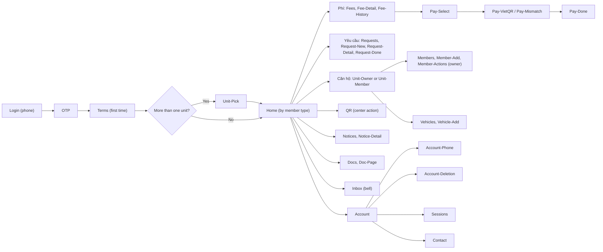
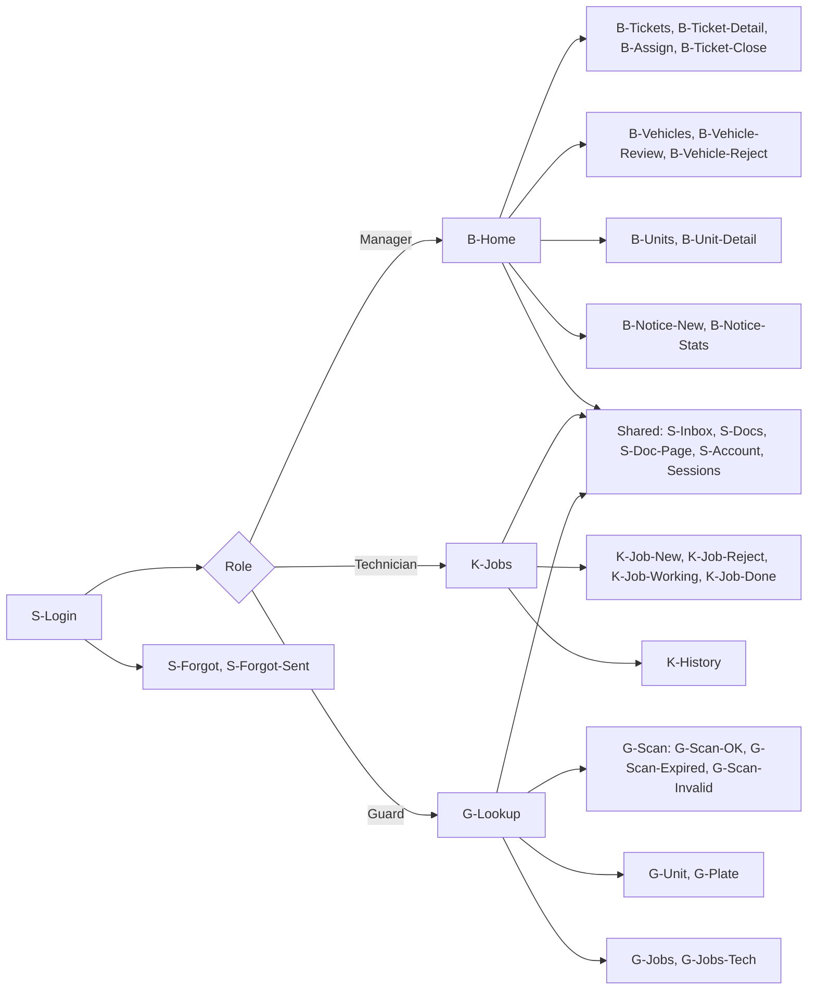
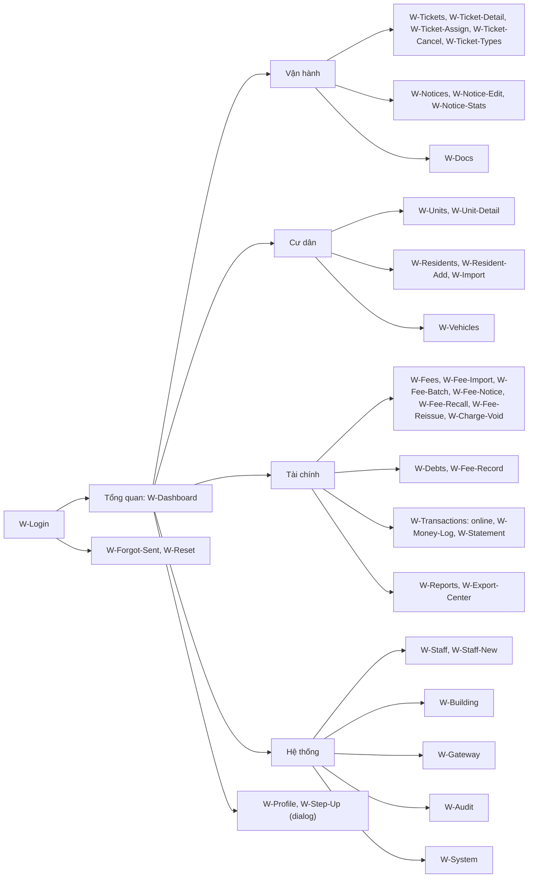

# UX principles and information architecture

> Status: **Approved** (Owner, 2026-10-21) · Updated: 2026-10-29 (DR-310: UX-02, the two choices of a form that meets a 409) · 2026-10-28 (P1-26: the `urgent` channel also carries `payment.received`, DR-303, §5.3) · 2026-10-21 (DR-226: `importId` row of `W-Import`; earlier: DR-204, 210, 211, 212, 216, 219: URL rows and UX-09) · DOC-53
> Depends on: original SDD §6.1, §7.4, §18, [DR](../00-decision-register.md) (DR-39, 40, 43, 44, 48, 69, 70, 71, 72, 73, 74, 75, 84, 127), [DOC-01](../01-product/vision-and-scope.md), [DOC-02](../01-product/personas-and-journeys.md), [DOC-03](../01-product/requirements.md) (NFR-02, 03, 12, 13), [DOC-10](../03-architecture/quality-attributes.md), [DOC-26](../06-design/identity-and-sessions.md), [DOC-27](../06-design/residency-and-memberships.md) §3, [DOC-39](../06-design/security.md), [DOC-42](../06-design/error-handling.md) §9, [DOC-50](../07-api/api-guidelines.md), [DOC-51](../07-api/api-endpoints.md), [ADR-0010](../04-adr/0010-two-account-kinds-membership-scoped-authorization.md), [ADR-0019](../04-adr/0019-mobile-and-web-client-stacks.md)
> Main readers: P1-09, P1-16, P1-17, every screen document DOC-57…67, DOC-54, DOC-55, DOC-68, the E2E tests of P1-16 and P1-17

This document fixes the rules that every screen obeys and the shape of the three clients: the numbered UX principles (`UX-01…UX-20`), the sitemap and navigation of each app by role and member type, the web URL map with its search parameters, the mobile route map with deep links and push routing, the responsive rules and the performance budget. It does not describe visuals: the canvas is the visual source of truth (`https://claude.ai/artifact/PLqx2HGSNuZFiVDaLhtgvj`, design system `Hien`; tokens in DOC-54). Per-screen behavior is in DOC-57…67; the state patterns and the copy keys are in DOC-68; client structure and cache keys are in DOC-55.

**How this was derived.** The navigation, labels and tab bars below were read from the canvas artboards on 2026-10-20 (`Main`, `Home-Helper`, `Home-Tenant-NoPay`, `B-Home`, `K-Jobs`, `G-Lookup`, `W-Tickets`, `W-Debts`, `W-Staff`, `W-System`, `canvas.json` and its notes) and checked against the policy tables of DOC-27 §3 and the audiences of DOC-51. Where the canvas differs from a decided DR, §7 lists the difference; the DR wins (DR-72).

## 1. Clients and audiences

| Client | Who signs in | Sign-in | Device | Stack (DR-70) |
| --- | --- | --- | --- | --- |
| Web CMS (`admin.<domain>`) | Admin, Manager | Email and password, refresh cookie (DOC-26) | Desktop browser; tablet usable (§6) | Vite, React 19, TanStack Router and Query, Tailwind, shadcn/ui |
| Staff app (`rms-staff`) | Manager, Technician, Guard | Email and password, refresh token in `expo-secure-store` | Phone, portrait | Expo SDK 58, expo-router, NativeWind |
| Resident app (`rms-resident`) | Owner, family member, tenant, helper | Phone and SMS code (OTP); one phone, many units | Phone, portrait | Expo SDK 58, expo-router, NativeWind |

The API lets any staff role sign in to any client (DOC-26 §3). The client decides what it offers: §3.4 (DR-174).

## 2. UX principles

Each principle has an ID `UX-nn` (a new prefix, listed in the glossary identifiers). A screen document cites the principles it relies on; "Checked by" names the test that fails when a screen breaks it.

| ID | Principle | Why (source) | Checked by |
| --- | --- | --- | --- |
| UX-01 | **Money screens never retry blindly.** A `POST` that moves or records money (create intent, cancel intent, manual payment, void, recall, publish) is sent once per tap. The button is disabled while the call is in flight. The only automatic retry is the one of DOC-42 §9 for 429, 503 and a lost answer: the same `Idempotency-Key`, at most 3 tries, then the message. A 409, 422 or 500 is never retried by the client. After a lost answer the screen shows "not sure it went through" and offers a read (`GET`/check, for an intent E-88), never a second `POST` with a new key. Reopening the payment screen first reads the open intent; it does not create another | NFR-01, ADR-0023, DOC-42 §9, original SDD §6.1 | E2E (P3): kill the network after send; one intent. Unit test of the client wrapper: no retry on 409/422/500 |
| UX-02 | **A 409 shows the fresh state.** On `version_conflict`, `charge_changed`, `invalid_transition` or `ticket_*`, the client refetches the resource, shows the server `message`, keeps what the user typed, and waits for the user. It never replays the write by itself. A form that holds the user's edits offers two buttons, "use the new version" (drops the edits) and "keep mine and save" (sends the edited fields with the fresh `ETag`), and names the fields both people changed (DR-310) | DOC-42 §9, original SDD §18.2, DR-310 | E2E: two sessions assign the same ticket; the second sees the fresh assignee and the message. Two Admins edit the settings (UIWS-19) |
| UX-03 | **Time comes from the server.** Countdowns (resident QR 15 minutes, OTP 5 minutes and the 45 s resend, intent expiry) use the `serverTime` of the answer plus the monotonic clock of the device, never the wall clock of the device | original SDD §18.2, DOC-50 §6 | Unit test with a skewed device clock |
| UX-04 | **Offline is read-only, and says so.** When the device has no network (`@react-native-community/netinfo` `isInternetReachable === false`; `null` is treated as online) a banner stays on screen, data already loaded stays visible, and every action that writes is disabled with the reason "no network". There is no queue of offline writes. On reconnect the visible queries refetch | original SDD §18.2, DR-70 | Maestro: airplane mode on `Requests`; Playwright: offline mode on the web |
| UX-05 | **What is kept offline, and what never is** (DR-70, DR-175). Persisted (TanStack Query cache, at most 24 hours): home, notices, docs, requests and tickets, unit, members, vehicles, account. Never persisted and always online: fees, fee detail, history, receipts, payment, QR, scan results, lookup, the money log, debts. A persisted screen shows its age ("Cập nhật 09:30"). A money screen offline shows the offline state, not old numbers | DR-70, NFR-01 (a stale amount is a wrong amount) | Maestro: relaunch offline shows `Notices`, not `Fees` |
| UX-06 | **Switching unit drops the previous unit's data.** The selected unit is part of every query key and of the persisted cache key. A switch removes the previous unit's queries from memory and from the persisted cache before the new unit renders. Sign-out clears both | original SDD §18.2, ADR-0010 | Maestro (P1-17): switch A-1508 to A-0703; no A-1508 text visible at any frame |
| UX-07 | **The UI hides, the API enforces.** The client hides what a role or member type can never do (no "Thành viên" for a tenant), and shows disabled, with a reason, what the current state forbids (cancel a request after acceptance). It never relies on hiding: every call may still return 403 `forbidden`, which renders the Forbidden state, not a crash. Authorization is proven on the API by EXP-10, not by screens | ADR-0010, DOC-39 §4, NFR-08 | EXP-10 (API); Playwright: a Manager opens `/gateway` by URL and sees Forbidden |
| UX-08 | **Optimistic updates only where nothing is lost.** Allowed: mark a notice read, toggle push, reorder locally before save. Not allowed: any money action, any state transition (assign, accept, close, lock), any approval. Those wait for the server | NFR-01, UX-02 | Code review rule; E2E |
| UX-09 | **Sensitive staff actions use step-up.** A `403 step_up_required` opens `W-Step-Up`: "send code" (E-38), then password and the 6-digit code, then one replay with `stepUp {password, code}` and a fresh `Idempotency-Key` (the refused call stored nothing). *Revised 2026-10-20 (DR-216):* a form that already knows its action (create or promote an Admin, change a staff email, save the gateway) opens the dialog on submit instead of waiting for the refusal; the 403 path stays for every other case, and every proof attempt gets a new `Idempotency-Key`. `step_up_failed` is shown inside the dialog and keeps it open. A Manager never sees the dialog: the route answers 403 `forbidden` first (DR-147) and the action is hidden | DR-39, DOC-26 §4.5, DOC-39 §9 | Playwright (P1-16): create an Admin; wrong code; right code; used code |
| UX-10 | **Every view has its six states.** Loading (skeleton after 150 ms, never a lone spinner for a list), empty (says why and what to do), error (message plus "Mã tham chiếu: {requestId}" and a retry), stale (data kept, a banner says the refresh failed and how old the data is), forbidden, offline. The patterns and the strings are DOC-68; a screen document lists which of the six apply | original SDD §18.2, DOC-42 §9 | Per screen E2E in DOC-57…67 |
| UX-11 | **No dead ends.** Every blocked account or state has a screen with the next step: see the table below | FR-14…16, FR-39, DOC-42 §9 | Maestro and Playwright cases in DOC-57, DOC-60, DOC-64 |
| UX-12 | **Vietnamese first, English one tap away.** Every string comes from the catalog (`@rms/i18n-catalog`, parity test NFR-13); no string is typed in a component. The language is the account's; before sign-in it is the device's (`Accept-Language`); the switch (VI/EN) is on the sign-in screens and in the account. Bilingual content falls back to Vietnamese. Formats follow DR-71 (`2.838.000 đ`, `09/10/2026`; `₫2,838,000`, `Oct 9, 2026`; 24-hour time in building time) | DR-71, NFR-13 | CI parity test; formatter table test (P1-09) |
| UX-13 | **Targets and contrast.** Touch targets at least 48 px (`tap-min`, DOC-54), text contrast 4.5:1, a visible focus ring, every icon button labelled, every control reachable by keyboard on the web | original SDD §18.2, DOC-54 | Lint rule for `aria-label`; axe check in Playwright |
| UX-14 | **Destructive and hard-to-undo actions say what they do.** Recall, void, lock, remove a member, cancel a request, request account deletion, delete a staff session: a dialog states the consequence in one sentence ("Phiếu đang giữ khoản này sẽ bị hủy, cư dân phải bắt đầu lại"), asks for the reason where the API needs one (void: at least 5 characters), and the confirm button is named after the action, never "OK" | DR-19, DR-20, DR-44 | Playwright per action |
| UX-15 | **Filters live in the URL (web) and survive Back.** A list's filters, sort, tab and page cursor are search parameters; copying the URL reproduces the view; Back returns to the same list at the same filter. Dialogs that matter are search parameters too (`dialog=assign`), so Back closes them. Mobile lists keep their filter while the screen is mounted and reset on a new visit | §4 | Playwright: filter, open detail, Back |
| UX-16 | **Aggregates carry their time.** A figure computed from many rows shows when it was computed ("Số liệu đến 09:30, 09/10/2026"), as `W-Debts` does | NFR-09, DR-80 | E2E on `W-Debts`, `W-Dashboard` |
| UX-17 | **Live data, by the cheapest channel that fits.** The web CMS listens to SSE (E-75: `inbox.created`, `ticket.created`, `ticket.changed`, `money_log.opened`, `export.ready`, `session.revoked`) and invalidates the matching queries; the mobile apps refetch on focus and on push; only the payment screen polls (2 s for the first minute, 3 s after, visible screen only) | DR-75, original SDD §6.1 | E2E (P3, P4) |
| UX-18 | **Personal data is masked by default.** Phone numbers are masked for a Guard with a Call button; the full CCCD and date of birth appear only on the detail view of a profile, never in a list, an import preview, an export or a log; opening that view is logged by the API (`pii.read`) | NFR-14, DR-48, DR-58 | `AD-`, `RM-` tests; Playwright: no CCCD in `W-Residents` |
| UX-19 | **A push is a hint, never the only channel.** Every push has an inbox entry (`Inbox`, `S-Inbox`); the tap routes by the allow-list of §5.3; a push carries no amount, name or ticket text | DR-52, DOC-09 `notification.push_requested.v1` | Maestro: tap with the app killed, background, foreground |
| UX-20 | **One word per thing.** The canvas and the glossary give the words: a ticket is "Yêu cầu" to a resident and "Phiếu" or "Phiếu hỗ trợ" to staff (DR-43); a fee batch is "Đợt phí"; a charge of a batch on a unit is shown under "Phí"; a receipt is "Biên lai". A screen document uses these words and DOC-68 holds them as keys | DR-43, DOC-06 | Catalog review |

**No dead ends: the cases of UX-11.**

| Situation | What the person sees | Next step offered |
| --- | --- | --- |
| Unknown phone at `Login` (404 `phone_not_registered`) | `Login-Error`: the phone is not registered | The Manager's contact from `GET /public/config` (E-03), the hotline; no self sign-up |
| Wrong code, expired code, 429 | Message with the wait (`Retry-After`) | Resend after 45 s; call the Manager |
| Membership locked or removed (403 `membership_inactive`) | A message "Bạn không còn quyền vào căn này" and `Unit-Pick` with the units left | If no unit is left: "no unit" state with the Contact button (E-15) and Sign out |
| Terms not accepted (403 `terms_required`) | `Terms` or `Terms-Update`; nothing else is reachable | Accept, then the interrupted action is replayed |
| App version too old (426 `upgrade_required`) | A blocking update screen with the store link from `details.storeUrl` | Open the store |
| Account has asked for deletion (`deletion_requested`) | The app keeps working; `Account` shows a banner with the date and a "Hủy yêu cầu xóa" action (E-19) | Cancel at any time before execution (DOC-35 §10.1) |
| Access token expired and refresh failed (401) | `Login` with the reason "phiên đã hết hạn"; the destination is kept (`redirect`) | Sign in again |
| Staff account locked (423 `account_locked`) | `W-Login` / `S-Login-Error`: "Too many attempts. Try again in {n} minutes." with no counter (DR-128) | Wait, or ask the Manager or Admin to unlock |
| Staff account `invited`, link expired (`token_invalid`) | `W-Reset` explains the link is no longer valid | "Gửi lại email" is the Manager's or Admin's action (E-08); the screen tells the person to ask them |
| 503 `maintenance` or `service_unavailable` | "The system is being updated. Try again in a few minutes." | Retry button; the app does not log out |
| A role on the wrong client | §3.4 | Names the right client |

## 3. Information architecture

### 3.1 Sitemap of the resident app

### 3.2 Sitemap of the staff app

### 3.3 Sitemap of the web CMS

### 3.4 Navigation by member type and role

**Resident app.** The tab bar is the one of `Main` (four tabs and a center action). What a member type sees follows the capability table of DOC-27 §3.2; the tab bar is rebuilt from `GET /me` (memberships with `memberType` and `canPay`) on every launch and on every unit switch.

| Member type | Tab bar | Home | Not offered |
| --- | --- | --- | --- |
| Owner (`Main`) | Trang chủ · Phí · **QR (center)** · Yêu cầu · Căn hộ | Amount due, pinned notices, open requests, 8 shortcuts (Thanh toán, Tạo yêu cầu, Tài liệu, Bản tin, Phương tiện, Thành viên, Liên hệ BQL, Mã QR của tôi) | |
| Family member (`Home-Member`) | Same four tabs and center | As the owner | "Thành viên" (no `manage_members`) |
| Tenant, `canPay` on (`Home-Tenant-Pay`) | Same | As the owner | "Thành viên" |
| Tenant, `canPay` off (`Home-Tenant-NoPay`, `Fees-NoPay`) | Same four tabs and center | Fees are read only | "Thanh toán" buttons and `Pay-*` (capability `pay`), "Thành viên" |
| Helper (`Home-Helper`) | Trang chủ · **QR (center)** · Tài khoản (two tabs) | The QR card, general notices only | Fees, requests, unit, vehicles, docs, inbox, members: every capability but `broadcast_notices` |

The bell (Inbox), the avatar (Account), the unit switcher (`Unit-Pick` as a sheet) and the shortcuts are on `Home`, not in the tab bar. A helper has no `Inbox` (`personal_notifications` is not theirs). The capability that decides each entry is in `UnitContext`; the client reads `canPay` from `GET /me` and the API still checks (UX-07).

**Staff app.** Role groups chosen after sign-in from `GET /staff/me`:

| Role | Tab bar (canvas) | Other entries |
| --- | --- | --- |
| Manager (`B-Home`) | Trang chủ · Phiếu · Phương tiện · Căn hộ · Tài khoản | Home shortcuts: Soạn bản tin (`B-Notice-New`), Tra cứu căn (`B-Units`), Tra biển số, Tài liệu; bell → `S-Inbox` |
| Technician (`K-Jobs`) | Công việc · Lịch sử · Tài liệu · Tài khoản | Bell → `S-Inbox`; sees assigned tickets only |
| Guard (`G-Lookup`) | Tra cứu · Phiếu · Tài liệu · Tài khoản, with **Quét mã QR cư dân (center)** | `G-Plate` and `G-Unit` from Tra cứu; `G-Jobs` is "Phiếu" (own security tickets), `G-Jobs-Tech` is read only |

**Web CMS sidebar.** The canvas has one sidebar with five groups. An entry is shown only when the role has the route (UX-07) **and** its phase has shipped (DR-174: no "coming soon" pages; the list is a constant in the build, not a server flag).

| Group | Entry (label) | Route | Admin | Manager | Phase |
| --- | --- | --- | --- | --- | --- |
| Tổng quan | Tổng quan | `/dashboard` | Y | Y | P6 (until then the landing page is `/units`) |
| Vận hành | Phiếu hỗ trợ (badge: unassigned) | `/tickets` | Y | Y | P4 |
| | Bản tin | `/notices` | Y | Y | P4 |
| | Tài liệu | `/docs` | Y | Y | P5 |
| Cư dân | Căn hộ | `/units` | Y | Y | P1 |
| | Cư dân | `/residents` | Y | Y | P1 |
| | Phương tiện (badge: pending) | `/vehicles` | Y | Y | P5 |
| Tài chính | Đợt phí | `/fees` | Y | Y | P2 |
| | Công nợ | `/debts` | Y | Y | P2 |
| | Giao dịch online | `/transactions` | Y | Y | P2 (money log), P3 (online, statements) |
| | Báo cáo | `/reports` | Y | Y | P6 |
| Hệ thống | Nhân viên | `/staff` | Y | Y (reads all; creates and locks Technician and Guard only, DR-147) | P1 |
| | Tòa nhà và cấu hình | `/building` | Y | | P1 |
| | Cổng thanh toán | `/gateway` | Y | | P3 |
| | Nhật ký thao tác | `/audit` | Y | | P6 |
| | Sao lưu và lưu trữ | `/system` | Y | | P6 |

Not in the sidebar: `W-Profile` (`/profile`, from the avatar block), `W-Export-Center` (`/exports`, from the Báo cáo page and from the toast of `export.ready`), `W-Step-Up` (a dialog). The Manager has no audit entry although E-54 lets a Manager read a narrowed set: that read serves the "history" panels of a unit, a charge or a payment, not a page (DR-174).

**Where a role does not belong (DR-174).**

| Case | Behavior |
| --- | --- |
| Technician or Guard signs in on the web CMS | The sign-in succeeds (API rule), the shell reads `GET /staff/me`, and shows the page `/wrong-app`: "Tài khoản này dùng App quản lý" with the store links and "Đăng xuất". No other route renders |
| Admin signs in on the staff app | The staff app shows the same kind of page: "Tài khoản Admin dùng Web quản lý" and "Đăng xuất" |
| Manager | Both clients are open |

## 4. Web URL map

The web CMS uses TanStack Router with file-based routes (DR-70). Rules (DR-176):

1. **Everything shareable is in the URL.** Path for identity (`/tickets/$ticketId`), search parameters for filters, tab, sort, page and an open dialog. No filter lives only in component state.
2. **Search parameters are validated.** Each route has a `validateSearch` that parses its parameters with a small parser (`lib/search.ts`: string, pattern, integer range, boolean, one of; *revised 2026-10-25, DR-263: not TypeBox, whose builders and checker would weigh as much as the sign-in page in the entry chunk of every route*) and replaces an invalid or missing value by its default, so a hand-edited URL never crashes the page. Numbers and booleans keep their type in the URL; arrays and objects are avoided (the router would JSON-encode them) (TanStack Router documentation, verified 2026-10-20).
3. **Names mirror the API.** A parameter has the name of the query parameter of the endpoint it feeds (`q`, `status`, `memberType`, `cursor`, `limit`, `page`, `pageSize`), so the route passes it through without renaming. Pagination follows the endpoint: `page`+`pageSize` (E-39) or `cursor`+`limit` (E-54, E-57, E-63). A changed filter drops `cursor` and `page`.
4. **Dialogs are search parameters** (`dialog=assign`, `dialog=recall`, `dialog=void&chargeId=…`). Back closes them; a reload reopens them. `W-Step-Up` is the exception: it is global, triggered by a 403, and not linkable.
5. **Sign-in keeps the destination.** An unauthenticated visit goes to `/login?redirect=<path>`. `redirect` is accepted only if it starts with a single `/` and is a route of this table; anything else is ignored.
6. **Role guard.** A route declares the roles that may see it. `beforeLoad` reads the role (`GET /staff/me`, cached) and renders Forbidden for a role that is not listed; it does not redirect silently (UX-07).
7. **Unknown path** renders `NotFound` with a link to the landing page.

| Screen | Path | Search parameters (name · values · default) | Roles | Phase |
| --- | --- | --- | --- | --- |
| `W-Login` | `/login` | `redirect` · app path · none; `reason` · `expired`, `signed_out` or `password_set` · none; `dialog` · `forgot` (the request-a-reset-link dialog, which has no artboard, DR-210) · none | public | P1 |
| `W-Forgot-Sent` | `/forgot/sent` | none (the email is not in the URL) | public | P1 |
| `W-Reset` | `/reset`, `/invite` | `token` · string · required (links of DOC-26 §4.3) | public | P1 |
| (wrong client) | `/wrong-app` | none | Technician, Guard | P1 |
| `W-Profile` | `/profile` | none (one page, the `tab` parameter was dropped, DR-211) | Admin, Manager | P1 |
| `W-Dashboard` | `/dashboard` | `month` · `YYYY-MM` · current fee month | Admin, Manager | P6 |
| `W-Tickets` | `/tickets` | `status` · `unassigned`, `received`, `processing`, `done`, `closed` · all; `type` · type id; `assignee` · staff id; `range` · `7d`, `30d`, `custom`; `from`, `to` · date; `q`; `cursor`, `limit` | Admin, Manager | P4 |
| `W-Ticket-Detail`, `W-Ticket-Assign`, `W-Ticket-Cancel` | `/tickets/$ticketId` | `dialog` · `assign`, `cancel` · none | Admin, Manager | P4 |
| `W-Ticket-Types` | `/tickets/types` | none | Admin, Manager | P4 |
| `W-Notices` | `/notices` | `status` · `draft`, `scheduled`, `sent` · all; `category`; `q`; `cursor`, `limit` | Admin, Manager | P4 |
| `W-Notice-Edit` | `/notices/new`, `/notices/$noticeId/edit` | `lang` · `vi`, `en` · `vi` | Admin, Manager | P4 |
| `W-Notice-Stats` | `/notices/$noticeId/stats` | `memberType`; `cursor` (unread list) | Admin, Manager | P4 |
| `W-Docs` | `/docs` | `folder` · id; `page` · id; `lang` · `vi`, `en` · `vi`; `q` | Admin, Manager | P5 |
| `W-Units` | `/units` | `q`; `occupancy` · `occupied`, `rented`, `vacant`; `floor` · integer; `bedrooms` · integer 0…20 (DR-212); `cursor`, `limit` (E-57); `dialog` · `add` | Admin, Manager | P1 |
| `W-Unit-Detail` | `/units/$unitId` | `tab` · `members`, `history`, then `debt`, `vehicles`, `money`, `tickets` · `members`; `dialog` · `edit`, `transfer`, `phone`, `member` (with `phone` and `member`, `membershipId` names the row) | Admin, Manager | P1 (members, history), P2 (debt), P3 (money), P5 (vehicles) |
| `W-Residents` | `/residents` | `q`; `unitId`; `memberType` · `owner`, `family`, `tenant`, `helper`; `status` · `active`, `locked`; `deletion` · `requested`; `neverSignedIn` · boolean (DR-212); `cursor`, `limit` (E-63); `dialog` · `profile` with `accountId` | Admin, Manager | P1 |
| `W-Resident-Add` | `/residents/new` | `unitId` · prefilled unit | Admin, Manager | P1 |
| `W-Import` | `/import` | `kind` · `unit_owner` · `unit_owner`; `importId` · id (resumes a job: a validated preview, DR-21, or one chosen in the recent-imports table, DR-226) | Admin, Manager | P1 |
| `W-Vehicles` | `/vehicles` | `status` · `pending`, `approved`, `rejected`, `retired` · `pending`; `q`; `cursor` | Admin, Manager | P5 |
| `W-Fees` | `/fees` | `status` · `draft`, `published`, `recalled`, `closed` · all; `month` · `YYYY-MM`; `cursor` | Admin, Manager | P2 |
| `W-Fee-Import` | `/fees/import` | `batchId` · id (re-import while draft) | Admin, Manager | P2 |
| `W-Fee-Batch`, `W-Fee-Recall`, `W-Fee-Reissue`, `W-Charge-Void` | `/fees/$batchId` | `q` (unit); `dialog` · `recall`, `reissue`, `void`; `chargeId` · with `void`; `cursor` | Admin, Manager | P2 |
| `W-Fee-Notice` | `/fees/$batchId/notice` | `lang` · `vi`, `en`, `both` · `both` | Admin, Manager | P2 |
| `W-Debts` | `/debts` | `view` · `unit`, `month` · `unit`; `month`; `overdue` · `30`; `q`; `cursor` | Admin, Manager | P2 |
| `W-Fee-Record` | `/debts/$unitId` | `dialog` · `record`, `void-payment` | Admin, Manager | P2 |
| `W-Transactions`, `W-Money-Log` | `/transactions` | `tab` · `online`, `money-log`, `statements` · `online`; `status`; `kind`; `reviewed` · boolean; `from`, `to`; `q`; `cursor` | Admin, Manager | P2 (money-log), P3 |
| `W-Statement` | `/transactions/statements/$statementId` | `filter` · `matched`, `unmatched`, `proposed`, `not-seen` · `unmatched`; `cursor` | Admin, Manager | P3 |
| `W-Reports` | `/reports` | `kind` · `aging`, `collection`, `tickets` · `aging`; `month` | Admin, Manager | P6 |
| `W-Export-Center` | `/exports` | `cursor` | Admin, Manager | P6 |
| `W-Staff` | `/staff` | `role` · `admin`, `manager`, `technician`, `guard`; `status` · `invited`, `active`, `locked`, `disabled`; `q`; `page`, `pageSize` (E-39) | Admin, Manager | P1 |
| `W-Staff-New` | `/staff/new`, `/staff/$staffId/edit` | none | Admin, Manager (Technician and Guard only) | P1 |
| `W-Building` | `/building` | `dialog` · `terms` (the publish panel, with `kind` · `terms` or `privacy`; the page is one screen with one save, so the `tab` parameter was replaced, DR-219) | Admin | P1 |
| `W-Gateway` | `/gateway` | none | Admin | P3 |
| `W-Audit` | `/audit` | `actorId`, `action`, `objectType`, `objectId`, `from`, `to`, `requestId`, `cursor`, `limit` (E-54) | Admin | P6 |
| `W-System` | `/system` | none | Admin | P6 |
| `W-Step-Up` | (dialog) | none | Admin | P1 |

## 5. Mobile route map

### 5.1 Resident app (expo-router)

Files live under `app/`. The group `(auth)` needs no session; `(app)` needs a session, an accepted terms version and a selected unit.

| Screen | Route | Params | Capability | Phase |
| --- | --- | --- | --- | --- |
| `Login`, `Login-Error` | `/login` | none | public | P1 |
| `OTP` | `/otp` | challenge held in memory, not in the URL | public | P1 |
| `Terms`, `Terms-Update` | `/terms` | `mode` · `first`, `update`, `view` (read-only, from the "Điều khoản sử dụng" row of `Account`, no consent button, DR-204) | resident | P1 |
| `Unit-Pick` | `/unit-pick` | `reason` · `inactive` | resident | P1 |
| `Main`, `Home-*` | `/` (tab) | none | by member type | P1 |
| `Fees`, `Fees-NoPay` | `/fees` (tab) | `view` · `due`, `history` · `due` | `view_fees` | P2 |
| `Fee-Detail` | `/fees/[chargeId]` | none | `view_fees` | P2 |
| `Fee-History` | `/fees/history` | none | `view_fees` | P2 |
| `Pay-Select` | `/pay` | `charges` · comma-separated charge ids | `pay` | P3 |
| `Pay-VietQR`, `Pay-Mismatch`, `Pay-Done` | `/pay/[intentId]` | none (the state comes from the intent) | `pay` (view: `view_fees`) | P3 |
| `Requests`, `Request-New`, `Request-Detail`, `Request-Cancel`, `Request-Done` | `/requests` (tab), `/requests/new`, `/requests/[ticketId]` | `filter` · `open`, `done` · `open` | `tickets` | P4 |
| `Unit-Owner`, `Unit-Member` | `/unit` (tab) | none | any but helper | P1 (info), P4 (members) |
| `Members`, `Member-Add`, `Member-Actions` | `/unit/members`, `/unit/members/add`, `/unit/members/[membershipId]` | none | `manage_members` | P4 |
| `Vehicles`, `Vehicle-Add` | `/unit/vehicles`, `/unit/vehicles/add` | none | `vehicles` | P5 |
| `QR`, `QR-Expired`, `QR-Helper` | `/qr` (modal over the tabs) | none | `broadcast_notices` | P5 |
| `Notices`, `Notices-Helper`, `Notice-Detail` | `/notices`, `/notices/[noticeId]` | `category` | `broadcast_notices` | P4 |
| `Inbox` | `/inbox` | none | `personal_notifications` | P4 |
| `Docs`, `Doc-Page` | `/docs`, `/docs/[pageId]` | none | `library` | P5 |
| `Account`, `Account-Helper`, `Account-Phone`, `Account-Deletion`, `Sessions`, `Contact` | `/account`, `/account/phone`, `/account/deletion`, `/account/sessions`, `/contact` | none | resident | P1 |

### 5.2 Staff app (expo-router)

| Screen | Route | Params | Roles | Phase |
| --- | --- | --- | --- | --- |
| `S-Login`, `S-Login-Error`, `S-Forgot`, `S-Forgot-Sent` | `/login`, `/forgot`, `/forgot/sent` | none | public | P1 |
| `S-Account`, `Sessions` | `/account`, `/account/sessions` | none | all staff | P1 |
| `S-Inbox` | `/inbox` | none | all staff | P4 |
| `S-Docs`, `S-Doc-Page` | `/docs`, `/docs/[pageId]` | none | all staff | P5 |
| `B-Home` | `/` (tab) | none | Manager | P4 |
| `B-Tickets`, `B-Ticket-Detail`, `B-Assign`, `B-Ticket-Close` | `/tickets` (tab), `/tickets/[ticketId]` | `status`, `assignee` | Manager | P4 |
| `B-Vehicles`, `B-Vehicle-Review`, `B-Vehicle-Reject` | `/vehicles` (tab), `/vehicles/[vehicleId]` | `status` · `pending` | Manager | P5 |
| `B-Units`, `B-Unit-Detail` | `/units` (tab), `/units/[unitId]` | `q` | Manager | P1 (read), P4 |
| `B-Notice-New`, `B-Notice-Stats` | `/notices/new`, `/notices/[noticeId]/stats` | none | Manager | P4 |
| `K-Jobs`, `K-Job-New`, `K-Job-Reject`, `K-Job-Working`, `K-Job-Done` | `/` (tab), `/jobs/[ticketId]` | `filter` · `all`, `awaiting`, `working`, `urgent` | Technician | P4 |
| `K-History` | `/history` (tab) | none | Technician | P4 |
| `G-Lookup`, `G-Unit`, `G-Plate` | `/` (tab), `/lookup/unit/[unitId]`, `/lookup/plate` | `mode` · `unit`, `plate` · `unit`; `q` | Guard | P5 |
| `G-Scan`, `G-Scan-OK`, `G-Scan-Expired`, `G-Scan-Invalid` | `/scan` (center action), `/scan/result` | result held in memory | Guard | P5 |
| `G-Jobs`, `G-Jobs-Tech` | `/jobs` (tab), `/jobs/tech` | none | Guard | P4 |
| (wrong client) | `/wrong-app` | none | Admin | P1 |

### 5.3 Deep links and push routing (DR-177)

Two schemes, from DR-69: `rms-resident://` and `rms-staff://`. Phase 1 has no universal links or app links. A link is the route of §5.1 or §5.2 with its parameters, for example `rms-resident://fees/0192f3c4-5a1e-7000-8000-0000000000a1`.

1. **Allow-list.** The app resolves only routes of its own table. An unknown route, a route of another app or a malformed id opens Home.
2. **A push carries `route`, `unitId` and `entityId`** and nothing else (`notification.push_requested.v1`, DOC-09). The target is `route` when `entityId` is `null`, and `route/entityId` otherwise (`/notices` + id opens `/notices/<id>`; `/fees` + id opens `/fees/<id>`).
3. **Order on a tap.** (a) Not signed in: keep the link in memory, show `Login`, continue after sign-in and terms. (b) Resident app with `unitId` different from the selected unit: switch unit first (UX-06), then navigate; if the membership is no longer active, show the `Unit-Pick` reason `inactive`. (c) The capability of the target is missing (a helper tapped an old fee push): open Home. (d) Navigate once.
4. **Cold start, background, foreground.** The root layout handles three entries: the tap that launched the app (`getLastNotificationResponse`/`useLastNotificationResponse`), a tap while the app runs (`addNotificationResponseReceivedListener`), and a link opened by the OS. After routing it calls `clearLastNotificationResponse` so a reload does not navigate again (Expo notifications documentation, verified 2026-10-20).
5. **Foreground pushes** do not navigate; they update the bell badge and the inbox query and show a toast with the title.
6. **Android channels** are `default` and `urgent` (the `channel` of the payload). The urgent channel is used for the notice category "Khẩn cấp" only. *Revised 2026-10-28 (DR-303):* and for `payment.received`, as DR-52 says ("urgent notices and payment received"); every other template uses `default` (DOC-31 §3.2). The routes a push may carry are the closed list of DOC-31 §6.5.

## 6. Responsive behavior

| Client | Rule |
| --- | --- |
| Web CMS | **Primary: width of 1280 px and more.** Fixed sidebar of 248 px, a content area that grows, tables inside a card that scrolls horizontally from a minimum width of 960 px, as the canvas shows (`W-Tickets`). **Usable: 768 to 1279 px** (tablet, small laptop): the full layout holds from 1024 px; from 768 to 1023 px the sidebar collapses to a 72 px icon rail (DR-186, which refines DR-178), and from 1024 px the user can collapse it to the rail too (DR-312); filters wrap and the detail panels stack. **Below 768 px the CMS is not supported**: the shell shows a notice "Web quản lý dành cho máy tính hoặc máy tính bảng. Trên điện thoại, dùng App quản lý." and no data screen. The login page works at every width (DR-178) |
| Mobile apps | Phone portrait only; the layout is designed for 390 × 844 pt and fluid from 360 pt. A tablet shows the phone layout centered at a maximum width of 480 pt. Safe areas are respected (the tab bar adds the bottom inset to its 64 px). The orientation is locked to portrait, including the scanner |
| Text size | The OS font scale is honored up to 130% (`maxFontSizeMultiplier` 1.3); layouts must not clip at that size. The web respects browser zoom to 200% |
| Theme | Light and dark tokens exist; the apps and the web follow the system setting (DOC-54 owns the switch, if any) |
| Print | The CMS has no print layout in phase 1; receipts and fee notices are PDFs (DOC-34) |

## 7. Where the prototype differs from a decision

The canvas was drawn before several decisions (DR-72). The screen documents correct these when they specify the screen; they are collected here so none is missed.

| Canvas | Decision | Owner document |
| --- | --- | --- |
| `Pay-Select` offers VNPay beside VietQR; `W-Gateway` chooses VNPay or VietQR | Phase 1 is VietQR only; `W-Gateway` is restricted to the chosen provider (DR-72) | DOC-58, DOC-67 |
| `Fees` note: "Muốn nộp tiền mặt hoặc nộp một phần, bạn liên hệ Ban quản lý" | A charge is paid in full or not at all; no partial payment is posted by anyone (DR-84) | DOC-58 |
| `W-Fee-Record`: manual payment with "partial allowed" | Whole-charge selection with a computed sum and no amount field (DR-23) | DOC-66 |
| `W-Login` error banner "Còn 2 lần thử, sau đó tài khoản tạm khóa 15 phút" | No counter before the lock (DR-128) | DOC-64 |
| Ticket codes `YC-1007-012` | The code shape is `YC-YYMMDD-NNN` (DR-10, glossary) | DOC-57…62, DOC-68 |
| No `Terms-Update`, `Account-Deletion`, `Sessions`, `Pay-Mismatch`, `W-Money-Log`, `W-Statement`, `W-Fee-Recall`, `W-Fee-Reissue`, `W-Charge-Void`, `W-Export-Center`, `W-Ticket-Cancel`, `W-Step-Up`, `UnitMoneyPanel` | To be designed before their phase; marked `to design` in DOC-56 (DR-72) | DOC-56 |
| `W-Ticket-Types` shows an SLA per type "phase 2" | Out of phase 1; ticket deadlines are optional (P4-12) | DOC-64 |
| `canvas.json` note "Thành viên gia đình (giả định)" | The family member is a real, separate member type (DR-81) | DOC-57 |
| Fonts Geologica and Big Shoulders in the canvas; DOC-11 pins Be Vietnam Pro for PDFs and "app typography" | One family for the apps and the CMS, to be settled in DOC-54 and DOC-11 together | DOC-54 |

## 8. Performance budget

All numbers are **planned** (nothing is measured yet). "Good" for the web vitals is the threshold published by web.dev at the 75th percentile (LCP ≤ 2.5 s, INP ≤ 200 ms, CLS ≤ 0.1; verified 2026-10-20). The API side is NFR-03 (p95 ≤ 300 ms); these budgets add the client. They are checked as in DR-179.

| Client | Measure | Planned target | Checked by |
| --- | --- | --- | --- |
| Web | JavaScript on the first load of `/login` (gzip), in Vietnamese and, with the English catalog chunk, in English | ≤ 180 KB (DR-308; 170 KB before) | Bundle-size check in CI (P1-19) |
| Web | JavaScript of the shell plus the landing route (gzip) | ≤ 300 KB | CI |
| Web | Any other route chunk (gzip) | ≤ 120 KB; the rich-text editor, the charts and drag-and-drop load only on their routes | CI |
| Web | LCP, `W-Login` and `W-Dashboard`, 4G throttling, mid-range laptop | ≤ 2.5 s (p75 of runs) | Lighthouse or Playwright trace, P6 |
| Web | INP on a table filter and on opening a detail | ≤ 200 ms | Playwright trace, P6 |
| Web | CLS | ≤ 0.1 | P6 |
| Web | Click on a list entry to content shown (API p95 300 ms included) | ≤ 1 s (p75) | Playwright, P1-16 onwards |
| Web | Import: the validated preview of a 2,000-row file | ≤ 10 s (NFR-12); a progress state after 1 s | `IM-` test, P1-13 |
| Resident app | Cold start to `Home` with a warm cache; without cache | ≤ 2 s; ≤ 3 s (release build, mid-range Android of 2021 or later) | Maestro timing, P1-17 and P6 |
| Mobile | A tap to a skeleton | ≤ 100 ms | Manual profile, P6 |
| Mobile | A list of 1,000 rows (FlashList) | ≥ 55 fps while scrolling | P6 |
| Resident app | `Pay-Select` to the QR on screen | ≤ 2 s (API p95 300 ms plus rendering) | E2E, P3 |
| Resident app | Webhook accepted to `Pay-Done` | ≤ 5 s at p95 (NFR-02) | EXP-01, P3 |
| Resident app | A new QR code | ≤ 1 s | E2E, P5 |
| Staff app (Guard) | Scan to result on screen | ≤ 1.5 s at p95 (API p95 300 ms) | E2E, P5 |
| Mobile | Photo upload: resize on the device to 1,920 px at most, quality 0.8 | ≤ 1 s per photo before the upload starts | P4 |

**Client timeouts (planned).** Default request 15 s; upload `PUT` 60 s; `POST /staff/imports` 30 s (NFR-12 allows 10 s); payment `check` 15 s. A timeout is "no answer" in the sense of UX-01.

## 9. Decisions made in this document

| Proposal | Decision | Applies in |
| --- | --- | --- |
| DR-174 | Clients by role and navigation by phase: Technician and Guard on the web, and Admin on the staff app, reach a `/wrong-app` page; an entry exists only when its phase has shipped (constant, no server flag, no "coming soon"); the Manager has no audit entry | §3.4 |
| DR-175 | Money screens are never persisted offline; the rest follows DR-70; no offline write queue | UX-04, UX-05 |
| DR-176 | Web URL conventions: filters, tab, page and dialogs are validated search parameters named like the API parameters | §4 |
| DR-177 | Deep links and push routing: allow-list, `route` + `entityId`, switch unit before navigating, three entry paths | §5.3 |
| DR-178 | Responsive thresholds: CMS primary ≥ 1280, usable ≥ 768 (full layout from 1024, icon rail below it: DR-186), unsupported below with a notice; apps portrait only, tablets letterboxed at 480 pt | §6 |
| DR-179 | The planned budget of §8 and how it is checked: bundle size in CI from P1-19, vitals and timings from Playwright and Maestro in P6 | §8 |

The full text of each decision is in the decision register (DR-174…179).

## 10. Sources checked

| Fact | Source | Verified |
| --- | --- | --- |
| `validateSearch` accepts a function or a schema, receives parsed JSON, types flow to `useSearch`; top-level numbers and booleans keep their type, nested values are JSON-encoded | <https://tanstack.com/router/latest/docs/framework/react/guide/search-params> | 2026-10-20 |
| Routing on a notification tap: `addNotificationResponseReceivedListener`, `useLastNotificationResponse`, `getLastNotificationResponse`, `clearLastNotificationResponse`; `router.push(url)` in the root layout of Expo Router | <https://docs.expo.dev/versions/latest/sdk/notifications/> | 2026-10-20 |
| Good thresholds LCP 2.5 s, INP 200 ms, CLS 0.1 at the 75th percentile, split by mobile and desktop | <https://web.dev/articles/vitals> and <https://web.dev/articles/lcp> | 2026-10-20 |

## Open questions

None. The six proposals of §9 are within what the Owner delegated; DOC-54 owns the font family question of §7.
