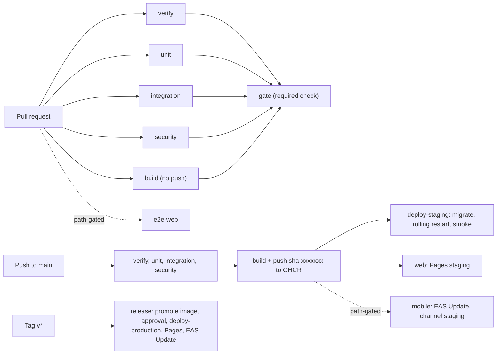
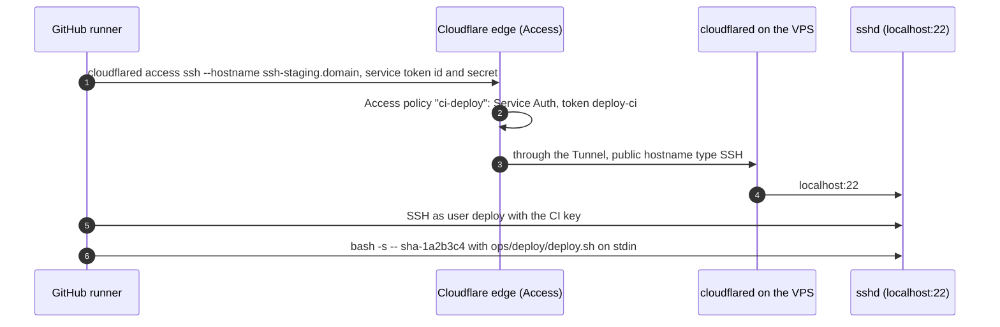

# CI/CD

> Status: **Review** · Updated: 2026-10-20 (DR-179, DR-184, DR-188: bundle budgets, axe audits, `client-core` path; earlier P0-31) · DOC-71
> Depends on: original SDD §4.3, §19.3, §19.5, [DR](../00-decision-register.md) (DR-01, 02, 04, 08, 69, 77, 82, 83, 88, 95, 152, 153, DR-163…166), [DOC-06](../02-glossary.md), [DOC-07](../03-architecture/system-context-and-containers.md) §4, [DOC-11](../03-architecture/tech-stack-and-versions.md) §8, §9, [DOC-12](../03-architecture/code-architecture.md) §6, [DOC-39](../06-design/security.md) §12, [DOC-69](local-dev.md) §5, [DOC-70](deploy-staging-and-production.md) §3.3, §5.2, §6, §9, [DOC-88](../10-testing/test-strategy.md)
> Main readers: P1-01, P1-19, P1-20, P2-14, P6-10, P6-13; every contributor (what a pull request must pass); the Owner (approval of a production deploy)

This document says what runs when code is pushed: the stages and which of them block a merge, how the image, the web CMS and the mobile apps are built and deployed, how a deploy reaches a VPS that has no inbound port, the smoke test, the gates, the schedules and the rollback. It does not hold what the host does with a deploy command (the script, the compose files: DOC-70 §6, §7), the test method (DOC-88), what each scanner must catch (DOC-39 §12) or the mobile build profiles (DOC-73).

**State of this document.** There is no repository yet: the workflows are written by P1-19 (pipeline), P1-20 (staging deploy), P6-10 (mobile) and P6-13 (production). The YAML below is the specification they implement; none of it has been run. Action versions are the DOC-11 §9 tags; the commit SHAs that DR-95 requires are resolved by P1-19 on the day it pins them.

## 1. Purpose and scope

| Item | Where |
| --- | --- |
| The workflow files and what triggers each | §2 |
| Rules every job follows | §3 |
| Stages and merge-blocking conditions | §4 |
| Security scans | §5 |
| The image: Dockerfile, tags, registry | §6 |
| Deploy over the Tunnel, smoke test, gates, rollback | §7 |
| Web CMS to Pages | §8 |
| Mobile: EAS build and update | §9 |
| Schedules | §10 |
| Repository rules: branches, commits, pull requests, Dependabot | §11 |
| Secrets and variables of CI | §12 |
| Time budgets | §13 |
| Acceptance checks | §15 |

## 2. Pipeline at a glance



| Workflow file | Trigger | Jobs |
| --- | --- | --- |
| `.github/workflows/ci.yml` | `pull_request`, `push` to `main` | `changes`, `verify`, `unit`, `integration`, `security`, `build`, `e2e-web`, `gate`; on `main` also `deploy-staging`, `deploy-web-staging`, `mobile-staging` |
| `.github/workflows/release.yml` | `push` of a tag `v*` | `promote`, `deploy-production`, `deploy-web-production`, `mobile-production`; the environment `production` needs the Owner's approval |
| `.github/workflows/nightly.yml` | `schedule` (01:00 in Ho Chi Minh City), `workflow_dispatch` | `race` (§10) |
| `.github/workflows/weekly.yml` | `schedule` (Monday 02:00), `workflow_dispatch` | `gitleaks-history`, `image-scan-running` (§5) |
| `.github/workflows/load.yml` | `workflow_dispatch` only | `k6` against staging (EXP-07, `bun run test:load`, DOC-88 §11) |
| `.github/workflows/rollback.yml` | `workflow_dispatch` | `rollback` of the API, the web CMS or the mobile channel (§7.6) |
| `.github/workflows/mobile-build.yml` | `workflow_dispatch` | EAS Build of a binary (DOC-73 §4) |
| `.github/dependabot.yml` | weekly | `bun`, `github-actions`, `docker` (§11.5) |

The cron expressions are in UTC: 01:00 in Ho Chi Minh City is `0 18 * * *` of the day before; Monday 02:00 is `0 19 * * 0`.

## 3. Rules every job follows

1. **One toolchain, read from `.tool-versions`.** `oven-sh/setup-bun` with `bun-version-file: .tool-versions` (DOC-69 §3); `actions/setup-node` with `node-version-file: .tool-versions` only in the jobs that run Expo or EAS. A job never installs a tool by name and version of its own.
2. **Actions are pinned by commit SHA with the tag in a comment** (DR-95): `uses: actions/checkout@<40-hex> # v7.0.1`. The tags are DOC-11 §9. Dependabot (`github-actions`) updates them weekly.
3. **Least privilege.** The workflow default is `permissions: contents: read`. A job that needs more states it: `packages: write` (build), `security-events: write` (CodeQL), `deployments: write` (deploy jobs), `id-token` is never granted.
4. **Concurrency.** `ci.yml`: `group: ci-${{ github.ref }}`, `cancel-in-progress: true` for pull requests and **false** on `main` (a deploy in progress is never cancelled). Deploy jobs: `group: deploy-${{ matrix.env }}`, `cancel-in-progress: false`, so two deploys to one environment queue.
5. **Timeouts.** `timeout-minutes` on every job: verify 10, unit 8, integration 15, security 15, build 15, e2e-web 20, deploy 15, race 30.
6. **Caches** (`actions/cache`, v6.1.0, DOC-11 §9):

   | Cache | Path | Key |
   | --- | --- | --- |
   | Bun packages | `~/.bun/install/cache` | `bun-${{ runner.os }}-${{ hashFiles('bun.lock') }}`; restore key `bun-${{ runner.os }}-` |
   | TypeScript build info | `**/tsconfig.tsbuildinfo` | `tsc-${{ hashFiles('bun.lock', 'tsconfig.base.json') }}-${{ github.sha }}`; restore key without the SHA |
   | Playwright browsers | `~/.cache/ms-playwright` | `pw-${{ hashFiles('bun.lock') }}` |
   | Docker layers | buildx `type=gha`, `mode=max` | `scope=rms-api` |

   A cache is a speed-up only: every job passes with an empty cache.
7. **`bun install --frozen-lockfile` everywhere.** A changed `bun.lock` after install fails the job (the check of DOC-11 §10 row 1).
8. **No secret reaches a pull request from a fork.** The repository is private (DR-08), so forks are not expected; the workflows use `pull_request`, never `pull_request_target`.
9. **A step prints no secret.** Secrets are passed as environment variables of the one step that needs them; `::add-mask::` is used for any value computed at run time.
10. **Artifacts** (`actions/upload-artifact` v7.0.2): test reports, `authz-matrix.json` and `authz-matrix.md` (DR-151), the coverage summary, Playwright traces on failure. Retention 14 days.

## 4. Stages and merge-blocking conditions

### 4.1 Stages

`changes` runs first and sets path outputs (`dorny/paths-filter` v4.0.3) used by `e2e-web` and the mobile jobs:

| Output | Paths |
| --- | --- |
| `api` | `apps/api/**`, `modules/**`, `packages/core-*/**`, `packages/shared-types/**`, `packages/i18n-catalog/**`, `docker/**`, `ops/**`, `bun.lock` |
| `web` | `apps/web/**`, `packages/design-tokens/**`, `packages/i18n-catalog/**`, `packages/shared-types/**`, `packages/client-core/**`, `packages/core-web-core/**`, `bun.lock` |
| `mobile` | `apps/resident-app/**`, `apps/staff-app/**`, `packages/mobile-core/**`, `packages/client-core/**`, `packages/ui-native/**`, `packages/design-tokens/**`, `packages/i18n-catalog/**`, `packages/shared-types/**`, `bun.lock` |
| `docs` | `docs/**` |

| Stage | Runs | Commands (DOC-69 §5) | Fails when | Blocks merge |
| --- | --- | --- | --- | --- |
| `verify` | always | `bun run lint` (Biome), `bun run typecheck`, `bun run check:arch` (three dependency-cruiser configs, knip, jscpd), `bun run check:scope` (building-scope lint, DR-12), `bun run check:i18n` (catalog parity: a key or ICU placeholder missing in `vi` or `en`), the `@app/api` value-import check, `bun run check:commits` (§11.2), `bun run check:authz-metadata` (a route without audience metadata, AG-01) | Any command exits non-zero | **Yes** |
| `unit` | always | `bun run test` (every workspace; no database) with `--coverage` | A test fails. A coverage figure below its target is a **warning** in the job summary and never fails (DR-77) | **Yes** |
| `integration` | always | Service container `postgres:18.6`; `0001-provision.sql` through `psql`; `bun run db:migrate`; `bun run test:integration`; `bun run test:authz` | A test fails; the authorization matrix has an unexpected 2xx or 3xx, an unexpected refusal, a 5xx, a leak, a route without metadata or a missing fixture (DR-151, DOC-39 §4.6) | **Yes** |
| `security` | always | §5: Gitleaks, Trivy filesystem, CodeQL (`security-extended`), dependency review | A finding of the severities of DOC-39 §12 | **Yes** (DR-153) |
| `build` | always (push only on `main`) | §6: the `rms-api` image; Trivy image scan; on `main` push `sha-<7>` to GHCR | The image does not build or the scan finds a fixed HIGH or CRITICAL vulnerability or a secret in a layer | **Yes** (so the Dockerfile cannot rot) |
| `e2e-web` | `changes.web` or `changes.api` | Build the web CMS and check the bundle budgets of DOC-53 §8 (first load of `/login` ≤ 170 KB gzip, shell plus landing route ≤ 300 KB, any other route chunk ≤ 120 KB; DR-179); start `bun run dev:api` against a migrated database seeded with `seed:demo`; `bun run test:e2e` (Playwright 1.64.1, Chromium), which includes the accessibility audits of `@axe-core/playwright` in both themes (DS-07, DS-08, DR-184) | A flow fails; a bundle is over budget; an audit finds a serious or critical violation | No on a pull request; **yes as a deploy gate** (§7.3) |
| `gate` | always, `if: always()` | Fails unless every job above that ran finished `success` or `skipped` | | It **is** the required check |

Merge is blocked by `verify`, `unit`, `integration`, `security` and `build` (DR-08 named the first three; DOC-39 §12 and DR-153 make the scans fail the build, which is why `security` and `build` join, DR-163). The branch rule requires one status, `gate`, so that a path-gated job that was skipped does not leave a required check pending.

### 4.2 Example: `.github/workflows/ci.yml` (specification)

```yaml
name: ci
on:
  pull_request:
  push: { branches: [main] }
permissions: { contents: read }
concurrency:
  group: ci-${{ github.ref }}
  cancel-in-progress: ${{ github.event_name == 'pull_request' }}
jobs:
  changes:
    runs-on: ubuntu-latest
    outputs:
      api: ${{ steps.f.outputs.api }}
      web: ${{ steps.f.outputs.web }}
      mobile: ${{ steps.f.outputs.mobile }}
    steps:
      - uses: actions/checkout@<sha> # v7.0.1
      - id: f
        uses: dorny/paths-filter@<sha> # v4.0.3
        with: { filters: .github/paths-filter.yml }
  verify:
    runs-on: ubuntu-latest
    timeout-minutes: 10
    steps:
      - uses: actions/checkout@<sha> # v7.0.1
      - uses: oven-sh/setup-bun@<sha> # v2.2.0
        with: { bun-version-file: .tool-versions }
      - uses: actions/cache@<sha> # v6.1.0
        with: { path: ~/.bun/install/cache, key: "bun-${{ runner.os }}-${{ hashFiles('bun.lock') }}" }
      - run: bun install --frozen-lockfile
      - run: git diff --exit-code bun.lock
      - run: bun run check
  integration:
    runs-on: ubuntu-latest
    timeout-minutes: 15
    services:
      postgres:
        image: postgres:18.6
        env: { POSTGRES_PASSWORD: ci-superuser }
        ports: ["5432:5432"]
        options: >-
          --health-cmd "pg_isready -U postgres" --health-interval 5s --health-retries 10
    env:
      APP_ENV: test
      PGPASSWORD: ci-superuser
    steps:
      - uses: actions/checkout@<sha> # v7.0.1
      - uses: oven-sh/setup-bun@<sha> # v2.2.0
        with: { bun-version-file: .tool-versions }
      - run: bun install --frozen-lockfile
      - run: bun run keys:generate          # throw-away passwords and keys, written to .env.local
      - run: bun run db:provision-ci        # psql -f 0001-provision.sql with the generated passwords
      - run: bun run db:migrate
      - run: bun run test:integration
      - run: bun run test:authz
      - if: always()
        uses: actions/upload-artifact@<sha> # v7.0.2
        with: { name: authz-matrix, path: "authz-matrix.*", retention-days: 14 }
  # unit, security, build, e2e-web: same shape; gate:
  gate:
    if: always()
    needs: [changes, verify, unit, integration, security, build, e2e-web]
    runs-on: ubuntu-latest
    steps:
      - run: |
          echo '${{ toJSON(needs) }}' | jq -e 'to_entries | all(.value.result == "success" or .value.result == "skipped")'
```

`db:provision-ci` is a root script that runs `0001-provision.sql` as `postgres` (DOC-19 §3, DOC-88 §6); it is the CI twin of the `initdb.d` script of DOC-69 §6.

## 5. Security scans

What each scanner must catch and the thresholds are DOC-39 §12 (DR-153); this section is where and when they run. Versions are DOC-11 §9.

| Scanner | Action and tool | Where | Trigger |
| --- | --- | --- | --- |
| Gitleaks | `gitleaks/gitleaks-action` v3.0.0 with gitleaks 8.30.1; config `.gitleaks.toml` (allow-list entries carry a comment) | job `security`: the commits of the pull request; `weekly.yml`: the full history of `main` | Every PR; weekly |
| Trivy filesystem | `aquasecurity/trivy-action` v0.36.0, Trivy 0.76.0, `scan-type: fs`, `--ignore-unfixed`, severity `HIGH,CRITICAL` | job `security`: `bun.lock` | Every PR |
| Trivy image | The same action, `scan-type: image`, plus `--scanners vuln,secret` | job `build`: the image just built; `weekly.yml`: the image tag that runs in production (read from the host over the Tunnel) | Every build; weekly |
| CodeQL | `github/codeql-action` v4.39.0, languages `javascript-typescript`, queries `security-extended` | job `security` | Every PR; results in the Security tab |
| Dependency review | `actions/dependency-review-action` v5.0.0, `fail-on-severity: high`, `deny-licenses: GPL-2.0, GPL-3.0, AGPL-3.0` for **linked** dependencies | job `security`, PRs only | Every PR |
| Dependabot | See §11.5 | | Weekly; security updates at once |

The licence rule applies to packages the product links. Grafana, Loki and k6 are AGPL-3.0 and run as separate programs (DOC-11 §0), so they are not in `bun.lock` and the rule does not see them.

A weekly failure of `image-scan-running` sends the failed-run email of GitHub Actions to the Owner; it is the only scanner that finds a new vulnerability in a build nobody touched (DOC-39 §12).

## 6. The image

### 6.1 Dockerfile (`docker/Dockerfile.api`)

One image, `rms-api`, serves both roles (`APP_ROLES`, DR-05).

```dockerfile
# syntax=docker/dockerfile:1
FROM oven/bun:1.4.3 AS deps
WORKDIR /app
COPY package.json bun.lock ./
COPY apps/api/package.json apps/api/
COPY modules/*/package.json modules/   # one COPY line per module: the P1-19 script generates them
COPY packages/core-*/package.json packages/
RUN bun install --frozen-lockfile --production --filter @app/api

FROM oven/bun:1.4.3 AS runtime
RUN groupadd --gid 10001 rms && useradd --uid 10001 --gid rms --no-create-home --shell /usr/sbin/nologin rms
WORKDIR /app
COPY --from=deps /app/node_modules ./node_modules
COPY apps/api ./apps/api
COPY modules ./modules
COPY packages ./packages
COPY scripts/migrate.ts scripts/healthcheck.ts scripts/keys-generate.ts ./scripts/
ARG GIT_SHA=unknown
LABEL org.opencontainers.image.source="https://github.com/<org>/residential-management-system" \
      org.opencontainers.image.revision="${GIT_SHA}"
ENV NODE_ENV=production
USER rms
EXPOSE 3000 3001
HEALTHCHECK --interval=10s --timeout=3s --start-period=20s --retries=3 CMD ["bun", "scripts/healthcheck.ts"]
CMD ["bun", "apps/api/src/main.ts"]
```

Notes:

- `NODE_ENV=production` stays in the image (DOC-41 §3); behavior is `APP_ENV`.
- The user is `rms`, uid 10001. The files that mount secrets are owned so that this uid can read them (DOC-70 §9.1).
- `scripts/healthcheck.ts` calls `http://localhost:${OPS_PORT}/health/ready` and exits 0 only on a 200 (the image has no `curl`). Compose uses the same script for the container health state.
- `scripts/migrate.ts` is the entry of the one-shot migration service: `bun scripts/migrate.ts` runs `db:migrate` with `MIGRATION_DATABASE_URL_FILE` (DOC-70 §6.3). The `api` and `worker` containers never mount that file.
- The Expo and web workspaces are not in the image. The `bun install --filter @app/api` flag keeps the image small; P1-19 measures it (planned ≤ 400 MB).
- Whether the TypeScript is run from source (above) or bundled with `bun build --target bun` is decided by P1-04 with the cold-start time of `/health/ready`; the Dockerfile changes only in its last two lines.

### 6.2 Tags and registry

| Item | Rule |
| --- | --- |
| Registry | `ghcr.io/<org>/rms-api`, private (the repository is private) |
| Tags built on `main` | `sha-<first 7 hex of the commit>`. The only tag a build pushes |
| Tags on a release | `vX.Y.Z` (semantic version) is **added** to the existing `sha-<7>` image by `docker buildx imagetools create`, not by a new build (§7.4, DR-164). The digest is identical |
| Never | `latest`, a branch name, a bare major (DR-95). A compose file names an exact tag |
| Push credentials | `GITHUB_TOKEN` with `packages: write`, only in `build` on `main` and in `promote` |
| Pull credentials on the VPS | A read-only token stored by `docker login ghcr.io` for the `deploy` user (DOC-70 §4.7) |
| Retention | A weekly cleanup (`actions/delete-package-versions`, a pinned version chosen by P1-19) keeps the 30 newest `sha-*` versions and every `v*` version. The tag running in an environment is never deleted, because rollback needs it |

Build arguments: `GIT_SHA=${{ github.sha }}`. Build with `docker/build-push-action` v7.4.0, `docker/setup-buildx-action` v4.4.1, `docker/login-action` v4.6.0, `docker/metadata-action` v6.2.0, platform `linux/amd64` only (the VPS is amd64; multi-arch is not built).

## 7. Deploy over the Tunnel

### 7.1 How a runner reaches a host with no inbound port

The VPS denies all inbound traffic, SSH included (DR-83 item 2). The runner reaches SSH through the Cloudflare Tunnel, with an Access **service token**:



On the runner (job `deploy-staging`):

```bash
# cloudflared 2026.10.1 from the GitHub release, checksum verified (the version is DOC-11 §7)
curl -fsSL -o cloudflared.deb https://github.com/cloudflare/cloudflared/releases/download/2026.10.1/cloudflared-linux-amd64.deb
echo "<sha256>  cloudflared.deb" | sha256sum -c -
sudo dpkg -i cloudflared.deb

install -m 700 -d ~/.ssh
echo "$DEPLOY_SSH_KEY" > ~/.ssh/id_deploy && chmod 600 ~/.ssh/id_deploy
echo "$DEPLOY_KNOWN_HOSTS" > ~/.ssh/known_hosts
cat > ~/.ssh/config <<EOF
Host ssh-staging.${DOMAIN}
  User deploy
  IdentityFile ~/.ssh/id_deploy
  StrictHostKeyChecking yes
  ProxyCommand cloudflared access ssh --hostname %h --service-token-id ${CF_ACCESS_CLIENT_ID} --service-token-secret ${CF_ACCESS_CLIENT_SECRET}
EOF
# upload the release (docker/ and ops/) and run the deploy command on the host (DOC-70 §3.2, §6.5)
tar -czf - docker ops | ssh ssh-staging.${DOMAIN} "cat > /opt/rms/incoming/sha-${SHORT_SHA}.tgz"
ssh ssh-staging.${DOMAIN} "bash -s -- sha-${SHORT_SHA}" < ops/deploy/deploy.sh   # the script of this commit is streamed, so no copy has to pre-exist on the host
```

The `ProxyCommand` form, the dashboard route of type SSH to `localhost:22` and the `cloudflared access ssh` command come from the Cloudflare documentation (read 2026-10-20). The flags `--service-token-id` and `--service-token-secret` exist in the `cloudflared` source for `access ssh`; P1-20 confirms them against `cloudflared access ssh --help` of 2026.10.1 before pinning the step. The host key is pinned in `DEPLOY_KNOWN_HOSTS`, so a man in the middle at the edge cannot answer for the VPS.

### 7.2 What the deploy command does

`ops/deploy/deploy.sh <tag>` runs **on the host**, streamed through `ssh host "bash -s -- <tag>" < ops/deploy/deploy.sh` after the release tarball is uploaded, and is DOC-70 §6. This document fixes its contract:

| Input | The image tag (`sha-1a2b3c4` or `v1.4.0`) |
| --- | --- |
| Effects, in order | (1) pull `rms-api:<tag>`; (2) migrations as `rms_migrator` and the grants step in a one-shot container; (3) restart `api-1`, wait for ready, restart `api-2` (production only), wait for ready; (4) restart `worker`; (5) record the tag as `current`, the old one as `previous` in `/var/lib/rms/deploy-state` |
| Exit code | 0 only when every step passed and the containers report `healthy`; otherwise non-zero, with the step number in the last line |
| On failure | It stops at the failing step. It does **not** roll back by itself after the migration step (the schema is already expanded, which is safe for the previous image, DR-08). The job fails; the Owner or an operator runs the rollback workflow (§7.6) |
| Output | Plain lines `step 1/5 pull ok` … ending in `deploy ok sha-1a2b3c4 in 142 s`, which the job log keeps |

Migrations follow expand then contract (DR-08, original SDD §16.3): a release may add a column, table or index, and a **contract** step (drop, rename, `NOT NULL` without default) ships one release after the code stopped using the old shape. A contract migration that cannot be backward compatible sets the maintenance flag (DOC-70 §6.4) and needs the Owner's approval in the pull request.

### 7.3 Staging deploy and its gate

Job `deploy-staging` in `ci.yml` runs on `push` to `main` after `gate` is green for that commit and `build` has pushed `sha-<7>`. If `e2e-web` ran for the commit (a web or API change) it must be green too: `needs: [gate]` plus `if: needs.e2e-web.result != 'failure'`. It is a **deploy gate**, not a merge gate (DR-163).

After the command returns, the **smoke test** runs from the runner, against the public host:

| # | Request | Expected |
| --- | --- | --- |
| 1 | `GET https://api-staging.<domain>/api/v1/health/ready` (E-02) | 200, `"status":"ok"`, `"maintenance":false`; retried every 5 s up to 60 s |
| 2 | `GET https://api-staging.<domain>/api/v1/public/config` (E-03) | 200, `apps.resident.minVersion` and `apps.staff.minVersion` present, `Cache-Control: public, max-age=60` |
| 3 | `GET https://api-staging.<domain>/api/v1/health/live` | **404** `not_found` (the ops route must not be public, DR-07) |
| 4 | `POST https://api-staging.<domain>/api/v1/auth/staff/login` (E-05) with the demo Manager, `client: "app"`, `X-App-Id: staff`, `X-App-Version` equal to the minimum | 200 and an `accessToken` (exercises the database, Argon2id and the signing key) |
| 5 | `POST /api/v1/auth/logout` (E-12) with that token's refresh token | 204 |
| 6 | `GET https://admin-staging.<domain>/` | 200 and the `Content-Security-Policy` header (SC-14); behind Access: sent with the service token headers `CF-Access-Client-Id` and `CF-Access-Client-Secret` |
| 7 | On the host: `docker compose ps` through the deploy command | `api-1`, `worker`, `caddy`, `cloudflared` `healthy` |

The script is `ops/deploy/smoke.sh <env>` (DOC-70 §6.5). Step 4 needs the demo password of staging (`STAGING_DEMO_PASSWORD`, a secret of the environment); on production only steps 1 to 3, 6 and 7 run, so the pipeline never signs in to the live system. A failed smoke test fails the job and the commit is marked as not deployed.

The deployment is recorded with the GitHub Deployments API (`environment: staging`, the SHA, the status), which §7.4 reads.

### 7.4 Production deploy

`release.yml` runs when a tag `vX.Y.Z` is pushed.

1. **`promote`.** The job fails unless (a) the tagged commit is on `main`; (b) the image `sha-<7>` exists in GHCR (built by `main`); (c) a **successful** `staging` deployment exists for that SHA (`gh api repos/<org>/<repo>/deployments?sha=<sha>&environment=staging`, then its latest status is `success`). Then it adds the tag: `docker buildx imagetools create -t ghcr.io/<org>/rms-api:vX.Y.Z ghcr.io/<org>/rms-api:sha-<7>`. A tag on a commit that was never built or never passed staging is refused (DR-164).
2. **Approval.** The next jobs use the GitHub environment `production` with a **required reviewer** (the Owner). Nothing reaches production without a click. The reviewer sees the tag, the SHA, the list of migrations in the release (`git diff <previous tag>..<tag> --stat -- 'modules/*/migrations/*'`) and the staging deployment time, printed by `promote` in the job summary.
3. **`deploy-production`.** The same steps as §7.1 and §7.2 with host `ssh-production.<domain>` and the tag `vX.Y.Z`; then the smoke test of §7.3 (public checks only). Before the first line of the deploy it notes the previous tag for the rollback.
4. **Web and mobile.** `deploy-web-production` (§8) and `mobile-production` (§9) run after `deploy-production` succeeded.

A release is announced to the Owner by the GitHub notification of the deployment; no other channel is built.

### 7.5 Gates summary

| Gate | Before | Condition |
| --- | --- | --- |
| Merge to `main` | A pull request | `gate` is green (§4.1) |
| Image on `main` | `build` push | `gate` is green for the commit |
| `deploy-staging` | Push to `main` | `gate` green; `e2e-web` not failed |
| `promote` | Tag `v*` | Commit on `main`; image exists; staging deployment `success` for the SHA |
| `deploy-production` | `promote` | Owner approval of the environment `production` |
| Mobile production update | `deploy-production` | Success, and the Owner's approval of the same environment |

### 7.6 Rollback

`rollback.yml` (`workflow_dispatch`) takes `env` (`staging` or `production`), `target` (`api`, `web` or `mobile`) and, optionally, a `tag`. Every rollback is ≤ 10 minutes (DR-08, DR-83 item 9).

| Target | How | Notes |
| --- | --- | --- |
| API | The same streamed command with `--rollback` redeploys the tag stored as `previous`; with `tag` it redeploys that one. No migration is run backward: the previous image works against the expanded schema (expand then contract) | A **contract** migration already applied cannot be undone by this: a forward fix or a PITR restore decides (RB-10, DOC-70 §6.4) |
| Web CMS | Rebuild from the previous release tag and `wrangler pages deploy` it to the same project; the dashboard's "Rollback to this deployment" for the previous Pages deployment is the manual alternative | The static bundle and the API image are compatible for one release because the API changes are backward compatible (DOC-50 §16) |
| Mobile | `eas update:republish` of the previous update group onto the channel, or `eas update:rollback`; P6-10 confirms the commands against `eas-cli` 25.2.0 (§9.4) | A binary is never "rolled back": a store build is replaced by a new one |

The time of a rollback is **measured** in P1-20 (staging) and P6-13 (production) and written in DOC-70 §6.6; the 10 minutes are a target until then.

## 8. Web CMS to Cloudflare Pages

| Item | Rule |
| --- | --- |
| Projects | Two Pages projects with direct upload: `rms-admin-staging` (domain `admin-staging.<domain>`) and `rms-admin-production` (`admin.<domain>`). A custom domain on a branch alias would need a hand-edited, proxied CNAME and falls through to production if it is not proxied (Cloudflare Pages documentation, read 2026-10-20), so each environment has its own project (DR-165; DR-83 item 1 said "Pages branch") |
| Build | `bun run --filter @app/web build` with the build variables of DOC-41 §15: `VITE_API_BASE_URL=https://api-staging.<domain>/api/v1`, `VITE_APP_ENV=staging` (production: `https://api.<domain>/api/v1`, `production`) |
| `_headers` | The file of DOC-39 §5.1 is a template in `apps/web/public/_headers.template`; the job substitutes `<domain>` and `<files-host>` and writes `dist/_headers`. SC-14 parses the result |
| Deploy | `cloudflare/wrangler-action` v4.1.3 with `wrangler` 4.151.1: `pages deploy apps/web/dist --project-name rms-admin-<env> --branch main` (the project's production branch, so the custom domain follows it); `commitHash` and `commitMessage` set from the job |
| Cache | `/assets/*` immutable for a year (hashed file names); `index.html` is not cached by the browser (`Cache-Control: no-cache` in `_headers`) |
| Order | After the API deploy, so a new bundle never calls an endpoint the old API lacks (the API change is backward compatible and ships first) |
| Smoke | `GET https://admin-staging.<domain>/` returns 200 with the `_headers` values (§7.3 step 6) |

The Pages project names and the Cloudflare account are Owner inputs (DOC-70 §2).

## 9. Mobile: EAS build and update

The profiles, channels, credentials and store steps are DOC-73; this section is the CI side. `eas-cli` 25.2.0 through `expo/expo-github-action` 9.0.0 with `EXPO_TOKEN`.

### 9.1 Which change needs what

| Change | Needs | Done by |
| --- | --- | --- |
| JavaScript or assets only | An **OTA update** on the channel | `mobile-staging` on `main`; `mobile-production` on a tag |
| A native module, `app.config.ts` native keys, an SDK upgrade, a permission string | A **new binary**, and a bump of `version` in `app.config.ts` (runtime version policy `appVersion`, DR-69, so the update never reaches a binary with different native code) | `mobile-build.yml` by hand (DOC-73 §4); the pull request ticks the box "native change" |
| Neither app changed (`changes.mobile` false) | Nothing | The jobs are skipped |

### 9.2 Jobs

```bash
# mobile-staging (on main, path-gated by changes.mobile), once per app
cd apps/resident-app && eas update --channel staging --environment preview --message "ci: $GITHUB_SHA" --non-interactive
cd apps/staff-app    && eas update --channel staging --environment preview --message "ci: $GITHUB_SHA" --non-interactive
# mobile-production (release.yml, after approval)
eas update --channel production --environment production --message "release: $TAG" --non-interactive
```

The `--environment` value selects the EAS environment variables (`API_BASE_URL`, `APP_ENV`) of DOC-73 §5. P6-10 checks the flags against `eas-cli` 25.2.0 (a flag that does not exist fails the first run of the job, not production). A build of a binary is never part of `ci.yml`: it is minutes long and consumes EAS build credits (DOC-73 §4).

### 9.3 Mobile tests in the pipeline

Maestro flows are not run per pull request: they run on demand and before a store release (DR-08, DOC-88 §11). The unit tests of `packages/mobile-core` and `packages/ui-native` run in `unit`.

### 9.4 Rollback

See §7.6. The update group id of every OTA is printed in the job summary so that a rollback names it.

## 10. Schedules

| Workflow | When | What | On failure |
| --- | --- | --- | --- |
| `nightly.yml` `race` | Every night, 01:00 ICT | `TEST_RACE_PROFILE=nightly bun run test:race` (1,000 rounds, 8 sessions), the database-only subsets of EXP-03, EXP-04 and EXP-11, `bun run test:grants` and the full authorization matrix, on a fresh service-container database, **not** on staging (DOC-88 §8.3, §11, DR-165) | A failed run emails the Owner (GitHub notification) and uploads the harness log; it blocks nothing |
| `weekly.yml` `gitleaks-history`, `image-scan-running` | Monday 02:00 ICT | §5 | Email; the Owner decides |
| `load.yml` | By hand only | k6 mix against `api-staging.<domain>` (EXP-07). It never runs together with the bulk-PDF experiment (DR-102) | The result file is committed by hand (DOC-88 §12) |
| Dependabot | Weekly | §11.5 | |

DR-08 said "nightly on staging". The concurrency harness needs to create databases from a template, which the application role on staging cannot do and which must not touch real data; the nightly job therefore runs the same harness on a throw-away database in CI. The load test, which needs the real host, stays on staging and by hand.

## 11. Repository rules

### 11.1 Branches

Trunk-based (DR-08): short-lived branches, squash-merged pull requests, protected `main`.

| Setting (branch protection of `main`) | Value |
| --- | --- |
| Require a pull request | Yes |
| Required status checks | `gate` only; branch must be up to date |
| Allowed merge method | Squash only; linear history |
| Force push and deletion | Denied, also for administrators |
| Reviews | One approval from the code owners of the touched paths **when the repository has more than one contributor**; none while the Owner is alone (DR-166, Owner input) |
| Tag protection | `v*` creatable by the Owner only |

### 11.2 Commits and titles

Conventional Commits in English, with the module as the scope: `feat(finance): …`, `fix(identity): …` (DR-08). Because merges are squashed, the **pull request title** becomes the commit, and `bun run check:commits` validates it (and each commit message on a branch):

```
^(feat|fix|perf|refactor|docs|test|chore|ci|build|revert)(\((identity|building|residency|finance|tickets|access|vehicles|notices|notification|wiki|audit|reporting|realtime|api|web|resident-app|staff-app|core|shared|ops|docs|deps)\))?!?: .{1,100}$
```

The vendored-package sync uses the title `chore(core): sync <sha>` (DR-02). A breaking API change carries `!`.

### 11.3 Pull request template (`.github/pull_request_template.md`)

```markdown
## What and why
<one paragraph; link the task Pn-xx and the DR if there is one>

## Checklist
- [ ] Docs updated in this PR (a behavior change edits the document; a decision change is a DR or a new ADR)
- [ ] Migration is backward compatible for one release (expand now, contract later), or the PR says why not
- [ ] New configuration key: added to DOC-41 and to the schema (CF-01 passes)
- [ ] New metric or alert: added to DOC-40
- [ ] New test prefix: registered in DOC-88
- [ ] Native change in a mobile app: `version` bumped in `app.config.ts`; a new binary is needed
- [ ] No secret, token or personal data in code, fixtures or logs
```

### 11.4 `CODEOWNERS`

`modules/finance`, `modules/identity`, `docs/04-adr`, `ops/`, `docker/` and `.github/` belong to the Owner (DR-08). The scope lint allow-list is reviewed by the owners of `modules/identity` and `modules/finance` (DOC-12 §7.3).

### 11.5 Dependabot (`.github/dependabot.yml`)

| Ecosystem | Directory | Interval | Grouping |
| --- | --- | --- | --- |
| `bun` | `/` | weekly | minor and patch grouped; a major is its own pull request and needs a DR (DR-01, DR-82) |
| `github-actions` | `/` | weekly | grouped; updates the SHA and the tag comment |
| `docker` | `/docker`, `/ops` | weekly | grouped; the exact image tags of the compose files (DR-95) |

The Expo-managed modules follow the SDK, not npm `latest` (DR-94): the `bun` entry ignores them (`ignore:` list generated from the SDK's `bundledNativeModules.json` by P1-19) and `expo install --fix` is the upgrade path. A pre-release version is never merged (DR-82). `docker/compose.*.yml` images are updated only after DOC-11 §7 is re-verified.

## 12. Secrets and variables of CI

All are GitHub **environment** secrets unless marked (an environment has its own value; `production` requires approval).

| Name | Environment | Used by | What | Rotation |
| --- | --- | --- | --- | --- |
| `GITHUB_TOKEN` | automatic | build, promote | Push to GHCR; read the deployments API | per run |
| `CF_ACCESS_CLIENT_ID`, `CF_ACCESS_CLIENT_SECRET` | `staging`, `production` | deploy, rollback, smoke (admin host) | Access service token `deploy-ci` (DOC-70 §5.2) | The token duration is set when created (up to 1 year, refreshed by the Owner); calendar reminder |
| `DEPLOY_SSH_KEY`, `DEPLOY_KNOWN_HOSTS` | `staging`, `production` | deploy, rollback | The key of the host user `deploy` (ed25519, one per environment) and the pinned host key | On staff change |
| `CLOUDFLARE_API_TOKEN`, `CLOUDFLARE_ACCOUNT_ID` | `staging`, `production` | web deploy | API token with only **Cloudflare Pages: Edit** on the account; the account id is a variable, not a secret | On staff change |
| `EXPO_TOKEN` | repository | mobile jobs | An Expo access token of the robot user | On staff change |
| `STAGING_DEMO_PASSWORD` | `staging` | smoke test | Password of the demo staff of staging (`DEMO_STAFF_PASSWORD`, DOC-41 §6) | With the host secret |
| `DOMAIN` (variable) | all | deploy, smoke, web build | The company domain (Owner input, DOC-70 §2) | |
| `APPLE_*`, `GOOGLE_*` store credentials | **not in GitHub** | none | They live in EAS credentials (DOC-73 §5) | |

The application's own secrets (database, keys, S3, SMS) are **not** in CI: they are files on the host (DOC-70 §9). CI never sees `MIGRATION_DATABASE_URL`. A token that CI holds can reach the VPS as the user `deploy`, which is root-equivalent through Docker; the Access policy and the pinned host key are what limit that (DOC-70 §3.3).

## 13. Time budgets

The target is a whole pull-request pipeline in **12 minutes or less** (P1-19); the jobs run in parallel, so the pipeline takes as long as the slowest job plus the queue. *Planned*, measured by P1-19 on the first green run and written back here with the date and the runner.

| Job | Planned | Notes |
| --- | --- | --- |
| `changes` | 0.5 min | |
| `verify` | 3 min | Biome, `tsc` (TypeScript 7, incremental), dependency-cruiser three times, knip, jscpd |
| `unit` | 2 min | No database |
| `integration` | 6 min | Includes the migration, the template database, the authorization matrix (about 2,700 cells, DOC-39 §4.6) |
| `security` | 5 min | CodeQL dominates |
| `build` | 4 min | With the buildx cache; Trivy image scan 1 min |
| `e2e-web` | 8 min | Path-gated |
| `deploy-staging` | 3 min | Pull, migrate, two restarts, smoke |
| **Critical path of a pull request** | **≈ 9 min** | `max(...)` plus checkout and cache restore |

## 14. Failure handling

| Situation | Rule |
| --- | --- |
| A flaky test | It is fixed or deleted within the week; a retry loop is not added. `gate` has no automatic re-run. A maintainer may re-run a failed job **once** and must open an issue if it passes on the second run |
| A scanner finding with no fix | Trivy ignores unfixed vulnerabilities (`--ignore-unfixed`, DOC-39 §12); a finding with a fix fails the build and is fixed by upgrading, never by an ignore entry without a dated comment |
| The registry or Tunnel is down at deploy time | The job fails at its first step with nothing changed; run it again when the service is back (`workflow_dispatch` of the same SHA) |
| A deploy fails after the migration step | §7.2: the schema is expanded and safe for the old image; run the rollback workflow, then fix forward |
| The nightly race job fails | The next morning's first task is to read the harness log; it is a defect in settlement or allocation until proven otherwise (DOC-88 §8) |

## 15. Acceptance checks

These are the checks of P1-19, P1-20 and P6-13; they are **not run** yet. They are not test cases and take no test ID.

| # | Check | Expected |
| --- | --- | --- |
| 1 | A pull request that breaks each of: a Biome rule, a type, a dependency-cruiser rule, a knip finding, a missing `vi`/`en` key, a query without a building predicate, a value import of `@app/api`, a bad PR title, a route without audience metadata | `verify` fails each, naming the rule (P1-19) |
| 2 | A pull request with a failing unit test; with a failing integration test; with a route that answers an unexpected 2xx | The matching job fails; `gate` is red |
| 3 | A coverage figure below its target | A warning in the job summary; `gate` green (DR-77) |
| 4 | A branch that adds a fake key; one that adds a HIGH dependency with a fix | `security` fails (SC-20, SC-31) |
| 5 | A merge to `main` | An image `sha-<7>` in GHCR; `deploy-staging` runs; the smoke test passes; the whole pull-request pipeline took 12 minutes or less |
| 6 | A tag on a commit that did not pass staging | `promote` refuses |
| 7 | A tag on a good commit | The Owner is asked to approve; after approval the production deploy and the smoke test pass |
| 8 | The rollback workflow on staging | The previous tag runs and the smoke test passes within 10 minutes; the time is written in DOC-70 §6.6 |
| 9 | A concurrent second merge during a deploy | The second deploy queues and does not cancel the first |
| 10 | The workflow files | Every `uses:` is a 40-hex SHA with the tag in a comment; `permissions` is declared; every job has `timeout-minutes` |

## 16. Decisions made while writing

Every new decision in this document is recorded as a DR (decided, Claude delegated by the Owner).

| ID | Title | State | Where used |
| --- | --- | --- | --- |
| DR-163 | `gate` is the one required check; `security` and `build` block a merge together with `verify`, `unit` and `integration` (extends DR-08 with DR-153); `e2e-web` blocks a staging deploy, not a merge; the smoke test of §7.3 signs in on staging only | Decided | §4.1, §7.3, §11.1 |
| DR-164 | A release **promotes** the `sha-<7>` image that passed staging and never rebuilds; a tag on a commit that never passed staging is refused | Decided | §6.2, §7.4 |
| DR-165 | Two Pages projects, one per environment (revises the wording of DR-83 item 1); the nightly race job runs on a CI database, not on staging (revises step 3 of DR-08) | Decided | §8, §10 |
| DR-166 | Code-owner review is required only when the repository has more than one contributor; `bun run check:commits` validates the PR title and the commit messages with the module names as scopes | Decided | §11.1, §11.2 |

## 17. Not in this document

| Topic | Lives in |
| --- | --- |
| The deploy script, compose files, host setup, migrations on the host | DOC-70 |
| What a scanner must catch, thresholds | DOC-39 §12 |
| Test levels, fixtures, the race harness, coverage targets | DOC-88 |
| EAS profiles, credentials, store submission, `MIN_APP_VERSION` | DOC-73 |
| Version pins of the actions and tools | DOC-11 §8, §9 |
| Alerts when a job or a backup fails on the host | DOC-40 |

## 18. Traceability

| Section | Decisions | Requirements and tasks |
| --- | --- | --- |
| §4 stages | DR-08, DR-77, DR-153 | NFR-08, NFR-14; P1-19 |
| §5 scans | DR-153, DR-95 | NFR-14; SC-20, SC-21, SC-31 |
| §6 image | DR-05, DR-95 | P1-19 |
| §7 deploy and rollback | DR-83, DR-08 | NFR-10; P1-20, P6-13 |
| §8 Pages | DR-83, DR-64 | SC-14; P1-16, P1-20 |
| §9 mobile | DR-69, DR-94 | P6-10 |
| §10 schedules | DR-08, DR-77, DR-102 | NFR-09; P2-14, P6-06 |

## Open questions

- **Commit SHAs of the actions** are resolved by P1-19 when it writes the workflows (DR-95). The tags are DOC-11 §9.
- **The `cloudflared access ssh` flag names** (`--service-token-id`, `--service-token-secret`) and **the GHCR read token type** (a classic personal access token with `read:packages`, or a fine-grained token) are checked by P1-20 against the pinned `cloudflared` and the GitHub documentation.
- **Review rule of §11.1** depends on whether a second contributor joins; Owner input.
- **EAS flags of §9.2** (`--environment`, `eas update:republish`, `eas update:rollback`) are checked against `eas-cli` 25.2.0 by P6-10.
- Decisions made while writing: DR-163…166.
