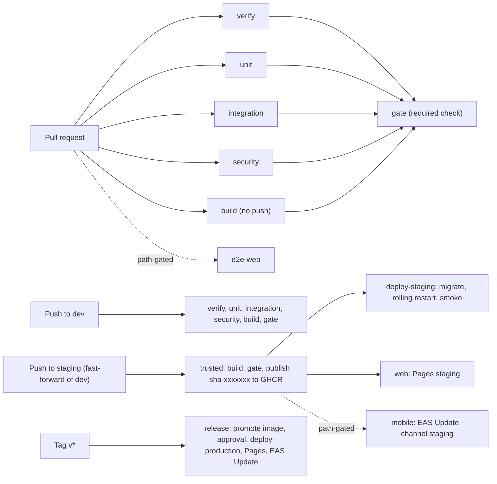
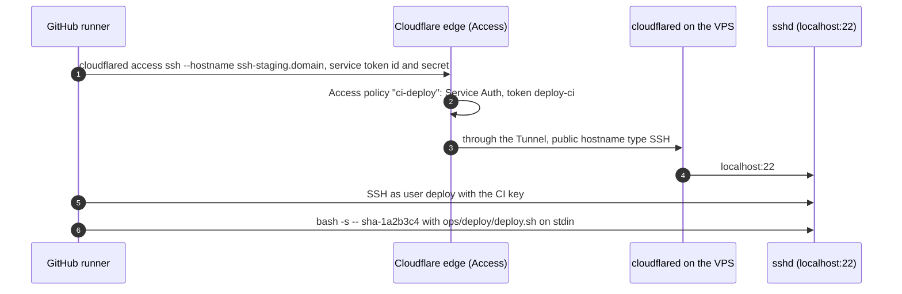

# CI/CD

> Status: **Approved** (Owner, 2026-10-21) · Updated: 2026-10-27 (DR-277: a change of documents only skips the code jobs, the `code` output, §4.1) · 2026-10-27 (DR-276: only a push to `staging`, a fast-forward of `dev`, publishes and deploys; §2, §4.3, §7.3, §7.5, §11.1) · 2026-10-27 (DR-275: no host, no publish and no deploy-staging (`staging-host` reads `HOST_IP`)) · 2026-10-27 (DR-274: the `e2e` paths, a push that repeats its pull request skips the checks, §4.3) · 2026-10-27 (DR-272: the worker is restarted before the APIs) · 2026-10-27 (P1-20 without a VPS, DR-271: `check:deploy` in `verify`; `deploy-staging`, `rollback.yml`, `image-scan-running` and `ghcr-retention` written and linted with actionlint, not run; the GHCR retention is a script; §6.1, §6.2, §7.1, §7.3, §7.6, §10, §15); earlier 2026-10-27 (P1-18: `check:ops` in `verify`); earlier 2026-10-22 (DR-246: the `commit-msg` hook in §11.2; P1-09: `uv` in the unit job, DR-237; P1-19: `ci.yml` and `weekly.yml` written and run, acceptance in §15; DR-238 Semgrep CE and Trivy licences in place of CodeQL and dependency review, DR-239 trunk `dev`, DR-240 pipeline mechanics, DR-241 `pr:merge` instead of branch protection, DR-242 release age; earlier: DR-166 confirmed by the Owner, open question closed; earlier: DR-179, DR-184, DR-188: bundle budgets, axe audits, `client-core` path; earlier P0-31) · DOC-71
> Depends on: original SDD §4.3, §19.3, §19.5, [DR](../00-decision-register.md) (DR-01, 02, 04, 08, 69, 77, 82, 83, 88, 95, 152, 153, DR-163…166, DR-238…242, DR-276, DR-277), [DOC-06](../02-glossary.md), [DOC-07](../03-architecture/system-context-and-containers.md) §4, [DOC-11](../03-architecture/tech-stack-and-versions.md) §8, §9, [DOC-12](../03-architecture/code-architecture.md) §6, [DOC-39](../06-design/security.md) §12, [DOC-69](local-dev.md) §5, [DOC-70](deploy-staging-and-production.md) §3.3, §5.2, §6, §9, [DOC-88](../10-testing/test-strategy.md)
> Main readers: P1-01, P1-19, P1-20, P2-14, P6-10, P6-13; every contributor (what a pull request must pass); the Owner (approval of a production deploy)

This document says what runs when code is pushed: the stages and which of them block a merge, how the image, the web CMS and the mobile apps are built and deployed, how a deploy reaches a VPS that has no inbound port, the smoke test, the gates, the schedules and the rollback. It does not hold what the host does with a deploy command (the script, the compose files: DOC-70 §6, §7), the test method (DOC-88), what each scanner must catch (DOC-39 §12) or the mobile build profiles (DOC-73).

**State of this document.** P1-19 wrote and ran `.github/workflows/ci.yml` (the pull-request and trunk pipeline) and `.github/workflows/weekly.yml` (Gitleaks over the history) on 2026-10-22; those files are now the source and this document says what they do and why. The deploy jobs and `release.yml`, `rollback.yml`, `nightly.yml`, `load.yml`, `mobile-build.yml` are still specifications here, written by P1-20 (staging deploy), P2-14 (nightly), P6-10 (mobile) and P6-13 (production). **The trunk is `dev`** (DR-239): every `main` of the original text reads `dev`; a `main` branch is created as the production branch at the first release (P6-13).

## 1. Purpose and scope

| Item | Where |
| --- | --- |
| The workflow files and what triggers each | §2 |
| Rules every job follows | §3 |
| Stages and merge-blocking conditions | §4 |
| Security scans | §5 |
| The image: Dockerfile, tags, registry | §6 |
| Deploy over the Tunnel, smoke test, gates, rollback | §7 |
| Web CMS to Pages | §8 |
| Mobile: EAS build and update | §9 |
| Schedules | §10 |
| Repository rules: branches, commits, pull requests, Dependabot | §11 |
| Secrets and variables of CI | §12 |
| Time budgets | §13 |
| Acceptance checks | §15 |

## 2. Pipeline at a glance



| Workflow file | Trigger | Jobs |
| --- | --- | --- |
| `.github/workflows/ci.yml` | `pull_request`, `push` to `dev` and `staging` (DR-276) | `changes`, `trusted` (push only, §4.3), `verify`, `unit`, `integration`, `security`, `build`, `e2e-web`, `gate` (**written, P1-19**); on `staging` also `staging-host`, `publish` (written, P1-19), `deploy-staging` (**written, P1-20; not run**: it needs the host), `deploy-web-staging` and `mobile-staging` (P6-10) |
| `.github/workflows/release.yml` | `push` of a tag `v*` | `promote`, `deploy-production`, `deploy-web-production`, `mobile-production`; the environment `production` needs the Owner's approval |
| `.github/workflows/nightly.yml` | `schedule` (01:00 in Ho Chi Minh City), `workflow_dispatch` | `race` (§10) |
| `.github/workflows/weekly.yml` | `schedule` (Monday 02:00), `workflow_dispatch` | `gitleaks-history` (**written, P1-19**); `image-scan-running` and `ghcr-retention` (**written, P1-20; not run**, §6.2) |
| `.github/workflows/load.yml` | `workflow_dispatch` only | `k6` against staging (EXP-07, `bun run test:load`, DOC-88 §11) |
| `.github/workflows/rollback.yml` | `workflow_dispatch` | `rollback-api` (**written, P1-20; not run**); the web CMS and the mobile channel arrive with P6-10 (§7.6) |
| `.github/workflows/mobile-build.yml` | `workflow_dispatch` | EAS Build of a binary (DOC-73 §4) |
| `.github/dependabot.yml` | weekly | `bun`, `github-actions`, `docker`, `docker-compose` (§11.5; generated by `bun run dependabot:sync`) |

The cron expressions are in UTC: 01:00 in Ho Chi Minh City is `0 18 * * *` of the day before; Monday 02:00 is `0 19 * * 0`.

## 3. Rules every job follows

1. **One toolchain, read from `.tool-versions`.** `oven-sh/setup-bun` with `bun-version-file: .tool-versions` (DOC-69 §3); `actions/setup-node` with `node-version-file: .tool-versions` only in the jobs that run Expo or EAS. A job never installs a tool by name and version of its own. The scanners are the exception: they run from exact image tags pinned once in the workflow `env` (DR-240), and the runner image is `ubuntu-24.04`, not `ubuntu-latest`.
2. **Actions are pinned by commit SHA with the tag in a comment** (DR-95): `uses: actions/checkout@3d3c42e5aac5ba805825da76410c181273ba90b1 # v7.0.1`. The tags are DOC-11 §9; P1-19 resolved the SHAs on 2026-10-22 (the peeled commit of an annotated tag). Dependabot (`github-actions`) updates them weekly. Six actions are used: `actions/checkout`, `oven-sh/setup-bun`, `actions/cache`, `actions/upload-artifact`, `dorny/paths-filter`, and the Docker set (`setup-buildx`, `build-push`, `login`).
3. **Least privilege.** The workflow default is `permissions: contents: read`. A job that needs more states it: `pull-requests: read` (`changes`: paths-filter lists the files of a pull request), `packages: write` (build), `deployments: write` (deploy jobs); `security-events` is not needed (no code-scanning upload, DR-238); `id-token` is never granted.
4. **Concurrency.** `ci.yml`: `group: ci-${{ github.ref }}`, `cancel-in-progress: true` for pull requests and **false** on `dev` (a deploy in progress is never cancelled). Deploy jobs: `group: deploy-${{ matrix.env }}`, `cancel-in-progress: false`, so two deploys to one environment queue.
5. **Timeouts.** `timeout-minutes` on every job: changes 5, trusted 3, verify 10, unit 8, integration 15, security 15, build 15, e2e-web 20, gate 2, deploy 15, race 30.
6. **Caches** (`actions/cache`, v6.1.0, DOC-11 §9):

   | Cache | Path | Key |
   | --- | --- | --- |
   | Bun packages | `~/.bun/install/cache` | `bun-${{ runner.os }}-${{ hashFiles('bun.lock') }}`; restore key `bun-${{ runner.os }}-` |
   | TypeScript build info | not cached: `tsc --noEmit` writes no build info, and `typecheck` takes about 4 s | |
   | Playwright browsers | `~/.cache/ms-playwright` | `pw-${{ hashFiles('bun.lock') }}` (added with the flows, P1-16) |
   | Trivy database | `~/.cache/trivy` | `trivy-db-<UTC date>`; restore key `trivy-db-` |
   | Docker layers | buildx `type=gha`, `mode=max` | `scope=rms-api` |

   A cache is a speed-up only: every job passes with an empty cache.
7. **`bun install --frozen-lockfile` everywhere.** A changed `bun.lock` after install fails the job (the check of DOC-11 §10 row 1).
8. **No secret reaches a pull request from a fork.** The repository is private (DR-08), so forks are not expected; the workflows use `pull_request`, never `pull_request_target`.
9. **A step prints no secret.** Secrets are passed as environment variables of the one step that needs them; `::add-mask::` is used for any value computed at run time.
10. **Artifacts** (`actions/upload-artifact` v7.0.2): `coverage-unit` (lcov per workspace), `semgrep` (the JSON report), `authz-matrix.json` and `authz-matrix.md` (DR-151, from P1-15), Playwright traces on failure (P1-16). Retention 14 days. Each job also writes its table (checks, coverage, Semgrep, bundle, image size) to the job summary.

## 4. Stages and merge-blocking conditions

### 4.1 Stages

`changes` runs first and sets path outputs (`dorny/paths-filter` v4.0.3, filters in `.github/paths-filter.yml`) used by the code jobs, `e2e-web` and the mobile jobs:

| Output | Paths |
| --- | --- |
| `api` | `apps/api/**`, `modules/**`, `packages/core-*/**`, `packages/shared-types/**`, `packages/i18n-catalog/**`, `docker/**`, `ops/**`, `bun.lock` |
| `web` | `apps/cms-web/**`, `packages/design-tokens/**`, `packages/i18n-catalog/**`, `packages/shared-types/**`, `packages/client-core/**`, `packages/core-web/**`, `bun.lock` |
| `mobile` | `apps/resident-app/**`, `apps/staff-app/**`, `packages/mobile-core/**`, `packages/client-core/**`, `packages/ui-native/**`, `packages/design-tokens/**`, `packages/i18n-catalog/**`, `packages/shared-types/**`, `bun.lock` |
| `docs` | `docs/**` |
| `code` | `!{docs/**,*.md,**/*.md}` (every file that is not under `docs/` and not Markdown) and, by name, the seven documents that a test or a check reads: `audit-privacy-and-terms.md` (DOC-35), `configuration-reference.md` (DOC-41), `error-handling.md` (DOC-42), `jobs-and-outbox-runtime.md` (DOC-38), `observability.md` (DOC-40), `api-endpoints.md` (DOC-51), `test-strategy.md` (DOC-88). `changes` outputs `true` on every push to `staging`, which builds the image it publishes. `tools/ops-files/ci.test.ts` fails when code reads a document that is not listed (DR-277) |
| `e2e` | `apps/api/**`, `apps/cms-web/**`, `modules/**`, `packages/core-*/**`, `packages/shared-types/**`, `packages/i18n-catalog/**`, `packages/design-tokens/**`, `packages/client-core/**`, `packages/test-support/**`, `docker/compose.local.yml`, `docker/postgres/**`, `ops/postgres/**`, the scripts that start and migrate the stack, the root manifests, `bun.lock`, the two CI files. What a flow can notice and nothing else: no other `ops/**` or `docker/**`, no check script, no mobile package (DR-274) |

| Stage | Runs | Commands (DOC-69 §5) | Fails when | Blocks merge |
| --- | --- | --- | --- | --- |
| `verify` | always, except on a trusted push (§4.3); without `code` only `check:commits` (DR-277) | `bun run check` (`scripts/check.ts`): `lint` (Biome), `typecheck` (every workspace and `scripts/`), `check:arch` (three dependency-cruiser configs; the `@app/api` value import is its rule `clients-import-the-api-type-only`, DR-04), `check:arch:fixtures`, `quality:unused` (knip), `quality:dup` (jscpd), `check:scope` (building-scope lint, DR-12; P1-07), `check:audit` (audit actions, AD-06; P1-08), `check:layout` (module layout, DOC-12 §6.4; DR-254), `check:i18n` (catalog parity; P1-09), `check:authz-metadata` (AG-01; P1-15), `check:dependabot`, `check:ops` (`promtool` config, rules and tests, `amtool`, `loki -verify-config`, `alloy validate` and `fmt`, the Grafana dashboards are current; OB-04, OB-05; P1-18; each tool runs from its image, which the runner pulls once), `check:deploy` (P1-20, DR-271: `docker compose config` for both environments, Caddy validated and run in front of a stand-in, `shellcheck` over `ops/**/*.sh`, and `tools/ops-files`: `deploy.sh`, `smoke.sh`, `ci-deploy.sh`, `ghcr-cleanup.sh`, the PostgreSQL files on PostgreSQL 18 and `postgres_exporter`; about 40 s; the backup path on SeaweedFS is `bun run test:backup-repo`, which installs pgBackRest and is not in `verify`), `check:test-ids` (warning only). Each check runs even after one failed and the job summary lists them; a target not created yet is reported `skipped until <task>` (DR-240). On a pull request also `bun run check:commits` (§11.2) and `check:openapi` (DR-144; from P1-04). `bun install --frozen-lockfile` and `git diff --exit-code bun.lock` come first | Any check exits non-zero | **Yes** |
| `unit` | `code`, except on a trusted push (§4.3; DR-277) | `bun run test:coverage`: every workspace's tests with lcov (DOC-88 §10). The job installs uv 0.13.5 (`astral-sh/setup-uv` v10.3.1) for the font check DS-05, which runs fontTools with `uv run --with` and fails in CI without it (DR-237) | A test fails. A coverage figure below its target is a **warning** in the job summary and never fails (DR-77) | **Yes** |
| `integration` | `code`, except on a trusted push (§4.3; DR-277) | Service container `postgres:18.6`; `bun run keys:generate`; `bun run db:provision-ci` (`0001-provision.sql` through `psql` of the same image); `db:migrate` (P1-06), `test:integration` (P1-04) and `test:authz` (P1-15) when they exist; until P1-04 moves it, `bun run --filter @core/db test` with `TEST_ADMIN_DATABASE_URL` runs the one suite that needs a database | A test fails; the provisioning fails; from P1-15 the authorization matrix has an unexpected 2xx or 3xx, an unexpected refusal, a 5xx, a leak, a route without metadata or a missing fixture (DR-151, DOC-39 §4.6) | **Yes** |
| `security` | always, except on a trusted push (§4.3); without `code` only Gitleaks (DR-277) | §5: Trivy vulnerabilities and licences, Semgrep CE, Gitleaks over the commits of the change (DR-238). Every scanner runs even after one failed | A finding of the severities of DOC-39 §12 | **Yes** (DR-153) |
| `build` | `code` (DR-277); always on a push to `staging` | §6: build `rms-api` (buildx, `type=gha` cache), print its size, Trivy image scan, boot smoke (the container starts and `/api/v1/health/live` answers 200 within 30 s; P1-04 moves it to `/health/ready` with CF-16, CF-17); on `dev` the scanned image is saved as the artifact `rms-api-image` | The image does not build, the scan finds a fixed HIGH or CRITICAL vulnerability or a secret in a layer, or the process does not answer | **Yes** (so the Dockerfile cannot rot) |
| `e2e-web` | `changes.e2e`, and not when the pull request of a trusted push already ran it green (§4.3; DR-274) | `bun run check:bundle`: builds the web CMS with a Vite manifest and checks the budgets of DOC-53 §8 (first load of `/login` ≤ 170 KB gzip, shell plus landing route ≤ 300 KB, any other route chunk ≤ 120 KB; DR-179). From P1-16: start `bun run dev:api` against a migrated database seeded with `seed:demo`; `bun run test:e2e` (Playwright 1.64.1, Chromium), which includes the accessibility audits of `@axe-core/playwright` in both themes (DS-07, DS-08, DR-184) | A flow fails; a bundle is over budget; an audit finds a serious or critical violation | No on a pull request; **yes as a deploy gate** (§7.3) |
| `publish` | `push` to `staging` (DR-276), after `gate` | Loads `rms-api-image`, tags it `sha-<7>` and pushes it to GHCR (§6.2); `packages: write` only here | The push fails | Not a merge check; it gates `deploy-staging` |
| `gate` | always, `if: always()` | Fails unless `changes`, `verify`, `unit`, `integration`, `security` and `build` finished `success` or `skipped`. `e2e-web` is **not** in its `needs` (DR-240): it gates the deploy, not the merge | | It **is** the required check |

Merge is blocked by `verify`, `unit`, `integration`, `security` and `build` (DR-08 named the first three; DOC-39 §12 and DR-153 make the scans fail the build, which is why `security` and `build` join, DR-163). The branch rule requires one status, `gate`, so that a path-gated job that was skipped does not leave a required check pending. **The rule cannot be set on GitHub Free** for a private repository (the API answers 403 "Upgrade to GitHub Pro or make this repository public", checked 2026-10-22), and the Owner keeps the Free plan (DR-241). `gate` is enforced instead by **`bun run pr:merge <number>`** (`scripts/merge-pr.ts`), the one way a pull request is merged: it squash-merges only when the pull request is open, not a draft, targets `dev`, contains the tip of `dev`, and `gate` is `success` on its head commit, and it passes `--match-head-commit` so a later push makes GitHub refuse the merge. A red commit that reaches `dev` anyway (a direct push, or the GitHub button) is not published: `publish` needs `gate` (§7.5).

### 4.2 `.github/workflows/ci.yml`

The workflow file is the source; this section only says how it is laid out, so a reader knows where to look.

- **Triggers and concurrency** as in §3 rule 4: `pull_request` (any base) and `push` to `dev`; `cancel-in-progress` only for pull requests.
- **`env`** pins the images used with `docker run`: `POSTGRES_IMAGE`, `TRIVY_IMAGE`, `GITLEAKS_IMAGE`, `SEMGREP_IMAGE` (the service container repeats `postgres:18.6`, because `services` cannot read `env`). Dependabot does not read these; they are refreshed with DOC-11 §9.
- **Every job that runs Bun** has the same four steps first: checkout, `setup-bun` from `.tool-versions`, the Bun cache, `bun install --frozen-lockfile`.
- **A target of a later task** is called with `bun scripts/run-if-defined.ts <target> <task>`, which runs `bun run <target>` if the root `package.json` has it and otherwise writes a notice `skipped: … is created by <task>` (DR-240). So P1-04, P1-06, P1-15 and P1-16 add their target and the step starts running without a workflow edit.
- **Scanners in containers** read the checkout with `GIT_CONFIG_*` setting `safe.directory`, because the container user is not the owner of the checkout.
- **`gate`** reads `toJSON(needs)` through an environment variable (never interpolated into the script) and fails unless every result is `success` or `skipped`.

`db:provision-ci` (`scripts/db-provision-ci.ts`) runs `0001-provision.sql` as `postgres` with the passwords `keys:generate` wrote to `.env.local` and `PGPASSWORD` of the service container; `psql` runs from the `postgres:18.6` image with `--network=host`, so the runner needs no client. It is the CI twin of the `initdb.d` script of DOC-69 §6 and was run against a fresh `postgres:18.6` on 2026-10-22 (four roles and the database `rms` created).

### 4.3 A push that repeats its pull request (DR-274, DR-276)

A pull request is merged by `bun run pr:merge` only when its head is up to date with `dev` and `gate` is green on it, and a rebase merge keeps the content: the tree of the commit that lands on `dev` is the tree that `gate` passed. The push to `dev` would check it a second time (about 23 minutes of a 2,000-minute month, measured 2026-10-27), so the job `trusted` decides whether it has to:

1. `ops/deploy/trusted-tree.sh` reads the merged pull request of the pushed commit (`GET /commits/<sha>/pulls`, base `dev`), the tree of the commit and the tree of the pull request's head (`GET /git/commits/<sha>`), and the latest conclusion of the check runs `gate` and `e2e-web` of the head. It writes `tested=true` when the trees are equal and `gate` is `success`, and `e2e=passed` when `e2e-web` was `success` too.
2. With `tested=true` the push skips `verify`, `unit`, `integration` and `security`; with `e2e=passed` it skips `e2e-web` too. `build`, `publish` and `deploy-staging` always run (the image is made and scanned on every push, and `deploy-staging` is the gate of §7.3).
3. **It fails open.** A direct push to `dev` (GitHub Free cannot forbid it, §11.1), a different tree, a head whose `gate` was not green, a missing token or an API error all give `tested=false` and exit 0, and every check runs as before. The job never fails the workflow and `gate` does not read it. On a pull request the job is skipped, its outputs are empty, and every `if` reads that as "not tested".
4. Only the tip of the push is compared: a middle commit of a pull request has another tree and is never trusted. `gate` counts a skipped check as `success` (§4.1), so a trusted push reaches `publish` through the same `gate`.

**A push to `staging` (DR-276).** `staging` is moved by a fast-forward of `dev` to a commit that `dev` already checked (`bun run staging:push`), so there is no pull request to find. With `GITHUB_REF_NAME=staging`, `trusted-tree.sh` reads `gate` and `e2e-web` on the pushed commit itself: `gate` `success` gives `tested=true` (and `e2e=passed` when `e2e-web` was `success`). A commit that was never pushed to `dev`, or whose `gate` was not green, gives `tested=false` and every check runs. Only a push to `staging` then makes the image artifact, `staging-host`, `publish` and `deploy-staging`; a push to `dev` stops at `gate`.

The reason of each decision is in the summary of the `trusted` job (`trusted-tree: the tree is the one of #28, where gate passed`).

## 5. Security scans

What each scanner must catch and the thresholds are DOC-39 §12 (DR-153); this section is where and when they run. Versions are DOC-11 §9.

| Scanner | Tool | Where | Trigger |
| --- | --- | --- | --- |
| Gitleaks | Image `ghcr.io/gitleaks/gitleaks:v8.30.1`, `gitleaks git` with `.gitleaks.toml` (the default rules plus allow-list entries, each with a comment) | job `security`: the commits of the change (`base..head` of a pull request, `before..sha` of a push); `weekly.yml`: the full history of `dev` | Every PR and push; weekly |
| Trivy filesystem | Image `aquasec/trivy:0.76.1`, `fs --scanners vuln --ignore-unfixed --severity HIGH,CRITICAL`, `node_modules` skipped | job `security`: `bun.lock` and `tools/depcruise/bun.lock` | Every PR and push |
| Trivy licences | The same image, `fs --scanners license --severity CRITICAL` with `trivy.yaml`, whose `forbidden` list is GPL-2.0, GPL-3.0 and AGPL in their SPDX forms; Trivy reads the licences from `node_modules` and skips development dependencies (DR-238, in place of `dependency-review-action`) | job `security` | Every PR and push |
| Trivy image | The same image, `image --scanners vuln,secret --ignore-unfixed --severity HIGH,CRITICAL` | job `build`: the image just built; `weekly.yml`: the image tag that runs (read from the host over the Tunnel; P1-20) | Every build; weekly from P1-20 |
| Semgrep CE | Image `semgrep/semgrep:1.182.1`, `semgrep scan --config p/default --config .semgrep/rules.yml --metrics=off` over the files git tracks; the job fails on a finding of severity ERROR, HIGH or CRITICAL and lists all findings in the summary (DR-238, in place of CodeQL) | job `security` | Every PR and push |
| Dependabot | See §11.5 | | Weekly; security updates at once |

The project rules (`.semgrep/rules.yml`, all ERROR, test files excluded where a test may build SQL or a command from constants): `rms-dynamic-code` (`eval`, `new Function`), `rms-sql-raw-dynamic` (`sql.raw` of anything but a string literal), `rms-shell-command-dynamic` (`exec`/`execSync` from `child_process` with a non-literal command), `rms-weak-hash` (MD5, SHA-1), `rms-tls-verification-off`, `rms-jwt-alg-none`. They were checked on 2026-10-22 against a sample that has each bad form next to its safe form (for example `RegExp.exec` and `execFile` are not flagged). On the code base of that day `p/default` reports only MEDIUM and WARNING findings: Dependabot without a `cooldown`, `bunfig.toml` without `minimumReleaseAge`, a read-only loop in `core-i18n`'s translator and a dynamic `RegExp` in `scripts/check-test-ids.ts`; none fails the build.

Semgrep CE analyses one file at a time and its registry rules are not pinned (they change on the registry as CodeQL's suite changed with the bundle). It is weaker than CodeQL's cross-file taint tracking; the P6-08 review (DOC-39 §13) stays manual. If GitHub Code Security is bought, CodeQL is added back next to it (DR-238).

The licence rule applies to packages the product links. Grafana, Loki and k6 are AGPL-3.0 and run as separate programs (DOC-11 §0), so they are not in `bun.lock` and the rule does not see them. The scanners do not run through `aquasecurity/trivy-action` or `gitleaks/gitleaks-action` (DR-240): an exact image is the same command on a laptop and in CI, and keeps third-party action code away from the token.

A weekly failure of `image-scan-running` sends the failed-run email of GitHub Actions to the Owner; it is the only scanner that finds a new vulnerability in a build nobody touched (DOC-39 §12).

## 6. The image

### 6.1 Dockerfile (`docker/Dockerfile.api`)

One image, `rms-api`, serves both roles (`APP_ROLES`, DR-05). The file is `docker/Dockerfile.api` (P1-19) and `.dockerignore` keeps `docs/`, `tools/`, `ops/`, the tests, `.env*` and every `node_modules` out of the context. Its shape:

| Stage | What it does |
| --- | --- |
| `deps` (`oven/bun:1.4.3`) | Copies the root `package.json`, `bun.lock`, `bunfig.toml` and every workspace manifest with `COPY --parents apps/*/package.json modules/*/package.json packages/*/package.json ./` (Dockerfile 1.20+, so no line per module is generated; `--frozen-lockfile` needs every workspace of `bun.lock`), then `bun install --frozen-lockfile --production --omit=peer --filter @app/api` |
| `runtime` (`oven/bun:1.4.3`) | User `rms` (uid 10001); `node_modules` from `deps`; `apps/api`, `modules`, `packages`, `scripts/healthcheck.ts`, `scripts/migrate.ts` and `ops/postgres` once P1-06 lands them in the image; labels `org.opencontainers.image.source` (build argument `SOURCE_URL`, from `github.server_url`/`github.repository`, so no Owner value is in the repository, DR-228) and `org.opencontainers.image.revision` (`GIT_SHA`); `NODE_ENV=production`; ports 3000 and 3001; `HEALTHCHECK` with `bun scripts/healthcheck.ts`; `CMD ["bun", "apps/api/src/main.ts"]` |

Notes:

- `NODE_ENV=production` stays in the image (DOC-41 §3); behavior is `APP_ENV`.
- The user is `rms`, uid 10001. The files that mount secrets are owned so that this uid can read them (DOC-70 §9.1).
- **`--omit=peer`** (DR-240): Bun installs optional peer dependencies, and Elysia's optional peers `typescript` and `@types/bun` put the TypeScript 7 native compiler (a Go binary) in the image; the first build of P1-19 failed the Trivy image scan on 15 fixed HIGH Go standard-library CVEs in it. `@app/api` therefore lists the peers Elysia needs at run time (`@sinclair/typebox`, `file-type`, `openapi-types`) as its own dependencies. A new runtime peer of a future dependency must be added the same way; the boot smoke of `build` catches a missing one.
- `scripts/healthcheck.ts` calls `http://localhost:${OPS_PORT}/health/ready` and exits 0 only on a 200 (the image has no `curl`). Compose uses the same script for the container health state.
- `scripts/migrate.ts` (P1-06) and the SQL it reads (`ops/postgres/0000-bootstrap.sql`, `0900-grants.sql`: two files, not the folder, which also holds the host's PostgreSQL configuration) are in the image; so are `scripts/maintenance.ts` (the maintenance flag, DOC-70 §6.4) and `scripts/keys-generate.ts` with `scripts/lib/env.ts` and `lib/keys.ts` (`--out` makes the secret files on the host, DOC-70 §9.1; built and run inside the image in P1-20). `migrate.ts` is the entry of the one-shot migration service: `bun scripts/migrate.ts` runs `db:migrate` with `MIGRATION_DATABASE_URL_FILE` (DOC-70 §6.3). The `api` and `worker` containers never mount that file.
- The Expo and web workspaces are not in the image (only their manifests, in `deps`). **Measured 2026-10-22**: 333 MB on the local Docker (`node_modules` 7.6 MB), under the planned 400 MB; CI prints the size of every build in the job summary.
- The TypeScript is **run from source** (decided in P1-04, DR-248): `bun src/main.ts` answers `/health/ready` 180 to 200 ms after it starts (measured on a developer laptop, three runs), so a bundle buys nothing and the Dockerfile stays as written. `scripts/healthcheck.ts` is the script above.

### 6.2 Tags and registry

| Item | Rule |
| --- | --- |
| Registry | `ghcr.io/<github-owner>/rms-api` (the workflow uses `github.repository_owner` in lower case), private (the repository is private) |
| Tags built on `dev` | `sha-<first 7 hex of the commit>`. The only tag a build pushes, after the image scan and the boot smoke passed (DR-239) |
| Tags on a release | `vX.Y.Z` (semantic version) is **added** to the existing `sha-<7>` image by `docker buildx imagetools create`, not by a new build (§7.4, DR-164). The digest is identical |
| Never | `latest`, a branch name, a bare major (DR-95). A compose file names an exact tag |
| Push credentials | `GITHUB_TOKEN` with `packages: write`, only in `publish` (on `push` to `dev`, after `gate`) and in `promote` |
| Pull credentials on the VPS | A read-only token stored by `docker login ghcr.io` for the `deploy` user (DOC-70 §4.7) |
| Retention | A weekly cleanup (`ops/deploy/ghcr-cleanup.sh`, job `ghcr-retention`) keeps the 30 newest versions that carry only `sha-<7>` tags, every version that has any other tag (`vX.Y.Z`) and every untagged version, and never deletes the tag running in an environment or the one `previous` names (`ci-deploy.sh <env> --tags` reads both from the host), because rollback needs them. **A script, not `actions/delete-package-versions`** (DR-271): that action matches `ignore-versions` against the version's name, which for a container is its digest, so "keep every `v*`" cannot be written with it. Tested against a stand-in `gh` (30 kept across pages, the running tags kept, `--dry-run`); the call to the packages API is the documented one and has not been made (the token available in P1-20 lacks `read:packages`) |

Build arguments: `GIT_SHA=${{ github.sha }}`, `SOURCE_URL`. Build with `docker/build-push-action` v7.4.0 (`load: true`, `provenance: false`, cache `type=gha,mode=max,scope=rms-api`) and `docker/setup-buildx-action` v4.4.1, platform `linux/amd64` only (the VPS is amd64; multi-arch is not built). The image is loaded, scanned and smoke-tested under the local tag `rms-api:ci`, and only then tagged `sha-<7>` and pushed with `docker push` after `docker/login-action` v4.6.0. `docker/metadata-action` is not used: one computed tag needs no action.

## 7. Deploy over the Tunnel

### 7.1 How a runner reaches a host with no inbound port

The VPS denies all inbound traffic, SSH included (DR-83 item 2). The runner reaches SSH through the Cloudflare Tunnel, with an Access **service token**:



On the runner (job `deploy-staging`): `cloudflared` is installed from the GitHub release with its checksum verified (2026.10.1, the `.deb`'s sha256 is the one the release notes list: `200573c8…b3cd`), and `ops/deploy/ci-deploy.sh staging sha-<7>` does the rest:

1. writes `~/.ssh/id_deploy` (0600) from `DEPLOY_SSH_KEY`, `known_hosts` from `DEPLOY_KNOWN_HOSTS`, and a `~/.ssh/config` for `ssh-staging.<domain>` with `User deploy`, `StrictHostKeyChecking yes` and `ProxyCommand cloudflared access ssh --hostname %h`; **the Access service token is not in that file**: `cloudflared` reads `TUNNEL_SERVICE_TOKEN_ID` and `TUNNEL_SERVICE_TOKEN_SECRET` from the environment (checked in `cloudflared access ssh --help` of 2026.10.1; the long flags `--service-token-id` and `--service-token-secret` exist too);
2. uploads the release: `tar -czf - docker ops | ssh host "cat > /opt/rms/incoming/<tag>.tgz"`;
3. runs the deploy command, streaming the script of this commit: `ssh host "bash -s -- <tag>" < ops/deploy/deploy.sh`, so no copy has to pre-exist on the host.

The same script serves the rollback (`--rollback`: no upload) and the weekly jobs (`--running-tag`, `--tags`: print what runs). It refuses a tag that is not `sha-<7 hex>` or `vX.Y.Z` before it connects. Tested with a stand-in `ssh` (`tools/ops-files/ci.test.ts`): the config, the file mode, that the token reaches `cloudflared` through the environment and not through a file, the upload and the byte-for-byte stream of `deploy.sh`.

The `ProxyCommand` form, the dashboard route of type SSH to `172.30.0.1:22` and the `cloudflared access ssh` command come from the Cloudflare documentation (read 2026-10-20). The host key is pinned in `DEPLOY_KNOWN_HOSTS`, so a man in the middle at the edge cannot answer for the VPS. **The path through Cloudflare has not been walked** (there is no host): DOC-70 §14 checks 3 and 4.

### 7.2 What the deploy command does

`ops/deploy/deploy.sh <tag>` runs **on the host**, streamed through `ssh host "bash -s -- <tag>" < ops/deploy/deploy.sh` after the release tarball is uploaded, and is DOC-70 §6. This document fixes its contract:

| Input | The image tag (`sha-1a2b3c4` or `v1.4.0`) |
| --- | --- |
| Effects, in order | (1) pull `rms-api:<tag>`; (2) migrations as `rms_migrator` and the grants step in a one-shot container; (3) restart `worker` and wait for ready, restart `api-1`, wait for ready, restart `api-2` (production only), wait for ready (the worker first, DR-272); (4) check `caddy` and `seaweedfs`; (5) record the tag as `current`, the old one as `previous` in `/var/lib/rms/deploy-state` |
| Exit code | 0 only when every step passed and the containers report `healthy`; otherwise non-zero, with the step number in the last line |
| On failure | It stops at the failing step. It does **not** roll back by itself after the migration step (the schema is already expanded, which is safe for the previous image, DR-08). The job fails; the Owner or an operator runs the rollback workflow (§7.6) |
| Output | Plain lines `step 1/5 pull ok` … ending in `deploy ok sha-1a2b3c4 in 142 s`, which the job log keeps |

Migrations follow expand then contract (DR-08, original SDD §16.3): a release may add a column, table or index, and a **contract** step (drop, rename, `NOT NULL` without default) ships one release after the code stopped using the old shape. A contract migration that cannot be backward compatible sets the maintenance flag (DOC-70 §6.4) and needs the Owner's approval in the pull request.

### 7.3 Staging deploy and its gate

Job `deploy-staging` in `ci.yml` runs on `push` to `staging` (DR-276: a push to `dev` checks and builds and deploys nothing) after `gate` is green for that commit and `publish` has pushed `sha-<7>` (`needs: [publish]`). If `e2e-web` ran for the commit (a web or API change) it must be green too: `needs: [gate]` plus `if: needs.e2e-web.result != 'failure'`. It is a **deploy gate**, not a merge gate (DR-163). **It runs only when there is a staging host** (DR-275): the job `staging-host` reads the variable `HOST_IP` of the environment `staging` (with `deployment: false`, so it writes no record) and `publish` and `deploy-staging` need its `ready`. Until the VPS exists no image reaches GHCR and no deployment record is written; a failed deploy would otherwise leave a `failure` record on every push. The weekly jobs that read the host wait for the same answer.

After the command returns, the **smoke test** runs from the runner, against the public host:

| # | Request | Expected |
| --- | --- | --- |
| 1 | `GET https://api-staging.<domain>/api/v1/health/ready` (E-02) | 200, `"status":"ok"`, `"maintenance":false`; retried every 5 s up to 60 s |
| 2 | `GET https://api-staging.<domain>/api/v1/public/config` (E-03) | 200, `apps.resident.minVersion` and `apps.staff.minVersion` present, `Cache-Control: public, max-age=60` |
| 3 | `GET https://api-staging.<domain>/api/v1/health/live` | **404** `not_found` (the ops route must not be public, DR-07) |
| 4 | `POST https://api-staging.<domain>/api/v1/auth/staff/login` (E-05) with the demo Manager, `client: "app"`, `X-App-Id: staff`, `X-App-Version` equal to the minimum | 200 and an `accessToken` (exercises the database, Argon2id and the signing key) |
| 5 | `POST /api/v1/auth/logout` (E-12) with that token's refresh token | 204 |
| 6 | `GET https://admin-staging.<domain>/` | 200 and the `Content-Security-Policy` header (SC-14); behind Access: sent with the service token headers `CF-Access-Client-Id` and `CF-Access-Client-Secret` |
| 7 | On the host: `docker compose ps` through the deploy command | `api-1`, `worker`, `caddy`, `cloudflared` `healthy` |

The script is `ops/deploy/smoke.sh <env>` (DOC-70 §6.5). Step 4 needs the demo password of staging (`STAGING_DEMO_PASSWORD`, a secret of the environment); on production only steps 1 to 3, 6 and 7 run, so the pipeline never signs in to the live system. A failed smoke test fails the job and the commit is marked as not deployed.

The deployment is recorded with the GitHub Deployments API (`environment: staging`, the SHA, the status), which §7.4 reads. **Only `deploy-staging` creates one.** `rollback.yml` and the weekly jobs `image-scan-running` and `ghcr-retention` use the environment for its secrets with `deployment: false` (a job key documented at docs.github.com, "control deployments"): otherwise each of them would add a successful `staging` deployment for the SHA it checked out, and `promote` (§7.4) would take a rollback or a scan for a deploy of that commit. The job is `deploy-staging` in `ci.yml`: `needs: [publish, e2e-web]`, `if: !cancelled() && push && publish succeeded && e2e-web did not fail` (a skipped `e2e-web` is fine), `concurrency: deploy-staging` with `cancel-in-progress: false` (a second deploy queues, §3 rule 4), then the install of `cloudflared`, `ci-deploy.sh` and `smoke.sh staging`. The job summary shows the last line of the deploy (`deploy ok sha-… in n s`).

### 7.4 Production deploy

`release.yml` runs when a tag `vX.Y.Z` is pushed.

1. **`promote`.** The job fails unless (a) the tagged commit is on `main`, the production branch created at the first release, whose commits come from `dev` (DR-239; P6-13 fixes how); (b) the image `sha-<7>` exists in GHCR (built and published by `dev`); (c) a **successful** `staging` deployment exists for that SHA (`gh api repos/<org>/<repo>/deployments?sha=<sha>&environment=staging`, then its latest status is `success`). Then it adds the tag: `docker buildx imagetools create -t ghcr.io/<org>/rms-api:vX.Y.Z ghcr.io/<org>/rms-api:sha-<7>`. A tag on a commit that was never built or never passed staging is refused (DR-164).
2. **Approval.** The next jobs use the GitHub environment `production` with a **required reviewer** (the Owner). Nothing reaches production without a click. The reviewer sees the tag, the SHA, the list of migrations in the release (`git diff <previous tag>..<tag> --stat -- 'modules/*/migrations/*'`) and the staging deployment time, printed by `promote` in the job summary.
3. **`deploy-production`.** The same steps as §7.1 and §7.2 with host `ssh-production.<domain>` and the tag `vX.Y.Z`; then the smoke test of §7.3 (public checks only). Before the first line of the deploy it notes the previous tag for the rollback.
4. **Web and mobile.** `deploy-web-production` (§8) and `mobile-production` (§9) run after `deploy-production` succeeded.

A release is announced to the Owner by the GitHub notification of the deployment; no other channel is built.

### 7.5 Gates summary

| Gate | Before | Condition |
| --- | --- | --- |
| Merge to `dev` | A pull request | `gate` is green on the head commit and the branch contains the tip of `dev`, checked by `bun run pr:merge` (DR-241) |
| Image on `staging` | `publish` | `gate` is green for the commit; `publish` pushes the image `build` scanned (artifact `rms-api-image`, one day) |
| `deploy-staging` | Push to `staging` | `gate` green; `e2e-web` not failed |
| `promote` | Tag `v*` | Commit on `main` (DR-239); image exists; staging deployment `success` for the SHA |
| `deploy-production` | `promote` | Owner approval of the environment `production` |
| Mobile production update | `deploy-production` | Success, and the Owner's approval of the same environment |

### 7.6 Rollback

`rollback.yml` (`workflow_dispatch`) takes `env` (`staging` or `production`), `target` and, optionally, a `tag`. **Written in P1-20 for `api` only**; `web` and `mobile` arrive with P6-10 (the input offers only `api` until then). With a `tag` the job checks out the commit of that tag (`sha-<7>` or `refs/tags/vX.Y.Z`), so the files and the script are the release's own; with none it checks out the current commit, which only supplies `deploy.sh`, and `--rollback` redeploys the host's `previous`. It prints the elapsed seconds in the job summary against the 600 s of DR-08 and ends with the smoke test. Every rollback is ≤ 10 minutes (DR-08, DR-83 item 9).

| Target | How | Notes |
| --- | --- | --- |
| API | The same streamed command with `--rollback` redeploys the tag stored as `previous`; with `tag` it redeploys that one. No migration is run backward: the previous image works against the expanded schema (expand then contract) | A **contract** migration already applied cannot be undone by this: a forward fix or a PITR restore decides (RB-10, DOC-70 §6.4) |
| Web CMS | Rebuild from the previous release tag and `wrangler pages deploy` it to the same project; the dashboard's "Rollback to this deployment" for the previous Pages deployment is the manual alternative | The static bundle and the API image are compatible for one release because the API changes are backward compatible (DOC-50 §16) |
| Mobile | `eas update:republish` of the previous update group onto the channel, or `eas update:rollback`; P6-10 confirms the commands against `eas-cli` 25.2.0 (§9.4) | A binary is never "rolled back": a store build is replaced by a new one |

The time of a rollback is **measured** on the host in P1-20 (staging) and P6-13 (production) and written in DOC-70 §6.6; the 10 minutes are a target until then.

## 8. Web CMS to Cloudflare Pages

| Item | Rule |
| --- | --- |
| Projects | Two Pages projects with direct upload: `rms-admin-staging` (domain `admin-staging.<domain>`) and `rms-admin-production` (`admin.<domain>`). A custom domain on a branch alias would need a hand-edited, proxied CNAME and falls through to production if it is not proxied (Cloudflare Pages documentation, read 2026-10-20), so each environment has its own project (DR-165; DR-83 item 1 said "Pages branch") |
| Build | `bun run --filter @app/cms-web build` with the build variables of DOC-41 §15: `VITE_API_BASE_URL=https://api-staging.<domain>/api/v1`, `VITE_APP_ENV=staging` (production: `https://api.<domain>/api/v1`, `production`) |
| `_headers` | The file of DOC-39 §5.1 is a template in `apps/cms-web/public/_headers.template`; the job substitutes `<domain>` and `<files-host>` and writes `dist/_headers`. SC-14 parses the result |
| Deploy | `cloudflare/wrangler-action` v4.1.3 with `wrangler` 4.151.1: `pages deploy apps/cms-web/dist --project-name rms-admin-<env> --branch main` (the project's production branch, so the custom domain follows it); `commitHash` and `commitMessage` set from the job |
| Cache | `/assets/*` immutable for a year (hashed file names); `index.html` is not cached by the browser (`Cache-Control: no-cache` in `_headers`) |
| Order | After the API deploy, so a new bundle never calls an endpoint the old API lacks (the API change is backward compatible and ships first) |
| Smoke | `GET https://admin-staging.<domain>/` returns 200 with the `_headers` values (§7.3 step 6) |

The Pages project names and the Cloudflare account are Owner inputs (DOC-70 §2).

## 9. Mobile: EAS build and update

The profiles, channels, credentials and store steps are DOC-73; this section is the CI side. `eas-cli` 25.2.0 through `expo/expo-github-action` 9.0.0 with `EXPO_TOKEN`.

### 9.1 Which change needs what

| Change | Needs | Done by |
| --- | --- | --- |
| JavaScript or assets only | An **OTA update** on the channel | `mobile-staging` on `dev`; `mobile-production` on a tag |
| A native module, `app.config.ts` native keys, an SDK upgrade, a permission string | A **new binary**, and a bump of `version` in `app.config.ts` (runtime version policy `appVersion`, DR-69, so the update never reaches a binary with different native code) | `mobile-build.yml` by hand (DOC-73 §4); the pull request ticks the box "native change" |
| Neither app changed (`changes.mobile` false) | Nothing | The jobs are skipped |

### 9.2 Jobs

```bash
# mobile-staging (on dev, path-gated by changes.mobile), once per app
cd apps/resident-app && eas update --channel staging --environment preview --message "ci: $GITHUB_SHA" --non-interactive
cd apps/staff-app    && eas update --channel staging --environment preview --message "ci: $GITHUB_SHA" --non-interactive
# mobile-production (release.yml, after approval)
eas update --channel production --environment production --message "release: $TAG" --non-interactive
```

The `--environment` value selects the EAS environment variables (`API_BASE_URL`, `APP_ENV`) of DOC-73 §5. P6-10 checks the flags against `eas-cli` 25.2.0 (a flag that does not exist fails the first run of the job, not production). A build of a binary is never part of `ci.yml`: it is minutes long and consumes EAS build credits (DOC-73 §4).

### 9.3 Mobile tests in the pipeline

Maestro flows are not run per pull request: they run on demand and before a store release (DR-08, DOC-88 §11). The unit tests of `packages/mobile-core` and `packages/ui-native` run in `unit`.

### 9.4 Rollback

See §7.6. The update group id of every OTA is printed in the job summary so that a rollback names it.

## 10. Schedules

| Workflow | When | What | On failure |
| --- | --- | --- | --- |
| `nightly.yml` `race` (P2-14) | Every night, 01:00 ICT, on `dev` | `TEST_RACE_PROFILE=nightly bun run test:race` (1,000 rounds, 8 sessions), the database-only subsets of EXP-03, EXP-04 and EXP-11, `bun run test:grants` and the full authorization matrix, on a fresh service-container database, **not** on staging (DOC-88 §8.3, §11, DR-165) | A failed run emails the Owner (GitHub notification) and uploads the harness log; it blocks nothing |
| `weekly.yml` `gitleaks-history` (written, P1-19), `image-scan-running` and `ghcr-retention` (written, P1-20; they read the host over the Tunnel and have not run) | Monday 02:00 ICT | §5, §6.2 | Email; the Owner decides |
| `load.yml` | By hand only | k6 mix against `api-staging.<domain>` (EXP-07). It never runs together with the bulk-PDF experiment (DR-102) | The result file is committed by hand (DOC-88 §12) |
| Dependabot | Weekly | §11.5 | |

DR-08 said "nightly on staging". The concurrency harness needs to create databases from a template, which the application role on staging cannot do and which must not touch real data; the nightly job therefore runs the same harness on a throw-away database in CI. The load test, which needs the real host, stays on staging and by hand.

## 11. Repository rules

### 11.1 Branches

Trunk-based (DR-08): short-lived branches, rebase-merged pull requests (DR-251), trunk `dev` (DR-239). The Owner keeps GitHub Free (DR-241), which has no branch protection or rulesets for a private repository, so each rule is held by what the plan does offer:

| Rule | How it holds on GitHub Free |
| --- | --- |
| Require a pull request | `bun run pr:merge` merges pull requests only; nobody pushes to `dev` directly (convention; a red direct push is not published) |
| Required status checks | `bun run pr:merge` requires `gate` = `success` on the head commit and a branch that contains the tip of `dev` (else: `gh pr update-branch <n>` and wait for CI) |
| Allowed merge method | Repository setting (set 2026-10-22, changed to rebase by DR-251): rebase merges only, merge commits and squash merges off; every commit of the branch lands on `dev` as written; merged branches are deleted |
| The `staging` branch (DR-276) | Not created yet; `bun run staging:push [sha]` creates it. It takes no pull request (`ci.yml` runs pull requests with base `dev` only) and moves only by a fast-forward to a commit of `dev` whose `gate` is green: the script (`scripts/staging-push.ts`) checks that, then moves the ref through the API with the user's token (a `GITHUB_TOKEN` push would not start `ci`), `force` off. A push to it publishes the image and deploys staging. GitHub Free cannot restrict who pushes to it by hand; the environment `staging` can restrict its deployment branches to `staging` |
| Force push and deletion | Convention (not enforceable on Free) |
| Reviews | One approval from the code owners of the touched paths **when the repository has more than one contributor**; none while the Owner is alone (DR-166, confirmed by the Owner on 2026-10-21) |
| Tag protection | `v*` created by the Owner only: convention on Free; `promote` refuses a tag on a commit that did not pass staging anyway (§7.4) |

### 11.2 Commits and titles

Conventional Commits in English, with the module as the scope: `feat(finance): …`, `fix(identity): …` (DR-08). Because merges are rebased, **each commit subject** of the branch lands on `dev` unchanged (the pull request title is not a commit, but is still checked), and `bun run check:commits` (`scripts/check-commits.ts`, P1-19) validates it and the subject of each non-merge commit of the branch (from the base of the pull request; locally from the merge base with `origin/dev`):

```
^(feat|fix|perf|refactor|docs|test|chore|ci|build|revert)(\((identity|building|residency|finance|tickets|access|vehicles|notices|notification|wiki|audit|reporting|realtime|api|web|resident-app|staff-app|core|db|runtime|shared|ops|docs|deps)\))?!?: .{1,100}$
```

The vendored-package sync uses the title `chore(core): sync <sha>` (DR-02). A breaking API change carries `!`.

The `commit-msg` hook runs the same script on each new commit (`--message-file`, DR-246, DOC-69 §4), so a bad subject is refused before it is pushed; the pull-request title is checked only in CI.

### 11.3 Pull request template (`.github/pull_request_template.md`)

```markdown
## What and why
<one paragraph; link the task Pn-xx and the DR if there is one>

## Checklist
- [ ] Docs updated in this PR (a behavior change edits the document; a decision change is a DR or a new ADR)
- [ ] Migration is backward compatible for one release (expand now, contract later), or the PR says why not
- [ ] New configuration key: added to DOC-41 and to the schema (CF-01 passes)
- [ ] New metric or alert: added to DOC-40
- [ ] New test prefix: registered in DOC-88
- [ ] Native change in a mobile app: `version` bumped in `app.config.ts`; a new binary is needed
- [ ] No secret, token or personal data in code, fixtures or logs
```

### 11.4 `CODEOWNERS`

`modules/finance`, `modules/identity`, `docs/04-adr`, `ops/`, `docker/` and `.github/` belong to the Owner (DR-08). The scope lint allow-list is reviewed by the owners of `modules/identity` and `modules/finance` (DOC-12 §7.3).

### 11.5 Dependabot (`.github/dependabot.yml`)

| Ecosystem | Directory | Interval | Grouping |
| --- | --- | --- | --- |
| `bun` | `/` | weekly | minor and patch grouped; a major is its own pull request and needs a DR (DR-01, DR-82) |
| every entry | | | `cooldown: { default-days: 7 }`: a version update is proposed only 7 days after its release (DR-242); security updates are not delayed (GitHub documentation, read 2026-10-22) |
| `github-actions` | `/` | weekly | grouped; updates the SHA and the tag comment |
| `docker` | `/docker` | weekly | grouped; the base image of `Dockerfile.api` (DR-95) |
| `docker-compose` | `/docker` | weekly | grouped; the exact image tags of the compose files (DR-95); `/ops` gets an entry when it holds a compose file (P1-20) |

The Expo-managed modules follow the SDK, not npm `latest` (DR-94): the `bun` entry ignores them and `expo install --fix` is the upgrade path. `.github/dependabot.yml` is generated by `bun run dependabot:sync` from `expo/bundledNativeModules.json` (all 125 modules of SDK 58.0.16, `expo` and `react` among them, so a web-side `react` bump cannot move the apps off the SDK's version; the web's `react` is upgraded by hand with DOC-11 §12); `check:dependabot` in `verify` fails when the file is stale, so the file is regenerated after an SDK upgrade. Commit prefixes are `chore(deps)`, `ci` and `build(deps)`, which pass §11.2. The images that `ci.yml` runs with `docker run` (Trivy, Gitleaks, Semgrep, `postgres` for psql and the service container) are not seen by Dependabot and are refreshed with DOC-11 §9. A pre-release version is never merged (DR-82). `docker/compose.*.yml` images are updated only after DOC-11 §7 is re-verified.

## 12. Secrets and variables of CI

All are GitHub **environment** secrets unless marked (an environment has its own value; `production` requires approval).

| Name | Environment | Used by | What | Rotation |
| --- | --- | --- | --- | --- |
| `GITHUB_TOKEN` | automatic | build, promote | Push to GHCR; read the deployments API | per run |
| `CF_ACCESS_CLIENT_ID`, `CF_ACCESS_CLIENT_SECRET` | `staging`, `production` | deploy, rollback, smoke (admin host) | Access service token `deploy-ci` (DOC-70 §5.2) | The token duration is set when created (up to 1 year, refreshed by the Owner); calendar reminder |
| `DEPLOY_SSH_KEY`, `DEPLOY_KNOWN_HOSTS` | `staging`, `production` | deploy, rollback | The key of the host users `deploy` and `ops` (ed25519, one per environment) and the pinned host key. `secrets:push` makes both and installs the host key from `RMS_SECRETS_PACK` (DR-273) | On staff change |
| `RMS_SECRETS_PACK` | `staging` (`production` with P6-13) | prepare | A base64 tar.gz of the secret files of the host: the 15 application files, `tunnel-token`, the host SSH key, the provider secrets, `ghcr-user`, `ghcr-read-token`. Made by `bun run secrets:push` (DR-273) | With the key it holds; a changed pack runs `--prepare` again |
| `HOST_IP`, `HOST_INITIAL_USER`, `RMS_DATA_DEVICE`, `OPERATOR_SSH_KEYS`, `RMS_APP_ENV_EXTRA` (variables) | `staging` | prepare, deploy, `staging-host` | The address for the first login (empty means there is no host yet, and `publish` and `deploy-staging` do not start, DR-275); the provider's first user (default `root`); the block device of the data volume; operators' public keys; lines appended to `app.env` | |
| `CLOUDFLARE_API_TOKEN`, `CLOUDFLARE_ACCOUNT_ID` | `staging`, `production` | web deploy | API token with only **Cloudflare Pages: Edit** on the account; the account id is a variable, not a secret | On staff change |
| `EXPO_TOKEN` | repository | mobile jobs | An Expo access token of the robot user | On staff change |
| `STAGING_DEMO_PASSWORD` | `staging` | smoke test | Password of the demo staff of staging (`DEMO_STAFF_PASSWORD`, DOC-41 §6) | With the host secret |
| `DOMAIN` (variable) | all | deploy, smoke, web build | The company domain (Owner input, DOC-70 §2) | |
| `APPLE_*`, `GOOGLE_*` store credentials | **not in GitHub** | none | They live in EAS credentials (DOC-73 §5) | |

**Since DR-273 the application's own secrets (database, keys, S3, SMS) are in CI** as `RMS_SECRETS_PACK`: `deploy-staging` writes them to the host, and `MIGRATION_DATABASE_URL` is in the pack (DR-65 no longer holds for it). The Owner chose it for one place to manage and a host that can be rebuilt from GitHub alone; the cost is that the GitHub environment is as sensitive as the host. A token that CI holds can reach the VPS as the user `deploy`, which is root-equivalent through Docker; the Access policy and the pinned host key are what limit that (DOC-70 §3.3).

## 13. Time budgets

The target is a whole pull-request pipeline in **12 minutes or less** (P1-19); the jobs run in parallel, so the pipeline takes as long as the slowest job plus the queue. **Measured** by P1-19 on 2026-10-22 on GitHub-hosted `ubuntu-24.04` runners (private repository), on the skeleton of that day (no modules yet): run 39746618248 took 175 s from the event to the end of `gate`, run 39747541466 took 100 s. The planned figures stay the targets for the full product; re-measure when P1-15 (the matrix) and P1-16 (Playwright) land.

| Job | Planned | Measured 2026-10-22 | Notes |
| --- | --- | --- | --- |
| `changes` | 0.5 min | 5 s | |
| `verify` | 3 min | 34 to 45 s | Biome, `tsc` (TypeScript 7), dependency-cruiser three times and its fixtures, knip, jscpd |
| `unit` | 2 min | 23 to 30 s | With lcov |
| `integration` | 6 min | 44 to 54 s | Service container, provisioning; the migration, the template database and the authorization matrix (about 2,700 cells, DOC-39 §4.6) come with P1-04 to P1-15 |
| `security` | 5 min | 84 to 86 s | Semgrep (image pull and the registry rules) is the longest step; Trivy uses the cached database |
| `build` | 4 min | 46 to 72 s | With the buildx cache; image scan and boot smoke included |
| `e2e-web` | 8 min | 18 to 24 s | Path-gated; only the bundle budgets until P1-16 |
| `deploy-staging` | 3 min | | P1-20 |
| **Critical path of a pull request** | **≈ 9 min** | **1.7 to 2.9 min** | `security` is the critical path today |

## 14. Failure handling

| Situation | Rule |
| --- | --- |
| A flaky test | It is fixed or deleted within the week; a retry loop is not added. `gate` has no automatic re-run. A maintainer may re-run a failed job **once** and must open an issue if it passes on the second run |
| A scanner finding with no fix | Trivy ignores unfixed vulnerabilities (`--ignore-unfixed`, DOC-39 §12); a finding with a fix fails the build and is fixed by upgrading, never by an ignore entry without a dated comment |
| The registry or Tunnel is down at deploy time | The job fails at its first step with nothing changed; run it again when the service is back (`workflow_dispatch` of the same SHA) |
| A deploy fails after the migration step | §7.2: the schema is expanded and safe for the old image; run the rollback workflow, then fix forward |
| The nightly race job fails | The next morning's first task is to read the harness log; it is a defect in settlement or allocation until proven otherwise (DOC-88 §8) |

## 15. Acceptance checks

These are the checks of P1-19, P1-20 and P6-13. They are not test cases and take no test ID. P1-19 ran items 1 to 4 and 10 on 2026-10-22 with throw-away pull requests against the P1-19 branch (closed and deleted afterwards).

| # | Check | Expected | Result |
| --- | --- | --- | --- |
| 1 | A pull request that breaks each of: a Biome rule, a type, a dependency-cruiser rule, a knip finding, a missing `vi`/`en` key, a query without a building predicate, a value import of `@app/api`, a bad PR title, a route without audience metadata | `verify` fails each, naming the rule (P1-19) | **Pass** for the rules that exist (PR #2, run 39747558607): Biome `lint/suspicious/noDebugger`, TypeScript `TS2322`, dependency-cruiser `clients-import-the-api-type-only` (the value import), knip "Unused files", `check:commits` on the title and both commit subjects; each is an annotation and a row of the summary table. The catalog key, the building predicate and the route metadata are checked by P1-09, P1-07 and P1-15 when they create `check:i18n`, `check:scope` and `check:authz-metadata`; `check` runs them from then on |
| 2 | A pull request with a failing unit test; with a failing integration test; with a route that answers an unexpected 2xx | The matching job fails; `gate` is red | **Pass** for the first two: a failing unit test fails `unit` (PR #2; `integration` failed too, because it reran every suite then; it now runs only `@core/db`); a test that fails only against the database fails `integration` alone (PR #3, run 39747030794). The 2xx case is P1-15 |
| 3 | A coverage figure below its target | A warning in the job summary; `gate` green (DR-77) | **Pass** (PR #4, run 39747036332): "packages/core-db: line coverage 13.4% is below its target 50%", `gate` green |
| 4 | A branch that adds a fake key; one that adds a HIGH dependency with a fix | `security` fails (SC-20, SC-31) | **Pass** (PR #5, run 39747043834), in one branch: Gitleaks `aws-access-token` and `generic-api-key`; Trivy `lodash` 4.17.20 CVE-2021-23337 (HIGH, fixed 4.17.21); Trivy licences `tinymce` 7.0.0 GPL-2.0-or-later `forbidden`; Semgrep `rms-dynamic-code`, `eval-detected` and the AWS key rule. Every scanner step ran and failed; `build` failed too (the image scan found the lodash CVEs and the key as a CRITICAL secret in a layer) |
| 5 | A merge to `dev` | An image `sha-<7>` in GHCR; `deploy-staging` runs; the smoke test passes; the whole pull-request pipeline took 12 minutes or less | **Pass** for P1-19: the merge of PR #1 (`36e9251`, 2026-10-22, with `bun run pr:merge`, DR-241) ran the push pipeline in 125 s and `publish` pushed `sha-36e9251` (digest `sha256:4b7f3e6031d2…`); pull-request runs take 1.4 to 2.9 minutes (§13). `deploy-staging` and the smoke test are written (P1-20, DR-271) and wait for the host |
| 6 | A tag on a commit that did not pass staging | `promote` refuses | P6-13 |
| 7 | A tag on a good commit | The Owner is asked to approve; after approval the production deploy and the smoke test pass | P6-13 |
| 8 | The rollback workflow on staging | The previous tag runs and the smoke test passes within 10 minutes; the time is written in DOC-70 §6.6 | P1-20 on the host. The workflow is written; `ci-deploy.sh` and `deploy.sh --rollback` are tested against stand-ins |
| 9 | A concurrent second merge during a deploy | The second deploy queues and does not cancel the first | P1-20 on the host (`concurrency` and `flock` are in place) |
| 10 | The workflow files | Every `uses:` is a 40-hex SHA with the tag in a comment; `permissions` is declared; every job has `timeout-minutes` | **Pass** (2026-10-22, checked with a script over `ci.yml` and `weekly.yml`; actionlint 1.7.12 clean). Re-run 2026-10-27 with `rhysd/actionlint` on the files of P1-20 (`deploy-staging`, `rollback.yml`, the weekly jobs): no finding in them (one `info` from shellcheck in the earlier boot-smoke step); no new `uses:` was added |

Found and fixed while running them: the first run failed on three real problems, recorded in DR-240 and above: `changes` lacked `pull-requests: read`; the image carried the TypeScript 7 Go binary (`--omit=peer`); the first Semgrep shell rule matched `RegExp.exec`. Run A also showed that a failed `check` skipped `check:commits`; the commit and OpenAPI checks now run after a failure.

## 16. Decisions made while writing

Every new decision in this document is recorded as a DR (decided, Claude delegated by the Owner).

| ID | Title | State | Where used |
| --- | --- | --- | --- |
| DR-163 | `gate` is the one required check; `security` and `build` block a merge together with `verify`, `unit` and `integration` (extends DR-08 with DR-153); `e2e-web` blocks a staging deploy, not a merge; the smoke test of §7.3 signs in on staging only | Decided | §4.1, §7.3, §11.1 |
| DR-164 | A release **promotes** the `sha-<7>` image that passed staging and never rebuilds; a tag on a commit that never passed staging is refused | Decided | §6.2, §7.4 |
| DR-165 | Two Pages projects, one per environment (revises the wording of DR-83 item 1); the nightly race job runs on a CI database, not on staging (revises step 3 of DR-08) | Decided | §8, §10 |
| DR-166 | Code-owner review is required only when the repository has more than one contributor; `bun run check:commits` validates the PR title and the commit messages with the module names as scopes | Decided | §11.1, §11.2 |
| DR-238 | Semgrep CE and Trivy licences replace CodeQL and dependency review, which need GitHub Code Security on a private repository (Owner) | Decided | §3, §4.1, §5 |
| DR-239 | The trunk is `dev`; `main` is created as the production branch at the first release (Owner) | Decided | §2, §4, §6.2, §7, §10, §11 |
| DR-241 | No GitHub Pro: `bun run pr:merge` enforces `gate` and the up-to-date rule; rebase only by repository setting (Owner, DR-251) | Decided | §4.1, §7.5, §11.1 |
| DR-242 | npm versions resolve only 7 days after release (`minimumReleaseAge`); Dependabot waits 7 days (`cooldown`) | Decided | §11.5 |
| DR-240 | Pipeline mechanics of P1-19: scanners from pinned images, `bun run check` with skipped targets and `run-if-defined`, `gate` without `e2e-web`, `--omit=peer` and `COPY --parents` in the image, line coverage only, cleanup and running-image scan deferred to P1-20 | Decided (confirm) | §3 to §6, §10, §13, §15 |

## 17. Not in this document

| Topic | Lives in |
| --- | --- |
| The deploy script, compose files, host setup, migrations on the host | DOC-70 |
| What a scanner must catch, thresholds | DOC-39 §12 |
| Test levels, fixtures, the race harness, coverage targets | DOC-88 |
| EAS profiles, credentials, store submission, `MIN_APP_VERSION` | DOC-73 |
| Version pins of the actions and tools | DOC-11 §8, §9 |
| Alerts when a job or a backup fails on the host | DOC-40 |

## 18. Traceability

| Section | Decisions | Requirements and tasks |
| --- | --- | --- |
| §4 stages | DR-08, DR-77, DR-153 | NFR-08, NFR-14; P1-19 |
| §5 scans | DR-153, DR-95 | NFR-14; SC-20, SC-21, SC-31 |
| §6 image | DR-05, DR-95 | P1-19 |
| §7 deploy and rollback | DR-83, DR-08 | NFR-10; P1-20, P6-13 |
| §8 Pages | DR-83, DR-64 | SC-14; P1-16, P1-20 |
| §9 mobile | DR-69, DR-94 | P6-10 |
| §10 schedules | DR-08, DR-77, DR-102 | NFR-09; P2-14, P6-06 |

## Open questions

- ~~**Branch protection on GitHub Free.**~~ Decided by DR-241 (Owner, 2026-10-22: no GitHub Pro): `bun run pr:merge` enforces `gate`, the repository settings enforce rebase merges (§11.1, DR-251).
- ~~**Commit SHAs of the actions**~~: resolved by P1-19 on 2026-10-22 (§3 rule 2).
- **The `cloudflared access ssh` flag names** (`--service-token-id`, `--service-token-secret`) and **the GHCR read token type** (a classic personal access token with `read:packages`, or a fine-grained token) are checked by P1-20 against the pinned `cloudflared` and the GitHub documentation.
- **Review rule of §11.1** (it depends on whether a second contributor joins): decided by DR-166 and confirmed by the Owner on 2026-10-21 ("up to you, other people may join the repository later"). The rule does not change: no required review while the Owner is alone, one code-owner approval once a second contributor joins.
- **EAS flags of §9.2** (`--environment`, `eas update:republish`, `eas update:rollback`) are checked against `eas-cli` 25.2.0 by P6-10.
- Decisions made while writing: DR-163…166; while running P1-19: DR-238…242.
