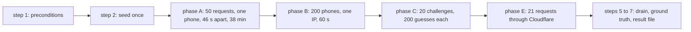

# EXP-09: The OTP limits bound SMS cost per phone and per IP, and no guess succeeds in five attempts

> Status: **Approved** (Owner, 2026-10-21, as the first version (run in P1-23)) · Updated: 2026-10-21 (DR-68: the run needs no real provider; earlier: P0-32; DR-171 decided) · DOC-98 / EXP-09
> Depends on: [common protocol](README.md) (DOC-89, not written yet), original SDD §7.3, §20.2, [DR](../../00-decision-register.md) (DR-37, 64, 77, 78, 80, 134, 152, DR-68), [DOC-26](../../06-design/identity-and-sessions.md) §5, §6, §10, [DOC-39](../../06-design/security.md) §5.3, §6, §11.4, [DOC-40](../../06-design/observability.md) §4.3, [DOC-88](../test-strategy.md) §12, [DOC-16](../../05-data/identity-and-residency-model.md) §4.3, §4.6
> Main readers: P1-11 (the code under test), P1-23 (the run); the evaluation of NFR-07

This experiment shows, on the staging host, that a hostile caller cannot make the system send more SMS than the bucket arithmetic allows, from one phone or from one IP, and cannot guess a code in the five attempts a challenge gives. It does not test the daily cap of 3,000 (AU-25 does, with a fake clock; sending 3,000 challenges on staging proves nothing more), SMS delivery to a real handset (P1-22), or the sign-in itself (AU-20…30, FI-).

**Until DOC-89 exists.** The common protocol (machine, runs, statistics, result files) is DOC-89, written in P2. For this run DR-78 and §6 of this document hold it: staging host of DR-06, five runs, min, median and max, every run must satisfy the correctness criteria, result files as in DOC-88 §12.

## 1. Hypothesis

| ID | Statement | Source | Measured by |
| --- | --- | --- | --- |
| H1 | One registered phone, asked for a code again and again, gets at most **5 SMS in the first 10 minutes** | NFR-07, original SDD §7.3, DR-37 | C1 |
| H2 | One IP asking for 200 different registered phones in one minute causes at most **20 challenges**; every other request is refused before it reads the account | NFR-07, DR-134 step 1 | C3, C4 |
| H3 | An attacker holding a challenge makes at most **5 counted attempts** and **0 guesses succeed**, even with 200 parallel guesses | NFR-07, DR-37 | C6 |
| H4 | The three ways to count an SMS agree: the answers the caller saw, the rows of `identity.otp_challenge`, and the metrics | DOC-26 §10 | C7 |
| H5 | No SMS reaches a real handset during the run (cost bound) | DR-37, DR-68 | C8 |
| H6 | **NFR-07 is a burst, not a sliding hour (DR-171).** The limiter is a token bucket (capacity 5 per phone, refill 5 per hour). It bounds a **burst**, not a sliding hour: 50 requests spread over 38 minutes yield **8** SMS, over an hour **9 or 10** | DOC-16 §4.6, DR-171 | C2 |

H6 is a prediction made before the run, from the arithmetic of §6.1. NFR-07 is worded as the bucket behaves (DR-171, decided by the Owner 2026-10-20): a burst of 5 per phone, then 5 per hour, at most 10 in any hour. The run still reports the count of a sliding 5-per-hour reading, for information only.

## 2. Variables

| Kind | Variable | Values |
| --- | --- | --- |
| Independent | Phone | one registered phone per run (phase A) |
| Independent | Request spacing for one phone | 46 s (the first instant the resend gate of 45 s lets a request through) |
| Independent | Requests per run | A: 50 for one phone; B: 200 for 200 phones; C: 200 guesses on each of 20 challenges |
| Independent | Source IP | a distinct documentation address per phase and run, sent as `CF-Connecting-IP` (§4), plus one real path through Cloudflare (phase E) |
| Dependent | SMS commands per phone, challenges per IP, counted attempts per challenge, successful guesses | §6 |
| Controlled | `OTP_PER_PHONE_PER_HOUR=5`, `OTP_PER_IP_PER_HOUR=20`, `OTP_TTL_SECONDS=300`, `OTP_RESEND_AFTER_SECONDS=45`, `OTP_MAX_ATTEMPTS=5`, `OTP_DAILY_CAP=3000`, `SMS_DRIVER=allowlist` with an allow-list that holds none of the test phones | DOC-41 §8, §9; checked in step 1 of §5 |
| Controlled | Test phones | the reserved block `+84 90 000 xxxx`; never a real subscriber's number is on the allow-list |

## 3. Baseline

Two baselines, because the question is whether the harness can see a failure.

| Baseline | What it is | What it proves |
| --- | --- | --- |
| B1: the limiter switched off | The same harness against `APP_ENV=local` with `OTP_PER_PHONE_PER_HOUR=1000`, `OTP_PER_IP_PER_HOUR=1000`, one run on a developer machine (the keys exist for this reason, DOC-26 §5.1) | The harness counts **48 SMS for the phone** (every 46-s request is issued) and **200 challenges for the IP**, so a broken limiter is detected |
| B2: guessing without the attempt cap | Not run. The database caps `attempts` at 5 (`CHECK (attempts BETWEEN 0 AND 5)`, DOC-16 §4.3), so a baseline cannot be built without changing the schema. The expected number of successes of a 5-guess attacker on 20 challenges is `20 × 5 / 10⁶ = 1 × 10⁻⁴` | The probability bound that C6 is compared with |

A positive control and a negative control run in every run (C9), so that "0 successful guesses" cannot come from a harness that cannot see a 200.

## 4. Environment

| Item | Value |
| --- | --- |
| Host | The staging VPS of DR-06 (2 vCPU, 4 GB, 60 GB; Ubuntu 26.04.1), API ×1 and worker, native PostgreSQL 18.6, monitoring running |
| Software | Commit recorded in every result file; Bun 1.4.3 (`oven/bun:1.4.3`), PostgreSQL 18.6, Prometheus 3.15.0 (DOC-11) |
| Where the harness runs | **On the staging host**, in a one-shot container on the compose network, so that it can send `CF-Connecting-IP` to Caddy as Cloudflare would. Caddy and the API trust the private Docker range (DOC-39 §5.3), so the harness chooses the client address of each request. Phase E is the one exception: it runs from the operator's machine through Cloudflare |
| Ground truth | Read-only `SELECT` on `identity.otp_challenge` and `identity.outbox_messages` as `rms_app` (the secret file `DATABASE_URL` mounted read-only into the container); metrics from the Prometheus of the host |
| Data | Test accounts `EXP-09 test NNN` (below), created through `POST /staff/residents` (E-64) as `helper` members of unit `A-1509` of the sample building |
| Time | The windows of the analysis use `created_at` of the database (the server clock), never the harness clock |

Test accounts (created once by `exp:09 seed`):

| Group | Phones | Count | Used by |
| --- | --- | --- | --- |
| A | `+84900000001` … `+84900000005` | 5 | phase A, one per run |
| B | `+84900001001` … `+84900001200` | 200 | phase B, every run |
| C | `+84900002001` … `+84900002020` | 20 | phase C, every run |
| Control | one `is_demo` account of the demo building | 1 | C9 only; **excluded from every count** (its challenge writes no SMS and accepts the fixed code `123456`, DOC-26 §5.3) |

## 5. Steps

One run is about 46 minutes; five runs are about 4 hours, sequential. Phone buckets refill 5 per hour and IP buckets 20 per hour, so each run uses its own phone A, its own source addresses and phones B and C that a run touches once.



1. **Preconditions** (on the staging host, once per session; the run refuses to start when one fails):

   ```bash
   # the source of the commit under test, copied from a checkout over the Tunnel (DOC-70 §6.7):
   #   git archive <commit> | ssh ops@ssh-staging.<domain> 'mkdir -p /opt/rms/src/<commit> && tar -x -C /opt/rms/src/<commit>'
   cd /opt/rms/src/<commit>
   docker exec rms-api-1-1 printenv \
     APP_ENV SMS_DRIVER SMS_ALLOWLIST OTP_PER_PHONE_PER_HOUR OTP_PER_IP_PER_HOUR OTP_DAILY_CAP OTP_MAX_ATTEMPTS
   # expect: staging, allowlist, a list with none of +8490000xxxx, 5, 20, 3000, 5
   docker exec rms-prometheus-1 wget -qO- 'http://localhost:9090/api/v1/query?query=otp_challenges_24h' | jq '.data.result[0].value[1]'
   # expect: below 2500, so the daily cap cannot interfere
   ```

2. **Seed** (once). Creates the 225 test accounts, idempotently (`Idempotency-Key` derived from the phone):

   ```bash
   docker run --rm --network rms -v "$PWD":/repo -w /repo \
     -e EXP_MANAGER_EMAIL -e EXP_MANAGER_PASSWORD_FILE=/run/secrets/exp-manager \
     -v /etc/rms/secrets/exp-manager:/run/secrets/exp-manager:ro \
     oven/bun:1.4.3 bun run exp:09 -- seed --base-url http://caddy/api/v1 --unit A-1509
   ```

   (The network `rms`, the container names `rms-<service>-1` and the secret file names are DOC-70 §3.2, §6.1 and §6.7. `exp-manager` is a file holding the password of a staging Manager made for the run; it is not part of the application's secret inventory and is deleted after P1-23.)

3. **Run k of 5** (phases A, B, C and the controls; about 45 minutes):

   ```bash
   docker run --rm --network rms --add-host host.docker.internal:172.30.0.1 \
     -v "$PWD":/repo -w /repo \
     -v /etc/rms/secrets/db-app-url:/run/secrets/db-app-url:ro -e DATABASE_URL_FILE=/run/secrets/db-app-url \
     oven/bun:1.4.3 bun run exp:09 -- run --run $k --of 5 \
       --base-url http://caddy/api/v1 --prom-url http://prometheus:9090 \
       --out docs/10-testing/experiments/results
   ```

   The harness does, in order:
   - **Phase A.** `POST /auth/otp` (E-09) for phone A_k, 50 times, one every 46 s, each request with its own `CF-Connecting-IP` from `198.51.100.1…50` so that the IP bucket never decides (the phone bucket is what is measured). It records every answer (status, `Retry-After`) and the instant, and sleeps `max(46 s, Retry-After)` only when a 429 carries a longer wait.
   - **Phase B.** From one address `203.0.113.<10+k>`, 200 requests for the 200 phones B in 60 seconds (concurrency 10, spread evenly). The first 20 spend a token, the rest meet an empty bucket at step 1 of DOC-26 §5.1.
   - **Phase C.** For each of the 20 phones C, with its own source address, request a code (202), then send **200 distinct wrong six-digit codes** to `POST /auth/otp/verify` (E-10), 20 in parallel at a time, from the same address. The harness never learns the real code: guesses are drawn uniformly without replacement from `000000…999999`, and any 200 answer is a success.
   - **Controls (C9).** The demo account asks for a code and verifies `123456` (expect 200). One non-demo account of group A asks for a code and verifies `123456` (expect 400 `otp_invalid`).

4. **Phase E** (from the operator's machine, through Cloudflare, once per run, 45 s):

   ```bash
   bun run exp:09 -- edge --run $k --base-url https://api-staging.<domain>/api/v1
   ```

   21 requests for 21 **unregistered** phones, one every 2 s (404 each: no challenge, no SMS). The 21st must be 429 from the API (`X-Request-Id` present, body `rate_limited`): the IP rule through the real edge, and a spent token for a request that found no account (DOC-26 §5.1 step 1). A 429 that carries `cf-ray` and no `X-Request-Id` came from the Cloudflare rule: the case is `inconclusive` and is repeated at 1 request per 5 s (the rule's numbers are DOC-70's).

**IPv6 case** (inside step 3, as phase B2): 21 requests for unregistered phones from 21 addresses of one `/64` (`2001:db8:1:2:<random 64 bits>`), sent as `CF-Connecting-IP`. The 21st is 429 (DOC-39 §5.3 rule 5, SC-18).

   **Phase F (the final run of P6-08 only, DOC-39 §13 row 6).** 2,500 requests in 10 minutes from random addresses of one `/64` over 6 registered phones (group A of that run, phones 1 to 5 plus one of group C). The bucket key is the `/64`, so the model allows 20 + 3 = 23 grants for the whole prefix and at most 5 per phone; the alert `OtpDailyCapReached` does not fire (23 challenges, far below 3,000) and `rate_limited_total{scope="otp_ip"}` rises by about 2,477.

5. **Wait for the outbox to drain** (the harness polls `sum(sms_sent_total)` until it has not changed for 30 s, at most 5 minutes): the SMS commands of a run are handled by the worker after the requests.

6. **Ground truth.** The harness runs the statements of §6.2 with the window `[started_at, finished_at + 120 s]` taken from the database clock, and the metric queries of §6.3.

7. **Result.** One file per run (`EXP-09-<utc>-run<k>.json`); after run 5, `bun run exp:09 -- summary` writes `EXP-09-<utc>-summary.json` and prints the table of §9.

**Baseline B1** (once, on a developer machine, `APP_ENV=local`, the keys of §3 set to 1000): `bun run dev` in one terminal, then `bun run exp:09 -- run --run 0 --of 0 --baseline --base-url http://localhost:3000/api/v1`. It writes `EXP-09-baseline.json`.

## 6. Metrics and formulas

### 6.1 The model (what the bucket allows)

The acquire statement is the single upsert of DOC-16 §4.6: capacity `cap`, refill `rate = cap / 3600` per second, a refused request changes nothing. For a phone with `cap = 5` and requests at the instants `t₀ = 0, t₁, …`:

```
tokens(first)  = cap − 1
tokens(tᵢ)     = min(cap, tokens(last grant) + (tᵢ − last grant) × rate) − 1     if that value before "− 1" is ≥ 1
refused        otherwise (tokens and the last grant instant unchanged)
```

`bucketModel(spacing, n, cap, perHour)` in `apps/api/tests/exp/model.ts` evaluates this. Results the run is compared with (computed, not measured):

| Case | Grants (SMS commands) |
| --- | --- |
| Phone, 50 requests 46 s apart (span 37.6 min) | **8**, at 0, 46, 92, 138, 184, 736, 1,472, 2,162 s; **5** within the first 600 s |
| Phone, 50 requests 72 s apart (span 58.8 min) | **9**; 5 within the first 600 s |
| Phone, 50 requests evenly over exactly 60 min | **10** |
| IP, 200 requests in 60 s | **20** (capacity 20 plus 0.33 refilled; the 21st grant needs 180 s) |
| IP, 200 requests in 600 s | **23** |

So the hour-wide bound of a token bucket is `cap + rate × 3600 = 2 × cap`: 10 per phone and 40 per IP in the worst hour (a burst, then a full refill during the same hour).

The resend gate (45 s) is separate: a request inside it is refused with 429 and **spends no phone token** (step 3 of DOC-26 §5.1), but it does spend an IP token (step 1). Phase A avoids that by rotating IPs.

### 6.2 Ground truth (SQL, read-only)

```sql
-- SMS commands requested per phone (one challenge = one SMS command for a non-demo account)
SELECT phone, count(*) AS challenges, min(created_at) AS first_at, max(created_at) AS last_at
  FROM identity.otp_challenge
 WHERE phone = ANY(:phones) AND created_at >= :from AND created_at < :to
 GROUP BY phone;

-- the same count per instant, for max-in-any-window (the script slides a 10-min and a 60-min window over created_at)
SELECT created_at FROM identity.otp_challenge WHERE phone = :phone AND created_at >= :from AND created_at < :to ORDER BY created_at;

-- challenges per IP (the stored ip is the full address)
SELECT ip, count(*) FROM identity.otp_challenge
 WHERE created_at >= :from AND created_at < :to AND ip = ANY(:ips) GROUP BY ip;

-- attempts per challenge (the column is capped at 5 by a CHECK)
SELECT id, attempts, consumed_at IS NOT NULL AS consumed
  FROM identity.otp_challenge WHERE phone = ANY(:phones_c) AND created_at >= :from AND created_at < :to;

-- SMS commands in the outbox for the same accounts (cross-check of the count above)
SELECT count(*) FROM identity.outbox_messages m
  JOIN identity.resident_account a ON a.id = (m.payload->>'accountId')::uuid
 WHERE m.type = 'identity.sms_requested.v1' AND a.phone = ANY(:phones) AND m.occurred_at >= :from AND m.occurred_at < :to;
```

### 6.3 Metrics (Prometheus, deltas over the same window)

| Query | Meaning |
| --- | --- |
| `sum(increase(auth_otp_requested_total{outcome="issued"}[W]))` | challenges issued |
| `sum by (outcome) (increase(auth_otp_requested_total[W]))` | every other outcome: `resend_wait`, `phone_limited`, `ip_limited`, `not_registered` |
| `sum by (outcome) (increase(sms_sent_total[W]))` | `not_allowlisted` (would have been sent), `sent` (really sent), `failed`, `expired`, `skipped_demo` |
| `sum by (outcome) (increase(auth_otp_verify_total[W]))` | `ok`, `invalid`, `expired`, `exhausted` |
| `sum by (scope) (increase(rate_limited_total[W]))` | `otp_ip`, `otp_phone` |
| `max_over_time(otp_challenges_24h[W])` | the daily cap gauge |

`W` is the window of the run. Counters are read before and after (a restart of the API between them voids the run).

### 6.4 Formulas

| Name | Definition |
| --- | --- |
| `smsPerPhone(p, w)` | rows of §6.2 for phone `p` inside a window of length `w` that slides over the run; reported as the **maximum** over all window positions |
| `max10(p)`, `max60(p)` | `smsPerPhone(p, 10 min)`, `smsPerPhone(p, 60 min)` |
| `challengesPerIp(ip)` | count of rows of §6.2 with that `ip` in the 60-second phase B window |
| `successfulGuesses` | answers `200` to `POST /auth/otp/verify` among the guesses of phase C (controls excluded) |
| `countedAttempts(c)` | `attempts` of challenge `c` in the database after phase C |
| `sentReal` | `increase(sms_sent_total{outcome="sent"})` over the run |
| `agree` | `|answers 202 − rows − issued delta| = 0` and `|rows − (sms_sent_total not_allowlisted + sent + failed + expired)| = 0` |

## 7. Pass criteria

Correctness criteria hold in **every** one of the 5 runs (DR-78). There is no latency criterion; the `p95` of `POST /auth/otp` is reported next to NFR-03's 300 ms as information.

| ID | Criterion | Source | Expected |
| --- | --- | --- | --- |
| C1 | `max10(A_k) ≤ 5` | NFR-07 as burst | 5 |
| C2 | `SMS in the 50-request run == bucketModel` (8 at 46 s) and `max60(A_k) ≤ 10`; `max60 ≤ 5` is **reported** for information (not a criterion since DR-171) | H6, DR-171 | 8; ≤ 10 |
| C3 | `challengesPerIp ≤ 20` in phase B, and every request after the 20th is 429 | NFR-07, DR-134 | exactly 20 issued, 180 refused |
| C4 | The 21st request of phase E and of the `/64` case is 429 from the API | DR-134 step 1, DR-152 | 21st = 429 |
| C5 | A refused request creates no challenge and no SMS command | DOC-26 §5.1 | rows = 202 count |
| C6 | `successfulGuesses = 0`; `max(countedAttempts) ≤ 5`; `auth_otp_verify_total{ok}` delta = 0 (controls excluded) | NFR-07, DR-37 | 0; 5; 0 |
| C7 | `agree` holds | DOC-26 §10 | 0 difference |
| C8 | `sentReal = 0` | DR-37, DR-68 | 0 |
| C9 | Positive control 200, negative control 400 `otp_invalid` | DOC-26 §5.3, AU-26 | as stated |
| C10 | `otp_challenges_24h` stayed below 3,000 and `otp_daily_cap_reached_total` did not rise | DR-37 | true |
| C11 | Phase F (final run only): challenges for the `/64` ≤ 23, per phone ≤ 5, `otp_ip` refusals ≥ 2,400 | DOC-39 §13 row 6, DR-152 | 23; 5; about 2,477 |

The experiment **passes** when C1, C3 to C10 (and C11 in the final run) hold in all 5 runs and C2 holds in its two measurable parts; the sliding 5-per-hour count is a separate line in the report, for information (DR-171). It **fails** when any criterion fails in any run; a failing run is not repeated away: the code is fixed and all five runs are redone.

## 8. Analysis

- `bun run exp:09 -- summary` reads the five run files and writes the summary: per criterion the min, median and max of the observed value, and `pass` only when every run passes.
- It also writes `EXP-09-<utc>-timeline.svg`: cumulative SMS commands of each run's phone A against the model, so a limiter that drifts from the arithmetic shows as a visible gap.
- The script `apps/api/tests/exp/analyze.ts` has a unit test over the model values of §6.1 (`bun test`), so the arithmetic that the verdict relies on is itself tested.
- The report quotes the files: `docs/10-testing/experiments/results/EXP-09-*.json`.

## 9. Result table template

Observed values are filled by the summary; empty until the run.

| Criterion | Expected | Run 1 | Run 2 | Run 3 | Run 4 | Run 5 | Min | Median | Max | Pass |
| --- | --- | --- | --- | --- | --- | --- | --- | --- | --- | --- |
| C1 `max10(A)` | ≤ 5 | | | | | | | | | |
| C2 SMS in 50 requests (model 8) | = model | | | | | | | | | |
| C2 `max60(A)` | ≤ 10 (sliding ≤ 5 reported for information) | | | | | | | | | |
| C3 challenges for the IP | 20 | | | | | | | | | |
| C3 refused after the 20th | 180 | | | | | | | | | |
| C4 21st request, edge and `/64` | 429 | | | | | | | | | |
| C5 rows − 202 count | 0 | | | | | | | | | |
| C6 successful guesses | 0 | | | | | | | | | |
| C6 max counted attempts | ≤ 5 | | | | | | | | | |
| C6 `ok` delta | 0 | | | | | | | | | |
| C7 disagreement | 0 | | | | | | | | | |
| C8 real SMS sent | 0 | | | | | | | | | |
| C9 controls | 200 / 400 | | | | | | | | | |
| C10 daily cap untouched | true | | | | | | | | | |
| C11 phase F (final run only) | ≤ 23 for the `/64` | | | | | | | | | |
| `POST /auth/otp` p95 (information) | ≤ 300 ms | | | | | | | | | |

Result file (one per run; the envelope is DOC-88 §12, `metrics` is this document's):

```json
{
  "experiment": "EXP-09", "run": 1, "of": 5, "commit": null,
  "startedAt": null, "finishedAt": null,
  "machine": { "host": "staging", "cpu": "2 vCPU", "ramGb": 4, "os": "Ubuntu 26.04.1" },
  "runtime": { "bun": "1.4.3", "postgres": "18.6", "api": null },
  "metrics": {
    "phoneA": { "phone": "+84900000001", "requests": 50, "answers": { "202": null, "429": null }, "smsRows": null, "max10": null, "max60": null, "model": 8 },
    "ipB": { "ip": "203.0.113.11", "requests": 200, "issued": null, "refused429": null },
    "edge": { "request21Status": null, "from": "api" },
    "ipv6": { "request21Status": null },
    "guesses": { "challenges": 20, "sent": 4000, "successful": null, "maxAttempts": null, "verifyOkDelta": null },
    "counts": { "answers202": null, "rows": null, "issuedDelta": null, "smsSentDelta": { "not_allowlisted": null, "sent": null, "failed": null, "expired": null } },
    "controls": { "demoFixedCode": null, "nonDemoFixedCode": null },
    "daily": { "max24h": null, "capReachedDelta": null },
    "phaseF": { "requests": 2500, "prefixChallenges": null, "maxPerPhone": null, "otpIpRefusals": null },
    "latency": { "otpRequestP95Ms": null }
  },
  "criteria": [ { "id": "C1", "expected": "≤ 5", "observed": null, "pass": null } ],
  "pass": null
}
```

## 10. Threats to validity

| Threat | Effect | Handling |
| --- | --- | --- |
| The harness sets `CF-Connecting-IP` itself | It is not the real edge | Only a peer inside the trusted range is believed (DOC-39 §5.3), which the Docker network is; phase E and SC-18 go through the real edge or the real function. A deployment that trusted the header from outside would show in SC-17 |
| Shared addresses behind Cloudflare | Many residents behind one building Wi-Fi share an IP | Not tested here; DOC-26 §5.1 and DOC-103 handle it (`OTP_PER_IP_PER_HOUR` raised for launch week) |
| Clock | The harness clock and the server clock differ | All windows use `created_at` of the database; the harness clock paces requests only |
| The Cloudflare rule on `/api/v1/auth/*` answers first | A 429 that is not the API's | Phase E tells the two apart by `X-Request-Id`; the Docker-network phases never meet the rule |
| Bucket arithmetic vs wall time | The 46-s spacing drifts by network latency | Spacing is measured from the previous answer; the model is evaluated on the **observed** instants from the database, not on the nominal ones |
| A metric label means something else | `exhausted` versus `invalid` | C6 relies on the database `attempts` and the `200` count first; the metrics are the cross-check (C7). The meaning of the labels is read from the code in P1-23 and written in §11 |
| 5 runs share phones B and C | Earlier runs change bucket state | Each run uses a new IP and a different phone A; B and C phones are touched once per run and their phone buckets hold at least 4 tokens (one spent) |
| Real SMS cost | A misconfigured allow-list sends 225 messages | Step 1 refuses to start unless the allow-list excludes the test block; C8 checks `sent = 0` |
| The fixed demo code | Passing `123456` for a demo account looks like a guess success | The demo account is a control, outside every count (C9) |
| Brute force probability | 0 successes is also the likely outcome of a broken verifier | The positive control (C9) shows the harness reads a 200; the arithmetic of B2 shows 1 × 10⁻⁴ expected successes |
| A pass proves the limits, not the SMS provider | A provider could still bill for a refused message | Refused requests write no command (C5); provider billing is checked in P1-22 |

## 11. Results

Not run. The run is P1-23 (after P1-11 and P1-20). It needs no real provider: `SMS_DRIVER=allowlist` with an allow-list that holds none of the test phones sends nothing, so it can run before the Owner has picked the providers (DR-68, Owner 2026-10-21), and provider billing is checked in P1-22; the results of record are the files under `docs/10-testing/experiments/results/` and the table of §9.

## 12. Open questions

- **DR-171 (decided, Owner, 2026-10-20: option (a)): what "per hour" in NFR-07 means.** *Problem:* NFR-07, the vision table, original SDD §20.2 and AU-24 say "≤ 5 SMS per phone per hour" and "≤ 20 challenges per IP per hour". The limiter of DOC-16 §4.6 and DOC-26 §6 is a token bucket with capacity 5 (20) and refill 5 (20) per hour. It allows 5 at once, then one per 12 minutes: 8 SMS in 37.6 minutes, 9 or 10 in a full hour for a phone, up to 40 per hour for an IP (§6.1). *Options:* (a) keep the bucket and reword the requirement: "a burst of 5 per phone and 20 per IP, then 5 and 20 per hour; at most 10 and 40 in any hour" (worst cost 10 SMS per phone per hour, bounded further by the daily cap of 3,000); (b) replace the token bucket of the OTP families by a **sliding-window count** over `identity.otp_challenge` (`count(*) WHERE phone = :p AND created_at > now() − interval '1 hour'` ≥ 5 refuses), which makes the literal reading true at the cost of one indexed count per request and a second mechanism beside the bucket helper; (c) keep the bucket with capacity 5 and refill 5 per 24 hours (a weaker service for a resident who mistypes). *Recommendation:* (a): the cost bound is acceptable (a phone cannot cost more than 10 SMS an hour, 3,000 a day for the whole building) and the bucket is already specified, tested (AU-24) and shared with the other limits. *Consequences if (a):* NFR-07 and the vision table change wording, AU-24 is written with the burst reading (requests 46 s apart with a fake clock give 8 in 37.6 minutes), C2 here is the pass criterion as written. *If (b):* the bucket helper is not used for `otp:phone`, DOC-26 §6 and DOC-16 §4.6 change, C1 and C2 become "≤ 5 in any 60 minutes". The Owner chose (a) on 2026-10-20; the literal reading no longer applies. *Write to:* DOC-03 NFR-07, DOC-01, DOC-26 §5.1, §6 and AU-24, DOC-16 §4.6, DOC-98.
- **DR-170 (decided, Claude delegated): how the run is made.** *Problem:* a single operator IP cannot test per-IP limits and phone limits independently, and the real SMS provider must not be billed. *Decision:* the harness runs inside the compose network of the staging host and sets `CF-Connecting-IP` per request (the same function the edge feeds); the test accounts are created through E-64 as helpers of unit `A-1509`, in the reserved phone block `+84 90 000 xxxx`, none on `SMS_ALLOWLIST`; ground truth is read with `SELECT` as `rms_app`; phase E and SC-18 cover the real edge and the `/64` rule. *Consequences:* DOC-70 names the compose network, the Prometheus address and the secret file path; the `exp:09` script needs a `seed`, `run`, `edge`, `summary` and `baseline` mode; the 225 test accounts remain on staging, inert. *Write to:* DOC-98, DOC-70, DOC-69.
- **The resend gate and the IP bucket.** Phase A rotates the source IP so that the phone bucket, not the IP bucket, decides. If the Owner prefers a run from one real IP, the 50 requests would meet the IP limit after about 27 requests (20 tokens plus 12 refilled over 37 minutes); this is a property of the design, not a defect, and is listed here so nobody mistakes it for one.
- **`details.scope` of the 429.** The E-09 example shows `"scope": "otp"`, while DOC-39 §6 and DOC-40 name the scopes `otp_ip` and `otp_phone`. The harness classifies refusals with `rate_limited_total{scope}` and `auth_otp_requested_total{outcome}`, not with the body; DOC-51 E-09 is to be aligned.
