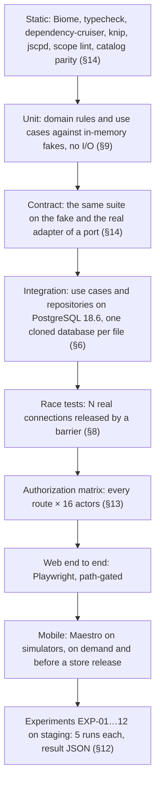
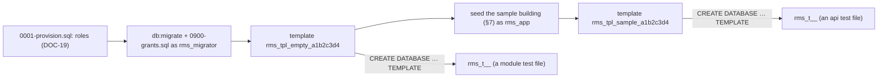

# Test strategy

> Status: **Approved** (Owner, 2026-10-21) · Updated: 2026-10-28 (P1-26: `NT-` written in DOC-31, `PD-` in DOC-34, new prefix `SE-` in DOC-52, `OPM-100…152`; P1-25: `IN-` written in DOC-23, `FF-` in DOC-44; DR-279: prefix `UA-`) · 2026-10-27 (DR-277: a change of documents only skips the code stages, §11) · 2026-10-22 (DOC-15: prefix `FNM-` in §15; P1-19: §10 mechanism measured, §11 stages as built; DR-238…240; earlier: DR-226: IM-01…43, UIWR-01…42, 169 routes; earlier: DR-195: screen and client prefixes in §15; earlier P0-32; DR-169, DR-163 stage names merged) · DOC-88
> Depends on: original SDD §20, §19.5, [DR](../00-decision-register.md) (DR-08, 26, 76, 77, 78, 80, 82, 95, 151, 156, DR-226), [DOC-06](../02-glossary.md), [DOC-07](../03-architecture/system-context-and-containers.md) §4, [DOC-11](../03-architecture/tech-stack-and-versions.md) §1, §8, §9, [DOC-12](../03-architecture/code-architecture.md) §2, §5.3, §6, [DOC-19](../05-data/db-roles-and-grants.md) §9, [DOC-39](../06-design/security.md) §4, §16, [DOC-41](../06-design/configuration-reference.md) §19, [DOC-71](../09-operations/ci-cd.md)
> Main readers: P1-01, P1-03, P1-04, P1-15, P1-19 and every task that writes a test; [DOC-71](../09-operations/ci-cd.md) (stages), [DOC-89](experiments/README.md) (experiment protocol), DOC-90…101

This document says how the system is tested: the levels and what each proves, the tools, how a test database is made, how a race is run, which fakes exist, what CI runs at each stage and which tests wait for a schedule or a person. It also holds the **index of every test-ID prefix** (§15) and the pointers to the authorization-matrix generator (§13). It does not hold the tests themselves: each design document owns its "Required tests" table, and each experiment has its own file (DOC-90…101). It does not define the CI jobs: those are DOC-71, which uses the stage names of §11.

## 1. Purpose and scope

| Item | Where |
| --- | --- |
| The pyramid and what each level proves | §2 |
| Module × level matrix | §3 |
| Tools, versions, commands | §4 |
| Naming, file layout, rules | §5 |
| Fixtures and the template database | §6 |
| Sample building and builders | §7 |
| Race harness | §8 |
| Fakes | §9 |
| Coverage (warnings only) | §10 |
| Stage → test mapping, schedules, on-demand runs | §11 |
| Experiments and result files | §12 |
| The authorization-matrix generator | §13 |
| Contract, architecture and catalog checks | §14 |
| Index of test-ID prefixes and how to add one | §15, §16 |
| Decisions made while writing | §17 |

Principle (original SDD §20): correctness of money and access is proved by tests that run the real SQL on a real PostgreSQL under concurrency and compare against a deliberately naive baseline; everything else is ordinary unit, integration and end-to-end testing. A task is Done only with its tests (master plan §7.2): a **race test with a barrier for every new conditional update** and a **run-twice test for every money or notification mutation**.

## 2. The pyramid



| Level | What it proves | Tool | Files live in | Planned cost |
| --- | --- | --- | --- | --- |
| Static | Layer and module boundaries, no unused code, no duplication, every business query scoped, `vi`/`en` parity | Biome, dependency-cruiser, knip, jscpd, a scope lint, the catalog parity test | whole repository | ≤ 90 s |
| Unit | State machines, policy table, amounts, token and QR encoding, signature check, use cases with fake ports | `bun test` | `src/**/*.test.ts` next to the code | whole suite ≤ 60 s |
| Contract | A port behaves the same on the fake and on the real adapter (S3, SMTP, Expo, SMS, gateway) | `bun test` | `modules/<m>/test/contract/*.contract.test.ts`, `packages/core-testing` | ≤ 2 min |
| Integration | Statements, constraints, conditional updates, transactions, outbox, grants, DDL, the HTTP app without a listener | `bun test` on PostgreSQL 18.6 | `modules/<m>/test/*.int.test.ts`, `apps/api/test/*.int.test.ts` | ≤ 6 min, about 100 ms to clone a database (DOC-39 §4.5) |
| Race | Exactly one winner, no deadlock, no half effect under N parallel sessions | `bun test` and the harness of §8 | `modules/<m>/test/race/*.race.test.ts`, `apps/api/test/race/` | CI profile ≤ 90 s; nightly profile ≤ 20 min |
| Authorization | 0 unexpected 2xx and 0 unexpected refusals on every route | generated, `bun test` | `apps/api/test/authz/` | ≤ 3 min for 169 routes |
| Web end to end | The CMS flows: import and publish a batch, record a payment, assign a ticket | Playwright 1.64.1 | `apps/cms-web/e2e/` | ≤ 6 min, one worker |
| Mobile | Critical resident and staff flows on simulators | Maestro 2.11.0 | `apps/resident-app/.maestro/`, `apps/staff-app/.maestro/` | on demand |
| Load | Mixed traffic, payment burst, fan-out | k6 2.3.0 | `apps/api/test/load/` | EXP-07, on demand |
| Experiments | The twelve claims of original SDD §20.2 | scripts in `apps/api/test/exp/` | DOC-90…101 | per experiment |

"Planned cost" is a design target, not a measurement; P1-19 measures the whole pipeline against the 12-minute limit (master plan P1-19) and records the numbers in DOC-71.

## 3. Module × level matrix

● required for the module · ○ where the module has the thing · — not applicable. The cell names the prefix that holds the tests; a prefix not written yet is in italics in §15.

| Module or package | Unit | Contract | Integration | Race | Authz matrix | Web e2e | Mobile | Experiments |
| --- | --- | --- | --- | --- | --- | --- | --- | --- |
| `identity` | ● `AU-` | ● SMS and mail senders (`AU-28`) | ● `AU-`, `IDM-` | ● `AU-23`, refresh, step-up | ● | ● `FI-` | ● OTP, staff login | EXP-09 |
| `building` | ● `BD-` | ● S3 (`FS-`) | ● `BD-`, `FS-`, `OPM-` | ○ settings `version` | ● | ● settings, gateway, terms | — | — |
| `residency` | ● `RM-` | — | ● `RM-`, `IM-` | ● owner transfer, invitation cap | ● (the policy table is matrix input) | ● units, import | ● unit switch | — |
| `finance` | ● *`LG-`* | ● payOS adapter *`PX-`* | ● *`LG-`, `IN-`, `ST-`* | ● every conditional update | ● | ● *`FF-`, `FO-`* | ● fees, payment | EXP-01…04, 11 |
| `tickets` | ● *`TK-`* | — | ● *`TK-`* | ● assignment | ● internal notes | ● | ● | — |
| `access` | ● *`QC-`* | — | ● *`QC-`* | ● credential version | ● | — | ● guard scan | EXP-05 |
| `vehicles` | ● *`VH-`* | — | ● *`VH-`* | ○ review | ● | ● | ● | — |
| `notices` | ● *`NT-`* | — | ● *`NT-`* | ● fan-out claim | ● | ● | ● | EXP-06 |
| `notification` | ● `NT-` | ● Expo push against a fake endpoint | ● `NT-` | ○ receipt job | ● | — | ● push token | EXP-06 |
| `wiki` | ● *`WK-`* | — | ● *`WK-`* | — | ● visibility | ● | ● | — |
| `audit` | ● `AD-` | — | ● `AD-` (trigger, grants) | ○ | ● | ● | — | — |
| `reporting` | ● *`RP-`*, `PD-` | — | ● *`RP-`* | ○ export concurrency | ● | ● | — | EXP-08 |
| `realtime` | ● `SE-` | — | ● `SE-` (SSE over `app.handle`) | — | ● | ● | — | — |
| `@core/*` packages | ● their own suites | ● `MC-` and the port suites | ● `MC-`, `JB-` | ● outbox claim | — | — | — | — |
| `apps/api` | ● | — | ● `AG-`, `ER-`, `CF-`, `SC-`, `OB-`, `JB-` | ● `apps/api/test/race` | ● | — | — | EXP-07, 10, 12 |
| `apps/cms-web` | ● catalog parity, money format | — | — | — | — | ● Playwright | — | — |
| `apps/resident-app`, `apps/staff-app`, `@rms/mobile-core` | ● logic packages | — | — | — | — | — | ● Maestro | — |
| Database (DDL, grants, retention) | — | — | ● `IDM-`, `OPM-`, `GRT-`, `DLC-` | — | — | — | — | EXP-11, 12 |

## 4. Tools, versions, commands

Versions are pinned in DOC-11 §8 and §9 (exact pins, DR-95); this table repeats them so a reader sees the toolbox in one place.

| Tool | Version | Used for |
| --- | --- | --- |
| `bun test` | part of Bun 1.4.3 | Unit, contract, integration, race, authorization, experiment scripts |
| PostgreSQL image | `postgres:18.6` | Local compose database and the CI service container (DR-08, DR-77) |
| `@playwright/test` | 1.64.1 | Web end to end |
| Maestro CLI | 2.11.0 | Mobile flows |
| k6 | 2.3.0 | EXP-07 and the payment-burst profile |
| Mailpit | v1.31.6 | Reads mail sent by `nodemailer` in `local` and in web end-to-end runs |
| Local S3-compatible store | chosen and pinned by P1-03 | Presigned `PUT`, `HEAD`, `DELETE` in integration tests (`FS-`) |

**Commands.** These are the test-related root scripts; DOC-69 §5 lists every root script and owns the full table. `test:grants`, `test:mobile`, `test:load`, `test:db-clean` and `check:test-ids` are added by this document and are owed to DOC-69 §5.

| Command | Runs | Needs |
| --- | --- | --- |
| `bun run test` | the unit tests of every workspace: every `*.test.ts` that is not `*.int`, `*.race`, `*.authz` or a contract test with a real adapter (DOC-69 §5) | nothing |
| `bun run test:integration` | `*.int.test.ts`, `*.contract.test.ts` with real adapters, `apps/api/test/authz` | `bun run infra:up` |
| `bun run test:race` | `*.race.test.ts` with `TEST_RACE_PROFILE=ci` (override with the variable) | `bun run infra:up` |
| `bun run test:authz` | the authorization-matrix generator and its mutation checks (§13) | `bun run infra:up` |
| `bun run test:grants` | `apps/api/tests/grants/` (DOC-19 §9) on clones of the migrated template | `bun run infra:up` |
| `bun run test:e2e` | Playwright against `bun run dev` | `bun run infra:up` |
| `bun run test:mobile` | Maestro flows against a development build | a simulator |
| `bun run test:load` | k6 profile named by `--profile` | the staging host |
| `bun run check` | the `verify` checks in one go: `lint`, `typecheck`, `check:arch`, `check:scope`, `check:audit`, `check:layout`, `check:i18n` (DOC-69 §5) | nothing |
| `bun run check:test-ids` | compares the IDs of every "Required tests" table with the test titles (§5, DR-169) | nothing |
| `bun run exp:01` … `bun run exp:12` | the script of the experiment (§12) | per experiment |

## 5. Naming, layout and rules

**Files.**

| Suffix | Level | Example |
| --- | --- | --- |
| `*.test.ts` | unit | `modules/identity/src/domain/otp.test.ts` |
| `*.contract.test.ts` | contract | `modules/building/test/contract/storage.contract.test.ts` |
| `*.int.test.ts` | integration | `modules/identity/test/otp.int.test.ts` |
| `*.race.test.ts` | race | `modules/finance/test/race/allocate.race.test.ts` |
| `*.authz.test.ts` | authorization | `apps/api/tests/authz/matrix.authz.test.ts` |
| `*.spec.ts` | Playwright | `apps/cms-web/e2e/fee-batch.spec.ts` |
| `*.yaml` | Maestro | `apps/resident-app/.maestro/otp-sign-in.yaml` |
| `exp<NN>-<name>.ts` | experiment script | `apps/api/test/exp/exp09-otp-abuse.ts` |

**Test titles start with the ID** of the document's "Required tests" table, then the scenario in the document's words, so that `grep "AU-22"` finds the test and the document row:

```ts
test('AU-22 five wrong codes: attemptsLeft 4, 3, 2, 1, 0, then the right code is refused', async () => { … })
```

A statement test of a document has the infix `S` (`AU-S04`, `IDM-S14`, `OPM-S06`): it runs one SQL statement of the document against the real DDL. A test the document marks **(race)** lives in a `*.race.test.ts` file; one marked **(S)** has its SQL run in the document's "statements run" section.

**Rules.**

1. One ID, one test. A scenario with several cases uses one `test.each`-style loop under one ID, and the loop names each case in the failure message.
2. A test never depends on another test of the file; a file owns one cloned database (§6) and may keep state only inside a `describe` with its own `beforeEach` reset.
3. No `sleep`. Time comes from `FakeClock` (§9); asynchronous effects are awaited with `eventually(fn, { timeoutMs })` of `@rms/test-support`, which polls and fails with the last value.
4. `test.skip` and `test.todo` carry the issue or task they wait for: `test.todo('LG-14 … (P2-07)')`. A `skip` without a task fails review.
5. No retries of a failing integration or race test. A flaky test is a bug in the test or the code; it is fixed or deleted, not retried. Playwright keeps 2 retries on CI and 0 locally, as the reference does; a test that passes only on retry is reported by `check:test-ids` as `flaky`.
6. Every test of a document runs against the **real** SQL of that document; a fake repository is for unit tests of use cases only.
7. A regression gets a reproducing test before the fix (master plan §7.2).
8. `bun run check:test-ids` reads the index of §15 (the first backticked word of the first column is the prefix, as CF-01 does for DOC-41), reads each listed document's rows `| XX-nn |`, scans test titles, and prints a table per prefix: IDs in the document without a test, tests whose ID is not in any document. It writes GitHub `::warning` annotations and **never fails the build** (DR-169); the review of `Pn-00` and of each milestone reads it.

## 6. Fixtures and the template database

### 6.1 Why and how (DR-77)

Integration and race tests use the compose PostgreSQL locally (`bun run infra:up`, DOC-69) and a `postgres:18.6` service container in CI. Each test file clones a migrated **template database** (`CREATE DATABASE … TEMPLATE …`), so files are isolated and a clone costs about 100 ms (planned, DOC-39 §4.5) instead of a full migration (seconds).



1. **Provision** once per cluster with `0001-provision.sql` (random passwords in `local` and CI) (DOC-19 §3).
2. **Build the templates** on first use per run, inside one advisory lock so parallel jobs build once: create `rms_tpl_empty_<hash8>`, run `bun run db:migrate` (migrations in catalog order, then the grants step) as `rms_migrator`, mark it `IS_TEMPLATE true`. `rms_tpl_sample_<hash8>` is a clone of the empty one plus the sample building seeded by the builders of §7.
3. **`<hash8>`** is the first 8 hex characters of the SHA-256 of all migration files, `0900-grants.sql`, `0001-provision.sql` and the sample-building seed version constant. A change to any of them changes the name, so a stale template is never reused; old templates are dropped by `bun run test:db-clean` and by the CI job's end.
4. **Clone** per file in `beforeAll`: `CREATE DATABASE rms_t_<pid>_<rand> TEMPLATE <template> OWNER rms_migrator`, serialized with an advisory lock (PostgreSQL refuses a clone while another session is connected to the template, and two clones at once can collide on the template lock; the helper retries on SQLSTATE `55006` up to 5 times with 50 ms back-off). The file connects as **`rms_app`**, the role the application uses (no DDL, no `UPDATE` on the audit table), so a missing grant fails in the test and not in staging. Fixtures that need more power (a corruption for EXP-11, a seed of a denied column) use a second client as `rms_migrator`, opened by the helper's `admin()` method and named as such in the test.
5. **Drop** in `afterAll` (`DROP DATABASE … WITH (FORCE)`); `TEST_KEEP_DB=true` keeps the database of a failing file and prints its name.

The helper's source, `packages/test-support/src/template-db.ts` (DR-169), has this shape:

```ts
import { randomBytes } from 'node:crypto'
import postgres, { type Sql } from 'postgres'

export type TemplateKind = 'empty' | 'sample'
export interface TestDb {
  readonly name: string
  readonly url: string                    // rms_app
  readonly sql: Sql                       // rms_app, max 10 connections
  admin(): Sql                            // rms_migrator, for fixtures that need DDL or the audit table
  connect(max: number): Sql               // N separate connections (race harness)
  drop(): Promise<void>
}

const LOCK = 7_141_988                    // advisory lock key of the template helper

export async function cloneTemplate(kind: TemplateKind = 'empty'): Promise<TestDb> {
  const adminUrl = process.env.TEST_ADMIN_DATABASE_URL ?? defaultAdminUrl()
  const root = postgres(adminUrl, { max: 1, prepare: false, onnotice: () => {} })
  const template = await ensureTemplate(root, kind)            // builds rms_tpl_<kind>_<hash8> once
  const name = `rms_t_${process.pid}_${randomBytes(4).toString('hex')}`
  for (let attempt = 1; ; attempt++) {
    try {
      await root`SELECT pg_advisory_lock(${LOCK})`
      await root.unsafe(`CREATE DATABASE ${name} TEMPLATE ${template} OWNER rms_migrator`)
      break
    } catch (e) {
      if ((e as { code?: string }).code !== '55006' || attempt === 5) throw e
      await Bun.sleep(50)
    } finally {
      await root`SELECT pg_advisory_unlock(${LOCK})`
    }
  }
  const url = withDatabase(process.env.TEST_APP_DATABASE_URL ?? appUrl(adminUrl), name)
  const sql = postgres(url, { max: 10, prepare: false })
  return {
    name, url, sql,
    admin: () => postgres(withDatabase(migratorUrl(adminUrl), name), { max: 2, prepare: false }),
    connect: (max) => postgres(url, { max, prepare: false }),
    async drop() {
      await sql.end({ timeout: 2 })
      if (process.env.TEST_KEEP_DB === 'true') return console.warn(`kept database ${name}`)
      await root.unsafe(`DROP DATABASE IF EXISTS ${name} WITH (FORCE)`)
      await root.end()
    },
  }
}
```

(`ensureTemplate`, `withDatabase`, `appUrl` and `migratorUrl` are small helpers of the same file; P1-04 writes them. `prepare: false` is the project's default, DR-67.)

### 6.2 A test file

```ts
// modules/identity/test/otp.int.test.ts
import { afterAll, beforeAll, beforeEach, describe, expect, test } from 'bun:test'
import { FakeClock } from '@core/testing'
import { cloneTemplate, type TestDb } from '@rms/test-support'
import { buildResidentAccount } from '@mod/identity/testing'
import { createIdentityForTest } from './support'

let db: TestDb
let clock: FakeClock
beforeAll(async () => { db = await cloneTemplate('empty') })
afterAll(async () => { await db.drop() })
beforeEach(async () => {
  await db.sql`TRUNCATE identity.otp_challenge, identity.rate_bucket`
  clock = new FakeClock(new Date('2026-10-20T03:00:00.000Z'))
})

describe('resident OTP', () => {
  test('AU-21 verify at 4 min 59 s works, at 5 min 01 s is otp_invalid; resend at 30 s is 429, at 46 s is accepted', async () => {
    const identity = createIdentityForTest({ sql: db.sql, clock })
    const account = await buildResidentAccount(db.sql, { phone: '+84901234567' })
    const first = await identity.requestOtp({ phone: account.phone, ip: '203.0.113.7' })
    clock.advance(30_000)
    await expect(identity.requestOtp({ phone: account.phone, ip: '203.0.113.7' }))
      .rejects.toMatchObject({ code: 'rate_limited', retryAfter: 15 })
    clock.advance(16_000)
    const second = await identity.requestOtp({ phone: account.phone, ip: '203.0.113.7' })
    expect(second.challengeId).not.toBe(first.challengeId)
  })
})
```

`TRUNCATE` runs as `rms_app` only on tables the test owns; the role has no `TRUNCATE` privilege on ledger tables (DOC-19), so a test that needs to empty one uses `db.admin()`. The test does not truncate the shared sample rows: it uses the `empty` template and its own builders.

### 6.3 Test-only variables

These are read by `@rms/test-support` and by the scripts of this document only. They are **not** application configuration: `loadConfig` never reads them, they are not in DOC-41, and they are not in the production image (DR-169).

| Key | Type | Default | Meaning |
| --- | --- | --- | --- |
| `TEST_ADMIN_DATABASE_URL` | url | the compose database on `localhost:${RMS_PG_PORT}` as the `postgres` user (DOC-69 §6, §7) | Superuser connection that creates and drops databases; in CI the service container's `postgres` user |
| `TEST_APP_DATABASE_URL` | url | derived from the admin URL with the role `rms_app` and the password of `bun run setup` | Role the files connect as |
| `TEST_KEEP_DB` | bool (`true` or `false`) | `false` | Keep the database of a file so a failure can be inspected |
| `TEST_RACE_PROFILE` | enum `ci`, `nightly` | `ci` | Race rounds, §8.3 |
| `TEST_BASE_URL` | url | `http://localhost:3000/api/v1` | Target of `exp:*` scripts and `test:load` when run against a deployed host |

## 7. The sample building and the builders

### 7.1 The fixtures

The tests share one building, the **sample building** of the glossary, so every document's examples and every test mean the same rows. The template `rms_tpl_sample_<hash8>` holds it; the file `apps/api/test/support/sample-building.ts` builds it (it lives in the composition root's tests because it needs the repositories of several modules, which `@rms/*` packages may not import, DOC-12 §2.2).

| Fixture | Rows | Used by |
| --- | --- | --- |
| Building B1 | `is_demo = false`, code `SUNRISE`, time zone `Asia/Ho_Chi_Minh` | every test of `apps/api` |
| Unit U1 `A-1508` | Owner Nguyễn Văn An `+84901234567`; tenant Trần Thị Bình `+84912345678` (`can_pay` on); family member Trần Minh Khoa; helper Lê Thị Mai | the resident actors of DOC-39 §4.2 |
| Unit U2 `A-1509` | Owner and one family member; the "stranger" of U1 is a member of U2 only | `res.stranger`, foreign scope |
| Unit `A-0703` | One tenant without `can_pay` | `res.tenant_nopay`, `FI-34` |
| Units `A-0101`…`A-2410` | 240 units in total, empty except for the first three | import tests, aging tests |
| Staff of B1 | Admin, Manager Lê Minh (`minh.le@sunrise.example`), Technician, Guard; a disabled staff member | the staff actors |
| Building B2 | Unit U3, Admin of B2 | `staff.admin_b2`, foreign building |
| Demo building | `is_demo = true`, one flagged resident account (fixed OTP) | `BD-`, `AU-26`, EXP-09 (excluded, §10 of DOC-98) |
| Fee data | None. Finance fixtures are built by the finance builders per test | `LG-`, `IN-` |

The seed is versioned by a constant `SAMPLE_BUILDING_VERSION` that is part of `<hash8>`; the same seed, run by `bun run seed:demo` with the demo flags, is the local development data (DR-60, DOC-36 §11).

### 7.2 Builders

Each module exports builders from `@mod/<m>/testing` (DOC-12 §2.3). A builder takes the SQL client and overrides, inserts through the **same repository code the application uses** where one exists (so a builder cannot create a row the application could not), and returns the row with its ids. Builders never read the clock: the caller passes `FakeClock` or explicit instants.

```ts
// @mod/identity/testing
export function buildResidentAccount(sql: Sql, o?: Partial<{ phone: string; fullName: string; isDemo: boolean; status: 'active' | 'locked' | 'deletion_requested' }>): Promise<ResidentAccountRow>
export function buildStaffAccount(sql: Sql, o: { buildingId: string; role: Role } & Partial<{ email: string; password: string; status: StaffStatus }>): Promise<StaffAccountRow & { password: string }>
// @mod/residency/testing
export function buildUnit(sql: Sql, o: { buildingId: string; code: string } & Partial<{ status: 'occupied' | 'vacant' }>): Promise<UnitRow>
export function buildMembership(sql: Sql, o: { unitId: string; accountId: string; type: MemberType } & Partial<{ canPay: boolean; status: 'active' | 'locked'; createdAt: Date }>): Promise<MembershipRow>
// @mod/finance/testing (P2-02)
export function buildOpenCharge(sql: Sql, o: { unitId: string; amount: bigint } & Partial<{ batchId: string; dueDate: string }>): Promise<ChargeRow>
```

Ids are UUIDv7 from `SequentialIds` of `@core/testing`, so ordering by id (the lock order of DR-14) is deterministic. A phone in a test is always a number of the reserved test block `+84 90 000 xxxx` or one of the two documented sample numbers; no real number appears in a fixture.

**Actors and tokens.** The 16 actors of DOC-39 §4.2 are issued by `issueActors(app, fixtures)` of `apps/api/test/support/actors.ts` through the real sign-in use cases, once per file, and exposed as `actors.res.owner.fetch(path, init)`. A client sends a random `CF-Connecting-IP` (inside the trusted-proxy rule of DOC-39 §5.3) per file so per-IP buckets do not bleed between files, as the reference does with `x-forwarded-for`.

## 8. The race harness

### 8.1 Why separate connections

A pooled single connection serializes statements and hides every race. The harness opens **N separate connections** (one `postgres(url, { max: 1 })` each), warms each with `SELECT 1`, and releases all sessions together with a **barrier**, so the statements arrive at PostgreSQL within microseconds of each other. Isolation is READ COMMITTED, the application's level (DR-14).

### 8.2 The helper

`packages/test-support/src/race.ts`:

```ts
import postgres, { type Sql } from 'postgres'

export interface RaceOptions { n: number; url: string; shuffleStart?: boolean }

/** Runs `session` on n sessions at once. Each session has its own connection. */
export async function race<T>(
  o: RaceOptions,
  session: (index: number, sql: Sql) => Promise<T>,
): Promise<PromiseSettledResult<T>[]> {
  const conns = Array.from({ length: o.n }, () => postgres(o.url, { max: 1, prepare: false }))
  try {
    await Promise.all(conns.map((c) => c`SELECT 1`))                 // connections are open before the start
    let release!: () => void
    const barrier = new Promise<void>((r) => { release = r })
    const order = conns.map((_, i) => i)
    if (o.shuffleStart) order.sort(() => Math.random() - 0.5)
    const running = order.map((i) => barrier.then(() => session(i, conns[i])))
    release()                                                        // all sessions start in the same tick
    return await Promise.allSettled(running)
  } finally {
    await Promise.all(conns.map((c) => c.end({ timeout: 2 })))
  }
}
```

A session that needs a multi-statement transaction calls `sql.begin(...)` on its own connection. A deadlock shows as a rejected session with SQLSTATE `40P01`; the tests assert there is none.

### 8.3 Profiles

| `TEST_RACE_PROFILE` | Sessions per round | Rounds | Used by |
| --- | --- | --- | --- |
| `ci` | 2…8 as the test states | 20 | stage `integration` (`bun run test:race`) |
| `nightly` | 8 | 1,000 | schedule `nightly` (§11); EXP-02 uses 2 sessions and 10 repetitions of its own (original SDD §20.2) |

A round resets the rows it needs from a snapshot (the helper `resetRows`) or uses new ids, so rounds do not interfere.

### 8.4 A worked race test

The rule (DR-14): of several full payments of one charge, exactly one wins. The arbiter is the conditional update.

```ts
// modules/finance/test/race/allocate.race.test.ts
import { afterAll, beforeAll, describe, expect, test } from 'bun:test'
import { cloneTemplate, race, rounds, type TestDb } from '@rms/test-support'
import { buildOpenCharge } from '@mod/finance/testing'
import { buildSampleUnit } from './support'

let db: TestDb
beforeAll(async () => { db = await cloneTemplate('empty') })
afterAll(async () => { await db.drop() })

describe('allocation arbiter (DR-14)', () => {
  test('LG-12 (race) 8 sessions pay the same open charge: exactly one wins, 0 deadlocks', async () => {
    const { buildingId, unitId } = await buildSampleUnit(db)
    for (let round = 0; round < rounds(20, 1000); round++) {
      const charge = await buildOpenCharge(db.sql, { unitId, amount: 2_838_000n })
      const results = await race({ n: 8, url: db.url }, (_i, sql) =>
        sql`UPDATE finance.charge SET status = 'paid', version = version + 1
             WHERE id = ${charge.id} AND building_id = ${buildingId}
               AND status = 'open' AND amount = ${charge.amount}
         RETURNING id`)
      const winners = results.filter((r) => r.status === 'fulfilled' && r.value.length === 1)
      const failures = results.filter((r) => r.status === 'rejected')
      expect({ round, winners: winners.length, failures: failures.length }).toEqual({ round, winners: 1, failures: 0 })
    }
  })
})
```

`rounds(ci, nightly)` returns the number for the active profile. The id `LG-12` is illustrative: DOC-22 (P2) owns the numbering. The real test exercises the use case (`allocate`), not the bare statement; the bare statement is the §9 test of DOC-22. The shape stays: N sessions, one barrier, assertions on winners, failures and the final rows.

**The naive baseline.** EXP-03 (DOC-92, P2-14) runs the same race against `apps/api/test/exp/baseline.ts` (read the status, decide in code, write without the predicate) and expects charges settled twice. That documents why the predicate exists (DR-78). A race test of the chosen design never runs against the baseline.

## 9. Fakes

| Fake | Source | Behavior |
| --- | --- | --- |
| `FakeClock` | `@core/testing` | A fixed instant with `advance(ms)`; returns copies so a test cannot mutate "now" |
| `SequentialIds` | `@core/testing` | UUIDv7-shaped ids `00000000-0000-7000-8000-…`; ordering by id still works |
| `InMemoryOutbox`, `InMemoryInbox`, `PassthroughUnitOfWork` | `@core/testing` | Collect events; the inbox records a key only after the function succeeds; `crashAfterNextSideEffect()` makes a redelivery visible |
| `FakeStorage` | `@core/testing` | Bytes and metadata, plus a `deleted` log |
| In-memory mailer | `@core/testing` | Collects messages; the `console` driver writes them to the log |
| `FakeGateway` | `modules/finance/testing` (DR-26) | The `fake` driver of `PaymentGateway`: stores links in a table, lets a test set a link `PAID`, `CANCELLED` or `EXPIRED`, answers `getStatus` |
| `FakeSms` | `modules/identity/testing` | `SmsSender` that records `{ to, text, at }` and can be set to fail N times; the count of recorded sends is what `sms_sent_total{outcome="sent"}` counts |
| Fake Expo endpoint | `modules/notification/testing` | An HTTP server answering `POST /--/api/v2/push/send` with tickets after a configurable delay (200 ms in EXP-06) |
| `payos:sim` | `bun run payos:sim` (DR-26) | Signs payloads with a configured checksum key and posts them to the real webhook route (`--repeat`, `--shuffle`, `--delay`, `--wrong-signature`, `--amount`) |

Fake and real adapters share a **port suite** (§14), so a fake that drifts from the real behavior fails the contract test. Repositories are faked inline per unit-test file only when the test is about the use case's orchestration.

## 10. Coverage targets (warnings only, DR-77)

CI reports line and branch coverage per module. **No target fails the build** (Owner, 2026-10-19). The numbers are targets that a reader compares with the report.

| Scope | Line | Branch |
| --- | --- | --- |
| `finance`, `identity` | 90 | 85 |
| `access`, `tickets`, `notices`, `residency` | 80 | 75 |
| Other modules | 70 | 60 |
| `apps/cms-web` | 60 | — |
| Mobile logic packages (`@rms/mobile-core` and similar) | 70 | — |

Mechanism (P1-19, DR-240): `bun run test:coverage` (`scripts/coverage-report.ts`) runs the tests of every workspace with `--coverage --coverage-reporter=lcov`, sums the lcov of each workspace, prints a table and writes a `::warning` annotation for each workspace below its line target. **`bunfig.toml` sets no `coverageThreshold`**, because a threshold makes the test command exit non-zero; the exit code is that of the tests (checked on Bun 1.4.3, 2026-10-22). Bun 1.4.3 writes no branch counters to lcov, so the **branch column is reported as n/a** until Bun writes them, and a file that no test imports is not in the report. The report runs in the stage `unit`; the coverage of `integration` is added by P1-04 with `test:integration`. The lcov files are a CI artifact and the table is in the job summary.

## 11. Stage → test mapping

The stage names are those of DOC-71. A pull request must pass `verify`, `unit`, `integration`, `security` and `build`, which DOC-71 §4.1 reads through the one required check `gate` (DR-08, DR-153, DR-163); the others run as the table says.

| Stage | Trigger | Runs | Blocks merge |
| --- | --- | --- | --- |
| `verify` | every pull request; a change of documents only runs `check:commits` alone (DOC-71 §4.1, DR-277) | `bun run check` (`lint`, `typecheck`, `check:arch` and its fixtures (the `@app/api` value-import rule is one of them), knip, jscpd, `check:scope`, `check:audit`, `check:layout`, `check:i18n`, the route-metadata check (SC-01), `check:dependabot`, `check:test-ids` (warning only)); `check:commits`; `check:openapi` (from P1-04) | yes |
| `unit` | every pull request that changes code or a document that code reads (the `code` output, DOC-71 §4.1; DR-277) | `bun run test` with coverage | yes |
| `integration` | every pull request that changes code (as `unit`; DR-277); `db-grants` also on changes to a migration, a `schema.ts` or `0900-grants.sql` | `test:integration` on the `postgres:18.6` service container: use cases, repositories, DDL and statement tests (`IDM-`, `OPM-`, `GRT-`, `DLC-`), contract tests with real adapters, `AG-`, `ER-`, `CF-`, `JB-`, `MC-`, `OB-`, `AU-`, `RM-`, `AD-`, `BD-`, `FS-`, the race tests in the `ci` profile, **the authorization matrix** (`test:authz`, §13), coverage | yes |
| `build` | every pull request (no push) and `dev` (push `sha-<7>`, DR-239) | image `rms-api`; boot smoke (the process starts with the generated `.env.example` profile `test`, `/health/ready` answers 200; CF-16, CF-17) | yes (DR-163) |
| `e2e-web` | path-gated: the `e2e` output of `.github/paths-filter.yml`, and not again on a push whose pull request ran it green (DOC-71 §4.1, §4.3; DR-274) | `bun run check:bundle` (DOC-53 §8 budgets); Playwright against `bun run dev`, Mailpit, the local store (from P1-16); SC-15 | no on a pull request; it gates the staging deploy (DR-163) |
| `security` | pull requests and `dev`; Gitleaks also weekly | Gitleaks, Trivy (filesystem vulnerabilities and licences; the image is scanned in `build`), Semgrep CE (DR-238): SC-20, SC-21, SC-31 | yes (DR-153) |
| `deploy-staging` | `dev` | migration, rolling restart, smoke test: SC-16 and SC-22 once after the first deploy, `GET /api/v1/health/ready` | blocks the deploy |
| `deploy-production` | `v*` tag with approval | the same smoke test | blocks the deploy |
| `nightly` (schedule) | 01:00 `Asia/Ho_Chi_Minh` on `dev` against a fresh database | race tests in the `nightly` profile; the database-only subsets of EXP-03, EXP-04 and EXP-11 (they need no staging host, DR-78); `bun run test:grants`; the full authorization matrix | no; a failure emails the Owner |
| `load` (on demand) | a person, on the staging host | `bun run test:load` (k6, EXP-07), EXP-08 | no |
| `mobile` (on demand) | a person, before a store release (DR-08) | Maestro flows on simulators against a development build | no |
| Staging experiments | a person, on the staging host (DR-78) | `exp:01`, `02`, `05`, `06`, `09`, `10`, `12` and the full EXP-03, 04, 11 when a milestone asks | a failing experiment blocks its milestone (DOC-89) |

**Which phase writes which stage's tests.** `verify` and `unit` exist after P1-01…P1-04; `integration` with P1-05 (jobs), P1-06 (grants), P1-15 (matrix); the race profiles with P2-03; the experiments in the phase of each EXP row of master plan §3.2.

## 12. Experiments and result files

Each experiment is a file `10-testing/experiments/EXP-NN-*.md` (template A.6) and a script `apps/api/test/exp/expNN-*.ts` run by `bun run exp:NN`. The common protocol (machine, five runs, statistics, seeds) is DOC-89 (P2); until it exists, DR-78 and §6 of each experiment hold it. Rules shared by all (DR-77, DR-78):

- All experiments run on the **staging host** of DR-06, except EXP-03 and EXP-04, which are database-only and may run on a developer machine that the result describes.
- Each runs **5 times**; the report gives min, median and max; pass criteria apply to **every run** for correctness metrics and to the **median** for latency.
- A run writes one JSON file, and the script writes a summary after the fifth.

```
docs/10-testing/experiments/results/EXP-09-20261105T0214Z-run1.json
docs/10-testing/experiments/results/EXP-09-20261105T0214Z-summary.json
```

The envelope (DOC-89 may add fields; it may not rename these):

```json
{
  "experiment": "EXP-09",
  "run": 1,
  "of": 5,
  "commit": "3f30820",
  "startedAt": "2026-11-05T02:14:00.000Z",
  "finishedAt": "2026-11-05T03:02:41.000Z",
  "machine": { "host": "staging", "cpu": "2 vCPU", "ramGb": 4, "os": "Ubuntu 26.04.1" },
  "runtime": { "bun": "1.4.3", "postgres": "18.6", "api": "sha-3f30820" },
  "metrics": { },
  "criteria": [ { "id": "C1", "expected": "≤ 5", "observed": 5, "pass": true } ],
  "pass": true
}
```

A number in a document is **planned** until a result file with commit, machine and date backs it (DOC-10 §2). The files are committed with the task that ran the experiment (P1-23 for EXP-09, P1-15 for the first EXP-10).

## 13. The authorization-matrix generator

The design is DOC-39 §4 and DR-151: the input (route metadata read in process), the 16 actors, the pure `expected()`, the run and the pass criterion. It is not repeated here. What belongs to the test strategy:

| Item | Value |
| --- | --- |
| Where it lives | `apps/api/tests/authz/` (DR-262): `route-records.ts` (routes joined with their metadata and the catalog), `matrix.ts` (cells and the run), `expected.ts` (the pure function and the hand-typed copy of the DOC-27 §3.2 capability table), `actors.ts`, `fixtures.ts` (path parameters per scope, bodies), `world.ts` (the seeded building and the 16 tokens), `stepup.ts` (EXP-10 §7.1), `mutations.ts` and `mutations.authz.test.ts` (the checks of the generator itself, DOC-99 §3), `report.ts` |
| Command | `bun run test:authz`; `bun run check:authz-metadata` (AG-01, AG-02) in `verify`; `bun run exp:10` (five runs and the result files) |
| Stage | `integration` on every pull request (about 900 cells at P1-15 and about a minute; about 2,700 in the final version); the same run in `nightly` |
| Database | one seeded copy of the `empty` template (the sample builders of §7 are not written yet), copied for each route with `cloneDatabase` so a route that changes data never changes what the next one sees |
| Artifacts | `authz-routes.json`, `authz-matrix.json`, `authz-matrix.md`, uploaded by the job and **not committed** |
| Fails on | an unexpected 2xx or 3xx, an unexpected refusal, any 5xx, a leak, a route without metadata, a missing fixture (DOC-39 §4.6) |
| Results of record | EXP-10, DOC-99 §11 |
| Owner task | P1-15 (first version), P6-08 (final) |

A route added to the catalog (DOC-51) with a new path parameter needs its fixture in `fixtures.ts` in the same pull request; the generator fails before sending a request otherwise (SC-13).

## 14. Contract, architecture and catalog checks

**Port suites.** `@core/testing/contracts` holds one suite per port (outbox, inbox, storage, mailer, rate limiter, lock). The same suite runs on the fake (stage `unit`) and on the real adapter (stage `integration`: PostgreSQL outbox and inbox, the local S3 store, SMTP against Mailpit). The project's own ports follow the rule: `SmsSender` (fake and the provider adapter against a recorded sandbox response, DR-68), `PaymentGateway` (the `fake` driver is the contract until a sandbox exists, then fixtures recorded in it are replayed against the `payos` adapter, DR-25, DR-26), Expo push (a fake endpoint).

**Architecture.** `bun run check:arch` runs dependency-cruiser three times (DOC-12 §6); the building-scope lint (DOC-12 §7.3) and the route-metadata check belong to `verify`. EXP-10 is the runtime counterpart of the scope lint.

**Catalog parity.** The test of NFR-13: every key of the `vi` catalog exists in `en` with the same ICU placeholders and the reverse. It runs in `verify` (a fast unit test) and fails the build.

**Idempotency and recovery.** The run-twice test (a money or notification mutation run twice has one effect) uses the same request with the same `Idempotency-Key` for an API mutation and the same message id for a handler. The kill test starts a child process, kills it between two statements of a transaction (`process.kill(pid, 'SIGKILL')` after a marker row), and asserts no half effect; the jobs document owns the cases (`JB-`).

## 15. Index of test-ID prefixes

The first backticked word of the first column is the prefix; `check:test-ids` reads this table (§5 rule 8). *Written today* is the range actually present in the document on 2026-10-20 (counted by a script over `docs/`); a document not written yet shows "not written". *Task* is the task that writes the tests in code, from master plan §5.

| Prefix | Meaning | Document | Written today | Status | Task |
| --- | --- | --- | --- | --- | --- |
| `LG-` | Ledger, allocation, money log, batch lifecycle | [DOC-22](../06-design/ledger-and-allocation.md) owns `LG-01…60`; [DOC-21](../06-design/fee-batches-and-import.md) takes `LG-61…81` | `LG-01…81` | Draft (DOC-21, DOC-22) | P2-02, P2-03, P2-05, P2-07…P2-11 |
| `IN-` | Payment intents and settlement | [DOC-23](../06-design/payment-intents-and-settlement.md) §16 | `IN-01…52` | Draft | P2-06, P3-02, P3-04 |
| `PX-` | payOS gateway adapter | DOC-24 | not written | planned (P3) | P3 |
| `ST-` | Bank-statement reconciliation | DOC-25 | not written | planned (P3) | P3-07 |
| `AU-` | Identity and sessions | [DOC-26](../06-design/identity-and-sessions.md) §12 | `AU-01…55`; statement tests `AU-S01…S12` | Review | P1-10, P1-11 |
| `RM-` | Residency and memberships | [DOC-27](../06-design/residency-and-memberships.md) §17 | `RM-01…51` | Review | P1-12, P4-10 |
| `TK-` | Tickets | DOC-28 | not written | planned (P4) | P4-01 |
| `QC-` | Resident QR | DOC-29 | not written | planned (P5) | P5-01 |
| `VH-` | Vehicles | DOC-30 | not written | planned (P5) | P5-03 |
| `NT-` | Notices and notifications | [DOC-31](../06-design/notices-and-notifications.md) §14 | `NT-01…04`, `10…22`, `30…37`, `40…46`, `50…61`, `70…74`, `80…81` (core); numbers from 100 on reserved for the notices (P4) | Draft | P2-12, P4-05 |
| `WK-` | Document library | DOC-32 | not written | planned (P5) | P5-04 |
| `RP-` | Reports and exports | DOC-33 | not written | planned (P6) | P6-01 |
| `PD-` | PDF rendering | [DOC-34](../06-design/pdf-rendering.md) §16 | `PD-01…39` | Draft | P2-13, P5-04, P6-02 |
| `SE-` | SSE and webhooks | [DOC-52](../07-api/sse-and-webhooks.md) §18 | `SE-01…26` (SSE; the webhook tests come with P3) | Draft | P2-12, P4 (web) |
| `AD-` | Audit, privacy, terms | [DOC-35](../06-design/audit-privacy-and-terms.md) §13 | `AD-01…46` | Review | P1-08, P1-11, P1-12, P6-04 |
| `BD-` | Building configuration and demo | [DOC-36](../06-design/building-configuration-and-demo.md) §13 | `BD-01…48` | Review | P1-07, P1-11, P1-12, P1-21 |
| `FS-` | Files and uploads | [DOC-37](../06-design/files-and-uploads.md) §13 | `FS-01…22` | Review | P1-07 |
| `JB-` | Jobs and outbox runtime | [DOC-38](../06-design/jobs-and-outbox-runtime.md) §9 | `JB-01…26` | Review | P1-05 |
| `MC-` | Messaging contracts | [DOC-09](../03-architecture/messaging-contracts.md) §9 | `MC-01…20` | Review | P1-02, P1-05 |
| `ER-` | Error handling | [DOC-42](../06-design/error-handling.md) §14 | `ER-01…45` | Review | P1-03, P1-04, P1-05 |
| `UA-` | Usage analytics | [DOC-104](../06-design/usage-analytics.md) §13 | `UA-01…36` | Written in P1-29 (DOC-104 §13.2) | P1-29 |
| `IM-` | Imports (units and owners; fee batches) | [DOC-18](../05-data/data-quality-rules.md) §4 owns `IM-01…49` (written `IM-01…43`); DOC-21 holds `IM-50…77` (fee import) | `IM-01…43`, `IM-50…77` | Draft (DOC-18, DOC-21) | P1-13, P2-04 |
| `IDM-` | Identity and residency tables (statement and constraint tests) | [DOC-16](../05-data/identity-and-residency-model.md) §9 | `IDM-01…68`; statement tests `IDM-S01…S14` | Review | P1-05 |
| `OPM-` | Operations-model tables | [DOC-17](../05-data/operations-model.md) §13 | `OPM-01…44`, `50…66`, `70…74`, `80…83`, `90…99` (80 tests); statement tests `OPM-S01…S12`; §6 notification tables `OPM-100…117`, `120…129`, `140…152`, statement tests `OPM-S13…S24` (P1-26) | Draft | P1-05, P1-07, P2-12 |
| `FNM-` | Finance tables (constraint, trigger and statement tests) | [DOC-15](../05-data/finance-model.md) §13 | `FNM-01…123`; statement tests `FNM-S01…S12` | Draft | P2-01, P2-02 |
| `GRT-` | Roles and grants | [DOC-19](../05-data/db-roles-and-grants.md) §9 | `GRT-01…97` | Review | P1-06 |
| `DLC-` | Purge statements of the data lifecycle | [DOC-20](../05-data/data-lifecycle.md) §10 | `DLC-01…15` | Draft | P1-05 |
| `AG-` | API guidelines | [DOC-50](../07-api/api-guidelines.md) §17 | `AG-01…26` | Review | P1-04 |
| `FF-` | Flows: fees and payments | [DOC-44](../06-design/flows/fees-and-payments.md) | `FF-01…102` (FL-01 `01…12`, FL-02 `13…20`, FL-03 `21…30`, FL-04 `31…40`, FL-05 `41…58`, FL-06 `59…66`, FL-07 `67…74`, FL-08 `75…82`, FL-09 `83…94`, FL-44 `95…102`) | Draft | P2 |
| `FO-` | Flows: online payment | DOC-45 | not written | planned (P3) | P3 |
| `FI-` | Flows: identity and household | [DOC-46](../06-design/flows/identity-and-household.md) | `FI-01…96` except numbers 31 and 32, which stay unused (struck 2026-10-21) | Review | P1-10…P1-12 |
| `FT-` | Flows: tickets | DOC-47 | not written | planned (P4) | P4 |
| `FN-` | Flows: notices, access, vehicles | DOC-48 | not written | planned (P4, P5) | P4, P5 |
| `FA-` | Flows: admin, reports, library | DOC-49 | not written | planned (P5, P6) | P5, P6 |
| `SC-` | Security | [DOC-39](../06-design/security.md) §16 | `SC-01…31` | Draft | P1-15, P1-16, P1-20, P3, P6-08 |
| `OB-` | Observability | [DOC-40](../06-design/observability.md) §10 | `OB-01…18` | OB-01…08, 12, 13 run in P1-18 (2026-10-27); OB-14 run locally; the rest wait for P1-20, P2-20, P3-09, P6-06 | P1-18 |
| `CF-` | Configuration | [DOC-41](../06-design/configuration-reference.md) §19 | `CF-01…18` | Draft | P1-04 |
| `DS-` | Design system (tokens, contrast, status table) | [DOC-54](../08-ux-ui/design-system.md) §14 | `DS-01…08` | Review | P1-09 |
| `CL-` | Clients (fetcher, refresh, unit context, offline, push) | [DOC-55](../08-ux-ui/client-architecture.md) §18 | `CL-01…30` | Review | P1-16, P1-17 |
| `UIRA-` | Screens: resident sign-in and home | [DOC-57](../08-ux-ui/screens/resident-signin-home.md) | `UIRA-01…55` | Review | P1-11, P1-17 |
| `UIRF-` | Screens: resident fees and payment | DOC-58 | not written | planned (P2, P3) | P2, P3 |
| `UIRU-` | Screens: resident requests, unit, members, vehicles | DOC-59 | not written | planned (P4, P5) | P4, P5 |
| `UIRQ-` | Screens: resident QR, notices, account | [DOC-60](../08-ux-ui/screens/resident-qr-notices-account.md) | `UIRQ-01…21` (account group; QR, notices P4, P5) | Review | P1-17 |
| `UISM-` | Screens: staff app shared and Manager | [DOC-61](../08-ux-ui/screens/staff-shared-and-manager.md) | `UISM-01…18` (sign-in, account; Manager P4, P5) | Review | P1-17 |
| `UIST-` | Screens: staff app Technician | DOC-62 | not written | planned (P4) | P4 |
| `UISG-` | Screens: staff app Guard | DOC-63 | not written | planned (P4, P5) | P4, P5 |
| `UIWO-` | Screens: web sign-in, dashboard, operations | [DOC-64](../08-ux-ui/screens/web-auth-dashboard-operations.md) | `UIWO-01…26` (sign-in, profile; the rest P4…P6) | Review | P1-16 |
| `UIWR-` | Screens: web residents | [DOC-65](../08-ux-ui/screens/web-residents.md) | `UIWR-01…42` | Review | P1-16 |
| `UIWF-` | Screens: web finance | DOC-66 | not written | planned (P2, P3, P6) | P2, P3, P6 |
| `UIWS-` | Screens: web system | [DOC-67](../08-ux-ui/screens/web-system.md) | `UIWS-01…32` (staff, building, step-up; the rest P3, P6) | Review | P1-16 |
| `UICP-` | UI states and copy (catalog parity cases) | [DOC-68](../08-ux-ui/ui-states-and-copy.md) | `UICP-01…14` (the row said "reserved" until 2026-10-22; `check:test-ids` found the gap) | Approved | P1-09 |
| `EXP-` | Experiments (an experiment's own steps are not test IDs; its criteria are `C1…`) | DOC-89, DOC-90…101 | EXP-09 (DOC-98), EXP-10 (DOC-99) | Draft | per EXP row of master plan §3.2 |

Three notes. (1) The statement-test infix `S` is a numbering convention inside the prefix, not a prefix. (2) `DQ-` is the catalog of data-quality **rules** (DOC-18), not tests; its tests are `IM-`. (3) `RM-` also holds the residency side of the import commit (DOC-27 §17); the validator and the file rows are `IM-`.

## 16. Registering a new test prefix

1. Pick two or three capital letters that mean the document. `grep -rn "| XX-" docs/` and `grep -n "XX-" docs/00-master-plan.md` must both find nothing (the clash that master plan §0.2 avoids: `RF-` for refactoring because `R-` was taken).
2. Add the prefix to the **Test prefixes** row of master plan §0.2 with the document.
3. Write the document's line ``Prefix `XX-` (<meaning>; unused before this document; master plan §0.2; DOC-88 indexes it)`` above its "Required tests" table; the table's first column holds `XX-nn`.
4. Add a row to §15 of this document, in the same change.
5. A document that adds IDs to a prefix owned elsewhere states the range it owns (as DOC-18 does for `IM-`).
6. A dropped test keeps its number and is struck through with the reason (conventions §1).

## 17. Decisions made while writing

Every new decision in this document is recorded as DR-169 (decided, Claude delegated by the Owner, decision log 2026-10-18; none touches money or access).

| Part of DR-169 | Decision | Where used |
| --- | --- | --- |
| (a) | Test-only variables carry the prefix `TEST_`, live only in §6.3, are read only by `@rms/test-support` and by scripts under `apps/api/test/`, and are never read by `loadConfig`; DOC-41 does not own the prefix | §6.3 |
| (b) | A dev-only package `packages/test-support` (`@rms/test-support`) holds the generic harness (`cloneTemplate`, `race`, `rounds`, `eventually`); builders stay in each module's `./testing` export; the sample-building seed and the 16 actors live in `apps/api/test/support/` | §6, §7, §8 |
| (c) | `bun run check:test-ids` reports IDs without a test and tests without an ID as annotations and never fails the build | §5 |
| (d) | Two race profiles: `ci` (20 rounds) in `integration`, `nightly` (1,000 rounds, 8 sessions) in the nightly schedule | §8.3, §11 |

## 18. Not in this document

| Topic | Lives in |
| --- | --- |
| The tests themselves | each design document's "Required tests" and DOC-90…101 |
| The CI jobs, caches, path gating, secrets | [DOC-71](../09-operations/ci-cd.md) |
| Local setup of the compose stack and the root scripts | [DOC-69](../09-operations/local-dev.md) |
| The authorization matrix design | [DOC-39](../06-design/security.md) §4 |
| The experiment protocol common to all twelve | DOC-89 (P2) |
| The demo script | DOC-102 |
| Package layout and import rules | [DOC-12](../03-architecture/code-architecture.md) |

## 19. Traceability

| Section | Decisions | Requirements and tasks |
| --- | --- | --- |
| §2, §3 pyramid and matrix | original SDD §20.1 | NFR-01…14; P1-19 |
| §6 template database | DR-77, DR-67 | P1-03, P1-04 |
| §8 race harness | DR-14, DR-77 | NFR-01; P2-03, P2-07 |
| §10 coverage | DR-77 | DR-77 "warnings only" |
| §11 stages | DR-08, DR-77, DR-78 | P1-19 |
| §12 experiments | DR-77, DR-78 | NFR-01…09, 11; P1-15, P1-23, P2-14 |
| §13 authorization matrix | DR-151, DR-99 | NFR-08; P1-15, P6-08 |
| §15 index | DR-156 | master plan §0.2 |

## Open questions

- None of the decisions of §17 is open. Decisions made while writing: DR-169; DR-171 and DR-173 (in DOC-98 and DOC-99) were decided by the Owner on 2026-10-20.
- **`bun test` parallelism.** Whether Bun 1.4.3 runs test files in parallel, and how many databases a run clones at once, is checked in P1-01; the design needs none (a file owns its database), so any scheduler is safe.
- **`apps/api/tests/grants/`.** DOC-19 §9 named `packages/testing/grants.test.ts`; the vendored testing package is `packages/core-testing` (DOC-12 §13) and the tests need the catalog and the migration script of `apps/api`, so P1-06 wrote them there (DR-250).
- **`FI-` numbers 31 and 32.** Struck on 2026-10-21: the block of FL-19 is `FI-21…30` and the two numbers stay unused.
