# Residential Management System — System Design

Oct 18, 2026 · @ninggiangboy

> Revised 2026-10-19 to follow the decision register ([docs/00-decision-register.md](docs/00-decision-register.md)): where a decision (DR-xx) changes this design, the section says so and cites it; detail that a decision leaves to a document (DOC-xx) is not repeated here.

A system for a property management company to run one apartment building: a web CMS for Admin and Manager (the building management board), a staff app for the Manager, technicians and guards, and a resident app for owners, family members, tenants and helpers. It covers units and residents, notices, support tickets, vehicles, resident QR codes, a document library, and fee batches with debt tracking and online payment by VietQR. The requirement above all others is that fee money is correct: no charge is ever settled twice and no payment that reaches the bank goes unseen (it is either posted or kept in a log for the Manager), even when gateway webhooks repeat, arrive late or never arrive. This phase serves one building; every business row already carries `building_id`, so serving several buildings later (section 2.3) needs no data migration.

## 1. Introduction

### 1.1 Context

A mid-size apartment building in Vietnam has a few hundred units, a management company with a management office of two or three people, a handful of technicians and guards, and residents who are owners, their families, tenants and long-term domestic helpers. Management fees, water, parking and occasional special charges (a fire-system overhaul, a broken shutter in the basement) are billed in irregular batches, paid by cash at the office, by bank transfer with hand-typed content, and increasingly by QR from a banking app. Requests and announcements travel through paper notices, phone calls and chat groups.

The hard part is not the number of screens (the proposal lists 139 features) but the places where several people and systems act on the same thing at once: two household members paying the same batch, a cash payment recorded while an online transfer is in flight, a batch recalled while it is being paid, a gateway that confirms twice or not at all, a technician rejecting a job that Manager is reassigning, an owner locking a helper whose QR code is already on screen. Each of those is rare on a given day and certain over a year.

### 1.2 Real-world problems

- **Fee collection is reconciled by hand.** Manager matches bank statement lines to units by reading transfer content; a typo, a rounded amount or a payment for two months at once costs an evening and sometimes a wrong debt notice to a resident who has paid.
- **Residents cannot see what they owe and what they paid.** Paper notices get lost, receipts are on paper, and a tenant often does not know whether the owner has paid, which leads to double payments and disputes.
- **Requests disappear in chat groups.** A leaking pipe reported in a group chat has no owner, no status and no record; Manager cannot tell residents who is coming and when, and cannot measure how long repairs take.
- **Announcements do not reach everyone.** A water shutdown posted in the lobby and in a chat group misses tenants and helpers; Manager has no way to know who has read it.
- **Access control relies on memory.** Guards recognise faces and plates; a new helper or a tenant's car is either stopped or waved through without a record.

### 1.3 Vision

1. **One source of truth for the building** — units, people, vehicles, fees, requests and documents in one system with role-based access, replacing spreadsheets, paper and chat groups (this phase).
2. **Money that reconciles itself** — every charge settled from verified sources with receipts, debt that is always current, and a statement reconciliation that leaves Manager only real exceptions (this phase).
3. **A platform for many buildings** — the same system run by a management company for all its buildings, with more gateways, electronic invoices and service deadlines (later; section 2.3 shows what the current design already prepares).

## 2. Goals, scope and focus

### 2.1 Core problem

> How can one building's fee charges be settled from three independent money sources (online VietQR transfers confirmed by a gateway webhook, re-queries of the same gateway, and cash or bank transfers that Manager records by hand) so that no charge is ever settled twice and no money that reached the bank goes unseen, even when webhooks are repeated, reordered, late or never arrive, when a batch is recalled while a resident is paying, when two household members pay at the same time, and when any process dies midway?

**Target scenario.** One building of 24 floors and 240 units (the sample in the design), about 650 resident accounts and 10 staff. A batch is published on the 1st of the month; in the following hour about 150 units pay online, and on the day before the due date another 100 pay within two hours, while Manager records cash at the office in parallel. The design keeps its guarantees at 20 buildings and 5,000 units on one PostgreSQL instance, the size of a small operator running the system as a service.

The invariant above every other requirement:

```
NEVER SETTLE A CHARGE TWICE · NEVER LOSE SIGHT OF A TRANSFER
status(charge) = 'paid'  ⇔  exactly one live allocation of the full amount(charge)
amount(payment) = Σ live allocations(payment)
```

The first line says a charge is paid in full or not at all, and is never paid twice. The second says a posted payment is exactly the sum of the whole charges it settles. Money that cannot be posted that way (a short, over, duplicate or unknown transfer) is not part of the ledger: it is a row of the money log that the Manager checks by hand, so nothing that reached the bank disappears (DR-84, section 5.7).

The second invariant protects people rather than money: **a resident sees and does only what an active membership in the selected unit allows, and staff see only their own building.** It decides who may pay, who may open a ticket, what a guard sees after a QR scan and who reads which notice (section 7).

### 2.2 Investment by module

| Module | Role | Investment level |
| --- | --- | --- |
| Fees and debt ledger | Batches, charges, allocations, receipts; the money invariant | Deep, with measured experiments |
| Online payment | Payment intents, payOS VietQR, webhook and re-query, reconciliation, money log | Deep, with measured experiments |
| Identity and unit-scoped access | Staff password, resident OTP, memberships, member types, policy | Deep |
| Support tickets | Ticket lifecycle, assignment, comments vs internal notes, rating | Solid implementation |
| Resident QR | Signed 15-minute codes, revocation, guard verification | Solid implementation |
| Notices and notifications | Audience fan-out, scheduled sending, read tracking, inbox, push | Solid implementation |
| Units, residents and import | Unit register, resident profiles, Excel import, owner history | Solid implementation |
| Vehicles | Registration, review, plate lookup | Basic |
| Document library | Folder tree, pages, role visibility, versions, search | Basic |
| Dashboard and reports | Collection rate, debt aging, ticket statistics, exports (module `reporting`) | Basic |
| Configuration, audit and files | Building settings, audit log, storage quota, backups | Basic (audit log: solid implementation) |

Investment follows the cost of a mistake. A wrong vehicle status is fixed with one click; a receipt issued twice, or a transfer that disappears, costs the management company the residents' trust and an afternoon with bank statements.

### 2.3 Scope

**In scope (phase 1)**

- One building operated by one management company, with `building_id` on every business row from the start.
- Three clients: a web CMS for Admin and Manager, a staff app for the Manager, Technician and Guard, and a resident app for owner, family member, tenant and helper (the 139 features of the [product proposal](docs/references/product-proposal.md), adjusted by the [design](docs/references/design-screens.md)).
- Fixed roles and member types with predefined permissions (no permission matrix editor).
- Fee batches without a fixed cycle, each labelled with a fee month; Excel import; publish, recall, re-issue and void of a single charge; manual payments of whole charges; receipts; debt and aging; a money log for transfers that cannot be posted.
- Online payment through one gateway: VietQR payment links from payOS. Whole charges only, several at once.
- Vietnamese and English for the UI and for bilingual content (notices, wiki, ticket types, fee notices), with Vietnamese as the fallback.
- Push through Expo Push (FCM and APNs), SMS for resident OTP, email for staff passwords.
- Continuous backup (WAL archive, RPO ≤ 5 minutes), staging and production environments.

**Later**

| Item | Content | How this phase handles it |
| --- | --- | --- |
| Several buildings, several companies | One deployment serving many buildings, a company admin above building admins | `building_id` on every row and in every query filter; a phone account already spans buildings (section 7.2); a demo building already exists as a second tenant (section 15) |
| VNPay | Card and wallet payments by redirect | Online payment sits behind a `PaymentGateway` port; VNPay is a second adapter with its own IPN route (section 6.6) |
| Ticket deadlines and overdue alerts | Due time per ticket type, escalation | The design marks it phase 2; `ticket.due_at` is already a column and the scheduler that will raise alerts exists for notices (section 8.6) |
| Electronic invoices | Legal e-invoices for fees | In phase 1 the company issues one only when a resident asks, outside the system; receipts are immutable snapshots with gapless numbers, reserve an `external_invoice` column and emit `finance.receipt_issued.v1` (section 5.6) |
| Online refunds | Refund through the gateway | In phase 1 the company refunds a wrong transfer by bank transfer outside the system; the money log keeps the transfer (section 5.7) |

**Out of scope**

- Expense tracking, income–expense reports and accounting roles (the proposal's checklist excludes them).
- Patrol management, floors as a separate module, materials and cost on tickets.
- Self sign-up for residents: Manager creates owners, owners add members.
- Partial payment, advance payment and credit by any channel: a charge is paid in full or not at all, and any other money is a log row that the Manager handles outside the system (DR-84).
- Custom branding per building beyond logo, names and contact details.

## 3. Users, use cases and requirements

### 3.1 User groups

Staff hold one fixed role per account and sign in with email and password; residents sign in with a phone number and OTP, and their rights come from their membership in the selected unit, not from the account.

- **Admin** — manages staff accounts, building settings, the payment gateway, the audit log and storage. Also has every Manager right.
- **Manager (building management board)** — runs daily operations on the web CMS and the staff app: units and residents, vehicles, notices, tickets, fee batches, payments, debt, reports. Creates and locks Technician and Guard accounts only.
- **Technician** — receives assigned tickets in the staff app, accepts or rejects them, records before/after photos and the result.
- **Guard** — scans resident QR codes, looks up units and approved plates, handles security tickets, sees Technician tickets read-only.
- **Owner** — one per unit; every unit feature, including adding, locking and removing members and granting a tenant the right to pay.
- **Family member** — every unit feature except member management; may pay.
- **Tenant** — like a family member, but pays only when the owner enables `can_pay`.
- **Helper** (long-term domestic worker) — sees broadcast notices and uses a personal QR code; nothing else.

One phone number is one resident account. The same account can be owner of one unit and tenant of another (the design's `Unit-Pick` screen); every screen of the resident app works in the context of the selected unit. A person who is both staff and resident has two accounts, one per app.

### 3.2 Use cases

```mermaid
usecase-beta
direction LR
actor Manager
actor ADM("Admin")
actor STF("Staff")
actor TEC("Technician")
actor GRD("Guard")
actor RES("Resident")
actor OWN("Owner")
actor MEM("Family member / Tenant")
actor HLP("Helper")
actor SYS("System")
actor OPS("Operator")
systemBoundary Money["Fees and payment"]
  UC01("UC-01 Import and publish a fee batch")
  UC02("UC-02 Record a manual payment")
  UC03("UC-03 Pay charges online")
  UC04("UC-04 Recall, re-issue, void a charge")
  UC05("UC-05 Follow debt, send reminders")
  UC06("UC-06 Reconcile with the bank statement")
  UC21("UC-21 Check money that was not posted")
end
systemBoundary Ops["Operations"]
  UC07("UC-07 Submit a ticket")
  UC08("UC-08 Assign a ticket")
  UC09("UC-09 Handle an assigned ticket")
  UC10("UC-10 Close or reopen, rate")
  UC11("UC-11 Send a notice")
  UC12("UC-12 Register, review, retire a vehicle")
  UC22("UC-22 Cancel a ticket as staff")
end
systemBoundary Access["People and access"]
  UC13("UC-13 Import units and residents")
  UC14("UC-14 Sign in with OTP")
  UC15("UC-15 Manage household members")
  UC16("UC-16 Show and scan the QR code")
  UC17("UC-17 Manage staff and settings")
  UC26("UC-26 Manage sessions and account")
  UC27("UC-27 Accept terms, request deletion")
  UC28("UC-28 Look up a unit, resident, plate")
end
systemBoundary Content["Content and reports"]
  UC23("UC-23 Edit and publish library pages")
  UC24("UC-24 Search and read the library")
  UC25("UC-25 View the dashboard, export")
end
systemBoundary Auto["Automatic jobs"]
  UC18("UC-18 Settle from webhook or re-query")
  UC19("UC-19 Send scheduled notices")
  UC20("UC-20 Check ledger invariants nightly")
end
systemBoundary Run["Running the system"]
  UC29("UC-29 Restore from backup")
  UC30("UC-30 Rotate secrets and keys")
end
ADM --|> Manager
Manager --|> STF
TEC --|> STF
GRD --|> STF
OWN --|> RES
MEM --|> RES
HLP --|> RES
Manager --> UC01
Manager --> UC02
Manager --> UC04
Manager --> UC05
Manager --> UC06
Manager --> UC21
Manager --> UC08
Manager --> UC10
Manager --> UC11
Manager --> UC12
Manager --> UC22
Manager --> UC13
Manager --> UC23
Manager --> UC25
Manager --> UC28
ADM --> UC17
OWN --> UC03
MEM --> UC03
OWN --> UC07
MEM --> UC07
OWN --> UC10
MEM --> UC10
OWN --> UC12
MEM --> UC12
OWN --> UC15
RES --> UC14
RES --> UC16
RES --> UC24
RES --> UC26
RES --> UC27
STF --> UC24
STF --> UC26
GRD --> UC16
GRD --> UC28
GRD --> UC09
TEC --> UC09
SYS --> UC18
SYS --> UC19
SYS --> UC20
OPS --> UC29
OPS --> UC30
```

The diagram groups use cases by what is at stake: money, daily operations, who may enter the building or the data, content, automatic jobs and the running of the system. It follows the table below. Admin has every Manager right, Manager, Technician and Guard are kinds of Staff, and Owner, Family member / Tenant and Helper are kinds of Resident, so a use case that every staff member or every resident has hangs on the general actor. The Operator is the Owner of the project who runs the deployment.

| ID | Role | Use case |
| --- | --- | --- |
| UC-01 | Manager | Import a fee batch from Excel, fix row errors, edit charges, publish it to residents |
| UC-02 | Manager | Record a cash or bank-transfer payment for whole charges of a unit (the system computes the amount); issue a receipt; void a wrong entry |
| UC-03 | Owner, family member, tenant with `can_pay` | Select one or more open charges and pay them in full with a VietQR code |
| UC-04 | Manager, Admin | Recall a wrong published batch and publish a corrected one; void a single wrong open charge |
| UC-05 | Manager | See debt per unit and per fee month, aging buckets; push reminders to selected units |
| UC-06 | Manager | Import the bank statement, match each line against recorded payments, mark the lines that match nothing as reviewed |
| UC-07 | Owner, family member, tenant | Submit a ticket with type, description, location, photos or video; cancel it before acceptance |
| UC-08 | Manager | Assign a ticket to a Technician or Guard by workload, set an appointment, add an internal note |
| UC-09 | Technician, Guard | Accept or reject an assignment, start, put on hold, report done with photos and a result note |
| UC-10 | Manager, owner, family member, tenant | Manager closes or reopens a resolved ticket; the resident rates a closed ticket |
| UC-11 | Manager | Write a bilingual notice, choose the audience, send now or schedule, follow read statistics |
| UC-12 | Owner, family member, tenant, Manager | Register a vehicle with photos, retire it; Manager approves or rejects with a reason |
| UC-13 | Manager | Import units and owners from Excel; create an owner by phone; change an owner; change a login phone |
| UC-14 | Every resident | Sign in with phone and OTP, accept terms on first sign-in, pick a unit |
| UC-15 | Owner | Add, edit, lock and remove members; grant or revoke a tenant's right to pay |
| UC-16 | Every resident, Guard | Show a 15-minute QR code for the selected unit; the guard scans it and sees the person's rights |
| UC-17 | Admin | Create staff accounts, edit building settings, configure the gateway (with step-up), read the audit log |
| UC-18 | System | Settle a payment intent from a signed webhook or a re-query when the amount is exact and the charges are open; otherwise write the money log |
| UC-19 | System | Send notices whose scheduled time has come; fan out inbox rows and push |
| UC-20 | System | Recompute the ledger invariants and raise an alert on any difference |
| UC-21 | Manager | See money that was not posted (short, over, duplicate, unknown) and mark each row reviewed with a note |
| UC-22 | Manager | Cancel a ticket (spam, duplicate, invalid) with a reason |
| UC-23 | Admin, Manager | Edit and publish library pages; restore a version |
| UC-24 | Resident, staff | Search and read the library pages the role may read |
| UC-25 | Manager, Admin | View the dashboard; export a report to Excel or PDF |
| UC-26 | Resident, staff | See and revoke sessions; change language and push settings |
| UC-27 | Resident | Accept a new terms version; request account deletion |
| UC-28 | Guard, Manager | Look up a unit, a resident or a plate |
| UC-29 | Operator | Restore the system from backup to a point in time |
| UC-30 | Operator | Rotate signing, encryption and provider keys |

### 3.3 Functional requirements

| ID | Requirement |
| --- | --- |
| FR-01 | Manager imports a fee batch from an Excel file; every invalid row is reported with its row number and reason, and only valid rows are saved to a draft batch. |
| FR-02 | A draft batch can be re-imported (overwrite), and its charges and lines can be added, edited or removed per unit; a published batch cannot be edited, except that its due date can be extended (FR-44). |
| FR-03 | Publishing a batch freezes every charge, makes it visible to the members of the unit who can see fees and sends them an in-app notification and push. |
| FR-04 | A published batch with no paid charge can be recalled; recalled charges disappear from debt, and a corrected batch can be published. |
| FR-05 | Manager records a manual payment (cash or transfer) for a unit, for whole charges selected by the Manager; the system computes the amount (the sum of the charges, never typed) and issues one receipt per charge paid. |
| FR-06 | Manager voids a manual payment with a reason; its allocations and receipts are voided, the charges reopen, and the action is in the audit log. |
| FR-07 | A member allowed to pay selects open charges of the selected unit and receives one VietQR payment link for the total amount of the selected charges. |
| FR-08 | A successful gateway confirmation settles the selected charges in full and issues receipts within the same transaction; the resident app shows the receipt without manual refresh. |
| FR-09 | A confirmation is posted only when its amount equals the intent amount and every charge of the intent is still open; any other confirmed transfer (short, over, duplicate, charge already paid or recalled, unknown order) is kept in the money log, linked to nothing, for the Manager to check (FR-46). |
| FR-10 | Pending payment links are re-queried every 5 minutes for 60 minutes; after that they are cancelled at the gateway and expire. |
| FR-11 | Manager imports a bank statement file and sees each line as matched, proposed, unmatched or already recorded; a line whose amount is exactly the amount of whole charges can be linked to a manual payment of those charges. |
| FR-12 | Manager sees debt per unit and per fee month with aging buckets not yet due, 1–30, 31–60, 61–90 and over 90 days past due, and sends push reminders to selected units. |
| FR-13 | Staff sign in with email and password; 5 consecutive failures lock sign-in for 15 minutes; a reset link valid 30 minutes is sent by email. |
| FR-14 | Admin creates staff accounts with a fixed role; the new staff member receives a set-password link valid 24 hours; Manager creates only Technician and Guard accounts. |
| FR-15 | Residents sign in with a registered phone number and a 6-digit OTP valid 5 minutes; unregistered numbers receive no SMS. |
| FR-16 | Every resident request is evaluated against the active membership of the selected unit; locking or removing a membership takes effect on the next request. |
| FR-17 | An owner adds members by phone as family member, tenant (with or without `can_pay`) or helper; an existing phone gets a new membership, not a new account. |
| FR-18 | Manager imports units and owners from Excel, creates an owner by phone, transfers ownership, and changes a resident's login phone; every change is kept in the unit history. |
| FR-19 | A resident submits a ticket with type, title, description, location and up to 5 photos and 1 video, and can cancel it only while it is unassigned. |
| FR-20 | Manager assigns a ticket to a Technician or Guard and sees each person's open-ticket count; the assignee receives a push. |
| FR-21 | The assignee accepts or rejects (with a reason) an assignment; a rejection returns the ticket to the Manager. |
| FR-22 | The assignee moves the ticket to in progress, on hold (with a reason) and resolved, with before/after photos and a result note; the resident sees the after photos and the result note once the ticket is closed. |
| FR-23 | Manager closes or reopens a resolved ticket; the resident is notified on every status change and can rate a closed ticket once with 1–5 stars and a comment. |
| FR-24 | Internal notes on a ticket are never returned by any resident endpoint. |
| FR-25 | A resident opens a QR code for the selected unit, valid 15 minutes; opening a new code invalidates the previous one. |
| FR-26 | A guard scan of a valid code shows unit, name, member type and rights, and the owner's name with a masked phone and a Call button; an expired, replaced, foreign or revoked code shows no resident data. |
| FR-27 | Manager writes a notice in Vietnamese and optionally English, with category, attachments, audience, pin and display expiry, and sends it now or at a scheduled time. |
| FR-28 | Manager sees read and unread counts per notice and per member type, and the list of recipients who have not read it. |
| FR-29 | Every user has an in-app inbox with an unread count; push follows the recipient's language and their push setting. |
| FR-30 | A resident registers a vehicle with plate, type, photo and both sides of the registration paper; Manager approves or rejects with a reason; the resident is notified. |
| FR-31 | Guards and Manager look up a plate among approved vehicles only, by any 3 or more characters of it. |
| FR-32 | Admin and Manager maintain a folder tree of pages with attachments and video links, choose the roles that may read each folder or page, and restore earlier versions. |
| FR-33 | Readers search pages by title and content within what their role may read. |
| FR-34 | The dashboard shows the collection rate per fee month, total debt, open and unassigned tickets, vehicles pending and the latest notice read rate. |
| FR-35 | Reports (collection per fee item, debt aging, tickets, online transactions, staff workload) export to Excel and PDF. |
| FR-36 | Fee notices and receipts are generated as PDF in Vietnamese, English or both, with the company logo and contact details. |
| FR-37 | Every staff mutation is written to the audit log, in the same transaction, with actor, time, IP, object and changed fields. |
| FR-38 | Admin edits building and company information, default due days, default language and login lockout settings. |
| FR-39 | Residents accept the current terms on first sign-in and after each new version; they can request account deletion. |
| FR-40 | Files are stored with a per-building quota; Admin is alerted at 80% use. |
| FR-41 | Admin publishes terms and privacy versions; a resident who has not accepted the latest version can use only sign-in, account and terms endpoints (added, DR-59). |
| FR-42 | Manager cancels a ticket in any state before resolution with a mandatory reason; the resident is notified with it (added, DR-44). |
| FR-43 | A vehicle is retired by the owner, a family member or Manager and stops showing to guards; Manager can retire all vehicles of a unit at move-out (added, DR-49). |
| FR-44 | Manager extends the due date of a published batch to a later date; residents are notified (added, DR-20). |
| FR-45 | Every user sees the list of their sessions and can revoke any of them (added, DR-38). |
| FR-46 | Manager marks a row of the money log reviewed with a note of at least 5 characters, once; a new open row alerts every Manager and Admin (added, DR-16, DR-84). |
| FR-47 | The money log shows every confirmation, posted or not, and the unmatched statement lines, with filters and a per-unit panel, and the dashboard shows the number of rows to check (added, DR-16). |
| FR-48 | Manager and Admin request exports in an export center and download the file from a 15-minute link (added, DR-55). |
| FR-49 | Manager or Admin voids a single open charge that has no live allocation, with a reason of at least 5 characters; intents holding it are cancelled and the resident is notified (added, DR-19, DR-20). |
| FR-50 | Changing the gateway configuration or the receiving account, creating or promoting an Admin, or changing a staff email needs the password and a one-time emailed code; every Admin is notified (added, DR-39). |

### 3.4 Non-functional requirements

| ID | Requirement | Target |
| --- | --- | --- |
| NFR-01 | No double settlement, no lost sight of a transfer | 0 charges settled twice, 0 duplicate payments per gateway reference, every payment equals the sum of its live allocations and every confirmed transfer is a payment or a money-log row, after 10,000 concurrent settlement attempts (EXP-01, EXP-02, EXP-03, EXP-04) |
| NFR-02 | Payment confirmation latency | Webhook accepted → first poll response showing `paid` (app polling every 2 s, then 3 s): p95 ≤ 5 s; the server part (accept → commit) p95 ≤ 1 s (EXP-01; DR-80) |
| NFR-03 | API latency | p95 ≤ 300 ms, p99 ≤ 800 ms at 50 requests/s mixed traffic on the staging host (2 vCPU, 4 GB, API, worker and PostgreSQL co-located; EXP-07; DR-06) |
| NFR-04 | Notice fan-out | 5,000 recipients: from the scheduler claim to the last request to Expo having returned ≤ 60 s (EXP-06; DR-80) |
| NFR-05 | Bulk PDF | 240 fee notices generated within 2 min; 5,000 within 30 min in the background (EXP-08) |
| NFR-06 | QR revocation | A replaced or revoked code is rejected on the first scan after the change: 0 accepted stale codes (EXP-05) |
| NFR-07 | OTP abuse | At most 5 SMS per phone per hour and 20 per IP per hour; at most 5 verification attempts per code (EXP-09) |
| NFR-08 | Isolation | 0 successful reads or writes of another unit or building across the authorization matrix (EXP-10) |
| NFR-09 | Ledger self-check | A nightly job verifies the invariants of section 2.1 on every unit; an injected difference is reported within 24 h (EXP-11) |
| NFR-10 | Availability | 99.5% per month by an external probe of `/api/v1/health/ready` every 60 s, excluding announced maintenance |
| NFR-11 | Backup and restore | RPO ≤ 5 min, RTO ≤ 4 h (pgBackRest to R2, point-in-time recovery); a restore drill succeeds once per quarter (EXP-12; DR-66) |
| NFR-12 | Import | From the accepted `POST /staff/imports` to the response carrying the validated preview, a 2,000-row Excel file takes ≤ 10 s; validation is synchronous in the API (timed integration test in stage S0; DR-21, DR-80) |
| NFR-13 | Languages | 100% of UI strings exist in Vietnamese and English (catalog parity test in CI) |
| NFR-14 | Personal data | National ID numbers and phone numbers are visible only to the Manager, Admin, the unit's own members and, masked and logged, Guards; the detail view of a profile and every export of it are logged (DR-48, DR-58) |

Load numbers are design targets for the phase 1 machine and are recalibrated on the staging machine when EXP-07 first runs.

## 4. Overall architecture and technology

The system is a modular monolith on Bun, Elysia, Drizzle and PostgreSQL, following the [reference architecture](docs/references/architecture-reference/00-overview.md): one deployable API, modules with their own schema and public contracts, a transactional outbox for every side effect. The reference's infrastructure packages are copied into the repository as `core-*` packages (DR-02), not installed. Monolith, because the money invariant depends on local database transactions: allocating a payment, updating the charge, issuing the receipt and queueing the push happen in one commit. Services would turn each of those into a distributed transaction for a load of a few requests per second. Modular, because the later multi-building product will want to scale or extract notification and reporting without touching finance.

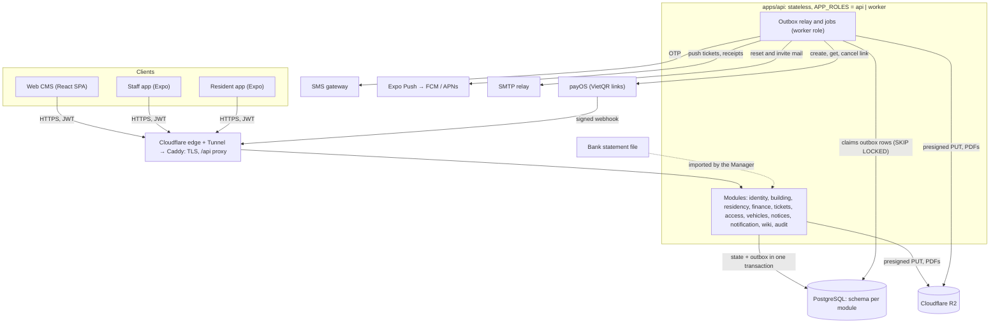

Every client request becomes a short transaction in one module; anything slow or external (gateway calls except link creation, SMS, push, mail, PDF) runs from the outbox in the worker role, so a slow provider never holds a database lock or a user request.

### 4.1 Components

1. **Web CMS** (`apps/web`) — React SPA for Admin and Manager, typed against the API with Eden Treaty; no business rule lives in it.
2. **Staff app** (`apps/staff-app`) — Expo app whose tabs depend on the role in the token (Manager, Technician, Guard); QR scanner for guards.
3. **Resident app** (`apps/resident-app`) — Expo app; every request carries the selected unit (section 7.4).
4. **API** (`apps/api`) — composition root that installs the modules and serves HTTP; stateless, runs as N instances.
5. **Worker** — the same image with `APP_ROLES=worker`: outbox relay, event handlers, scheduled jobs (notice sending, intent re-query and expiry, push receipts, PDF rendering, exports, purges, nightly invariant check). Excel imports are validated synchronously in the API, not in the worker (DR-21).
6. **Modules** (`modules/*`) — `identity` (staff and resident accounts, OTP, sessions), `building` (building, company, settings, gateway configuration), `residency` (units, resident profiles, memberships, unit history, import), `finance` (batches, charges, payments, allocations, receipts, payment intents, the money log, reconciliation), `tickets`, `access` (QR credentials and scans), `vehicles`, `notices`, `notification` (inbox, device tokens, push), `wiki`, `audit`, `reporting` (dashboard composition and export jobs) and `realtime` (server-sent events for the web CMS). `identity` and `notification` are forks of the reference modules, `realtime` is reused as is (DR-03). Modules call each other only through `contracts/` (sync interfaces and versioned events; the catalog is in DR-42), never through tables.
7. **PostgreSQL** — the only stateful dependency besides object storage: data, outbox and inbox, rate limits, job claims, counters.
8. **Object storage** — Cloudflare R2 (S3 API) for photos, attachments, imports and generated PDFs; uploads go straight from the client with presigned PUT URLs and are verified after the upload (section 15).
9. **External services** — payOS (payment links and webhooks), an SMS gateway (OTP), Expo Push (FCM, APNs), an SMTP relay (staff mail).

### 4.2 Cross-cutting principles

- **The database decides, the code asks.** Every state transition that two actors can race on is one conditional `UPDATE … WHERE <expected state> RETURNING`; zero rows means "someone else won" and becomes a 409, never a silent overwrite.
- **No signal from a phone moves money.** Only a signed gateway webhook, a gateway re-query made by the server, or a staff entry settles a charge. "I have transferred" from the resident app only speeds up the next re-query.
- **Every confirmed transfer stays visible.** A confirmation is posted only when its amount is exact and its charges are open; anything else is written to the money log and linked to nothing (section 5.7), so a payment that sits in the bank never disappears from the Manager's sight, and the system never guesses which charge it was meant for.
- **Every side effect goes through the outbox.** Push, SMS, mail, PDF and gateway cancellation are events written in the same transaction as the state change, delivered at least once and handled idempotently (inbox keyed by message and handler).
- **Every resident request is scoped by membership.** The policy reads the membership row of `(account, unit)` on each request; there is no cached permission to go stale (section 7.4).
- **Every row carries `building_id`.** Repositories take a `BuildingScope` argument and add the filter; a lint rule rejects queries on business tables without it (section 19.4).

### 4.3 Technology

> Version note (2026-10-18): the technologies below are the starting point. Versions are decided by the currency policy (latest stable, verified on the web: DR-82) and recorded in DOC-11. The snapshot already supersedes PostgreSQL 17 with 18 and fixes the Expo SDK at 58 on the New Architecture.

| Layer | Technology |
| --- | --- |
| Runtime, HTTP | Bun ≥ 1.4, Elysia, TypeBox schemas, `@elysiajs/openapi` (Scalar docs) |
| Data | PostgreSQL 18, Drizzle ORM and drizzle-kit migrations per module, PgBouncer-compatible (`DB_PREPARE=false`) |
| Messaging | Transactional outbox and inbox from the vendored reference packages (`@core/messaging`), in-process bus, `FOR UPDATE SKIP LOCKED` claiming |
| Auth | ES256 JWT access tokens (15 min), rotating refresh tokens with reuse detection, argon2id (`Bun.password`) for staff passwords |
| Files | S3 API (`@aws-sdk/client-s3`, presigned PUT), SeaweedFS locally, Cloudflare R2 in production |
| Excel, PDF | `exceljs` for import and export; `@react-pdf/renderer` with embedded Be Vietnam Pro font for fee notices, receipts, reports and wiki export |
| Phone numbers | `libphonenumber-js` (E.164 normalization, Vietnamese numbers) |
| Payment | payOS REST API v2 (`/v2/payment-requests`, webhook with HMAC-SHA256 signature) behind a `PaymentGateway` port with two drivers, `payos` and `fake` (tests, staging, demo) |
| Push | Expo Push API (`expo-server-sdk`), `expo-notifications` on devices |
| SMS, mail | `SmsSender` port with one provider adapter (provider to choose); SMTP via `nodemailer` |
| Web client | React 19, Vite, TanStack Router and Query, Tailwind CSS, shadcn/ui, Eden Treaty, TipTap (notice and wiki editor), hosted on Cloudflare Pages |
| Mobile clients | Expo SDK with expo-router, TanStack Query, Eden Treaty, `expo-secure-store`, `expo-camera` (QR scan), `react-native-qrcode-svg`, `expo-image-picker`, EAS Build and EAS Update |
| i18n | `@core/i18n` with a shared catalog package (`vi`, `en`), ICU messages, catalog parity test |
| Observability | pino logs with request IDs, Prometheus, Alertmanager and Grafana, Loki with Grafana Alloy for logs (no traces in phase 1, DR-63), `/health/live` and `/health/ready` |
| Quality | Biome, dependency-cruiser architecture rules, `bun test`, Testcontainers-style integration tests on PostgreSQL, Playwright for the web CMS, Maestro for the mobile apps, k6 for load |
| Delivery | Docker multi-stage images, Docker Compose on one VPS per environment, GitHub Actions to GHCR, Cloudflare Pages and Expo EAS (DR-83, DR-08) |

## 5. Fees and debt ledger

A charge is paid in full or not at all (DR-84): it becomes `paid` only through one allocation of a posted payment, and that allocation is one conditional update of the charge row inside the transaction that records the payment. Nothing else changes a charge to `paid`.

### 5.1 Model

The ledger has four kinds of record. Charges say what a unit owes; payments say what money came in and was posted; allocations connect the two; receipts are the immutable documents handed to residents. Money that reached the bank but cannot be posted is not part of the ledger: it is a row of the money log (section 5.7). There is no partial payment, no advance payment and no credit.

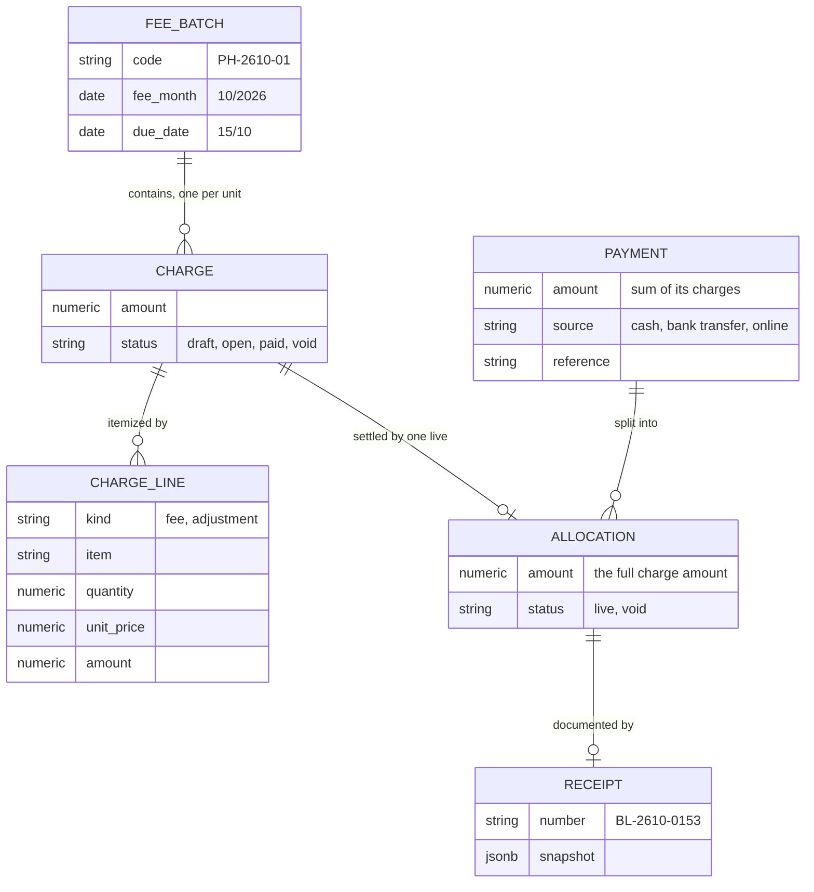

The batch groups charges for publishing and reporting; money always moves at the level of one whole charge, because a resident pays "October, batch 1" and not "some of my debt".

| Record | Holds | Changes after creation |
| --- | --- | --- |
| `fee_batch` | Code, name (vi/en), fee month, due date, status | Status, and a later due date (section 5.2) |
| `charge` | Unit, unit code snapshot, `amount`, status | Status only, once published |
| `charge_line` | Kind (`fee` or `adjustment`), item name (vi/en), quantity, unit price, amount, note | Never, once published |
| `payment` | Unit, source, amount, received time, payer name, reference, intent | Status `posted → void` only |
| `allocation` | Payment, charge, amount | Status `live → void` only |
| `receipt` | Number, allocation, amount, frozen snapshot, PDF key | Status `issued → void` only |

Money is a `bigint` number of đồng: VND has no minor unit, and integers make sums exact. Quantities are `numeric(12,3)`; a line amount is `round(quantity × unit price)` half up (DR-11). A line of kind `adjustment` may be negative (a discount, or the offset of an earlier overcharge, section 5.8); the charge total must stay above zero.

**Invariants**

| Object | Invariant | Enforced by |
| --- | --- | --- |
| Charge | `status = 'paid'` exactly when one live allocation of the full `amount` exists | `UNIQUE (charge_id) WHERE status = 'live'` on `allocation`, the conditional update of section 5.4, the nightly check (section 5.10) |
| Charge | `amount > 0`, and `amount` and lines never change once the batch is published | `CHECK` and a trigger rejecting updates of `amount` and of `charge_line` unless the charge is `draft` |
| Payment | `amount = Σ live allocation.amount` | One transaction per payment; nightly check |
| Payment | At most one payment per gateway transaction | `UNIQUE (provider, gateway_reference)` |
| Payment | At most one payment per payment intent | `UNIQUE (intent_id)` |
| Payment | A double-clicked manual entry is recorded once | `UNIQUE (building_id, client_key)` from the `Idempotency-Key` header |
| Allocation | `amount > 0` and equal to the charge amount | `CHECK`, and `amount = :expected_amount` in the conditional update |
| Receipt | Numbers are unique and gapless per building and month; one receipt per allocation | Counter row incremented in the same transaction (section 5.6); `UNIQUE (allocation_id)` |

### 5.2 Batch lifecycle

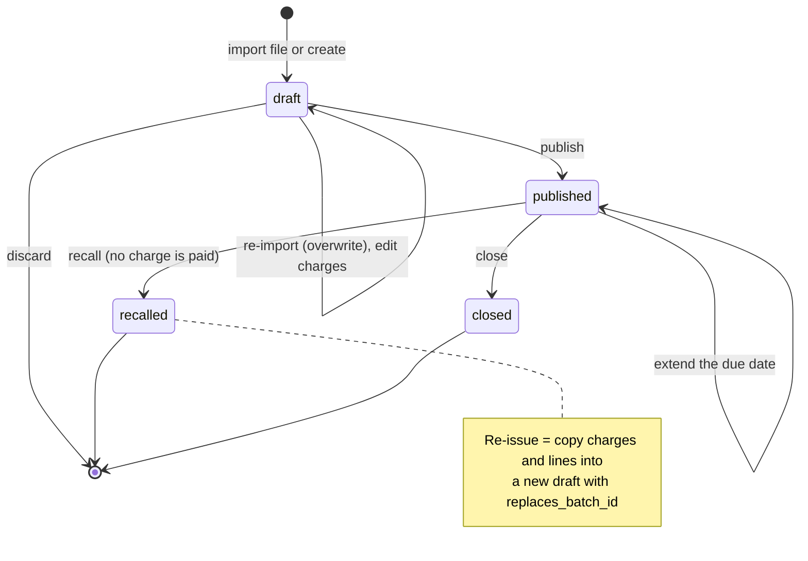

The diagram shows that a published batch never goes back to draft: a mistake found after publishing is fixed by recalling the batch and issuing a corrected copy, so residents never see amounts change under a code they already received.

| From | To | Triggered by | Effect |
| --- | --- | --- | --- |
| — | `draft` | Manager imports a file or creates a batch | Code `PH-YYMM-NN` taken from the counter; charges in status `draft` |
| `draft` | `draft` | Re-import, edit a charge or line | Draft charges replaced or edited; `version` increments |
| `draft` | — | Discard | Batch and draft charges deleted; the code is not reused |
| `draft` | `published` | Publish | Checks: at least one charge, every charge total > 0, due date not before today in building time. Charges `draft → open`; event `finance.batch_published.v1` → inbox and push to the active owner, family members and tenants of a charged unit (helpers get nothing, because they cannot see fees) |
| `published` | `published` | Extend the due date | The only edit of a published batch: a later `due_date`, guarded by `version` and audited; an earlier date is refused; residents get `fee.batch_due_extended` |
| `published` | `recalled` | Recall | Succeeds only if no charge is `paid`; charges `open → void`; every payment intent holding one of its charges is cancelled as a whole; event `finance.batch_recalled.v1` → notification "batch withdrawn" |
| `published` | `closed` | Manager presses Close | A manual freeze for reporting only: the batch can no longer be recalled; open charges stay as debt and stay payable; nothing closes automatically |

A re-issue copies the charges and lines of the recalled batch into a new draft with `replaces_batch_id` (new ids, new code from the counter; fee month and due date editable). Publishing is one conditional update on the batch (`WHERE status = 'draft' AND version = :version`) followed by the charge update in the same transaction, so two Manager users pressing "Publish" produce one publication and one round of push.

**Voiding one open charge.** A wrong charge inside a batch that cannot be recalled (another unit has paid) is voided alone: Manager or Admin, reason of at least 5 characters, only when the charge is `open` and has no live allocation (`POST /staff/charges/{id}/void`, FR-49). In the same transaction every intent holding the charge is cancelled as a whole and the resident is told to start again (`finance.charge_voided.v1`, `fee.charge_voided`); a late exact-amount confirmation of such an intent finds the charge `void` and goes to the money log as `charge_recalled`. The voided charge is never reopened: the corrected charge is issued in a new draft batch. A `paid` charge cannot be voided (409).

### 5.3 Import and draft editing

The import is two steps, matching the design (`W-Fee-Import`): the file goes to object storage with a presigned PUT, then `POST /staff/imports` reads it and validates it **synchronously in the API** (5 MB, 5,000 rows; DR-21). The preview (counts, the first 50 valid rows, up to 500 errors with row, column and code) is stored in `finance.import_job` and returned in the same response; Manager sees valid rows, errors per row and the total, then saves the valid rows into the draft batch in one transaction keyed by the import job (`UPDATE import_job SET status = 'committed' WHERE id = :id AND status = 'validated'`), so pressing "Save" twice saves once. A job older than 24 hours is refused (409 `import_expired`). No worker step is involved.

| Column | Rule |
| --- | --- |
| Unit code | Must exist in the building and not be vacant-without-owner (a charge needs someone to notify) |
| Fee month | `MM/YYYY`, equal to the batch's fee month; rows of other months are errors |
| Item name | 1–120 characters; an optional English name column fills `name.en` |
| Kind | `fee` (default) or `adjustment` |
| Quantity, unit price | Quantity ≥ 0 with up to 3 decimals (water meters); unit price an integer ≥ 0 |
| Amount | Integer > 0 for a fee row and non-zero for an adjustment row, equal to `round(quantity × unit price)` half up when both are given; a mismatch is a row error, not a silent recomputation |
| Duplicates | The same unit and item twice in one file is a row error |

Lines of one unit become one charge whose `amount` is the sum of its lines, and the total must be above zero. Re-importing a draft replaces all its charges; editing one unit's lines in the draft table (`W-Fee-Batch`) replaces that charge only, guarded by its `version`. Header aliases (Vietnamese and English) and the downloadable templates are in DR-22.

### 5.4 Allocating a payment

Every way of settling a charge (manual entry, online settlement) ends in the same statement, executed per charge in ascending `charge.id` order so that two transactions touching the same charges never deadlock (DR-14):

```sql
UPDATE finance.charge
SET status  = 'paid',
    version = version + 1
WHERE id = :charge_id
  AND building_id = :building_id
  AND status = 'open'
  AND amount = :expected_amount
RETURNING id;
-- 1 row: insert the allocation (the full amount) and the receipt in the same transaction.
-- 0 rows: the charge is no longer open (paid by another channel, or recalled) or its amount changed.
--   Manual entry: ROLLBACK and return 409 charge_changed with the fresh state.
--   Online settlement: roll back to the savepoint and write the confirmation to the money log (section 5.7).
```

The row lock taken by the `UPDATE` serializes every settlement of one charge. Under PostgreSQL's READ COMMITTED level, a transaction that waited for the lock re-evaluates the `WHERE` clause against the committed row, so the second of two concurrent payments of the same charge sees `paid` and updates zero rows: exactly one wins. `UNIQUE (charge_id) WHERE status = 'live'` on `allocation` is the last line: even a bug that skips the condition cannot commit a second live allocation.

**Manual payment** (`W-Fee-Record`, Manager or Admin; DR-23):

1. Manager opens the unit's debt; the form lists open charges and warns on any charge that has an active online payment link ("online payment open since 09:12").
2. Manager selects **whole charges**, the method (cash or bank transfer), payer, date (not in the future, at most 90 days back; older needs Admin), optional bank reference and note. The amount is computed by the system as the sum of the selected charges and shown, not typed; an `amount` that differs is refused (422 `allocation_mismatch`). A dry run returns the sum and the receipts that would be issued without saving.
3. The client sends the request with an `Idempotency-Key`. The API inserts the payment (`client_key` unique), runs the statement above for each charge, inserts the allocations, takes receipt numbers, writes the audit row and the outbox event `finance.payment_posted.v1`, then commits.
4. The worker renders the receipt PDFs and, if Manager ticked "send receipt", the resident receives a push.

Manager is never blocked by an open online link, because the cash is already in Manager's hands. If the online transfer then arrives, its confirmation finds the charge `paid`, nothing is posted twice, and the transfer goes to the money log as `charge_already_paid` for the Manager to refund outside the system.

### 5.5 Voiding a manual payment

A wrong manual entry is voided, never edited or deleted (Manager or Admin; DR-24). Voiding runs in one transaction: `UPDATE payment SET status = 'void' WHERE id = :id AND status = 'posted' AND source IN ('cash', 'bank_transfer')`, then for each live allocation `UPDATE allocation SET status = 'void'` and `UPDATE charge SET status = 'open' WHERE id = :charge_id AND status = 'paid'`, then the receipts to `void`; if the payment came from a statement line, the line returns to `unmatched`. A reason of at least 5 characters is mandatory and the audit row stores the before and after values (`W-Audit` shows "voided at 08:58, cash, reason: recorded on the wrong unit"); the resident is notified (`finance.payment_voided.v1`). Editing an entry is implemented as void plus a new entry, so receipts already handed out stay valid documents with a visible void status. Online payments cannot be voided by the Manager: money confirmed by the bank is undone only by a refund that the company makes outside the system.

### 5.6 Receipts and numbering

One receipt is issued per allocation, so paying two batches in one transfer yields two receipts (`Pay-Done`: `BL-2610-0153` and `BL-2610-0154`), each meaningful on its own. Receipt numbers follow the [gapless numbering pattern](docs/references/architecture-reference/patterns/gapless-document-numbering.md): a counter row per `(building_id, 'receipt', YYMM)` is incremented with an upsert inside the settlement transaction, immediately before the receipt insert.

```sql
INSERT INTO finance.document_counter (building_id, series, period, last)
VALUES (:building_id, 'receipt', :yymm, 1)
ON CONFLICT (building_id, series, period) DO UPDATE SET last = document_counter.last + 1
RETURNING last;  -- BL-<yymm>-<last padded to 4>
```

A rolled-back settlement rolls back its increment, so numbers have no gaps; the counter row lock serializes receipt issuing within one building and month, which is a few milliseconds per payment at this volume. The receipt stores a frozen `snapshot` (company and building details, unit code, payer, batch name and fee month, lines, amount of this receipt, method, gateway reference), so a later change of the logo or a unit's owner never changes a document already issued. The document is titled "Biên lai thu tiền / Payment receipt" and states that it is not a tax invoice: the company issues an e-invoice only when a resident asks, outside the system. The receipt reserves a nullable `external_invoice` column and emits `finance.receipt_issued.v1`, the seam for a later integration (DR-17). Batch codes (`PH-YYMM-NN`), intent codes and ticket codes use their own series in a `document_counter` table of the owning module (DR-10); only receipts must be gapless, and their period is the issue month in building time.

### 5.7 Money that is not posted: the log

The system posts a payment only when its amount is exactly the sum of whole open charges (DR-84). Every other confirmed transfer (short, over, duplicate, unknown order, or for a charge that is no longer open) is written to the **money log** and linked to nothing: the system never matches it to another charge, period or payment, and there is no unit credit. A wrong transfer is refunded by the Manager outside the system. The log is the existing `gateway_event` table (column `outcome`) and `statement_line` table (column `match_status`), with review columns; there is no anomaly table.

| `gateway_event.outcome` | When |
| --- | --- |
| `posted` | Exact amount, every charge open: a payment exists |
| `amount_short` | The amount is lower than the intent amount |
| `amount_over` | The amount is higher than the intent amount |
| `duplicate_transfer` | A second transfer for an intent that is already `paid` |
| `charge_already_paid` | Exact amount, but a charge of the intent is no longer `open` (paid by cash or another link) |
| `charge_recalled` | Exact amount, but a charge of the intent is `void` |
| `unknown_order` | No intent for the order code in this building |

Statement lines that stay `unmatched` or `statement_only` (section 6.7) are reviewable in the same way.

Manager sees the log on `W-Money-Log` (a tab of `W-Transactions`) and, for one unit, in the `UnitMoneyPanel` on the unit and debt screens. A row that is not posted is marked **reviewed** with a note of at least 5 characters, once, after the Manager has handled it outside the system (`POST /staff/money-log/{kind}/{id}/review`, audited); a new open row writes an inbox entry for every active Manager and Admin and raises the dashboard counter "money to check" (FR-46, FR-47). Reviewing never changes the ledger. Clearing a debt is a separate action: the resident pays the exact amount, or Manager records a manual payment for whole charges. An adjustment line (section 5.8) and the void of a single open charge (section 5.2) are likewise independent of the log: the system never creates, suggests or pre-fills either from a log row.

The resident never sees the log. When a transfer of another amount arrives for an intent, the intent stays `pending` and the status endpoint returns `unmatchedTransfer {amount, receivedAt}`, so the app shows "We received a transfer that does not match the amount to pay. The management office will check" and nothing more.

### 5.8 Race: recalling a batch while a resident pays it

**The arbiter is the charge row.** A recall and an online settlement both need to change the same charges, and each is a conditional update on them; whichever commits first decides, and the other observes the result.

1. **Recall.** Manager presses "Recall" on `PH-2610-01`. The transaction locks the batch (`UPDATE fee_batch SET status = 'recalled' WHERE id = :id AND status = 'published'`), then runs:

   ```sql
   UPDATE finance.charge SET status = 'void', version = version + 1
   WHERE batch_id = :batch_id AND status = 'open';
   -- The updated row count must equal the batch's charge count.
   -- Fewer: some charge is already paid. ROLLBACK and return 409 batch_has_payments.
   ```

   It then marks every active payment intent that holds one of the batch's charges `cancelling` (the whole intent, even if it also holds charges of another batch) and writes the outbox event that cancels them at payOS.
2. **Settlement.** At the same moment the payOS webhook for unit A-1508 arrives with the exact amount of that charge and runs the statement of section 5.4 on it.

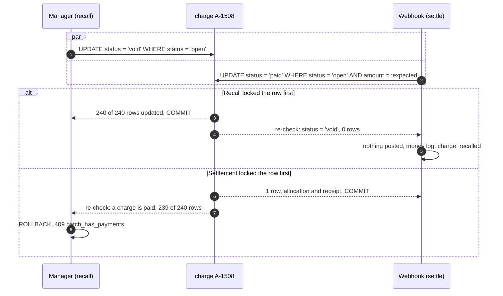

The diagram shows that both orders end in a consistent ledger: either the batch is recalled and the transfer waits in the money log as `charge_recalled` for the Manager to refund outside the system, or the batch stays published with one paid charge and Manager learns that a recall is no longer possible. In that case a single wrong open charge is voided alone (section 5.2), and a wrong paid charge is offset by a negative `adjustment` line in a later batch (DR-19); the refund of an overcharge is made outside the system. No order lets a recalled charge carry a payment or a payment vanish from the log; the nightly check (section 5.10) is the last net.

The same arbiter resolves "manual cash vs online transfer on one charge": the first to commit pays the charge, and the second leaves a `charge_already_paid` row in the money log.

### 5.9 Ledger design: options and rationale

Option C is chosen: charges with append-only allocations and a `status` guarded by a conditional update and a unique allocation per charge. Options A, B and D were considered first; this section records their pros and cons and why they were rejected.

**The problem.** The ledger must answer "is October batch 1 of A-1508 paid?" instantly for the resident app and for settlement, keep a trail of who paid what, and stay correct under concurrent settlements from three sources.

#### Option A: a balance column per unit

`unit_account.balance += charge` on publish, `-= payment` on payment.

- **Pros**: one row per unit, trivial debt query.
- **Cons**: knows how much a unit owes but not which charge is paid, so whole-charge online payment and per-charge receipts are impossible; a lost update or a double decrement leaves no trace to detect it.
- **Verdict**: rejected; it cannot express the product's rules.

#### Option B: a double-entry journal

Accounts per unit (receivable), a cash account, a gateway clearing account; every movement is a balanced journal entry.

- **Pros**: conservation holds by construction; accountants recognise it; refunds and gateway fees fit naturally.
- **Cons**: every screen (debt, receipts, aging) becomes a query over journal lines; the proposal explicitly excludes accounting; three to four times the code for the same phase 1 behaviour.
- **Verdict**: rejected for phase 1. Option C's records map one-to-one onto journal entries, so a journal can be derived later from `payment` and `allocation` if the accounting module is ever added.

#### Option C: charges, allocations and a guarded status (chosen)

The model of sections 5.1–5.7.

- **Pros**: the question "is this charge paid" is one column read; every change is one conditional `UPDATE` whose row lock is the natural arbiter; allocations keep the full trail; the invariants are a few `CHECK` constraints and `UNIQUE` indexes, and there is no running balance to keep in step.
- **Cons**: `charge.status` is a cache of "one live allocation exists" that could drift if some code path bypasses section 5.4.
- **Verdict**: chosen; the drift risk is closed by a single write path, the unique allocation per charge and the nightly check.

#### Option D: event-sourced charges

Each charge is a stream of events (`issued`, `paid`, `voided`) and state is a projection.

- **Pros**: complete history by construction.
- **Cons**: concurrency control by stream version adds a retry loop to every settlement; projections lag; the team pays the event-sourcing learning cost for a domain with five event types.
- **Verdict**: rejected; allocations and the audit log already give the history that matters.

#### Comparison and rationale

| Option | Per-batch settlement | Concurrency arbiter | Detects drift | Complexity | Verdict |
| --- | --- | --- | --- | --- | --- |
| A: balance column | No | Row lock on unit | No | Low | Rejected |
| B: double-entry journal | Yes, through sub-accounts | Row locks on accounts | Yes, by construction | High | Later, if accounting is added |
| C: charges + allocations | Yes | Row lock on charge | Yes, nightly check | Medium | Chosen |
| D: event sourcing | Yes | Stream version | Yes | High | Rejected |

1. **Whole-charge online payment and per-charge receipts eliminate A first**: the unit balance does not know which charge was paid.
2. **Of the rest, C is the only one where the arbiter of a race is a single row the business already talks about** (the charge), so each race of sections 5.8 and 6.5 is one conditional statement.
3. **The cost of C is a status that can drift, and it is small here**: one write path, one unique index, one nightly query over at most tens of thousands of charges.
4. **The choice is verified by measurement**: EXP-03 runs concurrent manual and online settlements against C and against a naive read-then-write baseline without the conditional predicate; EXP-11 injects drift and expects the nightly check to report it.

### 5.10 Debt, aging and the nightly check

Outstanding debt is computed, never stored: the `amount` of `open` charges in published or closed batches (DR-18). Aging counts days past the batch due date in the building's time zone (DR-09): not yet due, 1–30, 31–60, 61–90 and over 90 days (`W-Reports`).

```sql
SELECT c.unit_id,
       sum(c.amount)                                                         AS outstanding,
       count(*)                                                              AS open_charges,
       min(b.due_date)                                                       AS oldest_due,
       sum(c.amount) FILTER (WHERE :today - b.due_date > 30)                 AS overdue_30
FROM finance.charge c
JOIN finance.fee_batch b ON b.id = c.batch_id
WHERE c.building_id = :building_id AND c.status = 'open' AND b.status IN ('published', 'closed')
GROUP BY c.unit_id;
-- :today = (now() AT TIME ZONE building.time_zone)::date, computed once per request
```

A partial index `charge (building_id, unit_id) WHERE status = 'open'` keeps this under 50 ms at 5,000 units with 24 batches each. Reminders (`W-Debts`) are a notification event per selected unit, throttled to one reminder per unit per building day by `ON CONFLICT (unit_id, reminder_day)`.

At 03:00 building time the worker recomputes every invariant of section 5.1 per building with set queries: every `paid` charge has exactly one live allocation of its full amount and every live allocation sits on a `paid` charge; every posted payment equals the sum of its live allocations; every live allocation has one receipt; receipt numbers have no gaps against the counter; every `posted` money-log row has a payment. A non-empty result opens an `invariant_violation` alert with the offending rows and pages Admin; it means a bug, not a business situation (money to check is the log of section 5.7).

## 6. Online payment

A charge is paid online only when the server receives a signed payOS confirmation, through the webhook or through its own re-query, for a payment intent it created, with an amount exactly equal to the intent amount and with every charge of the intent still open; no signal from the resident's phone or browser is trusted, and every confirmation goes through the one settlement function of section 6.4. A confirmation that does not meet these conditions is kept in the money log (section 5.7), not posted.

### 6.1 Flow

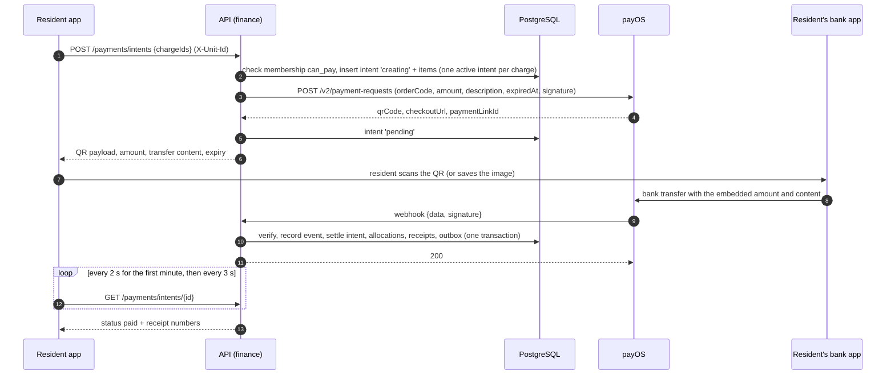

The diagram shows that the resident app only creates the intent and watches it; money becomes a payment in step 10, on the server, from a signed message.

### 6.2 Payment intent

A payment intent is the server's promise "if the bank confirms order `orderCode` for this amount, these charges are paid". It lists the charges and the amount of each at creation time, and owns the payOS link.

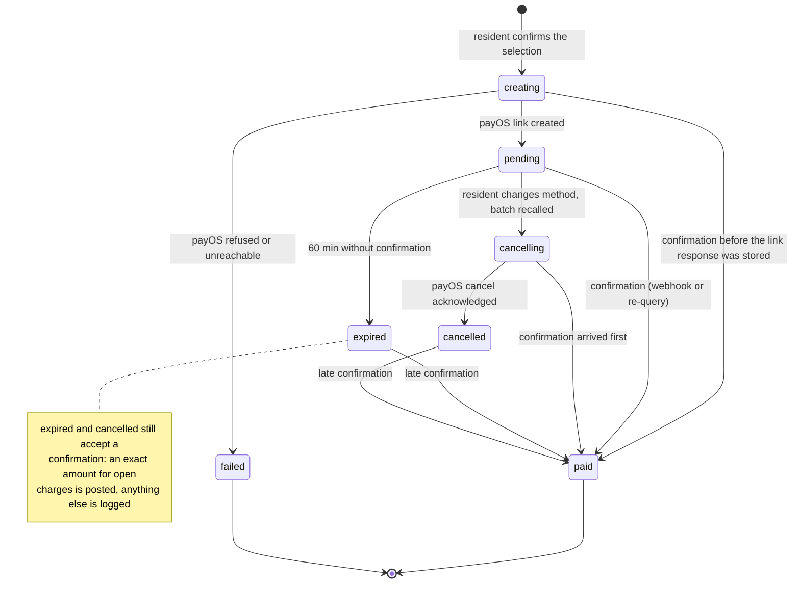

| From | To | Triggered by | Effect |
| --- | --- | --- | --- |
| — | `creating` | `POST /payments/intents` | Items inserted; each charge can be in only one active intent |
| `creating` | `pending` | payOS returns the link | QR payload stored; re-query schedule starts |
| `creating` | `failed` | payOS error, or a timeout followed by a `GET` that finds nothing | Items released; the resident sees "try again" |
| `creating`, `pending` | `paid` | Settlement (section 6.4) | Payment, allocations, receipts; items released |
| `pending` | `cancelling` | The creator, another member who can pay for the unit, or Manager or Admin cancels; a batch recall or the void of a held charge cancels the whole intent | Outbox event calls payOS cancel |
| `pending` | `expired` | Re-query job at 60 min finds no payment | payOS cancel called; items released |
| `cancelling` | `cancelled` | payOS cancel acknowledged | Items released |
| `cancelling`, `expired`, `cancelled` | `paid` | A confirmation arrives after all | Posted as usual only if the amount is exact and every charge is still open; otherwise the intent keeps its status and the money log gets a row (section 5.7) |

"Active" means `creating`, `pending` or `cancelling`. A partial unique index enforces one active intent per charge:

```sql
CREATE UNIQUE INDEX payment_intent_item_one_active
  ON finance.payment_intent_item (charge_id)
  WHERE released_at IS NULL;
```

### 6.3 Creating an intent

1. The API resolves the membership of the selected unit and requires `member_type IN ('owner', 'family')` or `member_type = 'tenant' AND can_pay`. Each selected charge must be `open` in a published or closed batch; one intent holds 1 to 10 whole charges, with a total between the gateway's minimum and maximum (defaults 2,000 and 500,000,000 đ).
2. In one transaction it inserts the intent with `order_code = nextval('finance.order_code_seq')` (the sequence starts at 1,000,000), `amount = Σ amount` of the selected charges, `expires_at = now() + 60 min`, and one item per charge. A unique violation on the index above means another intent holds a charge: if that intent covers exactly the same charges, the API returns it (two household members see the same QR, with "started by Trần Minh Khoa at 09:12"); if the holder's `display_until` has passed, the API cancels it (items released in the same transaction, cancel command queued) and creates the new one, because a dead QR must not block the household for the rest of the 60 minutes; otherwise it returns 409 `payment_in_progress` with the holder, so the resident can continue or cancel it.
3. After commit, the API calls payOS `POST /v2/payment-requests` with `orderCode`, `amount`, `description`, `expiredAt` (30 min, the QR's display validity) and the HMAC signature over `amount, cancelUrl, description, orderCode, returnUrl` as the [payOS API](https://payos.vn/docs/api/) specifies. On success the intent becomes `pending`. On a timeout the API calls `GET /v2/payment-requests/{orderCode}` once: found means `pending`, not found means `failed`.
4. The response carries the VietQR payload (rendered with `react-native-qrcode-svg`), amount, receiving account, transfer content and expiry. The content is `TT` plus the order code in Crockford base 32, at most 9 characters in total, because payOS limits the description to 9 characters for accounts not linked through payOS (order code 2610153 gives `TT2FMZ9`; DR-27). The design's longer content (`MM A1508 T10 D1D2 8F3K`) needs a linked account (section 22, open points).

The gateway call stays outside the database transaction so a slow payOS never holds charge locks; the cost is the `creating` state, which the re-query job cleans up after 2 minutes.

### 6.4 Settlement: one function for every confirmation

The webhook handler, the re-query job and the statement reconciliation all call `settle(confirmation)`, where a confirmation is `(provider, reference, orderCode, amount, paidAt, source, payload, gatewayConfigId)` already authenticated by its source (DR-29). The building comes from the gateway configuration. The function runs in one transaction at READ COMMITTED:

```sql
-- 1. Record the confirmation once. A repeated webhook or a re-query of the same transfer stops here.
INSERT INTO finance.gateway_event (building_id, provider, reference, order_code, amount, paid_at, source, payload, outcome)
VALUES (:building_id, 'payos', :reference, :order_code, :amount, :paid_at, :source, :payload, 'pending')
ON CONFLICT (provider, reference) DO NOTHING
RETURNING id;
-- 0 rows: this transfer was already processed. COMMIT, answer 200.
```

2. Resolve the intent from `order_code`. No intent: outcome `unknown_order`, commit.
3. Take a savepoint and classify without writing money: the intent is already `paid` → `duplicate_transfer`; `amount` below the intent amount → `amount_short`; above → `amount_over`. Any of these: set the outcome, commit; the intent keeps its status and the Manager is alerted (section 5.7).
4. Exact amount: claim the intent, then run the allocation statement of section 5.4 for each item in ascending `charge_id` order.

```sql
UPDATE finance.payment_intent
SET status = 'paid', paid_at = :paid_at, gateway_reference = :reference
WHERE order_code = :order_code
  AND status IN ('creating', 'pending', 'cancelling', 'expired', 'cancelled')
RETURNING id, building_id, unit_id, amount;
```

   Zero rows on any charge: roll back to the savepoint and set the outcome to `charge_already_paid` or `charge_recalled`; no part of the intent is posted on its own.
5. All charges updated: insert the payment (`source = 'online'`, `intent_id`, `gateway_reference`, both unique) and one allocation per item, issue a receipt per allocation (section 5.6), release the items, set the log row's outcome to `posted` with its `payment_id`, write `finance.payment_posted.v1` (push "payment received", receipt PDFs) to the outbox, and commit. On SQLSTATE `40001` or `40P01` the whole transaction is retried up to 3 times with a short random delay.

The intent becomes `paid` only in step 5. The webhook endpoint (`POST /payments/webhooks/{provider}/{gatewayConfigId}`, provider `payos`; the segment is neutral because the gateway may change, DR-25) checks, in order: body size, gateway configuration exists and is active (else 404 and no row), the HMAC-SHA256 signature over the `data` fields sorted by key in constant time, `data.accountNumber` equal to the configured receiving account, and a paid-transfer code; only then it calls `settle`. A failed check goes to `finance.webhook_rejection` (reason, IP, body hash, 2 KB excerpt, purged after 30 days) and never to `gateway_event`, so a forged body cannot occupy a real transfer's `(provider, reference)` and make the genuine webhook look "already processed" (DR-32). The answer is 200 for a processed or duplicate confirmation, 400 for a malformed body, 401 `invalid_signature`; the endpoint answers 200 only after commit, so a crash before commit leaves payOS to retry and the re-query to catch up. The HMAC is the only gate: a call from an unknown IP is logged, never blocked.

### 6.5 Race: webhook and re-query confirm the same transfer

**The arbiter is the `gateway_event` row, then the intent row.** Two paths can confirm one transfer at the same moment: the webhook, and the re-query job (every 5 minutes, or immediately when the resident presses "I have transferred").

1. The webhook verifies the signature and calls `settle`.
2. The re-query job calls `GET /v2/payment-requests/{orderCode}`, sees `PAID` with the transaction's reference, and calls `settle` with the same reference.
3. Both insert into `gateway_event` with the same `(provider, reference)`; the unique index lets one insert proceed and makes the other wait until the first commits, then return zero rows.

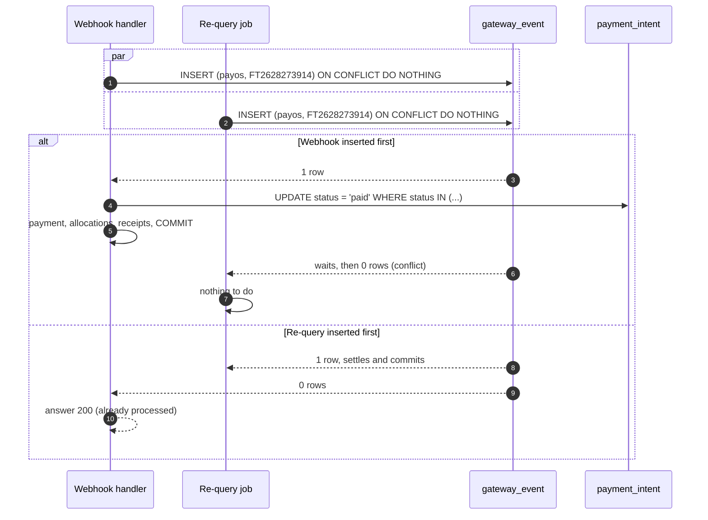

The diagram shows that whichever path arrives first settles, and the other becomes a no-op without an error. If two different references confirm the same order code (the resident transferred twice), step 3 of `settle` writes the second as `duplicate_transfer`, so the extra money is visible to the Manager, who refunds it outside the system, instead of silently ignored. The unique indexes on `payment (intent_id)` and `payment (provider, gateway_reference)` are the last net if a code change ever breaks the order of these steps. Manual payment against an open online link and recall against payment are resolved on the charge row (section 5.8).

**Parameters** (proposed defaults, confirmed in EXP-01 and EXP-02)

| Parameter | Default | Meaning |
| --- | --- | --- |
| `link_display_validity` | 30 min | `expiredAt` sent to payOS; the QR screen counts down to it |
| `requery_interval` | 5 min | Pending intents are re-queried at this interval |
| `requery_window` | 60 min | After this, the intent expires and the link is cancelled |
| `manual_requery_cooldown` | 30 s | "I have transferred" triggers at most one re-query per intent per 30 s |
| `client_poll_interval` | 2 s, then 3 s | The QR screen polls the intent while visible: every 2 s for the first minute, then every 3 s (DR-80) |

With 150 payments in the first hour after publishing, the re-query job makes at most 150 × 12 = 1,800 calls per hour in the worst case where every webhook is lost, about one call every 2 seconds, well inside any reasonable API quota (payOS's limits are an open point).

### 6.6 Payment gateway: options and rationale

Option B is chosen: one payOS payment link per intent. Options A and C were considered first; this section records why they were rejected for phase 1. C remains the planned second adapter.

**The problem.** The system must learn reliably which unit paid which batches, with a cost per transaction acceptable for fees of a few million đồng a month, and a resident experience that works with every Vietnamese bank app.

#### Option A: static account and transfer-content parsing

The resident transfers to the company's account with content like `A1508 T10`; a bank-feed service (balance-change webhooks) forwards every incoming transfer, and the system parses the content to find unit and batch.

- **Pros**: no payment link per payment; also catches transfers made without the app.
- **Cons**: matching depends on what the resident typed and what the bank app kept of it; amounts are free, so partial and rounded payments are common; every mismatch becomes Manager work. The feed's delivery guarantees are another provider to trust.
- **Verdict**: rejected as the main path; the same idea survives as the statement reconciliation of section 6.7, which catches the transfers this option would have caught.

#### Option B: payOS payment link per intent (chosen)

The QR embeds account, exact amount and a short order code; payOS confirms with a signed webhook and offers `GET` and `cancel` by order code.

- **Pros**: the order code makes matching exact; the amount is prefilled; a signed webhook plus a query API give two independent confirmation paths; any bank app can scan VietQR.
- **Cons**: description limited to 9 characters on unlinked accounts; payOS's fees, retry policy and quotas are external facts to confirm; one more provider credential to protect.
- **Verdict**: chosen; the design (`W-Gateway`) already asks for payOS's Client ID, API key and Checksum key.

#### Option C: VNPay redirect

The resident is redirected to VNPay (ATM card, international card, VNPay wallet); VNPay calls an IPN URL with a signed result.

- **Pros**: cards and wallets, not only bank transfers; a mature IPN with query API.
- **Cons**: a merchant contract and per-transaction fees that are higher than bank transfers; a browser redirect inside a mobile app; the proposal asks for one gateway in the first version.
- **Verdict**: later, as a second `PaymentGateway` adapter; `Pay-Select` already shows both methods.

#### Comparison and rationale

| Option | Matching | Confirmation paths | Resident effort | Cost per payment | Verdict |
| --- | --- | --- | --- | --- | --- |
| A: content parsing | Heuristic | Bank feed only | Type content correctly | Lowest | Rejected (kept as reconciliation) |
| B: payOS link | Exact by order code | Webhook + query + statement | Scan one QR | Low (to confirm) | Chosen |
| C: VNPay redirect | Exact by transaction reference | IPN + query | Redirect, card entry | Highest | Later adapter |

1. **The top invariant needs exact matching**: A's heuristics turn into rows for the Manager to check at the volume of a monthly batch.
2. **Of B and C, B gives the same guarantees with a flow residents already use** (scan with any bank app) and lower fees.
3. **B's weakness, the short description, does not affect matching**: the order code is in the QR, not typed by the resident.
4. **The choice is verified by measurement**: EXP-01 and EXP-02 replay payOS confirmations through every path.

The port keeps C cheap to add, and has two drivers today: `payos`, and `fake` for tests, staging and the demo building (production refuses `fake` for a non-demo building; DR-26).

```ts
interface PaymentGateway {
  createLink(input: CreateLinkInput): Promise<{ linkId: string; qrPayload: string; checkoutUrl: string }>
  getStatus(orderCode: number): Promise<GatewayStatus>          // PENDING | PAID (+ transactions) | CANCELLED | EXPIRED
  cancel(orderCode: number, reason: string): Promise<void>
  verifyWebhook(rawBody: string, configId: string): Promise<GatewayConfirmation | null>
}
```

### 6.7 Reconciliation with the bank statement

Once a day (or when Manager chooses), Manager uploads the receiving account's statement (`W-Transactions`, "reconcile"; XLSX or CSV up to 5 MB and 20,000 lines, read with a per-building statement profile that maps the columns; DR-34). Only credit lines are used, and a line seen before is reported as `already_recorded` by its `dedup_key`. Each credit line is matched in order, stopping at the first success (DR-35):

1. **By reference**: the line's bank reference equals a payment's `gateway_reference` or `bank_reference`: `matched`.
2. **By order code** found in the line's content (`TT` plus base 32) against a payment intent: if the intent is not `paid`, the system re-queries payOS for that order code and passes a `PAID` answer to `settle` with payOS's own reference and `source = 'statement'`, so a webhook arriving later still deduplicates on `(payos, reference)`; this is how a payment whose webhook and earlier re-queries were all lost is still settled. If payOS does not report it as paid, the line becomes `statement_only`, reviewable by the Manager; the statement is never a second confirmation path that could double-count. The amount must equal the intent amount, otherwise `settle` is not called and the line goes to step 4.
3. **By amount and date** against unreconciled manual `bank_transfer` payments of the same amount within one day: one candidate becomes `proposed` and the Manager confirms it; several are listed for the Manager to pick.
4. **Otherwise** the line is `unmatched`, reviewable (section 5.7): the Manager marks it reviewed with a note (not fee-related, a refund case, part of an instalment). Only a line whose amount is exactly the amount of whole charges may be linked to a manual payment of those charges; no other link exists.

Posted `online` and `bank_transfer` payments older than 3 days with no statement line, for dates covered by an imported statement period, are listed as "not seen in bank" for investigation (cash is excluded). The first statement profile is written from a sample of the company's receiving bank (section 22).

## 7. Identity and unit-scoped access

An account proves who the caller is; what a resident may do is decided on every request by the active membership of the selected unit, and what staff may do by their fixed role within their building.

### 7.1 Accounts and sign-in

| Account | Identifier | Sign-in | Created by | Where |
| --- | --- | --- | --- | --- |
| Staff (Admin, Manager, Technician, Guard) | Work email, unique | Email + password (argon2id); reset by emailed link | Admin (any role), Manager (Technician, Guard) | Web CMS (Admin, Manager), staff app (Manager, Technician, Guard) |
| Resident | Phone number in E.164, unique | Phone + 6-digit SMS OTP | Manager (owner) or owner (member) through a membership | Resident app |

Staff and resident accounts live in separate tables and receive tokens with different `kind` claims; a resident token is rejected by every staff endpoint and the reverse, independently of the role checks. This is a fork of the identity module of the [reference architecture](docs/references/architecture-reference/04-identity-and-sessions.md): magic links, passkeys, OAuth, two-factor and the reference step-up are removed, and the staff password flow, resident SMS OTP and an emailed-code step-up are added (DR-03, DR-36). Phone numbers are parsed with `libphonenumber-js` (default region VN, any internationally valid number accepted) and stored as E.164.

### 7.2 Resident identity and memberships

A resident account is only a phone number, a display name, an avatar, a language and push settings. Everything that gives rights is a **membership**, owned by the `residency` module:

| Column | Meaning |
| --- | --- |
| `account_id`, `unit_id`, `building_id` | Who, where |
| `member_type` | `owner`, `family`, `tenant`, `helper` |
| `can_pay` | Meaningful for tenants only; set by the owner |
| `status` | `active`, `locked` (by owner or Manager, reversible), `removed` |
| `locked_by` | `owner` or `manager`; a membership locked by the Manager can be unlocked only by the Manager |
| `credential_version` | Incremented in the same transaction by any change of status, member type or ownership; the QR scan compares it (section 9) |
| `added_by`, `added_at`, `removed_at` | History |

- One account, many memberships: one phone can be owner of A-1508 and tenant of A-0703 (`Unit-Pick`), and later belong to units in two buildings. There is no limit on the number of memberships or helpers per unit.
- Exactly one active owner per unit: `UNIQUE (unit_id) WHERE member_type = 'owner' AND status <> 'removed'`.
- One membership per account and unit: `UNIQUE (account_id, unit_id) WHERE status <> 'removed'`.
- Adding a member whose phone already has an account links a membership to it (`Member-Add`, `W-Resident-Add`); there is no second account for the same phone.
- A login phone changes only through the Manager (`Account-Phone`): `UPDATE resident_account SET phone = :new WHERE id = :id`, unique on phone; all of the account's sessions are revoked and the person signs in again with the new number. Memberships do not change. A number that already has an account is refused (409 `phone_in_use`); merging accounts is out of scope.

### 7.3 Resident OTP

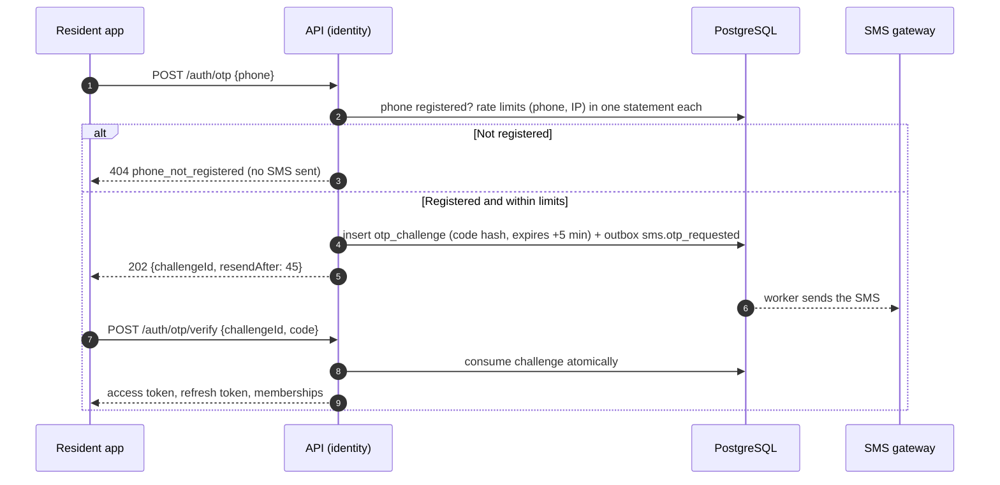

The diagram shows that no SMS is ever sent to an unregistered number. The design (`Login-Error`) tells the person that the number is not registered so they can call Manager; this reveals whether a phone is registered in the building, an accepted trade-off because the alternative leaves real residents stuck at a code that never comes. Not sending SMS to unknown numbers also removes the main SMS-pumping fraud vector, where attackers trigger SMS to premium numbers at the operator's cost.

The code is 6 digits from a CSPRNG. A new request first marks any unconsumed challenge of the phone as consumed, so there is one live challenge per phone; the SMS text has no diacritics and the outbox command expires after 5 minutes and is tried at most 3 times. SMS drivers: `console` (local), `allowlist` (staging, real provider only for listed test numbers), `provider` (production). A global cap of 3,000 SMS per day raises an alert and refuses new challenges when reached. The fixed code `123456` is accepted only for a resident account flagged `is_demo` (the demo building), which receives no SMS (section 15).

Verification is one statement, following the [single-use token pattern](docs/references/architecture-reference/patterns/atomic-single-use-tokens.md):

```sql
UPDATE identity.otp_challenge
SET consumed_at = now()
WHERE id = :challenge_id
  AND code_hash = :code_hash
  AND consumed_at IS NULL
  AND expires_at > now()
  AND attempts < 5
RETURNING phone;
-- 0 rows: increment attempts (UPDATE ... SET attempts = attempts + 1 WHERE id = :challenge_id)
-- and return 400 otp_invalid; the 5th failure ends the challenge.
```

Two taps on "verify" cannot both sign in: the second finds `consumed_at` set. Codes are stored as HMAC-SHA256 with a server key, so a database leak does not reveal valid codes.

**Parameters**

| Parameter | Default | Meaning |
| --- | --- | --- |
| `otp_ttl` | 5 min | Validity of one code (`OTP` screen) |
| `otp_resend_after` | 45 s | Minimum time between two SMS to one phone |
| `otp_max_attempts` | 5 | Wrong codes before the challenge ends |
| `otp_per_phone` | 5 per hour | SMS per phone (token bucket in PostgreSQL) |
| `otp_per_ip` | 20 per hour | Challenges per client IP |

The rate limits use the [PostgreSQL token bucket](docs/references/architecture-reference/patterns/postgres-token-bucket-rate-limit.md), one atomic statement per bucket, so they hold across API instances without Redis. A building of 650 residents needs about 650 SMS at go-live and a few per day afterwards; the provider is chosen by the Owner or the client before stage S0 builds the adapter (DR-68).

### 7.4 Unit context and policy

The resident app sends the selected unit in every request as `X-Unit-Id`. A request guard loads the membership by primary key `(account_id, unit_id)` and builds a `UnitContext { buildingId, unitId, membershipId, memberType, canPay }`; a missing, locked or removed membership answers 403 `membership_inactive` and the app returns to `Unit-Pick`. Use cases receive the context and ask one policy function, so every rule of the table below is written once:

| Capability | Owner | Family | Tenant | Helper |
| --- | --- | --- | --- | --- |
| Broadcast notices, own QR code, contact the Manager | Yes | Yes | Yes | Yes |
| Personal notifications (fees, tickets, vehicles) | Yes | Yes | Yes | No |
| View fees, history, receipts | Yes | Yes | Yes | No |
| Pay online | Yes | Yes | If `can_pay` | No |
| Submit, follow, cancel and rate tickets | Yes | Yes | Yes | No |
| Register and edit vehicles | Yes | Yes | Yes | No |
| Read the document library (resident pages) | Yes | Yes | Yes | No |
| Add, edit, lock, remove members; set `can_pay` | Yes | No | No | No |

The proposal lists only owners and tenants for vehicles and tickets; the design (`Home-Member`, `Unit-Member`) gives family members the same rights as tenants, which this table follows.

Reading the membership on every request costs one primary-key lookup (well under 1 ms) and buys immediate effect: when an owner locks a helper, the helper's next QR scan and next request fail, without waiting for a token to expire. Tokens carry no unit permissions, and a resident token has no building claim, for the same reason.

**What a resident sees of the history.** Debt follows the unit: a resident always sees the open charges of the unit. Paid charges, receipts and payer names are shown only for payments dated on or after the start of the resident's own membership (`membership.created_at`); Manager and Admin see everything. A new owner therefore sees earlier debt but not earlier payments, and the terms text says so (DR-40).

Staff roles are checked against a fixed table, and every staff query is scoped to the token's `building_id`:

| Capability | Admin | Manager | Technician | Guard |
| --- | --- | --- | --- | --- |
| Staff accounts | All roles | Technician and Guard | No | No |
| Building settings, gateway, audit log, storage, backups | Yes | No | No | No |
| Units, residents, vehicles, notices, fee batches, payments, debt, reports | Yes | Yes | No | No |
| Tickets | All | All | Assigned to them | Assigned to them; Technician tickets read-only |
| Unit and plate lookup, QR scan | Yes | Yes | No | Yes |
| Document library | Edit | Edit | Read (role-visible) | Read (role-visible) |

### 7.5 Staff passwords

- **Lockout.** Five consecutive failures lock sign-in for 15 minutes (`W-Building` settings): `UPDATE staff_account SET failed_attempts = failed_attempts + 1, locked_until = CASE WHEN failed_attempts + 1 >= :max THEN now() + :lock ELSE locked_until END WHERE email = :email RETURNING ...`, one statement, so parallel guesses cannot exceed the limit. A success resets the counter. A per-IP limit (30 attempts per 15 minutes) slows guessing across many emails.
- **Reset.** A single-use link valid 30 minutes, sent by email and opened in a browser (`S-Forgot`, `W-Reset`); the apps have no change-password screen. The response is identical whether the email exists or not.
- **Invite.** A new staff account starts `invited` with a set-password link valid 24 hours (`W-Staff-New`); expiry leaves the account `invited` until Admin resends.
- Passwords: at least 8 characters with letters and digits (at most 128), hashed with argon2id (`memoryCost` 19,456 KiB, `timeCost` 2, rehashed on sign-in when the parameters change). A new reset or invite token marks earlier ones of the same kind consumed; Admin, and Manager for Technician and Guard accounts, can unlock an account at once.
- **Step-up.** Changing the gateway configuration or the receiving account, creating or promoting an Admin, and changing a staff email need the Admin's password and a 6-digit code mailed to the Admin (valid 10 minutes, single use, at most 5 wrong attempts, `POST /staff/step-up`, FR-50). Each success notifies every Admin by email and inbox. The code reuses the `password_token` table with kind `step_up`.

### 7.6 Sessions

Access tokens are ES256 JWTs valid 15 minutes with `sub`, `kind`, `sid` and, for staff, `role` and `bid` (the building); a resident token carries no building, because a resident account can span buildings and the building comes from the selected membership. Several signing keys can be valid at once (`kid`), which makes rotation a deploy. Refresh tokens rotate on every use, with reuse detection and a 10-second grace window, as in the [reference](docs/references/architecture-reference/patterns/refresh-token-rotation-reuse-detection.md). The mobile apps keep the refresh token in `expo-secure-store` and send it in the request body (no cookies in native apps). The web CMS (`admin.<domain>`) and the API (`api.<domain>`) are same-site but cross-origin, so the refresh token lives in a `Secure; HttpOnly; SameSite=Strict` cookie scoped to `/api/v1/auth`, the SPA sends credentials, CORS allows only the admin origin, and a required `X-Requested-With` header on refresh and logout forces a preflight, which is the CSRF protection. Staff refresh tokens live 30 days sliding with a 90-day cap, resident ones 180 days sliding with a 365-day cap, because residents sign in with an SMS they must wait for and rarely sign out; an account keeps at most 10 live sessions and the oldest is revoked on the 11th sign-in. Every user can list and revoke their sessions (FR-45).

Revocation: locking or deleting an account, changing a resident's phone, and changing a staff member's role revoke every refresh token family of the account; the access token dies within 15 minutes, and the role or account status is also checked on each staff request, so a locked staff member is refused immediately.

### 7.7 Household changes

- **Owner adds a member** (`Member-Add`): phone, name, type, `can_pay` for tenants. The API finds or creates the resident account by phone and inserts the membership; the new member receives an SMS invitation to install the app (one SMS, counted in the phone's bucket; an owner sends at most 10 invitations a day).
- **Owner locks or removes a member**: `UPDATE membership SET status = 'locked', credential_version = credential_version + 1 WHERE id = :id AND unit_id = :owner_unit AND member_type <> 'owner'`. The scan of section 9 compares the credential version, so a screenshot of an old code stops working at once, even if the member is unlocked later; no other module's table is written. An owner may edit a member (family ↔ tenant, `can_pay`), lock, unlock and remove non-owner members, never themselves.
- **Manager transfers ownership** (`W-Unit-Detail`): in one transaction the old owner's membership is removed, the new owner's is inserted, and Manager chooses whether the existing members stay (default: removed, because a new owner usually means a new household; the Manager can tick "keep members"); the change is a `unit_history` row (owner changed, moved in, moved out).
- **Payment in flight**: a membership removed after creating a payment intent does not cancel it; the money still settles the unit's charges, which is what the unit owes anyway.

## 8. Support tickets

A ticket has exactly one status and at most one assignee at any time, every status change is a conditional update on the ticket row, and the resident is notified of every change they can see.

### 8.1 Lifecycle

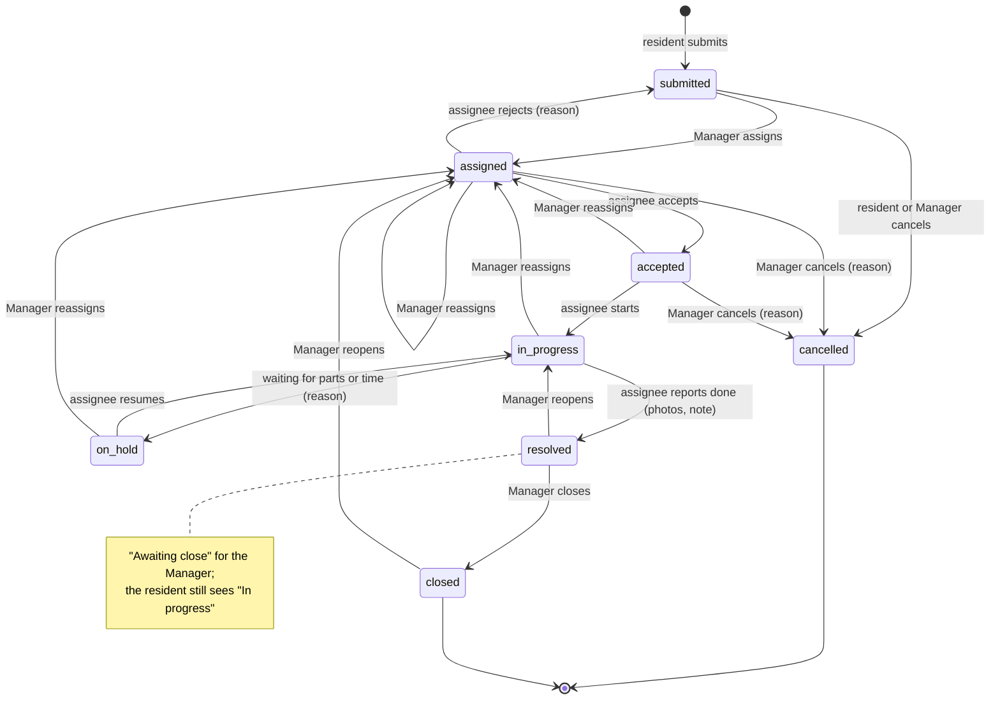

The diagram shows two checkpoints the design asks for: the assignee must accept before work starts (`K-Job-New`), and Manager checks the result before the resident is told it is done (`B-Ticket-Close`).

| From | To | Triggered by | Effect |
| --- | --- | --- | --- |
| — | `submitted` | Resident (owner, family, tenant) | Code `YC-YYMMDD-NNN` (DR-10); push to the Manager; resident sees "Sent" |
| `submitted` | `cancelled` | Resident | Allowed only in this state (`Request-Cancel`) |
| `submitted`, `assigned`, `accepted` | `cancelled` | Manager or Admin, with a mandatory reason (spam, duplicate, invalid; FR-42) | The resident is notified with the reason |
| `submitted` | `assigned` | Manager picks Technician or Guard, optional appointment and note | Push to assignee; resident sees "Accepted" |
| `assigned` | `submitted` | Assignee rejects with a reason (`wrong_skill`, `busy`, `needs_equipment`, `other`, plus a note of at most 300 characters) | Assignee cleared; push to the Manager (`S-Inbox`) |
| `assigned` | `accepted` | Assignee accepts | — |
| `assigned`, `accepted`, `in_progress`, `on_hold` | `assigned` | Manager reassigns | New assignee pushed; previous assignee notified |
| `accepted` | `in_progress` | Assignee starts | Resident sees "In progress" |
| `in_progress` | `on_hold` | Assignee marks waiting for parts or more time, with a reason | Resident sees the reason as a timeline entry |
| `on_hold` | `in_progress` | Assignee resumes | — |
| `in_progress` | `resolved` | Assignee reports done with before/after photos and a result note | Push to the Manager; ticket appears as "Awaiting close" |
| `resolved` | `closed` | Manager closes, optional result photos | Resident sees "Completed" and is invited to rate |
| `resolved` | `in_progress` | Manager reopens | Assignee pushed with the Manager's note |
| `closed` | `assigned` | Manager reopens a closed ticket | Same assignee by default, who must accept again |

Every transition is one conditional `UPDATE … WHERE status = :from`, and the transition table is a code constant used by the domain and by the authorization test. Reassigning to the same assignee is refused (422). A reopened ticket keeps its rating. Resident-facing statuses map from internal ones: `submitted` → Sent, `assigned`/`accepted` → Accepted, `in_progress`/`on_hold`/`resolved` → In progress, `closed` → Completed, `cancelled` → Cancelled.

### 8.2 Races and the arbiter

**The ticket row is the only arbiter**, through its `status`, `assignee_id` and `version`:

```sql
-- Resident cancels: only before anyone is assigned.
UPDATE tickets.ticket SET status = 'cancelled', version = version + 1
WHERE id = :id AND unit_id = :unit_id AND status = 'submitted'
RETURNING version;
-- 0 rows: Manager assigned it first. Return 409 ticket_already_accepted.

-- Assignee accepts: only their own, only while still assigned to them.
UPDATE tickets.ticket SET status = 'accepted', version = version + 1
WHERE id = :id AND status = 'assigned' AND assignee_id = :staff_id
RETURNING version;
-- 0 rows: Manager reassigned it meanwhile. Return 409 ticket_reassigned.
```

| Concurrent pair | Outcome |
| --- | --- |
| Resident cancels, Manager assigns | First commit wins; the loser gets 409 and a refreshed ticket |
| Assignee rejects, Manager reassigns | First commit wins; a reject after reassignment fails because `assignee_id` no longer matches |
| Two Manager users assign | Manager updates carry `version` (`If-Match`); the second gets 409 `version_conflict` |
| Assignee reports done, Manager reopens | Reopen requires `status = 'resolved'`; whichever runs second sees the new state |

Status changes and their notifications are one transaction with an outbox event, so a resident never receives "Completed" for a ticket whose close was rolled back.

### 8.3 Conversation and internal notes

Messages are rows of `ticket_message` with `visibility` `public` (resident and staff) or `internal` (staff only). Resident endpoints select `WHERE visibility = 'public'` in the repository method they use, and the response DTO for residents has no field that could carry an internal note; an authorization test (EXP-10) posts internal notes and asserts that no resident endpoint returns them. Attachments (`phase`: `report`, `before`, `after`, `result`) are stored in object storage: a resident sees the `report` attachments always, the `after` and `result` photos, the result note and the technician's timeline entries only once the ticket is closed (Manager checks first), and never the `before` photos. A staff message is public unless the author chooses "Internal note". A submission takes up to 5 images and at most 1 video (50 MB, 60 s); a message up to 3 images (DR-43, DR-45).

### 8.4 Assignment and workload

The assign dialog (`W-Ticket-Assign`, `B-Assign`) lists active staff of the chosen department with their open-ticket count (`status IN ('assigned', 'accepted', 'in_progress', 'on_hold')`), computed by one grouped query. Assignment is manual; automatic assignment is not in scope because Manager's judgement (skill, urgency, who is on shift) is not in the data. Manager marks a ticket `urgent`, which sorts it first in every list and is shown to the assignee. Assignable staff are active Technician and Guard accounts; the type only suggests a department. A Guard's read-only list of Technician tickets shows code, title, status, unit code, location and assignee, and hides the resident's name, phone and messages. A staff account holding open tickets cannot be locked until they are reassigned (409 `staff_has_open_tickets`; Admin may force with a new assignee; DR-46).

### 8.5 Rating

A resident of the unit can rate a closed ticket once, 1–5 stars and an optional comment, within 14 days of closing: `INSERT INTO ticket_rating ... ON CONFLICT (ticket_id) DO NOTHING`. Ratings feed the Technician's history (`K-History`) and the satisfaction report.

### 8.6 Ticket types and deadlines

Five ticket types (repair, cleaning, security, complaint, other) are seeded per building with Vietnamese and English names and can be enabled or disabled (`W-Ticket-Types`); a disabled type keeps its existing tickets. Deadlines and overdue alerts per type are phase 2 (decided, DR-47): the schema already has `ticket_type.resolution_hours` and `ticket.due_at`, set at creation but not read, and a feature flag marks where the overdue job will go; if the client asks for it earlier it is one scheduler job and two screen states.

## 9. Resident QR

A QR code proves "this person holds an active membership in this unit, and this is the newest code they generated in the last 15 minutes"; the guard's scan is checked on the server against the current membership, so a revoked, replaced or expired code reveals nothing.

### 9.1 Code format and verification

Each membership has one row in `access.qr_credential (membership_id, nonce, issued_at)`. Opening the QR screen (or pressing "new code") rotates the nonce and returns a signed token:

```
v1.<base64url(payload)>.<base64url(HMAC-SHA256(key_v1, payload))>
payload = { "b": building_id, "m": membership_id, "n": nonce, "cv": credential_version, "iat": 1791712800, "exp": 1791713700 }
```

```sql
-- Generate: rotating the nonce invalidates every earlier code of this membership.
UPDATE access.qr_credential
SET nonce = gen_random_uuid(), issued_at = now()
WHERE membership_id = :membership_id
RETURNING nonce, issued_at;
```

A guard scan (`G-Scan`) sends the raw string to `POST /access/scans`. The server checks, in order: format and signature; `b` is the guard's building; `exp > now()` (server clock); the stored nonce equals `n`; the membership (read through `ResidencyApi.getMembershipForScan`) is `active` and its `credential_version` equals `cv`. Locking, unlocking, removing, changing the type or transferring ownership increments the version in `residency`'s own transaction, so no cross-module transaction is needed and a screenshot taken before a lock stays dead after an unlock. The first failing check decides the result and every scan is logged in `access.qr_scan` (guard, membership if known, result, time; kept 90 days; an `invalid` result stores no membership). Two signing keys are valid during a rotation (`QR_KEYS`, the token prefix names the key).

| Result | Shown to the guard (`G-Scan-*`) |
| --- | --- |
| `valid` | Unit, person's name and avatar, member type, rights in the unit, the owner's name with the phone masked (`090••••123`) and a Call button that dials through `tel:`, "valid for 11 more minutes"; each such view is logged with guard and target |
| `expired` | Creation and expiry time only, advice to ask for a new code or look up the unit |
| `invalid` (bad signature, other building, replaced nonce, inactive membership) | Generic "invalid code" with the list of possible causes, no resident data |

Replaced and revoked codes share one `invalid` answer so that a scan cannot tell a guard (or someone with a guard's phone) whether the person still lives there.

The app shows a countdown computed from `exp` minus the server time sent with the token, so a phone with a wrong clock still counts correctly (`QR`, `QR-Expired`). A person in two units has one code per unit; the screen says which unit it belongs to.

### 9.2 QR credential: options and rationale

Option B is chosen: a signed stateless token checked against one nonce per membership. Options A and C were considered first.

**The problem.** A code must expire after 15 minutes, die immediately when replaced or when the member is locked, and work with the guard app online, without creating a table that grows with every opening of the screen.

#### Option A: random code stored per generation

Each opening inserts a random 128-bit code with an expiry into a table; the scan looks it up.

- **Pros**: simplest verification; revocation is a delete.
- **Cons**: one row per opening (residents open it at every pass through the gate, thousands of rows a day), which needs cleanup; replacing a code must delete the previous rows.
- **Verdict**: rejected; B gives the same guarantees with one row per membership.

#### Option B: signed token + nonce per membership (chosen)

- **Pros**: one row per membership; replacement and revocation are one update of the nonce; the signature rejects forged or foreign codes before any database read.
- **Cons**: one signing key to rotate (the `v1` prefix allows a second key during rotation); verification needs the server.
- **Verdict**: chosen.

#### Option C: offline time-based code (TOTP-like)

The app derives a code from a per-membership secret and the time; the guard app verifies offline.

- **Pros**: works without network at the gate.
- **Cons**: revocation needs the guard app to sync revocation lists; a stolen secret works until rotated; the guard must see the person's current rights anyway, which needs the server.
- **Verdict**: rejected; guards work at a desk with Wi-Fi, and offline verification would weaken the revocation rule.

#### Comparison and rationale

| Option | Rows | Immediate revocation | Works offline | Verdict |
| --- | --- | --- | --- | --- |
| A: stored codes | One per opening | Yes | No | Rejected |
| B: signed + nonce | One per membership | Yes | No | Chosen |
| C: time-based | One secret per membership | Only after sync | Yes | Rejected |

1. **Immediate revocation (FR-25, FR-26) eliminates C.**
2. **Of A and B, B has bounded storage and rejects forgeries without a lookup.**
3. **The server dependency of B is accepted**: the guard needs the server to show the person's current rights in any option.
4. **Verified by EXP-05**, which replaces and revokes codes and scans the old ones.

## 10. Notices and notifications

A notice is resolved to a fixed list of recipients at the moment it is sent, each recipient gets exactly one inbox entry and at most one push, and read statistics are counts over that list; nobody who joins the building later sees a notice as "unread".

### 10.1 Notice lifecycle

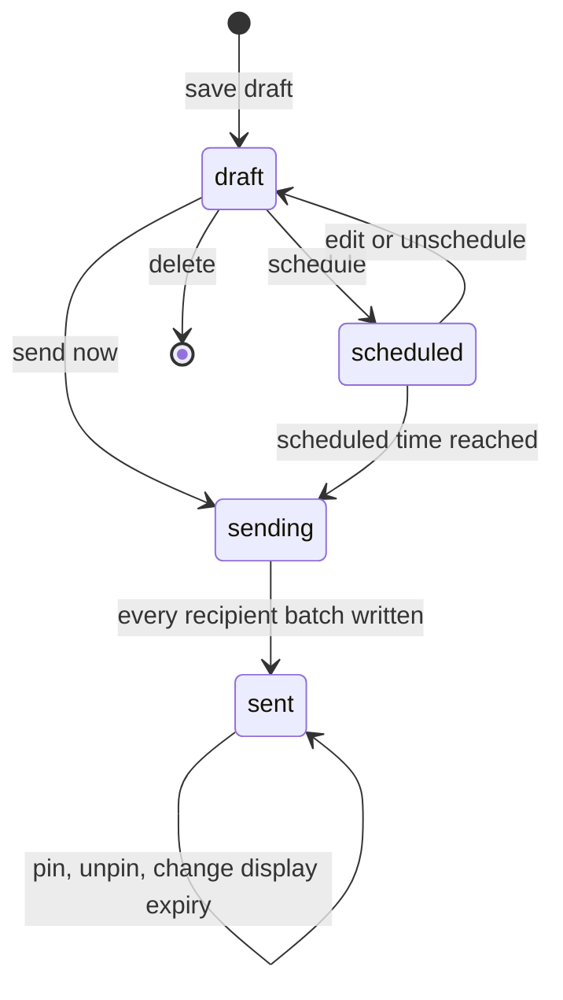

| From | To | Triggered by | Effect |
| --- | --- | --- | --- |
| — | `draft` | Manager saves | Content per language (`title`, `body` as TipTap JSON), category, audience, attachments |
| `draft` | `scheduled` | Manager sets a time | Editable until the time (`B-Notice-New`: "edit or cancel before sending") |
| `draft`, `scheduled` | `sending` | "Send now", or the scheduler | Audience resolved to recipient rows in batches |
| `sending` | `sent` | Last batch written | `sent_at`, recipient count frozen |
| `sent` | `sent` | Pin, unpin, change display expiry | Content and audience never change after sending; a correction is a new notice |

Categories are `general`, `maintenance`, `urgent`, `event`. Audiences are any combination of "residents" (all member types; helpers included, as the design's "Cư dân" checkbox says) and the staff roles Manager, Technician and Guard. Pinned notices appear on the resident home (`Main`); `display_until` hides a notice from lists after a date without deleting it.

### 10.2 Sending and fan-out

The scheduler runs every 30 seconds in the worker and claims due notices with the [SKIP LOCKED pattern](docs/references/architecture-reference/patterns/skip-locked-work-claiming.md):

```sql
UPDATE notices.notice SET status = 'sending', sending_started_at = now()
WHERE id IN (
  SELECT id FROM notices.notice
  WHERE status = 'scheduled' AND scheduled_at <= now()
  ORDER BY scheduled_at
  LIMIT 10
  FOR UPDATE SKIP LOCKED)
RETURNING id, building_id, audience;
```

For each claimed notice, the worker asks `residency` (resident accounts with an active membership in the building, deduplicated by account: a person in two units receives one notice; read page by page with a keyset cursor and 500 rows per page) and `identity` (active staff of the selected roles) for the recipients, and inserts one batch per transaction:

```sql
INSERT INTO notices.notice_recipient (notice_id, account_kind, account_id, member_type, locale)
SELECT :notice_id, r.kind, r.account_id, r.member_type, r.locale
FROM unnest(:kinds, :account_ids, :member_types, :locales) AS r(kind, account_id, member_type, locale)
ON CONFLICT (notice_id, account_kind, account_id) DO NOTHING;
```

The `ON CONFLICT` makes a worker that died midway safe to rerun: the worker updates `sending_heartbeat_at` after each batch, a notice whose heartbeat is older than 5 minutes is reclaimed (a long fan-out is never mistaken for a stuck one), and the batches already written are skipped. Each batch also writes one outbox event `notices.notice_sent_batch.v1` carrying the recipient IDs, which the notification module turns into inbox entries and push messages. `member_type` is the recipient's highest type at send time (owner > family > tenant > helper), stored for the read statistics per type (`W-Notice-Stats`).

At 5,000 recipients this is 10 batch inserts and 10 events; push goes out as 50 requests of 100 messages to Expo (section 10.4). EXP-06 measures the end-to-end time against NFR-04.

### 10.3 Read tracking

The single source of read state is `notice_recipient.read_at`. Opening a notice in any app (from the list or from the inbox, `POST /me/notices/{id}/read`) marks it read once, and the matching inbox entry is marked read by the `notices.notice_read.v1` event:

```sql
UPDATE notices.notice_recipient SET read_at = now()
WHERE notice_id = :notice_id AND account_kind = :kind AND account_id = :account_id AND read_at IS NULL;
```

The statistics (`B-Notice-Stats`, `W-Notice-Stats`) are grouped counts over `notice_recipient` (read, unread, per member type, push failed), and the unread list joins the recipient's name, unit and last app open through the residency and identity contracts for the page shown (20 rows), not for the whole list.

### 10.4 Inbox and push

The notification module, from the [reference architecture](docs/references/architecture-reference/06-notifications.md), owns one inbox for all personal events: fee published, payment received, ticket status changed or commented, vehicle approved or rejected, new assignment, and notices.

- **Templates, not text.** An inbox row stores a template key and parameters (`fee.batch_published`, `{batchName, amount, dueDate}`) and is rendered in the reader's current language, so switching to English changes old entries too ([pattern](docs/references/architecture-reference/patterns/store-templates-not-text-i18n.md)). Bilingual user content (a notice title) is stored in both languages and falls back to Vietnamese. A notice body is rich text limited to a small node set (paragraphs, two heading levels, lists, bold, italic, underline, links with `https`, `tel` or `mailto`, images by file id), validated by a schema and rendered by TipTap on the web and by one small renderer in `ui-native` on mobile (DR-50). The template catalog (fee published, recalled, due date extended, charge voided, reminder, payment received or voided, ticket events, vehicle events, notice, money to check, step-up done and so on) is in DR-53; a transfer of another amount creates no inbox entry and no push.
- **Unit tag.** Resident entries carry the `unit_id` they concern; tapping one switches the app to that unit first. Entries for a unit where the person's membership is no longer active are hidden.
- **Device tokens.** Each app registers its Expo push token with the current session; signing out or revoking the session deletes the token, so a sold phone stops receiving the previous owner's fee reminders.
- **Delivery.** The worker sends push messages to the [Expo Push API](https://docs.expo.dev/push-notifications/sending-notifications/) in requests of up to 100 messages (retried 3 times on 429 or 5xx), stores the returned tickets, and checks receipts 15 minutes later; `DeviceNotRegistered` deletes the token and other errors count as "push failed" for the notice statistics. Push respects the recipient's push setting and language; the in-app entry exists either way. **Payload privacy:** a push title and body come from templates and contain no amount, name, phone number or ticket text ("October fees published", "Payment received"); the data carries only a route and ids, and details are fetched in the app after sign-in (DR-52).
- **Unread count.** One counter query per app open (`count(*) WHERE read_at IS NULL`), indexed by account; the web CMS also receives new entries over SSE (module `realtime`, section 17), the mobile apps refresh on focus and on push.

## 11. Units, residents and import

The unit register is the reference every other module points to, so a unit is never deleted, only marked vacant, and every change of owner or occupancy is kept as history.

### 11.1 Units and resident profiles

A unit has a code unique in the building (`A-1508`), floor as an attribute (floors are not a module), type (number of bedrooms), area and occupancy (`occupied`, `rented`, `vacant`), matching `W-Units`. A resident profile belongs to the resident account and holds full name, email, national ID number (CCCD) and date of birth, entered by the Manager. The CCCD is stored encrypted and shown masked (`•••• 1234`) except on the detail view for the Manager and Admin; CCCD and date of birth are returned only to them (NFR-14), and the detail view and every export containing them are logged as one `pii.read` row (DR-40, DR-57, DR-58). Search covers unit codes, names typed with or without diacritics, a phone suffix of at least 4 digits and any 3 characters of a plate, with trigram and `unaccent` indexes (DR-41).

`unit_history` records owner changes, move-ins and move-outs with the actor and time (FR-18), and is what `W-Unit-Detail` shows as history.

### 11.2 Excel import

Units and owners are imported with the same two-step job as fee batches (section 5.3), in `residency.import_job`: upload, validate synchronously in the API, preview with row errors (`W-Import`), commit valid rows in one transaction keyed by the job. The uploaded file contains national ID numbers, so it is deleted when the job commits or expires (DR-22).

| Rule | Behaviour |
| --- | --- |
| Unit code exists | The row updates the unit (`W-Import`: "12 units exist, will be updated") |
| Phone | Normalized to E.164 with `libphonenumber-js`; invalid numbers are row errors |
| Same phone twice in the file for different people | Row error on the second row |
| Phone already has an account | The owner membership links to it; the name in the file does not overwrite the account's name, and the preview says so |
| Unit already has an owner and the file names another | Row error: ownership transfer is a deliberate action (section 7.7), not an import side effect |

Validation of 2,000 rows (NFR-12) is one pass in memory plus two set queries (existing units, existing phones), not one query per row.

## 12. Vehicles

A vehicle is visible to guards only after the Manager approves it; edits to an approved vehicle wait for approval while the approved data stays visible.

- **Registration** (`Vehicle-Add`): plate, type (car, motorbike, electric bike), brand and colour, a photo showing the plate, and both sides of the registration paper; uploads use presigned URLs and are verified before the vehicle is created ([pattern](docs/references/architecture-reference/patterns/presigned-upload-then-verify.md)).
- **States**: `pending → approved | rejected`, and `retired` (the owner, a family member or Manager removes a vehicle: it no longer shows to guards and its plate is free; Manager can retire all vehicles of a unit when a move-out is recorded, FR-43); a rejected vehicle can be edited and resubmitted (`Vehicles`: "edit and resend"). Editing an approved vehicle creates a `vehicle_revision` in `pending`; approval copies it onto the vehicle, so the guard never loses the plate during review.
- **Review** (`W-Vehicles`, `B-Vehicle-Review`): photos, sender and owner, the unit's approved vehicles. A building limit `max_cars_per_unit` (default 2, counting cars that are pending or approved) produces a warning, not a block, because exceptions exist; rejection takes a reason code (`over_limit`, `unclear_photo`, `paper_mismatch`, `other`) and a note, pushed to the sender.
- **Plates**: stored as typed and as a normalized key (upper case, no spaces, dots or dashes: `51F-123.45` becomes `51F12345`); `UNIQUE (building_id, plate_key) WHERE status IN ('pending', 'approved')` stops two units from registering one plate, and a pending revision reserves its plate key through a second partial unique index. Plate lookup (`G-Plate`) matches any 3 or more characters of the normalized key (a trigram index, because guards remember the last digits) among approved vehicles only.

## 13. Document library

Pages are visible to a reader only if the reader's role or member group is in the page's effective visibility, and only Manager and Admin write.

- **Tree**: folders nested by `parent_id` with an integer `position` per level (drag ordering in `W-Docs`); pages belong to one folder.
- **Visibility**: a folder lists the groups that may read it (resident, Manager, Technician, Guard); a page inherits the list of its nearest ancestor folder that sets one (depth at most 5) unless it overrides it. The effective readers are computed at read time with one recursive query up the folder chain and nothing is stored, so changing a folder's visibility never needs a recompute (DR-54). Admin and Manager always read and write; helpers read nothing.
- **Versions**: each save of a page appends a `page_version` (TipTap JSON per language, author, time); publishing points `published_version_id` at one of them; restoring copies an old version into a new one; the last 50 versions are kept and the published one never goes.
- **Search**: PostgreSQL full-text over title and plain text of the published version, with `unaccent` and the `simple` configuration so Vietnamese with or without diacritics matches; results are filtered through the same effective-readers expression.
- **Media**: video is a link (YouTube) with a preview card; attachments up to 20 MB with preview for PDF and images; Office files download. PDF export uses the same renderer as fee notices.

## 14. Dashboard and reports

Reports are read-only queries over the owning modules' tables, computed on request; there is no reporting copy of the data in phase 1.

| Report | Source | Notes |
| --- | --- | --- |
| Dashboard (`W-Dashboard`) | finance, tickets, vehicles, notices | Collection rate per fee month (Σ amount of paid charges / Σ amount of the non-void charges of the month's non-recalled batches), total debt (Σ open charges), open tickets (not closed or cancelled), unassigned tickets (`submitted`), pending vehicles, latest notice read rate, money to check (open rows of the money log) |
| Collection per fee item | `charge_line` of `paid` charges | A charge is paid whole, so an item total is the sum of its line amounts on paid charges; there is no pro-rata and no rounding rule (adjustment lines are their own item) |
| Debt aging | Section 5.10 query | Buckets not yet due, 1–30, 31–60, 61–90 and over 90 days past the batch due date in building time |
| Online transactions and money log | `payment_intent`, `gateway_event`, `webhook_rejection`, `statement_line` | Posted, pending, money to check, duplicates blocked, signature failures (`W-Transactions`, `W-Money-Log`) |
| Tickets and staff | `ticket`, `ticket_event`, `ticket_rating` | Count, average time from `submitted` to `resolved`, satisfaction, per assignee |

Each query is scoped to one building and served from indexes; at 5,000 units the heaviest (aging) stays under 200 ms. The dashboard is composed by the `reporting` module from read contracts of the owning modules, in parallel. Excel and PDF exports are `reporting.export_job` rows run by the worker (Excel streamed with `exceljs`, PDF with the shared renderer, at most 50,000 rows, 2 concurrent exports per user); the file is kept 7 days, delivered as a 15-minute signed URL, and the requester gets an inbox entry and an SSE event (`report.export_ready`, FR-48; DR-55). The report "template set once at setup" from the proposal is a per-building choice of columns and logo stored with the building settings. Cross-module reports read through module contracts (unit codes and owner names for one page of rows), never by joining another module's tables.

## 15. Configuration, audit and files

Settings, audit and files are infrastructure every module uses, so they are built once and cover all writes from day one.

- **Building settings** (`W-Building`): building and company names in both languages, address, hotline, hours, email, logo, time zone (`Asia/Ho_Chi_Minh`), and a validated settings document: default resident language, default due days (10), login lockout (5 tries, 15 minutes), `maxCarsPerUnit` (2), storage quota (50 GB), fee notice language (`vi`, `en` or both), report columns and `accountDeletionDays` (30, the cooling-off before an approved account deletion runs). Terms and privacy texts are versioned rows; publishing a new version asks every resident to accept again, and until they do only sign-in, account and terms endpoints answer (403 `terms_required`; FR-39, FR-41). A deletion request is approved by the Manager and executed after the cooling-off: sessions and devices are revoked, memberships removed, personal fields cleared and the phone freed, while financial rows keep the payer-name snapshot; it is refused while the account is the active owner of a unit (409 `owner_must_transfer`; DR-59).
- **Gateway configuration** (`W-Gateway`): the provider secrets (payOS Client ID, API key and Checksum key; each driver defines its own fields) are stored as one AES-256-GCM encrypted blob (`v1:<keyId>:<iv>:<ciphertext+tag>`) with keys from the environment, so rotation is "add a key, re-encrypt, remove the old one"; they are shown masked and testable with a "check connection" call. Only Admin edits them, with step-up (section 7.5); changing the receiving account while an intent is active is refused; every change is audited without the secret values (DR-33).
- **Audit log** (`W-Audit`): every staff use case that changes data writes one `audit_log` row **in the same transaction** as the change (actor, role, IP, action, object type and ID, changed fields before and after, reason), so a committed change is never without its audit row and a rolled-back one never leaves one; a failed audit insert fails the mutation. It is written by an application-layer wrapper around use cases rather than by triggers, so it records intent ("void manual payment, reason: wrong unit") and not just columns. A settlement from the webhook, the re-query or the statement writes its row with actor kind `system`. The detail view of a profile with CCCD and every export of it write one `pii.read` row (with the record count for an export). The application role cannot update or delete the table. Retention: 5 years for finance actions, 2 years for others, confirmed in the legal dossier; the ledger tables and the money log are never deleted (DR-57).
- **Files**: two private R2 buckets per environment (files and backups); every object has a row in `building.file_object` (pending, verified, attached, deleted) and keys are prefixed by environment, building and module. An S3 presigned PUT cannot cap the size, so the client uploads with a signed `Content-Type`, the server then reads the size with `HEAD` and deletes an oversized object, and reads the first bytes to check the real file type before the object is attached. Limits: images 10 MB (resized on the device), video 50 MB, attachments 20 MB, imports 5 MB, logo 1 MB; downloads are signed GET URLs of 15 minutes (5 for registration papers). The per-building quota (`W-System`: 50 GB) alerts Admin at 80% and refuses uploads at 100% (413 `quota_exceeded`); `pending` uploads older than 24 hours are deleted (DR-61).
- **Demo building**: the "trial account" of the proposal is a second building (`is_demo`) with seeded sample data and its own staff and resident accounts, in staging and in production (store review needs a working login). It uses the `fake` payment driver, the fixed OTP only for its flagged resident accounts, and no SMS or mail; the API refuses to boot in production if a flagged account belongs to a non-demo building. A nightly reset at 04:00 first asserts `is_demo` and refuses to run on any other building (DR-60).

## 16. Data model

This phase fixes the conceptual model, the core finance tables and the mandatory constraints; the full DDL of the other modules is written per module during implementation. Each module owns one PostgreSQL schema; references across modules are plain UUID columns without foreign keys, as in the [reference](docs/references/architecture-reference/01-modules-and-boundaries.md), so any module can later move to its own database.

### 16.1 Entities

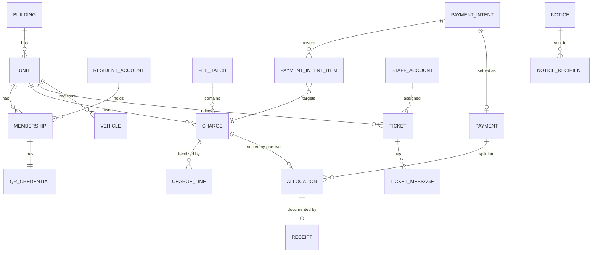

The diagram shows the logical relations; relations that cross a module boundary (membership → resident account, charge → unit, ticket → staff) are IDs checked through contracts, not foreign keys.

| Schema | Main tables |
| --- | --- |
| `identity` | `staff_account`, `resident_account`, `otp_challenge`, `password_token` (reset, invite, step-up), `refresh_family`, `refresh_token`, `rate_bucket` |
| `building` | `building`, `building_setting`, `gateway_config`, `terms_version`, `terms_acceptance`, `file_object`, `job_run` |
| `residency` | `unit`, `resident_profile`, `membership`, `unit_history`, `import_job` (units and owners) |
| `finance` | `fee_batch`, `charge`, `charge_line`, `payment`, `allocation`, `receipt`, `payment_intent`, `payment_intent_item`, `gateway_event`, `webhook_rejection`, `statement_import`, `statement_line`, `import_job` (fee batches), `document_counter`, sequence `order_code_seq` |
| `tickets` | `ticket_type`, `ticket`, `ticket_event`, `ticket_message`, `ticket_attachment`, `ticket_rating` |
| `access` | `qr_credential`, `qr_scan` |
| `vehicles` | `vehicle`, `vehicle_revision` |
| `notices` | `notice`, `notice_attachment`, `notice_recipient` |
| `notification` | `inbox_entry`, `device_token`, `push_ticket` |
| `wiki` | `folder`, `page`, `page_version`, `page_attachment` |
| `audit` | `audit_log` |
| `reporting` | `export_job` |
| `platform` | `idempotency_key` |
| `messaging` (per module) | `outbox`, `inbox` |

Core finance DDL (the columns of the other finance tables are in DR-13 and DR-34, and DOC-15 holds the full DDL):

```sql
CREATE TABLE finance.fee_batch (
  id           uuid PRIMARY KEY,
  building_id  uuid NOT NULL,
  code         text NOT NULL,                       -- PH-2610-01
  name         jsonb NOT NULL,                      -- {"vi": "...", "en": "..."}
  fee_month    date NOT NULL CHECK (extract(day FROM fee_month) = 1),
  due_date     date NOT NULL,
  status       text NOT NULL CHECK (status IN ('draft', 'published', 'recalled', 'closed')),
  replaces_batch_id uuid REFERENCES finance.fee_batch (id),
  published_at timestamptz, recalled_at timestamptz, closed_at timestamptz,
  version      int NOT NULL DEFAULT 1,
  UNIQUE (building_id, code)
);

CREATE TABLE finance.charge (
  id          uuid PRIMARY KEY,
  building_id uuid NOT NULL,
  batch_id    uuid NOT NULL REFERENCES finance.fee_batch (id),
  unit_id     uuid NOT NULL,
  unit_code   text NOT NULL,                        -- snapshot for documents
  amount      bigint NOT NULL CHECK (amount > 0),
  status      text NOT NULL CHECK (status IN ('draft', 'open', 'paid', 'void')),
  version     int NOT NULL DEFAULT 1,
  UNIQUE (batch_id, unit_id)
);
CREATE INDEX charge_open_by_unit ON finance.charge (building_id, unit_id) WHERE status = 'open';

CREATE TABLE finance.charge_line (
  id          uuid PRIMARY KEY,
  building_id uuid NOT NULL,
  charge_id   uuid NOT NULL REFERENCES finance.charge (id) ON DELETE CASCADE,  -- cascade only while draft
  position    smallint NOT NULL,
  kind        text NOT NULL DEFAULT 'fee' CHECK (kind IN ('fee', 'adjustment')),
  item_name   jsonb NOT NULL,
  quantity    numeric(12,3) NOT NULL DEFAULT 1 CHECK (quantity >= 0),
  unit_price  bigint NOT NULL CHECK (unit_price >= 0),
  amount      bigint NOT NULL,
  note        text,
  CHECK ((kind = 'fee' AND amount > 0) OR (kind = 'adjustment' AND amount <> 0)),
  UNIQUE (charge_id, position)
);

CREATE TABLE finance.payment (
  id                uuid PRIMARY KEY,
  building_id       uuid NOT NULL,
  unit_id           uuid NOT NULL,                   -- a payment exists only when it settles whole charges
  source            text NOT NULL CHECK (source IN ('cash', 'bank_transfer', 'online')),
  amount            bigint NOT NULL CHECK (amount > 0),
  received_at       timestamptz NOT NULL,
  payer_name        text,
  provider          text,                            -- 'payos' for online
  gateway_reference text,
  bank_reference    text,
  statement_line_id uuid,
  intent_id         uuid UNIQUE,
  client_key        text,                            -- Idempotency-Key of manual entries
  recorded_by       uuid,
  status            text NOT NULL CHECK (status IN ('posted', 'void')),
  void_reason       text,
  UNIQUE (provider, gateway_reference),
  UNIQUE (building_id, client_key)
);

CREATE TABLE finance.allocation (
  id          uuid PRIMARY KEY,
  building_id uuid NOT NULL,
  payment_id  uuid NOT NULL REFERENCES finance.payment (id),
  charge_id   uuid NOT NULL REFERENCES finance.charge (id),
  amount      bigint NOT NULL CHECK (amount > 0),    -- the full charge amount
  status      text NOT NULL CHECK (status IN ('live', 'void')),
  created_at  timestamptz NOT NULL DEFAULT now()
);
CREATE UNIQUE INDEX allocation_one_live_per_charge ON finance.allocation (charge_id) WHERE status = 'live';

CREATE TABLE finance.receipt (
  id               uuid PRIMARY KEY,
  building_id      uuid NOT NULL,
  number           text NOT NULL,
  allocation_id    uuid NOT NULL UNIQUE REFERENCES finance.allocation (id),
  charge_id        uuid NOT NULL,
  unit_id          uuid NOT NULL,
  amount           bigint NOT NULL CHECK (amount > 0),
  snapshot         jsonb NOT NULL,
  pdf_key          text,
  status           text NOT NULL CHECK (status IN ('issued', 'void')),
  issued_at        timestamptz NOT NULL DEFAULT now(),
  voided_at        timestamptz,
  external_invoice jsonb,                            -- reserved for a future e-invoice integration
  UNIQUE (building_id, number)
);
```

### 16.2 Required constraints

| Constraint | What it protects |
| --- | --- |
| `allocation UNIQUE (charge_id) WHERE status = 'live'`, and `charge.amount > 0` | A charge is paid at most once and an amount is never zero, even if code is wrong |
| Trigger: `charge.amount` and `charge_line` immutable unless `draft` | Published amounts never change under a code residents received |
| `payment UNIQUE (provider, gateway_reference)`, `UNIQUE (intent_id)` | One payment per bank transfer and per intent |
| `payment UNIQUE (building_id, client_key)` | A double-submitted manual entry is recorded once |
| `gateway_event UNIQUE (provider, reference)` | A repeated webhook or re-query is processed once |
| `payment_intent_item UNIQUE (charge_id) WHERE released_at IS NULL` | One active payment link per charge |
| `payment_intent UNIQUE (order_code)` | payOS order codes map to one intent |
| `receipt UNIQUE (building_id, number)`, `UNIQUE (allocation_id)` | Receipt numbers unique, one receipt per allocation |
| `import_job` committed by `UPDATE … WHERE status = 'validated'` | A double-pressed "Save" commits once |
| `membership UNIQUE (unit_id) WHERE member_type = 'owner' AND status <> 'removed'` | Exactly one owner per unit |
| `membership UNIQUE (account_id, unit_id) WHERE status <> 'removed'` | One membership per person and unit |
| `resident_account UNIQUE (phone)`, `staff_account UNIQUE (email)` | One account per phone, one per email |
| `unit UNIQUE (building_id, code)` | Unit codes unique per building |
| `vehicle UNIQUE (building_id, plate_key) WHERE status IN ('pending', 'approved')` | One active registration per plate |
| `notice_recipient PRIMARY KEY (notice_id, account_kind, account_id)` | One delivery per person per notice, safe re-run of fan-out |
| `ticket_rating PRIMARY KEY (ticket_id)` | One rating per ticket |
| `inbox (message_id, handler)` primary key | Each event handled once per handler |

### 16.3 Conventions

- IDs are UUIDv7 generated in the application (time-ordered, good index locality); human codes come from a `document_counter` table of the owning module (DR-10): receipts `BL-YYMM-NNNN` (gapless, by issue month), batches `PH-YYMM-NN`, payment intents `TT-YYMMDD-NNNN`, tickets `YC-YYMMDD-NNN`.
- Money is `bigint` đồng; quantities `numeric(12,3)`, line amounts rounded half up (DR-11).
- Times are `timestamptz`; servers and PostgreSQL run in UTC. Dates that are calendar days for people (due date, fee month) are `date`, and every business calendar computation uses the building's time zone (`building.time_zone`, default `Asia/Ho_Chi_Minh`): "today" is `(now() AT TIME ZONE tz)::date`, a charge is payable through the end of its due day and is overdue when today is after the due date (DR-09).
- Every business table has `building_id NOT NULL`, `created_at`, and an integer `version` on aggregates edited by several actors; tables that are global by nature (`rate_bucket`, `idempotency_key`) are on an explicit allow-list. Units and ledger rows are never deleted, drafts are hard-deleted, everything else changes `status` (DR-12).
- Bilingual content is `jsonb` `{"vi": …, "en": …}` with `vi` required.
- Every business table has `building_id NOT NULL` as the first column of its main indexes.
- Migrations are per module with drizzle-kit, history in `drizzle_<module>`, run before the new version starts; a destructive change takes two releases (expand, then contract).

## 17. Backend API

One JSON-over-HTTPS API serves the three clients under `/api/v1`, grouped by audience: `/staff/*` for staff tokens, `/me/*` for resident tokens with `X-Unit-Id`, `/auth/*` public, and `/payments/webhooks/*` for the payment gateway only.

### 17.1 Endpoints

| Group | Endpoint | Description |
| --- | --- | --- |
| Auth | `POST /auth/staff/login` | Email and password; returns tokens and role |
| | `POST /auth/staff/password-reset` · `POST /auth/staff/password` | Request a reset link; set a password from a reset or invite token |
| | `POST /auth/otp` · `POST /auth/otp/verify` | Request and verify a resident OTP |
| | `POST /auth/refresh` · `POST /auth/logout` | Rotate tokens; revoke the session and its push token |
| Resident | `GET /me` · `PATCH /me` | Account, memberships, language, push setting |
| | `GET /me/fees?status=open` · `GET /me/fees/{chargeId}` · `GET /me/receipts/{id}/pdf` | Charges of the selected unit, detail, receipt PDF |
| | `POST /me/payments/intents` · `GET /me/payments/intents/{id}` · `POST /me/payments/intents/{id}/cancel` · `POST /me/payments/intents/{id}/check` | Create, watch, cancel an intent; "I have transferred" |
| | `GET/POST /me/tickets` · `GET /me/tickets/{id}` · `POST /me/tickets/{id}/messages` · `POST /me/tickets/{id}/cancel` · `POST /me/tickets/{id}/rating` | Tickets of the selected unit |
| | `GET/POST /me/members` · `PATCH/DELETE /me/members/{id}` | Owner only |
| | `GET/POST /me/vehicles` · `PATCH /me/vehicles/{id}` | Vehicles of the selected unit |
| | `POST /me/qr` | Rotate and return the QR token |
| | `GET /me/notices` · `POST /me/notices/{id}/read` · `GET /me/inbox` · `POST /me/inbox/read-all` | Notices and inbox |
| | `GET /me/docs/tree` · `GET /me/docs/pages/{id}` · `GET /me/docs/search` | Document library |
| | `POST /me/uploads` | Presigned upload URL for ticket media and vehicle photos |
| Staff | `GET/POST /staff/units` · `GET/PATCH /staff/units/{id}` · `POST /staff/units/{id}/owner` | Units, ownership transfer |
| | `GET/POST /staff/residents` · `PATCH /staff/residents/{id}/phone` · `PATCH /staff/memberships/{id}` | Residents, login phone change, lock and remove |
| | `POST /staff/imports` · `GET /staff/imports/{id}` · `POST /staff/imports/{id}/commit` | Units/residents and fee imports; the `POST` takes the `fileKey` of an uploaded file and answers with the validated preview |
| | `GET/POST /staff/fee-batches` · `GET/PATCH /staff/fee-batches/{id}` · `POST .../{id}/publish` · `POST .../{id}/recall` · `POST .../{id}/close` · `POST .../{id}/pdf` | Batch lifecycle |
| | `PUT /staff/charges/{id}` · `POST /staff/charges/{id}/void` | Replace a draft charge's lines; void one open charge (Manager, Admin) |
| | `GET /staff/debts` · `GET /staff/units/{id}/debt` · `POST /staff/debts/reminders` | Debt and reminders |
| | `POST /staff/payments` · `POST /staff/payments/{id}/void` | Manual payment of whole charges, void |
| | `GET /staff/payments/intents` · `GET /staff/money-log` · `POST /staff/money-log/{kind}/{id}/review` · `GET /staff/units/{id}/money-log` | Online transactions, the money log and its review |
| | `POST /staff/statements` · `GET /staff/statements/{id}` · `POST …/lines/{lineId}/assign\|dismiss\|confirm` | Bank statement reconciliation |
| | `GET /staff/tickets` · `GET /staff/tickets/{id}` · `POST .../{id}/assign` · `POST .../{id}/transition` · `POST .../{id}/messages` | Tickets (role-filtered) |
| | `GET/POST /staff/notices` · `PATCH /staff/notices/{id}` · `POST .../{id}/send` · `GET .../{id}/stats` | Notices |
| | `GET/PATCH /staff/vehicles` · `POST /staff/vehicles/{id}/review` · `GET /staff/plates?q=` | Vehicles, plate lookup |
| | `POST /staff/access/scans` · `GET /staff/lookup?q=` | QR scan, unit lookup (Guard, Manager) |
| | `GET /staff/reports/{kind}` · `POST /staff/exports` | Reports and exports |
| | `GET/POST/PATCH /staff/accounts` · `GET/PATCH /staff/settings` · `GET/PUT /staff/gateway` · `POST /staff/step-up` · `GET /staff/audit` | Admin |
| Webhook | `POST /payments/webhooks/{provider}/{gatewayConfigId}` | Gateway confirmation (signature-verified, no token) |
| Health | `GET /health/live` · `GET /health/ready` | Liveness, readiness (database reachable) |

The table lists the main endpoints; DOC-51 numbers every endpoint (`E-xx`) and DR-73 adds the rest: public config, terms and account deletion, devices, sessions, fee history and receipts for the caller (paid history only from the start of the caller's membership), batch charges, re-issue and due-date edit, staff receipt PDFs, unit history, vehicle retirement, ticket types and staff cancellation, library writes and ordering, dashboard, exports, templates, storage, gateway check, and `GET /staff/events`, the server-sent event stream of the web CMS (inbox, tickets, money log, exports, revoked sessions; 3 streams per account, a heartbeat at least every 30 s because Cloudflare closes a silent proxied request after 100 s).

### 17.2 Core requests and responses

Creating a payment intent:

```http
POST /api/v1/me/payments/intents
Authorization: Bearer eyJ...
X-Unit-Id: 0192a3c4-...-a1508
Content-Type: application/json

{ "chargeIds": ["0192a3d0-...-01", "0192a3d0-...-02"] }
```

```json
{
  "id": "0192b7e1-5c2a-7f00-9a1d-3e4f5a6b7c8d",
  "status": "pending",
  "orderCode": 2610153,
  "amount": 2838000,
  "currency": "VND",
  "items": [
    { "chargeId": "0192a3d0-...-01", "batchCode": "PH-2610-01", "amount": 2488000 },
    { "chargeId": "0192a3d0-...-02", "batchCode": "PH-2610-02", "amount": 350000 }
  ],
  "qr": {
    "payload": "00020101021238570010A000000727...6304ABCD",
    "bankName": "Vietcombank",
    "accountNumber": "0011004567890",
    "accountName": "CONG TY QUAN LY ...",
    "content": "TT2FMZ9"
  },
  "unmatchedTransfer": null,
  "displayUntil": "2026-10-09T02:42:00Z",
  "serverTime": "2026-10-09T02:12:03Z",
  "startedBy": { "name": "Trần Minh Anh", "self": true }
}
```

Another intent already holds one of the charges:

```json
{
  "error": {
    "code": "payment_in_progress",
    "message": "This fee batch already has an open payment started by Trần Minh Khoa at 09:12.",
    "details": { "intentId": "0192b7d0-...", "expiresAt": "2026-10-09T03:12:00Z", "chargeIds": ["0192a3d0-...-01"] }
  }
}
```

When a transfer of another amount arrives for a pending intent, the status endpoint adds it so the app can show the mismatch message (and nothing else):

```json
{ "id": "0192b7e1-5c2a-7f00-9a1d-3e4f5a6b7c8d", "status": "pending",
  "unmatchedTransfer": { "amount": 2000000, "receivedAt": "2026-10-09T02:20:11Z" } }
```

Recording a manual payment (whole charges; the amount is computed, not sent):

```http
POST /api/v1/staff/payments
Authorization: Bearer eyJ...
Idempotency-Key: 6f1c2b8e-1d2a-4c55-9a77-3b0c9e7d1f20
Content-Type: application/json

{
  "unitId": "0192a3c4-...-a1508",
  "method": "cash",
  "chargeIds": ["0192a3d0-...-01"],
  "receivedOn": "2026-10-09",
  "payerName": "Trần Minh Anh",
  "note": "Paid at the office",
  "notifyResident": true
}
```

```json
{
  "paymentId": "0192b80a-...",
  "amount": 2488000,
  "receipts": [{ "number": "BL-2610-0155", "chargeId": "0192a3d0-...-01", "amount": 2488000 }],
  "warnings": [{ "code": "online_payment_open", "chargeId": "0192a3d0-...-01", "since": "2026-10-09T02:12:00Z" }]
}
```

The API refuses with 409 `charge_changed` and the fresh state when a selected charge is no longer open (paid meanwhile by another channel, or recalled) instead of allocating against a stale view, and with 422 `allocation_mismatch` when the request carries an `amount` that differs from the sum; `dryRun: true` returns the sum and the receipts that would be issued without saving.

### 17.3 Conventions

| HTTP | `code` | When |
| --- | --- | --- |
| 400 | `validation_failed` | Body or query does not match the schema; `details` lists fields |
| 400 | `otp_invalid` | Wrong or expired OTP |
| 401 | `unauthenticated` | Missing or expired access token; the client refreshes once |
| 401 | `invalid_signature` | Webhook signature check failed |
| 403 | `forbidden` | Role or member type may not do this |
| 403 | `membership_inactive` | `X-Unit-Id` is not an active membership of the caller |
| 404 | `not_found` | Object absent or outside the caller's building or unit (never 403, to avoid confirming existence) |
| 404 | `phone_not_registered` | OTP requested for an unknown phone |
| 409 | `version_conflict` | `If-Match` version is stale |
| 409 | `charge_changed` | A selected charge is no longer open (paid by another channel, or recalled) |
| 409 | `payment_in_progress` | Another active intent holds a selected charge |
| 409 | `batch_has_payments` | Recall refused because a charge is paid |
| 409 | `import_expired` | The import job is older than 24 hours |
| 409 | `phone_in_use`, `staff_has_open_tickets`, `owner_must_transfer` | Phone already has an account; staff holds open tickets; account is the active owner of a unit |
| 409 | `ticket_already_accepted`, `ticket_reassigned` | Ticket race lost (section 8.2) |
| 413 | `quota_exceeded` | The building's file quota is full |
| 422 | `allocation_mismatch`, `idempotency_key_reuse` | Manual payment amount differs from the sum of its charges; an `Idempotency-Key` reused with another body |
| 423 | `account_locked` | Staff sign-in locked; `details.retryAfter` |
| 426 | `upgrade_required` | The app version is below the minimum (`X-App-Version`, `X-App-Id`) |
| 429 | `rate_limited` | OTP, sign-in, intent, QR or reminder limits; `Retry-After` header |
| 502 | `gateway_unavailable` | payOS failed while creating a link |
| 503 | `sms_unavailable` | The SMS provider is down; OTP cannot be sent |
| 403 | `terms_required` | The latest terms version is not accepted; `details` names it |

- **Errors** have the shape `{ "error": { "code", "message", "details" } }`; `message` is in the caller's language, `code` is stable for clients.
- **Money** is an integer number of đồng with `"currency": "VND"`; clients format it (`2.838.000 đ` in Vietnamese, `₫2,838,000` in English).
- **Time** is ISO 8601 UTC; responses that drive a countdown include `serverTime`.
- **Pagination** is cursor-based (`?cursor=…&limit=20`, an opaque cursor, response `nextCursor`) for lists that grow (inbox, transactions, audit); small admin lists use page numbers as the design shows ("1–10 of 240"), capped at 10,000 rows.
- **Writes** that edit an existing object take `If-Match: <version>` (single resources return an `ETag`); creates that can be retried take `Idempotency-Key`, kept 24 hours in `platform.idempotency_key`: the same key and body replays the stored response with `Idempotent-Replayed: true`, the same key with another body is 422, and an in-flight duplicate waits on the row lock. A manual payment also keeps its own unique key as a second net.
- **Contract**: TypeBox schemas generate OpenAPI and the Eden Treaty types used by the three clients, so a schema change breaks the client build instead of production.
- **Tracing**: `x-request-id` is returned on every response and carried into outbox headers, as in the [reference](docs/references/architecture-reference/03-runtime-and-operations.md).

## 18. User interface

Three clients share one design system, one i18n catalog and one typed API client; the screens are specified by the [design canvas](docs/references/design-screens.md) (115 artboards), and this section fixes only the structure and the behaviour the design cannot show.

### 18.1 Screen flows

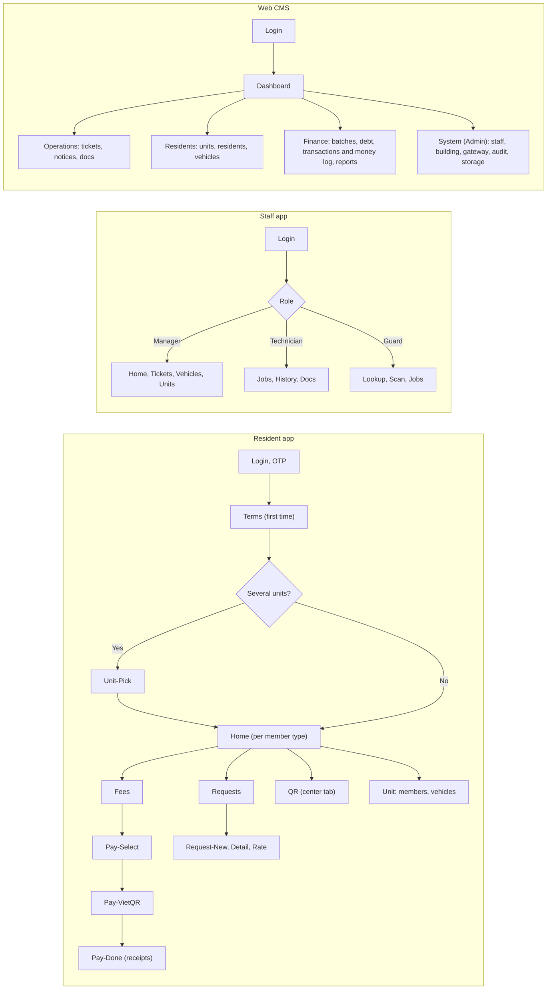

The diagram shows one entry per app and the role or member type branching right after sign-in; inside each branch the tab bar and menus follow the design.

| App | Area | Screens (design artboards) | Serves |
| --- | --- | --- | --- |
| Resident | Sign-in | `Login`, `OTP`, `Terms`, `Terms-Update`, `Unit-Pick` | UC-14, UC-27 |
| | Home | `Main`, `Home-Member`, `Home-Tenant-Pay`, `Home-Tenant-NoPay`, `Home-Helper` | Section 7.4 |
| | Fees and payment | `Fees`, `Fees-NoPay`, `Fee-Detail`, `Fee-History`, `Pay-Select`, `Pay-VietQR`, `Pay-Mismatch`, `Pay-Done` | UC-03 |
| | Requests | `Requests`, `Request-New`, `Request-Detail`, `Request-Cancel`, `Request-Done` | UC-07, UC-10 |
| | Unit, members, vehicles | `Unit-Owner`, `Unit-Member`, `Members`, `Member-Add`, `Member-Actions`, `Vehicles`, `Vehicle-Add` | UC-12, UC-15 |
| | QR, notices, docs, account | `QR`, `QR-Expired`, `QR-Helper`, `Notices`, `Notice-Detail`, `Inbox`, `Docs`, `Doc-Page`, `Account`, `Account-Phone`, `Account-Deletion`, `Sessions`, `Contact` | UC-16, UC-11, UC-26, UC-27 |
| Staff | Manager | `B-Home`, `B-Tickets`, `B-Ticket-Detail`, `B-Assign`, `B-Ticket-Close`, `B-Vehicles`, `B-Vehicle-Review`, `B-Vehicle-Reject`, `B-Units`, `B-Unit-Detail`, `B-Notice-New`, `B-Notice-Stats` | UC-08, UC-10, UC-12 |
| | Technician | `K-Jobs`, `K-Job-New`, `K-Job-Reject`, `K-Job-Working`, `K-Job-Done`, `K-History` | UC-09 |
| | Guard | `G-Lookup`, `G-Scan`, `G-Scan-OK`, `G-Scan-Expired`, `G-Scan-Invalid`, `G-Unit`, `G-Plate`, `G-Jobs`, `G-Jobs-Tech` | UC-16, UC-09 |
| | All staff | `S-Login`, `S-Forgot`, `S-Inbox`, `S-Docs`, `S-Doc-Page`, `S-Account` | UC-17 |
| Web | Operations | `W-Dashboard`, `W-Tickets`, `W-Ticket-Detail`, `W-Ticket-Assign`, `W-Ticket-Types`, `W-Ticket-Cancel`, `W-Notices`, `W-Notice-Edit`, `W-Notice-Stats`, `W-Docs` | UC-08, UC-11 |
| | Residents | `W-Units`, `W-Unit-Detail`, `W-Residents`, `W-Resident-Add`, `W-Import`, `W-Vehicles` | UC-12, UC-13 |
| | Finance | `W-Fees`, `W-Fee-Import`, `W-Fee-Batch`, `W-Fee-Notice`, `W-Fee-Record`, `W-Fee-Recall`, `W-Fee-Reissue`, `W-Charge-Void`, `W-Debts`, `W-Transactions`, `W-Money-Log`, `W-Statement`, `W-Reports`, `W-Export-Center` | UC-01 to UC-06, UC-21, UC-25 |
| | System | `W-Staff`, `W-Staff-New`, `W-Building`, `W-Gateway`, `W-Step-Up`, `W-Audit`, `W-System`, `W-Login`, `W-Reset`, `W-Profile` | UC-17, UC-26 |

The design (115 artboards) predates several decisions, and where they differ this document wins (DR-72): phase 1 shows VietQR only (VNPay is hidden on `Pay-Select` and `W-Gateway` is restricted to the chosen provider), `W-Fees` adds the `recalled` status, and the transfer content follows section 6.3. The screens that the design does not draw (`Pay-Mismatch`, `W-Money-Log`, `W-Statement`, `W-Fee-Recall`, `W-Fee-Reissue`, `W-Charge-Void`, `W-Export-Center`, `W-Ticket-Cancel`, `W-Step-Up`, `Terms-Update`, `Account-Deletion`, `Sessions`, and the component `UnitMoneyPanel`) are designed before the phase that needs them. `W-Fee-Record` has no amount field and no credit option: the Manager picks whole charges and sees the computed sum. The payment QR screen as the design draws it (`Pay-VietQR`), with its state while waiting for the bank:

```
+--------------------------------------+
| <  Scan to pay        VietQR, A-1508 |
|                                      |
|         +------------------+         |
|         |   [ VietQR code ]|         |
|         +------------------+         |
|   Waiting for bank confirmation ...  |
|                                      |
|   Amount            2,838,000 VND    |
|   Batches  10/2026 batch 1 and 2     |
|   Bank     [BANK], [ACCOUNT NO]      |
|   Content  TT2FMZ9         [Copy]    |
|                                      |
|  The app moves to the receipt when   |
|  the money arrives. Keep amount and  |
|  content unchanged.                  |
|                                      |
|  [ Save QR image ] [ I transferred ] |
|  Change payment method               |
+--------------------------------------+
```

### 18.2 Technical notes

- **Shared code.** `packages/ui-native` implements the design system's components for both Expo apps from the same tokens as the web (`packages/design-tokens`); `packages/mobile-core` holds the API client, auth and refresh, unit context, push registration and i18n setup. Styling is NativeWind driven by the same tokens; non-money screens keep a persisted query cache (24 hours at most), while the payment and QR screens are always online (DR-70).
- **Unit context.** The resident app keeps the selected unit in secure storage and in a query-key prefix, so switching units drops the previous unit's cached data instead of showing it under the new unit for a moment.
- **Server state.** TanStack Query everywhere; mutations that race (assign, accept, cancel, manual payment) refetch on 409 and show the fresh state with the server's message, never retry blindly.
- **Payment screen.** Polls the intent every 2 s for the first minute and every 3 s after, while visible, stops in the background, resumes on focus; shows the mismatch message when the status carries `unmatchedTransfer`; "Save QR image" writes to the photo library so a resident can pay from a bank app on the same phone; the countdown uses `serverTime`.
- **QR screen.** Brightness raised while visible; countdown from server time; regenerates on focus if less than 60 s remain.
- **Guard scanner.** `expo-camera` barcode scanning with torch toggle; a manual unit lookup is one tap away when the resident cannot open the app (`G-Scan-Expired`).
- **Uploads.** Photos are resized on the device to at most 1,920 px and JPEG quality 0.8 before upload; video up to 60 s and 50 MB.
- **Language and formats.** VI/EN switch in every app, remembered per account; dates `09/10/2026` and amounts `2.838.000 đ` in Vietnamese, `Oct 9, 2026` and `₫2,838,000` in English.
- **States.** Every list has empty, loading and error states; the apps show an offline banner and keep the last data read-only when the network drops.
- **Accessibility.** Touch targets at least 44 px, contrast 4.5:1 for text, icon buttons labelled (the design already labels them).
- **Updates.** EAS Update ships JavaScript fixes without store review; the API refuses app versions below a minimum (`426 upgrade_required`) when a breaking change ships.

## 19. Deployment and fault tolerance

When something fails, the system leans to "slower but correct": money waits as pending or in the money log rather than being guessed, notifications are late rather than lost, and a failing external service degrades only the feature that needs it.

### 19.1 Deployment

The topology is decided in DR-83: Cloudflare in front, one VPS per environment behind it.

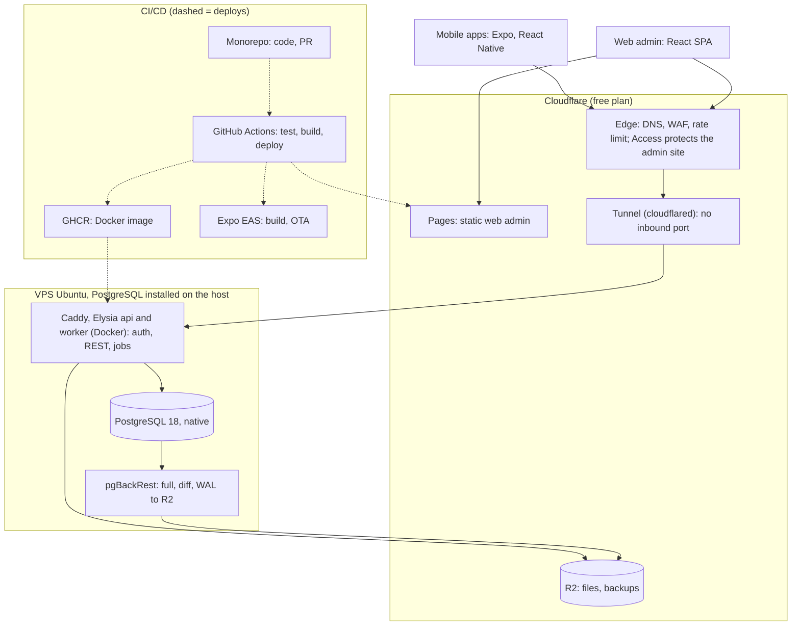

Cloudflare Pages serves the web CMS; the mobile apps and the web CMS reach the API through the Cloudflare edge and a Tunnel, so the VPS has no inbound port. On the VPS, Docker Compose runs Caddy, `cloudflared`, two API containers, one worker and monitoring; PostgreSQL 18 runs natively on the host and pgBackRest archives it to R2 (section 22).

| Component | Deployment | Replicas | Notes |
| --- | --- | --- | --- |
| Cloudflare edge | Free plan | — | DNS, managed WAF, one rate-limiting rule on `/api/v1/auth/*`; Access in front of the admin site only |
| Web CMS | Cloudflare Pages | — | Static, cross-origin to the API (CORS allows only the admin origin) |
| Tunnel | `cloudflared` container | 1 | Only way in: the firewall denies all inbound traffic, SSH included |
| Caddy | Container | 1 | Plain HTTP inside the host, reverse proxy with health checks on `/health/ready` |
| API | Container, `APP_ROLES=api` | 2 | Stateless; rolling restart one at a time |
| Worker | Same image, `APP_ROLES=worker` | 1 | Outbox relay and every job; jobs that must run once take an advisory lock, so a second worker is safe |
| PostgreSQL | Native on the VPS, version 18 | 1 primary | 8 GB host; pgBackRest full weekly, differential daily 02:00, WAL archive, RPO ≤ 5 min |
| Object storage | Cloudflare R2, private buckets | — | Presigned PUT (R2 has no presigned POST); separate bucket for backups |
| Staging | Same layout on a smaller VPS | 1 each | Own Tunnel, R2 buckets and Pages branch; payOS sandbox, SMS to an allow-list of test phones, separate push project |

Configuration comes only from environment variables (validated at boot); secrets (database URL, JWT signing keys, QR signing key, settings encryption key, payOS credentials encryption, SMS and SMTP credentials) live in the host's secret store and never in the image or the repository. Cloudflare's edge and R2 are outside Vietnam, so data residency under Decree 13/2023/NĐ-CP is an open question recorded in DR-58 and DR-83, to be settled before real personal data is loaded.

### 19.2 Observability and alerting

Logs are JSON (pino) with `request_id`, `building_id` and `account_id`, collected by Grafana Alloy into Loki (14 days); there are no traces in phase 1, the request id is enough to follow one request (DR-63). Metrics come from the application and from the database (outbox lag, pending intents, money to check, job last success) on an internal `/metrics` port scraped by Prometheus; Alertmanager sends alerts by email and Telegram, and a Critical alert repeats every 30 minutes until acknowledged. An external probe of `/api/v1/health/ready` measures availability.

| Alert | Condition | Level |
| --- | --- | --- |
| Ledger invariant | Nightly check returns any row | Critical |
| Payments stuck | Intents `pending` older than 60 min not moving to `expired`, or more than 5 `creating` older than 2 min | Critical |
| Webhook signatures | More than 3 rows in `webhook_rejection` in 10 min | Warning (possible misconfiguration or attack) |
| Outbox lag | Oldest unpublished message older than 2 min | Warning |
| Dead letters | Any message in the dead-letter state | Warning |
| SMS failures | More than 10% failures over 15 min | Warning |
| Backup | No successful backup in 26 h | Critical |
| Storage | Bucket use above 80% of quota | Warning |
| API errors | 5xx above 2% over 5 min | Critical |

### 19.3 Behavior under failure

| Failure | Detection | System behavior | Recovery |
| --- | --- | --- | --- |
| PostgreSQL unavailable | Connection errors, readiness fails | Every request returns 503; webhooks answer 5xx so payOS retries; nothing is half-written | Resumes when the database is back; re-query settles anything payOS gave up on |
| API instance crashes mid-request | Container restart | The transaction rolls back; the client retries with the same `Idempotency-Key` | Automatic |
| Worker down | Outbox lag alert | Requests still succeed; push, SMS, PDF, re-query and scheduled notices wait in the outbox | Worker restart drains the backlog in order |
| payOS down when creating a link | 5xx or timeout | Intent `failed` after one `GET` check; the resident sees "payment unavailable, try later or pay at the office" | Next attempt creates a new intent |
| payOS webhook lost or never sent | Intent still `pending` after 5 min | Re-query every 5 min for 60 min settles it | Statement reconciliation catches anything later (section 6.7) |
| payOS sends a webhook twice or out of order | Duplicate `(provider, reference)` | Second one is a no-op returning 200 | — |
| Transfer arrives after expiry or recall | Confirmation for a non-pending intent | Posted if the amount is exact and every charge is still open; otherwise written to the money log (`charge_recalled`, `charge_already_paid`) | Manager checks the row and refunds outside the system |
| A transfer of another amount arrives | Confirmation with an amount different from the intent | Nothing is posted; the intent stays `pending`; the resident sees the mismatch message; every Manager and Admin gets an inbox entry | Manager checks it by hand (section 5.7) |
| Tunnel or Cloudflare outage | Uptime probe | The API is unreachable and payOS webhooks may be missed | The re-query job and the statement reconciliation catch up (section 6.7) |
| VPS lost | Probe, alerts | Service stops | Rebuild from the compose files and restore pgBackRest to a point in time (RPO ≤ 5 min, RTO ≤ 4 h); then re-query intents of the gap, import the statement for it and review the `unknown_order` rows (DR-66) |
| SMS gateway down | Send errors | OTP requests answer 503 `sms_unavailable`; already signed-in residents are unaffected (refresh tokens last 180 days) | Outbox retries for 5 min, then gives up (a stale OTP is useless) |
| Expo Push down or token invalid | HTTP errors, receipts | In-app inbox still has every entry; push retried 3 times with backoff; invalid tokens deleted | Automatic |
| SMTP down | Send errors | Reset and invite links delayed; outbox retries with backoff | Automatic |
| Object storage down | Upload or presign errors | Ticket and vehicle submissions without media fail with a clear message; text-only actions continue | Automatic |
| Clock skew on a phone | — | QR countdown and expiry use server time | — |
| Bad deployment | Error-rate alert | Previous image redeployed, previous Pages deployment and previous EAS Update; migrations are backward-compatible for one release (expand, then contract) | Manual rollback, under 10 minutes |

### 19.4 Invariant checks and isolation guard

- The nightly ledger check (section 5.10) covers money; a similar weekly check covers memberships (one owner per unit, no active membership on a removed account) and notices stuck in `sending`.
- Building isolation is enforced in code by repositories that require a `BuildingScope` argument, and checked in CI by a lint rule that flags Drizzle queries on business tables without a `building_id` condition; EXP-10 tries cross-building and cross-unit access on every endpoint.

### 19.5 Minimum security

- TLS ends at Cloudflare and the VPS has no inbound port (Tunnel); HSTS, CSP and the other headers come from the Pages `_headers` file for the web CMS and from Caddy for API responses; CORS allows only the admin origin; Access protects the admin site and never the API, so mobile apps and the gateway can reach it (DR-64, DR-83).
- Staff passwords with argon2id, lockout, reset links single-use and short-lived; OTP hashed, attempt-limited and rate-limited (sections 7.3, 7.5).
- Every endpoint declares its audience (staff role or resident capability) in its route definition; there is no default-allow route.
- `404` for objects outside the caller's scope; IDs are UUIDv7, never sequential.
- payOS credentials and other integration secrets encrypted at rest (one blob per gateway configuration); never logged; masked in the UI. Keys (JWT, QR, OTP HMAC, settings and personal-data encryption) are Docker secrets read from files, rotated with an overlap; the personal-data key has a sealed offline copy, because losing it makes the national ID numbers unrecoverable (DR-65).
- Uploads: presigned PUT to a key the server chose, size and type verified after the upload, served through short-lived signed URLs; no public bucket.
- Personal data: CCCD (an encrypted column) and date of birth visible only to the Manager and Admin, detail views and exports logged; Cloudflare, Expo, FCM and APNs are the only cross-border processors, and push carries no personal text; account deletion removes memberships and personal fields and keeps financial records with the payer name snapshot, as accounting requires.
- Dependencies scanned in CI (gitleaks, Trivy, CodeQL, as in the reference repository).

### 19.6 Scaling

Phase 1 load is a few requests per second with peaks of about 20 per second after a batch is published; one PostgreSQL and two API containers carry it with a wide margin. The real limits come in this order: (1) PDF rendering CPU when bulk notices grow beyond a few thousand, solved by a second worker since jobs are claimed with `SKIP LOCKED`; (2) the per-building receipt counter row, which serializes receipt issuing at about one per few milliseconds, far above any building's payment rate; (3) PostgreSQL connections, solved with PgBouncer before adding API replicas. Adding replicas without measuring EXP-07 again is not done.

## 20. Testing and evaluation

Correctness of money and access is proven by tests that run the real SQL on a real PostgreSQL under concurrency and compare against a deliberately naive baseline; everything else is covered by ordinary unit, integration and end-to-end tests.

### 20.1 Test strategy

| Type | Scope | Tool |
| --- | --- | --- |
| Unit | Domain rules: state machines (batch, intent, ticket, vehicle), policy table, amount and allocation calculations, QR token encode/verify, payOS signature | `bun test` |
| Integration | Repositories and use cases on PostgreSQL 18 in a container, including every conditional update and constraint of section 16.2 | `bun test` + Docker PostgreSQL |
| Contract | payOS adapter against recorded sandbox responses and webhook samples when the Owner reports a sandbox, otherwise the `fake` driver is the contract; Expo Push and SMS adapters against fakes | `bun test`, payOS sandbox in staging if one exists (DR-25, DR-26) |
| Concurrency | The races of sections 5.8, 6.5 and 8.2 with N parallel transactions | Custom harness (`apps/api/test/race`) |
| Authorization | Every endpoint × every role and member type × own/foreign unit and building | Generated test matrix (EXP-10) |
| End-to-end | Web CMS flows (import and publish a batch, record payment, assign ticket) | Playwright |
| Mobile | Critical resident and staff flows on simulators | Maestro |
| Load | Mixed API traffic, payment burst, notice fan-out | k6 |
| Architecture | Layer and module boundaries, building-scope lint | dependency-cruiser, Biome plugin |

Integration and race tests run on the compose PostgreSQL (a service container in CI); each test file clones a migrated template database, and the race harness opens N separate connections released together by a barrier. Fakes are in-memory inbox, storage and mailer, a fake clock, the `fake` payment driver and a fake SMS sender. Coverage targets (finance and identity 90/85 line/branch, other modules 70–80) are reported in CI as warnings and never fail the build (DR-77). Each experiment runs five times and reports min, median and max; correctness metrics must hold in every run and latency in the median (DR-78).

### 20.2 Experiments

| ID | Experiment | Method | Metrics | Expected |
| --- | --- | --- | --- | --- |
| EXP-01 | Duplicate and late webhooks | 1,000 paid intents; each confirmation delivered 1–5 times in random order, some after expiry, some with a forged signature first; measure webhook-to-visible latency with the app polling every 2–3 s | Payments per reference; receipts per allocation; latency | Exactly 1 payment per reference; 0 duplicate receipts; p95 latency ≤ 5 s |
| EXP-02 | Webhook vs re-query | For 1,000 intents, fire the webhook and the re-query at the same instant (barrier), repeat 10 times | Payments per intent; deadlocks; errors | 1 payment per intent; 0 deadlocks; 0 errors returned to payOS |
| EXP-03 | Online vs manual on one charge, against a baseline | 500 charges; for each, an online settlement of the exact amount and a manual payment of the charge start together; run against the chosen design and against a baseline that reads the charge status, decides in code and writes back without the conditional predicate | Charges with two live allocations; payments not equal to Σ allocations; log rows for the losers | Chosen: exactly one payment wins per charge, 0 charges settled twice, the loser's transfer is a money-log row. Baseline: charges settled twice observed (documents why the conditional update exists) |
| EXP-04 | Recall vs payment | 200 published batches of 50 charges; recall each while 1–5 webhooks for its charges arrive | Batches recalled with a live allocation; confirmed amounts neither posted nor in the money log | 0 recalled batches with live allocations; every confirmed amount posted or in the money log |
| EXP-05 | QR revocation | Generate a code, regenerate, lock the member, unlock the member, wait past expiry; scan each old code immediately after each change; 1,000 rounds | Stale codes accepted; data in invalid responses | 0 stale codes accepted; 0 personal fields in `expired` or `invalid` responses |
| EXP-06 | Notice fan-out | Send one notice to 5,000 generated recipients with a fake Expo endpoint answering in 200 ms | Time from send to last inbox row and last push request | ≤ 60 s; rerun after killing the worker midway produces no duplicate rows |
| EXP-07 | API load | k6 mix (60% reads of home, fees, tickets; 25% writes; 15% list and search) at 50 requests/s for 15 min on the 2 vCPU, 4 GB staging host with one API container, API, worker and PostgreSQL co-located, so the numbers are conservative | p95, p99, error rate, DB CPU | p95 ≤ 300 ms, p99 ≤ 800 ms, errors < 0.1% |
| EXP-08 | Bulk PDF | Generate fee notices for 240 and for 5,000 units in VI, EN and bilingual | Duration, worker memory | 240 in ≤ 2 min; 5,000 in ≤ 30 min; memory ≤ 1 GB |
| EXP-09 | OTP abuse | Request OTPs for one phone 50 times and from one IP for 200 phones in one hour; brute-force codes | SMS sent; successful guesses | ≤ 5 SMS per phone, ≤ 20 challenges per IP; 0 successful guesses within 5 attempts per challenge |
| EXP-10 | Authorization matrix | Call every endpoint as every role and member type, on own and foreign unit and building, including internal ticket notes | Unexpected 2xx responses | 0 |
| EXP-11 | Ledger drift detection | Inject 20 kinds of corruption (an allocation off by 1 đồng, an orphan allocation, two live allocations on one charge, an allocation on a void charge, a receipt number gap, a duplicate receipt, a payment not equal to Σ allocations, a `posted` log row without a payment, an intent `paid` without a payment, two active intents on one charge and so on; the list is in DR-78) into a copy of staging data | Violations reported by the nightly check | All 20 reported; 0 false positives on clean data |
| EXP-12 | Restore drill | Restore the latest pgBackRest backup plus WAL to a chosen point in time and the files bucket to an empty host, run the invariant checks and a smoke test | Time to a working system; data loss window | ≤ 4 h; loss ≤ 5 min; invariant checks clean |

EXP-01 to EXP-04 prove the money invariant (NFR-01, NFR-02) and are the acceptance tests of the finance and payment stages; EXP-05, EXP-09 and EXP-10 prove the access invariant (NFR-06 to NFR-08); EXP-06 to EXP-08 calibrate load targets (NFR-03 to NFR-05) on the real machine; EXP-11 and EXP-12 prove that a failure would be noticed and recovered from (NFR-09, NFR-11).

## 21. Implementation plan

Money and access come first because every other module depends on units, memberships and the policy, and because the money mechanisms are the ones that cannot be fixed after go-live without touching real payments; each stage ends with something Manager can use on staging.

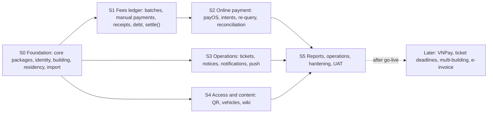

S1 and S2 are sequential because settlement reuses the allocation path; S3 and S4 can run in parallel with S1–S2 once S0 is done.

| Stage | Content | Results |
| --- | --- | --- |
| S0 Foundation | Monorepo with the reference packages vendored as `core-*`; three app shells with design tokens and i18n; staff and resident identity (password, OTP, sessions); building settings; units, profiles, memberships, policy; Excel import of units and owners; audit log; file uploads | Residents of the sample building imported on staging; residents sign in with OTP and switch units; EXP-09, EXP-10 (first version) |
| S1 Fees ledger | Batch import, draft editing, publish, recall, re-issue, close, due-date extension; charges and lines; manual payments of whole charges and void; void of a single open charge; receipts and gapless numbers; debt and aging; fee notice and receipt PDFs; resident fee screens; the migrations for intents and `gateway_event`, the `settle()` use case driven by test-built confirmations, the money log, the core of the notification module (inbox, templates, Expo push) and the SSE module, because publishing, payments and the money log notify (DR-76) | A batch published to the sample building and settled by manual entries; EXP-03 and EXP-04 run against `settle()` directly; EXP-08, EXP-11 |
| S2 Online payment | payOS adapter (create, get, cancel, webhook) and the `fake` driver; intents; wiring of the recall cancellation to the gateway; re-query and expiry jobs; payment screens; transactions screen and money log viewer; statement reconciliation | Payments end to end on staging (sandbox if the Owner reports one, otherwise the fake driver and one real minimum-amount payment before go-live); EXP-01, EXP-02 |
| S3 Operations | Tickets (lifecycle, assignment, messages, media, rating); notices (editor, scheduling, fan-out, statistics); ticket and notice notifications on top of the notification core | Full ticket and notice flows on the three clients; EXP-06 |
| S4 Access and content | QR generation and guard scanning; vehicles and plate lookup; document library with visibility, versions, search | Guard and resident flows of the design; EXP-05 |
| S5 Reports and hardening | Dashboard and reports with exports; backups and restore runbook; alerts; load test; security review; user acceptance test with the Manager; store submission of both apps | Go-live checklist signed; EXP-07, EXP-10 (final), EXP-12 |

**Cut order**: when time runs short, cut the document library editor's extras (version restore, PDF export), then report exports beyond Excel, then statement reconciliation's bank-format adapters beyond the company's own bank; never cut the settlement path, the re-query job, the nightly invariant check or the authorization matrix, because they are what make the first real payment safe.

**Demo script**

1. Manager imports the October fee file in the web CMS; the preview shows 236 valid rows and 4 errors; Manager fixes one unit by hand and publishes. The resident's phone shows a push "October fees published".
2. The owner of A-1508 opens Fees, selects two batches and pays with VietQR from a sandbox bank; within seconds the app shows two receipts, and the dashboard's collection rate moves.
3. The demo replays the same webhook five times and fires a re-query: the transactions screen shows one payment and "duplicates blocked: 5".
4. A family member starts a payment for the same batch on a second phone: the app says the payment is already open, started by the owner.
5. Manager records a cash payment on a charge whose online link is open; the online transfer then arrives: the unit shows the charge paid once, the transfer appears in the money log as `charge_already_paid`, and Manager marks it reviewed after refunding it outside the system.
6. The owner submits a ticket with a photo; Manager assigns it in the staff app; the technician accepts, reports done with before/after photos; Manager closes it; the resident rates it.
7. The owner locks the helper; the guard scans the helper's QR captured a minute earlier and sees "invalid code" with no personal data.

## 22. Risks and limitations

| Risk or limitation | Impact | Mitigation |
| --- | --- | --- |
| payOS behaviour not fully documented (webhook retry policy, behaviour of a transfer to a cancelled link, quotas) | A payment confirmed late or never | Re-query and statement reconciliation as independent paths (sections 6.4, 6.7); verify the facts against a gateway sandbox when the Owner reports one, with the `fake` driver and one real minimum-amount payment before go-live as the fallback (DR-25) |
| Description limited to 9 characters on accounts not linked through payOS | Transfer content differs from the design; Manager cannot read unit and batch from a raw bank statement | Order code is enough for matching; the transactions screen maps codes to units; link the account if the readable content matters |
| Residents transfer twice or edit the amount in their bank app | Extra or short money that cannot be posted | Nothing is posted; the money log shows it to the Manager, who refunds by hand (section 5.7); the resident sees the mismatch message; UI warns not to change amount or content |
| Recall after a payment is refused | Manager cannot recall a batch once one of its charges is paid | Void the single wrong open charge, or offset a paid overcharge with an adjustment line in a later batch (DR-19); the rule keeps receipts already issued valid (section 5.8) |
| SMS provider cost or deliverability (brandname registration) | Residents cannot sign in | Long resident sessions; provider behind a port; OTP limits keep cost bounded |
| Phone number churn (resident changes SIM) | Locked out of the account | Manager changes the login phone (section 7.2); the flow is in the app's help |
| Push not delivered (battery savers, disabled notifications) | Residents miss notices and fee alerts | In-app inbox is the record; read statistics show push failures to the Manager |
| One VPS per environment; edge, files and backups share one provider account | VPS, Tunnel or Cloudflare failure stops the service and may miss webhooks | Two API containers for deploys, pgBackRest with continuous WAL archive to R2 (RPO ≤ 5 min), restore drill (EXP-12), re-query and statement reconciliation after an outage; RTO 4 h and the single-provider risk accepted by the Owner (DR-66, DR-83) |
| Personal data (CCCD, phones, vehicle papers) | Legal and trust exposure; Cloudflare edge and R2 are outside Vietnam (Decree 13/2023/NĐ-CP) | Role-restricted fields, encrypted CCCD, logged reads, backups as ciphertext, generic push text, deletion flow (section 19.5); the residency question is recorded in DR-58 and DR-83 and reviewed before real personal data is loaded |
| `charge.status` drifting from allocations | Wrong debt shown | Single write path, unique live allocation per charge, nightly check (EXP-11) |
| Scope creep from the 139-feature checklist | Late go-live | Investment table (section 2.2) and cut order (section 21) |
| Mobile store review delays | Release slips | Submit S4 builds early; EAS Update for JavaScript-only fixes |

**Open points** (waiting for an input; the design proceeds on the default shown)

- **payOS facts to confirm**: webhook retry schedule, behaviour when a transfer is made to an expired or cancelled link, whether a transfer of another amount is reported and how, API rate limits, `orderCode` maximum, fees per transaction, sandbox coverage of the webhook. The defaults of section 6.5 stay until the Owner reports a gateway sandbox; VietQR may replace payOS or join it as a second driver (DR-25).
- **Receiving account linked through payOS or not**: it decides the transfer content (`TT2FMZ9`, at most 9 characters, vs the design's `MM A1508 T10 D1D2 8F3K`); default: not linked (DR-27).
- **SMS OTP provider** and brandname registration: chosen by the Owner or the client before stage S0 builds the adapter (DR-68).
- **Bank statement format** of the company's receiving bank: a generic column-mapping profile until a sample arrives (DR-34).
- **Real scale**: the design assumes 240 units and about 650 accounts, and the system is sized for 5,000 units (DR-06).
- **Data residency**: Cloudflare's edge and R2 are outside Vietnam; the question is recorded and reviewed before real personal data is loaded (DR-58, DR-83).

**Decided since the first version** (DR-81 and others)

- **PostgreSQL hosting**: the Owner's VPS with PostgreSQL 18 installed natively and pgBackRest to R2 (DR-83, DR-67).
- **Ticket deadlines and overdue alerts**: phase 2 (DR-47).
- **Meaning of "closed" batch**: a manual reporting freeze; open charges stay payable (DR-20).
- **Family member type**: kept, separate from "tenant" even if they look alike (DR-81).
- **Owner transfer default**: existing members are removed; Manager may keep them per transfer (DR-40).

## 23. Appendix: Repository layout

```
residential-management-system/
├── apps/
│   ├── api/                 # composition root: installs modules, HTTP server, worker role
│   ├── web/                 # web CMS (React, Vite, TanStack, Eden Treaty)
│   ├── resident-app/        # Expo app for owners, family members, tenants, helpers
│   └── staff-app/           # Expo app for the Manager, Technician, Guard
├── modules/                 # business modules, one PostgreSQL schema each
│   ├── identity/            # staff and resident accounts, OTP, sessions
│   ├── building/            # building, company, settings, gateway configuration, terms
│   ├── residency/           # units, profiles, memberships, unit history, import
│   ├── finance/             # batches, charges, payments, allocations, receipts, intents, payOS, money log, reconciliation
│   ├── tickets/             # ticket lifecycle, messages, media, ratings
│   ├── access/              # QR credentials and scans
│   ├── vehicles/            # registration, review, plate lookup
│   ├── notices/             # notices, scheduling, recipients, read tracking
│   ├── notification/        # inbox, device tokens, Expo push
│   ├── wiki/                # folders, pages, versions, search
│   ├── audit/               # audit log
│   ├── reporting/           # dashboard composition, export jobs
│   └── realtime/            # server-sent events for the web CMS (reused from the reference)
├── packages/
│   ├── core-*/              # infrastructure copied from the reference (core, context, config, db, telemetry, messaging, http, auth, mail, storage, runtime, i18n, testing, web-core); synced by hand, upstream commit in CORE_VERSION
│   ├── shared-types/        # languages, roles, member types, error codes shared by API and clients
│   ├── i18n-catalog/        # vi and en messages for all clients
│   ├── design-tokens/       # colours, type, spacing from the design system
│   ├── ui-native/           # React Native components for both Expo apps
│   ├── mobile-core/         # API client, auth, unit context, push registration
│   └── pdf-assets/          # fonts for the PDF renderer
├── docs/
│   └── references/          # product proposal, design screen catalog, architecture reference
├── docker/                  # Dockerfiles, Caddy, compose for local, staging, production
└── residential-management-sdd.md
```

Package scopes are `@core/*` (vendored reference packages), `@mod/*` (business modules), `@rms/*` (shared project packages) and `@app/*` (apps); the clients import the API type with a type-only import so no server code reaches a bundle (DR-04). The `finance` module holds both the ledger and online payment because settlement must update charges, payments, allocations and receipts in one local transaction (section 4); splitting them would need a cross-module transaction.
